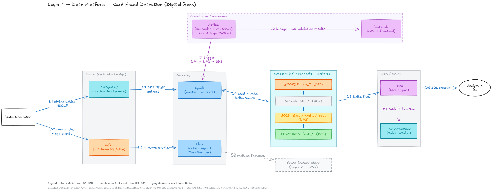

# Card Fraud Platform

Real-time card fraud detection platform for a Vietnamese digital bank — EDAI K11 coursework.
Layer 1: Data Platform. Layer 2: ML Platform.

## Table of contents
- [Architecture](#architecture)
- [Repo structure](#repo-structure)
- [Quick start](#quick-start)
- [Docs](#docs)

## Architecture



## Repo structure

```
infra/        docker-compose (profiles), secrets bootstrap, bucket/topic init
generator/    synthetic source data + injected data problems, and the checks that prove them
docs/         one file per major part
```

## Quick start

```bash
python -m venv .venv && .venv/Scripts/pip install -r requirements.txt
.venv/Scripts/python infra/make_env.py                        # once: random local secrets (gitignored)
docker compose -f infra/docker-compose.yaml --profile core up -d
.venv/Scripts/python infra/init_infra.py                      # buckets + Kafka topics
.venv/Scripts/python generator/generate.py                    # source data -> data/source
.venv/Scripts/python generator/check_data.py                  # assert every injected problem
```

Data volume is set in `generator/config.yaml` (`volume.n_transactions`).

## Docs
- Coming per phase: `data_characteristics.md`, `spark_jobs.md`, `flink_jobs.md`, `airflow.md`, `datahub.md`, `schema_design.md`, `storage_optimization.md`, `docker_optimization.md`.
