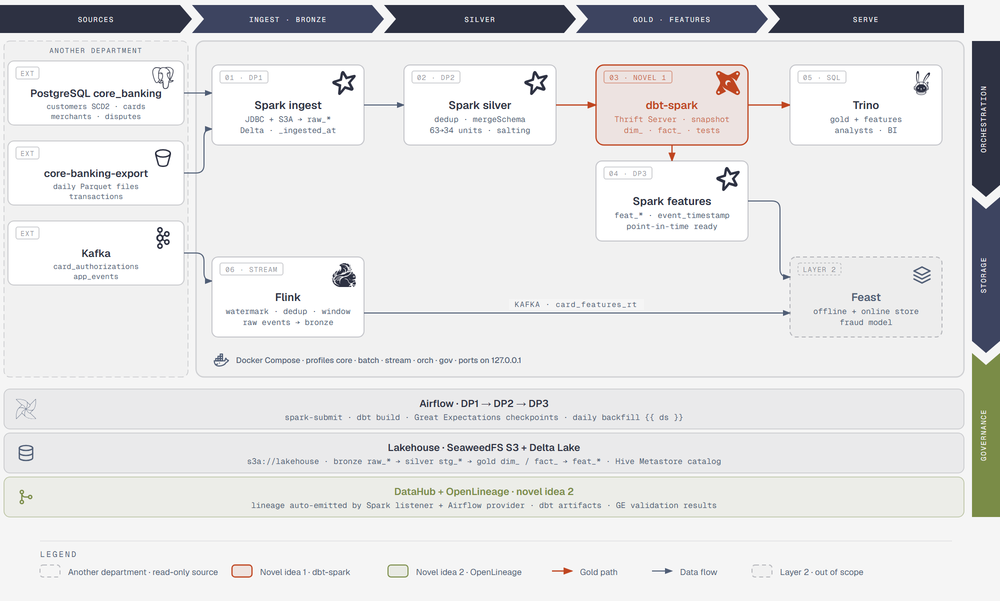
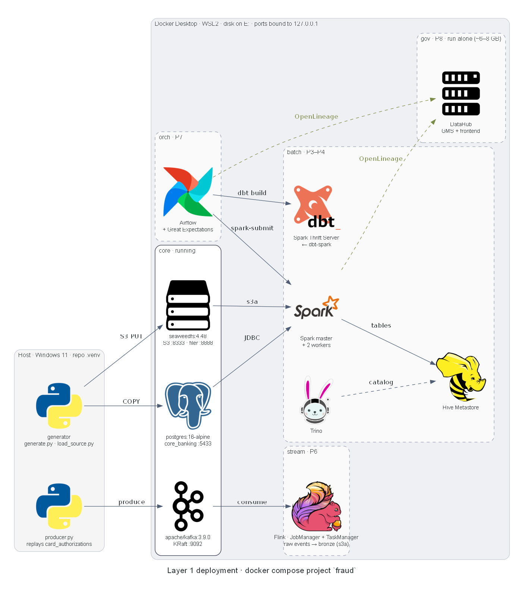

# Card Fraud Platform

Real-time card fraud detection platform for a Vietnamese digital bank — EDAI K11 coursework.
Layer 1: Data Platform. Layer 2: ML Platform.

## Table of contents
- [Architecture](#architecture)
- [Repo structure](#repo-structure)
- [Quick start](#quick-start)
- [Docs](#docs)

## Architecture



| Step | Component | What it does |
|---|---|---|
| 01 · DP1 | Spark ingest | Copies `core_banking` tables (JDBC) and the daily export files (S3A) into bronze `raw_*` Delta tables, unchanged |
| 02 · DP2 | Spark silver | Dedup, `mergeSchema` for the 2024-07-01 auth columns, 63 → 34 unit normalization, skew salting → `stg_*` |
| 03 · DP2 | dbt-spark (novel idea 1) | Gold `dim_*` / `fact_*` through Spark Thrift Server, SCD2 `dim_customer` as a dbt snapshot, dbt tests |
| 04 · DP3 | Spark features | `feat_*` tables with `event_timestamp` for the Layer 2 feature store |
| 05 | Trino | SQL over gold and feature tables through the Hive Metastore |
| 06 | Flink | Watermarks, late events, dedup and windows on Kafka; raw events → bronze, realtime features → `card_features_rt` |

Airflow runs DP1 → DP2 → DP3 with Great Expectations checks. Spark, Airflow and dbt send lineage to DataHub automatically through OpenLineage (novel idea 2).

Deployment by compose profile (`python docs/diagrams/deployment.py`, needs Graphviz):



Diagram sources: `docs/diagrams/layer1-overview.html` (open in a browser) and `docs/diagrams/deployment.py`.

## Repo structure

```
infra/        docker-compose (profiles), secrets bootstrap, bucket/topic init
generator/    synthetic source data + injected data problems, and the checks that prove them
spark/        Spark jobs (mounted into the Spark containers at /opt/jobs)
dbt/          dbt-spark project: gold models and tests
docs/         one file per major part
```

## Quick start

```bash
python -m venv .venv && .venv/Scripts/pip install -r requirements.txt
.venv/Scripts/python infra/make_env.py                        # once: random local secrets (gitignored)
docker compose -f infra/docker-compose.yaml --profile core up -d
.venv/Scripts/python infra/init_infra.py                      # buckets + Kafka topics
.venv/Scripts/python generator/generate.py                    # source data -> data/source
.venv/Scripts/python generator/check_data.py                  # assert every injected problem
.venv/Scripts/python generator/load_source.py                 # Postgres core_banking (127.0.0.1:5433) + s3://core-banking-export
.venv/Scripts/python generator/producer.py --speed 200            # replay card_authorizations into Kafka (--topic app_events, --replay-from, --limit)

# P3: Spark + Hive Metastore + Trino, then DP1 (source -> bronze Delta tables)
docker compose -f infra/docker-compose.yaml --profile core --profile batch up -d --build
docker compose -f infra/docker-compose.yaml exec spark-master /opt/spark/bin/spark-submit /opt/jobs/ingest_bronze.py
docker compose -f infra/docker-compose.yaml exec spark-master /opt/spark/bin/spark-submit /opt/jobs/build_silver.py
docker compose -f infra/docker-compose.yaml exec spark-master /opt/spark/bin/spark-submit /opt/jobs/build_labels.py
docker exec -it trino trino --execute "SELECT count(*) FROM delta.bronze.raw_transactions"

# P4 gold: dbt-spark through the Spark Thrift Server
docker compose -f infra/docker-compose.yaml --profile dbt up -d spark-thrift
.venv/Scripts/dbt build --project-dir dbt --profiles-dir dbt
```

UIs: Spark master http://127.0.0.1:8080, running job http://127.0.0.1:4040, finished jobs http://127.0.0.1:18080, Trino http://127.0.0.1:8090. From Git Bash, prefix `docker compose exec` with `MSYS_NO_PATHCONV=1` so `/opt/...` paths are not rewritten.

Data volume is set in `generator/config.yaml` (`volume`, ~1 GB: about 6 min to generate, `check_data.py` needs ~4.3 GB RAM). For a quick smoke test: `generate.py --scale 0.05`. What the data contains and the measured problems: [docs/data_characteristics.md](docs/data_characteristics.md).

## Docs
- [Data characteristics](docs/data_characteristics.md): datasets, injected problems, measured numbers.
- [Spark jobs](docs/spark_jobs.md): DP1 bronze ingest, DP2 silver (dedup, unit normalization), dbt gold (SCD2 `dim_customer`).
- [Spark optimization](docs/spark_optimization.md): merchant join skew, baseline vs salting vs AQE vs broadcast, skew level sweep.
- Coming per phase: `flink_jobs.md`, `airflow.md`, `datahub.md`, `schema_design.md`, `storage_optimization.md`, `docker_optimization.md`.
