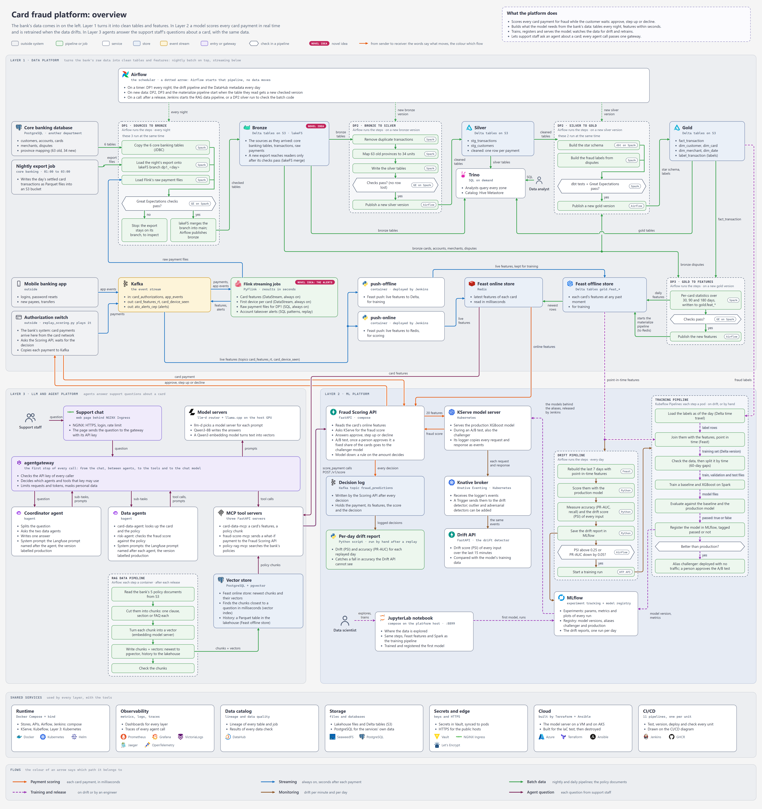
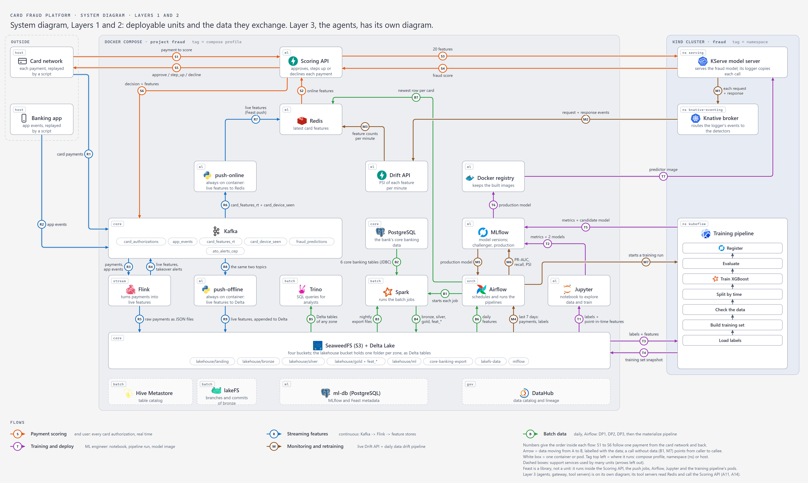
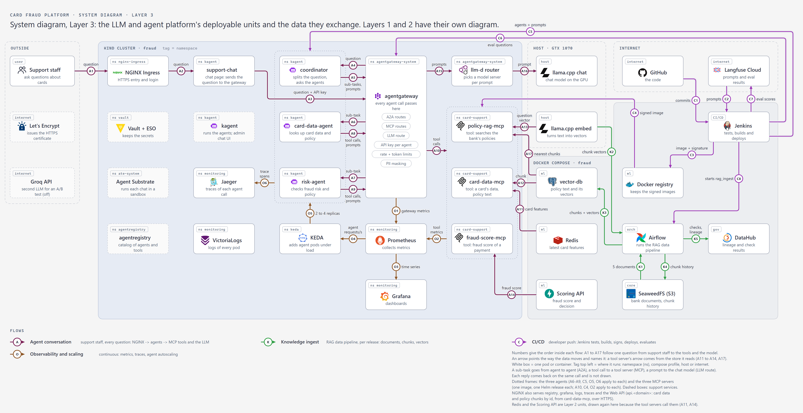
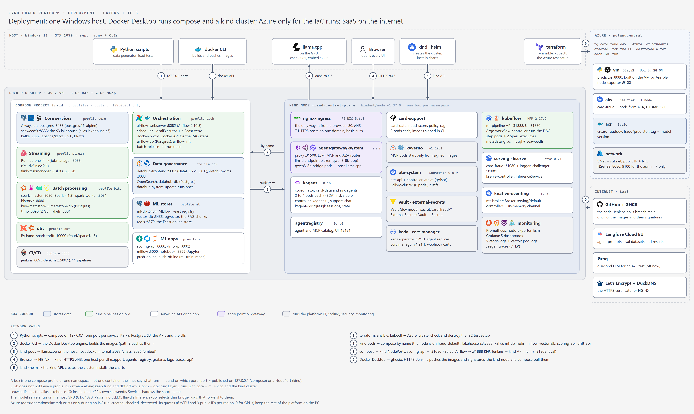
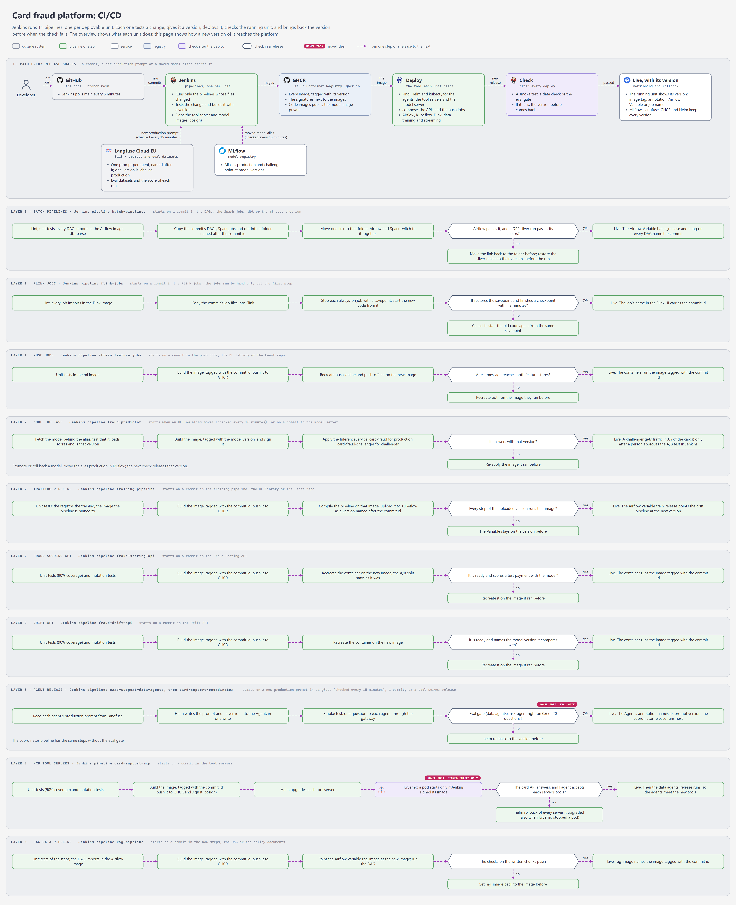

# Card Fraud Platform

Real-time card fraud detection and card support agents for a Vietnamese digital bank, built as the EDAI K11
coursework in three layers: a data platform (Layer 1), an ML platform (Layer 2) and an LLM and agent platform
(Layer 3).

## Table of contents
- [Business domain](#business-domain)
- [Architecture](#architecture)
  - [Layer 1: data platform](#layer-1-data-platform) · [Pipelines on Airflow](#pipelines-on-airflow) · [Layer 2: ML
    platform](#layer-2-ml-platform) · [Layer 3: LLM and agent platform](#layer-3-llm-and-agent-platform)
  - [System diagram, Layers 1 and 2](#system-diagram-layers-1-and-2) · [System diagram, Layer
    3](#system-diagram-layer-3) · [Deployment](#deployment) · [CI/CD](#cicd)
- [Repo structure](#repo-structure)
- [Quick start](#quick-start)
  - [Start Layer 3](#start-layer-3) · [UIs](#uis)
- [Docs](#docs)
  - [Data platform (Layer 1)](#data-platform-layer-1) · [Performance](#performance) · [ML platform (Layer
    2)](#ml-platform-layer-2) · [LLM and agent platform (Layer 3)](#llm-and-agent-platform-layer-3) ·
    [Operations](#operations)

## Business domain

A Vietnamese digital bank must score every card authorization for fraud in real time, and train and monitor the model
on history. That needs a data platform that joins data owned by other departments. The bank issues debit and credit
cards and runs a mobile banking app. Fraud shows up as card payments the cardholder did not make (mostly
card-not-present, often abroad) and as account takeovers in the app (password reset, new device, new payee, transfer).

| Source | Owner | How it arrives | Problems it brings |
|---|---|---|---|
| Customers, accounts, cards, merchants, disputes | core banking (Postgres) | DP1 (ingest pipeline) reads it over JDBC | SCD2 history (slowly changing dimension type 2: every past version of a customer kept); province names before and after the 2025-07-01 reorganization (63 -> 34 units) |
| Settled transactions | core banking nightly export (files on S3) | DP1 loads the new export folders | 2% duplicates from export re-runs; auth columns added on 2024-07-01 (schema evolution); merchant and city skew |
| Card authorizations | card network, through the bank's authorization switch | Kafka `card_authorizations` | late events from offline POS terminals; network-retry duplicates |
| App events | mobile app | Kafka `app_events` | events out of order within a session |
| Fraud labels | disputes, reported days to weeks later | DP2 writes `gold.label_transaction` | label delay |
| Card documents (terms, fees, disputes, authentication rules, FAQ) | product and legal teams | markdown files in `s3://bank-documents` | must be searchable by meaning and match what the agents cite |

The same customers call card support: why was my payment declined, what does a withdrawal abroad cost, am I liable
for a payment I did not make. Layer 3 agents answer from the platform's own data: the card's features, the
fraud model's verdict through the Scoring API, and the card documents through a RAG (retrieval-augmented generation)
pipeline. Layer 2 (feature store, training, serving, drift) reads Layer 1's `feat_*` tables and realtime features;
Layer 3 reads Layer 2's online features and model.

All data is synthetic (`generator/`), with every problem injected at a measured rate and checked
([docs/data-platform/data_characteristics.md](docs/data-platform/data_characteristics.md)).

## Architecture

Five pictures describe the platform. `python docs/diagrams/platform.py` draws them (stdlib only; PNG through headless
Chrome; SVG next to each PNG), and [docs/architecture.md](docs/architecture.md#overview) explains every colour, box
shape and arrow.

| Picture | Answers |
|---|---|
| [Overview](#architecture) (below) | What are the parts, and how does data move from the bank's systems to a fraud decision and to the agents? |
| [System diagram, Layers 1 and 2](#system-diagram-layers-1-and-2) | Which containers exchange which data, step by step, in each flow (scoring, streaming, batch, training, monitoring)? |
| [System diagram, Layer 3](#system-diagram-layer-3) | The same for the agents: a question, the knowledge ingest, CI/CD, monitoring |
| [Deployment](#deployment) | Where does each container run: the PC, the Docker VM, the kind cluster, Azure, the internet? |
| [CI/CD](#cicd) | How does a new version of a unit reach the platform, and what happens when it is bad? |



| Word | Means |
|---|---|
| Zone | a stage of the data in the lakehouse: bronze, the raw zone (exact copy of the sources; Flink's raw files land in `landing/` first), silver (cleaned), gold (modelled for analysis and labels), features (per-card statistics) |
| DP1, DP2, DP3 | the course's names for the three batch pipelines: sources to bronze, bronze to silver and gold (two DAGs here, one per zone), gold to features |
| Feast offline / online store | the same features kept twice: as they were at any past moment (to train), and the latest value per card (to score in milliseconds) |
| PSI | population stability index: how far a feature's values moved from the training data; above 0.25 counts as drift here |
| MCP | Model Context Protocol: how an agent calls a tool server |
| A2A | agent-to-agent protocol: how one agent asks another |
| kind | the Kubernetes cluster inside the Docker VM; it holds Kubeflow Pipelines, KServe and all of Layer 3 |

### Layer 1: data platform

Layer 1 turns data that other departments own into the features the fraud model reads. Daily Spark pipelines pass
data only through the lakehouse zones (Delta tables on SeaweedFS, registered in the Hive Metastore). Flink jobs compute
realtime features within seconds of each payment.

| Part | What it does | Docs |
|---|---|---|
| DP1, data pipeline: ingest to bronze | Spark copies the `core_banking` tables (JDBC), the daily export files (S3A, `mergeSchema` for the 2024-07-01 auth columns) and Flink's landing files into bronze `raw_*` Delta tables unchanged, then validates them. The export waits on a lakeFS branch until its checks pass (Layer 1 novel idea 2) | [spark_jobs.md](docs/data-platform/spark_jobs.md), [novel_lakefs_wap.md](docs/data-platform/novel_lakefs_wap.md) |
| DP2, data pipeline: bronze to silver | Removes duplicates, maps the 63 old province names to the 34 units, fills `auth_method` for rows before 2024-07-01 (join skew: salting, AQE and broadcast compared in [`pipelines/spark/skew_join.py`](https://github.com/cvinhnguyen/card-fraud-platform/blob/54d21eddbf6e602ae13fed46a1a9e0ef265d23cd/pipelines/spark/skew_join.py)), then validates silver | [spark_jobs.md](docs/data-platform/spark_jobs.md) |
| DP2, data pipeline: silver to gold | dbt-spark builds the `dim_*` / `fact_*` star schema (SCD2 `dim_customer`, incremental fact, 22 dbt tests); Spark writes the fraud labels as known on each day; then validates gold | [spark_jobs.md](docs/data-platform/spark_jobs.md), [dbt_gold.md](docs/data-platform/dbt_gold.md) |
| DP3, feature pipeline: gold to features | `feat_*` tables of per-card statistics over 30, 90 and 180 days; `event_timestamp` and `created` make them the Feast offline store | [spark_jobs.md](docs/data-platform/spark_jobs.md#dp3-features) |
| Streaming jobs (Flink) | Read payments from Kafka (watermarks, late events, dedup, windows); write raw events as `landing/` JSON files for DP1 and realtime features to `card_features_rt`; find account takeover patterns in the app events with `MATCH_RECOGNIZE` (Layer 1 novel idea 1) | [flink_jobs.md](docs/data-platform/flink_jobs.md), [novel_flink_cep.md](docs/data-platform/novel_flink_cep.md) |
| Push jobs | Two always-on containers ([`ml/jobs/push_job.py`](https://github.com/cvinhnguyen/card-fraud-platform/blob/54d21eddbf6e602ae13fed46a1a9e0ef265d23cd/ml/jobs/push_job.py)): `push-online` writes realtime features into Redis for scoring, `push-offline` appends them to Delta for training. Jenkins tests, builds and redeploys them | [feature_store.md](docs/ml-platform/feature_store.md), [cicd.md](docs/operations/cicd.md) |
| Trino | SQL over every zone (`delta.<zone>.<table>`, the export as `lakefs.bronze.raw_transactions`); finds each table in the Hive Metastore and reads its Delta files from S3 | [schema_design.md](docs/data-platform/schema_design.md) |
| Airflow | Runs the pipelines below and holds their connections and variables | [airflow.md](docs/data-platform/airflow.md) |
| DataHub | Every zone's tables, the lineage each Spark job sends through OpenLineage, and validation results as assertions | [datahub.md](docs/data-platform/datahub.md), [openlineage.md](docs/data-platform/openlineage.md) |

### Pipelines on Airflow

Each pipeline is one Airflow DAG (DP2 is two, one per zone) with its own Great Expectations validate stage, so bad
data stops where it is found. Only DP1 runs on a clock. After its checks pass, each batch pipeline emits a dataset
event for the zone it wrote (`lakehouse://bronze`, `silver`, `gold`, `features`), which starts the pipeline that reads
that zone ([how, and why](docs/architecture.md#what-starts-each-batch-pipeline)).

| Pipeline | Airflow DAG | Runs | Stages | Reads | Writes |
|---|---|---|---|---|---|
| DP1, ingest to bronze | `dp1_source_to_bronze` | daily; waits for the day's export folder | create a lakeFS branch, wait for the export; copy the core banking tables, the export (on the branch) and the landing files; commit; validate; merge into `main`; publish bronze | Postgres `core_banking`, `s3://core-banking-export`, Flink's landing files | bronze `raw_*` |
| DP2, bronze to silver | `dp2_bronze_to_silver` | when bronze is published | build, validate, publish silver | bronze | silver `stg_*` |
| DP2, silver to gold | `dp2_silver_to_gold` | when silver is published | dbt build of gold (and its docs) beside the labels job; validate; publish gold | silver, bronze reference tables | gold `dim_*` / `fact_*`, `gold.label_transaction` |
| DP3, gold to features | `dp3_gold_to_features` | when gold is published | build, validate, publish features | gold | `gold.feat_card_txn_stats_daily` |
| Incremental materialize | `feast_materialize` | when the features are published | copy rows newer than the last run into Redis; read a sample back | the feature table (Feast offline store) | Redis (Feast online store) |
| Data drift | `drift_monitoring` | daily, own schedule | drift and accuracy on the last 7 days (labels from the simulation's ground truth); start a training pipeline run on drift | payments, labels, point-in-time features, the `production` model | an MLflow run; a Kubeflow training run on drift |
| RAG data pipeline (Layer 3) | `rag_ingest` | after each new image (Jenkins), or by hand | chunk, embed, write to the feature store, validate | `s3://bank-documents` | Feast `card_support_kb` (pgvector online, Parquet offline) |
| DataHub metadata | `datahub_metadata` | daily | ingest the source tables, Kafka topics and dbt models | Postgres, Kafka, dbt artifacts | DataHub |

### Layer 2: ML platform

Layer 2 trains, serves and watches the fraud model.

| Part | What it does | Docs |
|---|---|---|
| Feast feature store ([`ml/feature_repo/`](https://github.com/cvinhnguyen/card-fraud-platform/tree/54d21eddbf6e602ae13fed46a1a9e0ef265d23cd/ml/feature_repo)) | One definition of the model's 20 features: the offline store (lakehouse Delta tables, point-in-time joins in Spark) builds training sets, the online store (Redis) answers the Scoring API. The materialize pipeline brings the daily features, the push jobs the realtime and device features | [feature_store.md](docs/ml-platform/feature_store.md) |
| Training pipeline (Kubeflow Pipelines on kind) | `train_fraud_model`, one pod per step: (1) labels as of a date, (2) the training set (Feast point-in-time join, saved as a new Delta version), (3) validate, (4) split by time, (5) a logistic-regression baseline and a distributed XGBoost on Spark executor pods, (6) evaluate against the baseline and `production`, (7) register in MLflow, tagged `passed` True or False. Only a passing model gets the alias `challenger` | [ml_training.md](docs/ml-platform/ml_training.md) |
| Notebook | Explores the data and trains the first model with the same seven step functions; ends with both models saved and an MLflow run ([`ml/notebooks/fraud_model.ipynb`](https://github.com/cvinhnguyen/card-fraud-platform/blob/54d21eddbf6e602ae13fed46a1a9e0ef265d23cd/ml/notebooks/fraud_model.ipynb)) | [ml_training.md](docs/ml-platform/ml_training.md) |
| MLflow | Experiment runs with their data versions; the model registry, where alias `challenger` marks a candidate and `production` the served model | [ml_training.md](docs/ml-platform/ml_training.md#evaluation-and-promotion) |
| KServe | InferenceService (Standard mode) serving the `production` model baked into the image | [serving.md](docs/ml-platform/serving.md) |
| Fraud Scoring API | FastAPI: online features from Feast plus the KServe score give approve, step_up (a one-time password, OTP, or a biometric check) or decline; a rule fallback when the model is late or down | [serving.md](docs/ml-platform/serving.md) |
| Drift monitoring | Live: KServe's payload logger feeds every request and response through Knative Eventing to the Drift API, which returns each feature's PSI against the training profile. Daily: the data drift pipeline checks accuracy on labelled payments and starts retraining on drift | [drift.md](docs/ml-platform/drift.md) |

Five classes carry the ML logic:

| Class | File | Job |
|---|---|---|
| `TrainingDataService` | [`ml/fraud_ml/data.py` L55](https://github.com/cvinhnguyen/card-fraud-platform/blob/54d21eddbf6e602ae13fed46a1a9e0ef265d23cd/ml/fraud_ml/data.py#L55) | Labels as of a date, Feast point-in-time join, versioned training set (Delta) |
| `FraudModelTrainer` | [`ml/fraud_ml/train.py` L27](https://github.com/cvinhnguyen/card-fraud-platform/blob/54d21eddbf6e602ae13fed46a1a9e0ef265d23cd/ml/fraud_ml/train.py#L27) | Logistic-regression baseline + distributed `SparkXGBClassifier` |
| `ModelEvaluator` | [`ml/fraud_ml/evaluate.py` L30](https://github.com/cvinhnguyen/card-fraud-platform/blob/54d21eddbf6e602ae13fed46a1a9e0ef265d23cd/ml/fraud_ml/evaluate.py#L30) | Thresholds on validation, test metrics, gate vs baseline and `production` |
| `ModelRegistry` | [`ml/fraud_ml/registry.py` L26](https://github.com/cvinhnguyen/card-fraud-platform/blob/54d21eddbf6e602ae13fed46a1a9e0ef265d23cd/ml/fraud_ml/registry.py#L26) | MLflow logging, model versions and aliases |
| `FraudScorer` | [`services/scoring_api/app/scorer.py` L34](https://github.com/cvinhnguyen/card-fraud-platform/blob/54d21eddbf6e602ae13fed46a1a9e0ef265d23cd/services/scoring_api/app/scorer.py#L34) | Request -> features -> score -> decision, fallback when KServe is down |

### Layer 3: LLM and agent platform

Layer 3 answers the support staff's questions about a card. A coordinator agent splits each question and asks two
specialist agents, which answer with tools: a card's features, the fraud model's verdict and a search of the bank's
documents. Every call passes one gateway that decides what each agent may do.

| Part | What it does | Docs |
|---|---|---|
| NGINX Ingress | Every UI and the Web API on `*.cvinhnguyen.duckdns.org`: Let's Encrypt HTTPS, basic auth, rate limits | [edge_security.md](docs/operations/edge_security.md) |
| Support chat | The support staff's page (`support.<domain>`, behind NGINX). It sends each question to the gateway route `/a2a/coordinator`, adding its API key server side | [agents.md](docs/llm-platform/agents.md) |
| agentgateway | The one entry for every agent call: the chat's question (`/a2a/coordinator`), LLM prompts (`/v1`), tool calls (MCP, `/mcp`) and agent-to-agent calls (A2A). From each caller's API key it decides which routes and tools that agent may call, limits its requests and tokens per minute, and masks card numbers, emails, phone numbers and citizen IDs before a prompt reaches the model | [llm_platform.md](docs/llm-platform/llm_platform.md), [agents.md](docs/llm-platform/agents.md) |
| Coordinator agent | Takes the question from the gateway and asks the two specialist agents over A2A | [agents.md](docs/llm-platform/agents.md) |
| Card-data and risk agents | kagent agents that call their MCP tools through the gateway; 2 to 4 replicas each, scaled by KEDA | [agents.md](docs/llm-platform/agents.md) |
| card-data-mcp, fraud-score-mcp, policy-rag-mcp | Three MCP servers from one FastAPI code base (pydantic, `/healthz` + `/readyz` probes, async), one Helm release each. card-data returns a card's features and a policy chunk by id, and is also the Web API; fraud-score asks the Scoring API; policy-rag searches the policies | [agents.md](docs/llm-platform/agents.md) |
| llm-d | The InferencePool `qwen3-8b` and its endpoint picker, which chooses a model server for each prompt | [llm_platform.md](docs/llm-platform/llm_platform.md) |
| llama.cpp | Model servers on the host GPU (GTX 1070): Qwen3-8B Q4_K_M for chat, Qwen3-Embedding-0.6B for vectors | [llm_platform.md](docs/llm-platform/llm_platform.md) |
| RAG data pipeline | Airflow `rag_ingest`: the bank documents become 57 chunks with a vector of 1024 numbers each, stored in Feast `card_support_kb` (pgvector online, Parquet offline); 7 checks and lineage go to DataHub | [rag_pipeline.md](docs/llm-platform/rag_pipeline.md) |
| Agent Substrate | Sandboxed copies of the agents: one gVisor sandbox per conversation, restored from a warm snapshot on a shared worker pool | [agents.md](docs/llm-platform/agents.md#sandboxed-agents-on-agent-substrate-warm-up) |
| agentregistry | Catalog of the agents and their three MCP servers, for people; not on the call path | [agents.md](docs/llm-platform/agents.md#agent-registry) |
| Operations | Prometheus + Grafana (metrics), VictoriaLogs (logs), Jaeger (traces), Vault (secrets) | [observability.md](docs/operations/observability.md), [edge_security.md](docs/operations/edge_security.md) |
| CI/CD | Jenkins, one pipeline per deployable unit ([CI/CD](#cicd)). Agent prompts come from Langfuse; the cluster runs only signed MCP server images (Layer 3 novel idea 2); each data-agent release passes an eval gate on the risk agent (Layer 3 novel idea 1) | [cicd.md](docs/operations/cicd.md) |

### System diagram, Layers 1 and 2

Every box is a compose container or a workload on the kind cluster (Feast is a library inside them, so it has no
box). Arrows follow the data and carry it as their label; a call without data (B2, M7) points from caller to callee.



| Letter | Flow | Who / when | Path |
|---|---|---|---|
| S | Payment scoring | end user, every authorization | authorization switch -> Scoring API (features from Redis, score from KServe) -> decision; every decision logged to Kafka |
| R | Streaming features | continuous | Kafka -> Flink -> Kafka -> push jobs -> Redis (online) and Delta (offline) |
| B | Batch data | daily, Airflow | Postgres + export files -> DP1 (bronze) -> DP2 silver -> DP2 gold -> DP3 (`feat_*`) -> materialize pipeline -> Redis; each starts on the dataset event of the zone it reads |
| T | Training and deploy | ML engineer | lakehouse -> notebook / training pipeline -> MLflow -> model image -> KServe |
| M | Monitoring and retraining | live + daily | KServe payload logger -> Knative Broker -> Drift API (PSI); data drift pipeline (PR-AUC, PSI) -> MLflow -> training pipeline run |

Every numbered arrow, one line each: [docs/architecture.md](docs/architecture.md#numbered-arrows).

### System diagram, Layer 3

Every agent call (A2A, MCP, LLM) passes agentgateway; the llm-d router hands LLM calls to llama.cpp on the host GPU.
The card-data MCP server reads the same Feast online store as Layer 2, fraud-score asks the Scoring API, and policy-rag
searches the chunks and vectors that the RAG data pipeline writes into a second Feast project (pgvector).



| Letter | Flow | Who / when | Path |
|---|---|---|---|
| A | Agent conversation | support staff, every question | NGINX -> support chat -> gateway -> coordinator -> gateway -> card-data / risk agents -> gateway -> MCP servers card-data (Redis, pgvector), fraud-score (Scoring API), policy-rag (embeddings, pgvector); LLM calls -> gateway -> llm-d -> llama.cpp |
| K | Knowledge ingest | RAG data pipeline `rag_ingest`, per release | bank documents (S3) -> chunks -> embeddings -> pgvector online + Parquet offline -> DataHub checks and lineage |
| C | CI/CD | developer push | GitHub -> Jenkins (prompts from Langfuse, model aliases from MLflow) -> signed image in GHCR -> deploy -> gates (signed images, eval gate) -> live release with its version; a failed gate rolls back |
| O | Observability and scaling | continuous | gateway + MCP metrics -> Prometheus -> Grafana and KEDA (agent replicas 2-4); agent spans -> Jaeger |

Every Layer 3 arrow, one line each: [docs/architecture.md](docs/architecture.md#numbered-arrows-layer-3).

### Deployment

Everything runs on one Windows PC, except the Azure resources of an IaC run and the SaaS used over the internet.



| Where | What runs there | Docs |
|---|---|---|
| The Windows PC (16 GB RAM, GTX 1070) | All of Layers 1-3. The compose profiles start what a phase needs; the kind cluster (joined to the compose network) holds Kubeflow Pipelines and KServe for Layer 2 and all of Layer 3, one namespace per part. The two llama.cpp model servers run on the host next to the GPU; the cluster reaches them through `host.docker.internal` | this README |
| Azure (`rg-cardfraud-dev`, Poland Central) | Only during an IaC run: Terraform creates the network, a VM, AKS and a container registry; Ansible deploys the fraud model server and node_exporter to the VM; AKS runs the same model image from the registry. `terraform destroy` removes it all | [iac.md](docs/operations/iac.md) |
| SaaS | GitHub (Jenkins polls it), Langfuse Cloud EU (agent prompts, eval experiments), Groq (side B of the LLM A/B test), Let's Encrypt with DuckDNS (the HTTPS certificate) | [cicd.md](docs/operations/cicd.md), [ab_testing.md](docs/llm-platform/ab_testing.md), [edge_security.md](docs/operations/edge_security.md) |

The rest of the platform is containers and Helm charts that could run on Azure too, but the Azure for Students
subscription keeps it on the PC: 6 vCPU and 3 public IPs per region, a quota of 0 for the T4, A10, A100 and H100 GPU
families, and $100 of credit, which a 16 GB VM would use up in about 18 days ([what would move where, and the
numbers](docs/operations/iac.md#why-not-all-of-it-on-azure)).

### CI/CD

Jenkins runs 11 pipelines, one per deployable unit. Each tests a change, versions it, deploys it, checks the running
unit and brings back the version before when the check fails. The picture draws each pipeline step by step, by layer:
the model release (MLflow aliases to KServe), the agent release (Langfuse prompts to the Agents, two pipelines) and the
other eight ([docs/architecture.md](docs/architecture.md#cicd), [cicd.md](docs/operations/cicd.md)).



## Repo structure

Repo paths differ from the paths inside the containers: `pipelines/spark/` is `/opt/jobs`, and `ml/` is `/opt/ml` in
the ML image.

```text
pipelines/            Layer 1 data pipelines, and the Layer 3 RAG pipeline's CI
  airflow/            DAGs (DP1-DP3, DataHub ingestion, Feast materialization, drift monitoring, rag_ingest), connections/variables bootstrap
  spark/              Spark jobs (mounted at /opt/jobs), benchmarks (skew, storage layout, 100 GB)
  dbt/                dbt-spark project: gold models and tests
  flink/              PyFlink jobs (mounted at /opt/flink/jobs) and their check scripts
  rag/                Jenkinsfile of the RAG data pipeline
ml/                   Layer 2 ML code (Dockerfile = the fraud/ml-train code image, also the image the RAG steps run in)
  feature_repo/       Feast repo card_fraud: entities, sources, feature views, on-demand features, feature services
  feature_repo_kb/    Feast repo card_support_kb (Layer 3): policy chunks and their vectors (pgvector)
  fraud_ml/           library: the 5 classes above and the 7 pipeline steps
  pipelines/          Kubeflow pipeline train_fraud_model (.py) and its compiled .yaml
  jobs/               push jobs, drift job, rag_ingest.py (RAG steps), Jenkinsfile.stream
  tools/              run by hand: replay_scoring, check_online, drift_by_day, stream_smoke
  notebooks/          fraud_model.ipynb, executed with outputs (models/ = the saved models, gitignored)
services/             scoring_api (FastAPI), drift_api (FastAPI), predictor (KServe custom model)
  card_support_mcp/   Layer 3: the three MCP servers (one code base, MCP_SERVER picks one): app, tests, Helm chart + values per server (gateway route, tool access), Jenkinsfile
agents/               Layer 3 agents: Helm chart (agents, A2A routes, KEDA, sandbox, network policy), prompts, two Jenkinsfiles,
                      eval/ (dataset + Langfuse eval gate), registry/ (agentregistry catalog), locustfile
generator/            synthetic source systems: data with injected problems, Kafka producer, checks; knowledge/ = the card documents
infra/                docker-compose (profiles), secrets bootstrap (make_env.py, .env.example), bucket/topic init
  spark/ flink/ airflow/ hive/ ml/ mlflow/   the images built here (multi-stage, see docs/performance/docker_optimization.md)
  k8s/                kind cluster, KFP + KServe, the Layer 3 platform (llm-platform.sh, agentgateway.yaml, llm-d-router.yaml),
                      observability, edge/ (NGINX routes), vault.sh + secrets.sh, tls.sh, supply-chain/ (cosign + Kyverno), dashboards/,
                      aks/ (the model server on Azure AKS)
  jenkins/            Jenkins image, configuration as code (credentials, the 11 jobs), deploy ServiceAccount
  terraform/          Azure: modules network / vm / aks / acr, envs/dev
  ansible/            roles that configure the VM and deploy the model server on it
  benchmark/          inference-perf load test of the model server, results
  conf/               service configs (Spark, Hive, Trino, SeaweedFS, DataHub, notebook)
  sql/                Postgres serving SQL (indexes + EXPLAIN)
docs/                 architecture.md, then one folder per area (data-platform/, performance/, ml-platform/,
                      llm-platform/, operations/); images/ = screenshots and diagrams; diagrams/ = the scripts that draw
                      them (platform.py: the 5 platform diagrams, er.py: the ER
                      diagrams, label_delay.py and hcmc_spend.py: two data charts, logos.json: the logos they use)
```

## Quick start

These commands bring up Layers 1 and 2, from the source data to a training run. Run them from the repo root, with
Docker and Python 3.

- The 8 GB Docker VM does not hold every profile at once: run `stream` on its own, keep `trino` and the Thrift Server
  (`dbt` profile) off while `orch` + `gov` run, and stop the kind cluster while Airflow and DataHub run for the RAG
  pipeline.
- `generator/config.yaml` sets the data volume (`volume`, ~1 GB: about 7 min to generate; `check_data.py` needs ~4.3 GB
  RAM). For a smoke test, run `generate.py --scale 0.05`. The data and its measured problems:
  [docs/data-platform/data_characteristics.md](docs/data-platform/data_characteristics.md).
- The venv path is `.venv/Scripts` on Windows and `.venv/bin` on macOS or Linux.
- From Git Bash, prefix `docker compose exec` with `MSYS_NO_PATHCONV=1` so `/opt/...` paths are not rewritten.

```bash
python -m venv .venv && .venv/Scripts/pip install -r requirements.txt
.venv/Scripts/python infra/make_env.py                        # once: random local secrets (gitignored)
docker compose -f infra/docker-compose.yaml --profile core up -d
.venv/Scripts/python infra/init_infra.py                      # buckets + Kafka topics
.venv/Scripts/python generator/generate.py                    # source data -> data/source
.venv/Scripts/python generator/check_data.py                  # assert every injected problem
.venv/Scripts/python generator/load_source.py                 # Postgres core_banking (127.0.0.1:5433) + s3://core-banking-export
.venv/Scripts/python generator/producer.py --speed 200            # replay card_authorizations into Kafka (--topic app_events, --replay-from, --limit)

# Batch stack: Spark + Hive Metastore + Trino, then the DP1 job and DP2's silver and labels jobs by hand
docker compose -f infra/docker-compose.yaml --profile core --profile batch up -d --build
docker compose -f infra/docker-compose.yaml exec spark-master /opt/spark/bin/spark-submit /opt/jobs/ingest_bronze.py --txn-root s3a://lakehouse/bronze
.venv/Scripts/python infra/init_lakefs.py                     # the export table moves under lakeFS (zero-copy); later loads: DP1 branches
docker compose -f infra/docker-compose.yaml exec spark-master /opt/spark/bin/spark-submit /opt/jobs/build_silver.py
docker compose -f infra/docker-compose.yaml exec spark-master /opt/spark/bin/spark-submit /opt/jobs/build_labels.py
docker exec -it trino trino --execute "SELECT count(*) FROM lakefs.bronze.raw_transactions"

# Gold with dbt-spark through the Spark Thrift Server, then the DP3 features
docker compose -f infra/docker-compose.yaml --profile dbt up -d spark-thrift
.venv/Scripts/dbt build --project-dir pipelines/dbt --profiles-dir pipelines/dbt
docker compose -f infra/docker-compose.yaml exec spark-master /opt/spark/bin/spark-submit /opt/jobs/build_features.py   # DP3, reads gold

# Streaming: Flink session cluster (UI http://127.0.0.1:8088), each check replays a slice and verifies the job
docker compose -f infra/docker-compose.yaml --profile core --profile stream up -d --build
.venv/Scripts/python pipelines/flink/check_windows.py --replay-from "2026-06-01 00:00" --limit 20000

# Pipelines on Airflow: DP1 runs daily; DP2, DP3 and materialize run on the dataset events of the zones they read
# (unpause them first, see docs/data-platform/airflow.md); DataHub receives lineage and validation results
docker compose -f infra/docker-compose.yaml --profile core --profile batch --profile orch --profile gov up -d --build
docker exec airflow-scheduler airflow dags backfill dp1_source_to_bronze -s 2026-10-12 -e 2026-10-15   # DP2/DP3 follow on the events

# Layer 2: Feast, MLflow, notebook, APIs (profile ml); KFP + KServe on kind
docker build -t fraud/ml:0.1 infra/ml                              # dependencies image, on top of fraud/spark:4.1.3 (batch profile build)
docker build -f ml/Dockerfile -t fraud/ml-train:latest .           # code image: notebook, push jobs, KFP steps, RAG steps
docker compose -f infra/docker-compose.yaml --profile core --profile ml up -d
docker compose -f infra/docker-compose.yaml exec notebook feast -c /opt/ml/feature_repo apply   # order + bootstrap: docs/ml-platform/feature_store.md
bash infra/k8s/up.sh && bash infra/k8s/platform.sh                 # kind cluster, KFP 2.17, KServe 0.21
pip install kfp==2.17.0 kfp-kubernetes==2.17.0                      # host venv: the KFP client
kubectl -n kubeflow port-forward svc/ml-pipeline 31888:8888 &      # the KFP API on 127.0.0.1:31888
python ml/pipelines/train_fraud_model.py --run --label-as-of 2026-10-15                # see docs/ml-platform/ml_training.md
```

### Start Layer 3

Start the model servers on the host first
([docs/llm-platform/llm_platform.md](docs/llm-platform/llm_platform.md#start-the-model-servers)), then run these
scripts in order. Each is idempotent and reads its secrets from `infra/.env`. The `rag_ingest` line needs Airflow
(profile `orch`; mind the memory note in the [Quick start](#quick-start)).

```bash
sh infra/k8s/vault.sh                  # Vault + External Secrets; secrets.sh writes every secret into Vault
sh infra/k8s/llm-platform.sh           # Gateway API, agentgateway, llm-d router, kagent, Agent Substrate, KEDA, agentregistry
sh infra/k8s/observability.sh          # Prometheus + Grafana (dashboards), VictoriaLogs, Jaeger
sh infra/k8s/edge.sh && sh infra/k8s/tls.sh   # NGINX Ingress + routes, then the HTTPS certificate (DuckDNS, Let's Encrypt)
.venv/Scripts/python generator/load_source.py --part documents && docker exec airflow-scheduler airflow dags trigger rag_ingest
sh infra/jenkins/setup.sh              # Jenkins (profile cicd): its 11 pipelines test, build and deploy every unit (docs/operations/cicd.md)
arctl apply -f agents/registry/catalog.yaml   # the registry catalog (kubectl -n agentregistry port-forward svc/agentregistry 12121:12121)
```

To deploy the MCP servers and agents without Jenkins:

```bash
echo "$GHCR_TOKEN" | docker login ghcr.io -u "$GHCR_USER" --password-stdin
docker build --target runtime -t ghcr.io/cvinhnguyen/card-support-mcp:<tag> services/card_support_mcp
docker push ghcr.io/cvinhnguyen/card-support-mcp:<tag>
for s in card-data fraud-score policy-rag; do
  helm upgrade --install $s-mcp services/card_support_mcp/chart -f services/card_support_mcp/chart/values-$s.yaml -n card-support --atomic --set image.tag=<tag>
done
helm upgrade --install card-support-data-agents agents/chart -n kagent -f agents/chart/values-data-agents.yaml
helm upgrade --install card-support-coordinator agents/chart -n kagent -f agents/chart/values-coordinator.yaml
```

### UIs

Passwords are in `infra/.env`.

| UI | Address |
|---|---|
| Spark master | http://127.0.0.1:8080 |
| Spark, running job | http://127.0.0.1:4040 |
| Spark, finished jobs | http://127.0.0.1:18080 |
| Trino | http://127.0.0.1:8090 |
| lakeFS | http://127.0.0.1:8001 |
| Flink | http://127.0.0.1:8088 |
| Airflow | http://127.0.0.1:8082 (user `admin`) |
| DataHub | http://127.0.0.1:9002 (user `datahub`) |
| MLflow | http://127.0.0.1:5000 |
| Jupyter | http://127.0.0.1:8899 (token `JUPYTER_TOKEN`) |
| KFP UI | http://127.0.0.1:31880 (port-forward, `infra/k8s/platform.sh`) |
| Scoring API | http://127.0.0.1:8000/docs |
| Drift API | http://127.0.0.1:8002/docs |
| Jenkins | http://127.0.0.1:8095 (user `admin`) |
| Layer 3, behind NGINX | https://agents, registry, grafana, logs, traces and api `.cvinhnguyen.duckdns.org` (user `admin`, `EDGE_ADMIN_PASSWORD`; Grafana has its own login) |

## Docs

Start with the [architecture](docs/architecture.md), which explains every diagram arrow by arrow. Each other doc
covers what one part does and why the bank needs it, how it works, how to run it and what was measured.

### Data platform (Layer 1)

Folder:
[docs/data-platform/](https://github.com/cvinhnguyen/card-fraud-platform/tree/54d21eddbf6e602ae13fed46a1a9e0ef265d23cd/docs/data-platform)

| Doc | What it tells you |
|---|---|
| [Data characteristics](docs/data-platform/data_characteristics.md) | what the synthetic data contains and which real-world problems it carries, at what measured rate |
| [Schema design](docs/data-platform/schema_design.md) | the lakehouse zones, each table's grain and the jobs that write and read it; ER diagrams of bronze, silver and gold |
| [Airflow](docs/data-platform/airflow.md) | what starts each pipeline, its check tasks, backfill |
| [Spark jobs](docs/data-platform/spark_jobs.md) | DP1, DP2 and DP3 job by job: dedup, province mapping, labels, features |
| [dbt-spark gold](docs/data-platform/dbt_gold.md) | the gold star schema in dbt, compared row by row with a PySpark build |
| [Flink jobs](docs/data-platform/flink_jobs.md) | late events, duplicates, live features, the hot key, each checked against the truth |
| [DataHub](docs/data-platform/datahub.md) | the data catalog: every table, its lineage and its check results |
| [OpenLineage](docs/data-platform/openlineage.md) | how each Spark job reports what it read and wrote, without lineage code |
| Layer 1 novel idea 1: [Flink CEP](docs/data-platform/novel_flink_cep.md) | account takeover patterns found in seconds with `MATCH_RECOGNIZE` |
| Layer 1 novel idea 2: [Write-Audit-Publish](docs/data-platform/novel_lakefs_wap.md) | the nightly export is checked on a lakeFS branch before readers see it |

### Performance

Folder:
[docs/performance/](https://github.com/cvinhnguyen/card-fraud-platform/tree/54d21eddbf6e602ae13fed46a1a9e0ef265d23cd/docs/performance)

| Doc | What it tells you |
|---|---|
| [Spark optimization](docs/performance/spark_optimization.md) | join skew, schema evolution and duplicates: baseline, fix, measured gain |
| [Storage optimization](docs/performance/storage_optimization.md) | small files, partitioning, Z-order on Delta; indexes on the Postgres serving table |
| [Docker optimization](docs/performance/docker_optimization.md) | smaller, faster-starting images with the jars baked in |
| [The 100 GB run](docs/performance/scale_100g.md) | what breaks at bank scale and how the jobs were changed |

### ML platform (Layer 2)

Folder:
[docs/ml-platform/](https://github.com/cvinhnguyen/card-fraud-platform/tree/54d21eddbf6e602ae13fed46a1a9e0ef265d23cd/docs/ml-platform)

| Doc | What it tells you |
|---|---|
| [Feature store](docs/ml-platform/feature_store.md) | Feast, its offline and online stores, the push jobs |
| [ML training](docs/ml-platform/ml_training.md) | the notebook, the training pipeline's seven tasks, evaluation, promotion in MLflow |
| [Serving](docs/ml-platform/serving.md) | a decision in milliseconds: Scoring API, KServe, thresholds, fallback |
| [Drift](docs/ml-platform/drift.md) | how the platform sees the model degrade, and when it retrains |

### LLM and agent platform (Layer 3)

Folder:
[docs/llm-platform/](https://github.com/cvinhnguyen/card-fraud-platform/tree/54d21eddbf6e602ae13fed46a1a9e0ef265d23cd/docs/llm-platform)

| Doc | What it tells you |
|---|---|
| [LLM platform](docs/llm-platform/llm_platform.md) | the model servers, the router and the gateway's LLM route (keys, limits, PII masking) |
| [LLM benchmark](docs/llm-platform/llm_benchmark.md) | model server speed and the configuration kept |
| [Agents](docs/llm-platform/agents.md) | the agents and tools, one question end to end, who may call what |
| [RAG pipeline](docs/llm-platform/rag_pipeline.md) | how the bank's documents become searchable for the agents |
| [A/B testing](docs/llm-platform/ab_testing.md) | trying a new model or model config on part of the traffic |
| Layer 3 novel idea 1: [Eval gate](docs/llm-platform/novel_eval_gate.md) | every agent release answers a test set; below 0.6 accuracy it rolls back |

### Operations

Folder:
[docs/operations/](https://github.com/cvinhnguyen/card-fraud-platform/tree/54d21eddbf6e602ae13fed46a1a9e0ef265d23cd/docs/operations)

| Doc | What it tells you |
|---|---|
| [CI/CD](docs/operations/cicd.md) | the 11 Jenkins pipelines: what each tests, builds and deploys, and how a bad release rolls back |
| Layer 3 novel idea 2: [Only signed images run](docs/operations/novel_supply_chain.md) | CI signs the MCP server image; the cluster refuses unsigned ones in namespace `card-support` |
| [Testing](docs/operations/testing.md) | tests of the APIs and MCP servers: kinds, coverage, mutation, load |
| [Edge and secrets](docs/operations/edge_security.md) | HTTPS, login and rate limits in front of every UI; secrets in Vault |
| [Observability](docs/operations/observability.md) | the dashboards, logs and traces, and what each shows |
| [Infrastructure as code](docs/operations/iac.md) | Terraform and Ansible on Azure, and why the rest stays on the PC |
