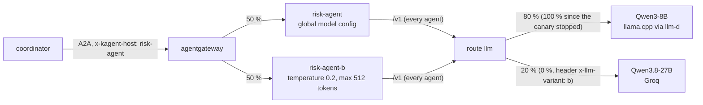

# A/B testing (agents and LLM versions)

A new model config or a new LLM version does not replace the current one: the gateway gives it a share of the
traffic, the "A/B tests" Grafana dashboard compares both sides on live traffic, and an evaluation run measures the
quality of each side on the same questions. The weights then move to the winner, or the variant is removed.



## Agent model config (risk-agent A vs B)

- **Config**: `abTests` in [`agents/chart/values-data-agents.yaml`](../agents/chart/values-data-agents.yaml). The chart
  makes `risk-agent-b`, a copy of `risk-agent` (same prompt from Langfuse, same MCP tools, its own KEDA ScaledObject,
  SandboxAgent and NetworkPolicy) whose only difference is the ModelConfig `qwen3-8b-precise`: temperature 0.2 and at
  most 512 output tokens, where the global config leaves llama.cpp's defaults (temperature 0.8, no cap).
- **Split**: the coordinator still calls `risk-agent`; the A2A route of the release
  ([`templates/a2a-gateway.yaml`](../agents/chart/templates/a2a-gateway.yaml)) sends 50 % of those calls to each side.
  Header `x-agent-variant: a|b` pins a call to one side, for evaluations.
- **Online metrics** (gateway, label `backend`): calls, latency p50 and error share per variant.

## LLM version (route `llm`: Qwen3-8B vs Qwen3.8-27B)

- **Config**: [`infra/k8s/agentgateway.yaml`](../infra/k8s/agentgateway.yaml). Version A is the platform's model
  (Qwen3-8B Q4_K_M on llama.cpp behind the llm-d InferencePool); version B is Qwen3.8-27B on Groq (an OpenAI-compatible
  `AgentgatewayBackend`, key `llm-groq` from Vault). The route sent 80 % of all model calls to A and 20 % to B
  (stopped since, see Decisions); callers keep sending model `qwen3-8b`, the backend rewrites it. Header
  `x-llm-variant: a|b` pins a call.
- The route's policy (API key, rate limits, PII masking) applies to both: a phone number in a prompt reaches Groq as
  `<masked>` (checked: "Repeat exactly: my phone is 0912345678" came back as "my phone is <masked>").
- Groq's edge (Cloudflare, error 1010) refused Python's default User-Agent, so the gateway sets its own on that backend.
- **Online metrics** (gateway, labels `backend` and `gen_ai_response_model`): calls, round trip p50, error share,
  input and output tokens per call.

## Monitoring: dashboard "Card Support - A/B tests"

[`infra/k8s/dashboards/ab-tests.json`](../infra/k8s/dashboards/ab-tests.json), loaded by `observability.sh`. A is
blue, B orange in every panel.


## Evaluation: [`agents/eval/`](../agents/eval)

`dataset.jsonl` holds 12 card-policy questions (fees, disputes, authentication) with the facts a correct answer must
state, taken from the bank documents (`generator/knowledge`). `run_eval.py` sends them through the gateway and scores
each answer: in `agent` mode to the risk agent over A2A (as the coordinator does), in `llm` mode straight to `/v1` with
the policy document as context. One experiment at a time: the agent runs were made with the LLM route at 100/0, so the
only difference between A and B was the agent's model config.

```bash
docker run --rm --network kind -e A2A_KEY -e AGW_KEY -e GATEWAY=http://fraud-control-plane:<gateway nodePort> \
  -v "$PWD:/repo" -w /repo python:3.13-slim python agents/eval/run_eval.py --mode agent --variant b
```

| experiment | side | correct | latency p50 | latency max |
|---|---|---:|---:|---:|
| agent model config | A: global config | 8 / 12 | 7.6 s | 71.7 s |
| agent model config | B: temperature 0.2, max 512 tokens | 7 / 12 | 7.5 s | 69.1 s |
| LLM version | A: Qwen3-8B (llama.cpp) | 12 / 12 | 1.93 s | 3.7 s |
| LLM version | B: Qwen3.8-27B (Groq) | 12 / 12 | 0.47 s | 1.5 s |

Per-question answers: `agents/eval/results/*.json`. With the split on (no pinning), two agent passes got 8 / 12 each
and the LLM pass 12 / 12, and the dashboard shows the route's share (about 78 / 22 of the LLM calls in the run).

## Decisions

- **Agent model config: keep A, remove B.** Near-greedy sampling with a cap neither improved accuracy (7 vs 8 of 12)
  nor latency (both ~7.5 s); the latency is the GPU's, not the sampling's. To end the test, delete the `abTests` entry:
  the next deploy removes `risk-agent-b` and the split.
- **What the evaluation found instead.** Both sides lose the same questions the same way: the agent answers "the policy
  could not be checked" in 2 s without calling `search_policy`, or after hits that did not include the fee table row.
  That is a prompt problem, not a sampling one; it is what the eval gate of the CD pipeline now measures
  ([novel idea: eval gate](novel_eval_gate.md)).
- **LLM version: canary stopped, A keeps 100 %.** On the evaluation B was as accurate on the document questions and
  about 4x faster. On live agent traffic it failed: the coordinator pipeline's smoke test (Jenkins
  `card-support-coordinator` #18) ended `failed` because its last model call landed on B and Groq answered
  `429 ... output tokens per minute (OTPM): Limit 1000, Requested 1619`. Agents send no `max_tokens`, and the free
  tier's 1,000 output tokens a minute (for the whole account) is less than two agent answers; the dashboard's "LLM
  error share" shows B's failures next to A's none. The default rule is now 100 / 0; B stays reachable with
  `x-llm-variant: b`, with a gateway default of `max_tokens: 512`, for evaluations. Resuming the canary needs a paid
  Groq tier, and a decision on sending (masked) customer text outside the bank. This is the case the procedure is
  for: B never replaced A, and stopping it was a weight change.
