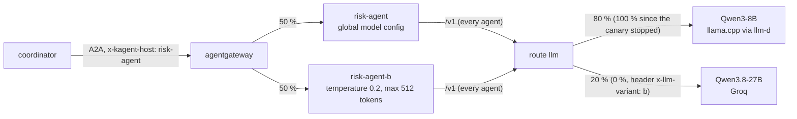
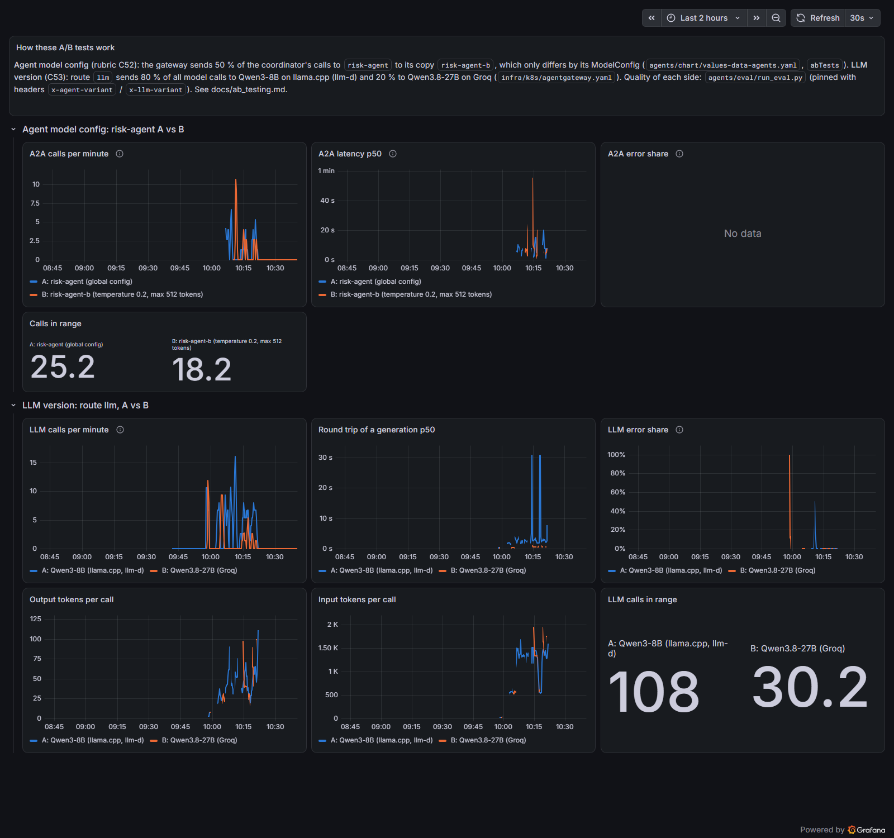

# A/B testing (agents and LLM versions)

A new model config or a new LLM version starts with a share of the traffic, next to the current one. The "A/B tests"
Grafana dashboard compares both sides on live traffic, and an evaluation run measures the quality of each side on the
same questions. The weights then move to the winner, or the variant is removed. Two tests ran in the agent layer: the
risk agent's model config, and the LLM version behind the gateway's route `llm`.

| | |
|---|---|
| Code | [`agents/chart/`](https://github.com/cvinhnguyen/card-fraud-platform/tree/1416656ca28dbf52a0663508c5f0a81fb869faed/agents/chart), [`infra/k8s/agentgateway.yaml`](https://github.com/cvinhnguyen/card-fraud-platform/blob/1416656ca28dbf52a0663508c5f0a81fb869faed/infra/k8s/agentgateway.yaml), [`infra/k8s/dashboards/ab-tests.json`](https://github.com/cvinhnguyen/card-fraud-platform/blob/1416656ca28dbf52a0663508c5f0a81fb869faed/infra/k8s/dashboards/ab-tests.json), [`agents/eval/`](https://github.com/cvinhnguyen/card-fraud-platform/tree/1416656ca28dbf52a0663508c5f0a81fb869faed/agents/eval) |
| Runs on | kind: agentgateway in namespace `agentgateway-system`, the agents in namespace `kagent`; the evaluation in a `python:3.13-slim` container on the `kind` network |
| Reads | `agents/eval/dataset.jsonl` and the bank documents in `generator/knowledge` (evaluation); the gateway's metrics (dashboard) |
| Writes | `agents/eval/results/*.json` (per-question answers) |
| Related | [agents.md](agents.md), [llm_platform.md](llm_platform.md), [observability.md](observability.md), [novel_eval_gate.md](novel_eval_gate.md) |

How the two tests split the traffic at the gateway:



## Run it

The evaluation sends the dataset through the gateway; `--mode agent` asks the risk agent over A2A, `--mode llm` asks
route `/v1`, and `--variant a|b` pins one side:

```bash
kubectl -n agentgateway-system get svc agentgateway-proxy -o jsonpath='{.spec.ports[0].nodePort}'   # the gateway nodePort
docker run --rm --network kind -e A2A_KEY -e AGW_KEY -e GATEWAY=http://fraud-control-plane:<gateway nodePort> \
  -v "$PWD:/repo" -w /repo python:3.13-slim python agents/eval/run_eval.py --mode agent --variant b
```

## Agent model config (risk-agent A vs B)

The test is configured by `abTests` in
[`agents/chart/values-data-agents.yaml` L30-L35](https://github.com/cvinhnguyen/card-fraud-platform/blob/1416656ca28dbf52a0663508c5f0a81fb869faed/agents/chart/values-data-agents.yaml#L30-L35):

```yaml
# A/B test of the risk agent's model config: B samples near-greedily and caps its answers (the global config leaves
# llama.cpp's defaults: temperature 0.8, no cap). Half of the coordinator's calls to risk-agent go to risk-agent-b.
abTests:
  risk-agent: {variant: risk-agent-b, modelConfig: qwen3-8b-precise, weight: 50}
modelConfigs:
  qwen3-8b-precise: {temperature: "0.2", maxTokens: 512}
```

The chart makes `risk-agent-b`
([`agents/chart/templates/_helpers.tpl` L1-L9](https://github.com/cvinhnguyen/card-fraud-platform/blob/1416656ca28dbf52a0663508c5f0a81fb869faed/agents/chart/templates/_helpers.tpl#L1-L9)),
a copy of `risk-agent` with the same prompt from Langfuse and the same MCP tools. It gets its own KEDA ScaledObject and
SandboxAgent, and the release's NetworkPolicy covers it. Its only difference is the ModelConfig `qwen3-8b-precise`
([`agents/chart/templates/modelconfigs.yaml` L1-L19](https://github.com/cvinhnguyen/card-fraud-platform/blob/1416656ca28dbf52a0663508c5f0a81fb869faed/agents/chart/templates/modelconfigs.yaml#L1-L19)):
temperature 0.2 and at most 512 output tokens, where the global config leaves llama.cpp's defaults (temperature 0.8,
no cap).

The coordinator still calls `risk-agent`; the A2A route of the release
([`agents/chart/templates/a2a-gateway.yaml`](https://github.com/cvinhnguyen/card-fraud-platform/blob/1416656ca28dbf52a0663508c5f0a81fb869faed/agents/chart/templates/a2a-gateway.yaml))
sends 50 % of those calls to each side. Header `x-agent-variant: a|b` pins a call to one side, for evaluations. The
gateway's metrics (label `backend`) give the online comparison: calls, latency p50 and error share per variant.

For an agent listed in `abTests` the template writes three rules: pinned to A, pinned to B, and the weighted split
([`agents/chart/templates/a2a-gateway.yaml` L29-L48](https://github.com/cvinhnguyen/card-fraud-platform/blob/1416656ca28dbf52a0663508c5f0a81fb869faed/agents/chart/templates/a2a-gateway.yaml#L29-L48)):

```yaml
    {{- range $name, $a := .Values.agents }}
    {{- $host := dict "name" "x-kagent-host" "value" (printf "%s.%s" $name $.Release.Namespace) }}
    {{- with index (default dict $.Values.abTests) $name }}
    - matches: [{path: {type: PathPrefix, value: /}, headers: [{{ toJson $host }}, {name: x-agent-variant, value: a}]}]
      backendRefs: [{group: agentgateway.dev, kind: AgentgatewayBackend, name: agent-{{ $name }}}]
      timeouts: {request: 300s}
    - matches: [{path: {type: PathPrefix, value: /}, headers: [{{ toJson $host }}, {name: x-agent-variant, value: b}]}]
      backendRefs: [{group: agentgateway.dev, kind: AgentgatewayBackend, name: agent-{{ .variant }}}]
      timeouts: {request: 300s}
    - matches: [{path: {type: PathPrefix, value: /}, headers: [{{ toJson $host }}]}]
      backendRefs:
        - {group: agentgateway.dev, kind: AgentgatewayBackend, name: agent-{{ $name }}, weight: {{ sub 100 .weight }}}
        - {group: agentgateway.dev, kind: AgentgatewayBackend, name: agent-{{ .variant }}, weight: {{ .weight }}}
      timeouts: {request: 300s}
    {{- else }}
    - matches: [{path: {type: PathPrefix, value: /}, headers: [{{ toJson $host }}]}]
      backendRefs: [{group: agentgateway.dev, kind: AgentgatewayBackend, name: agent-{{ $name }}}]
      timeouts: {request: 300s}
    {{- end }}
    {{- end }}
```

## LLM version (route `llm`: Qwen3-8B vs Qwen3.8-27B)

The test is configured in
[`infra/k8s/agentgateway.yaml`](https://github.com/cvinhnguyen/card-fraud-platform/blob/1416656ca28dbf52a0663508c5f0a81fb869faed/infra/k8s/agentgateway.yaml).
Version A is the platform's model, Qwen3-8B Q4_K_M on llama.cpp behind the llm-d InferencePool
([`infra/k8s/agentgateway.yaml` L18-L31](https://github.com/cvinhnguyen/card-fraud-platform/blob/1416656ca28dbf52a0663508c5f0a81fb869faed/infra/k8s/agentgateway.yaml#L18-L31)).
Version B is Qwen3.8-27B on Groq, an OpenAI-compatible `AgentgatewayBackend` with the key `llm-groq` from Vault
([`infra/k8s/agentgateway.yaml` L36-L57](https://github.com/cvinhnguyen/card-fraud-platform/blob/1416656ca28dbf52a0663508c5f0a81fb869faed/infra/k8s/agentgateway.yaml#L36-L57)).
The route sent 80 % of all model calls to A and 20 % to B (stopped since, see [Decisions](#decisions)). Callers keep
sending model `qwen3-8b`, and the backend rewrites it. Header `x-llm-variant: a|b` pins a call, and the B backend sets
its own User-Agent (see [Gotchas](#gotchas)). The rules of route `llm` as they are now
([`infra/k8s/agentgateway.yaml` L70-L84](https://github.com/cvinhnguyen/card-fraud-platform/blob/1416656ca28dbf52a0663508c5f0a81fb869faed/infra/k8s/agentgateway.yaml#L70-L84)):

```yaml
  rules:
    - matches: [{path: {type: PathPrefix, value: /v1}, headers: [{name: x-llm-variant, value: a}]}]
      backendRefs: [{group: agentgateway.dev, kind: AgentgatewayBackend, name: qwen3-8b}]
      timeouts: {request: 300s}
    - matches: [{path: {type: PathPrefix, value: /v1}, headers: [{name: x-llm-variant, value: b}]}]
      backendRefs: [{group: agentgateway.dev, kind: AgentgatewayBackend, name: qwen3-8-27b-groq, filters: [{type: RequestHeaderModifier, requestHeaderModifier: {set: [{name: User-Agent, value: agentgateway}]}}]}]
      timeouts: {request: 300s}
    # Canary stopped on 2026-10-21 (docs/ab_testing.md): at 20 % the dashboard showed B refusing agent calls (429, the
    # free tier's output tokens a minute). B stays reachable with the header; raise its weight again on a paid tier.
    - matches: [{path: {type: PathPrefix, value: /v1}}]
      backendRefs:
        - {group: agentgateway.dev, kind: AgentgatewayBackend, name: qwen3-8b, weight: 100}
        - {group: agentgateway.dev, kind: AgentgatewayBackend, name: qwen3-8-27b-groq, weight: 0,
           filters: [{type: RequestHeaderModifier, requestHeaderModifier: {set: [{name: User-Agent, value: agentgateway}]}}]}
      timeouts: {request: 300s}
```

The route's policy (API key, rate limits, PII masking,
[`infra/k8s/agentgateway.yaml` L86-L113](https://github.com/cvinhnguyen/card-fraud-platform/blob/1416656ca28dbf52a0663508c5f0a81fb869faed/infra/k8s/agentgateway.yaml#L86-L113))
applies to both versions. A phone number in a prompt reaches Groq as `<masked>` (checked: "Repeat exactly: my phone is
0912345678" came back as "my phone is <masked>"). The gateway's metrics (labels `backend` and `gen_ai_response_model`)
give calls, round trip p50, error share, and input and output tokens per call.

## Monitoring: dashboard "Card Support - A/B tests"

The dashboard is
[`infra/k8s/dashboards/ab-tests.json`](https://github.com/cvinhnguyen/card-fraud-platform/blob/1416656ca28dbf52a0663508c5f0a81fb869faed/infra/k8s/dashboards/ab-tests.json),
loaded by
[`infra/k8s/observability.sh`](https://github.com/cvinhnguyen/card-fraud-platform/blob/1416656ca28dbf52a0663508c5f0a81fb869faed/infra/k8s/observability.sh).
A is blue and B orange in every panel. The top row compares risk-agent A and B (A2A calls per minute, latency p50,
error share); the lower rows compare the two LLM versions (calls per minute, round trip p50, error share, output and
input tokens per call). Over the 2 hours of the runs, calls in range were 25.2 (A) and 18.2 (B) for the agent and 108
and 30.2 for the LLM:



## Evaluation

The evaluation lives in
[`agents/eval/`](https://github.com/cvinhnguyen/card-fraud-platform/tree/1416656ca28dbf52a0663508c5f0a81fb869faed/agents/eval).
[`agents/eval/dataset.jsonl`](https://github.com/cvinhnguyen/card-fraud-platform/blob/1416656ca28dbf52a0663508c5f0a81fb869faed/agents/eval/dataset.jsonl)
held 12 card-policy questions at the time of these runs (fees, disputes, authentication; 20 now, for the eval gate)
with the facts a correct answer must state, taken from the bank documents
([`generator/knowledge/`](https://github.com/cvinhnguyen/card-fraud-platform/tree/1416656ca28dbf52a0663508c5f0a81fb869faed/generator/knowledge)).
`run_eval.py` sends them through the gateway and scores each answer. An answer is correct when it states every
expected fact
([`agents/eval/run_eval.py` L31-L34](https://github.com/cvinhnguyen/card-fraud-platform/blob/1416656ca28dbf52a0663508c5f0a81fb869faed/agents/eval/run_eval.py#L31-L34)).
In `agent` mode the question goes to the risk agent over A2A (as the coordinator does), in `llm` mode straight to
`/v1` with the policy document as context
([`agents/eval/run_eval.py` L45-L70](https://github.com/cvinhnguyen/card-fraud-platform/blob/1416656ca28dbf52a0663508c5f0a81fb869faed/agents/eval/run_eval.py#L45-L70)).
The command is in [Run it](#run-it). One experiment ran at a time: the agent runs were made with the LLM route at
100/0, so the only difference between A and B was the agent's model config.

| experiment | side | correct | latency p50 | latency max |
|---|---|---:|---:|---:|
| agent model config | A: global config | 8 / 12 | 7.6 s | 71.7 s |
| agent model config | B: temperature 0.2, max 512 tokens | 7 / 12 | 7.5 s | 69.1 s |
| LLM version | A: Qwen3-8B (llama.cpp) | 12 / 12 | 1.93 s | 3.7 s |
| LLM version | B: Qwen3.8-27B (Groq) | 12 / 12 | 0.47 s | 1.5 s |

The per-question answers are in
[`agents/eval/results/`](https://github.com/cvinhnguyen/card-fraud-platform/tree/1416656ca28dbf52a0663508c5f0a81fb869faed/agents/eval/results)
(`*.json`). With the split on (no pinning), two agent passes got 8 / 12 each and the LLM pass 12 / 12, and the
dashboard shows the route's share (about 78 / 22 of the LLM calls in the run).

## Decisions

Agent model config: keep A and remove B. Near-greedy sampling with a cap improved neither accuracy (7 vs 8 of 12) nor
latency (both ~7.5 s); the latency comes from the GPU. To end the test, delete the `abTests` entry: the next deploy
removes `risk-agent-b` and the split.

The evaluation did find where both sides fail. They lose the same questions the same way: the agent answers "the
policy could not be checked" in 2 s without calling `search_policy`, or after hits that did not include the fee table
row. The prompt causes that, and the eval gate of the CD pipeline now measures it
([novel idea: eval gate](novel_eval_gate.md)).

LLM version: the canary is stopped and A keeps 100 %. On the evaluation B was as accurate on the document questions
and about 4x faster. On live agent traffic it failed. The coordinator pipeline's smoke test (Jenkins
`card-support-coordinator` #18) ended `failed` because its last model call landed on B and Groq answered
`429 ... output tokens per minute (OTPM): Limit 1000, Requested 1619`. Agents send no `max_tokens`, and the free
tier's 1,000 output tokens a minute (for the whole account) is less than two agent answers; the dashboard's "LLM error
share" shows B's failures next to A's none. The default rule is now 100 / 0. B stays reachable with
`x-llm-variant: b` for evaluations, with a gateway default of `max_tokens: 512`
([`infra/k8s/agentgateway.yaml` L54-L57](https://github.com/cvinhnguyen/card-fraud-platform/blob/1416656ca28dbf52a0663508c5f0a81fb869faed/infra/k8s/agentgateway.yaml#L54-L57)).
Resuming the canary needs a paid Groq tier, and a decision on sending (masked) customer text outside the bank. Because
B only ever had a share of the traffic, stopping it was a weight change.

## Gotchas

- Groq's edge (Cloudflare, error 1010) refused Python's default User-Agent, so the gateway sets its own
  (`User-Agent: agentgateway`, the `RequestHeaderModifier` filter on the `qwen3-8-27b-groq` backend refs in route
  `llm`).
