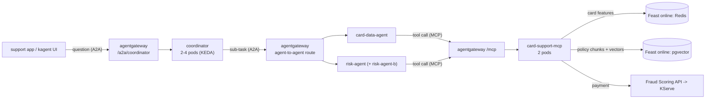
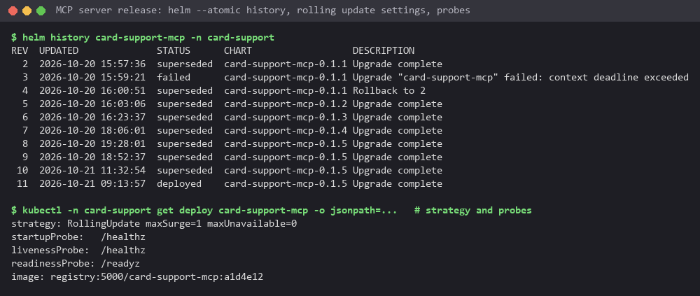
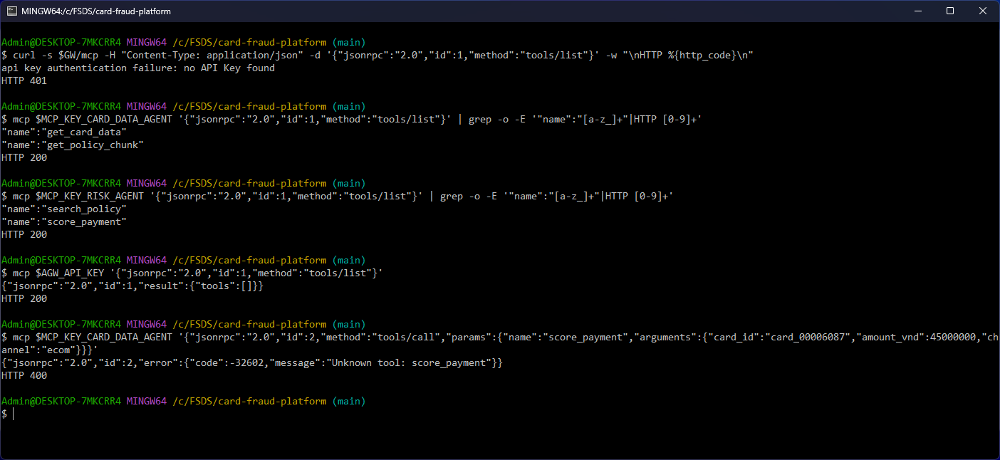

# Card support agents, MCP server and agent gateway

A bank customer asks why a card payment was declined or what a fee is. Three kagent agents answer: the coordinator
talks to the customer and asks two specialists, the card data agent (the card's live features and the bank's
documents by id) and the risk agent (the fraud model's verdict on a payment and a search over the card policies). The
specialists get their data from one MCP server, `card-support-mcp`. Agents never call each other, the MCP server or
the model directly: every call passes agentgateway, which checks a key per caller and allows each caller only what it
needs. This page covers rubric A8 and A16 to A27; the model behind the agents is in [llm_platform.md](llm_platform.md).



| Agent | Tools | Release, pipeline |
|---|---|---|
| card-data-agent | MCP `get_card_data`, `get_policy_chunk` | `card-support-data-agents`, [`agents/Jenkinsfile.data-agents`](../agents/Jenkinsfile.data-agents) |
| risk-agent (and its A/B variant risk-agent-b) | MCP `score_payment` (ML inference), `search_policy` (RAG) | same release |
| coordinator | the two agents above, over A2A | `card-support-coordinator`, [`agents/Jenkinsfile.coordinator`](../agents/Jenkinsfile.coordinator) |

The agents are declarative kagent 0.10.3 Agents on the Go ADK runtime, rendered by one Helm chart
([`agents/chart`](../agents/chart)) from a values file per release
([`values-data-agents.yaml`](../agents/chart/values-data-agents.yaml),
[`values-coordinator.yaml`](../agents/chart/values-coordinator.yaml)). Their system prompts come from Langfuse at
deploy time ([cicd.md](cicd.md#agents)).

## The MCP server: card data and chunks by id

[`services/card_support_mcp`](../services/card_support_mcp) is one FastAPI app that serves the same four tools twice:
as an MCP server on `/mcp` (streamable HTTP, stateless, for the agents) and as a REST API under `/v1` (for people, the
tests and the load test).

| Tool | REST | Reads |
|---|---|---|
| `get_card_data` | `GET /v1/cards/{card_id}` | Feast `card_fraud` online store (Redis): profile, 30/90/180-day stats, realtime activity from the stream jobs |
| `get_policy_chunk` | `GET /v1/chunks/{chunk_id}` | Feast `card_support_kb` online store (pgvector): one chunk written by the [RAG pipeline](rag_pipeline.md) |
| `search_policy` | `POST /v1/search` | embeds the question (llama.cpp embeddings), nearest chunks in pgvector, re-ranked by cosine |
| `score_payment` | `POST /v1/score` | the Layer 2 Fraud Scoring API, which reads the card's features and calls the KServe model |

- Validation: every input and output is a pydantic model ([`app/schemas.py`](../services/card_support_mcp/app/schemas.py)):
  card and chunk ids must match their patterns, an amount is a whole number of VND above 0 and at most 10 billion,
  the channel is an enum, a search asks for 1 to 10 chunks. A bad id
  is a 422 before any store is touched.
- Health checks for Kubernetes: `/healthz` (the process answers; startup and liveness probes) and `/readyz` (both
  Feast online stores answer; readiness probe), so a pod that lost Redis or pgvector gets no traffic but is not killed.
- Async: every handler is `async`; the HTTP clients (embeddings, Scoring API) use `httpx.AsyncClient`, and the Feast
  SDK calls, which are blocking, run in `asyncio.to_thread`, so one slow search does not hold up the other requests
  ([`app/clients.py`](../services/card_support_mcp/app/clients.py)).
- `/metrics`: requests per handler, plus calls, failures and latency per tool (the agent telemetry dashboard).

Tests (97 tests, 97.84% coverage, EP/BVA, property-based, mutation testing) and the load test are in
[testing.md](testing.md#layer-3-the-card-support-mcp-server).

### Deployed with Helm, rolling update and automatic rollback

The chart [`services/card_support_mcp/chart`](../services/card_support_mcp/chart) runs 2 replicas in namespace
`card-support` with `RollingUpdate` (`maxSurge: 1`, `maxUnavailable: 0`, `minReadySeconds: 5`): a new pod has to pass
`/readyz` before an old one stops, so the tools never drop below two serving pods. The pipeline installs it with
`helm upgrade --install --atomic`: when the new pods do not become Ready in time, Helm rolls the release back to the
last good revision by itself. MCP sessions are stateless (the gateway backend sets `sessionRouting: Stateless`), so
any replica can answer any call and a rolling update does not break a conversation.

The rolling update settings are in the chart
([`deployment.yaml` L8-L15](https://github.com/cvinhnguyen/card-fraud-platform/blob/35d4295a1e5a409fa242bc6aa9eff9b06038c111/services/card_support_mcp/chart/templates/deployment.yaml#L8-L15));
the fallback is the deploy stage of the pipeline
([`Jenkinsfile` L62-L70](https://github.com/cvinhnguyen/card-fraud-platform/blob/35d4295a1e5a409fa242bc6aa9eff9b06038c111/services/card_support_mcp/Jenkinsfile#L62-L70)):

```groovy
        stage('Deploy (helm --atomic)') {
          // rolling update with maxUnavailable 0; a release whose pods never get Ready is rolled back by --atomic
          steps {
            withCredentials([file(credentialsId: 'kubeconfig', variable: 'KUBECONFIG')]) {
              sh 'helm upgrade --install card-support-mcp $SVC/chart -n card-support --atomic --timeout 4m --set image.tag=$TAG'
              sh 'kubectl -n card-support rollout status deploy/card-support-mcp --timeout=60s'
            }
          }
        }
```



Revision 3 was a release that could not start (its knowledge base setting was missing on purpose): its pods never got
Ready, the upgrade failed after the timeout and Helm wrote revision 4, "Rollback to 2". During that test a client kept
calling the tools: 470 of 470 calls succeeded. A normal rolling update from 0.1.0 to 0.1.1 took 19 s with 311 of 311
calls answered.

## The agents: replicas, autoscaling, sandbox

Each Agent becomes a Deployment managed by kagent. The chart leaves `replicas` unset, so kagent does not fight the
autoscaler, and adds a KEDA ScaledObject per agent ([`scaledobjects.yaml`](../agents/chart/templates/scaledobjects.yaml)):
minimum 2 replicas, maximum 4, scaled on the agent's A2A request rate through the gateway (Prometheus
`agentgateway_requests_total`), 0.04 requests per second per replica. A conversation takes about 40 s, so that is
about 1.6 conversations in flight per replica. More replicas add no LLM capacity (one GPU behind llm-d); they keep a
slow conversation from blocking the next one.

[`scaledobjects.yaml` L1-L22](https://github.com/cvinhnguyen/card-fraud-platform/blob/35d4295a1e5a409fa242bc6aa9eff9b06038c111/agents/chart/templates/scaledobjects.yaml#L1-L22):

```yaml
{{- $as := .Values.autoscaling }}
{{- range $name, $a := include "card-support.agents" . | fromYaml }}
---
# KEDA owns the replicas of the Deployment kagent creates for the agent (the Agent leaves replicas unset)
apiVersion: keda.sh/v1alpha1
kind: ScaledObject
metadata:
  name: {{ $name }}
  namespace: {{ $.Release.Namespace }}
spec:
  scaleTargetRef: {name: {{ $name }}}
  minReplicaCount: {{ $as.minReplicas }}
  maxReplicaCount: {{ $as.maxReplicas }}
  pollingInterval: 15   # scale-down: the HPA's 5 min stabilization (cooldownPeriod applies only to scale-to-zero)
  triggers:
    - type: prometheus
      metadata:
        serverAddress: {{ $as.prometheus }}
        query: sum(rate(agentgateway_requests_total{backend="{{ $.Values.gateway.namespace }}/agent-{{ $name }}"}[1m]))
        threshold: {{ $as.requestsPerSecond | quote }}
        ignoreNullValues: "true"
{{- end }}
```


Scaling test: locust sent 6 users for 4 minutes to `/a2a/coordinator` (31 conversations, 0 failures). The coordinator
went from 2 to 4 replicas, the risk agent from 2 to 4 and the card data agent from 2 to 3, and they came back down
after the load. The full locust reports: [`locust_agents_scaling.html`](images/locust_agents_scaling.html) (this run)
and [`locust_agents_a2a.html`](images/locust_agents_a2a.html) (6 users, 5 minutes, 37 conversations, 0 failures,
p95 85 s).

Run again on 2026-10-21 from Git Bash: locust in a container on the kind network, 6 users for 3 minutes against the
gateway's `/a2a/coordinator` (18 conversations, 0 failures). Right after it, the coordinator was at 4 replicas and
risk-agent-b at 3, and the HPA events KEDA drives give the reason: the agent's request rate through the gateway
(`s0-prometheus`) above its target. The older events at the top are the HPAs being created and an earlier rise and
fall of the coordinator.


The agents' pods are limited by a NetworkPolicy ([`networkpolicy.yaml`](../agents/chart/templates/networkpolicy.yaml)):
they accept A2A calls only from the gateway proxy and the kagent controller, and they can open connections only to
DNS, the gateway, the kagent controller and Jaeger. An agent cannot reach the MCP server, the model server or another
agent except through the gateway. The MCP server has its own policy: it accepts connections only from the gateway,
Prometheus, NGINX and its own namespace.

### Sandboxed agents on Agent Substrate (warm-up)

The same chart renders every agent a second time as a SandboxAgent
([`sandboxagents.yaml` L1-L22](https://github.com/cvinhnguyen/card-fraud-platform/blob/35d4295a1e5a409fa242bc6aa9eff9b06038c111/agents/chart/templates/sandboxagents.yaml#L1-L22)),
from the same spec helper, so the sandboxed copy has the same prompt, tools and model config. A SandboxAgent runs each
conversation in its own gVisor sandbox on Agent Substrate 0.0.9, installed by
[`infra/k8s/llm-platform.sh` L34](https://github.com/cvinhnguyen/card-fraud-platform/blob/35d4295a1e5a409fa242bc6aa9eff9b06038c111/infra/k8s/llm-platform.sh#L34)
with kagent's worker pool turned on at
[L51-L55](https://github.com/cvinhnguyen/card-fraud-platform/blob/35d4295a1e5a409fa242bc6aa9eff9b06038c111/infra/k8s/llm-platform.sh#L51-L55).
Each sandbox is restored from a snapshot taken once the agent was warm, so there is no cold start. Its network egress
is limited to two hosts, the gateway and the kagent controller
([`values.yaml` L32-L39](https://github.com/cvinhnguyen/card-fraud-platform/blob/35d4295a1e5a409fa242bc6aa9eff9b06038c111/agents/chart/values.yaml#L32-L39)).

All sandboxed agents share the worker pool `kagent-default`. One worker runs one active conversation; after it, the
sandbox is snapshotted and the worker takes the next one. On this machine the pool has a single worker. In Git Bash,
`ask` is a shell function defined earlier in the session: an A2A `message/send` to
`/api/a2a-sandboxes/kagent/<agent>-sandbox/` on the kagent controller (port-forward), retried every 3 s while the
answer is "no free workers"; it prints the time and the number of retries:


One after the other, the three agents answered in 8 to 28 s on the same worker (the retries are the worker taking
the snapshot of the previous conversation). Sent at once, one got the worker and the others got "no free workers"
until it was free, retried, and all three answered within 61 s. The number of workers a fleet needs is the number of
conversations it runs at the same time, whatever the number of agents.

## MCP gateway

The agents reach the MCP server only through agentgateway's `/mcp` route
([`chart/templates/gateway.yaml`](../services/card_support_mcp/chart/templates/gateway.yaml)). kagent sees the tools
through one RemoteMCPServer per agent ([`mcp-servers.yaml`](../services/card_support_mcp/chart/templates/mcp-servers.yaml)),
all pointing at the same gateway URL, each sending that agent's own key from a Secret synced from Vault.

| Policy | Setting | Why |
|---|---|---|
| Authentication | `apiKeyAuthentication: Strict`, keys stored as SHA-256 hashes with a user id | a call without a known key never reaches the server |
| Tool authorization | `(apiKey.user_id == "card-data-agent" && mcp.tool.name in [get_card_data, get_policy_chunk]) \|\| (apiKey.user_id == "risk-agent" && mcp.tool.name in [score_payment, search_policy])` | least privilege: the card data agent cannot score payments, the risk agent cannot read raw card data; the rule filters `tools/list` too, so an agent does not even see the other tools |
| Rate limit | 300 requests a minute, burst 50, for all agents together | a looping agent cannot flood the stores |
| Session routing | `Stateless` | any MCP server replica answers any call (rolling updates, scaling) |

## A2A gateway

kagent's `proxy.url` sends every agent-as-tool call to the gateway instead of the other agent's Service, with the
header `x-kagent-host: <agent>.<namespace>`. The chart adds the routes and policies
([`a2a-gateway.yaml`](../agents/chart/templates/a2a-gateway.yaml)):

| Route | Who may call | Policy |
|---|---|---|
| `card-support-data-agents-internal` (header `x-kagent-host`) | key user `coordinator` only (the coordinator, and CI's smoke test and eval gate, which call an agent the way the coordinator does) | API key, `apiKey.user_id in ["coordinator"]`, 120 requests a minute (burst 20), 300 s timeout for long conversations |
| `a2a-coordinator` (`/a2a/coordinator`) | key user `support-app` only (the bank's support app, the coordinator pipeline's smoke test) | API key, `apiKey.user_id == "support-app"`, same rate limit |

The gateway rewrites the URL in each agent card to its own address, so an A2A client that follows the card keeps
going through the gateway. The A/B split of the risk agent also happens on the internal route (weights and the
`x-agent-variant` header, [ab_testing.md](ab_testing.md)).

The MCP policy is generated from one map in the chart's values (`agents.access`, agent key user to its tools), in
[`gateway.yaml` L30-L56](https://github.com/cvinhnguyen/card-fraud-platform/blob/35d4295a1e5a409fa242bc6aa9eff9b06038c111/services/card_support_mcp/chart/templates/gateway.yaml#L30-L56):

```yaml
# Who: an API key from agentgateway-api-keys. How much: a request rate limit. What: per agent, only its tools, both in
# tools/list (the rule runs once per listed tool) and in tools/call.
{{- $rules := list }}
{{- range $agent, $tools := .Values.agents.access }}
{{- $rules = append $rules (printf "(apiKey.user_id == %q && mcp.tool.name in %s)" $agent (toJson $tools)) }}
{{- end }}
apiVersion: agentgateway.dev/v1alpha1
kind: AgentgatewayPolicy
metadata:
  name: {{ .Release.Name }}
  namespace: {{ $ns }}
spec:
  targetRefs: [{group: gateway.networking.k8s.io, kind: HTTPRoute, name: {{ .Release.Name }}}]
  traffic:
    apiKeyAuthentication:
      mode: Strict
      configMapSelector: {matchLabels: {agentgateway.dev/apikey: "true"}}
    rateLimit:
      local:
        - {requests: {{ .Values.gateway.rateLimit.requests }}, unit: Minutes, burst: {{ .Values.gateway.rateLimit.burst }}}
  backend:
    mcp:
      authorization:
        action: Allow
        policy:
          matchExpressions:
            - {{ join " || " $rules | quote }}
```

In the screenshots below, the policies are called from Git Bash through a port-forward to the gateway. `mcp` is a
shell function defined earlier
in the session: one curl `POST /mcp` with the given key as a Bearer token and the given JSON-RPC body (the server is
stateless, so `tools/list` needs no `initialize` first). The keys come from the environment; only their variable
names appear:




With no key the MCP route answers 401. The card data agent's key lists only its two tools, the risk agent's key only
its two, and the agents' LLM key passes authentication but sees no tool. Calling `score_payment` with the card data
agent's key gets `Unknown tool`. On the A2A side, `/a2a/coordinator` refuses a missing key (401) and the coordinator's
own key (403), and accepts the support app's key; the internal route refuses the support app (403) and accepts the
coordinator. A pod outside the gateway path that calls the risk agent or the MCP server directly times out.

## Chat with the agents (kagent UI)

The kagent UI is published by NGINX at `https://agents.<domain>` behind basic auth ([edge_security.md](edge_security.md)).
It lists the agents and their sandboxed copies (lock icon), and a chat with the coordinator shows each sub-agent call
it makes:


## Agent registry

agentregistry 0.4.0 (namespace `agentregistry`, its own database on ml-db, RBAC limited to the `kagent` namespace)
keeps the catalog: which agents exist, their version and runtime image, where their definition lives and which MCP
server they use. The catalog is code, [`agents/registry/catalog.yaml`](../agents/registry/catalog.yaml), published
with `arctl apply -f agents/registry/catalog.yaml`; install values in
[`agents/registry/values.yaml`](../agents/registry/values.yaml). The UI is at `https://registry.<domain>` (basic auth).


## Gotchas

- After a reboot the Substrate Valkey cluster keeps its old pod IPs and the sandbox network components keep stale
  state: re-introduce the Valkey nodes (`CLUSTER MEET`), then restart `atenet-router`, `dns`, `ate-controller`,
  `atelet`, the ATE API server, the worker pool and the kagent controller. Before that, a sandboxed conversation hangs
  and holds the only worker.
- kagent's UI chat reaches the coordinator through the kagent controller. That first hop is kagent's control path and
  skips the gateway (kagent 0.10.3 cannot send it through `proxy.url`); every hop after it goes through the gateway.
- KEDA compares the trigger value per replica (`AverageValue`): 0.13 requests per second over two replicas did not
  cross a 0.1 threshold, which is why the threshold is per replica and low.
