# Card support agents, MCP servers and agent gateway

A bank customer asks why a card payment was declined or what a fee is. Three kagent agents answer: the coordinator
talks to the customer and asks two specialists. The card data agent reads the card's live features and the bank's
documents by id; the risk agent asks the fraud model for a verdict on a payment and searches the card policies. The
specialists get their data from three MCP servers, one per tool the rubric asks for:

| MCP server | Tools | Rubric |
|---|---|---|
| `card-data-mcp` | `get_card_data`, `get_policy_chunk` | A16: the Web API that pulls a user's data from the online feature store and a chunk written by the RAG pipeline, by id |
| `fraud-score-mcp` | `score_payment` | A22, tool 1: the call to the ML inference service |
| `policy-rag-mcp` | `search_policy` | A22, tool 2: RAG over the chunks the RAG data pipeline ingested |

Agents never call each other, an MCP server or the model directly: every call passes agentgateway, which checks a key
per caller and allows each caller only what it needs. This page covers rubric A8 and A16 to A27; the model behind the
agents is in [llm_platform.md](llm_platform.md).

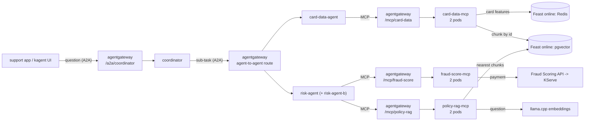

| Agent | Tools (MCP server) | Release, pipeline |
|---|---|---|
| card-data-agent | `get_card_data`, `get_policy_chunk` (`card-data-mcp`) | `card-support-data-agents`, [`agents/Jenkinsfile.data-agents`](../agents/Jenkinsfile.data-agents) |
| risk-agent (and its A/B variant risk-agent-b) | `score_payment` (`fraud-score-mcp`), `search_policy` (`policy-rag-mcp`) | same release |
| coordinator | the two agents above, over A2A | `card-support-coordinator`, [`agents/Jenkinsfile.coordinator`](../agents/Jenkinsfile.coordinator) |

The agents are declarative kagent 0.10.3 Agents on the Go ADK runtime, rendered by one Helm chart
([`agents/chart`](../agents/chart)) from a values file per release
([`values-data-agents.yaml`](../agents/chart/values-data-agents.yaml),
[`values-coordinator.yaml`](../agents/chart/values-coordinator.yaml)). Each agent lists the MCP servers it uses and
the tools it takes from each ([`values-data-agents.yaml` L5-L19](../agents/chart/values-data-agents.yaml#L5-L19)).
Their system prompts come from Langfuse at deploy time ([cicd.md](cicd.md#agents)).

## The three MCP servers

[`services/card_support_mcp`](../services/card_support_mcp) is one FastAPI code base that runs as three servers. The
environment variable `MCP_SERVER` picks the server, and the app factory registers only that server's tools, twice: as
MCP tools on `/mcp` (streamable HTTP, stateless, for the agents) and as REST routes under `/v1` (for people, the tests
and the load test). Each server is its own Helm release, so it has its own Deployment, probes, Secret, network policy,
gateway route, kagent tool server and registry entry.

| Server | REST | Reads | `/readyz` checks | Secret |
|---|---|---|---|---|
| card-data | `GET /v1/cards/{card_id}`, `GET /v1/chunks/{chunk_id}` | Feast `card_fraud` online store (Redis): profile, 30/90/180-day stats, real-time activity from the stream jobs; Feast `card_support_kb` online store (pgvector): one chunk of the [RAG pipeline](rag_pipeline.md) | Redis and pgvector answer | `card-data-mcp`: Feast registry, Redis and pgvector passwords |
| fraud-score | `POST /v1/score` | the Layer 2 Fraud Scoring API (features from Feast, XGBoost on KServe, rule fallback) | the Scoring API answers its `/healthz` | none |
| policy-rag | `POST /v1/search` | llama.cpp embeddings (the question's vector), pgvector (nearest chunks, re-ranked by cosine) | pgvector and the embedding server answer | `policy-rag-mcp`: Feast registry and pgvector passwords, embedder key |

The split is one table in [`app/main.py` L40-L44](../services/card_support_mcp/app/main.py#L40-L44), and
`build_service` ([L55-L62](../services/card_support_mcp/app/main.py#L55-L62)) builds only the adapters a server's
tools use, so fraud-score never imports Feast and holds no store password:

```python
# server -> (its tools, the adapters those tools use: built at start-up and checked by /readyz)
SERVERS = {
    "card-data": ({"get_card_data", "get_policy_chunk"}, ("features", "knowledge")),
    "fraud-score": ({"score_payment"}, ("scoring",)),
    "policy-rag": ({"search_policy"}, ("knowledge", "embedder")),
}
```

One code base and one image serve the three servers because they share the schemas, the metrics wrapper and the
FastAPI/MCP scaffolding and are released together: the image is built, tested, mutation-tested and signed once
([cicd.md](cicd.md#mcp-servers)). What has to differ at run time is separate per release: replicas, readiness, Secret,
network policy, gateway route and key. If the servers had different owners or release cadences, the same modules
would become three images.

### FastAPI and pydantic validation

Every input and output is a pydantic model or a constrained parameter
([`app/schemas.py` L8-L9, L64-L87](../services/card_support_mcp/app/schemas.py#L8-L87)): card and chunk ids must match
their patterns, an amount is a whole number of VND above 0 and at most 10 billion, the channel is an enum, a search
asks for 1 to 10 chunks. The MCP tools carry the same rules in their parameters
([`app/main.py` L99-L125](../services/card_support_mcp/app/main.py#L99-L125)), so the rules appear in each tool's input
schema and a bad argument from an agent is a tool error before any store is read. Over REST the same rule is a 422.

FastAPI publishes the REST API of each server as an OpenAPI page. The card data server's page through NGINX
(`https://api.<domain>/docs`, basic auth, [edge_security.md](edge_security.md)):

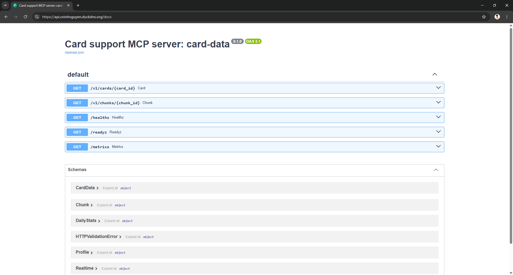

Opened on `GET /v1/cards/{card_id}`, the page shows the pydantic rule FastAPI enforces on the path parameter
(`pattern: ^[A-Za-z0-9_-]{1,64}$`) and the response model:

![FastAPI OpenAPI page: card_id is required and must match ^[A-Za-z0-9_-]{1,64}$; the 200 response is the CardData model](images/mcp3_docs_card.png)

From Git Bash, through a port-forward to each server's Service: a known card answers 200, a malformed card id, an
amount of 0 with an unknown channel and a search for 11 chunks answer 422 with pydantic's reason, and a route of another
server does not exist on this one (404):

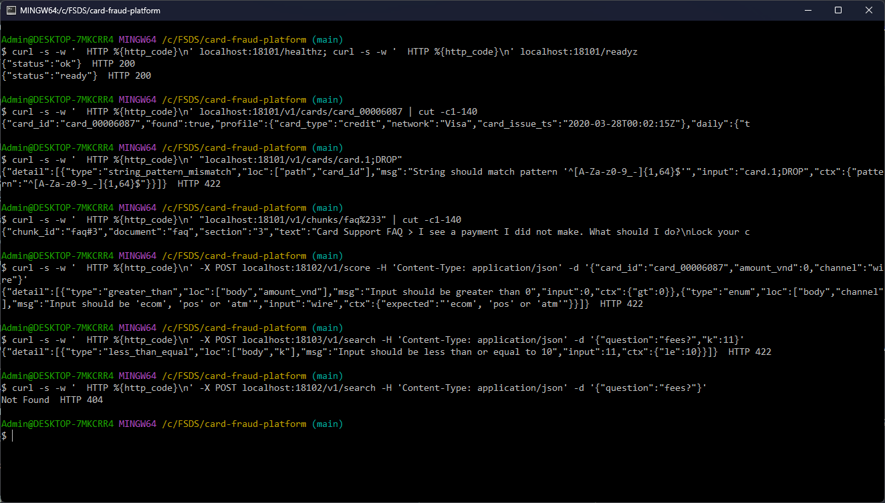

### Health checks for Kubernetes

`/healthz` answers as long as the process serves requests and never checks a dependency: it is the startup and the
liveness probe. `/readyz` checks the dependencies of this server's tools
([`app/main.py` L183-L194](../services/card_support_mcp/app/main.py#L183-L194)) and is the readiness probe. When a store
or an upstream is down, the server's pods stop getting traffic, but Kubernetes does not restart them: the fault is
outside the pod and a restart would not fix it. The probes in the chart
([`deployment.yaml` L36-L48](../services/card_support_mcp/chart/templates/deployment.yaml#L36-L48)):

```yaml
          startupProbe:
            httpGet: {path: /healthz, port: http}
            periodSeconds: 2
            failureThreshold: 30
          livenessProbe:
            httpGet: {path: /healthz, port: http}
            periodSeconds: 10
          readinessProbe:
            httpGet: {path: /readyz, port: http}
            periodSeconds: 5
            timeoutSeconds: 5
```

The test, from Git Bash: the Scoring API (compose container `scoring-api`) is stopped. Within the readiness period
both fraud-score pods go to 0/1 Ready with 0 restarts; `/healthz` still answers 200 and `/readyz` 503
(`not ready: scoring ConnectError`). Once the container is back, the pods are Ready again and `/readyz` answers 200.
No pod is restarted for a fault outside it. While no fraud-score pod is Ready, though, the gateway cannot connect to
the server at all, and the risk agent then fails every question, also the ones that need no score: a readiness check
on an upstream that all replicas share takes them out together (see Gotchas, data-agents #37).

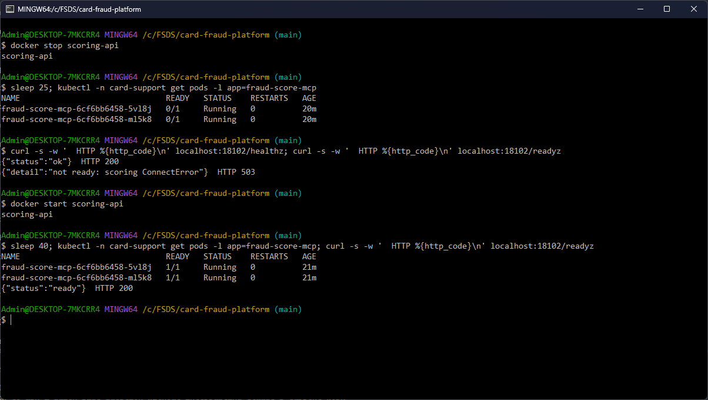

### Async

Every handler is `async`. The HTTP clients (embeddings, Scoring API) are one pooled `httpx.AsyncClient` each, and the
Feast reads that have no async API (the pgvector store) run in `asyncio.to_thread`, so one slow search does not hold up
the other requests ([`app/clients.py` L59-L72, L83-L117](../services/card_support_mcp/app/clients.py#L59-L117)). The
load test of the card data Web API is in [testing.md](testing.md#load-test-locust-1).

### Deployed with Helm: one release per server, rolling update, automatic rollback

One chart, [`services/card_support_mcp/chart`](../services/card_support_mcp/chart), with a values file per server
([`values-card-data.yaml`](../services/card_support_mcp/chart/values-card-data.yaml),
[`values-fraud-score.yaml`](../services/card_support_mcp/chart/values-fraud-score.yaml),
[`values-policy-rag.yaml`](../services/card_support_mcp/chart/values-policy-rag.yaml)), gives three releases in
namespace `card-support`. Each runs 2 replicas with `RollingUpdate` (`maxSurge: 1`, `maxUnavailable: 0`,
`minReadySeconds: 5`, [`deployment.yaml` L11-L14](../services/card_support_mcp/chart/templates/deployment.yaml#L11-L14)):
a new pod has to pass `/readyz` before an old one stops, so a server never drops below two serving pods. The pipeline
installs the releases one after the other with `helm upgrade --install --atomic`: when the new pods do not become Ready
in time, Helm rolls the release back to the last good revision by itself, and the pipeline stops before the next
server ([`Jenkinsfile` L64-L78](../services/card_support_mcp/Jenkinsfile#L64-L78)):

```groovy
        stage('Deploy (helm --atomic)') {
          // one release per server, one after the other; rolling update with maxUnavailable 0; a release whose pods
          // never get Ready is rolled back by --atomic and stops the pipeline before the next server
          steps {
            withCredentials([file(credentialsId: 'kubeconfig', variable: 'KUBECONFIG')]) {
              sh '''
                for s in $SERVERS; do
                  helm upgrade --install $s-mcp $SVC/chart -f $SVC/chart/values-$s.yaml -n card-support \
                    --atomic --timeout 4m --set image.tag=$TAG
                  kubectl -n card-support rollout status deploy/$s-mcp --timeout=60s
                done
              '''
            }
          }
        }
```

MCP sessions are stateless (the gateway backend sets `sessionRouting: Stateless`), so any replica answers any call and
a rolling update does not break a conversation.

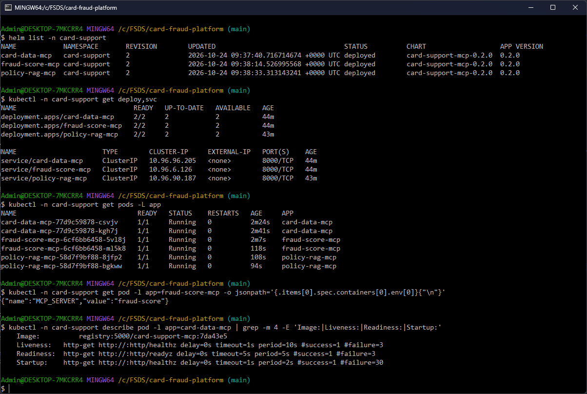

The fallback, tested on fraud-score: a release that points the server at a Scoring API that does not exist
(`--set env.SCORING_URL=http://no-such-api:8000/v1/score`, `--atomic --timeout 90s`). Its new pod never passes
`/readyz`, so after 90 s Helm answers `UPGRADE FAILED ... has been rolled back due to atomic being set`, writes
revision 4 "Rollback to 2" and removes the new pod; the two old pods served all along. A client called
`score_payment` through the gateway every 0.2 s meanwhile: 337 calls, all 200.

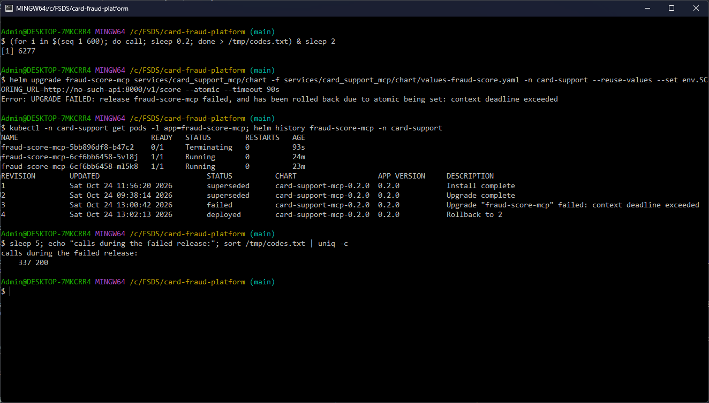

And a normal rolling update, on policy-rag with one setting changed (`TIMEOUT_S` 5 to 4) while a client searched the
policies through the gateway: the upgrade took 29 s, the two pods were replaced one at a time, and all 72 calls
answered 200.

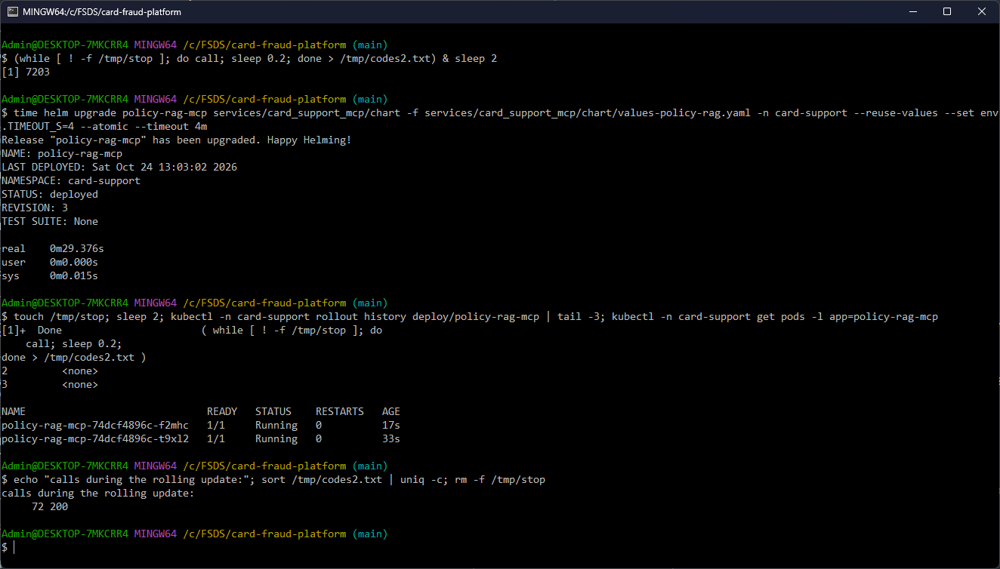

## The agents: replicas, autoscaling, sandbox

Each Agent becomes a Deployment managed by kagent. The chart leaves `replicas` unset, so kagent does not fight the
autoscaler, and adds a KEDA ScaledObject per agent ([`scaledobjects.yaml`](../agents/chart/templates/scaledobjects.yaml)):
minimum 2 replicas, maximum 4, scaled on the agent's A2A request rate through the gateway (Prometheus
`agentgateway_requests_total`), 0.04 requests per second per replica. A conversation takes about 40 s, so that is
about 1.6 conversations in flight per replica. More replicas add no LLM capacity (one GPU behind llm-d); they keep a
slow conversation from blocking the next one.

[`scaledobjects.yaml` L1-L22](https://github.com/cvinhnguyen/card-fraud-platform/blob/35d4295a1e5a409fa242bc6aa9eff9b06038c111/agents/chart/templates/scaledobjects.yaml#L1-L22):

```yaml
{{- $as := .Values.autoscaling }}
{{- range $name, $a := include "card-support.agents" . | fromYaml }}
---
# KEDA owns the replicas of the Deployment kagent creates for the agent (the Agent leaves replicas unset)
apiVersion: keda.sh/v1alpha1
kind: ScaledObject
metadata:
  name: {{ $name }}
  namespace: {{ $.Release.Namespace }}
spec:
  scaleTargetRef: {name: {{ $name }}}
  minReplicaCount: {{ $as.minReplicas }}
  maxReplicaCount: {{ $as.maxReplicas }}
  pollingInterval: 15   # scale-down: the HPA's 5 min stabilization (cooldownPeriod applies only to scale-to-zero)
  triggers:
    - type: prometheus
      metadata:
        serverAddress: {{ $as.prometheus }}
        query: sum(rate(agentgateway_requests_total{backend="{{ $.Values.gateway.namespace }}/agent-{{ $name }}"}[1m]))
        threshold: {{ $as.requestsPerSecond | quote }}
        ignoreNullValues: "true"
{{- end }}
```

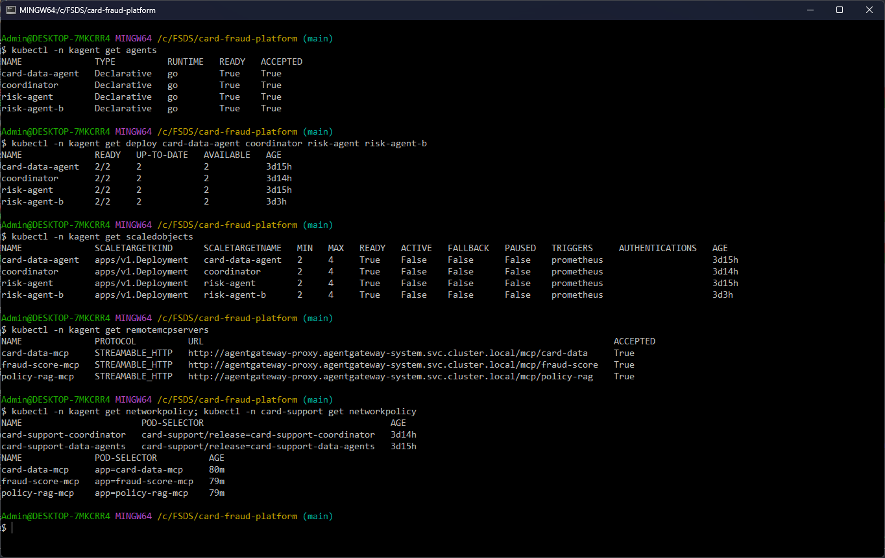

Scaling test: locust sent 6 users for 3 min 41 s to `/a2a/coordinator` (31 conversations, 0 failures). The coordinator
went from 2 to 4 replicas, the risk agent from 2 to 4 and the card data agent from 2 to 3, and they came back down
after the load. The full locust reports: [`locust_agents_scaling.html`](images/locust_agents_scaling.html) (this run)
and [`locust_agents_a2a.html`](images/locust_agents_a2a.html) (6 users, 5 minutes, 37 conversations, 0 failures,
p95 85 s).

Run again on 2026-10-21 from Git Bash: locust in a container on the kind network, 6 users for 3 minutes against the
gateway's `/a2a/coordinator` (18 conversations, 0 failures). Right after it, the coordinator was at 4 replicas and
risk-agent-b at 3, and the HPA events KEDA drives give the reason: the agent's request rate through the gateway
(`s0-prometheus`) above its target. The older events at the top are the HPAs being created and an earlier rise and
fall of the coordinator.

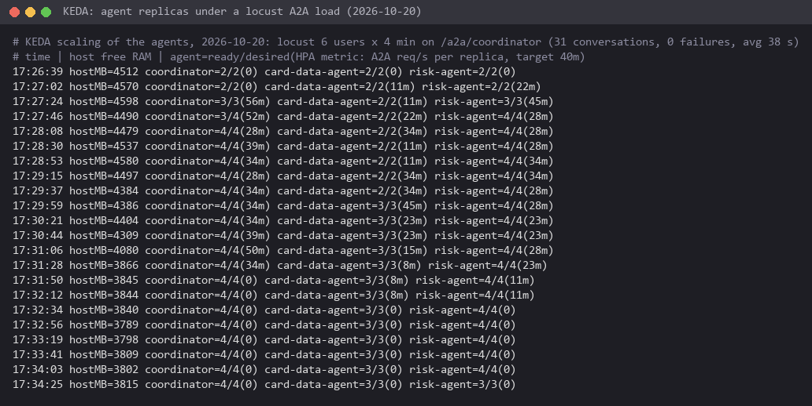

The agents' pods are limited by a NetworkPolicy ([`networkpolicy.yaml`](../agents/chart/templates/networkpolicy.yaml)):
they accept A2A calls only from the gateway proxy and the kagent controller, and they can open connections only to
DNS, the gateway, the kagent controller and Jaeger. An agent cannot reach an MCP server, the model server or another
agent except through the gateway. Each MCP server has its own policy
([`networkpolicy.yaml`](../services/card_support_mcp/chart/templates/networkpolicy.yaml)): it accepts connections only
from the gateway, Prometheus and its own namespace, and only the public Web API (card-data) also from NGINX.

### Sandboxed agents on Agent Substrate (warm-up)

The same chart renders every agent a second time as a SandboxAgent
([`sandboxagents.yaml` L1-L22](https://github.com/cvinhnguyen/card-fraud-platform/blob/35d4295a1e5a409fa242bc6aa9eff9b06038c111/agents/chart/templates/sandboxagents.yaml#L1-L22)),
from the same spec helper, so the sandboxed copy has the same prompt, tools and model config. A SandboxAgent runs each
conversation in its own gVisor sandbox on Agent Substrate 0.0.9, installed by
[`infra/k8s/llm-platform.sh` L34](https://github.com/cvinhnguyen/card-fraud-platform/blob/35d4295a1e5a409fa242bc6aa9eff9b06038c111/infra/k8s/llm-platform.sh#L34)
with kagent's worker pool turned on at
[L51-L55](https://github.com/cvinhnguyen/card-fraud-platform/blob/35d4295a1e5a409fa242bc6aa9eff9b06038c111/infra/k8s/llm-platform.sh#L51-L55).
Each sandbox is restored from a snapshot taken once the agent was warm, so there is no cold start. Its network egress
is limited to two hosts, the gateway and the kagent controller
([`values.yaml` L32-L39](https://github.com/cvinhnguyen/card-fraud-platform/blob/35d4295a1e5a409fa242bc6aa9eff9b06038c111/agents/chart/values.yaml#L32-L39)).

All sandboxed agents share the worker pool `kagent-default`. One worker runs one active conversation; after it, the
sandbox is snapshotted and the worker takes the next one. On this machine the pool has a single worker. In Git Bash,
`ask` is a shell function defined earlier in the session: an A2A `message/send` to
`/api/a2a-sandboxes/kagent/<agent>-sandbox/` on the kagent controller (port-forward), retried every 3 s while the
answer is "no free workers"; it prints the time and the number of retries:

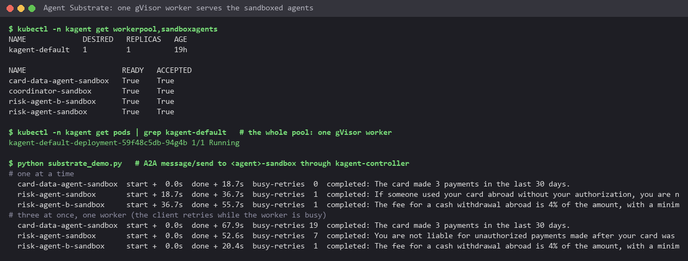

One after the other, the three agents answered in 8 to 28 s on the same worker (the retries are the worker taking
the snapshot of the previous conversation). Sent at once, one got the worker and the others got "no free workers"
until it was free, retried, and all three answered within 61 s. The number of workers a fleet needs is the number of
conversations it runs at the same time, whatever the number of agents.

## MCP gateway

Each MCP server is reached only through its own route on agentgateway, `/mcp/<server>`
([`chart/templates/gateway.yaml`](../services/card_support_mcp/chart/templates/gateway.yaml)). kagent sees each server
through one RemoteMCPServer ([`mcp-servers.yaml`](../services/card_support_mcp/chart/templates/mcp-servers.yaml)) that
points at that route and sends the key of the server's agent, from a Secret synced from Vault.

| Policy | Setting | Why |
|---|---|---|
| Authentication | `apiKeyAuthentication: Strict`, keys stored as SHA-256 hashes with a user id | a call without a known key never reaches a server |
| Tool authorization | per route: `apiKey.user_id == "card-data-agent"` on `/mcp/card-data`, `apiKey.user_id == "risk-agent"` on `/mcp/fraud-score` and `/mcp/policy-rag` | least privilege: the card data agent cannot score payments or search the policies, the risk agent cannot read raw card data; the rule filters `tools/list` too, so an agent does not even see the other servers' tools |
| Rate limit | 300 requests a minute, burst 50, per server | a looping agent cannot flood the stores |
| Session routing | `Stateless` | any replica of the server answers any call (rolling updates, scaling) |

The route, the backend and the policy come from the release's values (`server`, `agent`), in
[`gateway.yaml` L30-L53](../services/card_support_mcp/chart/templates/gateway.yaml#L30-L53):

```yaml
# Who: an API key from agentgateway-api-keys. How much: a request rate limit. What: only the key of this server's
# agent sees its tools (the rule runs once per tool, in tools/list and in tools/call); any other key, even a valid
# one, sees no tool here.
apiVersion: agentgateway.dev/v1alpha1
kind: AgentgatewayPolicy
metadata:
  name: {{ .Release.Name }}
  namespace: {{ $ns }}
spec:
  targetRefs: [{group: gateway.networking.k8s.io, kind: HTTPRoute, name: {{ .Release.Name }}}]
  traffic:
    apiKeyAuthentication:
      mode: Strict
      configMapSelector: {matchLabels: {agentgateway.dev/apikey: "true"}}
    rateLimit:
      local:
        - {requests: {{ .Values.gateway.rateLimit.requests }}, unit: Minutes, burst: {{ .Values.gateway.rateLimit.burst }}}
  backend:
    mcp:
      authorization:
        action: Allow
        policy:
          matchExpressions:
            - {{ printf "apiKey.user_id == %q" (required "agent: the gateway key user allowed to use these tools" .Values.agent) | quote }}
```

In the screenshot below, the policies are called from Git Bash through a port-forward to the gateway. `mcp` and
`tools` are shell functions typed at the start of the session: one curl `POST /mcp/<server>` with the given key as a
Bearer token and a JSON-RPC body (the servers are stateless, so `tools/list` needs no `initialize` first). The keys
come from the environment; only their variable names appear:

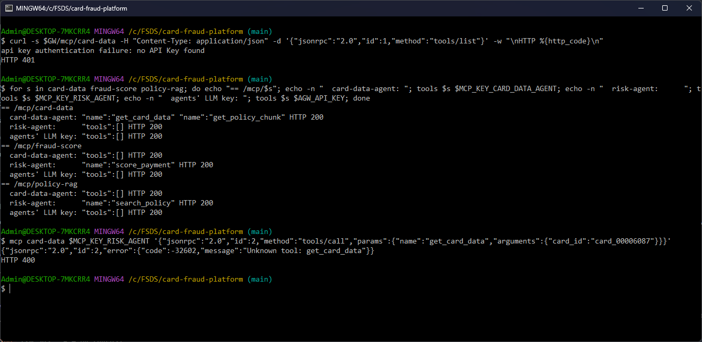

With no key a route answers 401. On each route only the key of that server's agent lists its tools: the card data
agent's key sees `get_card_data` and `get_policy_chunk` on `/mcp/card-data` and nothing on the other two routes; the
risk agent's key sees `score_payment` on `/mcp/fraud-score` and `search_policy` on `/mcp/policy-rag`, and nothing on
`/mcp/card-data`; the agents' LLM key passes authentication but sees no tool anywhere. The risk agent's key calling
`get_card_data` gets `Unknown tool: get_card_data`.

## A2A gateway

kagent's `proxy.url` sends every agent-as-tool call to the gateway instead of the other agent's Service, with the
header `x-kagent-host: <agent>.<namespace>`. The chart adds the routes and policies
([`a2a-gateway.yaml`](../agents/chart/templates/a2a-gateway.yaml)):

| Route | Who may call | Policy |
|---|---|---|
| `card-support-data-agents-internal` (header `x-kagent-host`) | key user `coordinator` only (the coordinator, and CI's smoke test and eval gate, which call an agent the way the coordinator does) | API key, `apiKey.user_id in ["coordinator"]`, 120 requests a minute (burst 20), 300 s timeout for long conversations |
| `a2a-coordinator` (`/a2a/coordinator`) | key user `support-app` only (the bank's support app, the coordinator pipeline's smoke test) | API key, `apiKey.user_id == "support-app"`, same rate limit |

The gateway rewrites the URL in each agent card to its own address, so an A2A client that follows the card keeps
going through the gateway. The A/B split of the risk agent also happens on the internal route (weights and the
`x-agent-variant` header, [ab_testing.md](ab_testing.md)). On the A2A side, `/a2a/coordinator` refuses a missing key
(401) and the coordinator's own key (403), and accepts the support app's key; the internal route refuses the support
app (403) and accepts the coordinator. A pod outside the gateway path that calls the risk agent or an MCP server
directly times out.

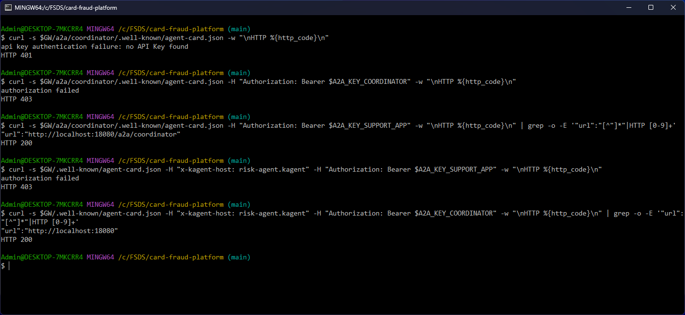

## Chat with the agents (kagent UI)

The kagent UI is published by NGINX at `https://agents.<domain>` behind basic auth ([edge_security.md](edge_security.md)).
It lists the agents and their sandboxed copies (lock icon), the three MCP servers with the tools kagent found on each,
and a chat with the coordinator shows each sub-agent call it makes:

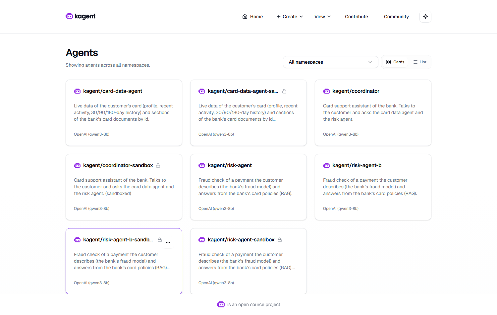

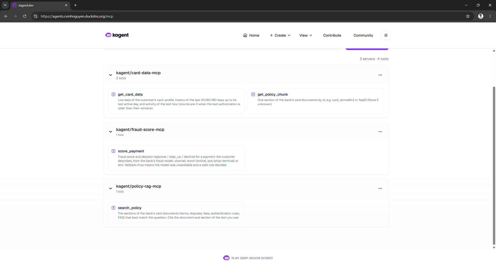

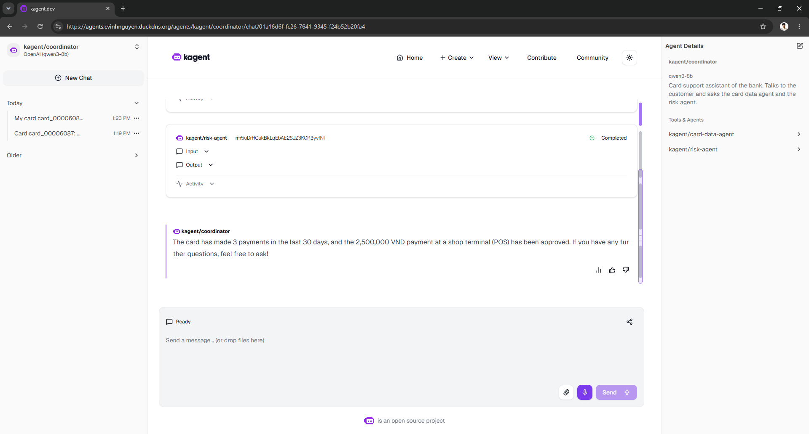

The risk agent's activity in the same chat: the request it got from the coordinator, one tool call `score_payment`
(served by `fraud-score-mcp`), and its answer. The A/B split of the gateway sent this call to `risk-agent-b`:

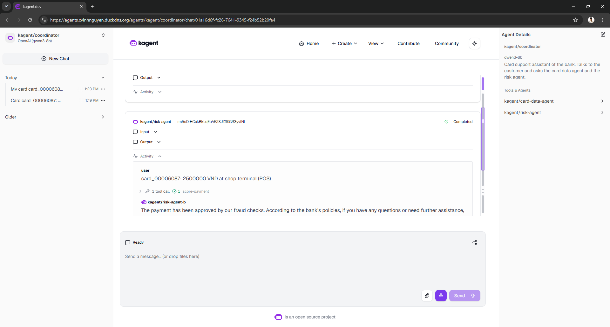

## Agent registry

agentregistry 0.4.0 (namespace `agentregistry`, its own database on ml-db, RBAC limited to the `kagent` namespace)
keeps the catalog: which agents exist, their version and runtime image, where their definition lives and which MCP
servers they use. The catalog is code, [`agents/registry/catalog.yaml`](../agents/registry/catalog.yaml), published
with `arctl apply -f agents/registry/catalog.yaml`; install values in
[`agents/registry/values.yaml`](../agents/registry/values.yaml). The UI is at `https://registry.<domain>` (basic auth).

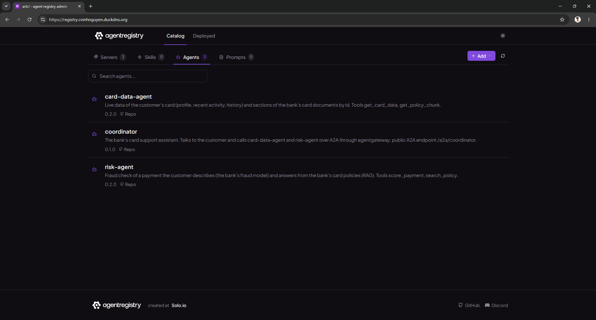

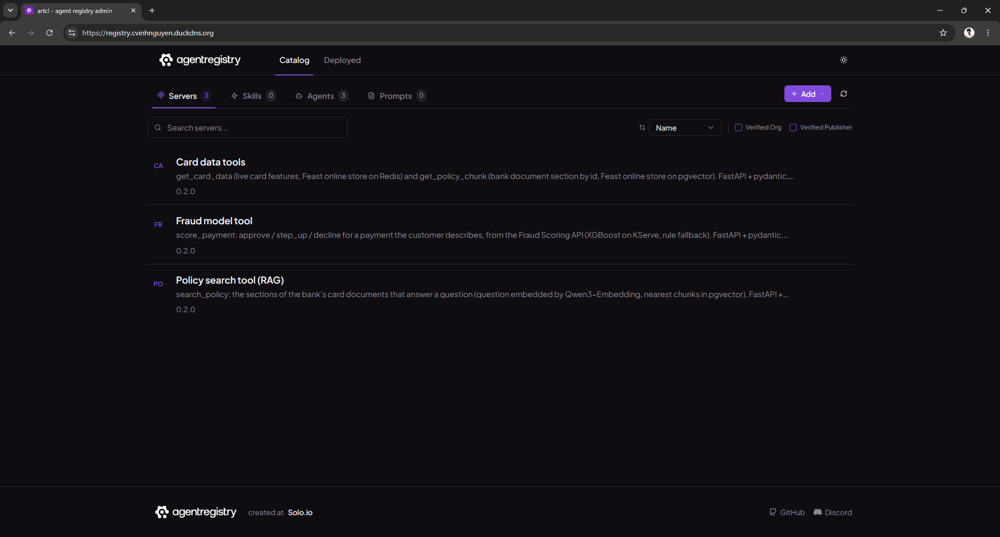

Each agent record names the servers it uses; the risk agent's raw record lists `fraud-score-mcp` and
`policy-rag-mcp`, both at 0.2.0:

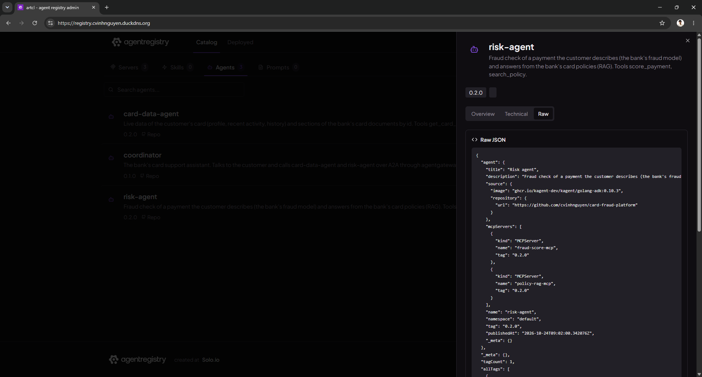

## Gotchas

- After a reboot the Substrate Valkey cluster keeps its old pod IPs and the sandbox network components keep stale
  state: re-introduce the Valkey nodes (`CLUSTER MEET`), then restart `atenet-router`, `dns`, `ate-controller`,
  `atelet`, the ATE API server, the worker pool and the kagent controller. Before that, a sandboxed conversation hangs
  and holds the only worker.
- kagent's UI chat reaches the coordinator through the kagent controller. That first hop is kagent's control path and
  skips the gateway (kagent 0.10.3 cannot send it through `proxy.url`); every hop after it goes through the gateway.
- KEDA compares the trigger value per replica (`AverageValue`): 0.13 requests per second over two replicas did not
  cross a 0.1 threshold, which is why the threshold is per replica and low.
- The gateway's PII guardrail on the LLM route can replace a number in the conversation with a placeholder such as
  `<PHONE_NUMBER>`, and the model may then pass that placeholder as `device_id` to `score_payment`. pydantic rejects it
  (`String should match pattern`), and the agent gets the reason as a tool error instead of a wrong score.
- The A/B split of the risk agent is per call, not per conversation. When the coordinator sends two calls of one
  sub-agent session at the same time and the gateway gives one to `risk-agent` and the other to `risk-agent-b`, both
  try to create that session in the kagent controller (`Session not found`, then `created ... agentRef
  kagent__NS__risk_agent_b`) and one call ends with an error the coordinator reports as a system error. Seen once on
  2026-10-24 in a chat that asked for a fee and a payment check together; a question that needs one call per agent
  is not affected. A per-session split needs a session key the gateway can hash on; the A/B tests of
  [ab_testing.md](ab_testing.md) call the agents directly with a new context per question.
- A readiness check on an upstream that every replica shares takes all of them out at once. On 2026-10-24 the Docker
  VM was overloaded (5-minute load average 19, 15-minute 27, read right after), `/readyz` of both fraud-score pods
  failed (timeouts and 503), and from 10:49:13 to 10:49:41 UTC the gateway's connections to `/mcp/fraud-score` were
  refused (`upstream call failed: Connect: Connection refused`). The risk agent connects to each of its MCP servers
  for every question, so the 22 questions it got in those 28 s failed, policy questions included; the 18 it got before
  and after were all answered right. The eval gate of data-agents #37 scored its two runs 0.20 and 0.70 and rolled the
  release back ([novel_eval_gate.md](novel_eval_gate.md#proof-it-worked)). The check stays because it is what makes
  `helm --atomic` roll back a release whose new pods cannot reach their upstream (the test above). Its price is that
  a slow upstream turns tool errors into failed questions. Checking the upstream in the startup probe only would keep
  the rollback and remove that price.
