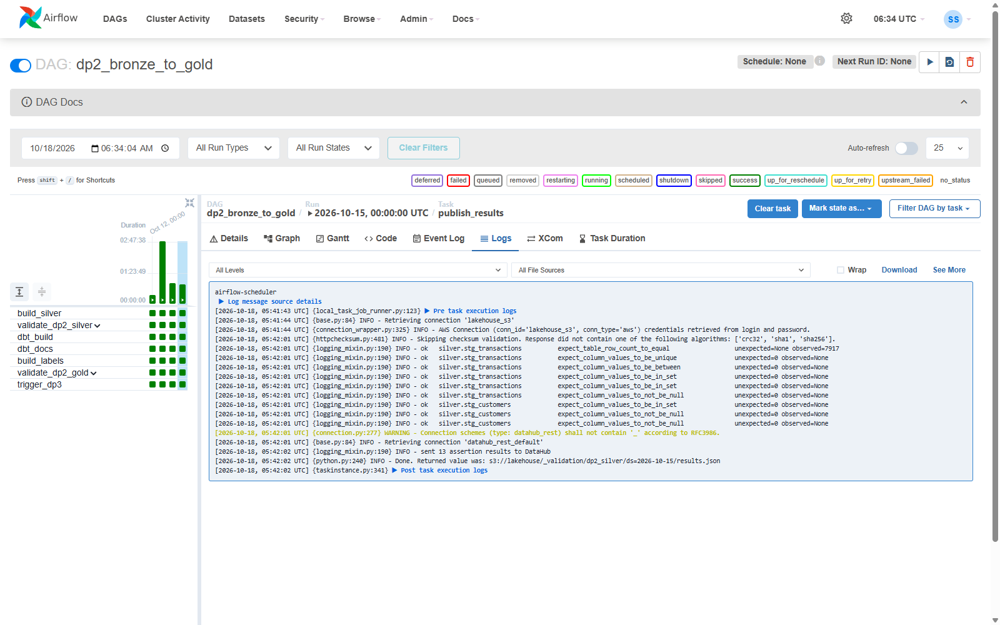
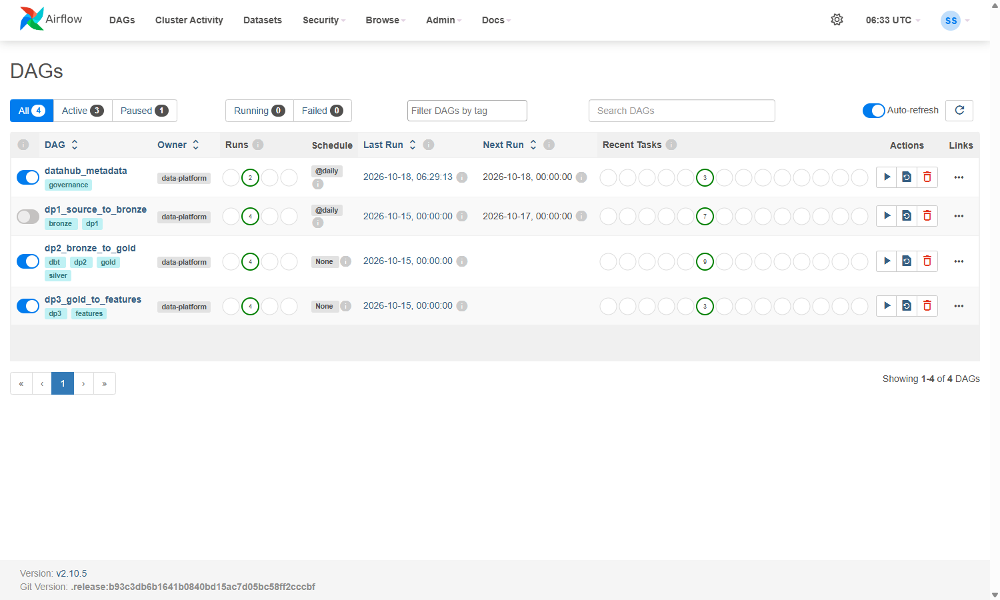
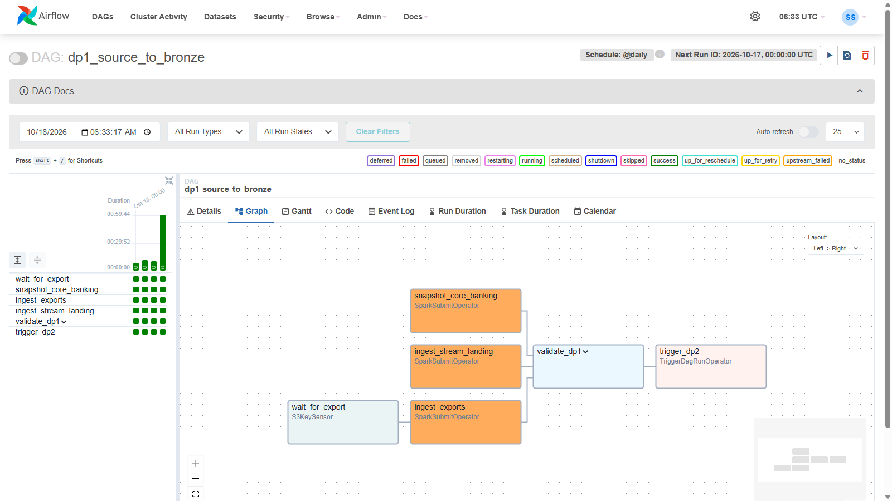
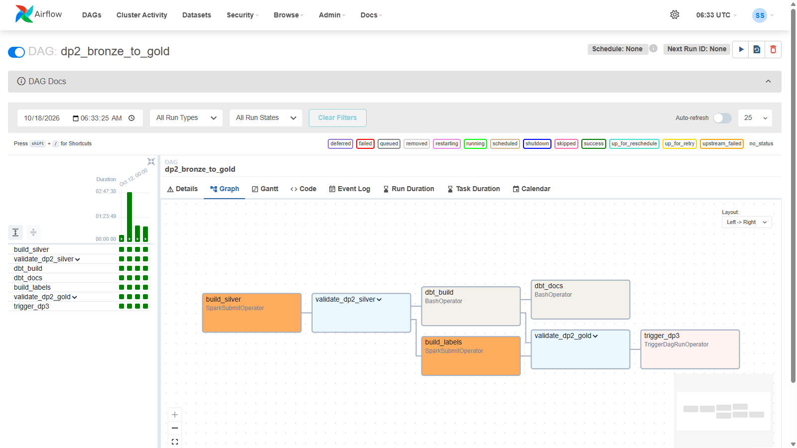
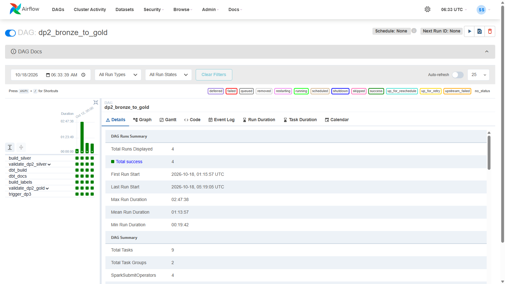
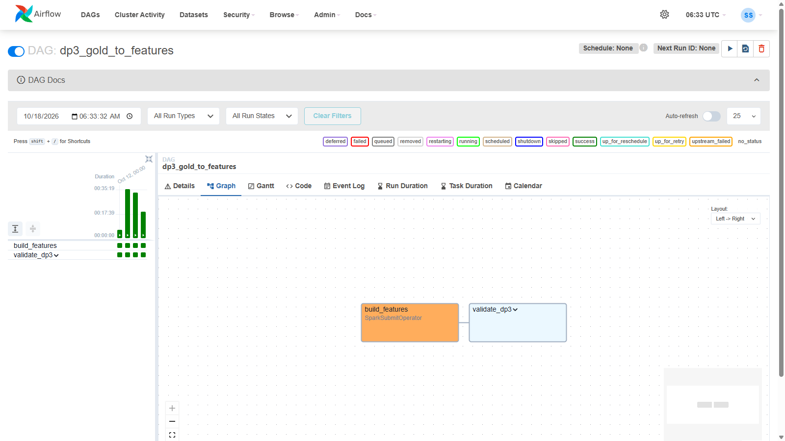
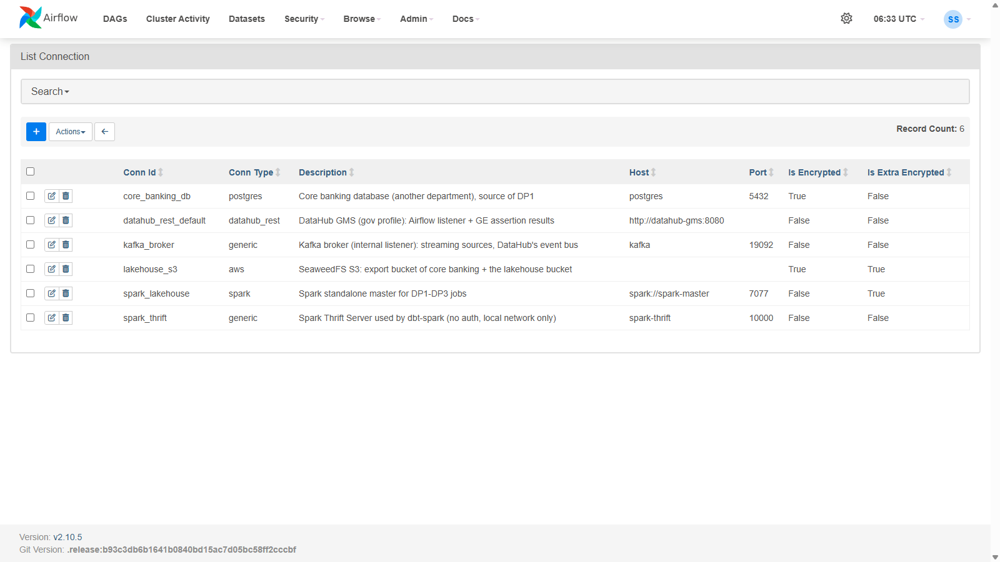
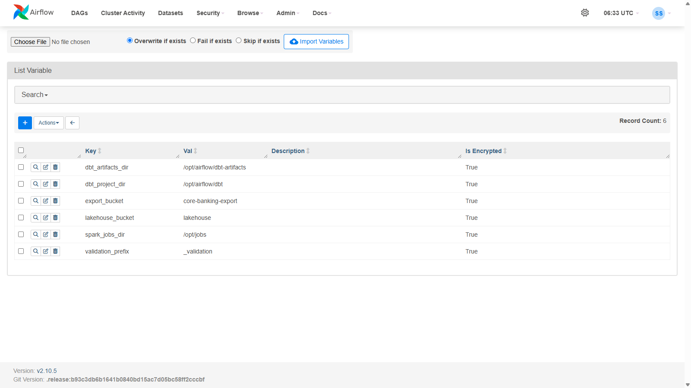
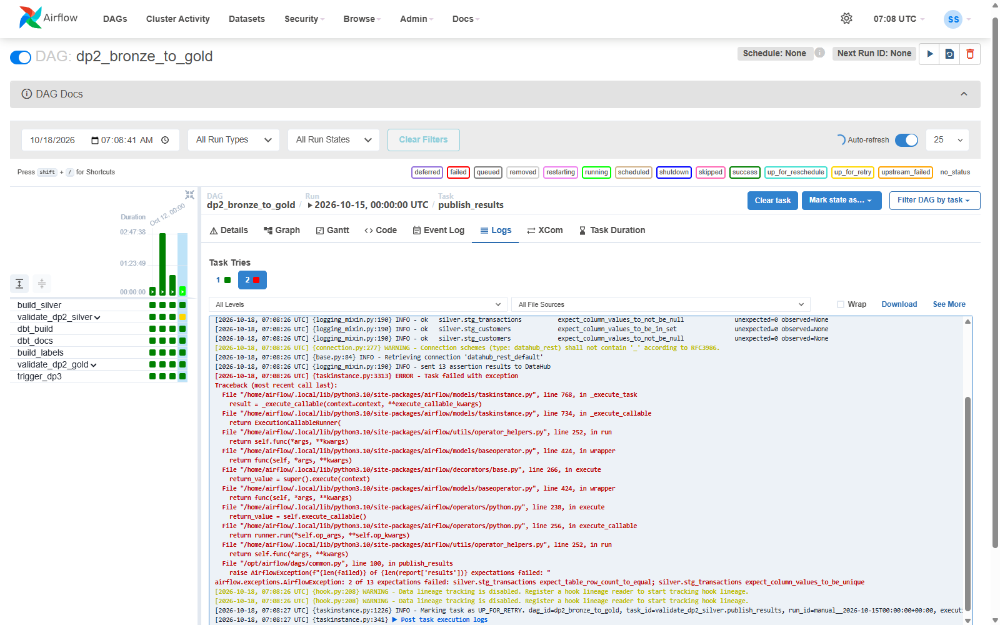
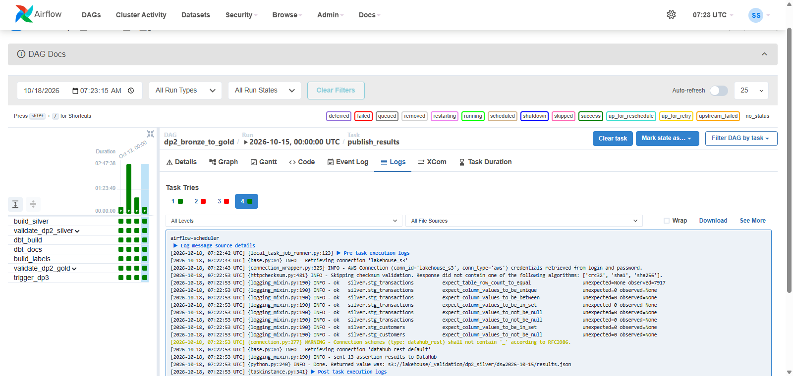

# Airflow pipelines (DP1, DP2, DP3)

Airflow runs the three batch data pipelines of Layer 1: DP1 loads the core banking sources and Flink's landing files
into bronze, DP2 builds silver and gold, DP3 computes the daily card feature table. Each DAG has an ingest stage and a
validate stage (Great Expectations on Spark) that stops the run before a bad batch reaches the next zone, and since
2026-10-24 DP1 publishes the nightly export through a lakeFS branch.

| | |
|---|---|
| Code | [`pipelines/airflow/`](https://github.com/cvinhnguyen/card-fraud-platform/tree/612ffdc2aa8a38f9098d6190f54bd46c2ea70315/pipelines/airflow), [`pipelines/spark/validate.py`](https://github.com/cvinhnguyen/card-fraud-platform/blob/612ffdc2aa8a38f9098d6190f54bd46c2ea70315/pipelines/spark/validate.py), [`infra/airflow/Dockerfile`](https://github.com/cvinhnguyen/card-fraud-platform/blob/612ffdc2aa8a38f9098d6190f54bd46c2ea70315/infra/airflow/Dockerfile) |
| Runs on | compose profile `orch`: Airflow 2.10.5 (LocalExecutor), UI http://127.0.0.1:8082 (user `admin`, password `AIRFLOW_ADMIN_PASSWORD` in `infra/.env`); Spark drivers in the scheduler container, executors on the standalone Spark cluster |
| Reads | core banking Postgres (6 tables), the nightly export in `s3://core-banking-export/transactions/`, Flink's raw authorization files |
| Writes | `bronze.raw_*` (the export through the lakeFS branch `dp1_<ds>`), `silver.stg_*`, gold dims, `fact_transaction` and `label_transaction`, `gold.feat_card_txn_stats_daily`; validation results in `s3://lakehouse/_validation/` |
| Related | [spark_jobs.md](spark_jobs.md), [novel_lakefs_wap.md](novel_lakefs_wap.md), [datahub.md](datahub.md), [feature_store.md](feature_store.md) |

## Run it

From the repo root, with the source data loaded (README, Quick start): start Airflow next to the batch stack, then
backfill DP1; DP2 and DP3 follow:

```bash
python infra/make_env.py                                              # adds the Airflow secrets to infra/.env
docker compose -f infra/docker-compose.yaml --profile core --profile batch --profile orch up -d --build
# with lineage + validation results in DataHub: add --profile gov (P8); without it: DATAHUB_ENABLED=false in infra/.env
docker exec airflow-scheduler airflow dags unpause dp2_bronze_to_gold   # DP2 / DP3 only run when triggered
docker exec airflow-scheduler airflow dags unpause dp3_gold_to_features
docker exec airflow-scheduler airflow dags backfill dp1_source_to_bronze -s 2026-10-12 -e 2026-10-15
```

## DAGs

Three of the DAGs in
[`pipelines/airflow/dags/`](https://github.com/cvinhnguyen/card-fraud-platform/tree/612ffdc2aa8a38f9098d6190f54bd46c2ea70315/pipelines/airflow/dags)
are the data pipelines, each with an ingest stage and a validate stage. The other four are `datahub_metadata`
([datahub.md](datahub.md)), for Layer 2 `feast_materialize` ([feature_store.md](feature_store.md)) and
`drift_monitoring` ([drift.md](drift.md)), and for Layer 3 `rag_ingest` ([rag_pipeline.md](rag_pipeline.md)).

| DAG | Schedule | Ingest stage | Validate stage |
|---|---|---|---|
| `dp1_source_to_bronze` | daily, business day `ds` | Postgres snapshot, new export files, Flink landing files -> `bronze.raw_*` | GE on the new export + every snapshot table |
| `dp2_bronze_to_gold` | triggered by DP1 (same logical date) | `stg_*` (PySpark), gold dims + fact (dbt-spark), labels as of `ds` | GE on silver before dbt reads it, then on gold + labels; dbt tests inside `dbt_build` |
| `dp3_gold_to_features` | triggered by DP2 | `feat_card_txn_stats_daily` | GE on the feature rows of `ds` |

## How the pieces fit

- `SparkSubmitOperator` submits `pipelines/spark/*.py` to the standalone master (connection
  `spark_lakehouse`). Standalone has no cluster deploy mode for Python, so the driver runs inside the scheduler
  container. The Airflow image therefore carries the same JRE and `/opt/spark` as the Spark image (copied from it in
  the Dockerfile,
  [`infra/airflow/Dockerfile` L38-L46](https://github.com/cvinhnguyen/card-fraud-platform/blob/612ffdc2aa8a38f9098d6190f54bd46c2ea70315/infra/airflow/Dockerfile#L38-L46)),
  so the driver has the cluster's Spark 4.1.3 and the executors' Python 3.10. The scheduler runs as
  uid 185 (the Spark user) and mounts the same `spark-defaults.conf` and the `spark_ivy` volume, where event logs land
  for the history server (:18080), so a run started by Airflow can be opened there like any other. The Delta / S3A /
  JDBC / OpenLineage jars are in the image (`fraud/spark`, P9), so nothing is downloaded at run time.
- The scheduler is on two networks (the default one and `airflow-docker` for DockerOperator), and its hostname
  resolves to the `airflow-docker` address first. A driver bound there refuses the executors, which reach it on the
  default network, so every Spark task sets `spark.driver.bindAddress` to `0.0.0.0`
  ([`pipelines/airflow/dags/common.py` L46-L48](https://github.com/cvinhnguyen/card-fraud-platform/blob/612ffdc2aa8a38f9098d6190f54bd46c2ea70315/pipelines/airflow/dags/common.py#L46-L48)).
- The pool `spark` has 1 slot. The worker has 3 GB: one executor (1.5 GB for DAG tasks) at a time, with room left
  for the Thrift Server's 1 GB executor when it is up. Every Spark task takes the pool slot, so Spark applications
  from overlapping DAG runs queue in Airflow instead of waiting for executors inside Spark.
- Connections and variables live in Airflow. `airflow-init` creates them from `infra/.env`
  ([`pipelines/airflow/setup_airflow.py` L62-L72](https://github.com/cvinhnguyen/card-fraud-platform/blob/612ffdc2aa8a38f9098d6190f54bd46c2ea70315/pipelines/airflow/setup_airflow.py#L62-L72),
  which also creates the `spark` pool); passwords are stored encrypted with the Fernet key. The DAG code holds no host
  name or credential: tasks render them at run time (`{{ conn.lakehouse_s3.password }}`), and Spark jobs read them from
  their environment (`CORE_DB_URL`, `CORE_DB_USER`, `AWS_ACCESS_KEY_ID`, `LAKEFS_ACCESS_KEY_ID`, ...). The task logs
  contain none of the secret values (checked by searching the logs for them).

Every Spark task of the three DAGs comes from one helper that sets the connection, the S3 environment and the
`spark` pool
([`pipelines/airflow/dags/common.py` L52-L59](https://github.com/cvinhnguyen/card-fraud-platform/blob/612ffdc2aa8a38f9098d6190f54bd46c2ea70315/pipelines/airflow/dags/common.py#L52-L59)):

```python
def spark_job(task_id: str, script: str, args: list[str] | None = None, env: dict | None = None,
              conf: dict | None = None, **kwargs) -> SparkSubmitOperator:
    """spark-submit pipelines/spark/<script> to the standalone master. Pool `spark` (1 slot) runs one application at a time,
    because the 3 GB worker fits one 2 GB executor next to the Thrift Server."""
    return SparkSubmitOperator(task_id=task_id, conn_id="spark_lakehouse",
                               application="{{ var.value.spark_jobs_dir }}/" + script, application_args=args or [],
                               env_vars={**S3_ENV, **(env or {})}, conf={**SPARK_CONF, **(conf or {})}, pool="spark",
                               **kwargs)
```

The connections and variables the DAGs use, as `setup_airflow.py` creates them
([`pipelines/airflow/setup_airflow.py` L14-L60](https://github.com/cvinhnguyen/card-fraud-platform/blob/612ffdc2aa8a38f9098d6190f54bd46c2ea70315/pipelines/airflow/setup_airflow.py#L14-L60)):

| Connection | Type | Used by |
|---|---|---|
| `spark_lakehouse` | spark, `spark://spark-master:7077`, client mode | every Spark task |
| `core_banking_db` | postgres, `postgres:5432/core_banking` | DP1 snapshot (JDBC URL, user, password) |
| `lakehouse_s3` | aws, endpoint `http://seaweedfs:8333` | S3 sensor, S3 credentials of the drivers, reading GE results |
| `lakefs` | http, `http://lakefs:8000` | DP1 `create_branch`, `commit_branch` and `merge_to_main` (lakeFS API), lakeFS keys of the drivers |
| `spark_thrift` | generic, `spark-thrift:10000` | dbt by hand / BI tools (`pipelines/dbt/profiles.yml` target `local`) |
| `kafka_broker` | generic, `kafka:19092` | DataHub ingestion of the topics (`datahub_metadata` DAG) |
| `datahub_rest_default` | datahub_rest, `http://datahub-gms:8080` | DataHub listener, GE results as assertions |

| Variable | Value |
|---|---|
| `spark_jobs_dir` | `/opt/jobs` (the `pipelines/spark/` folder, mounted in the Spark and Airflow containers) |
| `dbt_project_dir`, `dbt_artifacts_dir` | `/opt/airflow/dbt` (read-only), `/opt/airflow/dbt-artifacts` (target + logs volume) |
| `export_bucket`, `lakehouse_bucket`, `validation_prefix` | `core-banking-export`, `lakehouse`, `_validation` |

- dbt runs as a Spark application too. In DP2, dbt uses its `session` target: it opens its own Spark session in
  the task (same `spark-defaults.conf`, so OpenLineage sees its SQL, and the same Spark settings as `spark_job()`,
  driver bind address included), queued in the `spark` pool
  ([`pipelines/airflow/dags/dp2_bronze_to_gold.py` L30-L52](https://github.com/cvinhnguyen/card-fraud-platform/blob/612ffdc2aa8a38f9098d6190f54bd46c2ea70315/pipelines/airflow/dags/dp2_bronze_to_gold.py#L30-L52)).
  The Spark Thrift Server (target `local`) is for interactive use: it holds a 1 GB driver and a 1 GB executor all the
  time, which next to DataHub pushed the 8 GB Docker VM into swap; Docker's DNS then failed (`Unable to execute HTTP
  request: seaweedfs`) and tasks failed at random.
- Every task has `depends_on_past`
  ([`pipelines/airflow/dags/common.py` L18-L20](https://github.com/cvinhnguyen/card-fraud-platform/blob/612ffdc2aa8a38f9098d6190f54bd46c2ea70315/pipelines/airflow/dags/common.py#L18-L20)).
  All loads are incremental, so day D must not run before D-1 succeeded. The first backfill showed why: a Docker DNS
  error failed DP2 for 10-13, DP2 for 10-14 ran first, and its labels (as of 10-14) made the 10-13 label step a no-op,
  so the 10-13 validation would have failed with no rows labelled as of 10-13.
- XCom carries paths only. Data moves through the lakehouse; the only XCom value is the path of a results file.
- Tasks are idempotent. The transaction path is incremental: bronze appends only export dates it does not have,
  silver and the fact MERGE on `transaction_id`, labels skip an `as_of` already written. The Postgres snapshots and the
  DP3 feature table are rewritten whole. A retry or a rerun of an old date adds nothing twice.

## DP1: source to bronze

In
[`pipelines/airflow/dags/dp1_source_to_bronze.py`](https://github.com/cvinhnguyen/card-fraud-platform/blob/612ffdc2aa8a38f9098d6190f54bd46c2ea70315/pipelines/airflow/dags/dp1_source_to_bronze.py),
`wait_for_export` (S3 sensor, reschedule mode) waits for `export_date = ds + 1`: the core banking system exports day
`ds` the next night. Then three Spark tasks load the three sources, the validate stage checks them, and only then
`merge_to_main` publishes the export and `trigger_dp2` starts DP2
([`pipelines/airflow/dags/dp1_source_to_bronze.py` L45-L60](https://github.com/cvinhnguyen/card-fraud-platform/blob/612ffdc2aa8a38f9098d6190f54bd46c2ea70315/pipelines/airflow/dags/dp1_source_to_bronze.py#L45-L60)).
Since 2026-10-24 the export goes through a lakeFS branch (Write-Audit-Publish, [novel_lakefs_wap.md](novel_lakefs_wap.md)):
the run appends it on `dp1_<ds>`, the checks read that branch, and only a run that passed merges it into `main`, which
`bronze.raw_transactions` points at.

The order of the tasks
([`pipelines/airflow/dags/dp1_source_to_bronze.py` L57-L60](https://github.com/cvinhnguyen/card-fraud-platform/blob/612ffdc2aa8a38f9098d6190f54bd46c2ea70315/pipelines/airflow/dags/dp1_source_to_bronze.py#L57-L60)):

```python
    [wait, branch] >> exports
    checks = validate("dp1", ["--txn-root", TXN_ROOT])   # reads the export on the run's branch
    publish = merge_to_main.override(inlets=[LAKEFS_TXN], outlets=[TABLE])(BRANCH)
    [snapshot, exports >> commit_branch(BRANCH), landing] >> checks >> publish >> trigger
```

| Task | What it does |
|---|---|
| `create_branch` | lakeFS branch `dp1_<ds>` from `main` (an older one of the same day is replaced) |
| `wait_for_export` | waits for `s3://core-banking-export/transactions/export_date={{ macros.ds_add(ds, 1) }}/*.parquet`; frees its worker slot between checks |
| `snapshot_core_banking` | `ingest_bronze.py --part core_banking`: JDBC snapshot of the 6 Postgres tables (overwrite; Delta keeps the old versions) |
| `ingest_exports` | `ingest_bronze.py --part exports --until <ds+1> --txn-root s3a://bronze/dp1_<ds>`: appends new export dates to `raw_transactions` on the run's branch (mergeSchema) |
| `ingest_stream_landing` | `ingest_bronze.py --part landing`: Flink's raw authorization files -> `bronze.raw_card_authorizations` |
| `commit_branch` | lakeFS commit on the branch, with the Airflow run id |
| `validate_dp1.run_expectations` | `validate.py --suite dp1 --txn-root s3a://bronze/dp1_<ds>`: 45 expectations on 8 tables, the export read from the branch |
| `validate_dp1.publish_results` | reads the results, logs one line per expectation, fails the run if any failed |
| `merge_to_main` | lakeFS merge of the branch into `main` (readers see the export in one step), then deletes the branch |
| `trigger_dp2` | starts DP2 with the same logical date |

## DP2: bronze to silver to gold

DP1 triggers
[`pipelines/airflow/dags/dp2_bronze_to_gold.py`](https://github.com/cvinhnguyen/card-fraud-platform/blob/612ffdc2aa8a38f9098d6190f54bd46c2ea70315/pipelines/airflow/dags/dp2_bronze_to_gold.py)
with the same logical date:

| Task | What it does |
|---|---|
| `build_silver` | dedup, 63 -> 34 units, `auth_method` for old rows; MERGE into `silver.stg_transactions`; `silver.stg_customers` |
| `validate_dp2_silver` | 13 expectations: silver rows = distinct ids of the bronze export (dedup lost nothing), unique `transaction_id`, amount > 0, channel / currency / status / `txn_unit` (34 units) in their sets |
| `dbt_build` | dbt-spark (`--target session`): `dim_*`, SCD2 `dim_customer`, incremental `fact_transaction`, and the dbt tests (unique, not_null, relationships, reconciliation with silver); a failing dbt test fails the task |
| `dbt_docs` | `dbt docs generate` -> manifest + catalog (dbt docs site, DataHub ingestion) |
| `build_labels` | `gold.label_transaction` as of `ds` |
| `validate_dp2_gold` | 17 expectations on the fact rows of the export, `dim_customer`, and the labels written as of `ds` |
| `trigger_dp3` | starts DP3 |

Silver is validated before dbt reads it
([`pipelines/airflow/dags/dp2_bronze_to_gold.py` L57-L60](https://github.com/cvinhnguyen/card-fraud-platform/blob/612ffdc2aa8a38f9098d6190f54bd46c2ea70315/pipelines/airflow/dags/dp2_bronze_to_gold.py#L57-L60)),
so a bad silver batch never reaches gold.

## DP3: gold to features

DP2 triggers
[`pipelines/airflow/dags/dp3_gold_to_features.py`](https://github.com/cvinhnguyen/card-fraud-platform/blob/612ffdc2aa8a38f9098d6190f54bd46c2ea70315/pipelines/airflow/dags/dp3_gold_to_features.py):

| Task | What it does |
|---|---|
| `build_features` | `feat_card_txn_stats_daily` (windows end the day before `event_timestamp`); the job fails if a brute-force recount of 500 random rows differs (leakage check) |
| `validate_dp3` | GE on the rows written for active day `ds` (`event_timestamp` = `ds` + 1): one row per card, no NULL keys / timestamps, counts >= 0, ratios in [0, 1] |
| `trigger_feast_materialize` | Layer 2: starts `feast_materialize`, which loads the new rows into the Redis online store |

## Validate stage

[`pipelines/spark/validate.py`](https://github.com/cvinhnguyen/card-fraud-platform/blob/612ffdc2aa8a38f9098d6190f54bd46c2ea70315/pipelines/spark/validate.py)
runs Great Expectations 0.18 (`SparkDFDataset`, the same `expect_*` calls as the course's `ge.from_pandas`) inside a
Spark driver, on the slice the run wrote, so its cost does not grow with the table
([`pipelines/spark/validate.py` L126-L142](https://github.com/cvinhnguyen/card-fraud-platform/blob/612ffdc2aa8a38f9098d6190f54bd46c2ea70315/pipelines/spark/validate.py#L126-L142)).
In DP1 it gets `--txn-root` and reads `bronze.raw_transactions` from the run's lakeFS branch instead of `main`
([`pipelines/spark/validate.py` L30-L34](https://github.com/cvinhnguyen/card-fraud-platform/blob/612ffdc2aa8a38f9098d6190f54bd46c2ea70315/pipelines/spark/validate.py#L30-L34)).
It writes `s3://lakehouse/_validation/<suite>/ds=<ds>/results.json` and exits 0; `publish_results` then fails the run
if any expectation failed. Recording first and failing second means the reason of a stopped pipeline is always
written down (and, from P8, sent to DataHub).

The end of `publish_results` and the task group that runs it after the Spark check; `validate()` passes extra
arguments to the Spark check, which is how DP1 hands over `--txn-root`
([`pipelines/airflow/dags/common.py` L113-L127](https://github.com/cvinhnguyen/card-fraud-platform/blob/612ffdc2aa8a38f9098d6190f54bd46c2ea70315/pipelines/airflow/dags/common.py#L113-L127)):

```python
    failed = [r for r in report["results"] if not r["success"]]
    if failed:
        raise AirflowException(f"{len(failed)} of {len(report['results'])} expectations failed: "
                               + "; ".join(f"{r['table']} {r['expectation']}" for r in failed[:5]))
    return f"s3://{Variable.get('lakehouse_bucket')}/{key}"


def validate(suite: str, args: list[str] | None = None) -> TaskGroup:
    """Validate stage: GE expectations run in Spark (pipelines/spark/validate.py), then the results are published and gate
    the pipeline. The publish step is separate so the results are recorded even when the data is bad."""
    with TaskGroup(f"validate_{suite}") as group:
        run = spark_job("run_expectations", "validate.py", ["--suite", suite, "--ds", "{{ ds }}", *(args or [])],
                        conf={"spark.pyspark.driver.python": GE_PYTHON})
        run >> publish_results(suite)
    return group
```

GE runs on Spark because at 100 GB a day's export no longer fits a pandas DataFrame. GE has its own venv in the
image (`/opt/venvs/ge`); the task sets `spark.pyspark.driver.python` to it.

The log of `publish_results` of DP2 silver for 2026-10-15 has one ok line per expectation and reports 13 assertion
results sent to DataHub:



## Backfill run

`rewind_days.py --from 2026-10-12` deleted the last 4 export dates from bronze, silver and the fact and restored
the label table to its 2026-09-30 version
([`pipelines/spark/rewind_days.py` L40-L51](https://github.com/cvinhnguyen/card-fraud-platform/blob/612ffdc2aa8a38f9098d6190f54bd46c2ea70315/pipelines/spark/rewind_days.py#L40-L51));
the backfill above then reloaded them day by day. Since 2026-10-24 `bronze.raw_transactions` is on lakeFS `main`,
which takes only merges, so the script runs the bronze delete on a branch `rewind_<date>`, commits it and merges it
into `main`, the same way a DP1 run publishes.

All 12 DAG runs (3 DAGs x 4 business days) succeeded; the DataHub ingestion DAG ran next to them. Rows checked per
run (from the results files): bronze export 7,974-8,115 rows per day (duplicates included), silver = distinct ids of
that export (e.g. 7,869 for 10-12), fact 7,776 settled rows for 10-12, 45 + 13 + 17 + 13 expectations per day across
the four suites, all passed.

The DAG list after the backfill, 4 DAGs and 0 failed runs:



In DP1 the sensor gates `ingest_exports` only; the Postgres snapshot and the landing load do not wait for the
export file. The three Spark tasks queue in the `spark` pool. The DP1 graph of the run of 2026-11-07, every task
green: `create_branch` and the sensor before `ingest_exports`, `commit_branch` after it, then `validate_dp1`,
`merge_to_main` and `trigger_dp2` (Write-Audit-Publish on lakeFS,
[novel_lakefs_wap.md](novel_lakefs_wap.md#4-the-corrected-export-is-published)); the grid on the left holds 10 green
runs:



In DP2, silver is validated before dbt reads it, labels run next to dbt (they read silver, not gold), and the gold
validation waits for both, as the DP2 graph shows:



The DP2 grid of the 4 backfill runs: every task green, mean run 01:13:57, max 02:47:38:



The DP3 graph: `build_features`, then the `validate_dp3` group, 4 green runs:



### Connections and variables

The Connections page (Admin menu) shows hosts and descriptions only; the passwords are stored encrypted:



The Variables page (Admin menu) lists the six variables of the table above:



### A validation that stops the pipeline (drill)

To show the gate working, one row of the 2026-10-16 export was duplicated in `silver.stg_transactions` (as a
broken dedup would) and the validate group of DP2 for 2026-10-15 was cleared:

1. `run_expectations` succeeded (the checks ran), `publish_results` logged
   `FAIL silver.stg_transactions expect_table_row_count_to_equal` and `... expect_column_values_to_be_unique`, sent
   all 13 results to DataHub, then raised `AirflowException: 2 of 13 expectations failed`. With
   `depends_on_past`, nothing after it (dbt, labels, DP3, and the next day) could run.
2. `RESTORE TABLE silver.stg_transactions TO VERSION AS OF 11` (Delta time travel) removed the bad row; clearing the
   group again ran green.

`publish_results` failing on the duplicate:



After the restore, tries 2 and 3 are red and try 4 is green, with 13/13 ok:



### Timing

The first day's chain took 30 minutes (DP1 4, DP2 20, DP3 6; dbt build 158 s, features 72 s). The later days took
longer for reasons outside the DAGs, all in [datahub.md](datahub.md) and in [Gotchas](#gotchas) below.

## Gotchas

- The 8 GB Docker VM swapping with DataHub up made Docker's DNS fail: tasks failed on `seaweedfs` / `spark-thrift`
  name lookups until dbt moved off the Thrift Server (the `session` target, see
  [How the pieces fit](#how-the-pieces-fit)).
- The Spark worker kept every application's work dir (each with its own copy of the `--packages` jars) and its
  container layer reached 94 GB; with Docker's disk image back on C: after a Docker Desktop update, C: filled up and
  the engine hung mid-run. The worker now cleans finished applications (`SPARK_WORKER_OPTS`). The disk image went
  back to E: (a USB HDD, so later runs were I/O bound) and moved to the C: SSD (`C:\DockerDesktopWSL`) on
  2026-10-19. Every task is idempotent, so after the restart the interrupted runs were cleared and finished with
  the same results.
