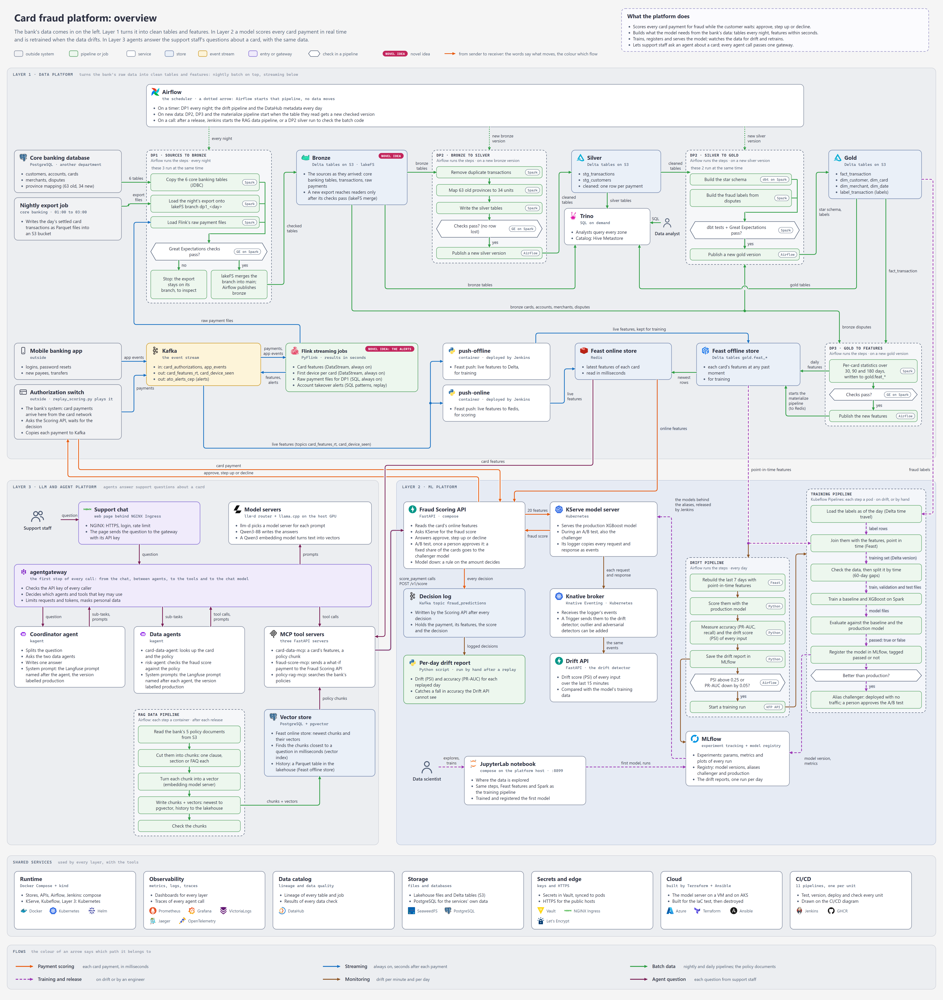
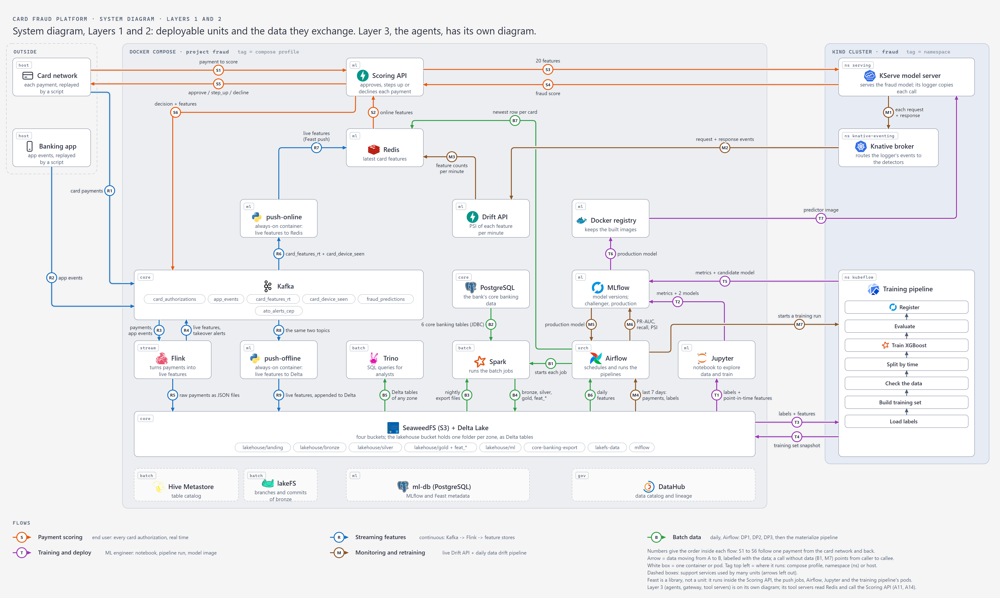
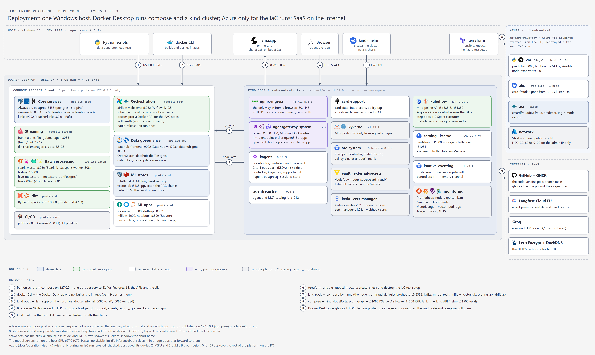
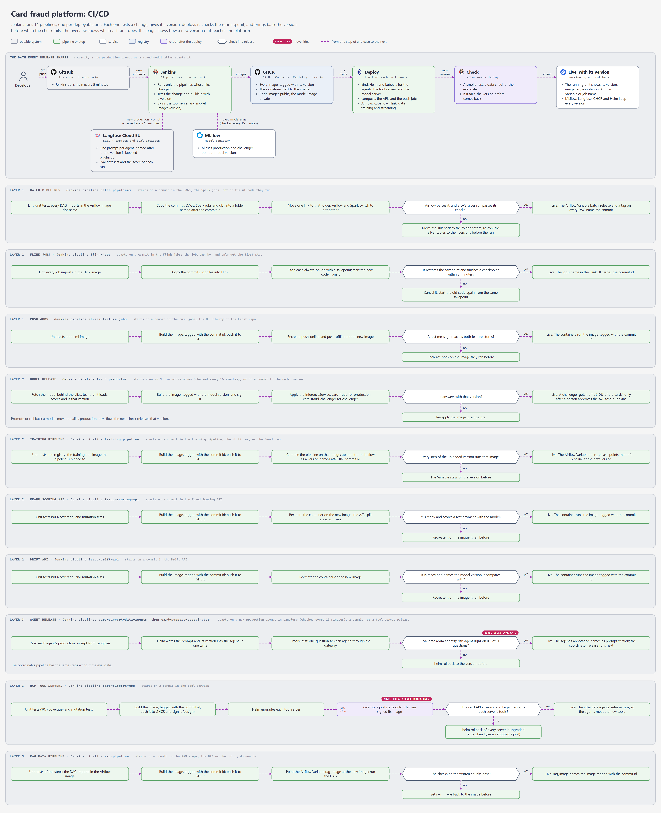

# Architecture

Five pictures describe the platform, from the most general to the most detailed. Start with the overview.

| View | Question it answers | Boxes are |
|---|---|---|
| [Overview](#overview) | What does the platform do, and how do the parts hand data to each other? | jobs, services and stores; each pipeline framed with its tasks in run order |
| [System diagram, Layers 1 and 2](#system-diagram-layers-1-and-2) | Which unit sends which data to which unit? | deployable units (compose containers, Kubernetes workloads), each with what it does |
| [System diagram, Layer 3](#system-diagram-layer-3) | The same for the agents, the gateway and the model servers | deployable units |
| [Deployment](#deployment) | Where does each unit run, on which port? | containers, Kubernetes workloads, host processes, with image and port |
| [CI/CD](#cicd) | How does a new version reach the platform, and what happens when it is bad? | the steps of a release; one row per Jenkins pipeline |

## Overview

The overview puts the whole platform on one page. The box at the top right lists what it does. Layer 1 fills the top
band (nightly batch first, streaming second), Layer 2 (right) and Layer 3 (left) sit under it, and the shared services
row is at the bottom. Brackets below (S1, A3) name arrows of the system diagrams.



Each box gives its name, technology and job. A pipeline is a dashed frame of steps, top to bottom; a white step with
pointed ends is a check, its outcomes (no, yes) under it. Arrows run from sender to receiver, labelled with what moves:

| Colour | Kind of part |
|---|---|
| grey | a system outside the platform (core banking, the bank's authorization switch, the mobile app) |
| green | a pipeline or a job: it processes data |
| white | a service: it answers requests |
| blue | a store: data rests here |
| yellow | the event stream (Kafka) |
| purple | an entry point or gateway |
| dashed | a note for the reader, not a component |

Arrow colours match the system diagrams: orange payment scoring, blue streaming, green batch data (also the policy
documents), purple training and release (dashed, to stay apart from blue for colour-blind readers), brown monitoring,
wine an agent question; the key is at the bottom. A raspberry `NOVEL IDEA` pill, a colour no flow uses, marks the
novel ideas: lakeFS and the account takeover alerts here, the signed images and the eval gate on the CI/CD picture.

### Layer 1: the data platform (top band)

The left column holds the sources other departments own: the core banking database (PostgreSQL, six tables), the
nightly export job (the day's settled card transactions as Parquet files in its own bucket), the authorization switch
and the mobile banking app, played here by `generator/load_source.py`, `generator/producer.py` and
`ml/tools/replay_scoring.py`. The course's three batch pipelines are four here, because DP2 is one per zone it writes:

| Pipeline | Reads | What it does | Writes |
|---|---|---|---|
| DP1, ingest to bronze | the six core banking tables (JDBC), the export files, Flink's raw payment files | copies them as they are, then checks them | `bronze` (`raw_*` tables) |
| DP2, silver pipeline | `bronze.raw_transactions`, `raw_customers`, `raw_ref_province_mapping` | removes duplicates, maps old province names to the 34 units | `silver.stg_transactions`, `silver.stg_customers` |
| DP2, gold pipeline | `silver.stg_*`, and bronze's reference tables (`raw_cards`, `raw_accounts`, `raw_merchants`, `raw_disputes`) | dbt builds the star schema, Spark writes the fraud labels | `gold` (dims, `fact_transaction`, `label_transaction`) |
| DP3, feature pipeline | `gold.fact_transaction`, `bronze.raw_disputes` | per-card spending statistics over 30, 90 and 180 days | `gold.feat_card_txn_stats_daily`, in the Feast offline store |

Every check task (`validate_*`) runs Great Expectations, records the results and stops the pipeline on a failure.

#### What starts each batch pipeline

No pipeline starts another. DP1 runs every night
([`pipelines/airflow/dags/dp1_source_to_bronze.py`](https://github.com/cvinhnguyen/card-fraud-platform/blob/54d21eddbf6e602ae13fed46a1a9e0ef265d23cd/pipelines/airflow/dags/dp1_source_to_bronze.py)).
Each pipeline ends by announcing a new checked version of its zone (an Airflow dataset event carrying the business
day), which schedules the pipeline that reads that zone
([`pipelines/airflow/dags/common.py`](https://github.com/cvinhnguyen/card-fraud-platform/blob/54d21eddbf6e602ae13fed46a1a9e0ef265d23cd/pipelines/airflow/dags/common.py)).
So the DP2 silver pipeline depends on the bronze tables, not on DP1, and can also be started by hand at any time,
even while DP1 writes: a Delta reader always gets the last committed version ([airflow.md](data-platform/airflow.md)).
On the overview, Airflow's dotted arrows start pipelines and move no data; DP3's frame says it starts on a new gold
version.

#### The nightly export goes through lakeFS

DP1 appends the export to `raw_transactions` on a lakeFS branch `dp1_<D>` (Git-style branches of data files), commits
it, and checks that commit while readers (silver, Trino) still see `main`. If every check passes, it merges the
branch into `main` and the export appears in one step; if not, `main` stays as yesterday and the bad export waits on
its branch ([novel_lakefs_wap.md](data-platform/novel_lakefs_wap.md)). The six core banking snapshot tables and the
raw payment files go straight to `s3a://lakehouse/bronze/`; their gate is the bronze announcement, which a failed run
never makes.

The DP2 silver, DP2 gold and DP3 pipelines write first and check after (their frames show a "Write" or "build" step
before the check). A failed check stops the announcement, so the next pipeline does not start and Redis keeps the old
features, but a direct reader (an analyst in Trino, a training run, a run started by hand) can see the unchecked rows
until the next good run. lakeFS branches for silver and gold would close that gap; it is not done.

#### Trino and the Hive Metastore

Trino (under silver) takes no arrow from a pipeline: it asks the Hive Metastore where a table lives and reads any
zone's Delta files itself. Its gold arrow hops over the bronze branch so the two do not join. The Hive Metastore sits
with Trino, not among the stores, because it is a service with its own PostgreSQL metadata.

#### Streaming

The four streaming jobs share one box because they are PyFlink jobs on one Flink cluster (the Kafka box lists the
topics in and out); each bullet names its Flink API:

| Job | Flink API | What it does |
|---|---|---|
| Card features ([`pipelines/flink/rt_features.py`](https://github.com/cvinhnguyen/card-fraud-platform/blob/54d21eddbf6e602ae13fed46a1a9e0ef265d23cd/pipelines/flink/rt_features.py)) | DataStream API with keyed state | the card features of each payment |
| First device | DataStream API with keyed state | the first device of each card |
| Raw landing | Flink SQL through the Table API | writes the raw payments as JSON files into `landing/` for DP1 |
| Account takeover alerts (novel idea 1) | Flink SQL through the Table API | uses SQL `MATCH_RECOGNIZE` to find three patterns in the app's events; so far run on a replay of the app events |

Two push jobs carry the feature topics on: `push-online` into Redis for scoring, `push-offline` appended to Delta for
training. The feature jobs, the raw landing job and the push jobs run all the time, and Jenkins releases them.

### The hand-over: Feast

Feast (the two blue stores ending the streaming row) is the hand-over between Layers 1 and 2, so training and serving
see the same 20 features (`fraud_model_v1`,
[`ml/feature_repo/fraud_features.py`](https://github.com/cvinhnguyen/card-fraud-platform/blob/54d21eddbf6e602ae13fed46a1a9e0ef265d23cd/ml/feature_repo/fraud_features.py)).

| Store | What it is | Written by | Read by |
|---|---|---|---|
| Offline | the `feat_*` Delta tables | DP3, `push-offline` | training, with point-in-time joins |
| Online | Redis | `push-online`, the materialize pipeline | the Scoring API, in milliseconds |

The arrow between the stores is the materialize pipeline (DAG `feast_materialize`, started by DP3's new feature
version): it copies each card's newest daily row into Redis and checks that it arrived.

### Layer 2: the ML platform (right panel)

Serving is on the left, under the online store; training on the right, under the offline store and the labels.

#### Serving

The authorization switch sends each payment to the Scoring API and waits (S1 to S5,
[`services/scoring_api/app/main.py`](https://github.com/cvinhnguyen/card-fraud-platform/blob/54d21eddbf6e602ae13fed46a1a9e0ef265d23cd/services/scoring_api/app/main.py)).
The Kafka topic `fraud_predictions` (S6) logs what the model server never sees: the payment, the decision and the
reason for a fallback. The per-day drift report (`ml/tools/drift_by_day.py`) reads it; the live drift path does not.

#### Live drift

Live drift is the standard KServe detector pattern (M1 to M3). The Drift API returns the PSI (population stability
index) of each feature and of the score over the last 15 minutes against the training profile, with no labels
([drift.md](ml-platform/drift.md)).

#### Training

The training pipeline
([`ml/pipelines/train_fraud_model.py`](https://github.com/cvinhnguyen/card-fraud-platform/blob/54d21eddbf6e602ae13fed46a1a9e0ef265d23cd/ml/pipelines/train_fraud_model.py))
runs seven steps as pods; the overview draws six (the check and the split share one), then the check "Better than
production?". The training set has no box: it is an artifact passed between steps. The arrows inside the frame name
what passes: label rows, the training set (a Delta version), the train, validation and test files, the model files,
the evaluation result (passed: true or false).

Labels come from `gold.label_transaction`, features from the Feast offline store. The training set is a new Delta
version in `lakehouse/ml/`, so any registered model traces back to its exact rows. Every trained model becomes an
MLflow version, even one no better than production, for later comparison; only a better one gets the alias
`challenger`
([`ml/fraud_ml/registry.py`](https://github.com/cvinhnguyen/card-fraud-platform/blob/54d21eddbf6e602ae13fed46a1a9e0ef265d23cd/ml/fraud_ml/registry.py)).
The `production` and `challenger` models reach KServe through the [model release](#model-release)
([serving.md](ml-platform/serving.md#model-release-pipeline)).

The first model was trained by hand in the JupyterLab notebook
([`ml/notebooks/fraud_model.ipynb`](https://github.com/cvinhnguyen/card-fraud-platform/blob/54d21eddbf6e602ae13fed46a1a9e0ef265d23cd/ml/notebooks/fraud_model.ipynb)),
the compose service `notebook` on the training image. It uses the same seven functions, Feast features and MLflow;
the overview draws it under the Drift API.

#### Retraining on drift

The drift pipeline (DAG `drift_monitoring`,
[`pipelines/airflow/dags/drift_monitoring.py`](https://github.com/cvinhnguyen/card-fraud-platform/blob/54d21eddbf6e602ae13fed46a1a9e0ef265d23cd/pipelines/airflow/dags/drift_monitoring.py))
scores the last 7 days daily with the production model and saves the report as an MLflow run whatever the result,
which is why the overview draws the save before the check. When a PSI is above 0.25 or the PR-AUC fell more than
0.05, it starts a training pipeline run with the newest labels. Those labels come from the simulation's ground truth
(`s3://lakehouse/ml/ground_truth/labels.parquet`); a real bank learns of fraud from disputes over about 60 days, so
its PR-AUC check would lag by that much and only PSI would be immediate.

### Layer 3: the LLM and agent platform (left panel)

agentgateway is the wide purple bar across the panel, because every call passes it: the support chat and the model
servers sit above it, the agents and MCP tool servers below. A question goes from the support chat
(`https://support.<domain>`, login checked by NGINX) to the gateway; the chat page adds its API key server side, so
the key never reaches the browser
([`agents/chart/templates/support-chat.yaml`](https://github.com/cvinhnguyen/card-fraud-platform/blob/54d21eddbf6e602ae13fed46a1a9e0ef265d23cd/agents/chart/templates/support-chat.yaml)).
The gateway checks that key and passes the question to the coordinator, whose sub-tasks, tool calls and prompts all
pass the gateway again (A1 to A10). A NetworkPolicy lets only the gateway (and the controller of kagent, which runs
the agents) reach the coordinator, so nothing calls an agent past it. The kagent UI is an admin console off the
support path. agentregistry is not drawn: it is a catalog for people, off the call path, listing which agents exist,
their version and image, and which MCP server each uses, published from `agents/registry/catalog.yaml`
([agents.md](llm-platform/agents.md#agent-registry)).

### What starts the pipelines, and the shared services

The Airflow box at the top of Layer 1 says what starts each pipeline
([batch pipelines](#what-starts-each-batch-pipeline)). The drift and DataHub metadata pipelines run daily on their own
schedule, the RAG data pipeline when its Jenkins pipeline or a person starts it ([airflow.md](data-platform/airflow.md) lists all eight DAGs).

The shared services row shows, with logos, the tools every layer uses: the runtime (Docker Compose and kind),
observability, the data catalog, storage, secrets and the edge, the Azure resources an IaC run creates and destroys
([iac.md](operations/iac.md)), and CI/CD (Jenkins with its 11 pipelines and GitHub Container Registry, on the
[CI/CD](#cicd) picture).

## System diagram, Layers 1 and 2

The deployable units of Layers 1 and 2 and the data between them, numbered per flow: S payment scoring, R streaming
features, B batch data, T training and deploy, M monitoring and retraining. The three outside boxes are the sources:
the authorization switch (R1) and the mobile banking app (R2), replayed by `generator/producer.py`, and core banking's
nightly export job (B1, Parquet files into `s3://core-banking-export`), played by
`generator/load_source.py --part exports`. The core banking database runs as the compose service PostgreSQL.



| Rule | In the picture |
|---|---|
| Every box is a deployable unit | one compose service or Kubernetes workload, with what it does under its name; the tag top left says where (compose profile or namespace). Feast is a library inside the Scoring API, the push jobs, Airflow, Jupyter and the training pipeline's pods, so it has no box; its stores (Redis, SeaweedFS) and registry (ml-db) do |
| Arrows follow the data, the data on the arrow | Redis to the Scoring API (S2), because features flow to the API; a call without data (B2 starts the Spark jobs, M7 a training run) points from caller to callee |
| Numbered, one numbering per flow | five flows, each with its own colour, letter and 1..n: S for the end user's payment, T for the ML engineer, R, B and M for the system's own flows |
| Few dashed lines, only off the main path | no dashed arrows; the dashed boxes are support services many units use (Hive Metastore, lakeFS, ml-db, DataHub), whose arrows would cross every flow |

The training pipeline's box lists its seven tasks bottom to top: input (labels and features, T3) enters at the bottom,
the model (T5) leaves at the top. The five flow colours are at least 17 apart (OKLab x 100) for normal vision, and the
badge letter carries the flow for colour-blind readers. Two crossings remain (M7 over T2, M2 over B8), drawn with a gap.

### Numbered arrows

| # | Flow | Data / call |
|---|---|---|
| S1 | Payment scoring | The bank's authorization switch, which receives each card payment from the card network, sends it to POST /v1/score (card, amount, channel, device); here ml/tools/replay_scoring.py plays the switch |
| S2 | Payment scoring | Feast reads the card's stored features from Redis (feature service fraud_model_v1) |
| S3 | Payment scoring | Feature vector to the model server (KServe V1 protocol, NodePort 31080, through the pod's agent sidecar) |
| S4 | Payment scoring | Probability of fraud from the production XGBoost booster |
| S5 | Payment scoring | Decision by the two thresholds; rule fallback when the model is late or down |
| S6 | Payment scoring | Every decision is logged to Kafka topic fraud_predictions, the record of decisions (scoring never waits on it) |
| R1 | Streaming features | Every authorization (retries included) to Kafka topic card_authorizations (generator/producer.py replays the generated stream in arrival order) |
| R2 | Streaming features | The mobile banking app's events (login, password reset, new payee, transfer, biometric check) to Kafka topic app_events, replayed the same way; about 15 % arrive after the next event of their session |
| R3 | Streaming features | Flink reads card_authorizations (watermarks, dedup of network retries); ato_cep reads the app events (account takeover patterns -> ato_alerts_cep; so far on the replay topic app_events_replay) |
| R4 | Streaming features | Realtime features to card_features_rt, first (card, device) pairs to card_device_seen; ato_cep writes one alert per matched pattern to ato_alerts_cep |
| R5 | Streaming features | raw_landing writes the raw authorizations as JSON lines to the S3 landing zone; DP1 (ingest to bronze) loads them into bronze.raw_card_authorizations (Delta) |
| R6 | Streaming features | push-online reads card_features_rt and card_device_seen |
| R7 | Streaming features | Writes them to the Redis online store through Feast push (offsets committed after the write) |
| R8 | Streaming features | push-offline reads the same two topics |
| R9 | Streaming features | Appends them to gold.feat_card_auth_rt / gold.feat_card_device: the offline copy for training |
| B1 | Batch data | Core banking's nightly export job writes the day's settled transactions as Parquet files into s3://core-banking-export/transactions/export_date=<day>/ (here: generator/load_source.py --part exports) |
| B2 | Batch data | Airflow submits the Spark jobs of DP1, the two DP2 pipelines and DP3 (a call, no data); each pipeline checks what it wrote with Great Expectations, then announces the new version of its zone, which starts the next one |
| B3 | Batch data | DP1 copies the core banking tables over JDBC (customers, accounts, cards, merchants, disputes, province mapping) |
| B4 | Batch data | DP1 loads the new daily export folders from s3://core-banking-export |
| B5 | Batch data | DP1 writes bronze, the DP2 silver pipeline silver, the DP2 gold pipeline gold (dbt) and the labels, DP3 the feat_* tables, all Delta in s3://lakehouse; bronze.raw_transactions goes through lakeFS: a branch per DP1 run, merged into main after the checks |
| B6 | Batch data | Trino reads the Delta tables of any zone for analysts; the Hive Metastore tells it where each table lives (bronze.raw_transactions: catalog lakefs, branch main) |
| B7 | Batch data | The incremental materialize pipeline (DAG feast_materialize, on DP3's new features) reads feat_card_txn_stats_daily through the Feast offline store |
| B8 | Batch data | ... and loads the newest row per card into Redis (feast materialize-incremental) |
| T1 | Training and deploy | The notebook builds the training set: labels + Feast point-in-time features |
| T2 | Training and deploy | Metrics, plots and both models of the notebook run |
| T3 | Training and deploy | Steps 1 and 2 (load labels, build the training set) read the labels as of label_as_of and the point-in-time features |
| T4 | Training and deploy | Step 2 MERGEs the run's rows into ml/training_set_fraud_model_v1, one Delta version per run, so every model can be traced back to the exact rows it learned from |
| T5 | Training and deploy | Steps 5 to 7 (train, evaluate, register) log params, data versions, metrics and the model; every model is kept as a version, and gets alias challenger only when it passes the evaluation gate |
| T6 | Training and deploy | Jenkins pipeline fraud-predictor: on a new alias it builds the model into the predictor image (fraud-predictor:v<model>-<commit>), pushes it to ghcr.io, signs it and applies the InferenceService; a challenger waits for a person to approve the A/B test |
| M1 | Monitoring and retraining | KServe's payload logger (the agent sidecar, mode all) posts every request and its response as CloudEvents to the broker serving/default |
| M2 | Monitoring and retraining | Trigger drift-detector delivers them to POST /v1/inference-events: request events count the features, response events the score. Outlier and adversarial detectors would subscribe the same way |
| M3 | Monitoring and retraining | Bin counts per feature and minute in Redis db 1; GET /v1/drift returns the PSI vs the training profile |
| M4 | Monitoring and retraining | Data drift pipeline (DAG drift_monitoring, daily): the last 7 days of payments, their labels (the simulation's ground truth) and point-in-time features |
| M5 | Monitoring and retraining | Loads the production model to score them |
| M6 | Monitoring and retraining | Logs PR-AUC, recall and PSI as a run of experiment card_fraud_monitoring |
| M7 | Monitoring and retraining | On drift: a training pipeline run (train_fraud_model) through the Kubeflow Pipelines API, label_as_of = the DAG's day (a call, no data) |

## System diagram, Layer 3

The diagram is built around the gateway bar across the cluster: callers above (the chat page and the three agents),
callees below (the llm-d router and the three MCP servers), and what those read under the cluster (the two llama.cpp
servers on the host, the stores in compose). Observability and support services are on the right, CI/CD on top. Its
flows: A, the support staff's question (the only flow a person at a screen starts); K, the RAG data pipeline Airflow
runs after each image release; C, the developer's push through Jenkins; O, monitoring and agent autoscaling.


| Rule | In the picture |
|---|---|
| Every box is a deployable unit | a pod set in the kind cluster (tag = namespace), a compose service (tag = profile), a host process, or an internet service. Dotted frames group the three agents (A6-A9, C5, O5 and O6 apply to each) and the three MCP servers (A10, C4 and O2 apply to each). Every arrow between support-chat, an agent, a tool and the model starts or ends at the gateway bar, the first hop of every call |
| Arrows follow the data, the data on the arrow | Redis to the card-data MCP server (A11) carries the card's features; an A2A, MCP or LLM request points the way of the request, and its reply returns on the same call without a second arrow |
| Numbered, one numbering per flow | A, K, C and O, each with its own colour and 1..n; K, C and O take the colours of B, T and M, so the validated pairs carry over, and A has its own (wine), at least 16 apart (OKLab x 100) from every other flow |
| Few dashed lines | no dashed arrows; the dashed boxes are support units without a flow: Vault + External Secrets (every Secret of the platform), Agent Substrate (sandboxed agents from warm snapshots), agentregistry (the catalog), kagent (runs the agents; admin chat UI), Let's Encrypt and the Groq B side of the LLM A/B test, now at weight 0 |

No two arrows cross and no line runs through a badge or label: the layout check in
[`docs/diagrams/platform.py`](diagrams/platform.py) warns before drawing, hence the CI lanes under the CI/CD band (C3,
C5, C6, C8) and under the MCP servers (C4).

### Numbered arrows, Layer 3

| # | Flow | Data / call |
|---|---|---|
| A1 | Agent conversation | A question in the support chat (https://support.<domain>, basic auth and rate limit at NGINX) |
| A2 | Agent conversation | NGINX passes it to support-chat, which serves the chat page (one A2A message/send per question) |
| A3 | Agent conversation | support-chat forwards the question to the gateway route /a2a/coordinator and adds the support-app API key, so the key never reaches the browser. The gateway is the first hop of every question |
| A4 | Agent conversation | Route a2a-coordinator: the gateway checks the key (only support-app may call it), applies the rate limit and passes the question to the coordinator over A2A |
| A5 | Agent conversation | The coordinator's A2A calls to the two agents and its LLM calls, all through the gateway (kagent proxy.url) |
| A6 | Agent conversation | Route card-support-data-agents-internal: a sub-task for card-data-agent; only the coordinator's key may call it |
| A7 | Agent conversation | ... and for risk-agent (risk-agent-b, the B side of its model-config A/B test, sits behind the same route) |
| A8 | Agent conversation | card-data-agent's tool calls (MCP, its own API key) and LLM calls through the gateway |
| A9 | Agent conversation | risk-agent's tool calls and LLM calls through the gateway |
| A10 | Agent conversation | Routes /mcp/card-data, /mcp/fraud-score, /mcp/policy-rag: only the key of each server's agent sees its tools (300 calls/min per server) |
| A11 | Agent conversation | card-data-mcp, get_card_data: the card's online features from Redis through Feast (project card_fraud) |
| A12 | Agent conversation | card-data-mcp, get_policy_chunk: one policy chunk by id from pgvector (Feast project card_support_kb) |
| A13 | Agent conversation | policy-rag-mcp, search_policy: the question's vector from Qwen3-Embedding-0.6B |
| A14 | Agent conversation | fraud-score-mcp, score_payment: POST /v1/score with the payment the customer describes (merchant agent-what-if, direct HTTP, not through the gateway); the Scoring API answers with the score and decision |
| A15 | Agent conversation | Route /v1: the agent's API key is checked, request and token limits applied, personal data masked, then the InferencePool qwen3-8b |
| A16 | Agent conversation | The endpoint picker chooses a pod; its bridge forwards the prompt to llama.cpp on the host GPU |
| A17 | Agent conversation | policy-rag-mcp, search_policy: the chunks nearest to the question vector from pgvector, re-ranked by cosine |
| K1 | Knowledge ingest | rag_ingest reads the 5 bank documents from s3://bank-documents |
| K2 | Knowledge ingest | Steps chunk (57 chunks) and embed: one 1024-dim vector per chunk from the embedding server |
| K3 | Knowledge ingest | Step write: chunks + vectors into the Feast online store (pgvector) |
| K4 | Knowledge ingest | ... and their history into the offline store s3://lakehouse/kb/policy_chunks.parquet |
| K5 | Knowledge ingest | Step validate: 7 checks as assertions, plus lineage documents -> jobs -> feature view |
| C1 | CI/CD | Jenkins polls GitHub main for its 11 pipelines, one per deployable unit (docs/operations/cicd.md) |
| C2 | CI/CD | Agent pipelines fetch the prompt labelled production for each agent |
| C3 | CI/CD | MCP pipeline: tests (coverage gate 90 %), mutation test, image build, push to ghcr.io, cosign signature |
| C4 | CI/CD | helm upgrade --atomic of each MCP server; the node pulls the signed image from ghcr.io (Kyverno verifies it whenever it is installed) |
| C5 | CI/CD | Agent pipelines: helm upgrade --atomic of the agents, each Agent with its Langfuse prompt inline and the prompt version as an annotation |
| C6 | CI/CD | Eval gate: the eval dataset asked to risk-agent through the gateway; below 0.6 accuracy, helm rollback |
| C7 | CI/CD | Answers and their scores stored as a run of the Langfuse experiment |
| C8 | CI/CD | RAG pipeline: sets Variable rag_image to the new image, triggers rag_ingest (Airflow REST API) |
| O1 | Observability and scaling | Gateway metrics: requests per route and backend, LLM tokens, time to first token, PII guardrail hits |
| O2 | Observability and scaling | MCP servers' metrics (one ServiceMonitor each): calls, failures and latency per tool |
| O3 | Observability and scaling | Grafana dashboards: Web API, compute, LLM telemetry, agent telemetry, A/B tests |
| O4 | Observability and scaling | KEDA's trigger: A2A requests per second for each agent |
| O5 | Observability and scaling | KEDA sets each agent's replicas between 2 and 4 |
| O6 | Observability and scaling | Agents send spans over OTLP; the gateway's spans join the same traces (one conversation: about 20) |

## Deployment

The host row on top holds the CLIs, the llama.cpp servers and terraform, next to Azure and the SaaS. In the Docker
Desktop VM, compose is left and the kind node right; a box is one compose profile or namespace (its version, what runs
and on which port), coloured by what it does: stores data, runs pipelines, serves an API, lets traffic in, or runs the
platform (CI, scaling, security, monitoring). The list under the picture explains each numbered network path.



| Decision | Why |
|---|---|
| One Docker Desktop VM, eight compose profiles | each phase starts only what it needs; the 8 GB VM cannot hold every profile at once (run `stream` alone, keep `trino` and `dbt` off while `orch` + `gov` run). Layer 3 runs with `core` + `ml` + `cicd` and the kind cluster; `orch` comes up for a RAG run |
| Kubernetes for Kubeflow Pipelines, KServe and all of Layer 3 | Kubeflow Pipelines and KServe need it; Knative Eventing (the broker between KServe's logger and the Drift API) and the Layer 3 tools (agentgateway, llm-d, kagent, KEDA, Substrate, agentregistry, Vault + External Secrets, NGINX Ingress) are Kubernetes operators. APIs, push jobs, MLflow, Redis, pgvector, Airflow and Jenkins stay in compose |
| Model servers on the host | the GTX 1070 (Pascal) cannot run vLLM, and the GPU is not visible inside the VM; llama.cpp serves chat on :8085 (GPU) and embeddings on :8086, and the llm-d InferencePool selects thin bridge pods that forward to the host (on a GPU node, real model server pods) |
| kind node joined to `fraud_default` | pods reach the compose services by name (`lakehouse-s3:8333`, `kafka:19092`, `ml-db`, `redis`, `mlflow:5000`, `vector-db`, `scoring-api:8000`, `drift-api:8000`), and compose reaches the cluster through NodePorts (31080 KServe, 31888 Kubeflow Pipelines API, 31508 agentgateway for the eval gate) |
| NGINX Ingress on the node's ports 80/443 | the only way in from a browser: `support`, `agents`, `registry`, `grafana`, `logs`, `traces` and `api` under `*.cvinhnguyen.duckdns.org`, all pointing at 127.0.0.1, with a Let's Encrypt wildcard certificate kept in Vault and basic auth on every UI except Grafana (own login) |
| GitHub Container Registry (`ghcr.io/cvinhnguyen`) | Jenkins pushes every image there, tagged with its version, with its cosign signature; the kind node and compose pull over HTTPS (path 9). The fraud-predictor image holds the model |
| Alias `lakehouse-s3` for SeaweedFS | Kubeflow Pipelines installs its own `seaweedfs` Service, which shadows the short name inside the cluster |
| Ports published on 127.0.0.1 only | nothing is reachable from the network; local secrets stay in `infra/.env` (gitignored), the cluster's come from Vault through External Secrets |
| Azure only for the IaC run | Terraform builds the VNet, VM, AKS cluster and container registry; Ansible deploys the model server to the VM and AKS runs the same image; `terraform destroy` follows. The subscription keeps the rest on the PC: 6 vCPU and 3 public IPs per region, a GPU quota of 0, $100 of credit ([iac.md](operations/iac.md#why-not-all-of-it-on-azure)) |

## CI/CD

Jenkins runs 11 pipelines, one per deployable unit ([cicd.md](operations/cicd.md)): each tests a change, versions it,
deploys it, checks the running unit and brings back the version before when the check fails. One pipeline per unit
lets each unit release and roll back on its own, keeps each credential in the pipeline that needs it, and gives each
unit its own build history. The picture shows the shared path, then one flow per pipeline in layer order.



#### The path every release shares

1. Jenkins polls GitHub main every 5 minutes and runs only the pipelines whose files changed; a new production prompt
   in Langfuse or a moved model alias in MLflow, both checked every 15 minutes, also start a release.
2. It tests, builds an image tagged with its version, signs the tool server and model images with cosign, and pushes
   to GitHub Container Registry (ghcr.io).
3. The deploy uses each unit's tool: Helm or kubectl in kind, a recreated container in compose, or a new release in
   Airflow, Kubeflow or Flink.
4. A check follows; the running unit shows its version (image tag, annotation, Airflow Variable or job name).

#### Model release

`fraud-predictor` starts when an MLflow alias moves. It tests that the model loads, scores and is that version,
builds and signs the image tagged with the model version, and applies the InferenceService (`card-fraud` for
production, `card-fraud-challenger` for challenger). If the model reports another version, the image before comes
back. A challenger
gets traffic, 10% of the cards, only after a person approves the A/B test in Jenkins
([serving.md](ml-platform/serving.md#model-release-pipeline)). To promote or roll back a model, move the alias
`production` in MLflow.

#### Agent release

`card-support-data-agents`, then `card-support-coordinator`, release the agents. Jenkins reads each agent's Langfuse
prompt labelled production; Helm writes its text inline into the Agent of the same name and its version as the
annotation `card-support/prompt` in one write, so `kubectl get agent` shows which prompt runs. A smoke test asks each agent one question. For
the data agents the eval gate follows (a novel idea): risk-agent answers 20 questions, and below 0.6 accuracy
`helm rollback` restores the release ([novel_eval_gate.md](llm-platform/novel_eval_gate.md)).

#### The other pipelines

The others follow the same pattern: tests, an image tagged with the commit id (a release folder for the batch code, a
savepoint restart for Flink), deploy, check, rollback. In the tool server flow, the other novel idea: Kyverno starts a
tool server pod only if Jenkins signed its image ([novel_supply_chain.md](operations/novel_supply_chain.md)).

## Run it

| | |
|---|---|
| Code | [`docs/diagrams/platform.py`](https://github.com/cvinhnguyen/card-fraud-platform/blob/54d21eddbf6e602ae13fed46a1a9e0ef265d23cd/docs/diagrams/platform.py) |
| Runs on | host process (Python stdlib; headless Chrome or Edge renders the PNGs) |
| Writes | `docs/images/platform-*.svg` and the PNGs next to them; prints the arrow tables above |
| Related | [airflow.md](data-platform/airflow.md), [schema_design.md](data-platform/schema_design.md), [agents.md](llm-platform/agents.md), [cicd.md](operations/cicd.md), [iac.md](operations/iac.md) |

One script draws all five pictures and the arrow tables, so they cannot drift apart. Run it from the repo root:

```bash
python docs/diagrams/platform.py            # every view
python docs/diagrams/platform.py system-layer-3    # only the named views (overview, system-layers-1-2, system-layer-3, deployment, cicd)
```

It renders the PNGs one at a time and warns when an arrow crosses a box, a label overlaps one, or two Layer 3 arrows
cross.
