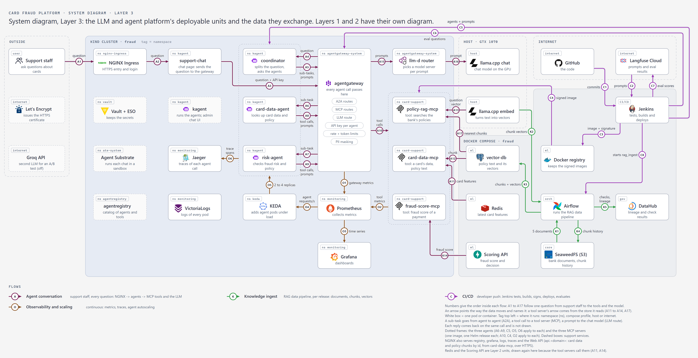

# Architecture

The platform is drawn in four pictures, from the most general to the most detailed. The overview shows every part
and how data moves between them, with each pipeline as a frame that holds its tasks in the order they run. The two
system diagrams show which container sends which data to which, arrow by arrow. The deployment diagram shows where
each unit runs. In the two system diagrams a box shows a name and, under it, what that part does in plain words; in
the deployment diagram it shows the container's image and port. A new reader should start with the overview.

| View | Question it answers | Boxes are |
|---|---|---|
| [Overview](#overview) | What does the platform do, and how do the parts hand data to each other? | the jobs (green) and services (white), the stores between them (blue), each pipeline framed with its tasks |
| [System diagram, Layers 1 and 2](#system-diagram-layers-1-and-2) | Which unit sends which data to which unit? | deployable units: compose containers and Kubernetes workloads |
| [System diagram, Layer 3](#system-diagram-layer-3) | The same question for the agents, the gateway and the model servers | deployable units |
| [Deployment](#deployment) | Where does each unit run, on which port? | containers, Kubernetes workloads, host processes |

## Overview

In the overview, each box says three things: its name, the technology under the name, and what it does as short bullets.
A pipeline is drawn as a dashed frame with its steps from top to bottom. A white step with pointed ends is a check, and
its two outcomes (no, yes) sit under it, so the picture says what happens when a check fails. An arrow goes from the
part that sends data (or a call) to the part that receives it, and the words on it say what moves. The colour of a box
says what kind of part it is:

| Colour | Kind of part |
|---|---|
| grey | a system outside the platform (core banking, the card network, the mobile app) |
| green | a pipeline or a job: it processes data |
| white | a service: it answers requests |
| blue | a store: data rests here |
| yellow | the event stream (Kafka) |
| purple | an entry point or gateway |
| dashed | a note for the reader, not a component |

The colour of an arrow says which flow it belongs to, with the same colours as the system diagrams: orange
payment scoring, blue streaming, green batch data (also the policy documents), purple training and release
(dashed, so it stays apart from blue for colour-blind readers), brown monitoring and wine for an agent question.
The key is at the bottom of the picture. The four novel ideas carry a raspberry `NOVEL IDEA` pill, a colour no flow
uses.

The box at the top right lists what the platform does. Layer 1 fills the top band, with the nightly batch on the
first row and the streaming side on the second. Layer 2 (right) and Layer 3 (left) are under it. Under them, the
CI/CD row follows a change from a commit to a checked release, and the services row shows the tools every layer
uses with their logos. The numbers in brackets in the text below (S1, A3) are the arrows of the two system
diagrams, which show the same paths step by step.

![Platform overview: the bank's sources on the left; in Layer 1, DP1, the DP2 silver and gold pipelines and DP3 each read one zone and write the next, Flink jobs turn Kafka events into live features and alerts, and Feast keeps the features offline and online; in Layer 2, the Scoring API decides each payment with the KServe model, KServe's logger feeds the Drift API through a Knative broker and the training pipeline registers every model; in Layer 3, the support chat, the agents, the MCP tool servers and the model servers meet at agentgateway; each pipeline is drawn as its steps and checks; the CI/CD path and the shared services are in the bottom rows](images/platform-overview.png)

### Layer 1: the data platform (top band)

The bank's data lives with other departments, and the left column shows each source as its own box: the core
banking database (PostgreSQL, six tables), the nightly export job that writes the day's settled card transactions
as Parquet files into its own bucket, the card network and the mobile banking app. In this project
`generator/load_source.py` and `generator/producer.py` play those systems. Layer 1 brings the data together in
four batch pipelines. The course names three (DP1, DP2, DP3); DP2 is two pipelines here, one per zone it writes:

| Pipeline | Reads | What it does | Writes |
|---|---|---|---|
| DP1, ingest to bronze | the six core banking tables (JDBC), the export files, Flink's raw payment files | copies them as they are, then checks them | `bronze` (`raw_*` tables) |
| DP2, silver pipeline | `bronze.raw_transactions`, `raw_customers`, `raw_ref_province_mapping` | removes duplicates, maps old province names to the 34 units | `silver.stg_transactions`, `silver.stg_customers` |
| DP2, gold pipeline | `silver.stg_*`, and bronze's reference tables (`raw_cards`, `raw_accounts`, `raw_merchants`, `raw_disputes`) | dbt builds the star schema, Spark writes the fraud labels | `gold` (dims, `fact_transaction`, `label_transaction`) |
| DP3, feature pipeline | `gold.fact_transaction`, `bronze.raw_disputes` | per-card spending statistics over 30, 90 and 180 days | `gold.feat_card_txn_stats_daily`, in the Feast offline store |

Every check task (`validate_*`) runs the Great Expectations checks, records the results and stops the pipeline
when one fails, so no later task reads bad data.

No pipeline starts another one. DP1 runs every night
([`pipelines/airflow/dags/dp1_source_to_bronze.py`](https://github.com/cvinhnguyen/card-fraud-platform/blob/822721cab1ac597d118f100f1c49949f137f8a7d/pipelines/airflow/dags/dp1_source_to_bronze.py)).
Each pipeline ends with a task that announces a new checked version of the zone it wrote (an Airflow dataset event that
carries the business day), and the pipeline that reads that zone is scheduled on the dataset
([`pipelines/airflow/dags/common.py`](https://github.com/cvinhnguyen/card-fraud-platform/blob/822721cab1ac597d118f100f1c49949f137f8a7d/pipelines/airflow/dags/common.py)).
So the DP2 silver pipeline depends on the bronze tables, never on DP1: anything that publishes bronze starts it, and it
can be started by hand at any time, also while DP1 is writing, because a reader of a Delta table always gets the last
committed version ([airflow.md](data-platform/airflow.md)).

DP1 shows why the nightly export goes through lakeFS. lakeFS keeps Git-style branches of data files. The run creates
the branch `dp1_<D>`, appends the export to `raw_transactions` on that branch only,
commits it, and the checks read that commit. Readers (silver, Trino) see the branch `main`, so they cannot see the
new export yet. When every check passes, the last step merges the branch into `main`, and the export becomes
visible in one step. When a check fails there is no merge: `main` stays as it was yesterday and the bad export
stays on its branch to be inspected ([novel_lakefs_wap.md](data-platform/novel_lakefs_wap.md)).
The six core banking snapshot tables and the raw payment files skip the branch and are written straight to
`s3a://lakehouse/bronze/`. For them the gate is the announcement described above, and a failed run never makes it.

Only the export waits on a branch. The DP2 silver, DP2 gold and DP3 pipelines write their tables first and check
them afterwards, which is why their frames show a "Write" or "build" step before the check. A failed check stops
the announcement, so the next pipeline does not start and Redis keeps the old features. A reader that goes to the
tables directly (an analyst in Trino, a training run, a run started by hand) can still see the unchecked rows
until the next good run. Putting silver and gold on lakeFS branches as well would close that gap; it is not done.

Trino (top right) takes no arrow from a pipeline: it asks the Hive Metastore where a table lives and reads the
Delta files of every zone itself, so analysts can query any zone. The Hive Metastore is drawn with Trino and not
among the stores, which hold the zones: it is a service that keeps its own metadata in PostgreSQL.

The second row of the band is the streaming side. The Kafka box lists the topics that come in and the topics the
jobs write. The four streaming jobs are all Flink jobs written in PyFlink, on the same Flink cluster, so they are
one box; each bullet names the Flink API that job uses. Two use the DataStream API with keyed state: the card
features of each payment
([`pipelines/flink/rt_features.py`](https://github.com/cvinhnguyen/card-fraud-platform/blob/822721cab1ac597d118f100f1c49949f137f8a7d/pipelines/flink/rt_features.py))
and the first device of each card. Two use Flink SQL through the Table API: the raw payments written as JSON files into
`landing/` for DP1, and the account takeover alerts (novel idea 1), which use SQL `MATCH_RECOGNIZE` to find three
patterns in the app's events. Two push jobs, containers that Jenkins deploys, carry the feature topics on: `push-online`
writes them into Redis for scoring, `push-offline` appends them to Delta for training. The two feature jobs and the push
jobs run all the time; the raw landing job runs by hand, and the takeover alerts have so far run on a replay of the app
events.

### The hand-over: Feast

Feast (the two blue stores at the end of the streaming row) is the hand-over between Layers 1 and 2. Layer 1
writes into it, Layer 2 reads from it, so training and serving see the same 20 features (`fraud_model_v1`,
[`ml/feature_repo/fraud_features.py`](https://github.com/cvinhnguyen/card-fraud-platform/blob/822721cab1ac597d118f100f1c49949f137f8a7d/ml/feature_repo/fraud_features.py)).
Its offline store is the `feat_*` Delta tables, read with point-in-time joins for training; its online store is Redis,
read by the Scoring API in milliseconds. DP3 and `push-offline` write the offline store, `push-online` writes the online
store, and the arrow between the two stores is the materialize pipeline (DAG `feast_materialize`, started by DP3's new
feature version): it copies the newest daily row of each card from the offline store into Redis and checks that it
arrived.

### Layer 2: the ML platform (right panel)

The left side of the panel is serving, under the online store it reads; the right side is training, under the
offline store and the labels.

Serving. The card network sends a payment to the Scoring API (S1,
[`services/scoring_api/app/main.py`](https://github.com/cvinhnguyen/card-fraud-platform/blob/822721cab1ac597d118f100f1c49949f137f8a7d/services/scoring_api/app/main.py)),
which reads the payment's online features (S2), sends them to KServe for the score (S3, S4) and answers approve, step_up
or decline (S5). It writes every decision to the Kafka topic `fraud_predictions`, the decision log (S6). The log holds
what the model server never sees: the payment, the decision and the reason for a fallback when the model was down. The
per-day drift report (`ml/tools/drift_by_day.py`) reads it; the live drift path below does not.

Live drift follows the standard KServe pattern. The model server's logger copies every request and its response
as CloudEvents to a Knative Eventing broker, and a Trigger delivers them to the Drift API, which is the drift
detector. An outlier or an adversarial detector would be one more Trigger on the same broker. The Drift API keeps
per-minute counts in Redis and returns the PSI of each feature and of the score over the last 15 minutes, against
the profile of the model's training data (no labels needed, [drift.md](ml-platform/drift.md)).

Training. The training pipeline on Kubeflow Pipelines
([`ml/pipelines/train_fraud_model.py`](https://github.com/cvinhnguyen/card-fraud-platform/blob/822721cab1ac597d118f100f1c49949f137f8a7d/ml/pipelines/train_fraud_model.py))
runs seven steps as pods: load the labels, build the training set, check the data, split by time, train, evaluate,
register. The overview draws them as six steps (the check and the split share one) and then the check "Better than
production?". The training set is not a box of its own, because it is an artifact one step hands to the next. The words
on each arrow inside the frame name what is passed on: label rows, the training set (a Delta version), the train,
validation and test files, the model files, and the result of the evaluation (passed: true or false).

The training set is saved as a new Delta version in
`lakehouse/ml/` and the later steps read that version, so any model in the registry can be traced back to the
exact rows it learned from. The labels come from `gold.label_transaction` and the features from the Feast offline
store. The last step registers every trained model as a new MLflow version, even one that is not better than
production, so it can still be inspected or compared later; only a better one gets the alias `challenger`
([`ml/fraud_ml/registry.py`](https://github.com/cvinhnguyen/card-fraud-platform/blob/822721cab1ac597d118f100f1c49949f137f8a7d/ml/fraud_ml/registry.py)).

The model promoted to `production` is built into the
KServe predictor image by an ML engineer. The first model was trained by hand in the JupyterLab notebook, the
compose service `notebook` on the same training image as the pipeline steps
([`ml/notebooks/fraud_model.ipynb`](https://github.com/cvinhnguyen/card-fraud-platform/blob/822721cab1ac597d118f100f1c49949f137f8a7d/ml/notebooks/fraud_model.ipynb)).
It calls the same seven functions, reads the same Feast features and logs its runs and model to the same MLflow, so it
is part of the platform and the overview draws it under the Drift API.

The drift pipeline makes the retraining decision (DAG `drift_monitoring`,
[`pipelines/airflow/dags/drift_monitoring.py`](https://github.com/cvinhnguyen/card-fraud-platform/blob/822721cab1ac597d118f100f1c49949f137f8a7d/pipelines/airflow/dags/drift_monitoring.py)).
It runs every day, scores the last 7 days with their labels and point-in-time features using the production model, and
saves the drift report as an MLflow run whatever the result. The labels of those 7 days come from the simulation's
ground truth (`s3://lakehouse/ml/ground_truth/labels.parquet`): a real bank learns about fraud from disputes over about
60 days, so there the PR-AUC check would lag by that much and only the PSI check would be immediate. When a PSI is above
0.25 or the PR-AUC fell more than 0.05, the pipeline also starts a training pipeline run with the newest labels;
otherwise the production model stays. The overview draws the save before the check, so both outcomes keep the report.

### Layer 3: the LLM and agent platform (left panel)

agentgateway is the wide purple bar in the middle of the panel, because every call passes it. The support chat
and the model servers are above it; the agents and the MCP tool servers are under it.

Support staff open the support chat (`https://support.<domain>`). NGINX checks the login over HTTPS (A1, A2). The chat
page sends the question to the gateway and adds its API key on the server side, so the key never reaches the browser
(A3,
[`agents/chart/templates/support-chat.yaml`](https://github.com/cvinhnguyen/card-fraud-platform/blob/822721cab1ac597d118f100f1c49949f137f8a7d/agents/chart/templates/support-chat.yaml)).
The gateway is the first hop of the question after NGINX and the chat page, before any agent. It checks that key,
applies the rate limit and only then passes the question to the coordinator (A4). The coordinator splits the question;
its sub-tasks go back through the gateway to the card-data and risk agents (A5 to A7), and the agents' tool calls and
prompts go through it again (A8 to A10). The gateway decides which routes and tools a key may use, limits rate and
tokens and masks personal data. A NetworkPolicy lets only the gateway (and the controller of kagent, which runs the
agents) reach the coordinator, so nothing can call an agent past it. The kagent UI stays as the admin console for the
agents and is not on the support path.

The MCP tool servers box stands for three servers, one per tool family
([`services/card_support_mcp/app/main.py`](https://github.com/cvinhnguyen/card-fraud-platform/blob/822721cab1ac597d118f100f1c49949f137f8a7d/services/card_support_mcp/app/main.py)).
card-data takes a card's features from the same Feast online store as Layer 2 (A11) and one policy chunk by id from the
vector store (A12). policy-rag asks llama.cpp for the question's vector (A13) and searches the vector store with it
(A17). fraud-score asks the Layer 2 Scoring API (A14). Prompts go through the llm-d router to llama.cpp on the host GPU
(A15, A16). The RAG data pipeline at the bottom
([`pipelines/airflow/dags/rag_ingest.py`](https://github.com/cvinhnguyen/card-fraud-platform/blob/822721cab1ac597d118f100f1c49949f137f8a7d/pipelines/airflow/dags/rag_ingest.py))
fills the vector store: it splits the bank's five documents into chunks, embeds each chunk, and writes chunks and
vectors into a second Feast project (`card_support_kb`).

That project uses two stores, as every Feast project does, and they answer different questions. The offline
store is a Parquet table in the lakehouse (`s3://lakehouse/kb/policy_chunks.parquet`): the history of every chunk,
read in bulk. The online store is PostgreSQL with the pgvector extension (container `vector-db`): only the newest
chunks, with a vector index (cosine) that finds the chunks closest to a question in milliseconds. Delta and
Parquet files on S3 have no such index, so a search there would read every vector for each question. The two are
not joined to each other: Feast writes both from the same pipeline run
([`ml/feature_repo_kb/feature_store.yaml`](https://github.com/cvinhnguyen/card-fraud-platform/blob/822721cab1ac597d118f100f1c49949f137f8a7d/ml/feature_repo_kb/feature_store.yaml)).

Agent Substrate runs the same three agents a second time as sandboxes: each conversation gets its own gVisor sandbox
restored from a warm snapshot, on a worker pool shared by all agents (one worker here), and the sandboxes call the
same gateway ([agents.md](llm-platform/agents.md#sandboxed-agents-on-agent-substrate-warm-up)). agentregistry is a
catalog for people, not on the call path: which agents exist, their version and image, and which MCP server each uses,
published from `agents/registry/catalog.yaml` ([agents.md](llm-platform/agents.md#agent-registry)).

### What starts the pipelines, and the platform services

The dashed note at the top of Layer 1 says what starts the pipelines, as described under Layer 1 above. The drift
and DataHub metadata pipelines run on their own daily schedule, and the RAG data pipeline when its Jenkins pipeline
or a person starts it ([airflow.md](data-platform/airflow.md) lists all eight DAGs).

The CI/CD row is the path of a change, from left to right: Jenkins polls GitHub, tests
and builds, pushes images to the registry (the MCP server image with its signature), then deploys (Helm upgrades in the
kind cluster, a new RAG image for Airflow, the push jobs in compose) and checks against the running platform
([cicd.md](operations/cicd.md)). Two of the novel ideas sit on that path: Kyverno admits an MCP server pod only with a
cosign signature from CI, and after each data-agent release the eval gate asks risk-agent 20 questions and rolls the
release back under 0.6 accuracy. Langfuse Cloud EU sits under Jenkins: Jenkins takes the production prompts from it, and
a new production prompt starts a release just like a commit; the eval gate's questions are a Langfuse dataset and its
scores go back there.

The services row names the tools every layer uses, each with its
logo: the runtime (Docker Compose and kind), observability, the data catalog, storage, secrets and the edge,
and the Azure resources an IaC run creates and destroys again ([iac.md](operations/iac.md)).

## System diagram, Layers 1 and 2

The deployable units of Layers 1 and 2 and the data between them. The two boxes outside are the event sources: the
card network (payments, R1) and the mobile banking app (app events, R2), both replayed from the generated data by
`generator/producer.py`. The arrows are numbered per flow: S payment scoring, R streaming features, B batch data,
T training and deploy, M monitoring and retraining:


The rules the picture follows:

| Rule | In the picture |
|---|---|
| Every box is a deployable unit | each box is one compose service or one Kubernetes workload, with what it does under its name; the tag top left says where (compose profile or namespace). Feast is a library inside the Scoring API, the push jobs, Airflow, Jupyter and the training pipeline's pods, so it has no box; its stores (Redis, SeaweedFS) and registry (ml-db) do |
| Arrows follow the data, the data on the arrow | the arrow runs from Redis to the Scoring API (S2), not the other way, because features flow to the API; a call without data (B1 runs the Spark jobs, M7 starts a training run) points from caller to callee |
| Numbered, one numbering per flow | five flows, each with its own colour, letter and 1..n: S for the end user's payment, T for the ML engineer, R, B and M for the system's own flows |
| Few dashed lines, only off the main path | no dashed arrows; the dashed boxes are support services used by many units (Hive Metastore, lakeFS, ml-db, DataHub), whose arrows would cross every flow |

The training pipeline's box lists its seven tasks bottom to top, because its input (labels and features, T3)
arrives at the bottom and its output (the model, T5) leaves at the top.

Colours: the five flow colours are at least 17 apart (OKLab x 100) for normal vision; for colour-blind readers the
letter in each badge carries the flow. Two crossings are left (M7 over T2, M2 over B7), drawn with a gap.

### Numbered arrows

| # | Flow | Data / call |
|---|---|---|
| S1 | Payment scoring | The card network's switch sends each payment authorization to POST /v1/score (card, amount, channel, device) |
| S2 | Payment scoring | Feast reads the card's stored features from Redis (feature service fraud_model_v1) |
| S3 | Payment scoring | Feature vector to the model server (KServe V1 protocol, NodePort 31080, through the pod's agent sidecar) |
| S4 | Payment scoring | Probability of fraud from the production XGBoost booster |
| S5 | Payment scoring | Decision by the two thresholds; rule fallback when the model is late or down |
| S6 | Payment scoring | Every decision is logged to Kafka topic fraud_predictions, the record of decisions (scoring never waits on it) |
| R1 | Streaming features | Every authorization (retries included) to Kafka topic card_authorizations (generator/producer.py replays the generated stream in arrival order) |
| R2 | Streaming features | The mobile banking app's events (login, password reset, new payee, transfer, biometric check) to Kafka topic app_events, replayed the same way; about 15 % arrive after the next event of their session |
| R3 | Streaming features | Flink reads card_authorizations (watermarks, dedup of network retries); ato_cep reads the app events (account takeover patterns -> ato_alerts_cep; so far on the replay topic app_events_replay) |
| R4 | Streaming features | Realtime features to card_features_rt, first (card, device) pairs to card_device_seen; ato_cep writes one alert per matched pattern to ato_alerts_cep |
| R5 | Streaming features | raw_landing writes the raw authorizations as JSON lines to the S3 landing zone; DP1 (ingest to bronze) loads them into bronze.raw_card_authorizations (Delta) |
| R6 | Streaming features | push-online reads card_features_rt and card_device_seen |
| R7 | Streaming features | Writes them to the Redis online store through Feast push (offsets committed after the write) |
| R8 | Streaming features | push-offline reads the same two topics |
| R9 | Streaming features | Appends them to gold.feat_card_auth_rt / gold.feat_card_device: the offline copy for training |
| B1 | Batch data | Airflow submits the Spark jobs of DP1, the two DP2 pipelines and DP3 (a call, no data); each pipeline checks what it wrote with Great Expectations, then announces the new version of its zone, which starts the next one |
| B2 | Batch data | DP1 copies the core banking tables (customers, accounts, cards, merchants, disputes, province mapping) |
| B3 | Batch data | DP1 loads the new daily export folders from s3://core-banking-export |
| B4 | Batch data | DP1 writes bronze, the DP2 silver pipeline silver, the DP2 gold pipeline gold (dbt) and the labels, DP3 the feat_* tables, all Delta in s3://lakehouse; bronze.raw_transactions goes through lakeFS: a branch per DP1 run, merged into main after the checks |
| B5 | Batch data | Trino reads the Delta tables of any zone for analysts; the Hive Metastore tells it where each table lives (bronze.raw_transactions: catalog lakefs, branch main) |
| B6 | Batch data | The incremental materialize pipeline (DAG feast_materialize, on DP3's new features) reads feat_card_txn_stats_daily through the Feast offline store |
| B7 | Batch data | ... and loads the newest row per card into Redis (feast materialize-incremental) |
| T1 | Training and deploy | The notebook builds the training set: labels + Feast point-in-time features |
| T2 | Training and deploy | Metrics, plots and both models of the notebook run |
| T3 | Training and deploy | Steps 1 and 2 (load labels, build the training set) read the labels as of label_as_of and the point-in-time features |
| T4 | Training and deploy | Step 2 MERGEs the run's rows into ml/training_set_fraud_model_v1, one Delta version per run, so every model can be traced back to the exact rows it learned from |
| T5 | Training and deploy | Steps 5 to 7 (train, evaluate, register) log params, data versions, metrics and the model; every model is kept as a version, and gets alias challenger only when it passes the evaluation gate |
| T6 | Training and deploy | ML engineer: fetch_model.py --alias production, docker build + push of fraud/predictor:<v> |
| T7 | Training and deploy | kubectl apply of the InferenceService; the node pulls the image from the registry |
| M1 | Monitoring and retraining | KServe's payload logger (the agent sidecar, mode all) posts every request and its response as CloudEvents to the broker serving/default |
| M2 | Monitoring and retraining | Trigger drift-detector delivers them to POST /v1/inference-events: request events count the features, response events the score. Outlier and adversarial detectors would subscribe the same way |
| M3 | Monitoring and retraining | Bin counts per feature and minute in Redis db 1; GET /v1/drift returns the PSI vs the training profile |
| M4 | Monitoring and retraining | Data drift pipeline (DAG drift_monitoring, daily): the last 7 days of payments, their labels (the simulation's ground truth) and point-in-time features |
| M5 | Monitoring and retraining | Loads the production model to score them |
| M6 | Monitoring and retraining | Logs PR-AUC, recall and PSI as a run of experiment card_fraud_monitoring |
| M7 | Monitoring and retraining | On drift: a training pipeline run (train_fraud_model) through the Kubeflow Pipelines API, label_as_of = the DAG's day (a call, no data) |

## System diagram, Layer 3

The Layer 3 diagram follows the same rules as the Layers 1 and 2 diagram, with four flows of their own. A is the support
staff's question, the only flow that starts with a person at a screen. K is the RAG data pipeline that Airflow runs
after each release of its image. C is the developer's push through Jenkins, and O is the platform's monitoring and the
agents' autoscaling:



| Rule | In the picture |
|---|---|
| Every box is a deployable unit | a pod set in the kind cluster (tag = namespace), a compose service (tag = profile), a process on the host, or a service on the internet. The dotted frame groups the three agents: A6-A9, C5, O5 and O6 apply to each of them. The question enters the gateway (A3) between the coordinator and the card-data agent, so the gateway is visibly its first hop |
| Arrows follow the data, the data on the arrow | the arrow from Redis to the card-data MCP server (A11) carries the card's features; an A2A, MCP or LLM request is drawn in the direction of the request, and its reply travels back on the same call without a second arrow |
| Numbered, one numbering per flow | A, K, C and O, each with its own colour and 1..n; K, C and O take the colours of B, T and M, so the validated pairs carry over, and A has its own (wine), at least 16 apart (OKLab x 100) from every other flow |
| Few dashed lines | no dashed arrows; the dashed boxes are support units without a flow of their own: Vault + External Secrets (every Secret of the platform), Agent Substrate (sandboxed agents from warm snapshots), agentregistry (the catalog), kagent (runs the agents; admin chat UI), Let's Encrypt and the Groq B side of the LLM A/B test, now at weight 0 |

No two arrows cross. The two CI lanes above the panels (C5, C6) and the lane between the model servers and the MCP
server (C4) are there for that reason.

### Numbered arrows, Layer 3

| # | Flow | Data / call |
|---|---|---|
| A1 | Agent conversation | A question in the support chat (https://support.<domain>, basic auth and rate limit at NGINX) |
| A2 | Agent conversation | NGINX passes it to support-chat, which serves the chat page (one A2A message/send per question) |
| A3 | Agent conversation | support-chat forwards the question to the gateway route /a2a/coordinator and adds the support-app API key, so the key never reaches the browser. The gateway is the first hop of every question |
| A4 | Agent conversation | Route a2a-coordinator: the gateway checks the key (only support-app may call it), applies the rate limit and passes the question to the coordinator over A2A |
| A5 | Agent conversation | The coordinator's A2A calls to the two agents and its LLM calls, all through the gateway (kagent proxy.url) |
| A6 | Agent conversation | Route card-support-data-agents-internal: a sub-task for card-data-agent; only the coordinator's key may call it |
| A7 | Agent conversation | ... and for risk-agent (risk-agent-b, the B side of its model-config A/B test, sits behind the same route) |
| A8 | Agent conversation | card-data-agent's tool calls (MCP, its own API key) and LLM calls through the gateway |
| A9 | Agent conversation | risk-agent's tool calls and LLM calls through the gateway |
| A10 | Agent conversation | Routes /mcp/card-data, /mcp/fraud-score, /mcp/policy-rag: only the key of each server's agent sees its tools (300 calls/min per server) |
| A11 | Agent conversation | card-data-mcp, get_card_data: the card's online features from Redis through Feast (project card_fraud) |
| A12 | Agent conversation | card-data-mcp, get_policy_chunk: one policy chunk by id from pgvector (Feast project card_support_kb) |
| A13 | Agent conversation | policy-rag-mcp, search_policy: the question's vector from Qwen3-Embedding-0.6B |
| A14 | Agent conversation | fraud-score-mcp, score_payment: the Layer 2 Scoring API answers with the fraud score and its decision |
| A15 | Agent conversation | Route /v1: the agent's API key is checked, request and token limits applied, personal data masked, then the InferencePool qwen3-8b |
| A16 | Agent conversation | The endpoint picker chooses a pod; its bridge forwards the prompt to llama.cpp on the host GPU |
| A17 | Agent conversation | policy-rag-mcp, search_policy: the chunks nearest to the question vector from pgvector, re-ranked by cosine |
| K1 | Knowledge ingest | rag_ingest reads the 5 bank documents from s3://bank-documents |
| K2 | Knowledge ingest | Steps chunk (57 chunks) and embed: one 1024-dim vector per chunk from the embedding server |
| K3 | Knowledge ingest | Step write: chunks + vectors into the Feast online store (pgvector) |
| K4 | Knowledge ingest | ... and their history into the offline store s3://lakehouse/kb/policy_chunks.parquet |
| K5 | Knowledge ingest | Step validate: 7 checks as assertions, plus lineage documents -> jobs -> feature view |
| C1 | CI/CD | Jenkins polls GitHub main for its 5 pipelines (MCP servers, data agents, coordinator, RAG, push jobs) |
| C2 | CI/CD | Agent pipelines fetch the prompt labelled production for each agent |
| C3 | CI/CD | MCP pipeline: tests (coverage gate 90 %), mutation test, image build, push, cosign signature |
| C4 | CI/CD | helm upgrade --atomic of each MCP server; the node pulls the signed image (Kyverno verifies it whenever it is installed) |
| C5 | CI/CD | Agent pipelines: helm upgrade --atomic of the agents, the Langfuse prompts in a ConfigMap |
| C6 | CI/CD | Eval gate: the eval dataset asked to risk-agent through the gateway; below 0.6 accuracy, helm rollback |
| C7 | CI/CD | Answers and their scores stored as a run of the Langfuse experiment |
| C8 | CI/CD | RAG pipeline: sets Variable rag_image to the new image, triggers rag_ingest (Airflow REST API) |
| O1 | Observability and scaling | Gateway metrics: requests per route and backend, LLM tokens, time to first token, PII guardrail hits |
| O2 | Observability and scaling | MCP servers' metrics (one ServiceMonitor each): calls, failures and latency per tool |
| O3 | Observability and scaling | Grafana dashboards: Web API, compute, LLM telemetry, agent telemetry, A/B tests |
| O4 | Observability and scaling | KEDA's trigger: A2A requests per second for each agent |
| O5 | Observability and scaling | KEDA sets each agent's replicas between 2 and 4 |
| O6 | Observability and scaling | Agents send spans over OTLP; the gateway's spans join the same traces (one conversation: about 20) |

## Deployment

Compose sits on top and the kind cluster underneath, both inside the Docker Desktop VM. The host runs the CLIs and
the two llama.cpp servers. The column on the right holds the SaaS the platform talks to and, under it, the Azure
resources an IaC run creates, reached from the host's terraform, ansible and kubectl. The corridor
between compose and the VM's edge carries the three paths between the host and the cluster: pods to the model
servers, the browser to NGINX, and kubectl/helm to the API server:


| Decision | Why |
|---|---|
| One Docker Desktop VM, eight compose profiles | each phase starts only what it needs; the 8 GB VM cannot hold every profile at once (run `stream` alone, keep `trino` and `dbt` off while `orch` + `gov` run). Layer 3 runs with `core` + `ml` + `cicd` and the kind cluster; `orch` comes up for a RAG run |
| Kubernetes for Kubeflow Pipelines, KServe and all of Layer 3 | Kubeflow Pipelines and KServe need it; Knative Eventing (the broker between KServe's logger and the Drift API) and the Layer 3 tools (agentgateway, llm-d, kagent, KEDA, Substrate, agentregistry, Vault + External Secrets, NGINX Ingress) are Kubernetes operators. APIs, push jobs, MLflow, Redis, pgvector, Airflow and Jenkins stay in compose |
| Model servers on the host | the GTX 1070 (Pascal) cannot run vLLM, and the GPU is not visible inside the VM; llama.cpp serves chat on :8085 (GPU) and embeddings on :8086, and the llm-d InferencePool selects thin bridge pods that forward to the host. On a GPU node the same pool would select real model server pods |
| kind node joined to `fraud_default` | pods reach the compose services by name (`lakehouse-s3:8333`, `kafka:19092`, `ml-db`, `redis`, `mlflow:5000`, `vector-db`, `scoring-api:8000`, `drift-api:8000`), and compose reaches the cluster through NodePorts (31080 KServe, 31888 Kubeflow Pipelines API, 31508 agentgateway for the eval gate) |
| NGINX Ingress on the node's ports 80/443 | the only way in from a browser: `support`, `agents`, `registry`, `grafana`, `logs`, `traces` and `api` under `*.cvinhnguyen.duckdns.org`, all pointing at 127.0.0.1, with a Let's Encrypt wildcard certificate kept in Vault and basic auth on every UI except Grafana (own login) |
| Local registry `registry:3` | the host pushes to `localhost:5001`; containerd on the node maps that name to `registry:5000` on the compose network. Jenkins signs the MCP image there (cosign), and the signature sits next to the image |
| Alias `lakehouse-s3` for SeaweedFS | Kubeflow Pipelines installs its own `seaweedfs` Service, which shadows the short name inside the cluster |
| Ports published on 127.0.0.1 only | nothing is reachable from the network; local secrets stay in `infra/.env` (gitignored), the cluster's come from Vault through External Secrets |
| Azure only for the IaC run | Terraform builds the VNet, VM, AKS cluster and container registry; Ansible deploys the model server to the VM and AKS runs the same image from the registry; `terraform destroy` follows. The rest stays on the PC because of the subscription: 6 vCPU and 3 public IPs per region, a GPU quota of 0, $100 of credit ([iac.md](operations/iac.md#why-not-all-of-it-on-azure)) |

## Run it

| | |
|---|---|
| Code | [`docs/diagrams/platform.py`](https://github.com/cvinhnguyen/card-fraud-platform/blob/822721cab1ac597d118f100f1c49949f137f8a7d/docs/diagrams/platform.py) |
| Runs on | host process (Python stdlib; headless Chrome or Edge renders the PNGs) |
| Writes | `docs/images/platform-*.svg` and the PNGs next to them; prints the arrow tables above |
| Related | [airflow.md](data-platform/airflow.md), [schema_design.md](data-platform/schema_design.md), [agents.md](llm-platform/agents.md), [cicd.md](operations/cicd.md), [iac.md](operations/iac.md) |

All four pictures are drawn from the tables in one script, so the pictures and the arrow tables on this page cannot
drift apart. Redraw them from the repo root (Python stdlib only; Chrome or Edge renders the PNGs):

```bash
python docs/diagrams/platform.py            # every view
python docs/diagrams/platform.py system-layer-3    # only the named views (overview, system-layers-1-2, system-layer-3, deployment)
```

It writes `docs/images/platform-*.svg`, renders the PNGs with headless Chrome or Edge one at a time, prints the arrow
tables above, and warns when an arrow crosses a box, a label overlaps one, or two arrows of the Layer 3 diagram cross.
