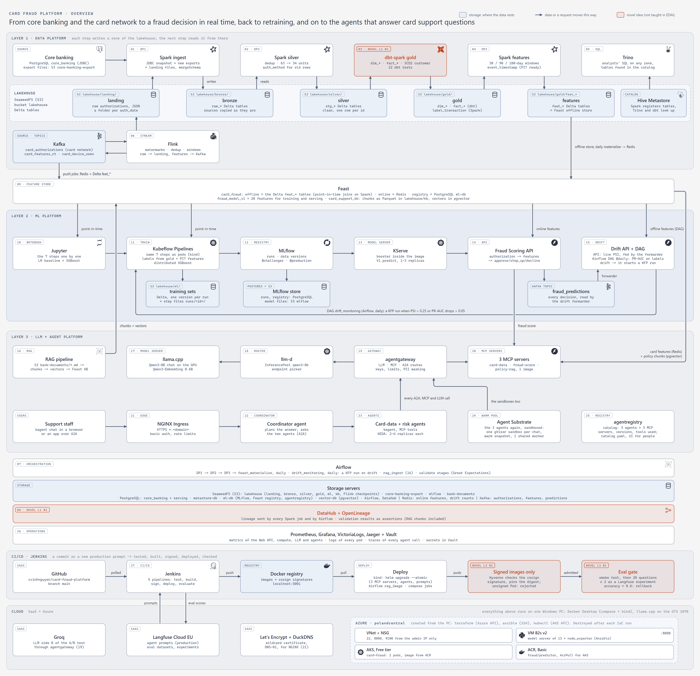
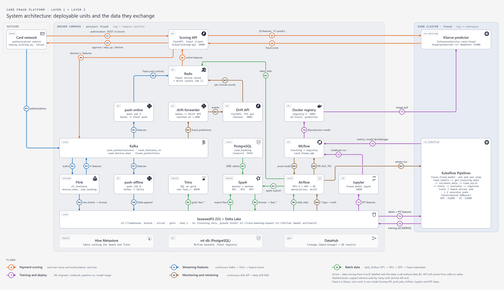
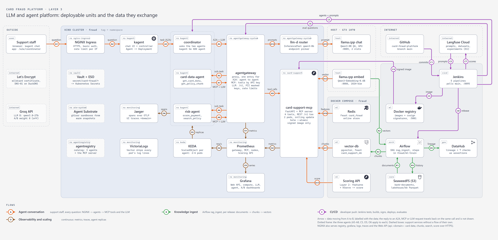
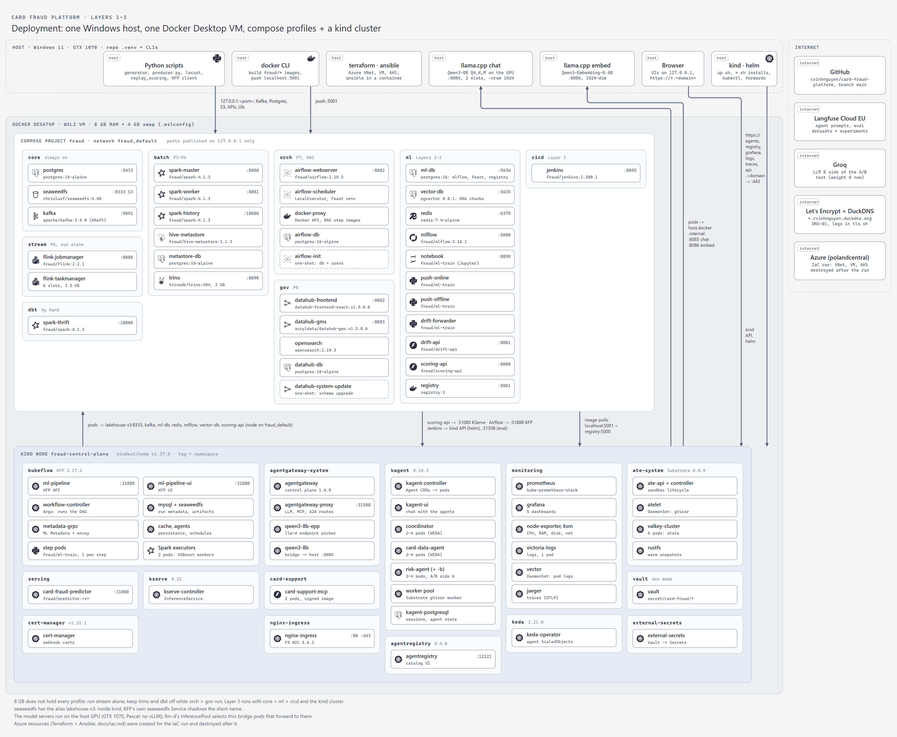

# Architecture

Four views of the same platform, Layers 1 to 3: what it does step by step, which deployable unit sends which data to
which, and where each unit runs. All four are drawn by
[`docs/diagrams/platform.py`](https://github.com/cvinhnguyen/card-fraud-platform/blob/a593ac7ac74f781dc50824b14e97f2620198be46/docs/diagrams/platform.py)
from the tables in that script (stdlib only), which also prints the numbered-arrow tables of this page.

| | |
|---|---|
| Code | [`docs/diagrams/platform.py`](https://github.com/cvinhnguyen/card-fraud-platform/blob/a593ac7ac74f781dc50824b14e97f2620198be46/docs/diagrams/platform.py) |
| Runs on | host process (Python stdlib; headless Chrome or Edge renders the PNGs) |
| Writes | `docs/images/platform-*.svg` and the PNGs next to them; prints the arrow tables below |
| Related | [schema_design.md](schema_design.md), [agents.md](agents.md), [cicd.md](cicd.md), [iac.md](iac.md) |

| View | Question it answers | Boxes are |
|---|---|---|
| [Overview](#overview) | What does the platform do, step by step, and where does the data rest? | the 27 steps of the README tables and their stores |
| [System diagram, Layers 1-2](#system-diagram) | Which unit sends which data to which unit? | deployable units |
| [System diagram, Layer 3](#layer-3-system-diagram) | The same question for the agents, the gateway and the model servers | deployable units |
| [Deployment](#deployment) | Where does each unit run, on which port? | containers, Kubernetes workloads, host processes |

## Run it

Redraw the diagrams from the repo root (Python stdlib only; Chrome or Edge renders the PNGs):

```bash
python docs/diagrams/platform.py            # every view
python docs/diagrams/platform.py layer3     # only the named views (overview, architecture, layer3, deployment)
```

It writes `docs/images/platform-*.svg`, renders the PNGs with headless Chrome or Edge one at a time, prints the arrow
tables below, and warns when an arrow crosses a box, a label overlaps one, or two arrows of the Layer 3 diagram cross.

## Overview

The overview has three bands, a bar between the first two, and bars under all of them. White cards are steps, blue
cards are stores (where the data rests between two steps), orange cards are the four novel ideas:



Layer 1 (top) turns the source systems into feature tables, daily with Spark (DAG
[`pipelines/airflow/dags/dp1_source_to_bronze.py` L43-L60](https://github.com/cvinhnguyen/card-fraud-platform/blob/a593ac7ac74f781dc50824b14e97f2620198be46/pipelines/airflow/dags/dp1_source_to_bronze.py#L43-L60),
which triggers DP2 and DP3) and continuously with Flink
([`pipelines/flink/rt_features.py` L94-L121](https://github.com/cvinhnguyen/card-fraud-platform/blob/a593ac7ac74f781dc50824b14e97f2620198be46/pipelines/flink/rt_features.py#L94-L121)).
No step hands its data straight to the next one: each writes a zone of the lakehouse (Delta tables under
`s3a://lakehouse/<zone>/` on SeaweedFS, registered in the Hive Metastore) and the next step reads that zone. Flink
lands the raw authorizations as JSON files in `landing/`, DP1 copies them and the core banking sources into
`bronze/`, DP2 cleans bronze into `silver/`, dbt builds `gold/` from silver, DP3 computes `gold/feat_*` from gold.
One bronze table lives elsewhere: DP1 appends the nightly export to `bronze.raw_transactions` in the lakeFS
repository `bronze`, on a branch of its own, and merges that branch into `main` after the checks
([novel_lakefs_wap.md](novel_lakefs_wap.md)).
Trino has no arrow from Spark: it asks the Hive Metastore where a table lives and reads the Delta files itself, so it
can query any zone.
Layer 2 (middle) trains, registers, serves and monitors the model (KFP pipeline
[`ml/pipelines/train_fraud_model.py` L102-L124](https://github.com/cvinhnguyen/card-fraud-platform/blob/a593ac7ac74f781dc50824b14e97f2620198be46/ml/pipelines/train_fraud_model.py#L102-L124),
Scoring API
[`services/scoring_api/app/main.py` L60-L63](https://github.com/cvinhnguyen/card-fraud-platform/blob/a593ac7ac74f781dc50824b14e97f2620198be46/services/scoring_api/app/main.py#L60-L63)).
Its stores sit under the steps: the versioned training sets in `lakehouse/ml/`, MLflow's PostgreSQL (runs, registry)
and bucket `mlflow` (model files), and the Kafka topic `fraud_predictions` that carries every decision to the drift
check.
Feast (the bar) is the hand-over: Layer 1 writes into it, Layer 2 reads from it, so training and serving
see the same 20 features (`fraud_model_v1`,
[`ml/feature_repo/fraud_features.py` L123-L128](https://github.com/cvinhnguyen/card-fraud-platform/blob/a593ac7ac74f781dc50824b14e97f2620198be46/ml/feature_repo/fraud_features.py#L123-L128)).
Drift is checked twice. The Drift API is a service that runs all the time: the drift forwarder reads every decision
from the Kafka topic `fraud_predictions` and posts it, and the API keeps per-minute counts in Redis and returns the
PSI of each input over the last 15 minutes (no labels needed). The loop inside Layer 2 is the retraining path: the
Airflow DAG `drift_monitoring` runs every day (`schedule="@daily"`), scores the last 7 days with ground truth and
point-in-time features from the offline store, and when a PSI is above 0.25 or the PR-AUC fell more than 0.05 it
starts a Kubeflow pipeline run with the newest labels
([`pipelines/airflow/dags/drift_monitoring.py` L39-L51](https://github.com/cvinhnguyen/card-fraud-platform/blob/a593ac7ac74f781dc50824b14e97f2620198be46/pipelines/airflow/dags/drift_monitoring.py#L39-L51),
[drift.md](drift.md)).

Layer 3 (bottom band) reads from both layers above it. Three MCP servers, one per tool family
([`services/card_support_mcp/app/main.py` L40-L44](https://github.com/cvinhnguyen/card-fraud-platform/blob/a593ac7ac74f781dc50824b14e97f2620198be46/services/card_support_mcp/app/main.py#L40-L44)), give the agents
their tools: card-data takes a card's features from the same Feast online store, fraud-score asks the Layer 2 Scoring
API, and policy-rag searches the bank's documents; the RAG pipeline
([`pipelines/airflow/dags/rag_ingest.py` L64-L73](https://github.com/cvinhnguyen/card-fraud-platform/blob/a593ac7ac74f781dc50824b14e97f2620198be46/pipelines/airflow/dags/rag_ingest.py#L64-L73))
writes the policy chunks and their
vectors into a second Feast project (`card_support_kb`, online store pgvector). Support staff reach the agents through
NGINX; every agent call (A2A, MCP, LLM) then goes through agentgateway, which sends the LLM calls to llama.cpp via the
llm-d router. Agent Substrate runs the same three agents a second time as sandboxes: each conversation gets its own
gVisor sandbox restored from a warm snapshot, on a worker pool shared by all agents (one worker here), and the
sandboxes call the same gateway ([agents.md](agents.md#sandboxed-agents-on-agent-substrate-warm-up)). agentregistry
is the catalog for people, not on the request path: which agents exist, their version and image, and which MCP
server each uses, published from `agents/registry/catalog.yaml` ([agents.md](agents.md#agent-registry)).
Airflow, the lakehouse, DataHub and the operations tools (metrics, logs, traces, Vault) run under everything.

The CI/CD row is the path of a change: Jenkins polls GitHub, tests and builds, pushes signed images to the registry,
then deploys and checks against the running platform (Helm into kind with the eval gate, a new RAG image in Airflow,
the push jobs in compose); prompts come from Langfuse and eval scores go back to it
([cicd.md](cicd.md)). The cloud row shows what runs outside the PC: the SaaS the platform calls (Groq, Langfuse
Cloud EU, Let's Encrypt + DuckDNS, GitHub above) and the Azure resources an IaC run creates (VNet + NSG, a VM with
the model server, AKS running the same model image from ACR), destroyed after the run ([iac.md](iac.md)).

## System diagram

The system diagram of Layers 1-2: every box is a deployable unit, and the arrows carry the data, numbered per flow
(S payment scoring, R streaming features, B batch data, T training and deploy, M monitoring and retraining):



The rules of the README diagram, and how the picture follows them:

| Rule | In the picture |
|---|---|
| Every box is a deployable unit | each box is one compose service or one Kubernetes workload; the tag says where (compose profile or namespace). Feast is a library inside Scoring API, push jobs, Airflow, Jupyter and the KFP steps, so it has no box; its stores (Redis, SeaweedFS) and registry (ml-db) do |
| Arrows follow the data, the data on the arrow | the arrow runs from Redis to Scoring API (S2), not the other way, because features flow to the API; a call without data (B1 spark-submit, M7 retraining run) points from caller to callee |
| Numbered, one numbering per user flow | five flows, each with its own colour, letter and 1..n: S for the end user's payment, T for the ML engineer, R / B / M for the system's own flows |
| Few dashed lines, only off the main path | no dashed arrows; the three dashed boxes are support services used by many units (Hive Metastore, ml-db, DataHub), whose arrows would cross every flow |

Colours: the five flow colours are at least 17 apart (OKLab x 100) for normal vision; for colour-blind readers the
letter in each badge carries the flow. One crossing is left (M7 over T2), drawn with a gap.

### Numbered arrows

| # | Flow | Data / call |
|---|---|---|
| S1 | Payment scoring | The switch sends each authorization to the API (card, amount, channel, device) |
| S2 | Payment scoring | Feast reads the card's stored features from Redis (feature service fraud_model_v1) |
| S3 | Payment scoring | Feature vector to the model server (KServe V1 protocol, NodePort 31080) |
| S4 | Payment scoring | Probability of fraud from the production XGBoost booster |
| S5 | Payment scoring | Decision by the two thresholds; rule fallback when the model is late or down |
| S6 | Payment scoring | Every decision is logged to Kafka topic fraud_predictions (scoring never waits on monitoring) |
| R1 | Streaming features | Every authorization (retries included) to Kafka topic card_authorizations |
| R2 | Streaming features | Flink reads card_authorizations (watermarks, dedup of network retries); ato_cep reads app_events (account takeover patterns -> ato_alerts_cep) |
| R3 | Streaming features | Realtime features to card_features_rt, first (card, device) pairs to card_device_seen |
| R4 | Streaming features | raw_landing writes the raw authorizations as JSON lines to the S3 landing zone; DP1's Spark task loads them into bronze.raw_card_authorizations (Delta) |
| R5 | Streaming features | push job A consumes card_features_rt and card_device_seen |
| R6 | Streaming features | Writes them to the Redis online store through Feast push (offsets committed after the write) |
| R7 | Streaming features | push job B consumes the same two topics |
| R8 | Streaming features | Appends them to gold.feat_card_auth_rt / gold.feat_card_device: the offline copy for training |
| B1 | Batch data | Airflow runs DP1 -> DP2 -> DP3 on the Spark cluster (call, no data); dbt and GE validate stages |
| B2 | Batch data | DP1 copies the core banking tables (customers, accounts, cards, merchants, disputes) |
| B3 | Batch data | DP1 loads the new daily export folders from s3://core-banking-export |
| B4 | Batch data | Delta tables bronze -> silver -> gold (dbt) -> feat_* in s3://lakehouse; bronze.raw_transactions through lakeFS: a branch per DP1 run, merged into main after the checks |
| B5 | Batch data | Trino reads the Delta tables of any zone for analysts; the Hive Metastore tells it where each table lives (bronze.raw_transactions: catalog lakefs, branch main) |
| B6 | Batch data | DAG feast_materialize (after DP3) reads feat_card_txn_stats_daily through the Feast offline store |
| B7 | Batch data | ... and loads the newest row per card into Redis (feast materialize-incremental) |
| T1 | Training and deploy | The notebook builds the training set: labels + Feast point-in-time features |
| T2 | Training and deploy | Metrics, plots and both models of the notebook run |
| T3 | Training and deploy | Pipeline steps 1-2 read the labels as of label_as_of and the point-in-time features |
| T4 | Training and deploy | Step 2 MERGEs the run's rows into ml/training_set_fraud_model_v1 (one Delta version per run) |
| T5 | Training and deploy | Steps 5-7 log params, data versions, metrics and the booster; alias challenger when the gate passes |
| T6 | Training and deploy | ML engineer: fetch_model.py --alias production, docker build + push of fraud/predictor:<v> |
| T7 | Training and deploy | kubectl apply of the InferenceService; the node pulls the image from the registry |
| M1 | Monitoring and retraining | The forwarder consumes the prediction log |
| M2 | Monitoring and retraining | Batches to POST /v1/events |
| M3 | Monitoring and retraining | Bin counts per feature and minute in Redis db 1; GET /v1/drift returns the PSI vs the training profile |
| M4 | Monitoring and retraining | DAG drift_monitoring: last 7 days of payments, ground truth, point-in-time features |
| M5 | Monitoring and retraining | Loads the production model to score them |
| M6 | Monitoring and retraining | Logs PR-AUC, recall and PSI as a run of experiment card_fraud_monitoring |
| M7 | Monitoring and retraining | On drift: a KFP run of train_fraud_model with label_as_of = the DAG's day (call, no data) |

## Layer 3 system diagram

The Layer 3 diagram follows the same rules as the Layers 1-2 diagram, with four flows of their own. A is the support
staff's question, the only flow that starts with a person at a screen. K is the RAG ingest that Airflow runs after
each release of its image. C is the developer's push through Jenkins, and O is the platform's monitoring and the
agents' autoscaling:



| Rule | In the picture |
|---|---|
| Every box is a deployable unit | a pod set in the kind cluster (tag = namespace), a compose service (tag = profile), a process on the host, or a service on the internet. The dotted frame groups the three agents: A5-A8, C5, O5 and O6 apply to each of them |
| Arrows follow the data, the data on the arrow | the arrow from Redis to the card-data MCP server (A10) carries the card's features; an A2A, MCP or LLM request is drawn in the direction of the request, and its reply travels back on the same call without a second arrow |
| Numbered, one numbering per user flow | A, K, C and O, each with its own colour and 1..n; the colours are the ones of S, B, T and M, so the validated pairs carry over |
| Few dashed lines | no dashed arrows; the dashed boxes are support units without a flow of their own: Vault + External Secrets (every Secret of the platform), Agent Substrate (sandboxed agents from warm snapshots), agentregistry (the catalog), Let's Encrypt and the Groq B side of the LLM A/B test, now at weight 0 |

No two arrows cross. The two CI lanes above the panels (C5, C6) and the lane between the model servers and the MCP
server (C4) are there for that reason.

### Numbered arrows, Layer 3

| # | Flow | Data / call |
|---|---|---|
| A1 | Agent conversation | A question in the kagent chat (https://agents.<domain>, basic auth at NGINX); a support app calls the gateway route /a2a/coordinator instead |
| A2 | Agent conversation | NGINX passes it to kagent-ui (host agents.<domain>, streamed answers, no buffering) |
| A3 | Agent conversation | kagent's controller sends the task to the coordinator over A2A (kagent's own control path) |
| A4 | Agent conversation | The coordinator's A2A calls to the two agents and its LLM calls, all through the gateway (kagent proxy.url) |
| A5 | Agent conversation | Route agents-internal: a sub-task for card-data-agent; only the coordinator's key may call it |
| A6 | Agent conversation | ... and for risk-agent (risk-agent-b, the B side of its model-config A/B test, sits behind the same route) |
| A7 | Agent conversation | card-data-agent's tool calls (MCP, its own API key) and LLM calls through the gateway |
| A8 | Agent conversation | risk-agent's tool calls and LLM calls through the gateway |
| A9 | Agent conversation | Routes /mcp/card-data, /mcp/fraud-score, /mcp/policy-rag: only the key of each server's agent sees its tools (300 calls/min per server) |
| A10 | Agent conversation | card-data-mcp, get_card_data: the card's online features from Redis through Feast (project card_fraud) |
| A11 | Agent conversation | card-data-mcp, get_policy_chunk: one policy chunk by id from pgvector (Feast project card_support_kb) |
| A12 | Agent conversation | policy-rag-mcp, search_policy: the question's vector from Qwen3-Embedding-0.6B |
| A13 | Agent conversation | fraud-score-mcp, score_payment: the Layer 2 Scoring API answers with the fraud score and its decision |
| A14 | Agent conversation | Route /v1: key check, request and token limits, PII masked, then the InferencePool qwen3-8b |
| A15 | Agent conversation | The endpoint picker chooses a pod; its bridge forwards the prompt to llama.cpp on the host GPU |
| A16 | Agent conversation | policy-rag-mcp, search_policy: the chunks nearest to the question vector from pgvector, re-ranked by cosine |
| K1 | Knowledge ingest | rag_ingest reads the 5 bank documents from s3://bank-documents |
| K2 | Knowledge ingest | Steps chunk (57 chunks) and embed: one 1024-dim vector per chunk from the embedding server |
| K3 | Knowledge ingest | Step write: chunks + vectors into the Feast online store (pgvector) |
| K4 | Knowledge ingest | ... and their history into the offline store s3://lakehouse/kb/policy_chunks.parquet |
| K5 | Knowledge ingest | Step validate: 7 checks as assertions, plus lineage documents -> jobs -> feature view |
| C1 | CI/CD | Jenkins polls GitHub main for its 5 pipelines (MCP servers, data agents, coordinator, RAG, stream jobs) |
| C2 | CI/CD | Agent pipelines fetch the prompt labelled production for each agent |
| C3 | CI/CD | MCP pipeline: tests (coverage gate 90 %), mutation test, image build, push, cosign signature |
| C4 | CI/CD | helm upgrade --atomic of each MCP server; the node pulls the signed image (Kyverno verifies it whenever it is installed) |
| C5 | CI/CD | Agent pipelines: helm upgrade --atomic of the agents, the Langfuse prompts in a ConfigMap |
| C6 | CI/CD | Eval gate: the eval dataset asked to risk-agent through the gateway; below 0.6 accuracy, helm rollback |
| C7 | CI/CD | Answers and their scores stored as a run of the Langfuse experiment |
| C8 | CI/CD | RAG pipeline: sets Variable rag_image to the new image, triggers rag_ingest (Airflow REST API) |
| O1 | Observability and scaling | Gateway metrics: requests per route and backend, LLM tokens, time to first token, PII guardrail hits |
| O2 | Observability and scaling | MCP servers' metrics (one ServiceMonitor each): calls, failures and latency per tool |
| O3 | Observability and scaling | Grafana dashboards: Web API, compute, LLM telemetry, agent telemetry, A/B tests |
| O4 | Observability and scaling | KEDA's trigger: A2A requests per second for each agent |
| O5 | Observability and scaling | KEDA sets each agent's replicas between 2 and 4 |
| O6 | Observability and scaling | Agents send spans over OTLP; the gateway's spans join the same traces (one conversation: about 20) |

## Deployment

Compose sits on top and the kind cluster underneath, both inside the Docker Desktop VM. The host runs the CLIs and
the two llama.cpp servers. The column on the right holds the SaaS the platform talks to and, under it, the Azure
resources an IaC run creates, reached from the host's terraform and ansible. The corridor
between compose and the VM's edge carries the three paths between the host and the cluster: pods to the model
servers, the browser to NGINX, and kubectl/helm to the API server:



| Decision | Why |
|---|---|
| One Docker Desktop VM, eight compose profiles | each phase starts only what it needs; the 8 GB VM cannot hold every profile at once (run `stream` alone, keep `trino` and `dbt` off while `orch` + `gov` run). Layer 3 runs with `core` + `ml` + `cicd` and the kind cluster; `orch` comes up for a RAG run |
| Kubernetes for Kubeflow Pipelines, KServe and all of Layer 3 | KFP and KServe need it; the Layer 3 tools (agentgateway, llm-d, kagent, KEDA, Substrate, agentregistry, Vault + ESO, NGINX Ingress) are Kubernetes operators. APIs, push jobs, MLflow, Redis, pgvector, Airflow and Jenkins stay in compose |
| Model servers on the host | the GTX 1070 (Pascal) cannot run vLLM, and the GPU is not visible inside the VM; llama.cpp serves chat on :8085 (GPU) and embeddings on :8086, and the llm-d InferencePool selects thin bridge pods that forward to the host. On a GPU node the same pool would select real model server pods |
| kind node joined to `fraud_default` | pods reach the compose services by name (`lakehouse-s3:8333`, `kafka:19092`, `ml-db`, `redis`, `mlflow:5000`, `vector-db`, `scoring-api:8000`), and compose reaches the cluster through NodePorts (31080 KServe, 31888 KFP API, 31508 agentgateway for the eval gate) |
| NGINX Ingress on the node's ports 80/443 | the only way in from a browser: `agents`, `registry`, `grafana`, `logs`, `traces` and `api` under `*.cvinhnguyen.duckdns.org`, all pointing at 127.0.0.1, with a Let's Encrypt wildcard certificate kept in Vault and basic auth on every UI except Grafana (own login) |
| Local registry `registry:3` | the host pushes to `localhost:5001`; containerd on the node maps that name to `registry:5000` on the compose network. Jenkins signs the MCP image there (cosign), and the signature sits next to the image |
| Alias `lakehouse-s3` for SeaweedFS | KFP installs its own `seaweedfs` Service, which shadows the short name inside the cluster |
| Ports published on 127.0.0.1 only | nothing is reachable from the network; local secrets stay in `infra/.env` (gitignored), the cluster's come from Vault through External Secrets |
| Azure only for the IaC run | Terraform builds the VNet, VM, AKS cluster and container registry; Ansible deploys the model server to the VM and AKS runs the same image from the registry; `terraform destroy` follows. The rest stays on the PC because of the subscription: 6 vCPU and 3 public IPs per region, a GPU quota of 0, $100 of credit ([iac.md](iac.md#why-not-all-of-it-on-azure)) |
