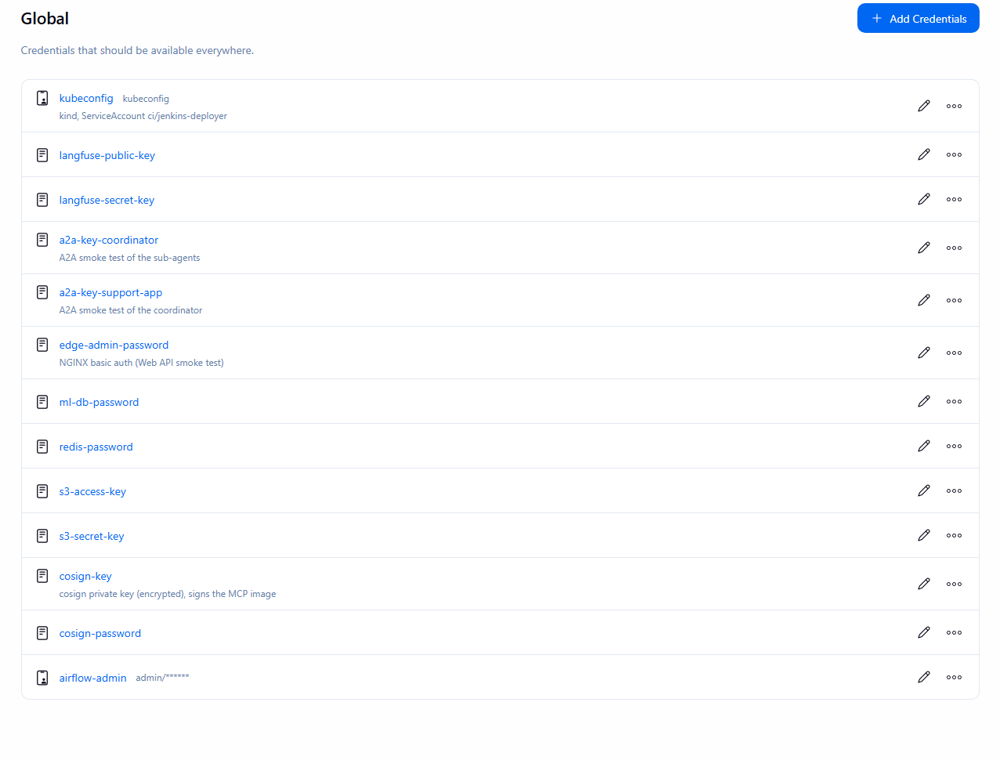
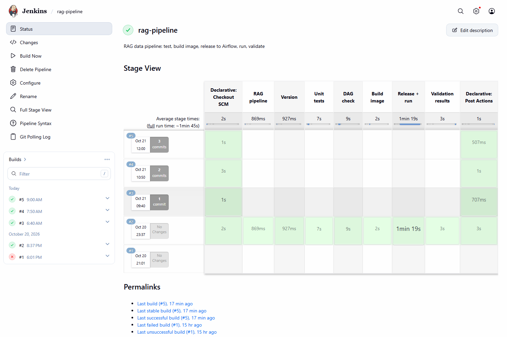
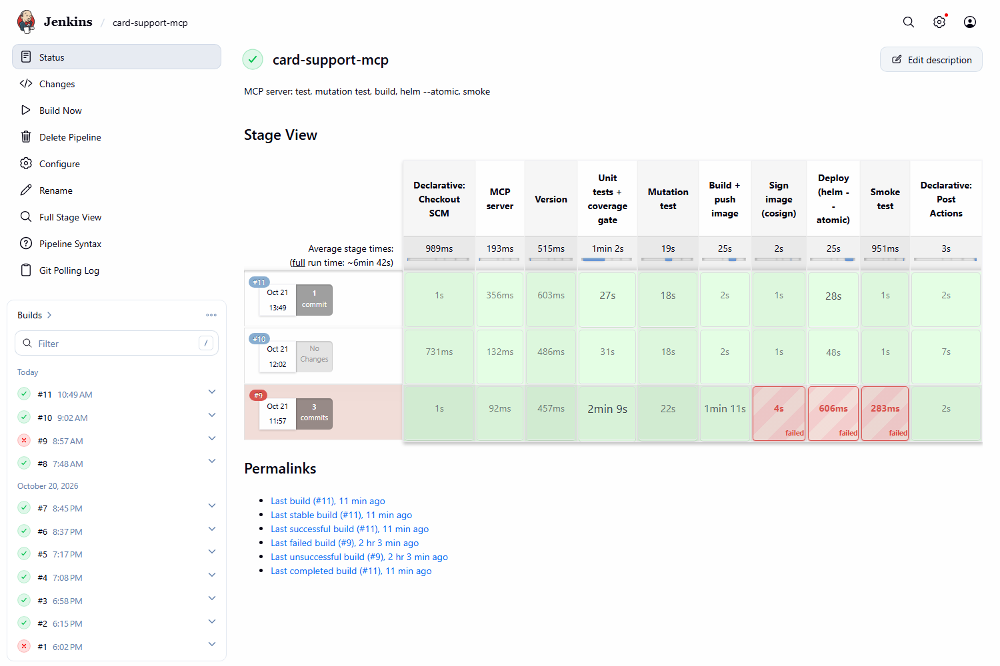
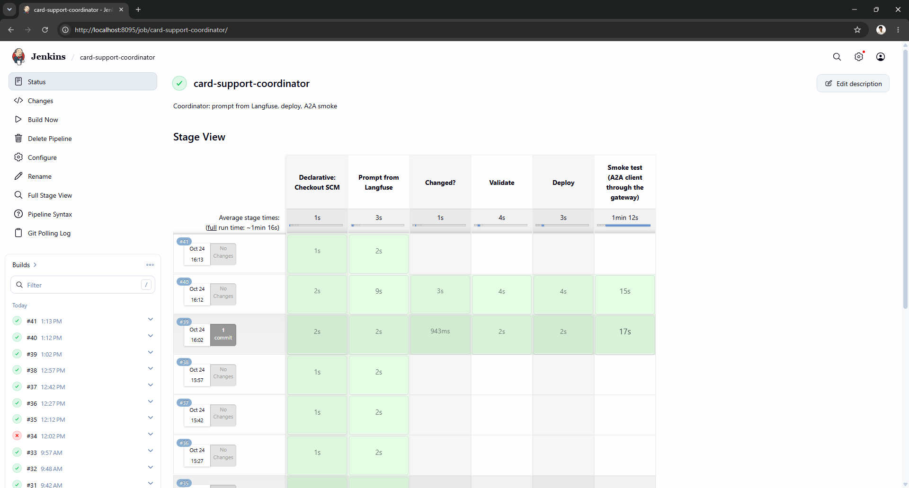
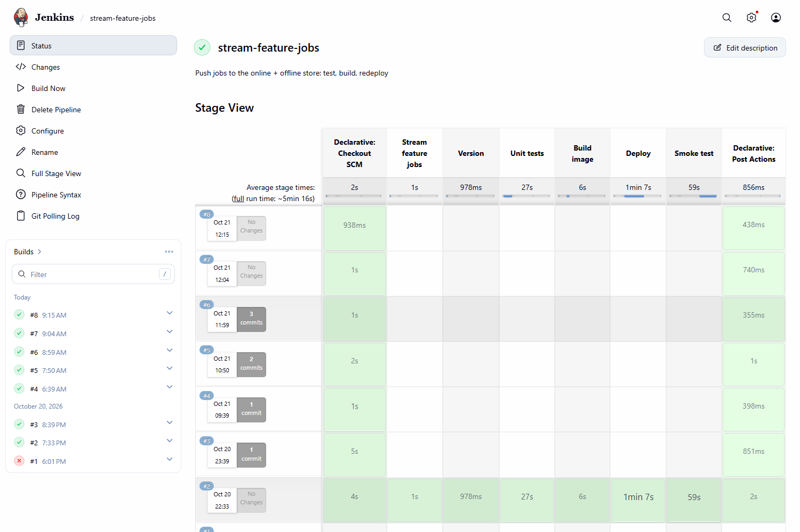

# CI/CD with Jenkins

Five Jenkins pipelines build, test and deploy the Layer 3 components. Each one is a Jenkinsfile next to the code it
ships, and each one ends with a check against the running platform, so a green build means the new version answers.

| | |
|---|---|
| Code | [`infra/jenkins/`](https://github.com/cvinhnguyen/card-fraud-platform/tree/1416656ca28dbf52a0663508c5f0a81fb869faed/infra/jenkins), the five Jenkinsfiles in [Pipelines](#pipelines) |
| Runs on | compose service `jenkins` (profile `cicd`, UI on `127.0.0.1:8095`); deploys into kind namespaces `card-support`, `kagent` and `agentgateway-system`, and to Airflow and compose |
| Reads | GitHub `main` (polled every 5 minutes), production prompts in Langfuse |
| Writes | the MCP servers' image in the compose registry, `fraud/ml-train` images, Helm releases in `card-support` and `kagent`, the Airflow Variable `rag_image` |
| Related | [rag_pipeline.md](rag_pipeline.md), [agents.md](agents.md), [novel_eval_gate.md](novel_eval_gate.md), [novel_supply_chain.md](novel_supply_chain.md), [testing.md](testing.md) |

## Run it

Jenkins runs in compose and deploys into the kind cluster, so the cluster comes first (`infra/k8s/up.sh`):

```bash
sh infra/jenkins/setup.sh     # deploy ServiceAccount + its kubeconfig, then the Jenkins container (profile cicd)
```

## Pipelines

| Jenkins job | Jenkinsfile | Runs when | Ships | Rubric |
|---|---|---|---|---|
| `rag-pipeline` | [`pipelines/rag/Jenkinsfile`](https://github.com/cvinhnguyen/card-fraud-platform/blob/1416656ca28dbf52a0663508c5f0a81fb869faed/pipelines/rag/Jenkinsfile) | RAG steps, DAG, documents or ml image changed | image of the RAG steps, released to Airflow and run | C33 |
| `card-support-mcp` | [`services/card_support_mcp/Jenkinsfile`](https://github.com/cvinhnguyen/card-fraud-platform/blob/1416656ca28dbf52a0663508c5f0a81fb869faed/services/card_support_mcp/Jenkinsfile) | `services/card_support_mcp/**` changed | image of the three MCP servers, one Helm release per server in `card-support` | B34 |
| `card-support-data-agents` | [`agents/Jenkinsfile.data-agents`](https://github.com/cvinhnguyen/card-fraud-platform/blob/1416656ca28dbf52a0663508c5f0a81fb869faed/agents/Jenkinsfile.data-agents) | `agents/**` changed, after the MCP pipeline, or a new production prompt in Langfuse | card-data-agent and risk-agent, Helm release in `kagent` | C34 |
| `card-support-coordinator` | [`agents/Jenkinsfile.coordinator`](https://github.com/cvinhnguyen/card-fraud-platform/blob/1416656ca28dbf52a0663508c5f0a81fb869faed/agents/Jenkinsfile.coordinator) | `agents/**` changed, after the data agents, or a new production prompt | coordinator, Helm release in `kagent` | C35 |
| `stream-feature-jobs` | [`ml/jobs/Jenkinsfile.stream`](https://github.com/cvinhnguyen/card-fraud-platform/blob/1416656ca28dbf52a0663508c5f0a81fb869faed/ml/jobs/Jenkinsfile.stream) | push jobs, ML library, Feast repo or ml image changed | push-online and push-offline (Kafka to Redis and Delta) | B36 |

## Jenkins setup

Jenkins 2.580.1 runs in compose (profile `cicd`, UI on `127.0.0.1:8095`, login required;
[`infra/docker-compose.yaml` L757-L778](https://github.com/cvinhnguyen/card-fraud-platform/blob/1416656ca28dbf52a0663508c5f0a81fb869faed/infra/docker-compose.yaml#L757-L778)).
The image
([`infra/jenkins/Dockerfile`](https://github.com/cvinhnguyen/card-fraud-platform/blob/1416656ca28dbf52a0663508c5f0a81fb869faed/infra/jenkins/Dockerfile))
adds the Docker CLI with buildx and compose, kubectl v1.37.0, Helm v3.22.1 and jq, plus the plugins in
[`infra/jenkins/plugins.txt`](https://github.com/cvinhnguyen/card-fraud-platform/blob/1416656ca28dbf52a0663508c5f0a81fb869faed/infra/jenkins/plugins.txt).
Nothing is clicked together in the UI:
[`infra/jenkins/casc.yaml`](https://github.com/cvinhnguyen/card-fraud-platform/blob/1416656ca28dbf52a0663508c5f0a81fb869faed/infra/jenkins/casc.yaml)
(configuration as code) creates the admin user, the credentials and the five jobs. The jobs poll GitHub `main` every 5
minutes, because no webhook can reach this machine. One executor runs one pipeline at a time, since two image builds
do not fit in the machine's RAM.

Secrets never appear in a Jenkinsfile. They start in the gitignored `infra/.env` (or `infra/.secrets/` for files),
reach the container as Docker secrets under `/run/secrets/`, and JCasC turns each into a Jenkins credential
([`infra/jenkins/casc.yaml` L13-L30](https://github.com/cvinhnguyen/card-fraud-platform/blob/1416656ca28dbf52a0663508c5f0a81fb869faed/infra/jenkins/casc.yaml#L13-L30)).
A Jenkinsfile names the credential id inside `withCredentials` and Jenkins masks the value in the console log. The API
keys go to curl on stdin (`curl -K -`) and to containers through the environment (`docker run -e NAME`), so they do
not show up in the process list or the build log.

| Credential id | Used by |
|---|---|
| `kubeconfig` | every deploy (ServiceAccount `ci/jenkins-deployer`) |
| `langfuse-public-key`, `langfuse-secret-key` | agent pipelines: system prompts and the eval experiment |
| `a2a-key-coordinator`, `a2a-key-support-app` | A2A smoke tests through agentgateway |
| `edge-admin-password` | MCP smoke test of the Web API over HTTPS through NGINX |
| `cosign-key`, `cosign-password` | signing the MCP servers' image |
| `ml-db-password`, `redis-password`, `s3-access-key`, `s3-secret-key` | stream jobs deploy and smoke test |
| `airflow-admin` | RAG pipeline: release and run through the Airflow REST API |

The same credentials in Jenkins (Manage Jenkins, Credentials, global domain). The page shows ids and descriptions;
the values stay hidden, the username/password one only shows `admin/******`:



Jenkins deploys with its own ServiceAccount
([`infra/jenkins/rbac.yaml`](https://github.com/cvinhnguyen/card-fraud-platform/blob/1416656ca28dbf52a0663508c5f0a81fb869faed/infra/jenkins/rbac.yaml))
instead of the cluster admin. The role is bound only in `card-support`, `kagent` and `agentgateway-system`, the
namespaces the MCP and agents charts write to, so a pipeline cannot touch Vault, the monitoring stack or kube-system.
[`infra/jenkins/setup.sh`](https://github.com/cvinhnguyen/card-fraud-platform/blob/1416656ca28dbf52a0663508c5f0a81fb869faed/infra/jenkins/setup.sh)
writes its kubeconfig to `infra/.secrets/jenkins-kubeconfig`.

Every Jenkinsfile wraps its stages in a `when { changeset ... }` on its own paths (the RAG pipeline's:
[`pipelines/rag/Jenkinsfile` L20-L27](https://github.com/cvinhnguyen/card-fraud-platform/blob/1416656ca28dbf52a0663508c5f0a81fb869faed/pipelines/rag/Jenkinsfile#L20-L27)).
A poll that finds commits elsewhere in the repo checks out and stops: these are the rows with only "Checkout SCM" in
the stage views below. Jenkins keeps the host's Docker socket because it builds images. Airflow only runs the RAG
image, so it reaches Docker through `docker-proxy` on an internal network, which allows the container and image API
calls and denies exec, build, volumes and the rest
([`infra/docker-compose.yaml` L435-L453](https://github.com/cvinhnguyen/card-fraud-platform/blob/1416656ca28dbf52a0663508c5f0a81fb869faed/infra/docker-compose.yaml#L435-L453));
the DAG itself only accepts a `fraud/ml-train` image as `rag_image`
([`pipelines/airflow/dags/rag_ingest.py` L40-L45](https://github.com/cvinhnguyen/card-fraud-platform/blob/1416656ca28dbf52a0663508c5f0a81fb869faed/pipelines/airflow/dags/rag_ingest.py#L40-L45)).

## RAG data pipeline

[`pipelines/rag/Jenkinsfile`](https://github.com/cvinhnguyen/card-fraud-platform/blob/1416656ca28dbf52a0663508c5f0a81fb869faed/pipelines/rag/Jenkinsfile)
tests the steps of the Airflow DAG `rag_ingest` (chunk the bank documents, embed the chunks, write them to the Feast
knowledge base, validate), builds the image the steps run in, releases that image to Airflow and runs the DAG. The
DAG starts each step as a container of the image named in the Airflow Variable `rag_image`, so releasing a new
version is one Variable update. More on the pipeline itself: [rag_pipeline.md](rag_pipeline.md).

| Stage | What it does |
|---|---|
| Version | short commit hash, used as the image tag |
| Unit tests | builds the `test` stage of [`ml/Dockerfile`](https://github.com/cvinhnguyen/card-fraud-platform/blob/1416656ca28dbf52a0663508c5f0a81fb869faed/ml/Dockerfile) and runs [`ml/jobs/tests/test_rag_ingest.py`](https://github.com/cvinhnguyen/card-fraud-platform/blob/1416656ca28dbf52a0663508c5f0a81fb869faed/ml/jobs/tests/test_rag_ingest.py) |
| DAG check | imports [`pipelines/airflow/dags/rag_ingest.py`](https://github.com/cvinhnguyen/card-fraud-platform/blob/1416656ca28dbf52a0663508c5f0a81fb869faed/pipelines/airflow/dags/rag_ingest.py) in the Airflow image and asserts its 5 tasks |
| Build image | `fraud/ml-train:<commit>` |
| Release + run | Airflow REST API: sets Variable `rag_image` to the new tag, unpauses the DAG, triggers a run, waits for `success` or `failed` ([`pipelines/rag/Jenkinsfile` L53-L77](https://github.com/cvinhnguyen/card-fraud-platform/blob/1416656ca28dbf52a0663508c5f0a81fb869faed/pipelines/rag/Jenkinsfile#L53-L77)) |
| Validation results | prints the checks the `validate_rag.run_checks` task logged |

Build #2 (started by hand, since the pipeline needs the Airflow profile up): 6 unit tests passed, the DAG imported
with its 5 tasks, `rag_image = fraud/ml-train:8f40d6a` was released and run `ci-8f40d6a-1792528682` succeeded
(`chunk_documents` 4 s, `embed_chunks` 6 s, `write_feature_store` 10 s, `validate_rag.run_checks` 13 s,
`validate_rag.publish_results` 1 s). The checks it printed:

```text
ok   expect_table_row_count_to_be_between         observed=57
ok   expect_column_values_to_be_unique            observed=0
ok   expect_column_values_to_not_be_null          observed=0
ok   expect_column_value_lengths_to_be_between    observed=0
ok   expect_embedding_dimension_to_equal          observed=[1024]
ok   expect_every_document_to_have_chunks         observed=['authentication_rules', 'card_terms', 'dispute_policy', 'faq', 'fee_schedule']
ok   expect_online_store_to_match_offline         observed=57/57 chunks identical online
```

In the stage view of `rag-pipeline`, build #2 ran every stage and the later polls stopped after checkout:



## MCP servers

[`services/card_support_mcp/Jenkinsfile`](https://github.com/cvinhnguyen/card-fraud-platform/blob/1416656ca28dbf52a0663508c5f0a81fb869faed/services/card_support_mcp/Jenkinsfile)
ships the three MCP servers the data agents use (card-data, fraud-score, policy-rag,
[agents.md](agents.md#the-three-mcp-servers)): one code base and one image, tested, mutation-tested and signed once,
then deployed as one Helm release per server. When it succeeds it starts the data agents' pipeline, so the agents are
deployed against the releases that just passed.

| Stage | What it does |
|---|---|
| Version | short commit hash, used as the image tag |
| Unit tests + coverage gate | `docker build --target test`, then pytest in it; fails under 90% coverage ([testing.md](testing.md#layer-3-the-card-support-mcp-servers)) |
| Mutation test | mutmut on the tool rules; fails under 80% of mutants killed |
| Build + push image | runtime stage of the multi-stage Dockerfile, pushed to the compose registry as `card-support-mcp:<commit>` |
| Sign image (cosign) | signs the image by digest with the CI key ([novel_supply_chain.md](novel_supply_chain.md)) |
| Deploy (helm --atomic) | for each server, `helm upgrade --install <server>-mcp -f values-<server>.yaml --atomic` into `card-support`: rolling update with maxUnavailable 0; a release whose pods never get Ready is rolled back and stops the stage before the next server |
| Smoke test | the card-data Web API over HTTPS through NGINX must return a real card, and the three kagent RemoteMCPServers must accept the new releases |
| post: success | `build job: 'card-support-data-agents'` |

The two test gates: the coverage threshold sits in
[`services/card_support_mcp/pytest.ini` L4](https://github.com/cvinhnguyen/card-fraud-platform/blob/1416656ca28dbf52a0663508c5f0a81fb869faed/services/card_support_mcp/pytest.ini#L4),
so the test container itself exits non-zero, and the mutation score is computed from mutmut's results in the stage
([`services/card_support_mcp/Jenkinsfile` L31-L48](https://github.com/cvinhnguyen/card-fraud-platform/blob/1416656ca28dbf52a0663508c5f0a81fb869faed/services/card_support_mcp/Jenkinsfile#L31-L48)):

```groovy
        stage('Unit tests + coverage gate') {
          // EP/BVA, hypothesis properties, REST + MCP + adapter tests; pytest.ini fails the stage under 90 % coverage
          steps {
            sh 'docker build --target test -t card-support-mcp:test-$TAG $SVC'
            sh 'docker run --rm card-support-mcp:test-$TAG'
          }
        }
        stage('Mutation test') {
          // mutmut on the code with the tool rules (setup.cfg); fails under 80 % killed
          steps {
            sh '''
              docker run --rm card-support-mcp:test-$TAG sh -c 'mutmut run >/dev/null 2>&1; mutmut results --all true' > mutmut.txt || true
              total=$(grep -c ': ' mutmut.txt || true); killed=$(grep -c ': killed' mutmut.txt || true)
              echo "mutation score: $killed / $total killed"; grep -E ': (survived|timeout|suspicious)' mutmut.txt || true
              [ "$total" -gt 0 ] && [ $((killed * 100 / total)) -ge 80 ]
            '''
          }
        }
```

Build #9 failed at "Sign image" ([Gotchas](#gotchas)). After the key file was fixed, build #10 passed every stage:
97 tests at 97.84% coverage, 243 of 245 mutants killed, image `a1d4e12` pushed and signed (`sha256:8f57ef0f...`),
Helm revision 11 rolled out,
`Web API: card data OK over HTTPS`, both RemoteMCPServers `Accepted`, then
`Scheduling project: card-support-data-agents`. Build #11 (started by hand after the trigger fix in
[Gotchas](#gotchas)) did the same in 89 s: 97 tests, image `b5bd125` signed (`sha256:fdb05642...`), Helm revision 12,
and it started data agents #29.

Build #13 (2026-10-24, started by hand, commit `7da43e5` that split the server into three) ran the same gates on the
new code: 118 tests at 98.31% coverage, 243 of 245 mutants killed, image `7da43e5` pushed and signed
(`sha256:933437f7...`), the three releases `card-data-mcp`, `fraud-score-mcp` and `policy-rag-mcp` upgraded one
after the other in 83 s, `Web API: card data OK over HTTPS`, the three RemoteMCPServers `Accepted`, then data agents
#35 ran the eval gate on them. Build #16, started by hand on the same commit, passed every stage again in about 10
minutes: 118 tests (98.31%), 243 of 245 mutants killed, the image rebuilt and signed under a new digest
(`sha256:0b9c88d6...`), the three releases upgraded in 2 min 14 s, smoke test passed, then data agents #37. Its eval
gate failed while the fraud-score server had no Ready pod and rolled the agents back; #40 re-ran the deploy by hand
and passed ([novel_eval_gate.md](novel_eval_gate.md#proof)).

The full stage view of `card-support-mcp` shows #16 passing every stage and #15 as a poll with nothing to build:



## Agents

The agents' system prompts live in Langfuse (prompt `card-support/<agent>`, label `production`).
[`agents/fetch_prompts.sh`](https://github.com/cvinhnguyen/card-fraud-platform/blob/1416656ca28dbf52a0663508c5f0a81fb869faed/agents/fetch_prompts.sh)
pulls each one into `agents/chart/prompts/<agent>.md` and returns Helm flags with the prompt versions, which the chart
writes into an annotation on each Agent. Every 15 minutes both agent pipelines compare the deployed versions with
production
([`agents/Jenkinsfile.data-agents` L22-L37](https://github.com/cvinhnguyen/card-fraud-platform/blob/1416656ca28dbf52a0663508c5f0a81fb869faed/agents/Jenkinsfile.data-agents#L22-L37)).
Promoting a new prompt version in Langfuse therefore redeploys the agent without a commit, and a run with nothing new
stops after this check.

The chain for a tool change is MCP server, then data agents, then coordinator: each pipeline starts the next one when
it succeeds (the data agents only when they deployed something). The chain did not work at first; the trigger fix is
in [Gotchas](#gotchas).

### Data agents

[`agents/Jenkinsfile.data-agents`](https://github.com/cvinhnguyen/card-fraud-platform/blob/1416656ca28dbf52a0663508c5f0a81fb869faed/agents/Jenkinsfile.data-agents)
deploys card-data-agent and risk-agent (Helm release `card-support-data-agents`).

| Stage | What it does |
|---|---|
| Prompts from Langfuse | fetches the production prompts, compares their versions with the deployed ones |
| Changed? | also deploys on a change under `agents/` or a manual / upstream start |
| Validate | `helm lint`, then `helm template` through a server-side dry run against the cluster |
| Deploy | `helm upgrade --atomic`, then waits until both Agents are Ready |
| Smoke test (A2A through the gateway) | asks each agent one question through agentgateway, the way the coordinator calls it (coordinator key, header `x-kagent-host`); the answer must complete and match the expected pattern (the fee question: its citation `fee_schedule` / "fee schedule" or the 2.5% fact) |
| Eval gate (Langfuse experiment) | the risk agent answers the eval dataset as a Langfuse experiment; below 0.6 accuracy, `helm rollback` and the build fails ([novel_eval_gate.md](novel_eval_gate.md)) |

The eval gate stage
([`agents/Jenkinsfile.data-agents` L85-L107](https://github.com/cvinhnguyen/card-fraud-platform/blob/1416656ca28dbf52a0663508c5f0a81fb869faed/agents/Jenkinsfile.data-agents#L85-L107)):

```groovy
    stage('Eval gate (Langfuse experiment)') {
      // the risk agent just deployed answers the eval dataset as a Langfuse experiment (agents/eval/langfuse_gate.py);
      // below EVAL_MIN_ACCURACY the release goes back to its previous revision and the build fails
      when { environment name: 'DEPLOY', value: 'true' }
      steps {
        withCredentials([string(credentialsId: 'langfuse-public-key', variable: 'LANGFUSE_PUBLIC_KEY'),
                         string(credentialsId: 'langfuse-secret-key', variable: 'LANGFUSE_SECRET_KEY'),
                         string(credentialsId: 'a2a-key-coordinator', variable: 'A2A_KEY'),
                         file(credentialsId: 'kubeconfig', variable: 'KUBECONFIG')]) {
          sh 'docker build -q -t fraud/agent-eval:ci agents/eval >/dev/null'
          script {
            def gate = sh(returnStatus: true, script: '''
              gw="http://fraud-control-plane:$(kubectl -n agentgateway-system get svc agentgateway-proxy -o jsonpath='{.spec.ports[0].nodePort}')"
              prompt=$(printf '%s' "$PROMPT_FLAGS" | grep -o 'risk-agent=[0-9]*' | cut -d= -f2)
              docker run --rm --network kind -e LANGFUSE_HOST -e LANGFUSE_PUBLIC_KEY -e LANGFUSE_SECRET_KEY -e A2A_KEY \
                -e GATEWAY="$gw" fraud/agent-eval:ci langfuse_gate.py --agent risk-agent \
                --run-name "risk-agent prompt v$prompt (Jenkins #$BUILD_NUMBER)" --min-accuracy "$EVAL_MIN_ACCURACY" --repeats 2
            ''')
            if (gate != 0) {
              sh 'helm rollback $RELEASE -n kagent --wait --timeout 5m'
              error "eval gate failed: $RELEASE rolled back to its previous revision"
            }
          }
```

- #20 (a commit under `agents/`): deploy and smoke test passed, the eval scored 0.583 against the 0.6 gate, Helm rolled
  the release back and the build failed.
- #23 (risk-agent prompt v2 promoted in Langfuse): the first stage logged `risk-agent=1` deployed and `risk-agent=2` in
  production, so it deployed v2. Smoke answers: `The card made 3 payments in the last 30 days.` and the foreign fee
  with its source `(fee_schedule#2)`. Eval 0.917, pass. Builds #20 and #23 ran the 12-question dataset once; the gate
  now asks 20 questions twice.
- #27: Jenkins was restarted while the eval container ran (to load the corrected cosign credential), the shell step
  lost its process and returned an error. The gate treats that like a failed eval: it rolled the release back to the
  revision that was running before (prompt v2 still in place) and failed the build.
- #29 (started by MCP #11, with the trigger fix): deploy and smoke test passed, then the eval gate asked the 20
  questions twice: 0.95 and 0.90, `accuracy 0.93 over 2 run(s) of 20 questions (gate 0.60): pass`. It then started the
  coordinator pipeline.
- #32 (2026-10-24, the commit that split the MCP server into three): the agents now take their tools from
  `card-data-mcp`, `fraud-score-mcp` and `policy-rag-mcp`; deploy, smoke test, eval 0.90 and 0.95, pass. #35, started
  by MCP #13: eval 1.00 and 0.95, pass.
- #37 (started by MCP #16): deploy and smoke test passed, then the eval scored 0.20 and 0.70 (mean 0.45). For 28 s
  both fraud-score pods had failed their readiness check, so the risk agent could not reach that server and failed
  every question asked in that window ([agents.md](agents.md#gotchas)). The gate rolled the release back. #39 was
  stopped by a crash of the PC during its eval; #40, started by hand, passed with 0.90 and 0.95 and started the
  coordinator.
- #45 (started by the commit `e148f37` that changed both agent Jenkinsfiles): deploy, smoke test, eval 0.95 and 0.95,
  pass, then coordinator #40.

The stage view of `card-support-data-agents` shows #35 and #40 deploying and passing the eval gate, #37 failing it and
rolling back, and #39 aborted:


### Coordinator

[`agents/Jenkinsfile.coordinator`](https://github.com/cvinhnguyen/card-fraud-platform/blob/1416656ca28dbf52a0663508c5f0a81fb869faed/agents/Jenkinsfile.coordinator)
deploys the coordinator (Helm release `card-support-coordinator`) with the same first four stages. Its smoke test
calls it the way a client application does: the public A2A route `/a2a/coordinator` with the support-app key, and a
question that needs both data agents
([`agents/Jenkinsfile.coordinator` L58-L78](https://github.com/cvinhnguyen/card-fraud-platform/blob/1416656ca28dbf52a0663508c5f0a81fb869faed/agents/Jenkinsfile.coordinator#L58-L78)).

| Stage | What it does |
|---|---|
| Prompt from Langfuse | fetches the coordinator's production prompt, compares the version with the deployed one |
| Changed? | also deploys on a change under `agents/` or a manual / upstream start |
| Validate | `helm lint` and a server-side dry run |
| Deploy | `helm upgrade --atomic`, waits until the coordinator is Ready |
| Smoke test (A2A client through the gateway) | one question needing card data and policy; the answer must complete and state the fee from the policy (its citation `fee_schedule` / "fee schedule" or the 2.5% fact) |

Build #24 (commit under `agents/`): `coordinator: completed | The card made 3 payments in the last 30 days. The
foreign transaction fee is 2.5% for debit cards and 3.0% for credit cards (fee_schedule#2).` Build #26, started by
data agents #29, answered the same question the same way. Build #18 failed its smoke test while the LLM canary sent
part of the traffic to Groq's free tier, which answered 429; that is why the canary was stopped
([ab_testing.md](ab_testing.md)).

On 2026-10-24 builds #29 and #30 failed the smoke test with correct answers: one wrote the source as
"(fee schedule#2)", the other gave the 2.5% fee without a source, and the check wanted the exact text `fee_schedule`.
The check now accepts the citation in either spelling or the fee itself
([`agents/Jenkinsfile.coordinator` L72-L74](https://github.com/cvinhnguyen/card-fraud-platform/blob/1416656ca28dbf52a0663508c5f0a81fb869faed/agents/Jenkinsfile.coordinator#L72-L74)):

```sh
            printf '%s' "$out" | jq -e '.result.status.state == "completed"' >/dev/null
            # the fee came from the policy search: its citation (written fee_schedule#2 or "fee schedule") or the fact itself
            printf '%s' "$answer" | grep -q -i -E 'fee[_ ]schedule|2[.,]5 ?%'
```

#34 failed the same way after data agents #40 ("(fee schedule#2)"), because Jenkins builds what is on GitHub and the
fix was not pushed yet. Once it was (commit `e148f37`), #39, started by hand, passed with an answer that gave the 2.5%
fee without a source, which the old check would have refused, and the chain ran by itself: data agents #45 saw the
commit, deployed, passed the eval gate with 0.95 and 0.95, and started coordinator #40, which passed with
`(fee_schedule#2)` in the answer.

The stage view of `card-support-coordinator` shows #39 and #40 passing the client smoke test and #34 red in the build
list:



## Stream feature jobs

[`ml/jobs/Jenkinsfile.stream`](https://github.com/cvinhnguyen/card-fraud-platform/blob/1416656ca28dbf52a0663508c5f0a81fb869faed/ml/jobs/Jenkinsfile.stream)
ships the two push jobs that write the streaming features to the feature store: `push-online` (Kafka to Redis) and
`push-offline` (Kafka to the Delta table behind the push source). They run as compose services on the ml image.

| Stage | What it does |
|---|---|
| Version | short commit hash, used as the image tag |
| Unit tests | the `test` stage of [`ml/Dockerfile`](https://github.com/cvinhnguyen/card-fraud-platform/blob/1416656ca28dbf52a0663508c5f0a81fb869faed/ml/Dockerfile): tests of the push jobs and the RAG steps |
| Build image | `fraud/ml-train:<commit>` and `:latest` |
| Deploy | starts Kafka if it is down, recreates `push-online` and `push-offline` on the new image |
| Smoke test | [`ml/tools/stream_smoke.py`](https://github.com/cvinhnguyen/card-fraud-platform/blob/1416656ca28dbf52a0663508c5f0a81fb869faed/ml/tools/stream_smoke.py) sends one marked authorization summary (`ci_smoke_<random>`, never a real card) to Kafka; it must reach the online store and the offline table within 180 s ([`ml/jobs/Jenkinsfile.stream` L55-L65](https://github.com/cvinhnguyen/card-fraud-platform/blob/1416656ca28dbf52a0663508c5f0a81fb869faed/ml/jobs/Jenkinsfile.stream#L55-L65)) |

Build #2 (started by hand): 15 tests passed, both containers were recreated on the new image, and the smoke message
arrived in both stores: `ci_smoke_fabe0b34: online 12.4 s, offline 8.4 s (s3://lakehouse/gold/feat_card_auth_rt)`.

In the stage view of `stream-feature-jobs`, build #2 ran every stage and the later polls stopped after checkout:



## Gotchas

- Build #9 of `card-support-mcp` failed at "Sign image": the signing key file was not readable by the Jenkins user,
  so cosign got an empty key (`reading key: invalid pem block`). Deploy and smoke test never ran and the cluster kept
  the release it had. Build #10 passed once the key file was fixed.
- The upstream chain did not trigger deploys at first. The `Changed?` stage of both agent pipelines tested
  `triggeredBy 'UpstreamCause'`, but the `build` step records a `BuildUpstreamCause`, so the runs started by an
  upstream pipeline (data agents #28 after MCP #10, coordinator #11, #19 and #21) checked the prompts and stopped
  without deploying. The running agents still used the new MCP release, because its service address and tool names
  stayed the same, but the redeploy and the eval gate that should follow a tool change did not run. Commit `b5bd125`
  added `triggeredBy 'BuildUpstreamCause'` to both agent Jenkinsfiles
  ([`agents/Jenkinsfile.data-agents` L38-L43](https://github.com/cvinhnguyen/card-fraud-platform/blob/1416656ca28dbf52a0663508c5f0a81fb869faed/agents/Jenkinsfile.data-agents#L38-L43)).
  The next chain ran end to end: MCP #11, then data agents #29 ("Started by upstream project card-support-mcp build
  number 11": deploy, smoke test, eval gate passed), then coordinator #26. Coordinator #25 had already built that
  commit, so #26 had no change to deploy; it deployed and ran its smoke test only because data agents #29 started it,
  which is the case the fix is for.
