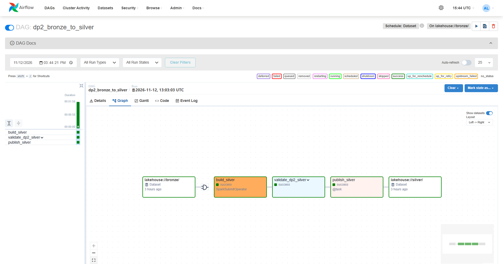
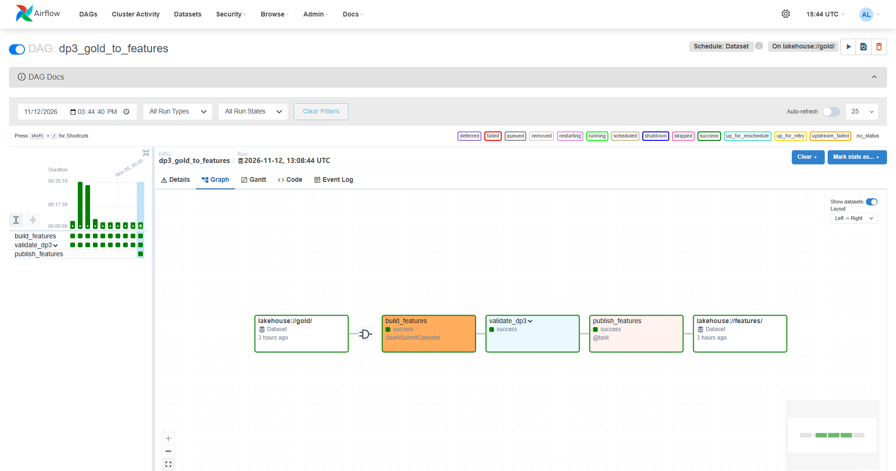
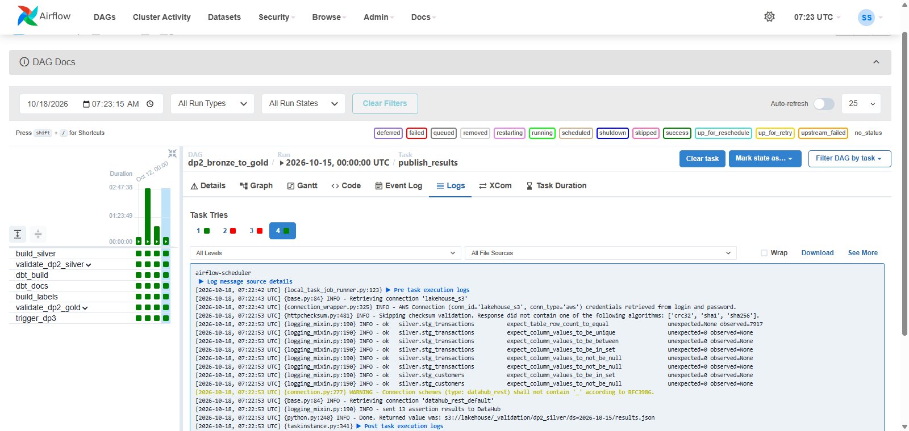
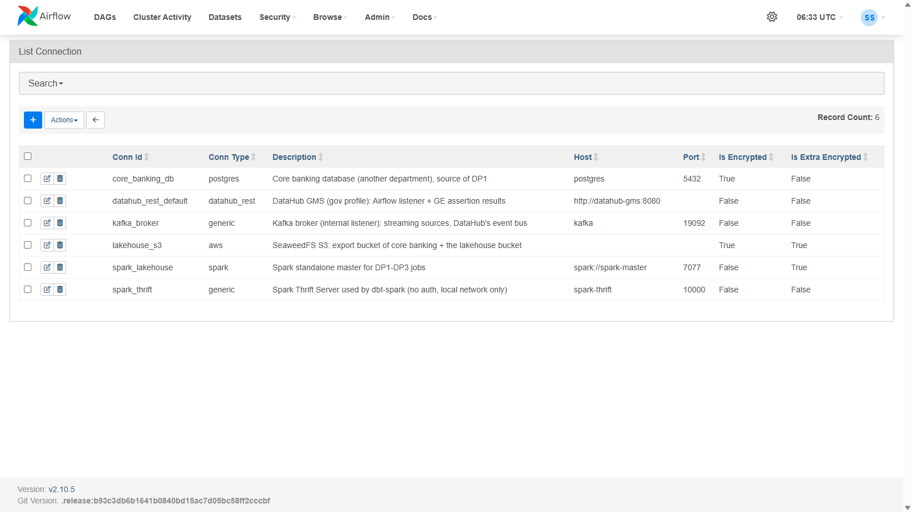
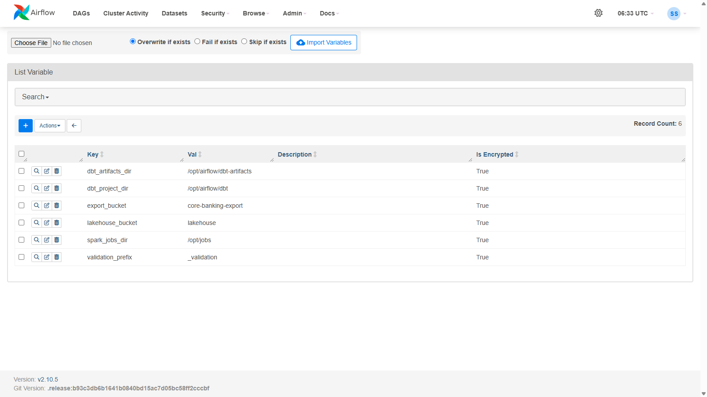

# Airflow pipelines (DP1, DP2, DP3)

Every night the bank's data changes in three places: the core banking database, the nightly export of the day's
settled transactions, and the raw card payments that Flink keeps landing. Each day all of it has to be loaded,
cleaned and turned into features, in the right order, and the work has to stop before a bad batch spreads. Airflow
does this with the three batch pipelines of the data platform (Layer 1), named as in the course: DP1 loads the
sources into bronze, DP2 builds silver and gold from bronze, DP3 computes the daily card features from gold.

Two design choices run through all of them, and DP1 adds a third:

- The lakehouse keeps the data in zones, one per stage of work: bronze is an exact copy of the sources, silver is
  cleaned, gold is modelled for analysis and holds the fraud labels, and the feature table holds per-card statistics.
  Each pipeline reads one zone and writes the next.
- Each pipeline runs a check task before its last task: Great Expectations checks, run on Spark, that stop the run
  before a bad batch reaches the next zone. The last task publishes the zone, and that is what starts the next
  pipeline.
- Since 2026-10-24 DP1 publishes the nightly export with Write-Audit-Publish: the export is written on a separate
  lakeFS branch and checked there. Only when the checks pass is it merged into the main branch that everyone reads.

| | |
|---|---|
| Code | [`pipelines/airflow/`](https://github.com/cvinhnguyen/card-fraud-platform/tree/822721cab1ac597d118f100f1c49949f137f8a7d/pipelines/airflow), [`pipelines/spark/validate.py`](https://github.com/cvinhnguyen/card-fraud-platform/blob/822721cab1ac597d118f100f1c49949f137f8a7d/pipelines/spark/validate.py), [`infra/airflow/Dockerfile`](https://github.com/cvinhnguyen/card-fraud-platform/blob/822721cab1ac597d118f100f1c49949f137f8a7d/infra/airflow/Dockerfile) |
| Runs on | compose profile `orch`: Airflow 2.10.5 (LocalExecutor), UI http://127.0.0.1:8082 (user `admin`, password `AIRFLOW_ADMIN_PASSWORD` in `infra/.env`); Spark drivers in the scheduler container, executors on the standalone Spark cluster |
| Reads | core banking Postgres (6 tables), the nightly export in `s3://core-banking-export/transactions/`, Flink's raw authorization files |
| Writes | `bronze.raw_*` (the export through the lakeFS branch `dp1_<ds>`), `silver.stg_*`, gold dims, `fact_transaction` and `label_transaction`, `gold.feat_card_txn_stats_daily`; validation results in `s3://lakehouse/_validation/` |
| Related | [spark_jobs.md](spark_jobs.md), [novel_lakefs_wap.md](novel_lakefs_wap.md), [datahub.md](datahub.md), [feature_store.md](../ml-platform/feature_store.md) |

## Where it fits

These are Layer 1's batch pipelines;
[architecture.md](../architecture.md#what-starts-the-pipelines-and-the-shared-services) shows what starts each one.
The pipelines read and write the zones of the lakehouse and never hand data to each other directly: DP1 writes bronze,
DP2 reads bronze and writes silver and gold, DP3 reads gold and writes the feature table that Layer 2's feature store
serves.

Airflow runs eight DAGs (directed acyclic graphs, Airflow's name for a pipeline of tasks) in all. Four are these data
pipelines (DP2 is two DAGs, one per zone it writes); the others belong to Layers 2 and 3 or to data governance:

| DAG | Pipeline | Started by | Docs |
|---|---|---|---|
| `dp1_source_to_bronze` | DP1, data pipeline: ingest to bronze | the schedule, daily (`@daily`) | this page |
| `dp2_bronze_to_silver` | DP2, data pipeline: bronze to silver | dataset `lakehouse://bronze`, or by hand | this page |
| `dp2_silver_to_gold` | DP2, data pipeline: silver to gold and the labels | dataset `lakehouse://silver`, or by hand | this page |
| `dp3_gold_to_features` | DP3, feature pipeline: gold to features | dataset `lakehouse://gold`, or by hand | this page |
| `feast_materialize` | incremental materialize pipeline (Layer 2) | dataset `lakehouse://features` | [feature_store.md](../ml-platform/feature_store.md) |
| `drift_monitoring` | data drift pipeline (Layer 2) | its own schedule, daily | [drift.md](../ml-platform/drift.md) |
| `rag_ingest` | RAG data pipeline (Layer 3) | the Jenkins pipeline `rag-pipeline` after a new image, or by hand | [rag_pipeline.md](../llm-platform/rag_pipeline.md) |
| `datahub_metadata` | metadata ingestion into DataHub | its own schedule, daily | [datahub.md](datahub.md) |

## How it works

Airflow runs the pipelines in the order of the zones each day. Only DP1 runs on a clock (`@daily`). No pipeline starts
another one. Each pipeline ends with a `publish_<zone>` task, which emits an Airflow dataset event
(`lakehouse://bronze`, `silver`, `gold` or `features`) that carries the business day. The pipeline that reads that
zone is scheduled on that dataset. So a pipeline depends on the table it reads and does not know which pipeline
writes it. The publish task runs only after the checks pass, so a failed check stops everything after it. The tables
are Delta tables, which are versioned: a reader always gets the last committed version and never a half-written one,
so DP2 can also be run by hand at any time, even while DP1 is writing. After DP3, the Layer 2 incremental materialize
pipeline copies the new features into Redis ([feature_store.md](../ml-platform/feature_store.md)).

One business day `ds`, from start to end:

1. Airflow starts DP1 for day `ds`. Its sensor waits for the export folder `export_date = ds + 1`, because the core
   banking system exports day `ds` the next night. Meanwhile DP1 opens a lakeFS branch for the run and takes a fresh
   copy of the core banking tables and Flink's new landing files.
2. When the export arrives, DP1 appends it to bronze on the branch, commits, and runs its checks. Only if they all
   pass does it merge the branch into `main`, which is when the new export becomes visible to everyone. Its last
   task, `publish_bronze`, emits the dataset event `lakehouse://bronze` with day `ds`.
3. That event starts `dp2_bronze_to_silver`. It cleans the new bronze rows into silver, checks silver, and emits
   `lakehouse://silver`. That event starts `dp2_silver_to_gold`: dbt builds gold next to the job that writes the fraud
   labels as known on `ds`, gold and the labels are checked, and `publish_gold` emits `lakehouse://gold`.
4. That event starts DP3. It rewrites the per-card feature table, recounts a sample by brute force to rule out
   leakage, checks the rows of day `ds`, and emits `lakehouse://features`, which starts the incremental materialize
   pipeline.
5. Every task waits for the same task of the DAG's previous run (`depends_on_past`), because each load is
   incremental: day `ds` must not run before `ds - 1` succeeded. A failed check therefore stops that day and every
   later day until it is fixed (see the drill in [A validation that stops the
   pipeline](#a-validation-that-stops-the-pipeline-drill)).

The business day travels on the dataset event. A run started by an event works on the day the event carries; a run
started by hand uses its own `ds`. Each published version starts its own run, and `max_active_runs=1` makes those
runs wait for each other in order. Two versions share one run only when both are published within the same
scheduler loop, before the scheduler creates the next run. That run works on the newest day, and because the loads
are incremental it loads the rows of the older day too. A toy pair of DAGs built on the same helpers confirmed both
points. The consumer DAG ran for the day the event carried (`2026-11-20`), while its own logical date was the wall
clock. Two days published 5 seconds apart gave two consumer runs, with one event each.

## Run it

From the repo root, with the source data loaded (README, Quick start): start Airflow next to the batch stack, then
backfill DP1; DP2 and DP3 follow on the dataset events (the last full backfill ran before DP2 was split, see
[Backfill run](#backfill-run)):

```bash
python infra/make_env.py                                              # adds the Airflow secrets to infra/.env
docker compose -f infra/docker-compose.yaml --profile core --profile batch --profile orch up -d --build
# with lineage + validation results in DataHub: add --profile gov (DataHub); without it: DATAHUB_ENABLED=false in infra/.env
docker exec airflow-scheduler airflow dags unpause dp2_bronze_to_silver   # DAGs start paused; these run on dataset events
docker exec airflow-scheduler airflow dags unpause dp2_silver_to_gold
docker exec airflow-scheduler airflow dags unpause dp3_gold_to_features
docker exec airflow-scheduler airflow dags backfill dp1_source_to_bronze -s 2026-10-12 -e 2026-10-15
# keep dp1 paused for this: unpaused, the scheduler also starts the latest interval (catchup=False), which here
# would load several export days at once
```

A run of the chain on 2026-11-12, for business day 2026-11-08: DP1 published `lakehouse://bronze` with
`{"ds": "2026-11-08"}`; `dp2_bronze_to_silver`, `dp2_silver_to_gold`, `dp3_gold_to_features` and
`feast_materialize` each started on the event of the one before, carried the same day (`build_labels --as-of
2026-11-08`, `feast materialize-incremental 2026-11-09T00:00:00`), and `check_online` found the 200 sampled cards
of that day in Redis with the offline values (0 missing, 0 stale). The whole chain took about 13 minutes.

The DAG list after the chain run of 2026-11-12, 8 DAGs. DP1, DataHub and the drift pipeline run on `@daily`; DP2
silver, DP2 gold, DP3 and the materialize pipeline show `Dataset` and the zone each one waits for
(`On lakehouse://bronze/`, `.../silver/`, `.../gold/`, `.../features/`). The red counts are runs stopped by hand:
the DP1 run of 2026-11-11 that unpausing DP1 queued, and two old materialize runs from October:


## Ingest and validate stages

Each of the four data pipelines in
[`pipelines/airflow/dags/`](https://github.com/cvinhnguyen/card-fraud-platform/tree/822721cab1ac597d118f100f1c49949f137f8a7d/pipelines/airflow/dags)
has an ingest stage and a validate stage:

| DAG | Schedule | Ingest stage | Validate stage |
|---|---|---|---|
| `dp1_source_to_bronze` | daily, business day `ds` | Postgres snapshot, new export files, Flink landing files -> `bronze.raw_*` | Great Expectations (GE) on the new export + every snapshot table |
| `dp2_bronze_to_silver` | dataset `lakehouse://bronze` (day from the event) | `stg_*` (PySpark) | GE on silver, before `publish_silver` |
| `dp2_silver_to_gold` | dataset `lakehouse://silver` (day from the event) | gold dims + fact (dbt-spark), labels as of `ds` | GE on gold + labels; dbt tests inside `dbt_build` |
| `dp3_gold_to_features` | dataset `lakehouse://gold` (day from the event) | `feat_card_txn_stats_daily` | GE on the feature rows of `ds` |

## DP1: source to bronze

In
[`pipelines/airflow/dags/dp1_source_to_bronze.py`](https://github.com/cvinhnguyen/card-fraud-platform/blob/822721cab1ac597d118f100f1c49949f137f8a7d/pipelines/airflow/dags/dp1_source_to_bronze.py),
`wait_for_export` (S3 sensor, reschedule mode) waits for `export_date = ds + 1`: the core banking system exports day
`ds` the next night. Three Spark tasks load the three sources, and only the export load waits for the sensor. The
validate stage checks them, and only then `merge_to_main` publishes the export and `publish_bronze` emits the dataset
event `lakehouse://bronze`
([`pipelines/airflow/dags/dp1_source_to_bronze.py`](https://github.com/cvinhnguyen/card-fraud-platform/blob/822721cab1ac597d118f100f1c49949f137f8a7d/pipelines/airflow/dags/dp1_source_to_bronze.py)).
DP1 starts no other pipeline. Since 2026-10-24 the export goes through a lakeFS branch (Write-Audit-Publish,
[novel_lakefs_wap.md](novel_lakefs_wap.md)): the run appends it on `dp1_<ds>`, the checks read that branch, and only a
run that passed merges it into `main`, which `bronze.raw_transactions` points at.

The order of the tasks
([`pipelines/airflow/dags/dp1_source_to_bronze.py`](https://github.com/cvinhnguyen/card-fraud-platform/blob/822721cab1ac597d118f100f1c49949f137f8a7d/pipelines/airflow/dags/dp1_source_to_bronze.py)):

```python
    [wait, branch] >> exports
    checks = validate("dp1", ["--txn-root", TXN_ROOT])   # reads the export on the run's branch
    merge = merge_to_main.override(inlets=[LAKEFS_TXN], outlets=[TABLE])(BRANCH)
    [snapshot, exports >> commit_branch(BRANCH), landing] >> checks >> merge >> publish(BRONZE)
```

| Task | What it does |
|---|---|
| `create_branch` | lakeFS branch `dp1_<ds>` from `main` (an older one of the same day is replaced) |
| `wait_for_export` | waits for `s3://core-banking-export/transactions/export_date={{ macros.ds_add(ds, 1) }}/*.parquet`; frees its worker slot between checks |
| `snapshot_core_banking` | `ingest_bronze.py --part core_banking`: JDBC snapshot of the 6 Postgres tables (overwrite; Delta keeps the old versions) |
| `ingest_exports` | `ingest_bronze.py --part exports --until <ds+1> --txn-root s3a://bronze/dp1_<ds>`: appends new export dates to `raw_transactions` on the run's branch (mergeSchema) |
| `ingest_stream_landing` | `ingest_bronze.py --part landing`: Flink's raw authorization files -> `bronze.raw_card_authorizations` |
| `commit_branch` | lakeFS commit on the branch, with the Airflow run id |
| `validate_dp1.run_expectations` | `validate.py --suite dp1 --txn-root s3a://bronze/dp1_<ds>`: 45 expectations on 8 tables, the export read from the branch |
| `validate_dp1.publish_results` | reads the results, logs one line per expectation, fails the run if any failed |
| `merge_to_main` | lakeFS merge of the branch into `main` (readers see the export in one step), then deletes the branch |
| `publish_bronze` | dataset event `lakehouse://bronze` with day `ds`: bronze has a new checked version |

In DP1 the sensor gates `ingest_exports` only; the Postgres snapshot and the landing load do not wait for the
export file. The three Spark tasks queue in the `spark` pool. The DP1 graph of the run of 2026-11-08, every task
green: `create_branch` and the sensor before `ingest_exports`, `commit_branch` after it, then `validate_dp1`,
`merge_to_main` (Write-Audit-Publish on lakeFS,
[novel_lakefs_wap.md](novel_lakefs_wap.md#4-the-corrected-export-is-published)) and `publish_bronze`, which emits
the dataset `lakehouse://bronze/`. The red square at the right end of the grid is the 2026-11-11 run stopped by hand:


## DP2: bronze to silver to gold

DP2 is two DAGs, one per zone it writes. Each one reads a zone and publishes the next.

[`pipelines/airflow/dags/dp2_bronze_to_silver.py`](https://github.com/cvinhnguyen/card-fraud-platform/blob/822721cab1ac597d118f100f1c49949f137f8a7d/pipelines/airflow/dags/dp2_bronze_to_silver.py)
(DAG `dp2_bronze_to_silver`) is scheduled on the dataset `lakehouse://bronze`:

| Task | What it does |
|---|---|
| `build_silver` | dedup, 63 -> 34 units, `auth_method` for old rows; MERGE into `silver.stg_transactions`; `silver.stg_customers` |
| `validate_dp2_silver` | 13 expectations: silver rows = distinct ids of the bronze export (dedup lost nothing), unique `transaction_id`, amount > 0, channel / currency / status / `txn_unit` (34 units) in their sets |
| `publish_silver` | dataset event `lakehouse://silver`: silver has a new checked version |

[`pipelines/airflow/dags/dp2_silver_to_gold.py`](https://github.com/cvinhnguyen/card-fraud-platform/blob/822721cab1ac597d118f100f1c49949f137f8a7d/pipelines/airflow/dags/dp2_silver_to_gold.py)
(DAG `dp2_silver_to_gold`) is scheduled on the dataset `lakehouse://silver`:

| Task | What it does |
|---|---|
| `dbt_build` | dbt-spark (`--target session`): `dim_*`, SCD2 `dim_customer`, incremental `fact_transaction`, and the dbt tests (unique, not_null, relationships, reconciliation with silver); a failing dbt test fails the task |
| `dbt_docs` | `dbt docs generate` -> manifest + catalog (dbt docs site, DataHub ingestion) |
| `build_labels` | `gold.label_transaction` as of `ds` |
| `validate_dp2_gold` | 17 expectations on the fact rows of the export, `dim_customer`, and the labels written as of `ds` |
| `publish_gold` | dataset event `lakehouse://gold`: gold has a new checked version |

`publish_silver` runs only after silver passed its checks, and `dp2_silver_to_gold` runs on that event, so a bad
silver batch does not reach gold through the schedule. A run started by hand reads the last committed Delta version
of its zone. Silver, gold and the feature table are written before they are validated, so that version has been
checked only if the writer's last run passed. Only the bronze export is checked on a lakeFS branch before readers
can see it.

`dp2_bronze_to_silver` starts on `lakehouse://bronze/`, builds and checks silver, and publishes
`lakehouse://silver/`; this run started 1 minute after DP1 published:



`dp2_silver_to_gold` starts on `lakehouse://silver/`. Labels run next to dbt (they read silver, not gold), and the
gold validation waits for both:


## DP3: gold to features

[`pipelines/airflow/dags/dp3_gold_to_features.py`](https://github.com/cvinhnguyen/card-fraud-platform/blob/822721cab1ac597d118f100f1c49949f137f8a7d/pipelines/airflow/dags/dp3_gold_to_features.py)
is scheduled on the dataset `lakehouse://gold`:

| Task | What it does |
|---|---|
| `build_features` | `feat_card_txn_stats_daily` (windows end the day before `event_timestamp`); the job fails if a brute-force recount of 500 random rows differs (leakage check) |
| `validate_dp3` | GE on the rows written for active day `ds` (`event_timestamp` = `ds` + 1): one row per card, no NULL keys / timestamps, counts >= 0, ratios in [0, 1] |
| `publish_features` | dataset event `lakehouse://features`; Layer 2's `feast_materialize` is scheduled on it and loads the new rows into the Redis online store |

The DP3 graph: started on `lakehouse://gold/`, `build_features`, the `validate_dp3` group, then `publish_features`:



## Validate stage

[`pipelines/spark/validate.py`](https://github.com/cvinhnguyen/card-fraud-platform/blob/822721cab1ac597d118f100f1c49949f137f8a7d/pipelines/spark/validate.py)
runs Great Expectations 0.18 (`SparkDFDataset`, the same `expect_*` calls as the course's `ge.from_pandas`) inside a
Spark driver, on the slice the run wrote, so its cost does not grow with the table ([`pipelines/spark/validate.py`
L126-L142](https://github.com/cvinhnguyen/card-fraud-platform/blob/822721cab1ac597d118f100f1c49949f137f8a7d/pipelines/spark/validate.py#L126-L142)).
In DP1 it gets `--txn-root` and reads `bronze.raw_transactions` from the run's lakeFS branch instead of `main`
([`pipelines/spark/validate.py`
L30-L34](https://github.com/cvinhnguyen/card-fraud-platform/blob/822721cab1ac597d118f100f1c49949f137f8a7d/pipelines/spark/validate.py#L30-L34)).
It writes `s3://lakehouse/_validation/<suite>/ds=<ds>/results.json` and exits 0; `publish_results` then fails the run if
any expectation failed. Recording first and failing second means the reason of a stopped pipeline is always written down
(and, when DataHub runs, sent to it as assertions).

A run can load more than one day: when two versions share a run (see [How it works](#how-it-works)), or when DP1
is unpaused after missed days (with `catchup=False`, the next run loads every export day since the last one). The
validate stage covers that case. Before it runs the checks, it looks up the suite's newest passed check in
`_validation/<suite>/`, and the day slices (exports, silver and gold rows, features) cover every business day after
that one up to `ds`. After a pass on the day before, that is `ds` alone. A day whose check failed stays in the
range, because DP1 loads it again (it never reached main) and DP2 keeps the failed rows until they are fixed. The
labels are checked as of `ds` only, since each run rebuilds them as of its own day.
`catchup=True` on DP1 would give each missed day its own run, but it would not help DP2 and DP3, whose shared runs
come from dataset events.

The end of `publish_results` and the task group that runs it after the Spark check; `validate()` passes extra
arguments to the Spark check, which is how DP1 hands over `--txn-root`. Both steps get `DAY`, the business day of the
run
([`pipelines/airflow/dags/common.py`](https://github.com/cvinhnguyen/card-fraud-platform/blob/822721cab1ac597d118f100f1c49949f137f8a7d/pipelines/airflow/dags/common.py)):

```python
    failed = [r for r in report["results"] if not r["success"]]
    if failed:
        raise AirflowException(f"{len(failed)} of {len(report['results'])} expectations failed: "
                               + "; ".join(f"{r['table']} {r['expectation']}" for r in failed[:5]))
    return f"s3://{Variable.get('lakehouse_bucket')}/{key}"


def validate(suite: str, args: list[str] | None = None) -> TaskGroup:
    """Validate stage: GE expectations run in Spark (pipelines/spark/validate.py), then the results are published and gate
    the pipeline. The publish step is separate so the results are recorded even when the data is bad."""
    with TaskGroup(f"validate_{suite}") as group:
        run = spark_job("run_expectations", "validate.py", ["--suite", suite, "--ds", DAY, *(args or [])],
                        conf={"spark.pyspark.driver.python": GE_PYTHON})
        run >> publish_results(suite, DAY)
    return group
```

GE runs on Spark because at 100 GB a day's export no longer fits a pandas DataFrame. GE has its own venv in the
image (`/opt/venvs/ge`); the task sets `spark.pyspark.driver.python` to it.

The log of `publish_results` of DP2 silver for 2026-10-15 (a run of the single DP2 DAG of that time,
`dp2_bronze_to_gold`) has one ok line per expectation and reports 13 assertion results sent to DataHub:


### A validation that stops the pipeline (drill)

To show the gate working, one row of the 2026-10-16 export was duplicated in `silver.stg_transactions` (as a
broken dedup would) and the validate group of DP2 for 2026-10-15 was cleared:

1. `run_expectations` succeeded (the checks ran), `publish_results` logged
   `FAIL silver.stg_transactions expect_table_row_count_to_equal` and `... expect_column_values_to_be_unique`, sent
   all 13 results to DataHub, then raised `AirflowException: 2 of 13 expectations failed`. In the single DP2 DAG of
   that time, with `depends_on_past`, nothing after it (dbt, labels, DP3, and the next day) could run. Today the same
   failure stops `dp2_bronze_to_silver` before `publish_silver`, so no event starts `dp2_silver_to_gold` or DP3, and
   the next run of `dp2_bronze_to_silver` waits at the same task (`depends_on_past`).
2. `RESTORE TABLE silver.stg_transactions TO VERSION AS OF 11` (Delta time travel) removed the bad row; clearing the
   group again ran green.

The two screenshots below come from that single DP2 DAG, `dp2_bronze_to_gold`, whose task list ends in
`trigger_dp3`. `publish_results` failing on the duplicate:


After the restore, tries 2 and 3 are red and try 4 is green, with 13/13 ok:



## How the pieces fit

### Spark tasks

- `SparkSubmitOperator` submits `pipelines/spark/*.py` to the standalone master (connection
  `spark_lakehouse`). Standalone has no cluster deploy mode for Python, so the driver runs inside the scheduler
  container. The Airflow image therefore carries the same JRE and `/opt/spark` as the Spark image (copied from it in
  the Dockerfile,
  [`infra/airflow/Dockerfile`
  L38-L46](https://github.com/cvinhnguyen/card-fraud-platform/blob/822721cab1ac597d118f100f1c49949f137f8a7d/infra/airflow/Dockerfile#L38-L46)),
  so the driver has the cluster's Spark 4.1.3 and the executors' Python 3.10. The scheduler runs as uid 185 (the Spark
  user) and mounts the same `spark-defaults.conf` and the `spark_ivy` volume, where event logs land for the history
  server (:18080), so a run started by Airflow can be opened there like any other. The Delta / S3A / JDBC / OpenLineage
  jars are baked into the image (`fraud/spark`, [docker_optimization.md](../performance/docker_optimization.md)), so
  nothing is downloaded at run time.
- The scheduler is on two networks (the default one and `airflow-docker` for DockerOperator), and its hostname
  resolves to the `airflow-docker` address first. A driver bound there refuses the executors, which reach it on the
  default network, so every Spark task sets `spark.driver.bindAddress` to `0.0.0.0`
  ([`pipelines/airflow/dags/common.py`
  L73-L75](https://github.com/cvinhnguyen/card-fraud-platform/blob/822721cab1ac597d118f100f1c49949f137f8a7d/pipelines/airflow/dags/common.py#L73-L75)).
- The pool `spark` has 1 slot. The worker has 3 GB: one executor (1.5 GB for DAG tasks) at a time, with room left
  for the Thrift Server's 1 GB executor when it is up. Every Spark task takes the pool slot, so Spark applications
  from overlapping DAG runs queue in Airflow instead of waiting for executors inside Spark.
- dbt runs as a Spark application too. In `dp2_silver_to_gold`, dbt uses its `session` target: it opens its own
  Spark session in the task (same `spark-defaults.conf`, so OpenLineage sees its SQL, and the same Spark settings as
  `spark_job()`, driver bind address included), queued in the `spark` pool
  ([`pipelines/airflow/dags/dp2_silver_to_gold.py`](https://github.com/cvinhnguyen/card-fraud-platform/blob/822721cab1ac597d118f100f1c49949f137f8a7d/pipelines/airflow/dags/dp2_silver_to_gold.py)).
  The Spark Thrift Server (target `local`) is for interactive use: it holds a 1 GB driver and a 1 GB executor all the
  time, which next to DataHub pushed the 8 GB Docker VM into swap; Docker's DNS then failed
  (`Unable to execute HTTP request: seaweedfs`) and tasks failed at random.

Every Spark task of the four DAGs comes from one helper that sets the connection, the S3 environment and the
`spark` pool
([`pipelines/airflow/dags/common.py`
L79-L86](https://github.com/cvinhnguyen/card-fraud-platform/blob/822721cab1ac597d118f100f1c49949f137f8a7d/pipelines/airflow/dags/common.py#L79-L86)):

```python
def spark_job(task_id: str, script: str, args: list[str] | None = None, env: dict | None = None,
              conf: dict | None = None, **kwargs) -> SparkSubmitOperator:
    """spark-submit pipelines/spark/<script> to the standalone master. Pool `spark` (1 slot) runs one application at a time,
    because the 3 GB worker fits one 2 GB executor next to the Thrift Server."""
    return SparkSubmitOperator(task_id=task_id, conn_id="spark_lakehouse",
                               application="{{ var.value.spark_jobs_dir }}/" + script, application_args=args or [],
                               env_vars={**S3_ENV, **(env or {})}, conf={**SPARK_CONF, **(conf or {})}, pool="spark",
                               **kwargs)
```

### Connections and variables

Connections and variables live in Airflow. `airflow-init` creates them from `infra/.env`
([`pipelines/airflow/setup_airflow.py`
L62-L72](https://github.com/cvinhnguyen/card-fraud-platform/blob/822721cab1ac597d118f100f1c49949f137f8a7d/pipelines/airflow/setup_airflow.py#L62-L72),
which also creates the `spark` pool); passwords are stored encrypted with the Fernet key. The DAG code holds no host
name or credential: tasks render them at run time (`{{ conn.lakehouse_s3.password }}`), and Spark jobs read them from
their environment (`CORE_DB_URL`, `CORE_DB_USER`, `AWS_ACCESS_KEY_ID`, `LAKEFS_ACCESS_KEY_ID`, ...). The task logs
contain none of the secret values (checked by searching the logs for them).

The connections and variables the data pipelines use, as `setup_airflow.py` creates them (it also creates the ones
of Layers 2 and 3)
([`pipelines/airflow/setup_airflow.py`
L14-L60](https://github.com/cvinhnguyen/card-fraud-platform/blob/822721cab1ac597d118f100f1c49949f137f8a7d/pipelines/airflow/setup_airflow.py#L14-L60)):

| Connection | Type | Used by |
|---|---|---|
| `spark_lakehouse` | spark, `spark://spark-master:7077`, client mode | every Spark task |
| `core_banking_db` | postgres, `postgres:5432/core_banking` | DP1 snapshot (JDBC URL, user, password) |
| `lakehouse_s3` | aws, endpoint `http://seaweedfs:8333` | S3 sensor, S3 credentials of the drivers, reading GE results |
| `lakefs` | http, `http://lakefs:8000` | DP1 `create_branch`, `commit_branch` and `merge_to_main` (lakeFS API), lakeFS keys of the drivers |
| `spark_thrift` | generic, `spark-thrift:10000` | dbt by hand / BI tools (`pipelines/dbt/profiles.yml` target `local`) |
| `kafka_broker` | generic, `kafka:19092` | DataHub ingestion of the topics (`datahub_metadata` DAG) |
| `datahub_rest_default` | datahub_rest, `http://datahub-gms:8080` | DataHub listener, GE results as assertions |

| Variable | Value |
|---|---|
| `spark_jobs_dir` | `/opt/release/current/spark` (the `pipelines/spark/` folder of the live release, see [Releases](#releases-cicd)) |
| `dbt_project_dir`, `dbt_artifacts_dir` | `/opt/release/current/dbt` (read-only), `/opt/airflow/dbt-artifacts` (target + logs volume) |
| `batch_release` | the commit of the live release, set by Jenkins; absent before the first release |
| `export_bucket`, `lakehouse_bucket`, `validation_prefix` | `core-banking-export`, `lakehouse`, `_validation` |

The Connections page (Admin menu) shows hosts and descriptions only; the passwords are stored encrypted:



The Variables page (Admin menu) lists the six variables of the table above. It was captured before Layers 2 and 3
added four more (`feast_repo`, `feast_kb_repo`, `drift_psi_threshold`, `drift_pr_auc_drop`):



### Datasets, retries and idempotency

- Every task has `depends_on_past`
  ([`pipelines/airflow/dags/common.py`
  L19-L21](https://github.com/cvinhnguyen/card-fraud-platform/blob/822721cab1ac597d118f100f1c49949f137f8a7d/pipelines/airflow/dags/common.py#L19-L21)).
  All loads are incremental, so day D must not run before D-1 succeeded. The first backfill showed why. A Docker DNS
  error failed DP2 for 2026-10-13, so DP2 for 2026-10-14 ran first. Its labels, as of 2026-10-14, turned the 2026-10-13
  label step into a no-op, and the 2026-10-13 validation would then have failed because no rows were labelled as of
  2026-10-13.
- XCom (Airflow's store for small values passed between tasks) carries no data. Data moves through the lakehouse;
  the only XCom value is the path of a results file.
- Tasks are idempotent. The transaction path is incremental: bronze appends only export dates it does not have,
  silver and the fact MERGE on `transaction_id`, labels skip an `as_of` already written. The Postgres snapshots and the
  DP3 feature table are rewritten whole. A retry or a rerun of an old date adds nothing twice.
- The pipelines are chained through Airflow datasets. `common.py` defines three things: one dataset per zone;
  `DAY`, the business day of a run (the day on the event that started it, else the run's own `ds`); and `publish()`,
  the last task of every data pipeline. The publish task puts the day on the event the scheduler creates when the
  task succeeds
  ([`pipelines/airflow/dags/common.py`](https://github.com/cvinhnguyen/card-fraud-platform/blob/822721cab1ac597d118f100f1c49949f137f8a7d/pipelines/airflow/dags/common.py)):

```python
BRONZE, SILVER, GOLD, FEATURES = (Published(f"lakehouse://{zone}") for zone in ("bronze", "silver", "gold", "features"))
# Business day of a run: the day carried by the dataset event that started it, or the run's own ds when it is
# scheduled (DP1) or started by hand. Each published version starts its own run; only versions published within one
# scheduler loop share a run, which then takes the newest day (Airflow gives the events unsorted, so they are
# sorted by time; the loads are incremental, so no row is skipped).
# The day is rendered into shell commands and Spark arguments, and a dataset event can also be posted through the
# Airflow API with any text in it. ds_format parses the value as YYYY-MM-DD and writes it back, so anything that is
# not a date fails the task while it renders, before a command runs.
DAY_EXPR = ("macros.ds_format(((triggering_dataset_events.values() | first | sort(attribute='timestamp') | last)"
            ".extra['ds'] "
            "if triggering_dataset_events else ds), '%Y-%m-%d', '%Y-%m-%d')")
DAY = "{{ " + DAY_EXPR + " }}"


def publish(zone: Published):
    """Last task of a pipeline: tell Airflow the zone has a new checked version; the business day travels on the event."""
    @task(task_id=f"publish_{zone.uri.rstrip('/').rsplit('/', 1)[-1]}", outlets=[zone])   # Airflow may add a final /
    def announce(day: str, *, outlet_events=None) -> str:
        """Attach the business day to the dataset event the scheduler creates when this task succeeds."""
        outlet_events[zone].extra = {"ds": day}
        return day
    return announce(DAY)
```

The event also carries the code release that wrote the zone:
`{"ds": "2026-11-08", "release": "<sha>"}` (see the next section).

## Releases (CI/CD)

The DAGs, the Spark jobs, the dbt project and the `ml/` code the Layer 2 DAGs run are released together by the
Jenkins job `batch-pipelines`
([`pipelines/airflow/Jenkinsfile`](../../pipelines/airflow/Jenkinsfile)). A release is a copy of one commit. Its
version is the git short sha.

Airflow reads all of this code through one path, `/opt/release/current`, in the Docker volume
`fraud_batch_release`. `current` is a symlink. Airflow's DAG folder is `/opt/release/current/dags`, and the
Variables `spark_jobs_dir`, `dbt_project_dir` and `feast_repo` point under it too. A release copies the commit into
`/opt/release/<sha>/` and then moves the symlink. DAGs, jobs and dbt switch together, between two tasks, and Airflow
keeps running. The Spark drivers run in the scheduler, so the Spark jobs that Airflow starts read the released files
as well. This is the pattern git-sync uses in Airflow's Helm chart. It was chosen because Jenkins holds only the
Airflow admin credential: recreating the Airflow containers would need Airflow's own secrets.

Before the first release, `current` points at `local`. `local` holds symlinks to the working tree, which is
mounted into the containers. So a fresh `docker compose up` works without Jenkins, and editing a DAG in
the working tree still shows up within a minute. The one-shot service `batch-release-init` sets this up on the first
start ([`pipelines/airflow/release.sh`](../../pipelines/airflow/release.sh) `seed`).

What the Jenkins job does:

| Stage | What it checks or does |
|---|---|
| Lint | `ruff check --select E9,F` (syntax errors, undefined names, unused imports) on `pipelines/airflow` and `pipelines/spark` |
| Unit tests | the ml library's tests (ml image's test stage) and `pipelines/airflow/test_release.sh` |
| DAG check | every DAG file imports in the Airflow image, and each batch DAG has exactly its tasks ([`check_dags.py`](../../pipelines/airflow/check_dags.py)) |
| dbt parse | models, sources, refs and tests resolve with target `session`. `dbt build` and its tests need the lakehouse, so they run in DP2 itself |
| Release | copies the commit into the volume, moves `current`, sets the Variable `batch_release` |
| Scheduler parsed it | waits until every batch DAG has the tag `release:<sha>` and Airflow reports no import error |
| Run + checks | runs `dp2_bronze_to_silver` with the conf `check_only` and prints its Great Expectations results. A check-only run skips its publish, so it starts no gold run: a rerun on bronze silver already has carries no new day, and gold's checks rightly expect one. Gold, features and materialize meet the release on the next real night |

If a stage after the switch fails, the job moves `current` back to the release before it and resets
`batch_release`. The check run wrote silver for real, so the data goes back too: before the run the job keeps the
Delta version of `silver.stg_transactions` and `silver.stg_customers`, and on a failure it restores them
(`RESTORE TABLE ... TO VERSION AS OF`, [`pipelines/spark/table_versions.py`](../../pipelines/spark/table_versions.py)).
It also deletes the failed check run: the DAGs use `depends_on_past`, so a failed run would hold back every later
run of the DAG, the nightly ones included. The run stays in the Jenkins log.

Where to see which version runs:

- the Variable `batch_release` (Admin, Variables), written by Jenkins
- the tag `release:<sha>` on each batch DAG, which is what the scheduler parsed (`release:local` = the working tree)
- the dataset event of each published zone, `"release": "<sha>"`
- the lakeFS commit of each DP1 load, metadata `release`
- the Spark conf `spark.fraud.release` in the Environment tab of the Spark UI and the history server

To roll back or go back to the working tree by hand (Airflow picks it up within a minute):

```bash
docker run -i --rm --user 0 --entrypoint sh -v fraud_batch_release:/opt/release fraud/airflow:2.10.5 \
  -s switch previous < pipelines/airflow/release.sh        # or: switch local, switch <sha>, show
```

A DAG run that is in progress when `current` moves runs its next tasks on the new release. The Spark containers keep
the working tree at `/opt/jobs` for jobs submitted by hand. `rag_ingest.py` sits in the same DAG folder, so its DAG
file goes out with these releases too; the image its steps run is released by the RAG pipeline.

## Backfill run

`rewind_days.py --from 2026-10-12` deleted the last 4 export dates from bronze, silver and the fact and restored
the label table to its 2026-09-30 version
([`pipelines/spark/rewind_days.py`
L40-L51](https://github.com/cvinhnguyen/card-fraud-platform/blob/822721cab1ac597d118f100f1c49949f137f8a7d/pipelines/spark/rewind_days.py#L40-L51));
the backfill above then reloaded them day by day. Since 2026-10-24 `bronze.raw_transactions` is on lakeFS `main`, which
takes only merges, so the script runs the bronze delete on a branch `rewind_<date>`, commits it and merges it into
`main`, the same way a DP1 run publishes.

This backfill ran before DP2 was split, when DP1 triggered DP2 and DP2 triggered DP3 with a trigger task. All 12 DAG
runs (3 DAGs x 4 business days) succeeded; the DataHub ingestion DAG ran next to them. The dataset-driven layout of
today has not been backfilled yet. Rows checked per
run (from the results files): bronze export 7,974-8,115 rows per day (duplicates included), silver = distinct ids of
that export (e.g. 7,869 for 10-12), fact 7,776 settled rows for 10-12, 45 + 13 + 17 + 13 expectations per day across
the four suites, all passed.

The grid of the 4 backfill runs of October, when DP2 was still one DAG, `dp2_bronze_to_gold`: every task green,
mean run 01:13:57, max 02:47:38:


### Timing

The first day's chain took 30 minutes (DP1 4, DP2 20, DP3 6; dbt build 158 s, features 72 s), measured before DP2
was split, when both halves ran as one DAG. The later days took
longer for reasons outside the DAGs, all in [datahub.md](datahub.md) and in [Gotchas](#gotchas) below.

## Gotchas

- The 8 GB Docker VM swapping with DataHub up made Docker's DNS fail: tasks failed on `seaweedfs` / `spark-thrift`
  name lookups until dbt moved off the Thrift Server (the `session` target, see
  [How the pieces fit](#how-the-pieces-fit)).
- The Spark worker kept every application's work dir, each with its own copy of the `--packages` jars, and its
  container layer reached 94 GB. A Docker Desktop update had put Docker's disk image back on C:, so C: filled up and
  the engine hung mid-run. The worker now cleans finished applications (`SPARK_WORKER_OPTS`). The disk image then
  went back to E:, a USB HDD, so later runs were I/O bound. On 2026-10-19 it moved to the C: SSD
  (`C:\DockerDesktopWSL`). Every task is idempotent, so after the restart the interrupted runs were cleared and
  finished with the same results.
