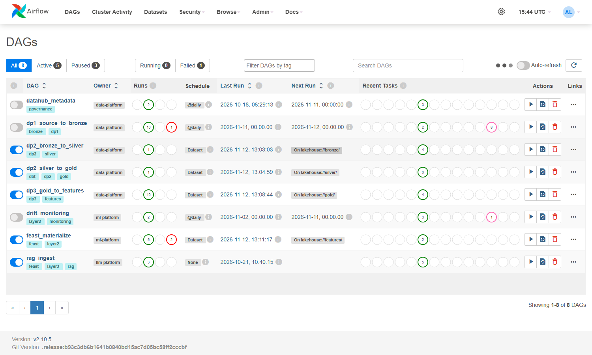
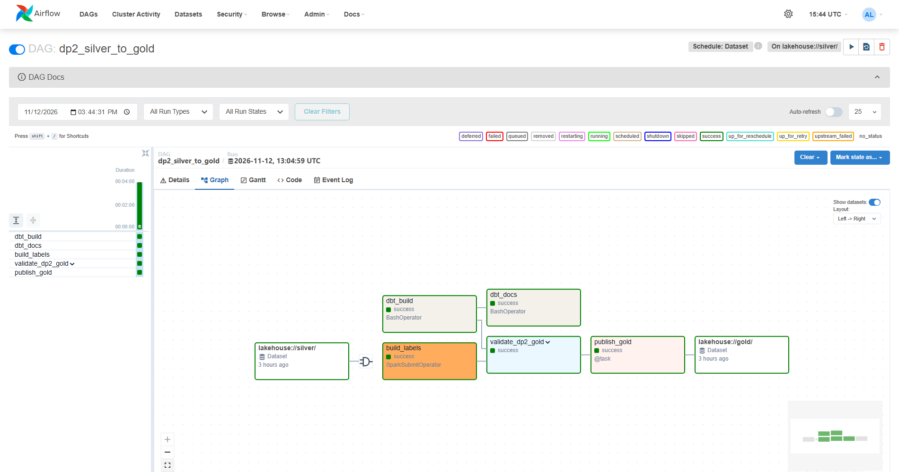
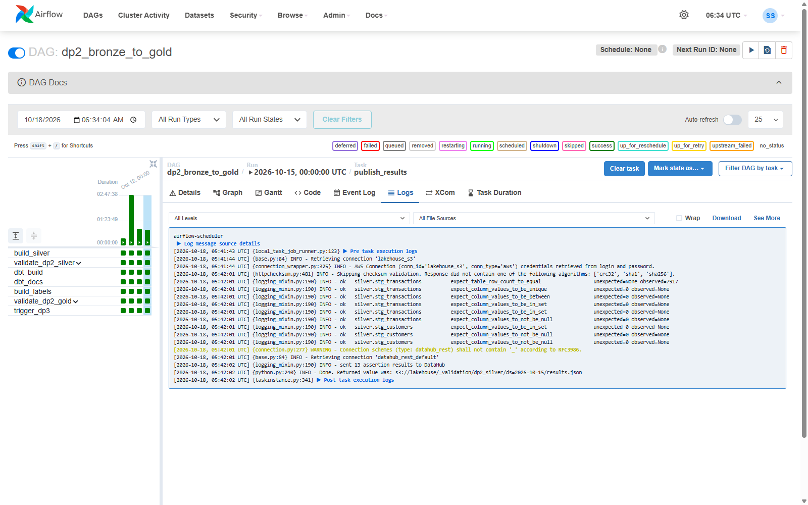
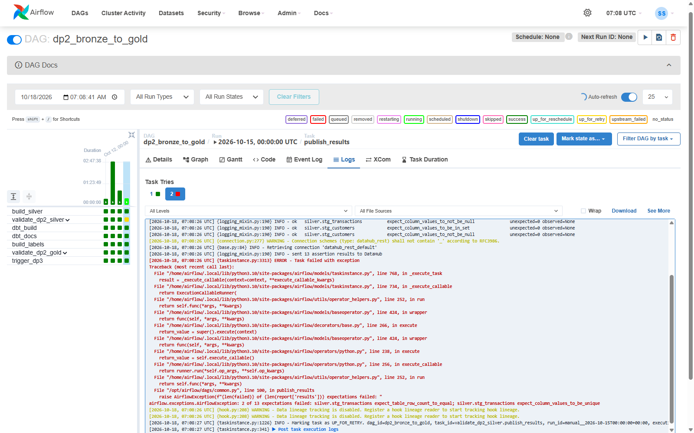
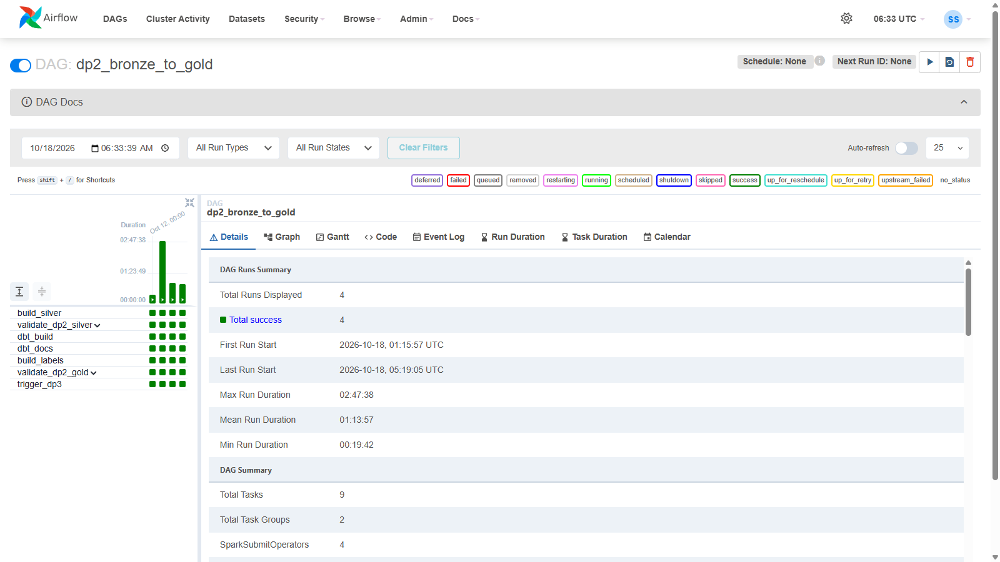

# Airflow pipelines (DP1, DP2, DP3)

Airflow runs Layer 1's three batch pipelines each night: DP1 loads the core banking database, the nightly export of
settled transactions and Flink's raw card payments into bronze, DP2 builds silver and gold, and DP3 computes the daily
card features. Each pipeline checks its output with Great Expectations on Spark before publishing its zone, which
starts the next pipeline, so a bad batch stops where it appears. Since 2026-10-24 DP1 checks the export on a lakeFS
branch before merging it into `main` (Write-Audit-Publish).

| | |
|---|---|
| Code | [`pipelines/airflow/`](https://github.com/cvinhnguyen/card-fraud-platform/tree/6457d47445ec1a910ebd2c01bc1edbff50f76d37/pipelines/airflow), [`pipelines/spark/validate.py`](https://github.com/cvinhnguyen/card-fraud-platform/blob/6457d47445ec1a910ebd2c01bc1edbff50f76d37/pipelines/spark/validate.py), [`infra/airflow/Dockerfile`](https://github.com/cvinhnguyen/card-fraud-platform/blob/6457d47445ec1a910ebd2c01bc1edbff50f76d37/infra/airflow/Dockerfile) |
| Runs on | compose profile `orch`: Airflow 2.10.5 (LocalExecutor), UI http://127.0.0.1:8082 (user `admin`, password `AIRFLOW_ADMIN_PASSWORD` in `infra/.env`); Spark drivers in the scheduler container, executors on the standalone Spark cluster |
| Reads | core banking Postgres (6 tables), the nightly export in `s3://core-banking-export/transactions/`, Flink's raw authorization files |
| Writes | `bronze.raw_*` (the export through the lakeFS branch `dp1_<ds>`), `silver.stg_*`, gold dims, `fact_transaction` and `label_transaction`, `gold.feat_card_txn_stats_daily`; validation results in `s3://lakehouse/_validation/` |
| Related | [spark_jobs.md](spark_jobs.md), [novel_lakefs_wap.md](novel_lakefs_wap.md), [datahub.md](datahub.md), [feature_store.md](../ml-platform/feature_store.md) |

## Where it fits

- Layer 1's batch pipelines; [architecture.md](../architecture.md#what-starts-the-pipelines-and-the-shared-services)
  shows what starts each one.
- Zones: bronze is an exact copy of the sources, silver is cleaned, gold is modelled and holds the fraud labels, the
  feature table holds per-card statistics. Each pipeline reads one zone and writes the next.
- Layer 2's feature store serves the feature table.
- Airflow runs eight DAGs (directed acyclic graphs: pipelines of tasks), four of them these pipelines (DP2 is two):

| DAG | Pipeline | Started by | Docs |
|---|---|---|---|
| `dp1_source_to_bronze` | DP1, data pipeline: ingest to bronze | the schedule, daily (`@daily`) | this page |
| `dp2_bronze_to_silver` | DP2, data pipeline: bronze to silver | dataset `lakehouse://bronze`, or by hand | this page |
| `dp2_silver_to_gold` | DP2, data pipeline: silver to gold and the labels | dataset `lakehouse://silver`, or by hand | this page |
| `dp3_gold_to_features` | DP3, feature pipeline: gold to features | dataset `lakehouse://gold`, or by hand | this page |
| `feast_materialize` | incremental materialize pipeline (Layer 2) | dataset `lakehouse://features` | [feature_store.md](../ml-platform/feature_store.md) |
| `drift_monitoring` | data drift pipeline (Layer 2) | its own schedule, daily | [drift.md](../ml-platform/drift.md) |
| `rag_ingest` | RAG data pipeline (Layer 3) | the Jenkins pipeline `rag-pipeline` after a new image, or by hand | [rag_pipeline.md](../llm-platform/rag_pipeline.md) |
| `datahub_metadata` | metadata ingestion into DataHub | its own schedule, daily | [datahub.md](datahub.md) |

## How it works

Only DP1 runs on a clock (`@daily`). Each pipeline ends with a `publish_<zone>` task that emits an Airflow dataset
event (`lakehouse://bronze`, `silver`, `gold` or `features`) carrying the business day, and the pipeline that reads
that zone is scheduled on it. So no pipeline starts another or knows which one writes its input. For one business
day `ds`:

1. DP1's sensor waits for the export folder `export_date = ds + 1` (the core banking system exports day `ds` the
   next night). Meanwhile DP1 opens a lakeFS branch and snapshots the core banking tables and Flink's new landing
   files ([DP1](#dp1-source-to-bronze)).
2. DP1 appends the export on the branch, commits and checks it, and merges it into `main` only if every check
   passes. `publish_bronze` then emits `lakehouse://bronze` with day `ds`.
3. `dp2_bronze_to_silver` cleans the new rows into silver, checks them and emits `lakehouse://silver`. Then
   `dp2_silver_to_gold` runs dbt next to the job that writes the fraud labels as known on `ds`, checks both, and
   `publish_gold` emits `lakehouse://gold` ([DP2](#dp2-bronze-to-silver-to-gold)).
4. DP3 rewrites the per-card feature table, checks a brute-force sample for leakage and the rows of `ds`, and emits
   `lakehouse://features` ([DP3](#dp3-gold-to-features)), which starts the Layer 2 materialize pipeline into Redis
   ([feature_store.md](../ml-platform/feature_store.md)).
5. Every task waits for the same task of the previous run (`depends_on_past`): loads are incremental, so `ds` must
   not run before `ds - 1` succeeded. A failed check stops that day and every later one
   ([the drill](#a-validation-that-stops-the-pipeline-drill)).

Readers of the versioned Delta tables get the last committed version, never a half-written one, so DP2 can run by
hand at any time, even while DP1 writes.

A run started by an event works on the event's day; a run by hand uses its own `ds`. Each published version starts
its own run, queued in order by `max_active_runs=1`. Versions published within one scheduler loop share a run, which
takes the newest day and, as loads are incremental, also loads the older day's rows. A toy pair of DAGs confirmed it:
the consumer ran for the event's day (`2026-11-20`), not its wall-clock logical date, and two days published 5
seconds apart gave two runs.

## Run it

From the repo root, with the source data loaded (README, Quick start). DP2 and DP3 follow DP1 on the dataset events;
the last full backfill ran before DP2 was split ([Backfill run](#backfill-run)).

```bash
python infra/make_env.py                                              # adds the Airflow secrets to infra/.env
docker compose -f infra/docker-compose.yaml --profile core --profile batch --profile orch up -d --build
# with lineage + validation results in DataHub: add --profile gov (DataHub); without it: DATAHUB_ENABLED=false in infra/.env
docker exec airflow-scheduler airflow dags unpause dp2_bronze_to_silver   # DAGs start paused; these run on dataset events
docker exec airflow-scheduler airflow dags unpause dp2_silver_to_gold
docker exec airflow-scheduler airflow dags unpause dp3_gold_to_features
docker exec airflow-scheduler airflow dags backfill dp1_source_to_bronze -s 2026-10-12 -e 2026-10-15
# keep dp1 paused for this: unpaused, the scheduler also starts the latest interval (catchup=False), which here
# would load several export days at once
```

### The chain run of 2026-11-12

The run of 2026-11-12 processed business day 2026-11-08 in about 13 minutes. DP1 published `lakehouse://bronze` with
`{"ds": "2026-11-08"}`; `dp2_bronze_to_silver`, `dp2_silver_to_gold`, `dp3_gold_to_features` and
`feast_materialize` each started on the event before and carried the same day (`build_labels --as-of
2026-11-08`, `feast materialize-incremental 2026-11-09T00:00:00`), and `check_online` found the 200 sampled cards in
Redis with the offline values (0 missing, 0 stale).

In the DAG list, DP2 silver, DP2 gold, DP3 and materialize show `Dataset` and their zone
(`On lakehouse://bronze/`, `.../silver/`, `.../gold/`, `.../features/`); the rest run on `@daily`. The red counts
are runs stopped by hand: the DP1 run of 2026-11-11 that unpausing DP1 queued, and two old materialize runs:



## Ingest and validate stages

Each data pipeline in
[`pipelines/airflow/dags/`](https://github.com/cvinhnguyen/card-fraud-platform/tree/6457d47445ec1a910ebd2c01bc1edbff50f76d37/pipelines/airflow/dags)
has an ingest and a validate stage:

| DAG | Schedule | Ingest stage | Validate stage |
|---|---|---|---|
| `dp1_source_to_bronze` | daily, business day `ds` | Postgres snapshot, new export files, Flink landing files -> `bronze.raw_*` | Great Expectations (GE) on the new export + every snapshot table |
| `dp2_bronze_to_silver` | dataset `lakehouse://bronze` (day from the event) | `stg_*` (PySpark) | GE on silver, before `publish_silver` |
| `dp2_silver_to_gold` | dataset `lakehouse://silver` (day from the event) | gold dims + fact (dbt-spark), labels as of `ds` | GE on gold + labels; dbt tests inside `dbt_build` |
| `dp3_gold_to_features` | dataset `lakehouse://gold` (day from the event) | `feat_card_txn_stats_daily` | GE on the feature rows of `ds` |

## DP1: source to bronze

[`pipelines/airflow/dags/dp1_source_to_bronze.py`](https://github.com/cvinhnguyen/card-fraud-platform/blob/6457d47445ec1a910ebd2c01bc1edbff50f76d37/pipelines/airflow/dags/dp1_source_to_bronze.py)
loads three sources with three Spark tasks in the `spark` pool. The S3 sensor `wait_for_export` (reschedule mode)
gates only `ingest_exports`. The export goes through the lakeFS branch `dp1_<ds>`
([novel_lakefs_wap.md](novel_lakefs_wap.md)): the checks read that branch, and only a passing run merges it into
`main`, which `bronze.raw_transactions` points at. Task order:

```python
    [wait, branch] >> exports
    checks = validate("dp1", ["--txn-root", TXN_ROOT])   # reads the export on the run's branch
    merge = merge_to_main.override(inlets=[LAKEFS_TXN], outlets=[TABLE])(BRANCH)
    [snapshot, exports >> commit_branch(BRANCH), landing] >> checks >> merge >> publish(BRONZE)
```

| Task | What it does |
|---|---|
| `create_branch` | lakeFS branch `dp1_<ds>` from `main` (an older one of the same day is replaced) |
| `wait_for_export` | waits for `s3://core-banking-export/transactions/export_date={{ macros.ds_add(ds, 1) }}/*.parquet`; frees its worker slot between checks |
| `snapshot_core_banking` | `ingest_bronze.py --part core_banking`: JDBC snapshot of the 6 Postgres tables (overwrite; Delta keeps the old versions) |
| `ingest_exports` | `ingest_bronze.py --part exports --until <ds+1> --txn-root s3a://bronze/dp1_<ds>`: appends new export dates to `raw_transactions` on the run's branch (mergeSchema) |
| `ingest_stream_landing` | `ingest_bronze.py --part landing`: Flink's raw authorization files -> `bronze.raw_card_authorizations` |
| `commit_branch` | lakeFS commit on the branch, with the Airflow run id |
| `validate_dp1.run_expectations` | `validate.py --suite dp1 --txn-root s3a://bronze/dp1_<ds>`: 45 expectations on 8 tables, the export read from the branch |
| `validate_dp1.publish_results` | reads the results, logs one line per expectation, fails the run if any failed |
| `merge_to_main` | lakeFS merge of the branch into `main` (readers see the export in one step), then deletes the branch |
| `publish_bronze` | dataset event `lakehouse://bronze` with day `ds`: bronze has a new checked version |

The graph of the run of 2026-11-08 is all green, ending with `validate_dp1`, `merge_to_main`
([Write-Audit-Publish](novel_lakefs_wap.md#4-the-corrected-export-is-published)) and `publish_bronze`, which emits
`lakehouse://bronze/`. The red square at the right of the grid is the 2026-11-11 run stopped by hand:


## DP2: bronze to silver to gold

DP2 is two DAGs, one per zone it writes.
[`pipelines/airflow/dags/dp2_bronze_to_silver.py`](https://github.com/cvinhnguyen/card-fraud-platform/blob/6457d47445ec1a910ebd2c01bc1edbff50f76d37/pipelines/airflow/dags/dp2_bronze_to_silver.py)
(DAG `dp2_bronze_to_silver`) runs on the dataset `lakehouse://bronze`:

| Task | What it does |
|---|---|
| `build_silver` | dedup, 63 -> 34 units, `auth_method` for old rows; MERGE into `silver.stg_transactions`; `silver.stg_customers` |
| `validate_dp2_silver` | 13 expectations: silver rows = distinct ids of the bronze export (dedup lost nothing), unique `transaction_id`, amount > 0, channel / currency / status / `txn_unit` (34 units) in their sets |
| `publish_silver` | dataset event `lakehouse://silver`: silver has a new checked version |

[`pipelines/airflow/dags/dp2_silver_to_gold.py`](https://github.com/cvinhnguyen/card-fraud-platform/blob/6457d47445ec1a910ebd2c01bc1edbff50f76d37/pipelines/airflow/dags/dp2_silver_to_gold.py)
(DAG `dp2_silver_to_gold`) runs on the dataset `lakehouse://silver`:

| Task | What it does |
|---|---|
| `dbt_build` | dbt-spark (`--target session`): `dim_*`, SCD2 `dim_customer`, incremental `fact_transaction`, and the dbt tests (unique, not_null, relationships, reconciliation with silver); a failing dbt test fails the task |
| `dbt_docs` | `dbt docs generate` -> manifest + catalog (dbt docs site, DataHub ingestion) |
| `build_labels` | `gold.label_transaction` as of `ds` |
| `validate_dp2_gold` | 17 expectations on the fact rows of the export, `dim_customer`, and the labels written as of `ds` |
| `publish_gold` | dataset event `lakehouse://gold`: gold has a new checked version |

A bad silver batch never reaches gold through the schedule, since `dp2_silver_to_gold` runs on `publish_silver`. A
run by hand reads the last committed Delta version, which for silver, gold and features (written before they are
validated) is checked only if the writer's last run passed. Only the bronze export is checked before readers see it.

`dp2_bronze_to_silver` starts on `lakehouse://bronze/` and publishes `lakehouse://silver/`; this run started 1 minute
after DP1 published:


In `dp2_silver_to_gold`, started on `lakehouse://silver/`, the labels run next to dbt (they read silver, not gold),
and the gold validation waits for both:



## DP3: gold to features

[`pipelines/airflow/dags/dp3_gold_to_features.py`](https://github.com/cvinhnguyen/card-fraud-platform/blob/6457d47445ec1a910ebd2c01bc1edbff50f76d37/pipelines/airflow/dags/dp3_gold_to_features.py)
runs on the dataset `lakehouse://gold`:

| Task | What it does |
|---|---|
| `build_features` | `feat_card_txn_stats_daily` (windows end the day before `event_timestamp`); the job fails if a brute-force recount of 500 random rows differs (leakage check) |
| `validate_dp3` | GE on the rows written for active day `ds` (`event_timestamp` = `ds` + 1): one row per card, no NULL keys / timestamps, counts >= 0, ratios in [0, 1] |
| `publish_features` | dataset event `lakehouse://features`; Layer 2's `feast_materialize` is scheduled on it and loads the new rows into the Redis online store |

The DP3 graph, started on `lakehouse://gold/`:


## Validate stage

[`pipelines/spark/validate.py`](https://github.com/cvinhnguyen/card-fraud-platform/blob/6457d47445ec1a910ebd2c01bc1edbff50f76d37/pipelines/spark/validate.py)
runs Great Expectations 0.18 (`SparkDFDataset`, the same `expect_*` calls as the course's `ge.from_pandas`) in a
Spark driver, on the slice the run wrote, so its cost does not grow with the table
([`validate.py` L154-L169](https://github.com/cvinhnguyen/card-fraud-platform/blob/6457d47445ec1a910ebd2c01bc1edbff50f76d37/pipelines/spark/validate.py#L154-L169)).
Spark, because a 100 GB daily export does not fit a pandas DataFrame. GE's venv (`/opt/venvs/ge`) is set as
`spark.pyspark.driver.python`. Two steps:

1. `run_expectations` writes `s3://lakehouse/_validation/<suite>/ds=<ds>/results.json` and exits 0. In DP1 it gets
   `--txn-root` and reads `bronze.raw_transactions` from the run's branch instead of `main`
   ([`validate.py` L32-L36](https://github.com/cvinhnguyen/card-fraud-platform/blob/6457d47445ec1a910ebd2c01bc1edbff50f76d37/pipelines/spark/validate.py#L32-L36)).
2. `publish_results` fails the run if any expectation failed, so the reason for a stop is always recorded (and sent
   to DataHub as assertions when it runs).

A run can cover several days: when two versions share a run ([How it works](#how-it-works)), or when DP1 is unpaused
after missed days (with `catchup=False` its next run loads every export day since the last). So the day slices
(exports, silver and gold rows, features) cover every business day from the suite's newest passed check in
`_validation/<suite>/` up to `ds`, usually `ds` alone. A failed day stays in the range: DP1 loads it again (it never
reached main) and DP2 keeps the failed rows until fixed. Labels are checked as of `ds` only, as each run rebuilds
them. `catchup=True` would split missed DP1 days into runs but not help DP2 and DP3, whose runs come from events.

The end of `publish_results` and the task group; `validate()` passes extra arguments (DP1's `--txn-root`) to the
Spark check, and both steps get `DAY`, the run's business day
([`pipelines/airflow/dags/common.py`](https://github.com/cvinhnguyen/card-fraud-platform/blob/6457d47445ec1a910ebd2c01bc1edbff50f76d37/pipelines/airflow/dags/common.py)):

```python
    failed = [r for r in report["results"] if not r["success"]]
    if failed:
        raise AirflowException(f"{len(failed)} of {len(report['results'])} expectations failed: "
                               + "; ".join(f"{r['table']} {r['expectation']}" for r in failed[:5]))
    return f"s3://{Variable.get('lakehouse_bucket')}/{key}"


def validate(suite: str, args: list[str] | None = None) -> TaskGroup:
    """Validate stage: GE expectations run in Spark (pipelines/spark/validate.py), then the results are published and gate
    the pipeline. The publish step is separate so the results are recorded even when the data is bad."""
    with TaskGroup(f"validate_{suite}") as group:
        run = spark_job("run_expectations", "validate.py", ["--suite", suite, "--ds", DAY, *(args or [])],
                        conf={"spark.pyspark.driver.python": GE_PYTHON})
        run >> publish_results(suite, DAY)
    return group
```

The `publish_results` log of DP2 silver for 2026-10-15, from the single DP2 DAG of that time, `dp2_bronze_to_gold`:



### A validation that stops the pipeline (drill)

One row of the 2026-10-16 export was duplicated in `silver.stg_transactions` (as a broken dedup would), and the
validate group of DP2 for 2026-10-15 was cleared:

1. `run_expectations` succeeded. `publish_results` logged
   `FAIL silver.stg_transactions expect_table_row_count_to_equal` and `... expect_column_values_to_be_unique`, sent
   all 13 results to DataHub and raised `AirflowException: 2 of 13 expectations failed`. In the single DP2 DAG of
   then, `depends_on_past` stopped dbt, labels, DP3 and the next day.
2. `RESTORE TABLE silver.stg_transactions TO VERSION AS OF 11` (Delta time travel) removed the bad row, and clearing
   the group again ran green.

Today the same failure stops `dp2_bronze_to_silver` before `publish_silver`: no event starts `dp2_silver_to_gold` or
DP3, and the next run of `dp2_bronze_to_silver` waits at the same task. The screenshots come from
`dp2_bronze_to_gold`, whose task list ends in `trigger_dp3`:




## How the pieces fit

### Spark tasks

Every Spark task comes from one helper, `spark_job()`, which sets the connection, the S3 environment and the `spark`
pool
([`common.py` L104-L111](https://github.com/cvinhnguyen/card-fraud-platform/blob/6457d47445ec1a910ebd2c01bc1edbff50f76d37/pipelines/airflow/dags/common.py#L104-L111)):

```python
def spark_job(task_id: str, script: str, args: list[str] | None = None, env: dict | None = None,
              conf: dict | None = None, **kwargs) -> SparkSubmitOperator:
    """spark-submit pipelines/spark/<script> to the standalone master. Pool `spark` (1 slot) runs one application at a time:
    the 3 GB worker holds one 1.5 GB executor with room left for the Thrift Server of the dbt profile."""
    return SparkSubmitOperator(task_id=task_id, conn_id="spark_lakehouse",
                               application="{{ var.value.spark_jobs_dir }}/" + script, application_args=args or [],
                               env_vars={**S3_ENV, **(env or {})}, conf={**SPARK_CONF, **(conf or {})}, pool="spark",
                               **kwargs)
```

- `SparkSubmitOperator` submits `pipelines/spark/*.py` to the standalone master (connection `spark_lakehouse`).
  Standalone has no cluster deploy mode for Python, so the driver runs in the scheduler, whose image copies the Spark
  image's JRE and `/opt/spark`
  ([`infra/airflow/Dockerfile` L38-L46](https://github.com/cvinhnguyen/card-fraud-platform/blob/6457d47445ec1a910ebd2c01bc1edbff50f76d37/infra/airflow/Dockerfile#L38-L46)):
  the cluster's Spark 4.1.3 and the executors' Python 3.10.
- The scheduler runs as uid 185 (the Spark user) and mounts the same `spark-defaults.conf` and `spark_ivy` volume,
  so its event logs reach the history server (:18080). The Delta / S3A / JDBC / OpenLineage jars are baked into the
  image (`fraud/spark`, [docker_optimization.md](../performance/docker_optimization.md)); nothing downloads at run
  time.
- The scheduler is on the default network and on `airflow-docker` (for DockerOperator), and its hostname resolves to
  the `airflow-docker` address first. A driver bound there refuses the executors, so every Spark task sets
  `spark.driver.bindAddress` to `0.0.0.0`
  ([`common.py` L97-L99](https://github.com/cvinhnguyen/card-fraud-platform/blob/6457d47445ec1a910ebd2c01bc1edbff50f76d37/pipelines/airflow/dags/common.py#L97-L99)).
- The pool `spark` has 1 slot: the 3 GB worker runs one executor (1.5 GB for DAG tasks) at a time, with room for the
  Thrift Server's 1 GB executor. Overlapping DAG runs queue in Airflow, not inside Spark.
- In `dp2_silver_to_gold`, dbt's `session` target opens its own Spark session in the task, in the `spark` pool, with
  the same `spark-defaults.conf` (so OpenLineage sees its SQL) and the same settings as `spark_job()`
  ([`dp2_silver_to_gold.py`](https://github.com/cvinhnguyen/card-fraud-platform/blob/6457d47445ec1a910ebd2c01bc1edbff50f76d37/pipelines/airflow/dags/dp2_silver_to_gold.py)).
  The Spark Thrift Server (target `local`) is for interactive use and holds a 1 GB driver and a 1 GB executor all the
  time ([Gotchas](#gotchas)).

### Connections and variables

`airflow-init` creates the connections, the variables and the `spark` pool from `infra/.env`
([`setup_airflow.py` L64-L74](https://github.com/cvinhnguyen/card-fraud-platform/blob/6457d47445ec1a910ebd2c01bc1edbff50f76d37/pipelines/airflow/setup_airflow.py#L64-L74)),
and stores passwords encrypted with the Fernet key. The DAG code holds no host name or credential: tasks render them
at run time (`{{ conn.lakehouse_s3.password }}`), and Spark jobs read them from the environment (`CORE_DB_URL`,
`CORE_DB_USER`, `AWS_ACCESS_KEY_ID`, `LAKEFS_ACCESS_KEY_ID`, ...). No secret value appears in the task logs (searched).

The ones the data pipelines use (`setup_airflow.py` also creates those of Layers 2 and 3;
[`pipelines/airflow/setup_airflow.py` L14-L62](https://github.com/cvinhnguyen/card-fraud-platform/blob/6457d47445ec1a910ebd2c01bc1edbff50f76d37/pipelines/airflow/setup_airflow.py#L14-L62)):

| Connection | Type | Used by |
|---|---|---|
| `spark_lakehouse` | spark, `spark://spark-master:7077`, client mode | every Spark task |
| `core_banking_db` | postgres, `postgres:5432/core_banking` | DP1 snapshot (JDBC URL, user, password) |
| `lakehouse_s3` | aws, endpoint `http://seaweedfs:8333` | S3 sensor, S3 credentials of the drivers, reading GE results |
| `lakefs` | http, `http://lakefs:8000` | DP1 `create_branch`, `commit_branch` and `merge_to_main` (lakeFS API), lakeFS keys of the drivers |
| `spark_thrift` | generic, `spark-thrift:10000` | dbt by hand / BI tools (`pipelines/dbt/profiles.yml` target `local`) |
| `kafka_broker` | generic, `kafka:19092` | DataHub ingestion of the topics (`datahub_metadata` DAG) |
| `datahub_rest_default` | datahub_rest, `http://datahub-gms:8080` | DataHub listener, GE results as assertions |

| Variable | Value |
|---|---|
| `spark_jobs_dir` | `/opt/release/current/spark` (the `pipelines/spark/` folder of the live release, see [Releases](#releases-cicd)) |
| `dbt_project_dir`, `dbt_artifacts_dir` | `/opt/release/current/dbt` (read-only), `/opt/airflow/dbt-artifacts` (target + logs volume) |
| `batch_release` | the commit of the live release, set by Jenkins; absent before the first release |
| `export_bucket`, `lakehouse_bucket`, `validation_prefix` | `core-banking-export`, `lakehouse`, `_validation` |

The Connections page (Admin menu) shows hosts and descriptions only:


The Variables page shows the six variables created for the data pipelines, captured before Layers 2 and 3 added
`feast_repo`, `feast_kb_repo`, `drift_psi_threshold` and `drift_pr_auc_drop`:


### Datasets, retries and idempotency

- Every task has `depends_on_past`
  ([`common.py` L36-L38](https://github.com/cvinhnguyen/card-fraud-platform/blob/6457d47445ec1a910ebd2c01bc1edbff50f76d37/pipelines/airflow/dags/common.py#L36-L38)).
  In the first backfill a Docker DNS error failed DP2 for 2026-10-13, so DP2 for 2026-10-14 ran first; its labels
  (as of 2026-10-14) made the 2026-10-13 label step a no-op, and the 2026-10-13 validation would have failed with no
  rows labelled as of 2026-10-13.
- XCom (Airflow's store for small values between tasks) carries only a results file path; data moves through the
  lakehouse.
- Tasks are idempotent, so a retry or rerun adds nothing twice: bronze appends only missing export dates, silver and
  the fact MERGE on `transaction_id`, labels skip an `as_of` already written, and the Postgres snapshots and DP3
  feature table are rewritten whole.
- `common.py` defines one dataset per zone, `DAY` (the triggering event's day, else the run's `ds`) and `publish()`,
  the last task of every data pipeline, which puts the day on the event created when the task succeeds
  ([`common.py`](https://github.com/cvinhnguyen/card-fraud-platform/blob/6457d47445ec1a910ebd2c01bc1edbff50f76d37/pipelines/airflow/dags/common.py#L45-L71)):

```python
BRONZE, SILVER, GOLD, FEATURES = (Published(f"lakehouse://{zone}") for zone in ("bronze", "silver", "gold", "features"))
# Business day of a run: the day carried by the dataset event that started it, or the run's own ds when it is
# scheduled (DP1) or started by hand. Each published version starts its own run; only versions published within one
# scheduler loop share a run, which then takes the newest day (Airflow gives the events unsorted, so they are
# sorted by time; the loads are incremental, so no row is skipped).
# The day is rendered into shell commands and Spark arguments, and a dataset event can also be posted through the
# Airflow API with any text in it. ds_format parses the value as YYYY-MM-DD and writes it back, so anything that is
# not a date fails the task while it renders, before a command runs.
DAY_EXPR = ("macros.ds_format(((triggering_dataset_events.values() | first | sort(attribute='timestamp') | last)"
            ".extra['ds'] "
            "if triggering_dataset_events else ds), '%Y-%m-%d', '%Y-%m-%d')")
DAY = "{{ " + DAY_EXPR + " }}"


def publish(zone: Published):
    """Last task of a pipeline: tell Airflow the zone has a new checked version; the business day travels on the event."""
    @task(task_id=f"publish_{zone.uri.rstrip('/').rsplit('/', 1)[-1]}", outlets=[zone])   # Airflow may add a final /
    def announce(day: str, *, outlet_events=None, dag_run=None) -> str:
        """Attach the business day and the code release to the dataset event the scheduler creates when this task
        succeeds: each published version of a zone says which release wrote it. A run started with the conf
        {"check_only": true} (the release check of pipelines/airflow/Jenkinsfile) skips this task: no event, so no
        later pipeline starts on a rerun of data it already has. Skipped still counts for depends_on_past."""
        if dag_run is not None and (dag_run.conf or {}).get("check_only"):
            raise AirflowSkipException("release check run: the zone is not announced")
        outlet_events[zone].extra = {"ds": day, "release": RELEASE}
        return day
    return announce(DAY)
```

Each event names the day and the release that wrote the zone, for example `{"ds": "2026-11-08", "release": "<sha>"}`;
the release check run skips the task ([Releases](#releases-cicd)).

## Releases (CI/CD)

The Jenkins job `batch-pipelines` ([`pipelines/airflow/Jenkinsfile`](../../pipelines/airflow/Jenkinsfile)) releases
the DAGs, the Spark jobs, the dbt project and the `ml/` code of the Layer 2 DAGs together, as a copy of one commit
versioned by its git short sha.

Airflow reads this code through the symlink `/opt/release/current` in the Docker volume `fraud_batch_release`: the
DAG folder `/opt/release/current/dags` and the Variables `spark_jobs_dir`, `dbt_project_dir` and `feast_repo` point
under it, and the Spark drivers in the scheduler read it too. A release copies the commit into `/opt/release/<sha>/`
and moves the symlink, so DAGs, jobs and dbt switch together between two tasks while Airflow keeps running. This
git-sync pattern (from Airflow's Helm chart) fits because Jenkins holds only the Airflow admin credential;
recreating the containers would need Airflow's own secrets.

Before the first release, `current` points at `local`, symlinks to the mounted working tree, so a fresh
`docker compose up` works without Jenkins and a DAG edit shows up within a minute. The one-shot service
`batch-release-init` sets this up ([`pipelines/airflow/release.sh`](../../pipelines/airflow/release.sh) `seed`).

| Stage | What it checks or does |
|---|---|
| Lint | `ruff check --select E9,F` (syntax errors, undefined names, unused imports) on `pipelines/airflow` and `pipelines/spark` |
| Unit tests | the ml library's tests (ml image's test stage) and `pipelines/airflow/test_release.sh` |
| DAG check | every DAG file imports in the Airflow image, and each batch DAG has exactly its tasks ([`check_dags.py`](../../pipelines/airflow/check_dags.py)) |
| dbt parse | models, sources, refs and tests resolve with target `session`. `dbt build` and its tests need the lakehouse, so they run in DP2 itself |
| Release | copies the commit into the volume, moves `current`, sets the Variable `batch_release` |
| Scheduler parsed it | waits until every batch DAG has the tag `release:<sha>` and Airflow reports no import error |
| Run + checks | runs `dp2_bronze_to_silver` with the conf `check_only` and prints its Great Expectations results. The run skips its publish, so no gold run starts: a rerun on bronze silver already has carries no new day, which gold's checks expect. Gold, features and materialize meet the release on the next real night |

If a stage after the switch fails, the job:

1. moves `current` back to the release before it and resets `batch_release`;
2. restores `silver.stg_transactions` and `silver.stg_customers` to the Delta versions it kept before the check run,
   which wrote silver for real (`RESTORE TABLE ... TO VERSION AS OF`,
   [`pipelines/spark/table_versions.py`](../../pipelines/spark/table_versions.py));
3. deletes the failed check run, which would otherwise hold back every later run of the DAG, the nightly ones
   included (`depends_on_past`). The Jenkins log keeps it.

| Where the version shows | What it shows |
|---|---|
| the Variable `batch_release` (Admin, Variables) | the release Jenkins set |
| the tag `release:<sha>` on each batch DAG | what the scheduler parsed (`release:local` = the working tree) |
| the dataset event of each published zone | `"release": "<sha>"` |
| the lakeFS commit of each DP1 load | metadata `release` |
| the Spark conf `spark.fraud.release` | the Environment tab of the Spark UI and the history server |

To roll back or return to the working tree by hand (Airflow picks it up within a minute):

```bash
docker run -i --rm --user 0 --entrypoint sh -v fraud_batch_release:/opt/release fraud/airflow:2.10.5 \
  -s switch previous < pipelines/airflow/release.sh        # or: switch local, switch <sha>, show
```

A DAG run in progress when `current` moves runs its next tasks on the new release. Jobs submitted by hand use the
working tree at `/opt/jobs` in the Spark containers. `rag_ingest.py` ships with these releases (same DAG folder);
the image its steps run comes from the RAG pipeline.

## Backfill run

The backfill of 2026-10-12 to 2026-10-15 reloaded 4 export dates day by day: all 12 DAG runs (3 DAGs x 4 business
days) succeeded, with the DataHub ingestion DAG alongside. It ran before DP2 was split, when a trigger task started
the next DAG; the dataset-driven layout has not been backfilled yet.

First, `rewind_days.py --from 2026-10-12` deleted those dates from bronze, silver and the fact and restored the labels
to their 2026-09-30 version
([`pipelines/spark/rewind_days.py` L49-L59](https://github.com/cvinhnguyen/card-fraud-platform/blob/6457d47445ec1a910ebd2c01bc1edbff50f76d37/pipelines/spark/rewind_days.py#L49-L59)).
Since 2026-10-24 `bronze.raw_transactions` is on lakeFS `main`, which takes only merges, so the script deletes on a
branch `rewind_<date>`, commits it and merges it into `main`, as a DP1 run publishes.

Rows checked per run, from the results files (all expectations passed):

| Check | Rows or count |
|---|---|
| bronze export | 7,974-8,115 rows per day (duplicates included) |
| silver | distinct ids of that export (e.g. 7,869 for 10-12) |
| fact | 7,776 settled rows for 10-12 |
| expectations per day across the four suites | 45 + 13 + 17 + 13 |

The grid of the 4 runs in the single DP2 DAG, `dp2_bronze_to_gold`: every task green, mean run 01:13:57, max
02:47:38:



### Timing

The first day's chain took 30 minutes (DP1 4, DP2 20, DP3 6; dbt build 158 s, features 72 s), measured before DP2
was split. Later days took longer for reasons outside the DAGs ([datahub.md](datahub.md), [Gotchas](#gotchas)).

## Gotchas

- Tasks fail at random on `seaweedfs` / `spark-thrift` name lookups (`Unable to execute HTTP request: seaweedfs`).
  The Thrift Server, next to DataHub, pushed the 8 GB Docker VM into swap and broke Docker's DNS. Fix: dbt runs on
  the `session` target ([How the pieces fit](#how-the-pieces-fit)).
- The Docker engine hangs mid-run with C: full. The Spark worker kept every application's work dir with its own copy
  of the `--packages` jars (a 94 GB container layer), and a Docker Desktop update had moved Docker's disk image back
  to C:. Fix: the worker cleans finished applications (`SPARK_WORKER_OPTS`); the interrupted runs, being idempotent,
  were cleared and finished with the same results.
- Runs are I/O bound with Docker's disk image on E:, a USB HDD. Fix: on 2026-10-19 it moved to the C: SSD
  (`C:\DockerDesktopWSL`).
