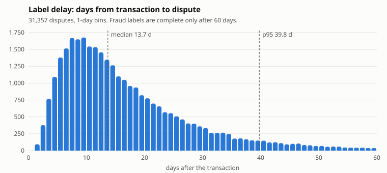

# Data characteristics

All data in this project is synthetic, so the problems a real bank's data has (duplicates, skew, renamed provinces,
late events, fraud labels that arrive weeks later) had to be put in on purpose, at a known rate, and checked. This
page is that check: what each dataset looks like, which problems it carries, how big each problem is, and which part
of the platform fixes it. A reader who wants to know why a pipeline step exists will find its problem here. The
numbers are for the default volume (~1 GB) and are the "before" numbers the pipelines and the model are measured
against.

| | |
|---|---|
| Code | [`generator/`](https://github.com/cvinhnguyen/card-fraud-platform/tree/822721cab1ac597d118f100f1c49949f137f8a7d/generator) |
| Runs on | host process (`.venv` Python) |
| Writes | Parquet under `data/source/`; [`generator/load_source.py`](https://github.com/cvinhnguyen/card-fraud-platform/blob/822721cab1ac597d118f100f1c49949f137f8a7d/generator/load_source.py) loads it into Postgres `core_banking` and the S3 bucket `core-banking-export`, [`generator/producer.py`](https://github.com/cvinhnguyen/card-fraud-platform/blob/822721cab1ac597d118f100f1c49949f137f8a7d/generator/producer.py) replays the streams into Kafka |
| Related | [spark_jobs.md](spark_jobs.md), [flink_jobs.md](flink_jobs.md), [scale_100g.md](../performance/scale_100g.md) |

## Where it fits

This is the data before the platform touches it; Layer 1 (data platform) ingests all of it. The six core banking
tables go to Postgres `core_banking` and the nightly transaction export to the bucket `core-banking-export`, both
read by DP1 (data pipeline: ingest to bronze, [spark_jobs.md](spark_jobs.md)). The two streams are replayed into
Kafka for the Flink jobs ([flink_jobs.md](flink_jobs.md)). Each problem below is handled by a named step of a
pipeline or by a Layer 2 feature; the "Fixed in" column of each table is the map from a data problem to the code that
handles it.

## How it works

1. [`generator/generate.py`](https://github.com/cvinhnguyen/card-fraud-platform/blob/822721cab1ac597d118f100f1c49949f137f8a7d/generator/generate.py)
   writes every dataset as Parquet under `data/source/` with `seed: 42` for the period 2024-01-01 to 2026-10-15,
   planting each problem at the rate set in `generator/config.yaml`, so the same data can be generated again.
2. `load_source.py` loads the core banking tables into Postgres and the transaction export into S3, and
   `producer.py` replays the two streams into Kafka in arrival order (`received_ts`), so Kafka sees the delays and the
   disorder as a real network would.
3. [`generator/check_data.py`](https://github.com/cvinhnguyen/card-fraud-platform/blob/822721cab1ac597d118f100f1c49949f137f8a7d/generator/check_data.py)
   measures every planted problem against an expected range, each one a `check()` call
   ([`generator/check_data.py` L30-L35](https://github.com/cvinhnguyen/card-fraud-platform/blob/822721cab1ac597d118f100f1c49949f137f8a7d/generator/check_data.py#L30-L35)):
   69 checks, all pass. Every number below is printed by that script.
4. The truth file `_truth/ato_sessions.parquet` lists the account takeover (ATO) sessions for evaluation only; it is
   never loaded into the platform.

## Datasets

| Dataset | Where it lands | Files | Rows | Size |
|---|---|---:|---:|---:|
| customers (100,000 customers with their history: the SCD2 source) | Postgres `core_banking` | 1 | 193,207 | |
| accounts | Postgres | 1 | 100,000 | |
| cards | Postgres | 1 | 130,120 | |
| merchants (5,000 domestic + 200 foreign online) | Postgres | 1 | 5,200 | |
| disputes (fraud labels) | Postgres | 1 | 31,364 | |
| ref_province_mapping (63 → 34) | Postgres | 1 | 63 | |
| *core banking tables total* | | 6 | 459,954 | 11.6 MB |
| transactions (nightly export) | S3 `core-banking-export/transactions/export_date=*/` | 1,019 | 8,159,516 | 327.6 MB |
| card_authorizations | Kafka topic, key `card_id` | 1,019 | 8,119,499 | 402.2 MB |
| app_events | Kafka topic, key `customer_id` | 1,019 | 4,822,745 | 224.0 MB |
| *total* | | | | *~966 MB* |

Sizes are Parquet on disk under `data/source/`. `_truth/ato_sessions.parquet` (21,789 ATO sessions) is the ground
truth for evaluation only.

Generating takes ~7 min and 0.31 GB RAM. The check takes 1 to 3.5 min (slower when the Spark containers are up) and
peaks at 4.24 GB RAM (measured before the `currency` column was added to the check).

## Problems in the batch sources

| Problem | How it shows up | Measured | Fixed in |
|---|---|---|---|
| Duplicate rows | Nightly export re-run after a timeout: same `transaction_id`, later `created_ts` ([`generator/generate.py` L328-L330](https://github.com/cvinhnguyen/card-fraud-platform/blob/822721cab1ac597d118f100f1c49949f137f8a7d/generator/generate.py#L328-L330)) | 159,990 extra rows = 2.00% of 7,999,526 unique; 100% of duplicates have a later `created_ts` | DP2 silver: dedup, keep the latest ([spark_optimization.md](../performance/spark_optimization.md#duplicates)) |
| Merchant skew | 10 super merchants (e-wallet top-up, ride-hailing, marketplace, convenience chains) | top-10 share 0.7000; biggest / median merchant = 10,012× | DP2: salting / AQE (adaptive query execution) skew join ([spark_optimization.md](../performance/spark_optimization.md#merchant-join-skew)) |
| Cross-border online payments | 200 foreign merchants (digital content, games, online stores, travel, software; US / SG / IE / CN / GB), online only, `currency = USD`, `amount_vnd` already converted; `city` NULL | 4.01% of transactions; 100% online with a merchant outside VN | Layer 2 `foreign_txn_ratio_90d` |
| City skew | Shares on the 34 new units | Ho Chi Minh 0.5993, Ha Noi 0.1802, Da Nang 0.0500 | DP2 and the storage layout: partitioning ([storage_optimization.md](../performance/storage_optimization.md#lakehouse-layout)); Flink: hot key ([flink_jobs.md](flink_jobs.md#hot-key)) |
| Province reorganization (63 → 34, from 2025-07-01) | Old names before the cutoff; 5% of legacy terminals keep sending old names after it ([`generator/generate.py` L83-L93](https://github.com/cvinhnguyen/card-fraud-platform/blob/822721cab1ac597d118f100f1c49949f137f8a7d/generator/generate.py#L83-L93)) | old-only names 19.62% before, 0.99% after; raw "Ho Chi Minh" share 0.4797 before the cutoff (a fake jump to 0.60 if not normalized) | DP2 silver: normalize via `ref_province_mapping` |
| Schema evolution | `auth_method`, `three_ds_version` exist only in files from 2024-07-01 ([`generator/generate.py` L322-L324](https://github.com/cvinhnguyen/card-fraud-platform/blob/822721cab1ac597d118f100f1c49949f137f8a7d/generator/generate.py#L322-L324)) | 100% of earlier files lack the columns, 100% of later files have them; `3ds_app` 30.00% of ecom, 3DS 2.2.0 85.03% | DP1 and DP2: `mergeSchema` ([spark_optimization.md](../performance/spark_optimization.md#schema-evolution)) |
| High cardinality | `terminal_id` on POS / ATM, null for ecom | 26,863 distinct | storage layout: bucketing, approx distinct |
| SCD2 | Customers move (5%/yr), get rescored (10%/yr); on 2025-07-01 the core system relabels old province names | 56.45% of customers have >1 version; 16,635 spurious relabel versions (95.09% of old-name customers) | DP2 gold: SCD2 `dim_customer` ([dbt_gold.md](dbt_gold.md)) |
| As-of joins | A moved customer pays in the home unit valid at `txn_ts` | 97.08% of 1,107,271 post-move transactions | DP2 gold: point-in-time join ([spark_jobs.md](spark_jobs.md#point-in-time-join)) |
| Label delay | Disputes arrive 1 to 60 days after the transaction (truncated log-normal, median 14) | median 13.65 days; last-30-day fraud rate is 0.53× the mature rate (expected 0.48) | DP2 labels / Layer 2: maturity window of 60 days ([ml_training.md](../ml-platform/ml_training.md#labels-and-the-split)) |
| Trend: ATM decline | ATM share of card payments falls 17%/yr | 2025 / 2024 = 0.8327 | Layer 2 drift monitoring |

Labels: the fraud rate on mature transactions is 0.0030; the ecom fraud rate is 4.18× non-ecom, and foreign payments
3.03× domestic ecom (learnable signals).

### Label delay

Disputes peak 7 to 10 days after the transaction (median 13.7) and 5% arrive after day 40 (p95 39.8 days; the
configured 45 in
[`generator/config.yaml` L60](https://github.com/cvinhnguyen/card-fraud-platform/blob/822721cab1ac597d118f100f1c49949f137f8a7d/generator/config.yaml#L60)
applies before the 60-day truncation). The histogram of the delay in days per dispute shows that shape:



Transactions from the last 60 days are still missing part of their fraud labels, so training data must be older than
60 days. Redraw the histogram with `python docs/diagrams/label_delay.py`.

The delay is drawn per dispute, and disputes reported after the end of the period are left out
([`generator/generate.py` L334-L349](https://github.com/cvinhnguyen/card-fraud-platform/blob/822721cab1ac597d118f100f1c49949f137f8a7d/generator/generate.py#L334-L349)):

```python
def gen_disputes(rng, cfg, disputed: pd.DataFrame) -> pd.DataFrame:
    """Problem: label delay. A dispute is reported 1-60 days after the payment (truncated log-normal).
    Disputes reported after the end of the period do not exist yet, so recent months look clean."""
    ld = cfg["labels"]["dispute_delay_days"]
    mu, sigma = np.log(ld["median"]), (np.log(ld["p95"]) - np.log(ld["median"])) / 1.645
    delay = rng.lognormal(mu, sigma, len(disputed))
    while (bad := (delay < ld["min"]) | (delay > ld["max"])).any():   # redraw = truncate
        delay[bad] = rng.lognormal(mu, sigma, bad.sum())
    reported = disputed.txn_ts + pd.to_timedelta(delay * 86400, unit="s").round("s")
    fraud = disputed.is_confirmed_fraud.to_numpy()
    reason = np.where(fraud, np.where(disputed.channel == "ecom", "fraud_card_not_present", "fraud_card_present"),
                      rng.choice(["not_received", "duplicate_charge", "amount_differs"], len(disputed)))
    out = pd.DataFrame({"dispute_id": tokens("dsp", rng, len(disputed)), "transaction_id": disputed.transaction_id.to_numpy(),
                        "reported_ts": reported.to_numpy(), "reason_code": reason, "is_confirmed_fraud": fraud})
    end = pd.Timestamp(cfg["period"]["end"]) + pd.Timedelta(days=1)
    return out[out.reported_ts < end].sort_values("reported_ts", ignore_index=True)
```

## Problems in the streams

Both streams carry two timestamps: event time (`auth_ts`, `event_ts`) and arrival time (`received_ts`).
`producer.py` sends in `received_ts` order
([`generator/producer.py` L27-L33](https://github.com/cvinhnguyen/card-fraud-platform/blob/822721cab1ac597d118f100f1c49949f137f8a7d/generator/producer.py#L27-L33)),
so Kafka sees the disorder.

### card_authorizations

| Problem | How it shows up | Measured | Fixed in |
|---|---|---|---|
| Late events | 10% of POS payments come from offline terminals and arrive 5 to 30 min late | 191,295 late = 2.39% of all auths (9.98% of POS); on-time delay ≤ 2 s | Flink: watermark 5 s + `allowed_lateness` 30 min + side output ([flink_jobs.md](flink_jobs.md#late-events-and-duplicates)) |
| Duplicates | Network retry without an ack: same `auth_id`, `received_ts` 1 to 10 s later | 1.50% extra rows; duplicates differ only in `received_ts` | Flink: keyed dedup on `auth_id` with state TTL, before any count |
| Join key to batch | `auth_id` shares the counter with `transaction_id` | 7,999,526 unique auths = unique transactions, 100% match | Layer 2 label join: auth to transaction to dispute |
| Device signal | `device_id` on ecom only; fraud always uses a device new to the card | 170,459 distinct devices; new device: fraud 100%, legit 3.37% | Layer 2 realtime feature |

The new device of a fraud, the late POS events and the retries are all made in `gen_auths()`
([`generator/generate.py` L370-L390](https://github.com/cvinhnguyen/card-fraud-platform/blob/822721cab1ac597d118f100f1c49949f137f8a7d/generator/generate.py#L370-L390)):

```python
    # Fraudsters pay online from their own phone, so the card sees a device it never used (a realtime signal).
    new = fraud & (channel == "ecom")
    dev[new] = tokens("dev", rng, int(new.sum()))
    delay = rng.uniform(*st["network_delay_s"], n)
    late = (channel == "pos") & (rng.random(n) < st["late_share_of_pos"])
    delay[late] = rng.uniform(*st["late_delay_min"], late.sum()) * 60
    df = pd.DataFrame({
        "auth_id": txns.transaction_id.str.replace("txn_", "auth_", regex=False).to_numpy(),
        "card_id": txns.card_id.to_numpy(),
        "merchant_id": txns.merchant_id.to_numpy(),
        "amount_vnd": txns.amount_vnd.to_numpy(),
        "channel": channel,
        "terminal_id": txns.terminal_id.to_numpy(),
        "device_id": pd.Series(dev, dtype="string").where(channel == "ecom"),
        "geo_city": txns.txn_city.to_numpy(),
        "auth_ts": txns.txn_ts.to_numpy(),
        "received_ts": txns.txn_ts.to_numpy() + pd.to_timedelta(np.round(delay * 1000), unit="ms"),
    })
    dup = df.iloc[rng.choice(n, round(n * st["duplicate_rate"]), replace=False)].copy()
    dup["received_ts"] += pd.to_timedelta(np.round(rng.uniform(*st["retry_delay_s"], len(dup)) * 1000), unit="ms")
    return pd.concat([df, dup], ignore_index=True).sort_values("received_ts", ignore_index=True)
```

### app_events

2,199,812 sessions: 2,178,023 legit, 14,602 `new_device` ATO, 7,187 `remote_access` ATO.

| Problem | How it shows up | Measured | Fixed in |
|---|---|---|---|
| Out-of-order events | App uploads in parallel: an event reaches Kafka after the next event of its session ([`generator/app_events.py` L146-L171](https://github.com/cvinhnguyen/card-fraud-platform/blob/822721cab1ac597d118f100f1c49949f137f8a7d/generator/app_events.py#L146-L171)) | exactly 15.00%; max disorder 20 s; in-order delay ≤ 1 s | Flink: event-time watermark 30 s, buffer per `session_id`, sort by `event_ts` (Flink CEP, complex event processing, or a `KeyedProcessFunction`, [flink_jobs.md](flink_jobs.md#out-of-order-app-events)) |
| Sequence rule broken by disorder | `new_device` ATO: password_reset, then add_payee, then transfer within 10 min | 1,205 of 4,034 ATO sequences look broken in arrival order | same as above |
| Decision 2345/QĐ-NHNN (from 2024-07-01) | Biometric check on a new device, a transfer ≥ 10M VND, or a day total > 20M VND; a failed check ends the session | all rule checks 100%; pass rate legit 0.9895, ATO 0.1052 | Flink rule / Layer 2 feature |
| Split transfers | `remote_access` ATO (malware on the victim's phone) keeps each transfer in [9M, 10M) | 16,673 remote ATO vs 4,836 legit transfers in that band | Layer 2 `transfer_9m_10m_count_1d` |
| Trend: QR at shops | `qr_merchant` share of transfers grows 15%/yr | 2025 / 2024 = 1.1497 | Layer 2 drift monitoring |

## Scaling

The volume is set in `volume` of
[`generator/config.yaml` L11-L15](https://github.com/cvinhnguyen/card-fraud-platform/blob/822721cab1ac597d118f100f1c49949f137f8a7d/generator/config.yaml#L11-L15);
`generate.py --scale 0.05` gives a quick smoke test. The pandas-based checks stop at about this size (4.24 GB RAM);
the 100 GB run ([scale_100g.md](../performance/scale_100g.md)) checks with Spark.
