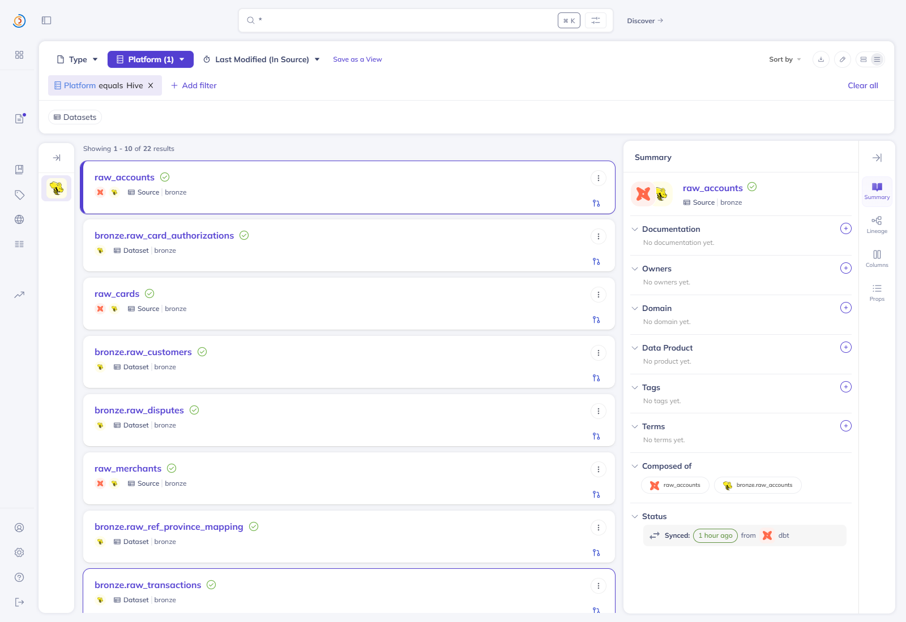
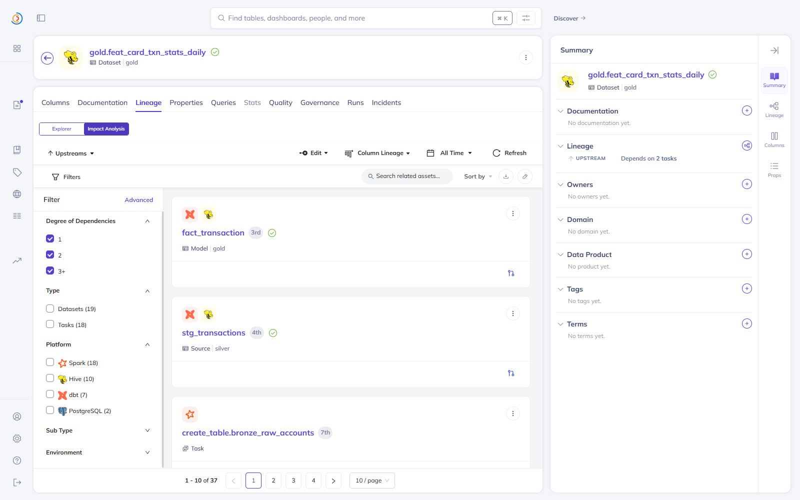
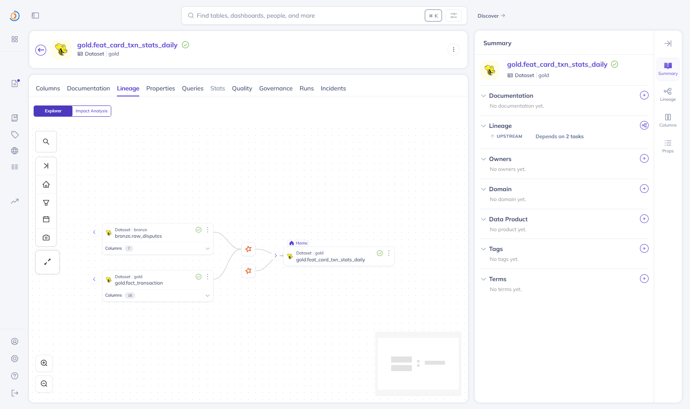
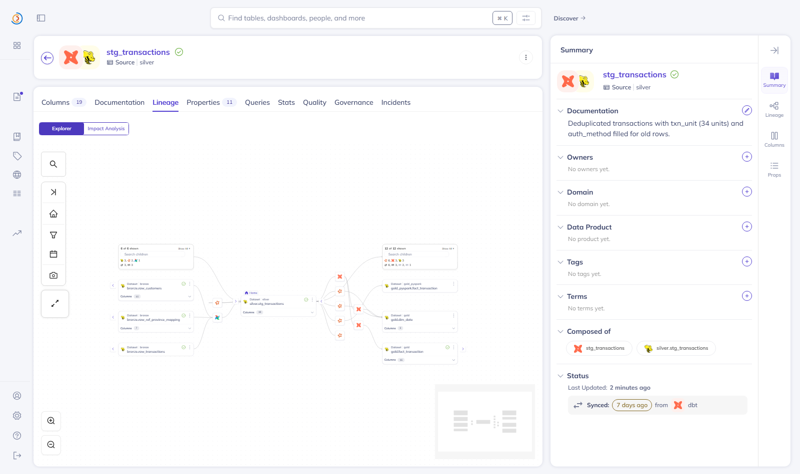
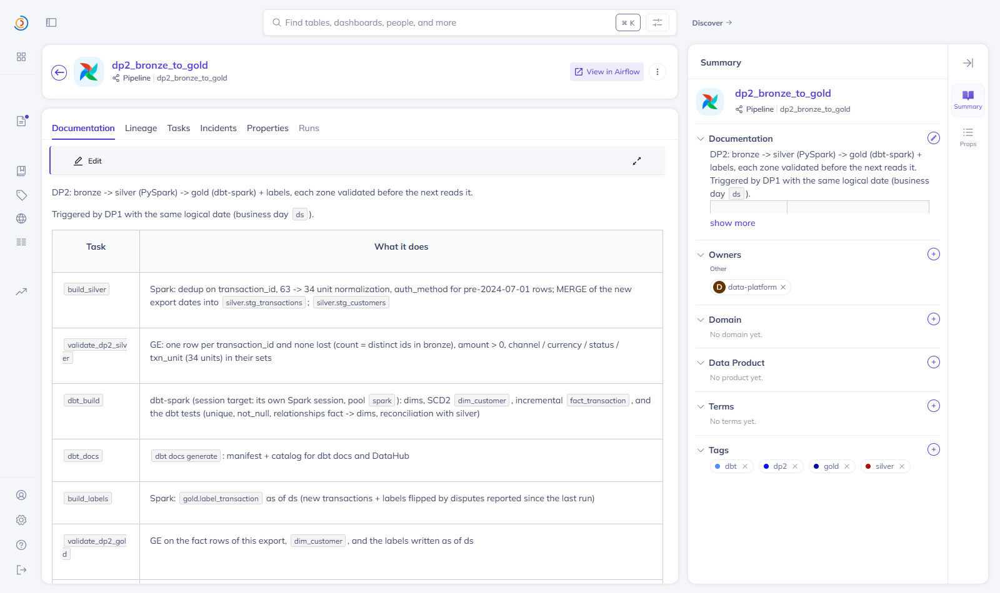
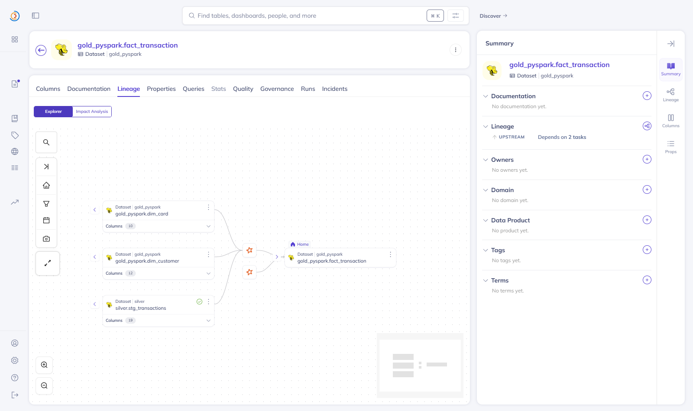

# DataHub: tables, lineage, validation

DataHub v1.5.0.6, the course version, is the platform's metadata catalog (data governance in the course's terms): the
lakehouse tables of every zone, their lineage from the core banking sources to the features, the Airflow pipelines
that produce them and every validation result. When a number in a report looks wrong, it shows which
table it came from, which job wrote that table from which sources, and whether that day's checks passed.

| | |
|---|---|
| Code | [`infra/docker-compose.yaml` L491-L600](https://github.com/cvinhnguyen/card-fraud-platform/blob/6457d47445ec1a910ebd2c01bc1edbff50f76d37/infra/docker-compose.yaml#L491-L600), [`pipelines/airflow/dags/datahub_metadata.py`](https://github.com/cvinhnguyen/card-fraud-platform/blob/6457d47445ec1a910ebd2c01bc1edbff50f76d37/pipelines/airflow/dags/datahub_metadata.py), [`pipelines/airflow/dags/datahub_recipes/`](https://github.com/cvinhnguyen/card-fraud-platform/tree/6457d47445ec1a910ebd2c01bc1edbff50f76d37/pipelines/airflow/dags/datahub_recipes) |
| Runs on | compose profile `gov`: GMS (the metadata service) on 127.0.0.1:8083, UI on http://127.0.0.1:9002 |
| Reads | OpenLineage events of every Spark job, the Airflow listener, Great Expectations (GE) results, `datahub ingest` of Postgres `core_banking`, the Kafka topics and the dbt artifacts |
| Writes | its own Postgres and OpenSearch |
| Related | [openlineage.md](openlineage.md), [airflow.md](airflow.md), [dbt_gold.md](dbt_gold.md) |

## Where it fits

- One of the shared services under the three layers of the
  [overview](../architecture.md#what-starts-the-pipelines-and-the-shared-services).
- Fed by the Layer 1 (data platform) pipelines as they run and by Layer 3's RAG data pipeline
  ([rag_pipeline.md](../llm-platform/rag_pipeline.md)).
- Read by people, through the UI.

## How it works

1. Every Layer 1 Spark job, dbt included, runs the OpenLineage listener, which posts each action's job, tables and
   column mappings, read from the executed plan, to GMS ([openlineage.md](openlineage.md)).
2. Airflow's DataHub listener adds the DAGs (pipelines of tasks), their tasks and runs, and each Spark job carries its
   DAG's name ([Which pipeline produced a table](#which-pipeline-produced-a-table)).
3. The validate stage of every Airflow pipeline ([airflow.md](airflow.md)) posts each GE check as an assertion on its
   table, with one run event per DAG run ([Validation results](#validation-results)).
4. The daily `datahub_metadata` DAG ingests what no listener sees: the core banking Postgres tables, the Kafka topics,
   and the dbt models, docs and tests.
5. DataHub stores it all in its own Postgres and OpenSearch, with the core Kafka as its event bus.

## Run it

DataHub needs the `gov` profile next to the batch stack and Airflow, and its admin password in `infra/.env`:

```bash
python infra/make_env.py      # DATAHUB_ADMIN_PASSWORD in infra/.env, written to the frontend's user.props
docker compose -f infra/docker-compose.yaml --profile core --profile batch --profile orch --profile gov up -d --build
docker exec airflow-scheduler airflow dags trigger datahub_metadata    # core banking tables, Kafka topics, dbt
```

Then open http://127.0.0.1:9002 and log in as `datahub` with `DATAHUB_ADMIN_PASSWORD`; `make_env.py` writes it into
the frontend's `user.props` in place of the default `datahub:datahub`.

## What reaches DataHub

| What | Sent by | How |
|---|---|---|
| Lakehouse tables (bronze / silver / gold / feat), their schema and lineage, column-level lineage | every Spark job, dbt included | OpenLineage listener in [`infra/conf/spark/spark-defaults.conf` L34-L44](https://github.com/cvinhnguyen/card-fraud-platform/blob/6457d47445ec1a910ebd2c01bc1edbff50f76d37/infra/conf/spark/spark-defaults.conf#L34-L44), posting to GMS `/openapi/openlineage/api/v1/lineage` ([openlineage.md](openlineage.md)) |
| DAGs, tasks, task runs | Airflow | DataHub's Airflow listener (`acryl-datahub-airflow-plugin`) |
| Validation results (GE) | `publish_results` task of every validate stage ([`pipelines/airflow/dags/common.py` L114-L170](https://github.com/cvinhnguyen/card-fraud-platform/blob/6457d47445ec1a910ebd2c01bc1edbff50f76d37/pipelines/airflow/dags/common.py#L114-L170)) | `AssertionInfo` + `AssertionRunEvent` per expectation, on the table's hive URN (DataHub's entity id) |
| Core banking tables, Kafka topics, dbt models / docs / tests | `datahub_metadata` DAG | one `datahub ingest` per recipe in [`datahub_recipes/`](https://github.com/cvinhnguyen/card-fraud-platform/tree/6457d47445ec1a910ebd2c01bc1edbff50f76d37/pipelines/airflow/dags/datahub_recipes) |

The DAG ([`datahub_metadata.py`
L33-L37](https://github.com/cvinhnguyen/card-fraud-platform/blob/6457d47445ec1a910ebd2c01bc1edbff50f76d37/pipelines/airflow/dags/datahub_metadata.py#L33-L37)):

```python
with DAG("datahub_metadata", schedule="@daily", start_date=datetime(2026, 10, 1), catchup=False, max_active_runs=1,
         default_args={**DEFAULT_ARGS, "depends_on_past": False}, doc_md=__doc__, tags=["governance", RELEASE_TAG]) as dag:
    for name in ["core_banking", "kafka_topics", "dbt"]:
        recipe = {"kafka_topics": "kafka"}.get(name, name)
        BashOperator(task_id=name, bash_command=f"{DATAHUB} ingest -c {RECIPES}/{recipe}.yml", env=ENV, append_env=True)
```

## What DataHub holds

GraphQL counts after the DP1 (ingest to bronze), DP2 (bronze to silver and gold) and DP3 (feature pipeline) runs of
2026-10-12 to 2026-10-15 and one `datahub_metadata` run. Since then DP2, then the single DAG `dp2_bronze_to_gold`,
became `dp2_bronze_to_silver` and `dp2_silver_to_gold` (one DAG more), and on 2026-10-24 `bronze.raw_transactions`
moved into lakeFS: DP1 appends each export on the run's branch (`s3a://bronze/dp1_<ds>/raw_transactions`) and merges
it into `main` after the checks ([novel_lakefs_wap.md](novel_lakefs_wap.md)).

| Entity | Count |
|---|---:|
| Lakehouse tables (hive): 8 bronze, 2 silver, 7 gold (dims, fact, labels, features) + the 5 tables of `gold_pyspark` | 22 |
| Core banking tables (Postgres) | 6 (12 with the `core_banking.public` schema entities) |
| Kafka topics | 4 |
| dbt models / sources (shown as siblings of the hive tables they build) | 10 |
| Pipelines: Airflow DAGs (listener) and the Spark jobs of each DAG (OpenLineage) | 4 + 4 |
| Spark jobs (one per Spark action): 42 in the three DP pipelines + 11 of `gold_pyspark` | 53 |
| Airflow tasks | 22 |
| Job-dataset lineage edges | 74 |
| Assertions: 88 from GE (4 suites) + 27 from the 22 dbt tests (a test on two tables, as the 4 `relationships` tests and the silver reconciliation are, counts once per table) | 115 |

### Tables of every zone

Every `bronze.*`, `silver.*` and `gold.*` table sits in its zone container. A table dbt builds is merged with its
model (dbt and Hive icons): one entity carries the SQL, docs, tests and lineage. Filtered on Hive, 22 results:



### Lineage from the source to the features

Upstream of the feature table, the impact analysis at *all degrees* finds 37 entities (19 datasets, 18 tasks) over
Spark, Hive, dbt and PostgreSQL, reaching the core banking Postgres tables through `bronze.raw_cards` /
`raw_accounts` (7 hops):



Its direct inputs are `gold.fact_transaction` and `bronze.raw_disputes`:



`silver.stg_transactions` sits in the middle (DP2 run of 2026-11-07, when DP2 was still `dp2_bronze_to_gold`). Its
bronze inputs `raw_customers`, `raw_ref_province_mapping` and `raw_transactions` link through `build_silver`, which
declares them because OpenLineage reports DP2's MERGE without its source
([`pipelines/airflow/dags/dp2_bronze_to_silver.py`](https://github.com/cvinhnguyen/card-fraud-platform/blob/6457d47445ec1a910ebd2c01bc1edbff50f76d37/pipelines/airflow/dags/dp2_bronze_to_silver.py),
where `build_silver` now lives; [openlineage.md](openlineage.md#how-it-is-wired)). Downstream are dbt (the fact and
`dim_date`), the labels and the PySpark comparison job:



### Which pipeline produced a table

Each table's upstream job carries the DAG's name: the OpenLineage job name `spark.openlineage.appName` is set to the
DAG id for every Spark task ([`common.py`
L92-L99](https://github.com/cvinhnguyen/card-fraud-platform/blob/6457d47445ec1a910ebd2c01bc1edbff50f76d37/pipelines/airflow/dags/common.py#L92-L99)).

`bronze.raw_transactions` takes one more step. DP1 publishes its lakeFS branch with a merge, an API call OpenLineage
cannot see, so the DAG declares that hop
([`pipelines/airflow/dags/dp1_source_to_bronze.py`
L39-L43](https://github.com/cvinhnguyen/card-fraud-platform/blob/6457d47445ec1a910ebd2c01bc1edbff50f76d37/pipelines/airflow/dags/dp1_source_to_bronze.py#L39-L43),
[dp1_source_to_bronze.py L54](https://github.com/cvinhnguyen/card-fraud-platform/blob/6457d47445ec1a910ebd2c01bc1edbff50f76d37/pipelines/airflow/dags/dp1_source_to_bronze.py#L54),
[dp1_source_to_bronze.py L59](https://github.com/cvinhnguyen/card-fraud-platform/blob/6457d47445ec1a910ebd2c01bc1edbff50f76d37/pipelines/airflow/dags/dp1_source_to_bronze.py#L59);
[novel_lakefs_wap.md](novel_lakefs_wap.md#how-it-is-wired)). After the DP1 run of 2026-11-07, the repository's
`bronze/raw_transactions` (S3) sits between the export and the table: `ingest_exports` writes it from
`core-banking-export/transactions` and `merge_to_main` turns it into `bronze.raw_transactions`, which also keeps its
pre-lakeFS producer `create_table.bronze_raw_transactions`:


Each Airflow DAG is an entity with its documentation, tasks and runs; `dp2_bronze_to_silver` and
`dp2_silver_to_gold` replace this `dp2_bronze_to_gold` once they have run:



### Validation results

Each GE result becomes an `AssertionInfo` (what is checked) and an `AssertionRunEvent` (this run's result), next to
the dbt tests (from `run_results.json`). The assertion id hashes table, expectation and column, so every run lands on
the same assertion ([`common.py`
L129-L146](https://github.com/cvinhnguyen/card-fraud-platform/blob/6457d47445ec1a910ebd2c01bc1edbff50f76d37/pipelines/airflow/dags/common.py#L129-L146)):

```python
    for r in report["results"]:
        dataset = make_dataset_urn(r.get("platform", "hive"), r["table"], "PROD")   # Layer 3 results name feast
        col = r["kwargs"].get("column")
        urn = make_assertion_urn(datahub_guid({"table": r["table"], "expectation": r["expectation"], "column": col}))
        info = AssertionInfoClass(type=AssertionTypeClass.DATASET, description=f"{r['expectation']} {r['kwargs']}",
                                  datasetAssertion=DatasetAssertionInfoClass(
                                      dataset=dataset, operator=AssertionStdOperatorClass._NATIVE_,
                                      nativeType=r["expectation"],
                                      nativeParameters={k: str(v)[:200] for k, v in r["kwargs"].items()},
                                      scope=DatasetAssertionScopeClass.DATASET_COLUMN if col else DatasetAssertionScopeClass.DATASET_ROWS,
                                      fields=[f"urn:li:schemaField:({dataset},{col})"] if col else []))
        result = AssertionResultClass(type=AssertionResultTypeClass.SUCCESS if r["success"] else AssertionResultTypeClass.FAILURE,
                                      unexpectedCount=r["unexpected_count"], rowCount=r["element_count"],
                                      nativeResults={"observed_value": str(r["observed_value"]), "filter": str(r["filter"])})
        emitter.emit(MetadataChangeProposalWrapper(entityUrn=urn, aspect=info))
        emitter.emit(MetadataChangeProposalWrapper(entityUrn=urn, aspect=AssertionRunEventClass(
            timestampMillis=now, runId=run_id, asserteeUrn=dataset, assertionUrn=urn,
            status=AssertionRunStatusClass.COMPLETE, result=result)))
```

`silver.stg_transactions` carries its 10 GE checks, passing after the silver validation drill in
[airflow.md](airflow.md) (the failing run is in each assertion's history), and the dbt reconciliation test:


On the Assertions tab the dbt test `fact_transaction_reconciles_with_silver` comes first:


### A job nobody declared

[`pipelines/spark/build_gold_pyspark.py`](https://github.com/cvinhnguyen/card-fraud-platform/blob/6457d47445ec1a910ebd2c01bc1edbff50f76d37/pipelines/spark/build_gold_pyspark.py),
the hand-written comparison for the dbt gold layer that Airflow never runs, appears with its inputs and outputs after
its first run:



Its column-level lineage (16 column mappings for that fact, [openlineage.md](openlineage.md)) is stored on the job
and readable through the API; the canvas draws column edges only for target tables with a schema in DataHub, which
tables written by path do not get from the listener.

## Gotchas

- Nothing was stored or searchable: OpenLineage events got HTTP 200, but entities had no properties and search
  returned 0. The course compose sets `SPRING_KAFKA_PROPERTIES_USE_LATEST_VERSION` / `AUTO_REGISTER_SCHEMAS` on both
  system-update and GMS, so with the internal schema registry GMS's consumers ask for a schema's "latest version",
  get `lookUpSchemaUnderSubject method not implemented` /
  `Error retrieving Avro value schema version for id 16`, and stop. Fix, as in DataHub's quickstart: set them (and
  `SCHEMA_REGISTRY_SYSTEM_UPDATE`) on system-update only ([`infra/docker-compose.yaml`
  L538-L543](https://github.com/cvinhnguyen/card-fraud-platform/blob/6457d47445ec1a910ebd2c01bc1edbff50f76d37/infra/docker-compose.yaml#L538-L543)).
- GMS consumes the legacy topic `MetadataChangeEvent_v4` (and its failed / audit topics), which system-update does not
  create and our broker does not auto-create. `infra/init_infra.py` creates them
  ([`init_infra.py`
  L16-L18](https://github.com/cvinhnguyen/card-fraud-platform/blob/6457d47445ec1a910ebd2c01bc1edbff50f76d37/infra/init_infra.py#L16-L18)).
- Docker's DNS failed when the 8 GB Docker VM swapped: DataHub (GMS 1 GB heap, OpenSearch 512 MB) fits next to
  batch + orch only without the Spark Thrift Server ([airflow.md](airflow.md)).
- `acryl-datahub-airflow-plugin` 1.6.x needs Airflow 3, and 1.5.0.6 pins a `sqlglotc` build no longer on PyPI;
  1.5.0.17 works with Airflow 2.10 and the v1.5.0.6 server
  ([`infra/airflow/Dockerfile`
  L54-L57](https://github.com/cvinhnguyen/card-fraud-platform/blob/6457d47445ec1a910ebd2c01bc1edbff50f76d37/infra/airflow/Dockerfile#L54-L57)).
