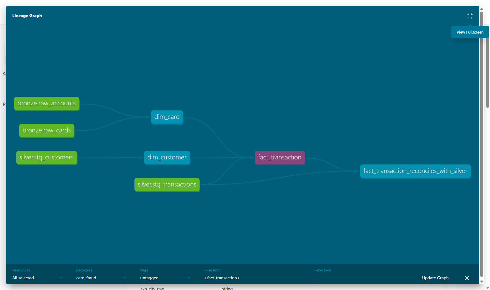

# dbt-spark for the gold layer

dbt on Spark builds the gold star schema that analysts, the fraud labels job and the feature pipeline read:
`dim_customer` (SCD2, slowly changing dimension type 2: every past version of a customer kept), `dim_card`,
`dim_merchant`, `dim_date` and the incremental `fact_transaction`, one row per settled transaction. dbt, a SQL build
tool, orders the `SELECT` models by their `ref()` / `source()` calls, runs them on Spark, tests them and writes docs
and lineage for DataHub. It runs in `dp2_silver_to_gold`, the Airflow DAG (pipeline of tasks) for the second half of
DP2 (data pipeline: bronze to silver and gold).

| | |
|---|---|
| Code | [`pipelines/dbt/`](https://github.com/cvinhnguyen/card-fraud-platform/tree/54d21eddbf6e602ae13fed46a1a9e0ef265d23cd/pipelines/dbt), [`pipelines/spark/build_gold_pyspark.py`](https://github.com/cvinhnguyen/card-fraud-platform/blob/54d21eddbf6e602ae13fed46a1a9e0ef265d23cd/pipelines/spark/build_gold_pyspark.py) (the PySpark baseline) |
| Runs on | by hand: Spark Thrift Server, compose profile `dbt` (target `local`); in Airflow DAG `dp2_silver_to_gold`: dbt's own Spark session (target `session`) |
| Reads | `silver.stg_transactions`, `silver.stg_customers`, `bronze.raw_cards`, `bronze.raw_accounts`, `bronze.raw_merchants` |
| Writes | `gold.dim_customer`, `gold.dim_card`, `gold.dim_merchant`, `gold.dim_date`, `gold.fact_transaction` (Delta under `s3a://lakehouse/gold`) |
| Related | [schema_design.md](schema_design.md), [airflow.md](airflow.md), [datahub.md](datahub.md), [spark_jobs.md](spark_jobs.md) |

## Where it fits

- The DP2 gold pipeline of [architecture.md](../architecture.md#layer-1-the-data-platform-top-band): it reads silver,
  built by `build_silver.py` in `dp2_bronze_to_silver` (the first half of DP2), and three bronze tables.
- Everything after silver ("join and reshape") is dbt. Silver's dedup window and MERGE on the newest `created_ts`
  need DataFrame code, so they stay in PySpark, as do `mergeSchema` (DP1) and the skew benchmark.
- Gold feeds the fraud labels job, DP3's features ([spark_jobs.md](spark_jobs.md)) and analysts' Trino queries.
- DP3 runs on the event `publish_gold` emits, which a failing dbt test blocks ([airflow.md](airflow.md)).

## How it works

1. The models are SQL files in `pipelines/dbt/models/`; each `ref()` is a dependency, so the dimensions build before
   the fact that joins them ([The dbt project](#the-dbt-project)).
2. `dim_customer` starts a new version only when a tracked attribute changes (the city after normalization, so the
   2025 renaming of old province names is not a move), with valid-from and valid-to dates for point-in-time joins.
3. `fact_transaction` is incremental: each run processes only the export dates it does not have yet.
4. `dbt build` runs each model's tests right after it and skips everything downstream of a failure
   ([Tests that stop bad data](#tests-that-stop-bad-data)).
5. `dbt docs generate` writes the manifest and catalog DataHub reads for model lineage and column docs
   ([Lineage graph](#lineage-graph)).

A PySpark baseline measures what dbt saves
([Same tables as hand-written PySpark](#same-tables-as-hand-written-pyspark)).

## Run it

Prerequisites: the `batch` profile up and silver built ([spark_jobs.md](spark_jobs.md)). From the repo root:

```bash
docker compose -f infra/docker-compose.yaml --profile dbt up -d spark-thrift
.venv/Scripts/dbt build --project-dir pipelines/dbt --profiles-dir pipelines/dbt           # models + tests; --full-refresh rebuilds the fact
.venv/Scripts/dbt docs generate --project-dir pipelines/dbt --profiles-dir pipelines/dbt   # docs site + manifest for DataHub
# the PySpark baseline and the row-by-row comparison with dbt's tables
docker compose -f infra/docker-compose.yaml exec spark-master /opt/spark/bin/spark-submit \
    --conf spark.cores.max=2 --conf spark.executor.memory=1g /opt/jobs/build_gold_pyspark.py
```

In Airflow, `dbt_build` and `dbt_docs` run when `dp2_bronze_to_silver` emits the dataset event `lakehouse://silver`.

## The dbt project

| Where | What |
|---|---|
| [`pipelines/dbt/models/gold/`](https://github.com/cvinhnguyen/card-fraud-platform/tree/54d21eddbf6e602ae13fed46a1a9e0ef265d23cd/pipelines/dbt/models/gold) | 5 models; `fact_transaction` is `incremental` with `merge` on `transaction_id` and `partition_by txn_month` |
| [`pipelines/dbt/models/gold/schema.yml`](https://github.com/cvinhnguyen/card-fraud-platform/blob/54d21eddbf6e602ae13fed46a1a9e0ef265d23cd/pipelines/dbt/models/gold/schema.yml) | 19 generic tests (unique, not_null, relationships from the fact to each dim) + descriptions |
| [`pipelines/dbt/tests/`](https://github.com/cvinhnguyen/card-fraud-platform/tree/54d21eddbf6e602ae13fed46a1a9e0ef265d23cd/pipelines/dbt/tests) | 3 singular tests: one current version per customer, no gaps/overlaps between versions, fact reconciles with silver |
| [`pipelines/dbt/profiles.yml`](https://github.com/cvinhnguyen/card-fraud-platform/blob/54d21eddbf6e602ae13fed46a1a9e0ef265d23cd/pipelines/dbt/profiles.yml) | `local`: Spark Thrift Server (by hand, :10000); `session`: dbt's own Spark session (Airflow DP2) |
| [`pipelines/airflow/dags/dp2_silver_to_gold.py`](https://github.com/cvinhnguyen/card-fraud-platform/blob/54d21eddbf6e602ae13fed46a1a9e0ef265d23cd/pipelines/airflow/dags/dp2_silver_to_gold.py) | the `dbt_build` + `dbt_docs` tasks |

The fact MERGEs only new export dates on `transaction_id`
([`pipelines/dbt/models/gold/fact_transaction.sql`
L4-L17](https://github.com/cvinhnguyen/card-fraud-platform/blob/54d21eddbf6e602ae13fed46a1a9e0ef265d23cd/pipelines/dbt/models/gold/fact_transaction.sql#L4-L17)):

```sql
{{ config(
    materialized='incremental',
    incremental_strategy='merge',
    unique_key='transaction_id',
    partition_by=['txn_month'],
) }}

with txn as (
    select * from {{ source('silver', 'stg_transactions') }}
    where status = 'settled'
    
      and export_date > (select max(export_date) from {{ this }})
    
)
```

## Same tables as hand-written PySpark

dbt-spark produces exactly the rows hand-written Spark produces.
[`build_gold_pyspark.py`](https://github.com/cvinhnguyen/card-fraud-platform/blob/54d21eddbf6e602ae13fed46a1a9e0ef265d23cd/pipelines/spark/build_gold_pyspark.py)
builds the same five tables by hand in PySpark (the course's way) into the database
`gold_pyspark` and runs the same 22 checks as assertions
([build_gold_pyspark.py L82-L110](https://github.com/cvinhnguyen/card-fraud-platform/blob/54d21eddbf6e602ae13fed46a1a9e0ef265d23cd/pipelines/spark/build_gold_pyspark.py#L82-L110)).
It then compares both results row by row, with `EXCEPT ALL` in both directions
([build_gold_pyspark.py L113-L120](https://github.com/cvinhnguyen/card-fraud-platform/blob/54d21eddbf6e602ae13fed46a1a9e0ef265d23cd/pipelines/spark/build_gold_pyspark.py#L113-L120)):

```python
def compare_with_dbt(spark: SparkSession) -> None:
    """Row-for-row comparison with the tables dbt built in `gold` (both directions of EXCEPT ALL)."""
    for name in ["dim_customer", "dim_card", "dim_merchant", "dim_date", "fact_transaction"]:
        mine, dbt = spark.table(f"{DB}.{name}"), spark.table(f"gold.{name}")
        cols = [c for c in dbt.columns if c in mine.columns]
        only_mine, only_dbt = mine.select(cols).exceptAll(dbt.select(cols)).count(), dbt.select(cols).exceptAll(mine.select(cols)).count()
        print(f"{name}: {mine.count():,} rows here, {dbt.count():,} in dbt gold, {len(cols)} columns compared, "
              f"only here {only_mine}, only in dbt {only_dbt}")
```

| Table | Rows (PySpark) | Rows (dbt) | Columns compared | Only in PySpark | Only in dbt |
|---|---:|---:|---:|---:|---:|
| `dim_customer` | 144,167 | 144,167 | 12 | 0 | 0 |
| `dim_card` | 130,120 | 130,120 | 10 | 0 | 0 |
| `dim_merchant` | 5,200 | 5,200 | 6 | 0 | 0 |
| `dim_date` | 1,019 | 1,019 | 8 | 0 | 0 |
| `fact_transaction` | 7,879,773 | 7,879,773 | 16 | 0 | 0 |

## What it costs to write and run

Similar code size, less plumbing, slower runs. Both used the same Spark resources (2 cores, 1 GB executor), data
(after the Airflow backfill) and disk (Docker on the USB HDD) for a full build of all five tables:

| | PySpark by hand | dbt-spark |
|---|---|---|
| Transformation code | 61 lines of Python | 95 lines of SQL (5 files) |
| Tests | 28 lines of assertion code for 22 checks | 22 tests: 19 declared in `schema.yml` (`[unique, not_null]`, `relationships`) + 14 lines of SQL for the 3 singular ones |
| Build order | written by hand (fact after its dims) | derived from `ref()` |
| Incremental fact | not done (full rebuild); a MERGE would add a max(export_date) lookup + `DeltaTable.merge` | `materialized='incremental'`, `unique_key`, one `is_incremental()` filter |
| Docs + lineage graph | none | `dbt docs generate`: column docs, model DAG (below), artifacts DataHub ingests |
| A failing test | stops at the first failed assert | runs and reports every test, skips only what is downstream of a failure |
| Full build + tests | 171 s build + 87 s checks = 258 s (inside the job) | `dbt build --full-refresh`: 477 s (wall, incl. starting the session) |
| Daily run | full rebuild every day (as above) | `dbt build`, nothing new: 405 s; in Airflow 158 s for one new export date (on the SSD, before Docker's disk moved to the USB HDD) |

The plumbing dbt saves: a `save()` helper, table registration, an explicit build order and an assertion per test
become a materialization config, `ref()` and one word per test.

dbt is slower: it runs one model and one test query at a time (threads 1 in the session target,
[`profiles.yml`
L17-L22](https://github.com/cvinhnguyen/card-fraud-platform/blob/54d21eddbf6e602ae13fed46a1a9e0ef265d23cd/pipelines/dbt/profiles.yml#L17-L22)),
rebuilds the four dimension tables every run (materialized `table`) and starts a session; the PySpark job computes
everything in one session and counts its 22 checks in a few shared scans. A long-lived Thrift Server with
`threads: 2` (target `local`) removes the session cost; incremental dimensions would shorten the daily run.

### Adding one more dimension

Adding a `dim_terminal` (one row per POS/ATM terminal from the fact's `terminal_id`, with merchant and unit):

| Step | PySpark | dbt |
|---|---|---|
| Transformation | new function, listed before the fact | `dim_terminal.sql` (a `SELECT`) |
| Write + register | reuse `save()` | nothing (materialization config of the folder) |
| Key tests | 2 assertions (unique, not_null) + 1 for the fact relationship | 3 lines in `schema.yml` |
| Docs / lineage | none | in `dbt docs` and, via the manifest, DataHub |

## Tests that stop bad data

A failing dbt test fails the Airflow task, so `publish_gold` does not run and the features are not built. `dbt build`
runs the 19 generic tests of `schema.yml` and the 3 singular ones right after each model; `dp2_silver_to_gold` runs
it first, next to `build_labels`, once `dp2_bronze_to_silver` has validated and published silver
([`dp2_silver_to_gold.py`](https://github.com/cvinhnguyen/card-fraud-platform/blob/54d21eddbf6e602ae13fed46a1a9e0ef265d23cd/pipelines/airflow/dags/dp2_silver_to_gold.py)).

Every DP2 run of the backfill passed 27/27 (5 models, 22 tests), when DP2 was still the single DAG
`dp2_bronze_to_gold`. The silver validation drill in [airflow.md](airflow.md) shows a failing test one step earlier;
dbt's report lists each failing test with the query that failed.

## Lineage graph

`dbt docs generate` (task `dbt_docs`) draws the graph from `ref()` / `source()` alone; `fact_transaction`, sources
in green:



The same manifest feeds DataHub (`datahub_metadata` DAG, recipe
[`pipelines/airflow/dags/datahub_recipes/dbt.yml`
L3-L10](https://github.com/cvinhnguyen/card-fraud-platform/blob/54d21eddbf6e602ae13fed46a1a9e0ef265d23cd/pipelines/airflow/dags/datahub_recipes/dbt.yml#L3-L10)),
which merges each model with its hive table: SQL, column docs and test results sit next to the Great Expectations
assertions, the 22 dbt tests shown as 27 assertions
([datahub.md](datahub.md#what-datahub-holds)).

## Gotchas

- A dbt `snapshot` cannot build `dim_customer`: it records changes only from its first run, but the source holds
  every version since 2024. So `dim_customer` is a model (lag over a hash of the tracked attributes,
  city compared after normalization,
  [`pipelines/dbt/models/gold/dim_customer.sql`
  L4-L22](https://github.com/cvinhnguyen/card-fraud-platform/blob/54d21eddbf6e602ae13fed46a1a9e0ef265d23cd/pipelines/dbt/models/gold/dim_customer.sql#L4-L22));
  decision recorded 2026-10-17.
- `ClassCastException LocalDate -> java.sql.Date` on `min/max(date)` with Delta on the Thrift Server: Delta's
  metadata-only query clashes with the Thrift Server's java8 time API. Fix:
  `spark.databricks.delta.optimizeMetadataQuery.enabled=false`
  ([`infra/docker-compose.yaml`
  L286-L289](https://github.com/cvinhnguyen/card-fraud-platform/blob/54d21eddbf6e602ae13fed46a1a9e0ef265d23cd/infra/docker-compose.yaml#L286-L289)).
- Docker's DNS failed with the Thrift Server up next to DataHub: its 1 GB driver and 1 GB executor, always held,
  pushed the 8 GB Docker VM into swap (`Unable to execute HTTP request:
  seaweedfs`). In Airflow, dbt therefore uses the `session` target, a Spark session for the task's length in the
  `spark` pool; the Thrift Server stays for interactive use.
