# Flink jobs

The Flink jobs are the streaming half of Layer 1 (data platform): they read card payments (authorizations) and app
events from Kafka as they happen, because a fraud model approving a payment in milliseconds needs the card's last 10
minutes as well as its history up to last night. Each job handles one stream problem: offline POS (point-of-sale)
terminals send payments up to 30 minutes late, network retries send duplicates, app events arrive out of order, and
one city is most of the traffic (a hot key). Replay checks compare each job's output with a pandas recomputation.

| | |
|---|---|
| Code | [`pipelines/flink/`](https://github.com/cvinhnguyen/card-fraud-platform/tree/6457d47445ec1a910ebd2c01bc1edbff50f76d37/pipelines/flink), [`infra/flink/Dockerfile`](https://github.com/cvinhnguyen/card-fraud-platform/blob/6457d47445ec1a910ebd2c01bc1edbff50f76d37/infra/flink/Dockerfile), [`infra/docker-compose.yaml` L318-L360](https://github.com/cvinhnguyen/card-fraud-platform/blob/6457d47445ec1a910ebd2c01bc1edbff50f76d37/infra/docker-compose.yaml#L318-L360) |
| Runs on | compose profile `stream`: Flink 2.2.1 session cluster, 1 JobManager and 1 TaskManager with 6 slots; UI http://127.0.0.1:8088 |
| Reads | Kafka `card_authorizations`; the replay topics `card_auth_replay` and `app_events_replay` |
| Writes | Kafka `auth_counts_<mode>`, `auth_late_<mode>`, `card_features_rt`, `card_device_seen`, `ato_alerts_<order>`, `ato_alerts_cep`, `unit_counts_<mode>`; JSON lines under `s3://lakehouse/landing/card_authorizations/` |
| Related | [novel_flink_cep.md](novel_flink_cep.md), [feature_store.md](../ml-platform/feature_store.md) |

## Where it fits

- Always on: `rt_features.py` and `device_seen.py` feed the Feast push jobs `push-online` and `push-offline`
  ([feature_store.md](../ml-platform/feature_store.md)); `raw_landing.py` writes files under `landing/` that DP1
  (data pipeline: ingest to bronze) loads nightly into `bronze.raw_card_authorizations`
  ([spark_jobs.md](spark_jobs.md)). Jenkins upgrades all three ([Releases](#releases-cicd)).
- Replays: the other jobs, from baseline to fix. The Flink SQL account takeover job is one of Layer 1's two novel
  ideas ([novel_flink_cep.md](novel_flink_cep.md)).
- The streaming row of Layer 1 in the platform overview
  ([architecture.md](../architecture.md#layer-1-the-data-platform-top-band)), and the arrows R3 to R5 in the system
  diagram ([numbered arrows](../architecture.md#numbered-arrows)).

## How it works

1. The producer replays the generated payments and app events into Kafka with the event time as the message
   timestamp, so every job works in event time ([Event time](#event-time)).
2. `rt_features.py` computes four per-card features over 10 minutes and 1 hour as each payment arrives, and
   `device_seen.py` notes a card's first use of a device. Push jobs copy both into the Feast online store (Scoring
   API) and offline store (training) ([Realtime features](#realtime-features)).
3. `raw_landing.py` copies every raw payment, duplicates and late events included, to the lakehouse landing zone, so
   DP1 can load the stream's history into bronze ([Raw events to bronze](#raw-events-to-bronze)).
4. Each streaming problem has a job with a baseline and a fixed mode: late events and duplicates (`auth_windows.py`),
   out-of-order app events (`ato_sequence.py`, and the novel idea's CEP, complex event processing, job) and the hot
   key (`hot_key.py`). A check script measures each against pandas
   ([What each optimization changed](#what-each-optimization-changed)).
5. A live job checkpoints every 10 s to the lakehouse and commits its Kafka offsets with each checkpoint, so a
   restart resumes where it stopped ([Live: the job stays RUNNING](#live-the-job-stays-running)).

## Run it

From the repo root, with the source data generated (the checks read its Parquet files):

```bash
docker compose -f infra/docker-compose.yaml --profile core --profile stream up -d --build
python pipelines/flink/check_windows.py --replay-from "2026-06-01 00:00" --limit 20000     # late events + duplicates
python pipelines/flink/check_features.py --replay-from "2025-03-01 00:00" --limit 100000   # realtime features
python pipelines/flink/check_ato.py --replay-from "2024-03-01 00:00" --limit 150000        # out-of-order sessions
python pipelines/flink/check_ato_cep.py --replay-from "2026-03-01 00:00" --limit 300000    # takeover patterns, Flink CEP
python pipelines/flink/check_hot_key.py --replay-from "2025-01-01 00:00" --limit 1000000   # hot key, parallelism 4

# the three always-on jobs, unbounded (-d returns once the job is submitted)
docker exec flink-jobmanager flink run -d -py /opt/flink/jobs/rt_features.py --topic card_authorizations --live
docker exec flink-jobmanager flink run -d -py /opt/flink/jobs/device_seen.py --topic card_authorizations --live
docker exec flink-jobmanager flink run -d -py /opt/flink/jobs/raw_landing.py --topic card_authorizations --live
```

Each `check_*.py` replays a fixed slice of the stream into a replay topic, runs the job bounded (earliest to latest offset) and compares
the output topic with pandas. The live jobs
take 3 of the 6 slots (parallelism 1 each); `check_hot_key.py` needs 4, so cancel `raw_landing` first
([Gotchas](#gotchas)).

## Releases (CI/CD)

The Jenkins job `flink-jobs` ([`pipelines/flink/Jenkinsfile`](../../pipelines/flink/Jenkinsfile)) runs on every
change under `pipelines/flink/`: it lints the jobs (`ruff check --select E9,F`) and imports each in the Flink image.
The `check_*.py` scripts stay manual, since they reset topics and need the Parquet files.

When `rt_features.py`, `device_seen.py` or `raw_landing.py` change, it upgrades that job if it runs live (RUNNING,
with checkpoints on); stopped jobs, bounded runs by hand and `raw_landing.py` backfills (they checkpoint, but keep
Flink's default job name) are left alone:

1. copies the commit's job files into both Flink containers at `/tmp/release/<sha>/`
2. stops the job with a savepoint in `s3://lakehouse/flink/savepoints`
3. submits the new code from that savepoint, with `--release <sha>`: the job is named `rt_features <sha>`
4. waits up to 3 minutes for the new job to run, restore the savepoint and complete a checkpoint

If step 4 fails, Jenkins cancels the new job and resubmits the old code from the same savepoint, keeping the state (the dedup and 1-hour
windows of `rt_features`, the Kafka offsets and open files of `raw_landing`). The version shows in
the job name (Flink UI, `flink list`); a job started by hand without `--release` keeps the plain name.

The operators have no explicit uid, so Flink maps savepoint state by job-graph shape: a change inside a function
restores, but adding or removing an operator (for `raw_landing.py`, in the SQL query plan) falls back to the old code
and needs a manual restart without the savepoint. `raw_landing.py --live` loses nothing that way: it resumes from the
offsets committed with its last checkpoint, along with its files.

## Jobs

The image adds PyFlink 2.2.1 and the Kafka connector 5.0.0-2.2 to Flink 2.2.1
([Dockerfile L4-L21](https://github.com/cvinhnguyen/card-fraud-platform/blob/6457d47445ec1a910ebd2c01bc1edbff50f76d37/infra/flink/Dockerfile#L4-L21)).
Most jobs use the PyFlink DataStream API; `ato_cep.py` and `raw_landing.py` use Flink SQL. The jobs in
[`pipelines/flink/`](https://github.com/cvinhnguyen/card-fraud-platform/tree/6457d47445ec1a910ebd2c01bc1edbff50f76d37/pipelines/flink)
are mounted at `/opt/flink/jobs`
([compose L349-L351](https://github.com/cvinhnguyen/card-fraud-platform/blob/6457d47445ec1a910ebd2c01bc1edbff50f76d37/infra/docker-compose.yaml#L349-L351)).

- Bounded jobs stop at the offset that was latest at start and end FINISHED (dedup screenshot below), so their
  output can be compared with pandas row by row.
- `--live` jobs stay RUNNING until cancelled: `rt_features.py --live`, `device_seen.py --live` and
  `raw_landing.py --live` read `card_authorizations` from their committed offsets
  ([`rt_features` running](#live-the-job-stays-running)); `hot_key.py --live` is fed at a fixed rate
  ([screenshots](#at-a-fixed-input-rate-live-mode)).

| Job | What it computes, and for whom | Input | Output | Runs |
|---|---|---|---|---|
| `auth_windows.py --mode baseline\|lateness\|dedup` | authorizations per card window despite late POS events and duplicates | `card_auth_replay` | `auth_counts_<mode>`, late events `auth_late_<mode>` | replay check |
| `rt_features.py` | the realtime card features (counts and sums over 10 minutes and 1 hour), for the Scoring API through Feast | `card_auth_replay`; live: `card_authorizations` | `card_features_rt` (feature view `card_auth_realtime`) | replay check; `--live` always on |
| `device_seen.py` | the first time a card is used from a device, the strongest realtime fraud signal | `card_authorizations` (backfill, or live) | `card_device_seen` (feature view `card_device`) | backfill; `--live` always on |
| `ato_sequence.py --order arrival\|event` | account takeover sequences in app events, with a hand-written state machine; out-of-order events sorted by event time | `app_events_replay` | `ato_alerts_<order>` | replay check |
| `ato_cep.py` (Flink SQL, MATCH_RECOGNIZE; [novel idea](novel_flink_cep.md)) | the same takeover patterns written as SQL row patterns | `app_events_replay` | `ato_alerts_cep` | replay check |
| `hot_key.py --mode hot\|two_phase [--live]` (parallelism 4) | authorizations per unit when one unit (Ho Chi Minh) is most of the traffic | `card_auth_replay` | `unit_counts_<mode>` | replay check; `--live` at a fixed rate |
| `raw_landing.py` (Flink SQL) | every raw payment as a file, for bronze | `card_authorizations` | `s3://lakehouse/landing/card_authorizations/auth_date=*/` | `--live` always on; backfill by hand: the whole topic, or from a Kafka time (`--from-ms`), then it stops |

## What each optimization changed

| Problem | Job | Metric | Before (baseline) | After (fix) |
|---|---|---|---|---|
| Late events: offline POS terminals send 5 to 30 min late | `auth_windows.py` | late events dropped from their window; card windows exact | 483 dropped; 96.08% | `allowed_lateness(30 min)` + side output: 0 dropped; 98.47%; replay 305 s -> 348 s |
| Duplicates: network retries resend the same `auth_id` | `auth_windows.py` | card windows overcounted; exact | 301 overcounted; 98.47% (`lateness` mode) | dedup on `auth_id` before the window: 0; 100.00% |
| Out-of-order app events within a session | `ato_sequence.py` | account takeovers caught | 461 / 658 (70.1%) in arrival order | 658 / 658 (100%) in event-time order, +30 s per alert |
| Hot key: Ho Chi Minh is 60% of the authorizations | `hot_key.py`, parallelism 4 | replay: job time; records on the busiest counting subtask; Flink UI data skew and backpressure. Live at 16,000 events/s: records/s processed, Kafka lag, BackPressure status | 71.4 s; 84%; skew 100%, upstream backpressured 88%. Live: about 13,300/s, lag grows, HIGH | two-phase salting: 50.7 s (about 14,000 -> 19,700 records/s); 33%; skew 28%, upstream 48%. Live: 16,000/s, lag 0, OK |

The hot key is a load problem, measured by backpressure and busy time
([Flink UI before and after](#flink-ui-before-and-after), [at a fixed input rate](#at-a-fixed-input-rate-live-mode)).
The others are correctness problems, measured against pandas; in the Flink UI they show in the `late events` sink
metric (443 before, 0 after, at the same replay point, [screenshots](#in-the-flink-ui-late-events-before-and-after))
and the records per operator.

## Event time

The producer sets each Kafka message timestamp to the event time (`auth_ts`, `event_ts`), as a card network or app
would
([`generator/producer.py` L43-L55](https://github.com/cvinhnguyen/card-fraud-platform/blob/6457d47445ec1a910ebd2c01bc1edbff50f76d37/generator/producer.py#L43-L55)).
The jobs use `WatermarkStrategy.for_bounded_out_of_orderness(...)` without a timestamp assigner, so watermarks are
generated inside the Kafka source
([`auth_windows.py` L108-L110](https://github.com/cvinhnguyen/card-fraud-platform/blob/6457d47445ec1a910ebd2c01bc1edbff50f76d37/pipelines/flink/auth_windows.py#L108-L110)).

## Late events and duplicates

[`pipelines/flink/auth_windows.py`](https://github.com/cvinhnguyen/card-fraud-platform/blob/6457d47445ec1a910ebd2c01bc1edbff50f76d37/pipelines/flink/auth_windows.py)
counts authorizations per card per 5-minute tumbling window, with a watermark of 5 s (normal network delay is at most
2 s). Each mode adds one fix:

| Mode | Behavior |
|---|---|
| `baseline` | Late events miss their window (here they go to a side output, so they can be counted); retries are counted twice. |
| `lateness` | Allowed lateness keeps each window's state 30 minutes past the watermark: the window fires on time and again for each late event, so results are early and complete. A 30-minute watermark delay would hold every result back 30 minutes. |
| `dedup` | A flag per `auth_id`, kept 1 hour (retries come 1 to 10 s later), passes only the first copy, before any count ([`auth_windows.py` L42-L55](https://github.com/cvinhnguyen/card-fraud-platform/blob/6457d47445ec1a910ebd2c01bc1edbff50f76d37/pipelines/flink/auth_windows.py#L42-L55)). |

The modes in the job
([`auth_windows.py` L117-L130](https://github.com/cvinhnguyen/card-fraud-platform/blob/6457d47445ec1a910ebd2c01bc1edbff50f76d37/pipelines/flink/auth_windows.py#L117-L130)):

```python
    events = env.from_source(source, wm, f"kafka {TOPIC}").map(parse, output_type=EVENT)
    if mode == "dedup":
        events = events.key_by(lambda e: e[0], key_type=Types.STRING()).process(FirstSeen(), output_type=EVENT)

    # ponytail: untyped (pickled) tag; a TUPLE-typed tag fails to pickle in PyFlink 2.2 (nested Java type info)
    late = OutputTag("late")
    windows = events.key_by(lambda e: e[1], key_type=Types.STRING()).window(TumblingEventTimeWindows.of(WINDOW))
    if mode != "baseline":
        windows = windows.allowed_lateness(LATENESS.to_milliseconds())
    counts = windows.side_output_late_data(late).aggregate(Count(), ToJson(), accumulator_type=Types.LONG(),
                                                           output_type=Types.STRING())
    counts.sink_to(sink(f"auth_counts_{mode}")).name("counts")
    (counts.get_side_output(late).map(lambda e: json.dumps({"auth_id": e[0], "card_id": e[1], "auth_ts": e[3]}), output_type=Types.STRING())
     .sink_to(sink(f"auth_late_{mode}")).name("late events"))
```

Replay: 20,000 authorizations from 2026-06-01, of which 301 are network-retry duplicates and 485 arrive 5 to 30
minutes late (offline POS terminals); 19,696 card windows.

| Mode | What it adds | Late events dropped | Card windows exact | Overcounted | Undercounted |
|---|---|---:|---:|---:|---:|
| `baseline` | watermark 5 s | 483 (to side output) | 96.08% | 295 | 477 |
| `lateness` | `allowed_lateness(30 min)` + side output | 0 | 98.47% | 301 | 0 |
| `dedup` | keyed state on `auth_id`, kept 1 h (state TTL, time to live), before the window | 0 | 100.00% | 0 | 0 |

The `dedup` job's records per operator: 20,000 events in, 19,699 after dedup, 19,696 windows:

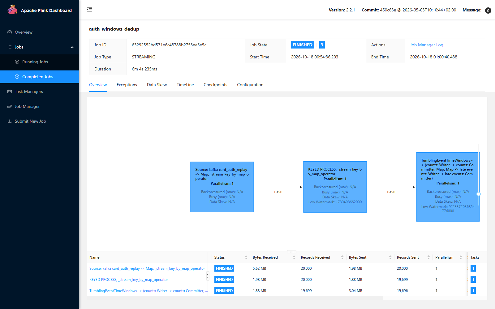

### In the Flink UI: late events before and after

The window vertex chains two Kafka sinks, `counts` and `late events` (the side output); its Metrics tab shows
`late_events__Writer.numRecordsIn`, the events that arrived after the watermark closed their window. Flink shows
metrics only while a job runs, so the screenshots caught about 18,700 (`baseline`) and 19,300 (`lateness`) of the
20,000 events (Records Received); at the end the check script counts 483 and 0.

Before, `baseline` (watermark 5 s only): 443 late events after 18,726 events:


After, `lateness` (`allowed_lateness(30 min)`): 0 late events after 19,334 events, which now update their windows:

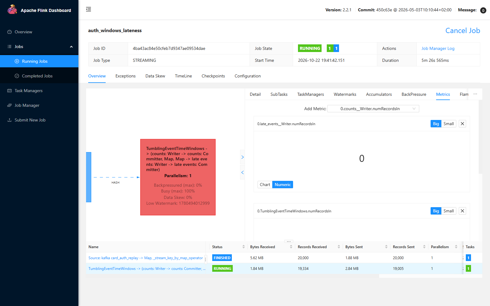

Allowed lateness costs time: 348 s against 305 s for the baseline (re-run on 2026-10-22, same results), as each
window keeps its state 30 minutes longer and fires again per late event. Both runs show the window vertex busy 100%,
backpressured 0%; with a Python bundle size of 1 (below) they measure correctness only.

### What it took to see the late events in a replay

The first runs reported 0 late events. Three replay effects hid them:

1. PyFlink 2.2 ignores a Python `TimestampAssigner` passed to `from_source`, so windows used the Kafka timestamp (then
   the send time) and every event landed in the current 5 minutes. Fix: event time as the Kafka timestamp.
2. The default 200 ms watermark interval spans hours of event time in a replay, so a 30-minute-late event still
   arrived "before" the watermark; the Python map's 1,000-event bundles also let the source run ahead. Fix: watermark every 10 ms and a Python bundle size of 1
   ([`auth_windows.py` L97-L102](https://github.com/cvinhnguyen/card-fraud-platform/blob/6457d47445ec1a910ebd2c01bc1edbff50f76d37/pipelines/flink/auth_windows.py#L97-L102)).
3. The watermark is the minimum over Kafka partitions, and the 6 partitions were read at very different speeds: a
   debug job saw it at `Long.MIN_VALUE` for the first 30,000 events, then days behind, so few events looked late (206
   of 1,218 in a 50,000-event replay). The production fix, watermark alignment (`with_watermark_alignment` pauses
   partitions that run ahead), failed on a bounded source with
   `IllegalStateException: No current assignment for partition card_authorizations-5` once a partition finished.
   Fix for the demo: a replay topic with 1 partition and parallelism 1.

Live traffic has none of these effects: partitions advance with the wall clock, and 200 ms covers a few events.

## Realtime features

[`pipelines/flink/rt_features.py`](https://github.com/cvinhnguyen/card-fraud-platform/blob/6457d47445ec1a910ebd2c01bc1edbff50f76d37/pipelines/flink/rt_features.py)
emits one feature row per authorization on arrival, over the same card's earlier authorizations: `auth_count_10m`,
`amount_sum_1h`, `distinct_merchants_1h`, `distinct_units_1h`. It is a `KeyedProcessFunction` per card holding the
last 90 minutes in state
([`rt_features.py` L64-L91](https://github.com/cvinhnguyen/card-fraud-platform/blob/6457d47445ec1a910ebd2c01bc1edbff50f76d37/pipelines/flink/rt_features.py#L64-L91)),
since a window reports only when it closes and scoring needs the features of the payment now. Duplicates are dropped
first. Locations map to the 34 units (the provinces after the reorganization) through the 63-row mapping, loaded once
(a broadcast stream only if it changed at runtime).

Replay: 100,000 authorizations from 2025-03-01 (before the reorganization: 20% of location strings are old province names); 98,529 unique,
one feature row each.

| Feature | Rows equal to the pandas recomputation |
|---|---:|
| `auth_count_10m`, `amount_sum_1h`, `distinct_merchants_1h`, `distinct_units_1h` | 100.00% each |

| Authorizations whose card was in 2 or more places within the hour | Count |
|---|---:|
| by raw location name | 122 |
| by unit (what the job emits as `distinct_units_1h`) | 14 |

108 of the 122 would be "impossible travel" alerts caused only by old and new names of the same place (for example
"Binh Duong" and "Ho Chi Minh").

### Live: the job stays RUNNING

In the platform, `rt_features.py --topic card_authorizations --live` resumes from the committed offsets of group
`rt_features`, checkpoints every 10 s to `s3://lakehouse/flink/checkpoints` with the Kafka offsets
([`rt_features.py` L108-L113](https://github.com/cvinhnguyen/card-fraud-platform/blob/6457d47445ec1a910ebd2c01bc1edbff50f76d37/pipelines/flink/rt_features.py#L108-L113);
storage in [compose L343-L344](https://github.com/cvinhnguyen/card-fraud-platform/blob/6457d47445ec1a910ebd2c01bc1edbff50f76d37/infra/docker-compose.yaml#L343-L344))
and runs until cancelled, feeding the Feast push jobs ([feature_store.md](../ml-platform/feature_store.md)).

For the screenshots (2026-10-25) it read the replay topic, fed at 200 events/s by
`producer.py --speed 200 --target card_auth_replay`, so `card_authorizations` and the Feast stores stayed untouched:
the push jobs were stopped, and their groups (`feast_push_online`, `feast_push_offline`, at lag 0 before) were then
moved past the test's 29,247 feature rows in `card_features_rt`.

After 1 min 45 s the job is RUNNING and STREAMING: 18,668 records read, 17,805 reach the feature step, no vertex
backpressured. The Checkpoints tab lists 9 completed checkpoints, the latest 2.01 MB:

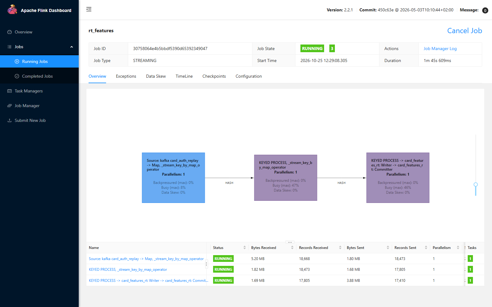

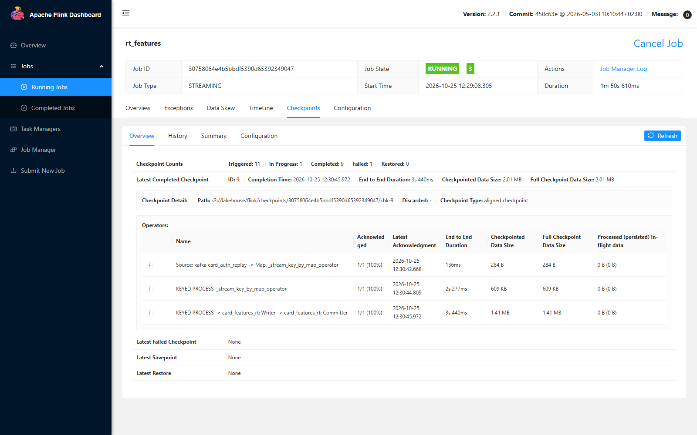

At cancel, 15 of its 16 checkpoints had completed. The group's lag on the replay topic stayed around one checkpoint
interval of events (2,405 at 200 events/s), and 0 on `card_authorizations`:

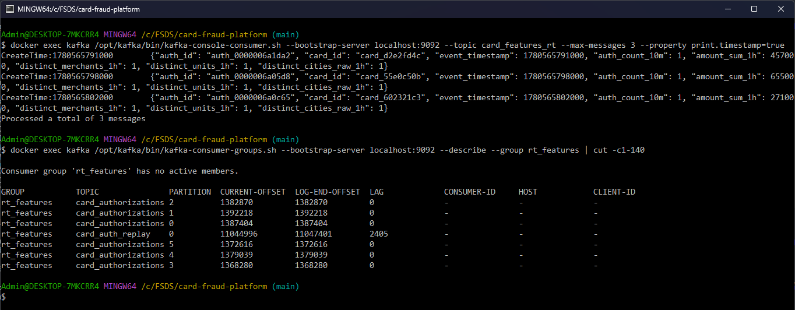

## Out-of-order app events

[`pipelines/flink/ato_sequence.py`](https://github.com/cvinhnguyen/card-fraud-platform/blob/6457d47445ec1a910ebd2c01bc1edbff50f76d37/pipelines/flink/ato_sequence.py)
looks for the `new_device` account takeover pattern: `password_reset`, then `add_payee`, then `transfer`, within 10
minutes in one session. 15% of app events reach Kafka after the session's next event (1 to 20 s, parallel uploads).
Two orders:

| Order | How events reach the state machine |
|---|---|
| `arrival` | a state machine per session ([`ato_sequence.py` L53-L65](https://github.com/cvinhnguyen/card-fraud-platform/blob/6457d47445ec1a910ebd2c01bc1edbff50f76d37/pipelines/flink/ato_sequence.py#L53-L65)), fed in arrival order |
| `event` | events wait in keyed state until an event-time timer at each `event_ts` releases them in `event_ts` order once the watermark (30 s behind the newest event) passes; then the same state machine runs ([`ato_sequence.py` L67-L80](https://github.com/cvinhnguyen/card-fraud-platform/blob/6457d47445ec1a910ebd2c01bc1edbff50f76d37/pipelines/flink/ato_sequence.py#L67-L80)) |

Replay: 150,000 app events from 2024-03-01 (before the biometric rule, which later stops most takeovers before the
transfer); 67,443 sessions, 771 with the full pattern in event time, 658 of them generator-labelled `new_device`
account takeovers (ATO).

| Order | Alerts | Pattern sessions caught | ATO caught |
|---|---:|---:|---:|
| arrival | 578 | 557 / 771 (72.2%) | 461 / 658 (70.1%) |
| event time | 795 | 771 / 771 (100%) | 658 / 658 (100%) |

Reordering costs 30 s per alert and finds every takeover; arrival order misses 3 in 10. The extra alerts (21 in
arrival order, 24 in event time) fall outside the pandas truth query, which takes the session's first `add_payee` and
`transfer`, while the state machine takes the first ones after the `password_reset`.

## Hot key

[`pipelines/flink/hot_key.py`](https://github.com/cvinhnguyen/card-fraud-platform/blob/6457d47445ec1a910ebd2c01bc1edbff50f76d37/pipelines/flink/hot_key.py)
counts authorizations per unit per day (an operations metric: payment volume by province), with parallelism 4. Ho Chi
Minh is 60% of all authorizations, so `key_by(unit)` sends 60% of the stream, plus units that hash to the same place,
to one subtask. The check runs both modes, then `two_phase` with every unit salted:

```bash
python pipelines/flink/check_hot_key.py --replay-from "2025-01-01 00:00" --limit 1000000                  # hot + two_phase
python pipelines/flink/check_hot_key.py --replay-from "2025-01-01 00:00" --limit 1000000 --no-replay --modes two_phase --salt-all
```

Replay: 1,000,000 authorizations from 2025-01-01 (Ho Chi Minh 59.9%, Ha Noi 18.0%, Da Nang 5.0%). Every mode matches
pandas on 4,283 of 4,283 unit-days with 0 late events (the watermark waits 31 minutes, past the latest POS event).
Per-subtask records and busy time come from the REST API after the job ends.

| Mode | Job time | Records into the counting subtasks | Busiest subtask |
|---|---:|---|---|
| `hot`: `key_by(unit)` | 71.4 s | 97,976 / 842,368 / 32,823 / 26,833 | 84% of records, busy 100%; the other three 69-84% idle |
| `two_phase`, 8 salts on Ho Chi Minh only | 50.7 s | 247,514 / 318,138 / 107,782 / 326,566 | 33% of records; three subtasks busy 94-100% |
| `two_phase`, 8 salts on every unit (`--salt-all`) | 112.5 s | 192,699 / 176,333 / 149,634 / 481,334 | 48%, and slower than no fix |

### Flink UI before and after

Per vertex, while each job runs:

| Vertex (parallelism) | Flink UI metric | `hot` (before) | `two_phase` (after) |
|---|---|---:|---:|
| Kafka source (1) | backpressured (max) | 100% | 100% |
| `to unit`, map before `key_by` (4) | backpressured (max) | 88% | 48% |
| | busy (max) | 24% | 51% |
| `count per key` (4) | busy (max) | 99% | 99% |
| | data skew | 100% | 28% |
| `add partial counts` (4, two-phase only) | busy (max) / data skew | none | 34% / 33% |

In `hot` the UI colours the counting vertex red, and the operator before it is backpressured 88%, waiting on the one
hot subtask. Two-phase cuts that wait, so the operator works more and the job finishes in 50.7 s instead of 71.4 s.

Before, `hot`: the counting vertex busy 99% with data skew 100% (Data Skew tab below), upstream backpressured
88-100%:

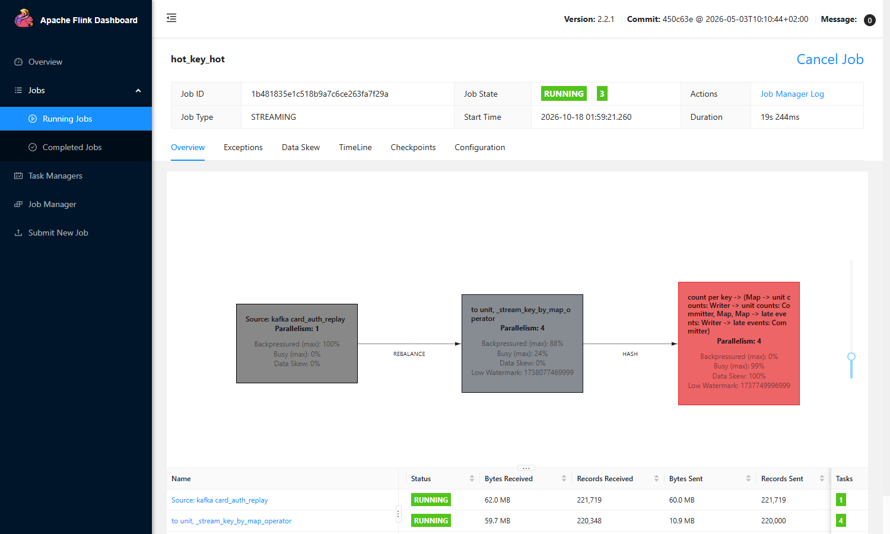

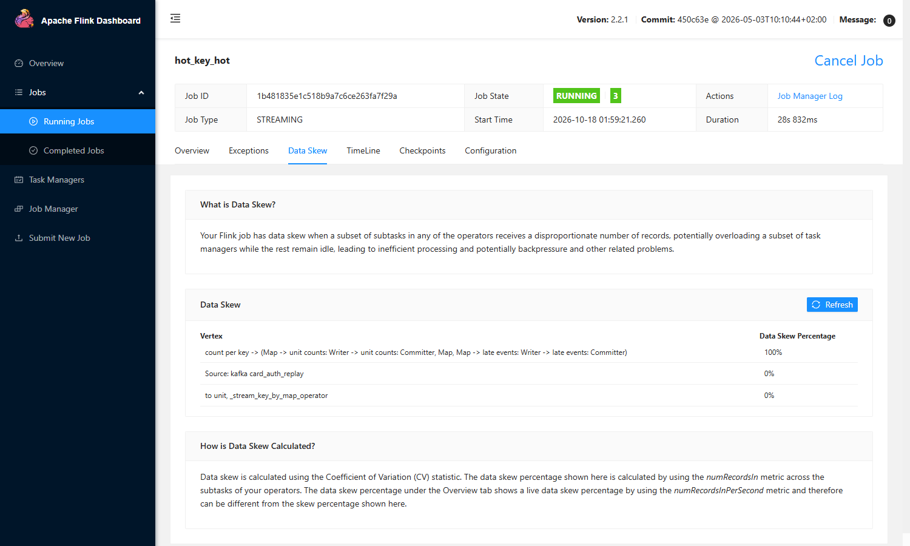

After, `two_phase`: data skew 28%, upstream backpressure 48%:

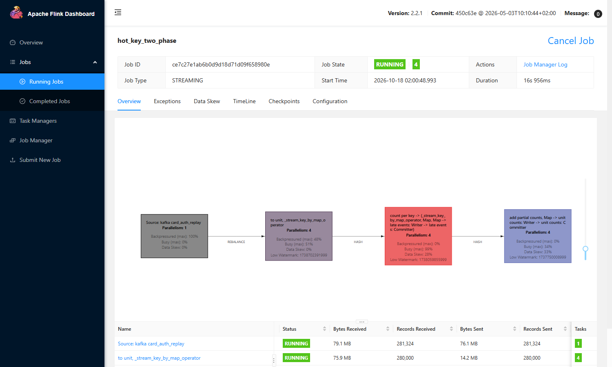

### How two-phase aggregation works

The modes differ in the key and a second window adding the partial counts
([`hot_key.py` L117-L128](https://github.com/cvinhnguyen/card-fraud-platform/blob/6457d47445ec1a910ebd2c01bc1edbff50f76d37/pipelines/flink/hot_key.py#L117-L128)):

```python
    if mode == "hot":
        windows = auths.key_by(lambda a: a[1], key_type=Types.STRING())
    else:
        # The salt comes from auth_id, so a retry lands in the same partial count as its original.
        windows = auths.key_by(lambda a: f"{a[1]}#{int(a[0][5:], 16) % salts}" if hot is None or a[1] in hot else a[1],
                               key_type=Types.STRING())
    partials = (windows.window(TumblingEventTimeWindows.of(WINDOW)).side_output_late_data(late)
                .aggregate(Count(), Partial(), accumulator_type=Types.LONG(), output_type=PARTIAL).name("count per key"))
    counts = partials
    if mode == "two_phase":
        counts = (partials.key_by(lambda p: p[0], key_type=Types.STRING()).window(TumblingEventTimeWindows.of(WINDOW))
                  .reduce(lambda a, b: (a[0], a[1], a[2] + b[2]), output_type=PARTIAL).name("add partial counts"))
```

Ho Chi Minh's key gets a salt from `auth_id` (`Ho Chi Minh#0` .. `#7`), so its records spread over all subtasks;
each counts its share per day, then `key_by(unit)` adds the at most 8 partial counts of a unit-day. Phase 2 receives
5,165 records instead of 1,000,000.

Only hot keys should be salted: salting all 34 units made the job slower (112.5 s) though its records spread better.
In PyFlink each new (key, window) pair costs a state entry and a timer registration through the Python runtime, and a
small unit with a few records per day pays that 8 times for almost no records. Measured:

- Subtasks holding many small units process about 4,500 records/s, the Ho Chi Minh subtask 12,000 records/s.
- Two-phase on every unit got slower with each salt (a separate series of runs: 4 salts 102 s, 8 salts 111 s, 16
  salts 135 s). Ho Chi Minh has about 4,700 records per day, so its 8 partial keys are still full.
- A salt from the event minute (fewer key switches) changed nothing (99.8 s vs 102.0 s for 4 salts), so key
  switching is not the cost.

`key_by(card_id)` would also spread the load, but answers a different question (per card, not per unit).

### At a fixed input rate (live mode)

A replay cannot show whether a job keeps up: the source reads a backlog faster than the Python operators can take,
so it is backpressured in both modes; two-phase removes the hot spot, not the Python cost.

`--live` makes the job unbounded (RUNNING, from the latest offset;
[`hot_key.py` L106-L109](https://github.com/cvinhnguyen/card-fraud-platform/blob/6457d47445ec1a910ebd2c01bc1edbff50f76d37/pipelines/flink/hot_key.py#L106-L109)),
and the producer sends a fixed 16,000 events/s, more than `hot` can process:

```bash
docker exec flink-jobmanager flink run -d -py /opt/flink/jobs/hot_key.py --mode hot --live      # then --mode two_phase
python generator/producer.py --replay-from "2025-01-01 00:00" --limit 2000000 --speed 16000 --target card_auth_replay
```

Same input for both modes, screenshots 75 to 95 s after the producer started:

| At 16,000 events/s | `hot` (before) | `two_phase` (after) |
|---|---:|---:|
| Records/s through the job (REST API, 60 s average) | about 13,300 | 16,000 |
| Records read by the source, job running about 82 s | 681,325 | 944,783 |
| Kafka lag of the source (`pendingRecords`) | rises in steps to about 100,000 | 0 |
| Source backpressured (max) | 98% | 1% |
| `to unit` BackPressure tab | HIGH (30-68% per subtask) | OK (0% on all four) |
| `count per key` busy (max) / data skew | 100% / 100% | 71% / 29% |

With `hot` the lag grows while the rate lasts, so per-unit counts arrive later and later; two-phase keeps up. It
replayed at about 19,700 records/s, so above that it falls behind too; then the next step is more parallelism, or a
Flink SQL aggregation, which runs in the JVM instead of Python.

Before, `hot`:

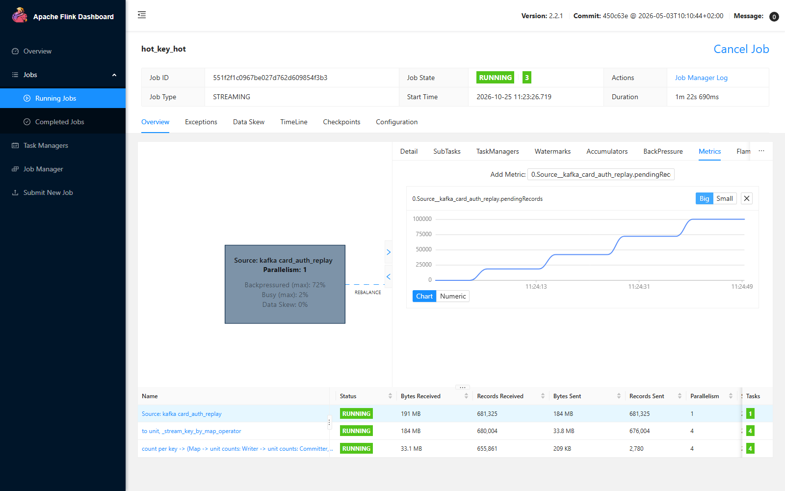

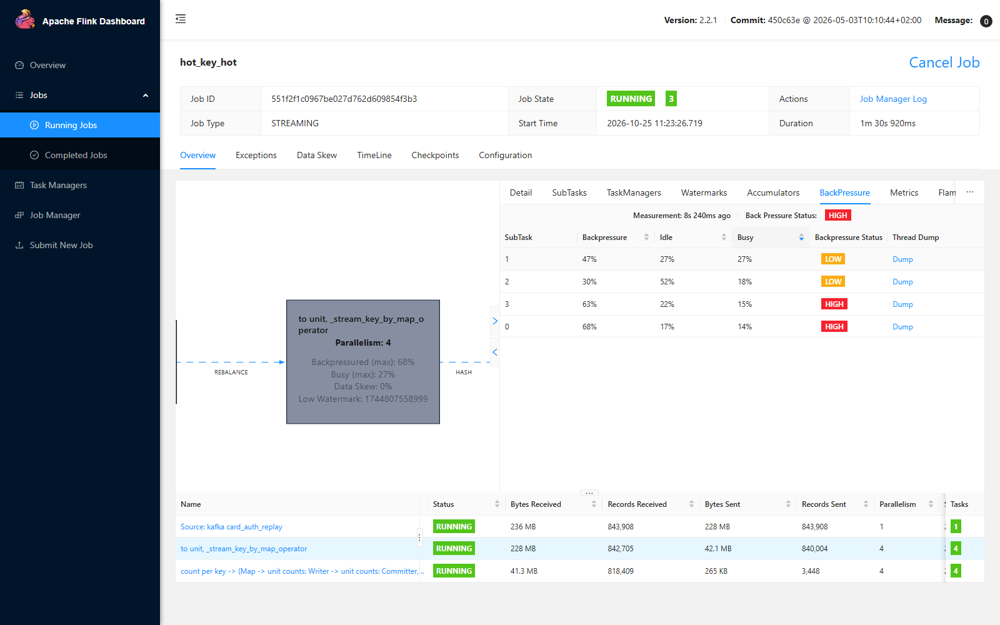

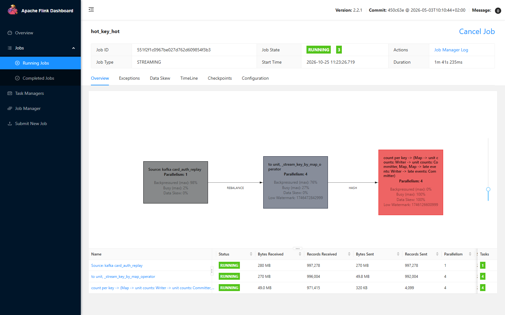

After, `two_phase`:

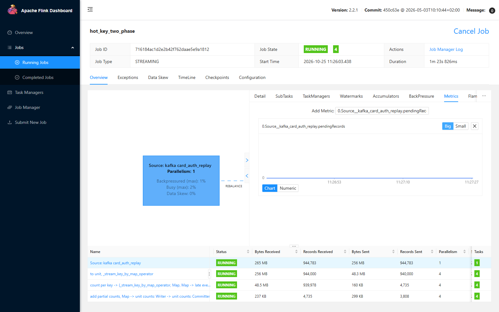

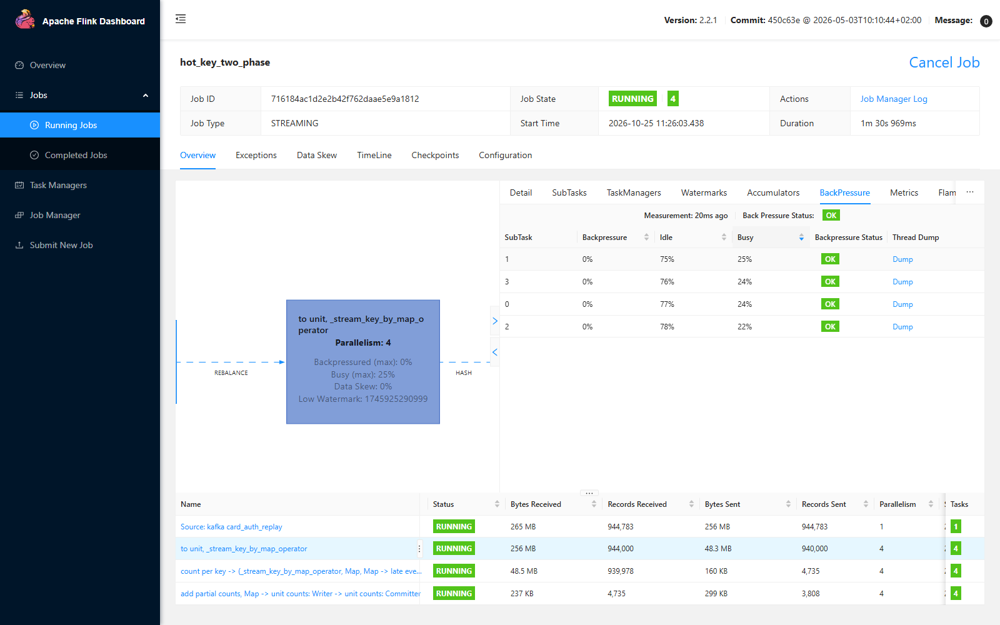

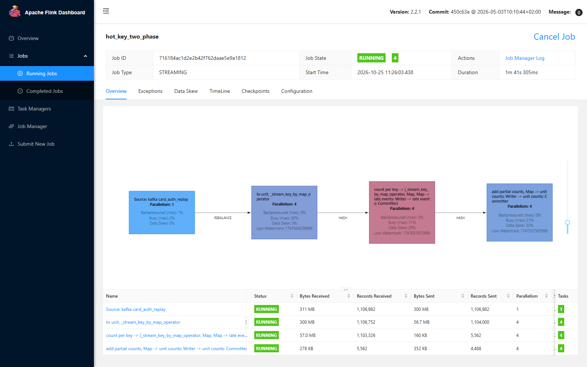

## Raw events to bronze

Flink SQL in
[`pipelines/flink/raw_landing.py` L39-L69](https://github.com/cvinhnguyen/card-fraud-platform/blob/6457d47445ec1a910ebd2c01bc1edbff50f76d37/pipelines/flink/raw_landing.py#L39-L69)
copies `card_authorizations` unchanged (duplicates and late events included, plus Kafka partition and offset for
tracing) to `s3://lakehouse/landing/card_authorizations/auth_date=YYYY-MM-DD/` as JSON lines. With `--live` it runs
unbounded from the committed offsets of group `raw_landing` (the whole topic on the first start); without it, it is a
backfill that stops at the end of the topic. Run a backfill only while the live job is stopped, or both land the same
messages.

No reader sees a half-written file: the sink closes a part file at 64 MB or 30 minutes and commits it with the next
checkpoint (every 10 s); until then it is an unfinished S3 multipart upload, next to temporary objects starting with
`_`, which Spark skips.

`ingest_bronze.py --part landing` appends the committed files to the Delta table `bronze.raw_card_authorizations`
with a Spark file stream (`trigger(availableNow=True)`,
[`pipelines/spark/ingest_bronze.py` L112-L116](https://github.com/cvinhnguyen/card-fraud-platform/blob/6457d47445ec1a910ebd2c01bc1edbff50f76d37/pipelines/spark/ingest_bronze.py#L112-L116)).
Its checkpoint remembers the loaded files, so a late file in an older `auth_date` is still picked up and a re-run
loads nothing twice. DP1 loads every file committed since its last run, so a day still being written arrives over two
runs.

| Step | Result |
|---|---|
| `raw_landing.py` (backfill) on the 50,000-event topic | 8 `auth_date` partitions, 14.8 MB, 5 s |
| `ingest_bronze.py --part landing` | `bronze.raw_card_authorizations`: 50,000 rows (52 s) |
| same command again | still 50,000 rows |

The landing files are JSON because Flink's Parquet writer needs the Hadoop client jars on the classpath; Spark writes
Delta in the next step.

## Gotchas

- Kafka deletes 2024-2026 messages as soon as a segment rolls: event-time timestamps are older than the default 7
  days of retention. Fix: `retention.ms=-1`, as
  [`infra/init_infra.py` L35-L38](https://github.com/cvinhnguyen/card-fraud-platform/blob/6457d47445ec1a910ebd2c01bc1edbff50f76d37/infra/init_infra.py#L35-L38)
  and the check scripts (for example
  [`pipelines/flink/check_windows.py` L35-L36](https://github.com/cvinhnguyen/card-fraud-platform/blob/6457d47445ec1a910ebd2c01bc1edbff50f76d37/pipelines/flink/check_windows.py#L35-L36))
  create them.
- A side-output tag typed as a tuple fails to pickle in PyFlink 2.2, so the late-event tag is untyped
  ([`auth_windows.py` L121-L122](https://github.com/cvinhnguyen/card-fraud-platform/blob/6457d47445ec1a910ebd2c01bc1edbff50f76d37/pipelines/flink/auth_windows.py#L121-L122)).
  In the same version, windows and state TTL take `Time`, watermarks take `Duration`
  ([`auth_windows.py` L36-L38](https://github.com/cvinhnguyen/card-fraud-platform/blob/6457d47445ec1a910ebd2c01bc1edbff50f76d37/pipelines/flink/auth_windows.py#L36-L38)).
- A job waits for slots, then fails with `NoResourceAvailableException`: the three live jobs hold 3 of the 6 slots,
  and `check_hot_key.py` and `hot_key.py --live` need 4. Fix: cancel `raw_landing` first (`flink list`, then
  `flink cancel <job id>`), then restart it with the release in its job name, losing nothing:
  `flink run -d -py /tmp/release/<sha>/raw_landing.py --topic card_authorizations --live --release <sha>` (no version
  in the name: the working tree, see [Run it](#run-it)).
- A live job restored from a savepoint fails while catching up with `OutOfMemoryError: Direct buffer memory`: the
  Kafka fetchers of the three always-on jobs need more direct memory than the 128 MB framework off-heap. Fix: the
  TaskManager sets `taskmanager.memory.task.off-heap.size: 256m`
  ([`infra/docker-compose.yaml`](../../infra/docker-compose.yaml)).
