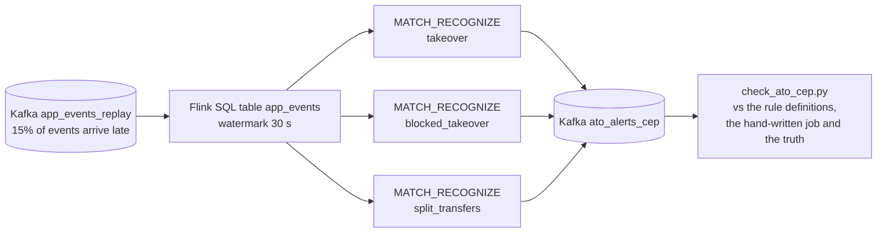
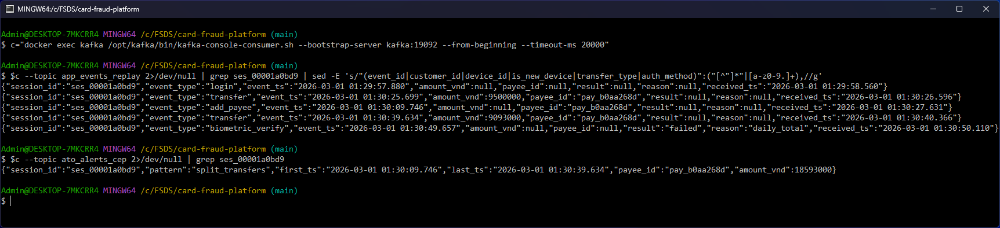
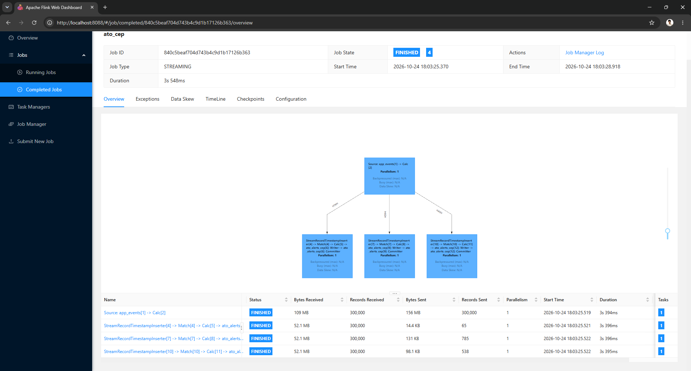
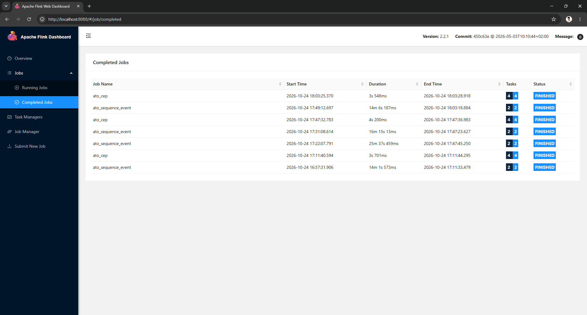
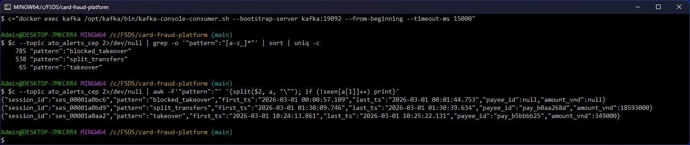
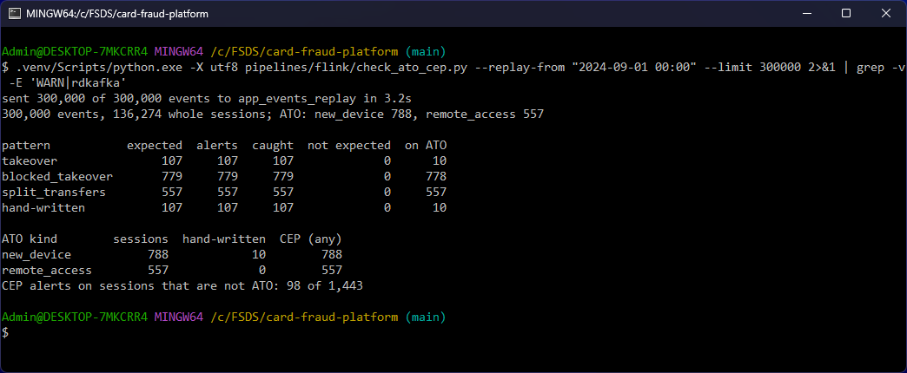

# Novel idea: account takeover patterns with Flink CEP (MATCH_RECOGNIZE)

Layer 1 novel idea. In an account takeover, someone else resets the customer's banking app password, adds a new payee
and moves money out within minutes: no single event is suspicious, their order is. One Flink job finds three takeover
patterns in the app's event stream with complex event processing (CEP), Flink SQL's `MATCH_RECOGNIZE`, which orders
each session's events by event time without the hand-written buffer of `ato_sequence.py` and runs in about 4 s where
that job takes 14 to 26 minutes on the same 300,000 events. Not covered in the EDAI course: complex event processing
(row pattern recognition with `MATCH_RECOGNIZE`, the Flink CEP library); the course covered the Flink windows,
watermarks and keyed state the hand-written job uses.

Proof: in [the run of 2026-10-24](#the-run-of-2026-10-24-step-by-step), on a held-out window, the patterns find 791
of 791 `new_device` and 538 of 538 `remote_access` takeovers, the hand-written job 8 and 0
([How the result is judged](#how-the-result-is-judged)).

| | |
|---|---|
| Code | [`pipelines/flink/ato_cep.py`](https://github.com/cvinhnguyen/card-fraud-platform/blob/6457d47445ec1a910ebd2c01bc1edbff50f76d37/pipelines/flink/ato_cep.py), [`pipelines/flink/check_ato_cep.py`](https://github.com/cvinhnguyen/card-fraud-platform/blob/6457d47445ec1a910ebd2c01bc1edbff50f76d37/pipelines/flink/check_ato_cep.py) |
| Runs on | compose profile `stream` (the Flink session cluster of [flink_jobs.md](flink_jobs.md)) |
| Reads | Kafka `app_events_replay` |
| Writes | Kafka `ato_alerts_cep` |
| Related | [flink_jobs.md](flink_jobs.md) |

The job, from the Kafka replay to the alerts:



## Where it fits

- One of the Flink jobs of Layer 1, the data platform ([flink_jobs.md](flink_jobs.md)).
- Reads the app's events (`app_events`, replayed here into `app_events_replay`); only the check script reads the
  alerts, which a bank would feed to a fraud team's queue.
- Compared with `ato_sequence.py`, the out-of-order example of [flink_jobs.md](flink_jobs.md#out-of-order-app-events).
- In the overview: the account takeover bullet of the
  [Flink box](../architecture.md#layer-1-the-data-platform-top-band) and arrows R2 to R4 of the
  [system diagram](../architecture.md#numbered-arrows).

## How it works

1. 15% of the app's events reach Kafka after the next event of their session, because the phone uploads in parallel
   ([data_characteristics.md](data_characteristics.md#app_events)).
2. A Flink SQL table reads the topic with `event_ts` as event time and a 30 s watermark (the app delays an event by
   20 s at most), so the operator sorts each session by event time with no hand-written buffer or timer.
3. Three `MATCH_RECOGNIZE` patterns, `takeover`, `blocked_takeover` and `split_transfers`, run over each session as
   one statement set, so Kafka is read once; every match is one alert ([The three patterns](#the-three-patterns)).
4. Each alert is one JSON message in `ato_alerts_cep`. The check script compares them with a pandas implementation of
   the same rules and the generator's list of takeover sessions ([How the result is judged](#how-the-result-is-judged)).

## Run it

`check_ato_cep.py` loads a replay into `app_events_replay`, runs both jobs and compares their alerts (step 4 of
[the run below](#the-run-of-2026-10-24-step-by-step)):

```bash
docker compose -f infra/docker-compose.yaml --profile core --profile stream up -d --build
python pipelines/flink/check_ato_cep.py --replay-from "2024-09-01 00:00" --limit 300000   # development window
python pipelines/flink/check_ato_cep.py --replay-from "2026-03-01 00:00" --limit 300000   # held-out window
docker exec flink-jobmanager flink run -py /opt/flink/jobs/ato_cep.py                     # the CEP job alone, replay loaded
```

## Problem

The app's events (`app_events`: login, password reset, add payee, transfer, identity check) show a takeover as a
sequence in one session. Since Decision 2345/QĐ-NHNN (from 2024-07-01) a face scan is required for a new device, for
any transfer of 10M VND (Vietnamese dong) or more, and when a day's transfers pass 20M VND
([data_characteristics.md](data_characteristics.md#app_events)). Most takeovers now stop at a failed identity check,
and malware driving the victim's own phone skips the password reset: it adds a payee and splits the money into
transfers just below 10M.

[`pipelines/flink/ato_sequence.py`](https://github.com/cvinhnguyen/card-fraud-platform/blob/6457d47445ec1a910ebd2c01bc1edbff50f76d37/pipelines/flink/ato_sequence.py)
([flink_jobs.md](flink_jobs.md#out-of-order-app-events)) codes one sequence (password reset, add payee, transfer) as a
state machine with its own event-time buffer and timers. On the replays below it flags 10 and 8 takeover sessions out
of about 1,340, slowly: a Python operator per event.

## The three patterns

[`ato_cep.py`](https://github.com/cvinhnguyen/card-fraud-platform/blob/6457d47445ec1a910ebd2c01bc1edbff50f76d37/pipelines/flink/ato_cep.py)
runs three patterns in one job, each written like a regular expression over a session's rows in event time:

| Pattern | Sequence in one session | Takeover it describes |
|---|---|---|
| `takeover` | `password_reset`, then `add_payee`, then `transfer`, within 10 minutes | the attacker resets the password on a new phone and empties the account (the hand-written job's sequence) |
| `blocked_takeover` | `password_reset`, then a failed `biometric_verify` for a new device or for the amount, within 10 minutes | the same attempt stopped by the identity check; the password is known, so the account is still at risk |
| `split_transfers` | `add_payee`, then two transfers of 9,000,000 to 9,999,999 VND to that payee, within 30 minutes | remote control of the victim's phone: no reset, no new device, amounts under the 10M check |

The patterns ([`ato_cep.py`
L20-L39](https://github.com/cvinhnguyen/card-fraud-platform/blob/6457d47445ec1a910ebd2c01bc1edbff50f76d37/pipelines/flink/ato_cep.py#L20-L39);
`X*?` and `Y*?` let any other events sit in between):

```python
PATTERNS = {
    "takeover": """
        MEASURES R.ts AS first_ts, T.ts AS last_ts, T.payee_id AS payee_id, T.amount_vnd AS amount_vnd
        ONE ROW PER MATCH AFTER MATCH SKIP PAST LAST ROW
        PATTERN (R X*? P Y*? T) WITHIN INTERVAL '10' MINUTE
        DEFINE R AS R.event_type = 'password_reset', P AS P.event_type = 'add_payee', T AS T.event_type = 'transfer'""",
    "blocked_takeover": """
        MEASURES R.ts AS first_ts, V.ts AS last_ts, CAST(NULL AS STRING) AS payee_id, CAST(NULL AS BIGINT) AS amount_vnd
        ONE ROW PER MATCH AFTER MATCH SKIP PAST LAST ROW
        PATTERN (R X*? V) WITHIN INTERVAL '10' MINUTE
        DEFINE R AS R.event_type = 'password_reset',
               V AS V.event_type = 'biometric_verify' AND V.`result` = 'failed' AND V.reason IN ('new_device', 'amount')""",
    "split_transfers": """
        MEASURES A.ts AS first_ts, S2.ts AS last_ts, A.payee_id AS payee_id, S1.amount_vnd + S2.amount_vnd AS amount_vnd
        ONE ROW PER MATCH AFTER MATCH SKIP PAST LAST ROW
        PATTERN (A X*? S1 Y*? S2) WITHIN INTERVAL '30' MINUTE
        DEFINE A AS A.event_type = 'add_payee',
               S1 AS S1.event_type = 'transfer' AND S1.payee_id = A.payee_id AND S1.amount_vnd BETWEEN 9000000 AND 9999999,
               S2 AS S2.event_type = 'transfer' AND S2.payee_id = A.payee_id AND S2.amount_vnd BETWEEN 9000000 AND 9999999""",
}
```

Each pattern becomes `INSERT INTO ato_alerts_cep SELECT ... FROM app_events MATCH_RECOGNIZE (PARTITION BY session_id
ORDER BY ts ...)` in one statement set
([ato_cep.py L65-L71](https://github.com/cvinhnguyen/card-fraud-platform/blob/6457d47445ec1a910ebd2c01bc1edbff50f76d37/pipelines/flink/ato_cep.py#L65-L71)),
reading a source table with `event_ts` as event time and the 30 s watermark
([ato_cep.py L50](https://github.com/cvinhnguyen/card-fraud-platform/blob/6457d47445ec1a910ebd2c01bc1edbff50f76d37/pipelines/flink/ato_cep.py#L50)).

## The run of 2026-10-24, step by step

### 1. A session's events arrive out of order

The run replays 300,000 app events from 2026-03-01 into `app_events_replay` in arrival order (`received_ts`).
Session `ses_00001a0bd9` is a remote-access takeover: login, add payee, transfers of 9,500,000 and 9,093,000, then the
20M daily-total check fails. The first transfer (event time 01:30:25) reached Kafka before the `add_payee` it depends
on (01:30:09), so a match in arrival order would miss the session. The CEP alert starts at the `add_payee`
(01:30:09.746) and ends at the second transfer, 18,593,000 VND to `pay_b0aa268d`:



### 2. One job, three pattern operators

In the Flink UI one Kafka source feeds the three `Match` operators, which read the 300,000 events and wrote 65, 785
and 538 alerts; the job took 3.5 s:



Every run of the hand-written job (a Python operator) on 300,000 events took 14 to 26 minutes; every CEP run took
about 4 s:



### 3. Alerts in Kafka

Each alert carries the session, the pattern, the first and last event, and for transfers the payee and amount.
Counts per pattern and the first alert of each:



### 4. Checked against the rule definitions and the truth

[`check_ato_cep.py`](https://github.com/cvinhnguyen/card-fraud-platform/blob/6457d47445ec1a910ebd2c01bc1edbff50f76d37/pipelines/flink/check_ato_cep.py)
loads the replay, runs both jobs and compares their alerts with:

- the sessions each rule should flag, recomputed with pandas from the Parquet files in event time (an independent
  implementation of the same definitions,
  [check_ato_cep.py L26-L48](https://github.com/cvinhnguyen/card-fraud-platform/blob/6457d47445ec1a910ebd2c01bc1edbff50f76d37/pipelines/flink/check_ato_cep.py#L26-L48));
- the generator's list of takeover sessions (`new_device`, `remote_access`).

The run on the held-out window (2026-03-01 to 2026-05-03):


## How the result is judged

The generator that wrote the synthetic data also defines what a takeover looks like, so patterns written by someone
who read it find what it generated: the takeover numbers are not a fraud detection rate.

### The technique works, independent of the data

For every pattern the CEP alerts are exactly the sessions the pandas implementation of the rule finds, 0 missing and
0 extra on both windows, and `takeover` gives the same sessions as the hand-written job. A match in arrival order
would miss sessions (the hand-written job's arrival-order mode misses 3 in 10,
[flink_jobs.md](flink_jobs.md#out-of-order-app-events)), while the SQL operator orders by event time without buffer
code. A new pattern is five lines of SQL against a new state machine.

### Coverage of the known takeover types, bounded by the data

Finding the takeover types the patterns encode is a coverage check, and the share found is an upper bound. They
were written on a development window (300,000 events from 2024-09-01) and then frozen. There the first
`blocked_takeover` (new-device check only) caught 717 of 788 `new_device` takeovers; the 71 it missed had passed the
new phone's face scan and failed it at the transfer amount, so the rule was widened to both checks, the only
change. The frozen patterns then ran once on a window 18 months later. The development run:



### The cost: alerts on legitimate sessions

Legitimate sessions come from the generator's own customer behaviour (1% password resets, 10% new payees, transfer
amounts drawn from a lognormal), not from the patterns, so their alerts are each pattern's cost.

| Window | Pattern | Alerts | Also found by pandas | On takeover sessions | On other sessions |
|---|---|---:|---:|---:|---:|
| development, 2024-09-01 | `takeover` | 107 | 107 | 10 | 97 |
| | `blocked_takeover` | 779 | 779 | 778 | 1 |
| | `split_transfers` | 557 | 557 | 557 | 0 |
| | hand-written job | 107 | 107 | 10 | 97 |
| held-out, 2026-03-01 | `takeover` | 65 | 65 | 8 | 57 |
| | `blocked_takeover` | 785 | 785 | 783 | 2 |
| | `split_transfers` | 538 | 538 | 538 | 0 |
| | hand-written job | 65 | 65 | 8 | 57 |

| Window | Takeover type | Sessions | Hand-written job | CEP, any pattern |
|---|---|---:|---:|---:|
| development | `new_device` | 788 | 10 | 788 |
| | `remote_access` | 557 | 0 | 557 |
| held-out | `new_device` | 791 | 8 | 791 |
| | `remote_access` | 538 | 0 | 538 |

`blocked_takeover` and `split_transfers` flag almost only takeovers. `takeover` is mostly noise after the
identity-check rule: 57 of its 65 held-out alerts are customers who forgot their password and paid someone new. It
stays as the hand-written job's rule, and a fraud team would route it as low priority.

## Limits

- The thresholds are fixed (9,000,000 to 9,999,999 VND, two transfers, 30 and 10 minutes): three transfers of 6.5M,
  a 31-minute wait or two payees pass `split_transfers`. CEP covers known takeover types with alerts an analyst can
  read; unknown types need a model, and the Layer 2 fraud model scores card payments, not app sessions.
- A match stays within one session (`PARTITION BY session_id`). A cross-session pattern, such as one attacker phone
  on many accounts, would partition by device with a longer window and more state.
- The SQL operator drops events later than the 30 s watermark. The app's 20 s maximum delay fits; a client that
  buffers for minutes needs a longer watermark, which delays every alert as much.
- The numbers come from synthetic data ([How the result is judged](#how-the-result-is-judged)).
