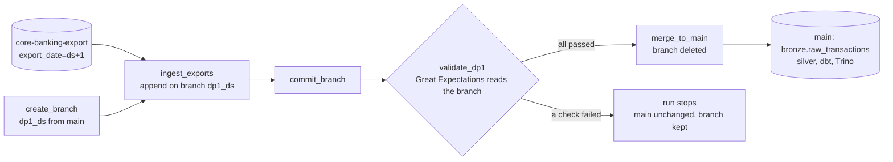
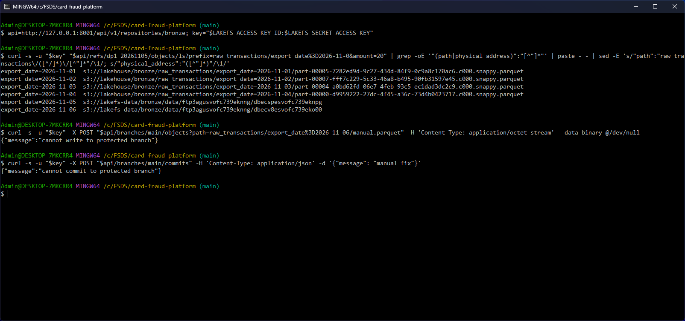
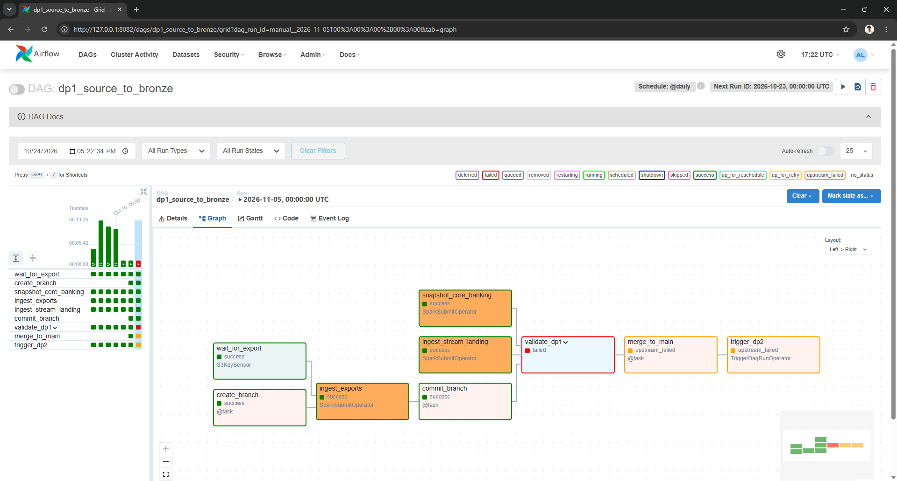
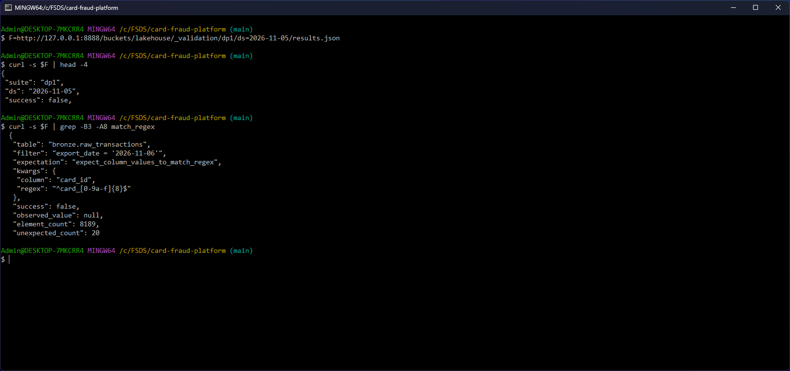
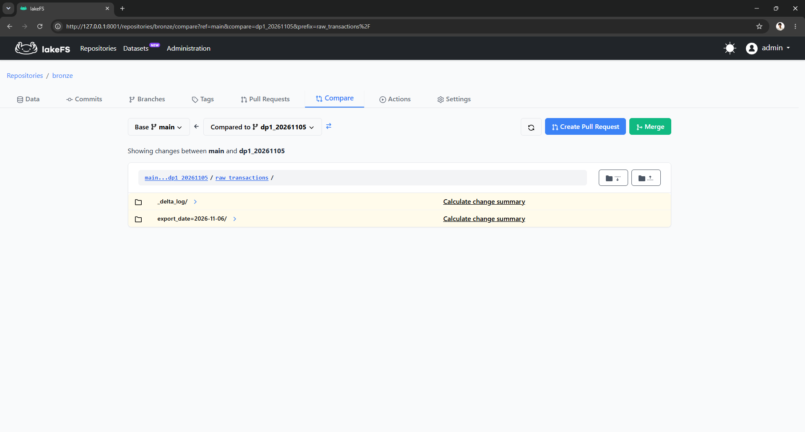
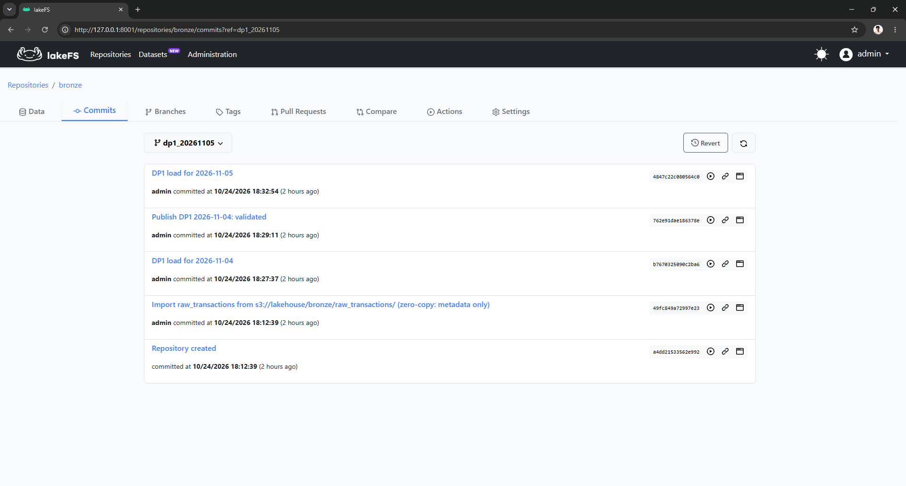
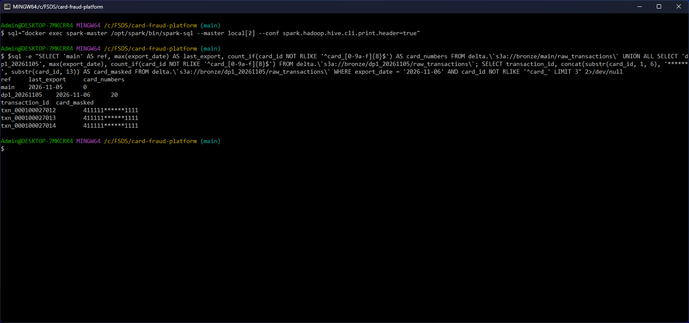
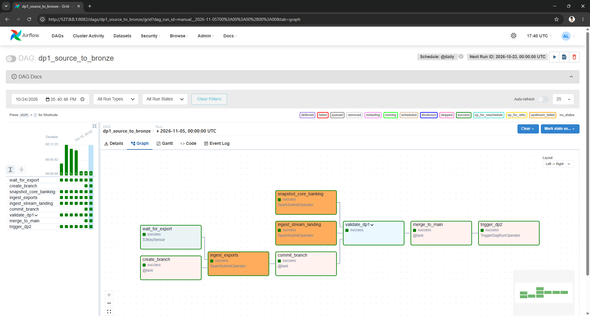
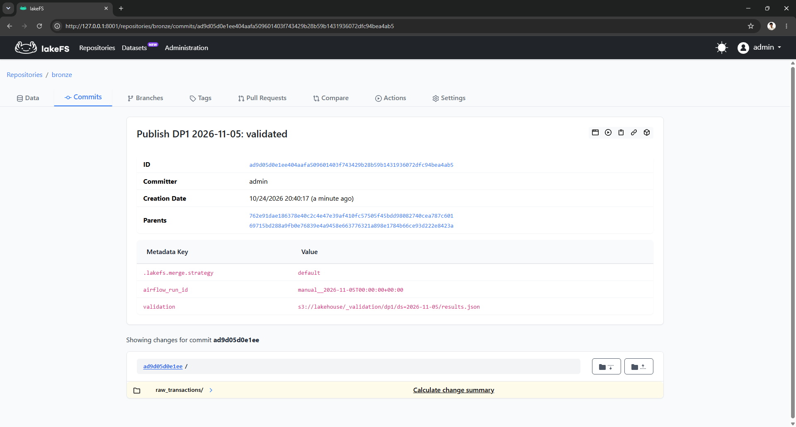
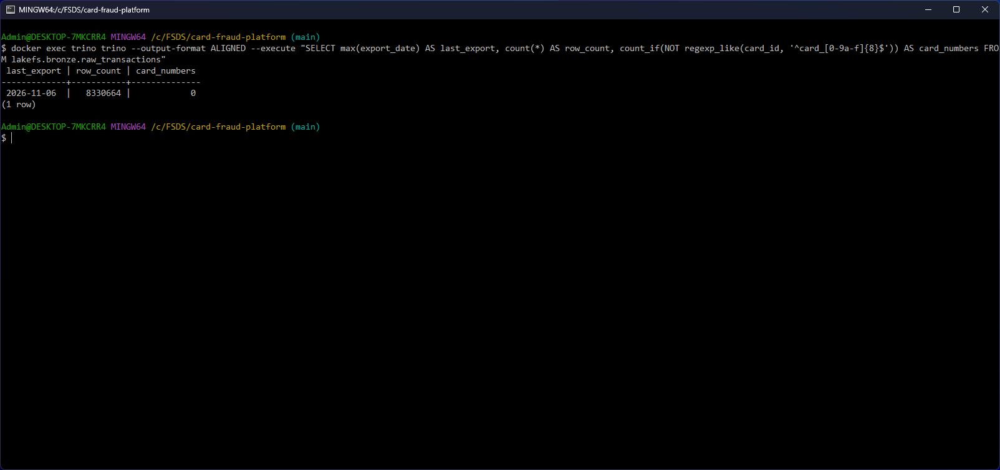

# Novel idea: Write-Audit-Publish for the nightly export with lakeFS

Layer 1 novel idea: DP1 (the data pipeline that ingests the sources into bronze) loads the nightly core banking
export with Write-Audit-Publish on [lakeFS](https://docs.lakefs.io/), Git-like branches, commits and merges over
object storage. Each run writes the export on its own branch, checks it there, and merges into `main`, which silver,
dbt and Trino read, only if every check passed, so a broken export (wrong values, missing rows) never reaches readers.
Not covered in EDAI: data version control over a data lake (branches, commits, merges, zero-copy import with lakeFS)
and Write-Audit-Publish; the course's Delta Lake (versions of one table) and Great Expectations are used unchanged.

Proof: in [the run of 2026-10-24](#the-run-of-2026-10-24-step-by-step) an export with 20 card numbers stayed on its
branch, `main` kept 0 and DP2 (bronze to silver and gold) did not start; the corrected export was then published in
one merge ([How the result is judged](#how-the-result-is-judged)).

| | |
|---|---|
| Code | [`init_lakefs.py`](https://github.com/cvinhnguyen/card-fraud-platform/blob/6457d47445ec1a910ebd2c01bc1edbff50f76d37/infra/init_lakefs.py), [`pipelines/airflow/dags/common.py` L183-L228](https://github.com/cvinhnguyen/card-fraud-platform/blob/6457d47445ec1a910ebd2c01bc1edbff50f76d37/pipelines/airflow/dags/common.py#L183-L228), [`pipelines/airflow/dags/dp1_source_to_bronze.py`](https://github.com/cvinhnguyen/card-fraud-platform/blob/6457d47445ec1a910ebd2c01bc1edbff50f76d37/pipelines/airflow/dags/dp1_source_to_bronze.py), [`infra/docker-compose.yaml` L189-L215](https://github.com/cvinhnguyen/card-fraud-platform/blob/6457d47445ec1a910ebd2c01bc1edbff50f76d37/infra/docker-compose.yaml#L189-L215) |
| Runs on | lakeFS 1.88: compose profile `batch`, UI and API http://127.0.0.1:8001; the DP1 DAG in Airflow (profile `orch`) |
| Reads | the nightly export in `s3://core-banking-export/transactions/export_date=<ds+1>/` |
| Writes | `bronze.raw_transactions` in the lakeFS repository `bronze`: the run branch `dp1_<ds>`, merged into `main`; new objects in `s3://lakefs-data` |
| Related | [airflow.md](airflow.md) |

One DP1 run on lakeFS:



## Where it fits

- Part of DP1, the first Airflow pipeline of Layer 1 (data platform) ([airflow.md](airflow.md),
  [spark_jobs.md](spark_jobs.md#dp1-source-to-bronze)).
- DataHub shows the branch, the merge and the table as one lineage chain ([datahub.md](datahub.md)).
- In the overview: the DP1 paragraph of [Layer 1](../architecture.md#layer-1-the-data-platform-top-band) and arrow
  B5 of the [system diagram](../architecture.md#numbered-arrows).

## How it works

1. Setup, once: `init_lakefs.py` imports the table into `main` without copying a file and protects `main`, so only a
   merge changes it ([How it is wired](#how-it-is-wired)).
2. Write: each run creates the branch `dp1_<ds>` from `main` and appends the day's export there. Only the export goes
   through a branch ([Scope](#scope-one-table-chosen-by-who-delivers-it)).
3. Audit: the run commits the branch and runs the Great Expectations checks on it, including that every `card_id` is
   a token.
4. Publish: if every check passes, `merge_to_main` moves `main` to the new commit in one step and records the
   Airflow run id and validation results path; lakeFS keeps every published export. `publish_bronze` then emits the
   Airflow dataset event `lakehouse://bronze`, which schedules DP2.
5. If a check fails, the run stops: `main` is unchanged, the branch stays for the source team, and no event starts
   DP2. A DP2 run started by hand reads `main` and misses the bad export too.

## Run it

`init_lakefs.py` runs once, with the `core` and `batch` profiles up; after it, every DP1 run goes through a branch
(other Airflow commands: [airflow.md](airflow.md#run-it)):

```bash
docker compose -f infra/docker-compose.yaml --profile core --profile batch --profile orch up -d --build
python infra/init_lakefs.py                                                     # repository, zero-copy import, main protected
docker exec airflow-scheduler airflow dags test dp1_source_to_bronze <ds>        # one DP1 run: branch, load, checks, merge
```

`<ds>` is the business day (`YYYY-MM-DD`); the run reads the next day's export, `export_date=<ds+1>`.

## Problem

The core banking system, run by another department, exports each business day's card transactions as Parquet into
the bucket `core-banking-export`, and DP1 appends them to `bronze.raw_transactions`. DP1 used to check after the
append: a failed check stopped DP2, but the rows were already queryable. Removing them meant a Delta `DELETE` and,
because older table versions keep the files, a `VACUUM` after the retention period.

The worst bad delivery carries real card numbers (PAN) instead of the tokens `card_xxxxxxxx`. PCI DSS (the card
industry's data security standard) v4.0 requirement 3.5.1 asks for the PAN to be unreadable anywhere it is stored.

## Scope: one table, chosen by who delivers it

The export is the only input another department delivers. Every other bronze table stays on SeaweedFS, the platform's
object store.

| Bronze source | Delivered by | Write | Through lakeFS |
|---|---|---|---|
| `raw_transactions` (nightly Parquet export) | another department, as files | append | yes |
| `raw_customers`, `raw_cards`, ... (Postgres snapshot) | read by DP1 itself over JDBC | overwrite | no |
| `raw_card_authorizations` (Flink landing files) | the platform's own stream job | append | no |

## How it is wired

| File | What it does |
|---|---|
| [`docker-compose.yaml` L189-L215](https://github.com/cvinhnguyen/card-fraud-platform/blob/6457d47445ec1a910ebd2c01bc1edbff50f76d37/infra/docker-compose.yaml#L189-L215) | lakeFS 1.88 in the `batch` profile: objects in the SeaweedFS bucket `lakefs-data`, metadata in a local key-value store in the volume `lakefs_data`. `LAKEFS_EMAIL_SUBSCRIPTION_ENABLED=false` skips the first-start company e-mail form; the admin user and keys come from `infra/.env`. |
| [`infra/conf/spark/spark-defaults.conf` L19-L24](https://github.com/cvinhnguyen/card-fraud-platform/blob/6457d47445ec1a910ebd2c01bc1edbff50f76d37/infra/conf/spark/spark-defaults.conf#L19-L24), [`infra/conf/hive/hive-site.xml` L14-L17](https://github.com/cvinhnguyen/card-fraud-platform/blob/6457d47445ec1a910ebd2c01bc1edbff50f76d37/infra/conf/hive/hive-site.xml#L14-L17) | S3A settings for the bucket `bronze` only: `s3a://bronze/<branch>/...` goes to the lakeFS S3 gateway, every other bucket to SeaweedFS, so no other read changes. |
| [`infra/init_lakefs.py`](https://github.com/cvinhnguyen/card-fraud-platform/blob/6457d47445ec1a910ebd2c01bc1edbff50f76d37/infra/init_lakefs.py) | Run once: creates the repository `bronze`, imports the table into `main` without copying it, protects `main` (no direct writes or commits) and points the metastore table at `s3a://bronze/main/raw_transactions`, so silver and dbt keep the table name. |
| [`infra/conf/trino/catalog/lakefs.properties`](https://github.com/cvinhnguyen/card-fraud-platform/blob/6457d47445ec1a910ebd2c01bc1edbff50f76d37/infra/conf/trino/catalog/lakefs.properties) | Trino reads the table as `lakefs.bronze.raw_transactions`; every other table stays in the catalog `delta`. |
| [`common.py` L183-L228](https://github.com/cvinhnguyen/card-fraud-platform/blob/6457d47445ec1a910ebd2c01bc1edbff50f76d37/pipelines/airflow/dags/common.py#L183-L228) | `create_branch`, `commit_branch` and `merge_to_main`: three lakeFS API calls. The commit carries the Airflow run id, the merge commit also the validation results path. |
| [`dp1_source_to_bronze.py`](https://github.com/cvinhnguyen/card-fraud-platform/blob/6457d47445ec1a910ebd2c01bc1edbff50f76d37/pipelines/airflow/dags/dp1_source_to_bronze.py) | The branch `dp1_<ds>`, `ingest_exports` and `validate_dp1` with `--txn-root s3a://bronze/dp1_<ds>`, and the task order: ingest, commit, validate, merge, publish bronze. |

`ingest_bronze.py` refuses to append an export to `main` (`--txn-root` is required and must be a branch,
[`pipelines/spark/ingest_bronze.py`
L129-L131](https://github.com/cvinhnguyen/card-fraud-platform/blob/6457d47445ec1a910ebd2c01bc1edbff50f76d37/pipelines/spark/ingest_bronze.py#L129-L131)),
and `rewind_days.py` deletes days on a branch of its own and merges it
([`pipelines/spark/rewind_days.py`
L49-L55](https://github.com/cvinhnguyen/card-fraud-platform/blob/6457d47445ec1a910ebd2c01bc1edbff50f76d37/pipelines/spark/rewind_days.py#L49-L55)).

Lineage (added 2026-10-25): OpenLineage sees the Spark write on the branch but not the merge, an API call, and it
named the written dataset after the branch, a new one every run. `spark-defaults.conf` now drops `dp1_<ds>/` from
dataset names (`spark.openlineage.dataset.removePath.pattern`, [`spark-defaults.conf`
L42-L44](https://github.com/cvinhnguyen/card-fraud-platform/blob/6457d47445ec1a910ebd2c01bc1edbff50f76d37/infra/conf/spark/spark-defaults.conf#L42-L44)),
and the DP1 DAG declares the hop with `inlets` / `outlets`, as `rag_ingest` does
([`dp1_source_to_bronze.py`
L39-L43](https://github.com/cvinhnguyen/card-fraud-platform/blob/6457d47445ec1a910ebd2c01bc1edbff50f76d37/pipelines/airflow/dags/dp1_source_to_bronze.py#L39-L43),
[dp1_source_to_bronze.py L54](https://github.com/cvinhnguyen/card-fraud-platform/blob/6457d47445ec1a910ebd2c01bc1edbff50f76d37/pipelines/airflow/dags/dp1_source_to_bronze.py#L54),
[dp1_source_to_bronze.py L59](https://github.com/cvinhnguyen/card-fraud-platform/blob/6457d47445ec1a910ebd2c01bc1edbff50f76d37/pipelines/airflow/dags/dp1_source_to_bronze.py#L59)):
`ingest_exports` reads `s3 core-banking-export/transactions` and writes `s3 bronze/raw_transactions` (the
repository), and `merge_to_main` reads that and writes `hive bronze.raw_transactions`.

## The run of 2026-10-24, step by step

The runs were made on 2026-10-24 (step 5 on 2026-10-25) and load the business days 2026-11-04 to 2026-11-07 of the
generated data, which runs ahead of the calendar. In steps 3 and 4 DP1's last task was still `trigger_dp2`, which
started DP2 directly; it is now `publish_bronze`.

### 1. The table moves into lakeFS without a copy

`init_lakefs.py` imported `s3://lakehouse/bronze/raw_transactions/` into `main`: 1,970 objects in 2 s, one commit,
nothing copied ([`init_lakefs.py`
L50-L61](https://github.com/cvinhnguyen/card-fraud-platform/blob/6457d47445ec1a910ebd2c01bc1edbff50f76d37/infra/init_lakefs.py#L50-L61)).
Spark counted 8,314,171 rows through `main` and through the old path, and so did Trino's
`lakefs.bronze.raw_transactions`.

On a later run branch, exports up to 2026-11-04 are imported objects still in `s3://lakehouse/...`, and those
appended through lakeFS (2026-11-05 and 2026-11-06) are new objects in `s3://lakefs-data/...`. A direct write and a
direct commit on `main` get `403`:



### 2. A good export is published

The run for business day 2026-11-04 created `dp1_20261104`, appended the export of 2026-11-05 (8,322,475 rows on the
branch), committed, passed 45 of 45 checks and merged into `main`. The three lakeFS tasks each finished within 0.2 s
of the task before; the run took about 4 minutes, almost all of it Spark.

### 3. A broken export is held on its branch

To test the gate, 20 of the 8,189 rows in the export of 2026-11-06 got the card number 4111 1111 1111 1111 in
`card_id` (a public test number). The run for 2026-11-05 appended and committed it on
`dp1_20261105`. The token check on `card_id`
([`pipelines/spark/validate.py`
L67-L68](https://github.com/cvinhnguyen/card-fraud-platform/blob/6457d47445ec1a910ebd2c01bc1edbff50f76d37/pipelines/spark/validate.py#L67-L68))
failed, so `validate_dp1` failed and `merge_to_main` and `trigger_dp2` never ran:



The run's validation results name the check and the count, 20 unexpected values of 8,189:



lakeFS shows the branch differs from `main` by one new export folder and one new Delta log entry:



The branch's commit sits on top of `main`'s history:



Spark reads both refs: `main` ends at the export of 2026-11-05 with no card number, and the branch holds the new
export with the 20 (masked in the query):



### 4. The corrected export is published

The source team delivers the export again (here: the original file put back) and the run is restarted.
`create_branch` replaces `dp1_20261105` with a fresh branch from `main`
([`common.py`
L203-L208](https://github.com/cvinhnguyen/card-fraud-platform/blob/6457d47445ec1a910ebd2c01bc1edbff50f76d37/pipelines/airflow/dags/common.py#L203-L208)),
and the run commits (`69715bd2`), passes 45 of 45 checks, merges and starts DP2 through `trigger_dp2`:



The merge commit has two parents, `main` before (`762e91da`) and the run's commit, and its metadata names the Airflow
run and the validation results:



Trino reads `main` through the catalog `lakefs`: the export of 2026-11-06 is there, 8,330,664 rows, no card number:



DP2 (then the single DAG `dp2_bronze_to_gold`) built silver and gold from `main`; every task succeeded.

The rerun reused the blocked run's Airflow run id, branch name and results path, so Airflow, the branch
list and `_validation/dp1/ds=2026-11-05/results.json` show the passing run. The blocked load is kept as the lakeFS tag
`dp1_20261105_blocked` on commit `4847c22c` and can still be read:

```bash
docker exec spark-master /opt/spark/bin/spark-sql --master 'local[2]' -e "SELECT max(export_date), count_if(card_id NOT RLIKE '^card_[0-9a-f]{8}$') FROM delta.\`s3a://bronze/dp1_20261105_blocked/raw_transactions\`"
# 2026-11-06	20
```

### 5. The publish shows in DataHub (2026-10-25)

Before the lineage fix, the run of 2026-11-06 left an orphan dataset named after its branch,
`bronze/dp1_20261106/raw_transactions`, and `bronze.raw_transactions` showed only its pre-lakeFS creator. The run of
2026-11-07 writes the repository's `bronze/raw_transactions` and links it to the table through `merge_to_main`:


## How the result is judged

| Finding | Evidence |
|---|---|
| Readers never saw the bad rows. | After the failed run `main` still pointed at `762e91da`, ended at the export of 2026-11-05 and held 0 card numbers; DP2 never started. |
| Publishing is one step. | The merge moves `main` to a new commit, so a reader sees the day before or the whole new export. |
| `main` cannot be written around the gate. | A direct upload and a direct commit get `403`. |
| The cost is small. | One more service, 536 MiB of the 8 GB Docker VM, and three API calls per run, well under a second; the checks and Spark jobs are unchanged. |

The runs do not test detection: the broken export is simulated (a test number in 20 rows) and the check already
existed in DP1. lakeFS changes where the rows are while a check runs, so any other failed check on the export (row
count, nulls, schema) stops it the same way.

## Limits

- The Postgres snapshot tables are overwritten in place before the checks, so a failed check stops the run but their
  new version is already visible.
- `main` still reads the imported files in `s3://lakehouse/bronze/raw_transactions/`: deleting, cleaning or
  `VACUUM`-ing that path breaks it.
- Deleting a branch keeps its objects. The 20 card numbers stay in `s3://lakefs-data` until lakeFS garbage collection
  (a Spark job with retention rules) runs, which is not set up, and the demo tag keeps them on purpose; a real
  incident needs garbage collection and no tag.
- The validation results are one file per suite and day, so a rerun overwrites the failed result; the lakeFS commit
  keeps only the failed data.
- Two branches appending to the same Delta table write the same log file name and conflict on merge. DP1 runs one
  day at a time (`max_active_runs=1`,
  [`dp1_source_to_bronze.py`
  L45-L46](https://github.com/cvinhnguyen/card-fraud-platform/blob/6457d47445ec1a910ebd2c01bc1edbff50f76d37/pipelines/airflow/dags/dp1_source_to_bronze.py#L45-L46)),
  so only a manual load next to a run hits it.
- One lakeFS server, metadata in the Docker volume `lakefs_data`, no high availability. Losing the volume
  (`docker compose down -v`, a Docker Desktop reset) breaks `bronze.raw_transactions`: the objects stay in SeaweedFS,
  but exports appended through lakeFS have generated names in `s3://lakefs-data` that only the metadata maps back, so
  silver, DP2 and Trino fail. To recover:
  1. Delete the leftover `s3://lakefs-data/bronze/` prefix.
  2. Run [`init_lakefs.py`](https://github.com/cvinhnguyen/card-fraud-platform/blob/6457d47445ec1a910ebd2c01bc1edbff50f76d37/infra/init_lakefs.py)
     again; it imports the table as it was at the import (exports up to 2026-11-04).
  3. Rerun DP1 for every later business day; the export files are still in `core-banking-export`.

  lakeFS can also dump and restore a repository's refs (`lakectl refs-dump` and `refs-restore`), not set up here.
- Trino's `delta.bronze.raw_transactions` no longer works (that catalog cannot reach the bucket `bronze`); use
  `lakefs.bronze.raw_transactions`.
- The path pattern renames datasets, not jobs: the Spark job of `ingest_exports` is still named after its branch, so
  DataHub gets one more Spark job entity per DP1 run. Lineage stays connected through the dataset and the Airflow
  tasks.
