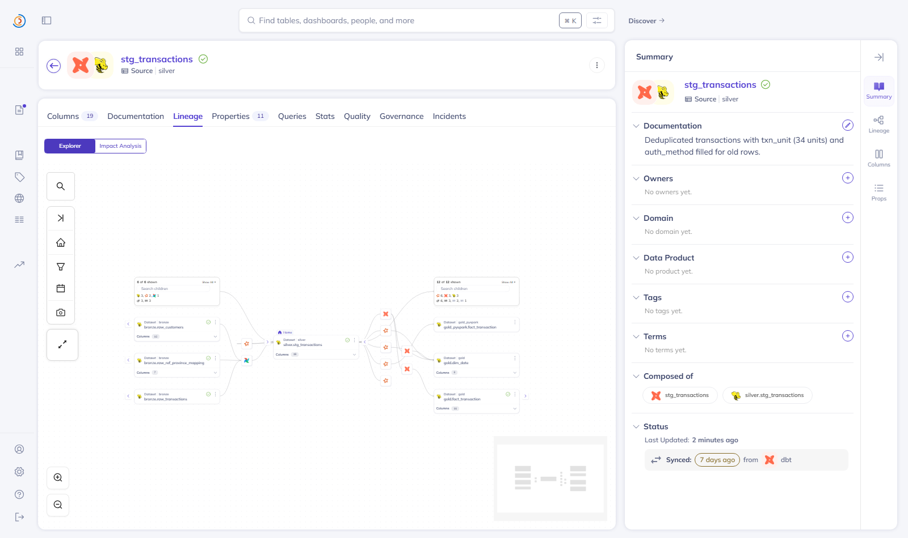
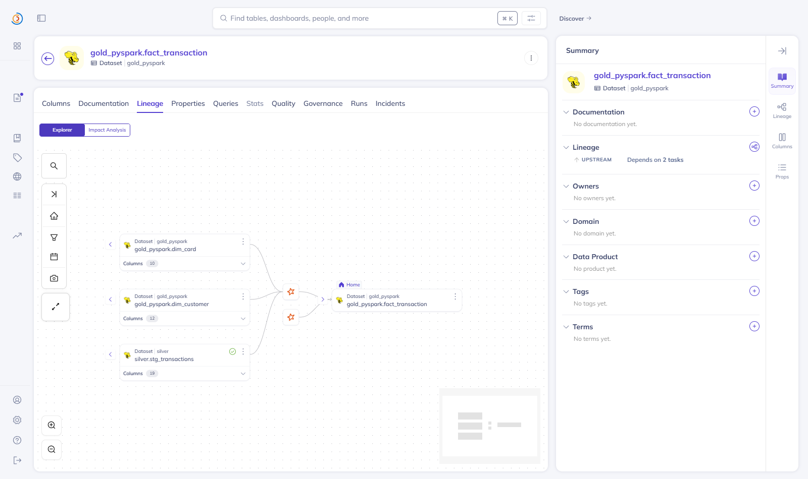

# Automatic lineage with OpenLineage

A Spark listener reads the query plan of every Layer 1 Spark job, dbt included, and posts lineage events to
DataHub, so no Spark job declares its lineage and it cannot go stale the way hand-written lineage does. OpenLineage
is an open standard for lineage events (a job run read these datasets and wrote those, with column-level detail),
plus integrations that emit them without code changes; DataHub turns them into datasets, jobs and lineage edges.
Three tasks of the Airflow DAGs (pipeline definitions) declare their tables where OpenLineage misses a hop
([below](#how-it-is-wired)).

| | |
|---|---|
| Code | [`infra/conf/spark/spark-defaults.conf` L34-L44](https://github.com/cvinhnguyen/card-fraud-platform/blob/6457d47445ec1a910ebd2c01bc1edbff50f76d37/infra/conf/spark/spark-defaults.conf#L34-L44), [`infra/spark/Dockerfile` L8-L14](https://github.com/cvinhnguyen/card-fraud-platform/blob/6457d47445ec1a910ebd2c01bc1edbff50f76d37/infra/spark/Dockerfile#L8-L14), [`pipelines/airflow/dags/common.py` L92-L99](https://github.com/cvinhnguyen/card-fraud-platform/blob/6457d47445ec1a910ebd2c01bc1edbff50f76d37/pipelines/airflow/dags/common.py#L92-L99) |
| Runs on | inside every Spark driver: the Spark containers, the Airflow image (drivers of DAG tasks, dbt's session) and the Thrift Server; DataHub GMS (its metadata service) in compose profile `gov` receives the events |
| Reads | the query plan of every Spark action |
| Writes | lineage events to GMS `/openapi/openlineage/api/v1/lineage` |
| Related | [datahub.md](datahub.md), [dbt_gold.md](dbt_gold.md), [airflow.md](airflow.md) |

## Where it fits

- Between Layer 1's Spark jobs ([architecture.md](../architecture.md#layer-1-the-data-platform-top-band)) and
  DataHub ([datahub.md](datahub.md)), which shows its events as the lineage graph.
- Covers the batch pipelines ([spark_jobs.md](spark_jobs.md), [dbt_gold.md](dbt_gold.md)) and any job run by hand.
- The Airflow DAGs ([airflow.md](airflow.md)) add one setting, the job name.

## How it works

1. The listener jar is in the Spark image, and five lines of `spark-defaults.conf` turn it on for every Spark driver,
   with no job changes ([How it is wired](#how-it-is-wired)).
2. After each Spark action it posts one event to GMS: the job, the datasets it consumed and produced, and for each
   output column the input columns it came from.
3. Each Airflow task sets the job name to its DAG id, so every table in DataHub shows which pipeline's job produced it.
4. Where the plan misses a hop, the DAG task declares it with `inlets` and `outlets`.
5. The listener resolves each Delta path to its hive table name, the one the validation assertions use, so lineage
   and checks share one entity; GMS keeps the column-level detail too ([Column-level lineage](#column-level-lineage)).

## Run it

Nothing runs for OpenLineage itself: with DataHub up, every Spark job posts its lineage
([airflow.md](airflow.md) runs the pipelines).

```bash
docker compose -f infra/docker-compose.yaml --profile core --profile batch --profile orch --profile gov up -d --build
# a job that no DAG declares: it appears in DataHub after its first run
docker compose -f infra/docker-compose.yaml exec spark-master /opt/spark/bin/spark-submit \
    --conf spark.cores.max=2 --conf spark.executor.memory=1g /opt/jobs/build_gold_pyspark.py
```

## How it is wired

The `openlineage-spark_2.13:1.53.0` jar is in the Spark image ([`Dockerfile`
L8-L14](https://github.com/cvinhnguyen/card-fraud-platform/blob/6457d47445ec1a910ebd2c01bc1edbff50f76d37/infra/spark/Dockerfile#L8-L14)),
and the five lines are in the shared
[`spark-defaults.conf`](https://github.com/cvinhnguyen/card-fraud-platform/blob/6457d47445ec1a910ebd2c01bc1edbff50f76d37/infra/conf/spark/spark-defaults.conf)
([spark-defaults.conf L37-L41](https://github.com/cvinhnguyen/card-fraud-platform/blob/6457d47445ec1a910ebd2c01bc1edbff50f76d37/infra/conf/spark/spark-defaults.conf#L37-L41)):

```properties
spark.extraListeners                           io.openlineage.spark.agent.OpenLineageSparkListener
spark.openlineage.transport.type               http
spark.openlineage.transport.url                http://datahub-gms:8080
spark.openlineage.transport.endpoint           /openapi/openlineage/api/v1/lineage
spark.openlineage.namespace                    card-fraud-platform
```

Each Airflow task adds `spark.openlineage.appName = {{ dag.dag_id }}` through `SPARK_CONF`, which every `spark_job()`
of the DAGs uses ([`common.py`
L92-L101](https://github.com/cvinhnguyen/card-fraud-platform/blob/6457d47445ec1a910ebd2c01bc1edbff50f76d37/pipelines/airflow/dags/common.py#L92-L101)):

```python
SPARK_CONF = {
    # ponytail: 1.5 GB executors (2 GB in spark-defaults) so a pipeline run fits next to DataHub in the 8 GB Docker VM
    "spark.executor.memory": "1536m",
    # OpenLineage names its jobs after this: every table in DataHub shows which DAG's job produced it
    "spark.openlineage.appName": "{{ dag.dag_id }}",
    # The scheduler is on two networks (default + airflow-docker for DockerOperator): its hostname resolves to the
    # airflow-docker address first, so a driver bound there refuses the executors, which reach it on the default one
    "spark.driver.bindAddress": "0.0.0.0",
    "spark.fraud.release": RELEASE,   # Environment tab of the Spark UI / history server: the code release of the job
}
```

Apart from these settings, no Spark job declares lineage. Three DAG tasks declare their tables with `inlets` /
`outlets` (added 2026-10-25):

| Task | Hop OpenLineage misses | Declared |
|---|---|---|
| DP1's `ingest_exports` and `merge_to_main` (DP1: the data pipeline that ingests to bronze) | the publish of the lakeFS branch, a merge through the API | `ingest_exports`: export -> repository; `merge_to_main`: repository -> table |
| DP2's `build_silver` (DP2: bronze to silver and gold) | its MERGE into `silver.stg_transactions` is reported with the target only, without `bronze.raw_transactions` | the three bronze tables it reads and the two silver tables it writes ([`pipelines/airflow/dags/dp2_bronze_to_silver.py`](https://github.com/cvinhnguyen/card-fraud-platform/blob/6457d47445ec1a910ebd2c01bc1edbff50f76d37/pipelines/airflow/dags/dp2_bronze_to_silver.py)) |

For DP1's branch write,
[`spark-defaults.conf`
L42-L44](https://github.com/cvinhnguyen/card-fraud-platform/blob/6457d47445ec1a910ebd2c01bc1edbff50f76d37/infra/conf/spark/spark-defaults.conf#L42-L44)
also drops the branch from the dataset name ([`pipelines/airflow/dags/dp1_source_to_bronze.py`
L39-L43](https://github.com/cvinhnguyen/card-fraud-platform/blob/6457d47445ec1a910ebd2c01bc1edbff50f76d37/pipelines/airflow/dags/dp1_source_to_bronze.py#L39-L43),
[dp1_source_to_bronze.py L54](https://github.com/cvinhnguyen/card-fraud-platform/blob/6457d47445ec1a910ebd2c01bc1edbff50f76d37/pipelines/airflow/dags/dp1_source_to_bronze.py#L54),
[dp1_source_to_bronze.py L59](https://github.com/cvinhnguyen/card-fraud-platform/blob/6457d47445ec1a910ebd2c01bc1edbff50f76d37/pipelines/airflow/dags/dp1_source_to_bronze.py#L59);
[novel_lakefs_wap.md](novel_lakefs_wap.md#how-it-is-wired)). For DP2, a probe on 2026-10-25 (OpenLineage 1.53,
Delta 4) lost the source the same way with a SQL MERGE, without the cache and without source materialization; a MERGE
from `bronze.raw_ref_province_mapping` kept its source.

## Lineage of the whole pipeline, with no lineage code in the jobs

Counts from DataHub's GraphQL API after one run of DP1, DP2 and DP3 (feature pipeline); [datahub.md](datahub.md) has
the screenshots. DP2 was then one DAG, `dp2_bronze_to_gold`; its jobs are now named after `dp2_bronze_to_silver`
(`build_silver`) and `dp2_silver_to_gold` (dbt and the labels).

| | Count |
|---|---:|
| Spark pipelines (one per DAG, `spark.openlineage.appName = dag_id`) | 3 |
| Jobs (one per Spark action) in those pipelines | 17 / 22 / 3 = 42 |
| Job-dataset edges written by DP1 / DP2 / DP3 | 23 / 30 / 4 = 57 |
| Lakehouse tables with lineage | 17 (8 bronze, 2 silver, 7 gold) |
| Longest chain | from core banking Postgres through bronze, silver and the gold fact (dbt) to the features: 7 hops, 37 upstream entities |

Each Spark action becomes one DataHub job `<dag>.<action>.<table>`, linked to the tables it read (`Consumes`) and
wrote (`Produces`), such as `dp2_bronze_to_gold.execute_merge_into_command.stg_transactions` (now starting
`dp2_bronze_to_silver.`). Tables carry hive URNs (`bronze.raw_transactions`), the names the Great Expectations (GE)
assertions use; Postgres inputs keep their source identity (`core_banking.public.customers`).

The export's way into bronze after the DP1 run of 2026-11-07: `core-banking-export/transactions`, `ingest_exports`
and its Spark job, the lakeFS repository's `bronze/raw_transactions` (one dataset for every branch, thanks to the path
pattern), then `merge_to_main` and `bronze.raw_transactions`:


`silver.stg_transactions` between its bronze inputs, linked through the declared `build_silver`, and the jobs that
read it:



## Column-level lineage

For every output column the listener also reports its input columns and whether it is a copy or a computation; GMS
keeps them because of `DATAHUB_OPENLINEAGE_CAPTURE_COLUMN_LEVEL_LINEAGE`
([`infra/docker-compose.yaml`
L571-L573](https://github.com/cvinhnguyen/card-fraud-platform/blob/6457d47445ec1a910ebd2c01bc1edbff50f76d37/infra/docker-compose.yaml#L571-L573)).
For the fact built in [`pipelines/spark/build_gold_pyspark.py`
L68-L79](https://github.com/cvinhnguyen/card-fraud-platform/blob/6457d47445ec1a910ebd2c01bc1edbff50f76d37/pipelines/spark/build_gold_pyspark.py#L68-L79),
DataHub shows 16 column mappings, for example:

| Output column (`fact_transaction`) | From | Kind |
|---|---|---|
| `transaction_id`, `card_id`, `merchant_id`, `txn_ts`, `txn_unit` | `silver.stg_transactions` (same names) | IDENTITY |
| `date_key` | `silver.stg_transactions.txn_date` | TRANSFORMATION (`date_format` + cast) |
| `customer_sk` | `dim_customer.customer_sk` (point-in-time join) | IDENTITY |

For silver it shows `stg_transactions.txn_unit <- raw_ref_province_mapping.new_unit_name`, the example the project
plan asked for: the lookup from 63 provinces to 34 units in
[`pipelines/spark/build_silver.py`
L20-L35](https://github.com/cvinhnguyen/card-fraud-platform/blob/6457d47445ec1a910ebd2c01bc1edbff50f76d37/pipelines/spark/build_silver.py#L20-L35).
The course's `inlets`/`outlets` are table-level and cannot declare this.

## A new job needs nothing

[`pipelines/spark/build_gold_pyspark.py`](https://github.com/cvinhnguyen/card-fraud-platform/blob/6457d47445ec1a910ebd2c01bc1edbff50f76d37/pipelines/spark/build_gold_pyspark.py)
was written to compare with dbt. Airflow never runs it, and its entry point is plain Spark with no DataHub code
([build_gold_pyspark.py L123-L136](https://github.com/cvinhnguyen/card-fraud-platform/blob/6457d47445ec1a910ebd2c01bc1edbff50f76d37/pipelines/spark/build_gold_pyspark.py#L123-L136)).
Its first run brought its 5 output tables and 17 job-dataset edges into DataHub, column lineage included. The
lineage of its `gold_pyspark.fact_transaction`:



In the course (lesson L12, DAG `orders_pipeline`), every task declares its tables by hand
(`inlets=[DatahubDataset(...)]`, `outlets=[...]`) or emits `UpstreamLineage` itself:

| | Course (L12): `inlets` / `outlets` / emitter | OpenLineage |
|---|---|---|
| Lineage statements to write for this pipeline | one per job input and output: 57 | 0 (5 config lines + 1 jar, shared) |
| Column-level | no | yes (16 mappings on the fact alone) |
| New job / new table | edit the DAG | nothing |
| Can drift from the code | yes (nothing checks a declaration against the code) | no (read from the executed plan) |
| Cost when DataHub is down | DAG code must handle it | listener logs the HTTP error, the job goes on |

## Gotchas

- `ContextFactory: Query execution is null: can't emit event` in the logs comes from commands without a query plan
  (e.g. `SET`) and is harmless.
- `UnknownHostException: datahub-gms` in the listener log means those events were lost, while the jobs carried on:
  every container must resolve `datahub-gms`, which failed while the Docker VM swapped.

## Limits

- A write by path (`.save(s3a://...)`) followed by `CREATE TABLE ... LOCATION` (the `save()` helper of
  [`pipelines/spark/ingest_bronze.py`
  L43-L54](https://github.com/cvinhnguyen/card-fraud-platform/blob/6457d47445ec1a910ebd2c01bc1edbff50f76d37/pipelines/spark/ingest_bronze.py#L43-L54))
  produces an `s3` dataset (`lakehouse/bronze/raw_transactions`) next to the `hive` one, which gets the lineage; the
  s3 ones are extra entities. Since `bronze.raw_transactions` moved into lakeFS (2026-10-24), the helper registers a
  table only for `s3a://lakehouse/bronze` and lakeFS `main`, not for a DP1 run's own branch
  ([novel_lakefs_wap.md](novel_lakefs_wap.md)).
- There is one job per Spark action, not per Airflow task: a task with 3 writes shows 3 jobs. The shared name
  (`spark.openlineage.appName = dag_id`) ties them to the DAG / task entities of the DataHub Airflow listener.
