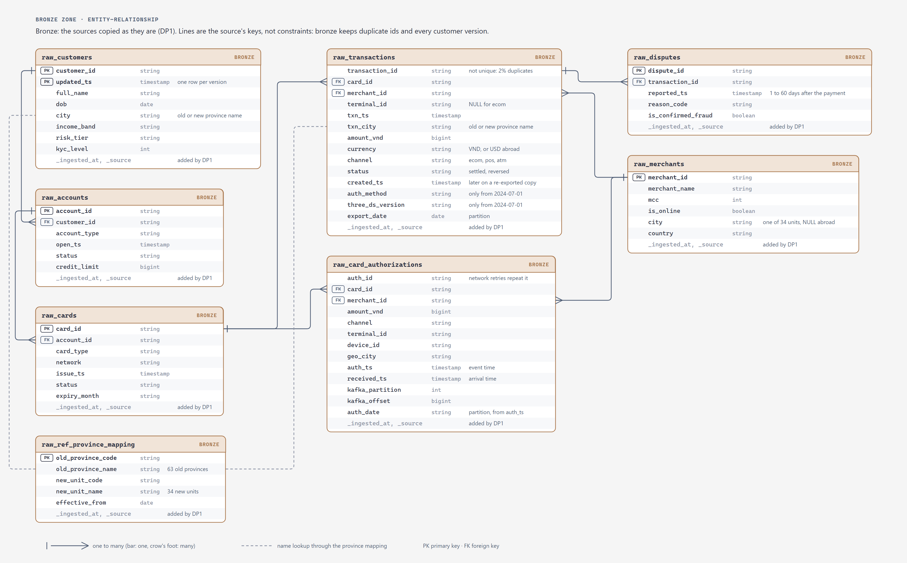
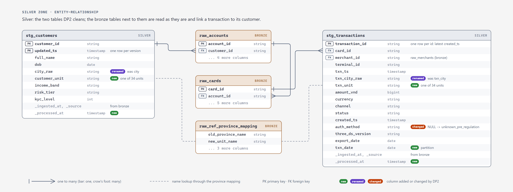
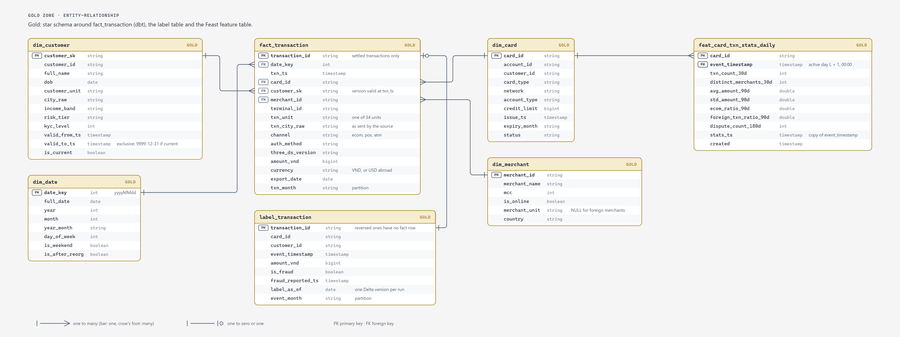
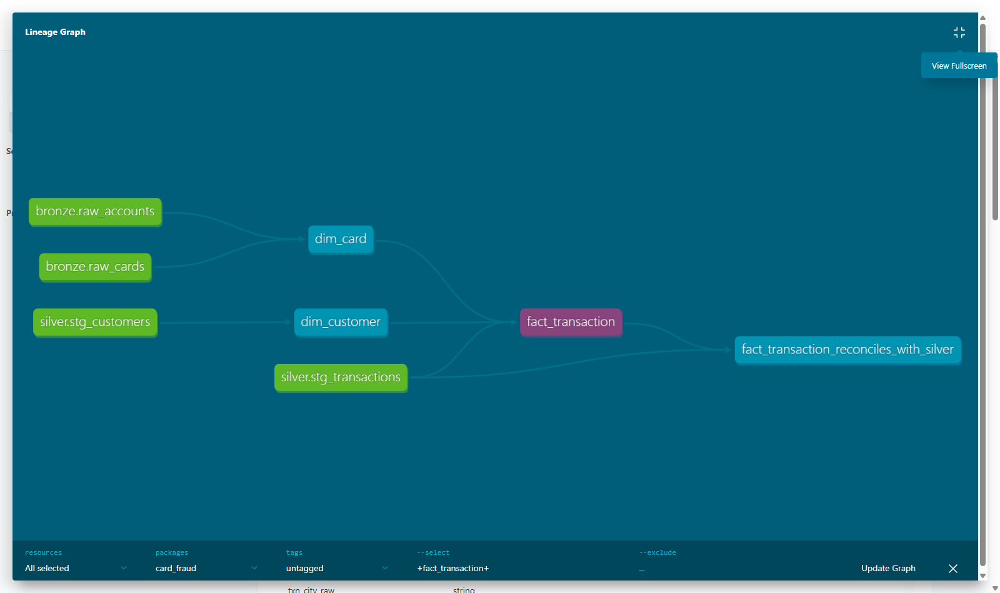
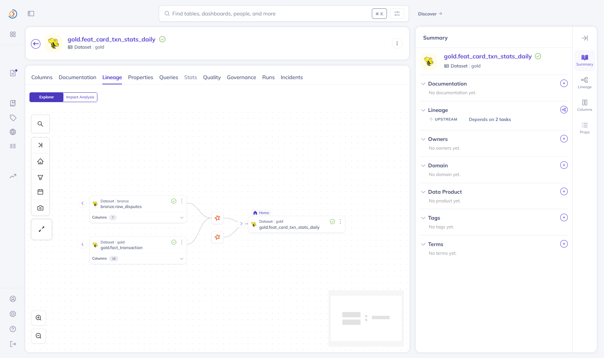

# Schema design

Every table of the lakehouse of Layer 1 (data platform), zone by zone: where it lives, what one row means (its grain)
and which job writes it, plus the ER (entity-relationship) diagrams and the design choices behind them. The three
course pipelines write the tables: DP1 (data pipeline: ingest to bronze), DP2 (bronze to silver and gold) and DP3
(feature pipeline: gold to features), see [airflow.md](airflow.md).

| | |
|---|---|
| Code | [`pipelines/spark/`](https://github.com/cvinhnguyen/card-fraud-platform/tree/6457d47445ec1a910ebd2c01bc1edbff50f76d37/pipelines/spark), [`pipelines/dbt/models/gold/`](https://github.com/cvinhnguyen/card-fraud-platform/tree/6457d47445ec1a910ebd2c01bc1edbff50f76d37/pipelines/dbt/models/gold), [`docs/diagrams/er.py`](https://github.com/cvinhnguyen/card-fraud-platform/blob/6457d47445ec1a910ebd2c01bc1edbff50f76d37/docs/diagrams/er.py) |
| Runs on | compose profile `batch` (Spark, Hive Metastore, lakeFS, Trino) and `dbt` (Spark Thrift Server) |
| Writes | Delta tables under `s3a://lakehouse/bronze/`, `silver/` and `gold/`; `bronze.raw_transactions` in the lakeFS repository `bronze` |
| Related | [spark_jobs.md](spark_jobs.md), [dbt_gold.md](dbt_gold.md), [novel_lakefs_wap.md](novel_lakefs_wap.md), [feature_store.md](../ml-platform/feature_store.md) |

## Where it fits

- DP1 fills bronze from the core banking Postgres, the nightly export and the Flink landing files; DP2 builds silver
  and gold, DP3 the feature table.
- Feast copies the features into the online store for scoring ([feature_store.md](../ml-platform/feature_store.md)).
- Training reads the labels and, through Feast, the features ([ml_training.md](../ml-platform/ml_training.md)).
- Analysts query every zone through Trino; DataHub holds the tables with their lineage ([datahub.md](datahub.md)).

## How it works

1. Bronze copies the sources, silver cleans them, gold holds the star schema, the labels and the features
   ([Zones](#zones)).
2. Every table is a Delta table in the Hive Metastore, so Spark, dbt (through the Spark Thrift Server) and Trino share
   one name per table.
3. A name gives the zone and kind (`raw_`, `stg_`, `dim_`, `fact_`, `label_`, `feat_`); each table has a stated grain,
   key, partitioning and load mode ([Naming](#naming), [Tables and grain](#tables-and-grain)).
4. Each job reads tables of the zone before it and writes its own ([Zone flow](#zone-flow)).

## Zones

| Zone | Location | Written by | What it holds |
|---|---|---|---|
| bronze | `s3a://lakehouse/bronze/`; `raw_transactions` in the lakeFS repository `bronze` (`s3a://bronze/main/raw_transactions`, [novel_lakefs_wap.md](novel_lakefs_wap.md)) | [`pipelines/spark/ingest_bronze.py`](https://github.com/cvinhnguyen/card-fraud-platform/blob/6457d47445ec1a910ebd2c01bc1edbff50f76d37/pipelines/spark/ingest_bronze.py) (DP1) | Faithful copies of the sources: duplicates, old province names and missing columns are kept |
| silver | `s3a://lakehouse/silver/` | [`pipelines/spark/build_silver.py`](https://github.com/cvinhnguyen/card-fraud-platform/blob/6457d47445ec1a910ebd2c01bc1edbff50f76d37/pipelines/spark/build_silver.py) (DP2) | Cleaned rows: deduplicated, locations mapped to the 34 units, `auth_method` filled |
| gold | `s3a://lakehouse/gold/` | dbt models, [`pipelines/spark/build_labels.py`](https://github.com/cvinhnguyen/card-fraud-platform/blob/6457d47445ec1a910ebd2c01bc1edbff50f76d37/pipelines/spark/build_labels.py), [`pipelines/spark/build_features.py`](https://github.com/cvinhnguyen/card-fraud-platform/blob/6457d47445ec1a910ebd2c01bc1edbff50f76d37/pipelines/spark/build_features.py) (DP3) | Star schema for analysis, the label table and the feature table for Layer 2 |

The tables live in the SeaweedFS bucket `lakehouse` (Trino: `delta.<zone>.<table>`), except
`bronze.raw_transactions`: it is on branch `main` of the lakeFS repository `bronze` (Trino:
`lakefs.bronze.raw_transactions`) so a bad export can be held back. DP1's `save()` writes and registers a bronze table
([`pipelines/spark/ingest_bronze.py`
L43-L54](https://github.com/cvinhnguyen/card-fraud-platform/blob/6457d47445ec1a910ebd2c01bc1edbff50f76d37/pipelines/spark/ingest_bronze.py#L43-L54)).

Bronze and silver are PySpark because `mergeSchema` on the bronze appends, the dedup window and the `MERGE` into
silver need DataFrame-level control; the skew benchmark
[`pipelines/spark/skew_join.py`](https://github.com/cvinhnguyen/card-fraud-platform/blob/6457d47445ec1a910ebd2c01bc1edbff50f76d37/pipelines/spark/skew_join.py)
is a separate job. The gold star schema is SQL in dbt, tested (`dbt build`) and documented in one place, and dbt
writes every gold model as a Delta table under `s3a://lakehouse/gold`
([`pipelines/dbt/dbt_project.yml`
L12-L17](https://github.com/cvinhnguyen/card-fraud-platform/blob/6457d47445ec1a910ebd2c01bc1edbff50f76d37/pipelines/dbt/dbt_project.yml#L12-L17)).

## Tables and grain

| Table | Grain (one row is) | Key | Partitioned by | Load |
|---|---|---|---|---|
| `bronze.raw_transactions` | one exported row (duplicates included) | none | `export_date` | append new export dates (on a lakeFS branch, merged into `main` after the checks) |
| `bronze.raw_<table>` (6 core banking tables) | one source row | source PK | | full snapshot overwrite |
| `silver.stg_transactions` | one transaction (latest `created_ts`) | `transaction_id` | `txn_date` | `MERGE` new export dates |
| `silver.stg_customers` | one customer version (`customer_id`, `updated_ts`) | both | | overwrite |
| `gold.dim_customer` | one customer version with a change in a tracked attribute (SCD2, slowly changing dimension type 2: every past version kept, with a validity range) | `customer_sk` | | dbt table |
| `gold.dim_card` | one card | `card_id` | | dbt table |
| `gold.dim_merchant` | one merchant | `merchant_id` | | dbt table |
| `gold.dim_date` | one calendar day | `date_key` (`yyyyMMdd`) | | dbt table |
| `gold.fact_transaction` | one settled transaction (reversed ones are left out) | `transaction_id` | `txn_month` | dbt incremental `MERGE` |
| `gold.label_transaction` | one transaction (settled or reversed) as labelled on `label_as_of` | `transaction_id` | `event_month` | `MERGE` per `--as-of` run |
| `gold.feat_card_txn_stats_daily` | one card after one day with activity (a settled transaction or a reported dispute) | `card_id`, `event_timestamp` | | overwrite |

## Zone flow

Who reads each table and what they write (from `pipelines/spark/*.py`, the dbt `source()` / `ref()` calls and the one
Layer 2 reader of bronze):

| Table | Read by | Writes |
|---|---|---|
| `bronze.raw_transactions` | `build_silver.py` (DP2) | `silver.stg_transactions` |
| `bronze.raw_customers` | `build_silver.py` (DP2) | `silver.stg_customers` |
| `bronze.raw_ref_province_mapping` | `build_silver.py` (DP2), as a lookup | the 34-unit columns of both silver tables |
| `bronze.raw_cards`, `bronze.raw_accounts` | dbt, `build_labels.py` | `gold.dim_card`, `gold.label_transaction` |
| `bronze.raw_merchants` | dbt | `gold.dim_merchant` (its city is already one of the 34 units) |
| `bronze.raw_disputes` | `build_labels.py`, `build_features.py` (DP3) | `gold.label_transaction`, `gold.feat_card_txn_stats_daily` |
| `bronze.raw_card_authorizations` | no Layer 1 job; Layer 2's `TrainingDataService` ([`ml/fraud_ml/data.py` L96-L98](https://github.com/cvinhnguyen/card-fraud-platform/blob/6457d47445ec1a910ebd2c01bc1edbff50f76d37/ml/fraud_ml/data.py#L96-L98)) and `ml/jobs/drift_job.py` | each payment's `device_id`, joined into the training set and the drift window; the realtime features come from the Flink jobs through the push jobs ([feature_store.md](../ml-platform/feature_store.md)) |
| `silver.stg_transactions` | dbt, `build_labels.py` | `gold.dim_date`, `gold.fact_transaction`, `gold.label_transaction` |
| `silver.stg_customers` | dbt | `gold.dim_customer` (SCD2) |
| `gold.fact_transaction` | `build_features.py` (DP3) | `gold.feat_card_txn_stats_daily` |

## Naming

| Prefix | Zone | Meaning | Example |
|---|---|---|---|
| `raw_` | bronze | copy of one source table or export | `raw_transactions` |
| `stg_` | silver | cleaned, same grain as the source | `stg_transactions` |
| `dim_` | gold | dimension (who, what, where, when) | `dim_customer` |
| `fact_` | gold | measurable events at a fixed grain | `fact_transaction` |
| `label_` | gold | ML labels that change after they are written | `label_transaction` |
| `feat_` | gold | ML features with `event_timestamp` + `created` (Feast offline source) | `feat_card_txn_stats_daily` |

| Column kind | Rule | Examples |
|---|---|---|
| any | `snake_case` | |
| timestamp | ends in `_ts`; `timestamp_ntz` in Vietnam local time, as in the source | `txn_ts`, `valid_from_ts` |
| key | surrogate keys end in `_sk`, natural keys in `_id` | |
| boolean | starts with `is_` | |
| amount | carries the unit | `amount_vnd` |
| pipeline metadata | starts with `_` | `_ingested_at`, `_source`, `_processed_at` |

## Bronze ER diagram

The ER diagrams are drawn from the column lists in
[`docs/diagrams/er.py`](https://github.com/cvinhnguyen/card-fraud-platform/blob/6457d47445ec1a910ebd2c01bc1edbff50f76d37/docs/diagrams/er.py).
A line ends in a bar on the "one" side and a crow's foot on the "many" side; a dashed line is a name lookup.

Bronze keeps what the source sent, so its lines are source keys, not constraints: `raw_transactions` holds the 2%
duplicate `transaction_id`s and `raw_customers` every customer version. Every bronze table also has `_ingested_at` and
`_source` (the Postgres table or the file path).



## Silver ER diagram

DP2 cleans two tables, `stg_transactions` and `stg_customers` (badges mark the columns it adds or changes); gold reads
the other, already clean bronze tables as they are. `raw_cards` and `raw_accounts` link a transaction to its customer,
and `raw_ref_province_mapping` holds the 34 units:



Before / after numbers of each fix (rows, distinct ids, settled spend, NULL `auth_method`):
[spark_jobs.md](spark_jobs.md#before--after-full-build-146-s) and
[spark_optimization.md](../performance/spark_optimization.md#duplicates).

## Gold ER diagram

Gold is the dbt star schema of `fact_transaction` with `dim_customer` (SCD2), `dim_date`, `dim_card` and
`dim_merchant`, plus `label_transaction` (one row per transaction, zero or one fact row) and the Feast feature table
`feat_card_txn_stats_daily`:



dbt's docs site draws `fact_transaction` from its sources and joined dimensions ([dbt_gold.md](dbt_gold.md)):



DataHub shows the feature table built from `gold.fact_transaction` and `bronze.raw_disputes`
([datahub.md](datahub.md)):



## Design notes

| Choice | Reason |
|---|---|
| SCD2 `dim_customer`: `valid_from_ts` inclusive, `valid_to_ts` exclusive, the open version ends at 9999-12-31 | A point-in-time join is always `valid_from_ts <= ts < valid_to_ts`. Versions are compared on `customer_unit`, so relabelling an old province name on 2025-07-01 is not a new version (16,635 avoided). |
| `fact_transaction.customer_sk` resolved once, at build time, against the customer version valid at `txn_ts` | Queries join on `customer_sk` without a date condition. |
| Every location keeps two columns: the 34-unit value for grouping (`txn_unit`, `customer_unit`, `merchant_unit`) and the raw source string (`txn_city_raw`, `city_raw`) | The raw string serves lineage and audits ([`pipelines/spark/build_silver.py` L28-L31](https://github.com/cvinhnguyen/card-fraud-platform/blob/6457d47445ec1a910ebd2c01bc1edbff50f76d37/pipelines/spark/build_silver.py#L28-L31)). |
| Labels in their own table, apart from the fact, updated with `MERGE`; each run is a Delta version tagged `label_as_of=<date>` | A fraud label can flip up to 60 days after the payment ([spark_jobs.md](spark_jobs.md), [`pipelines/spark/build_labels.py` L67-L69](https://github.com/cvinhnguyen/card-fraud-platform/blob/6457d47445ec1a910ebd2c01bc1edbff50f76d37/pipelines/spark/build_labels.py#L67-L69)). |
| A feature row describes an active day L and carries `event_timestamp` = L + 1 day, the night it is written; `created` is the processing time | A point-in-time join in Feast sees the card's last active day before the payment, never the payment being scored ([`pipelines/spark/build_features.py` L69-L71](https://github.com/cvinhnguyen/card-fraud-platform/blob/6457d47445ec1a910ebd2c01bc1edbff50f76d37/pipelines/spark/build_features.py#L69-L71)). |
| The fact and the label table are partitioned by month (`txn_month`, `event_month`); silver by day (`txn_date`) | A `MERGE` of recent data rewrites only the last few partitions; the day partitions match the nightly export ([`pipelines/spark/build_silver.py` L83-L84](https://github.com/cvinhnguyen/card-fraud-platform/blob/6457d47445ec1a910ebd2c01bc1edbff50f76d37/pipelines/spark/build_silver.py#L83-L84)). |

The code behind the first choice: a new SCD2 version starts only when the hash of the tracked attributes changes
([`pipelines/dbt/models/gold/dim_customer.sql`
L4-L22](https://github.com/cvinhnguyen/card-fraud-platform/blob/6457d47445ec1a910ebd2c01bc1edbff50f76d37/pipelines/dbt/models/gold/dim_customer.sql#L4-L22)):

```sql
with src as (
    select
        *,
        md5(to_json(named_struct(
            'full_name', full_name, 'dob', dob, 'unit', customer_unit,
            'income_band', income_band, 'risk_tier', risk_tier, 'kyc_level', kyc_level
        ))) as attr_hash
    from {{ source('silver', 'stg_customers') }}
),

flagged as (
    select *, lag(attr_hash) over (partition by customer_id order by updated_ts) as prev_hash
    from src
),

versions as (
    select * from flagged
    where prev_hash is null or prev_hash != attr_hash
)
```

Their validity range
([`pipelines/dbt/models/gold/dim_customer.sql`
L34-L38](https://github.com/cvinhnguyen/card-fraud-platform/blob/6457d47445ec1a910ebd2c01bc1edbff50f76d37/pipelines/dbt/models/gold/dim_customer.sql#L34-L38)):

```sql
    updated_ts as valid_from_ts,
    coalesce(lead(updated_ts) over (partition by customer_id order by updated_ts),
             timestamp_ntz '9999-12-31 00:00:00') as valid_to_ts,   -- exclusive end; open-ended = 9999-12-31
    lead(updated_ts) over (partition by customer_id order by updated_ts) is null as is_current
from versions
```

The fact's merge key and month partitions
([`pipelines/dbt/models/gold/fact_transaction.sql`
L4-L9](https://github.com/cvinhnguyen/card-fraud-platform/blob/6457d47445ec1a910ebd2c01bc1edbff50f76d37/pipelines/dbt/models/gold/fact_transaction.sql#L4-L9)):

```sql
{{ config(
    materialized='incremental',
    incremental_strategy='merge',
    unique_key='transaction_id',
    partition_by=['txn_month'],
) }}
```

The point-in-time join that sets `customer_sk`
([`pipelines/dbt/models/gold/fact_transaction.sql`
L36-L39](https://github.com/cvinhnguyen/card-fraud-platform/blob/6457d47445ec1a910ebd2c01bc1edbff50f76d37/pipelines/dbt/models/gold/fact_transaction.sql#L36-L39)):

```sql
from txn t
join {{ ref('dim_card') }} c on c.card_id = t.card_id
left join {{ ref('dim_customer') }} d
    on d.customer_id = c.customer_id and t.txn_ts >= d.valid_from_ts and t.txn_ts < d.valid_to_ts
```

## Run it

The Spark jobs and dbt build the tables (commands in [spark_jobs.md](spark_jobs.md#run-it)). To redraw the ER
diagrams, run from the repo root (Python stdlib only; Chrome or Edge renders the PNGs):

```bash
python docs/diagrams/er.py              # all three zones -> docs/images/er-<zone>.svg + .png
python docs/diagrams/er.py gold         # only the named zones (bronze, silver, gold)
```
