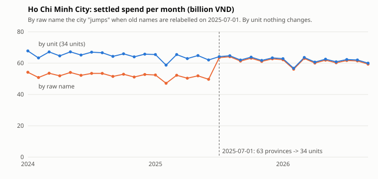

# Spark jobs

The Spark jobs of Layer 1 (data platform) turn other departments' source data into clean, modelled tables and
features, one lakehouse zone at a time. The data arrives dirty: a re-run export leaves duplicate
transactions, provinces were renamed in 2025, columns were added in 2024, and fraud labels arrive weeks after the
payment. The stack is Spark 4.1.3 standalone (1 master, 1 worker with 8 cores / 3 GB), Delta Lake 4.4.1, Hive
Metastore 3.1.3 and Trino 484.

| | |
|---|---|
| Code | [`pipelines/spark/`](https://github.com/cvinhnguyen/card-fraud-platform/tree/54d21eddbf6e602ae13fed46a1a9e0ef265d23cd/pipelines/spark), [`pipelines/dbt/`](https://github.com/cvinhnguyen/card-fraud-platform/tree/54d21eddbf6e602ae13fed46a1a9e0ef265d23cd/pipelines/dbt) |
| Runs on | compose profile `batch` (jobs run inside the `spark-master` container); dbt through the Spark Thrift Server, compose profile `dbt`, port 10000 |
| Reads | Postgres `core_banking` (6 tables, JDBC), the export bucket `s3a://core-banking-export/transactions/`, Flink's landing files in `s3a://lakehouse/landing/card_authorizations/` |
| Writes | Delta tables `bronze.*`, `silver.*` and `gold.*` under `s3a://lakehouse/`; `bronze.raw_transactions` in the lakeFS repository `bronze` |
| Related | [dbt_gold.md](dbt_gold.md), [spark_optimization.md](../performance/spark_optimization.md), [novel_lakefs_wap.md](novel_lakefs_wap.md), [airflow.md](airflow.md) |

## Where it fits

- Airflow runs the jobs as tasks of the course pipelines DP1, DP2 and DP3 ([airflow.md](airflow.md)).
- The batch row of Layer 1 in the platform overview
  ([architecture.md](../architecture.md#layer-1-the-data-platform-top-band)), the B arrows in the system diagram
  ([numbered arrows](../architecture.md#numbered-arrows)).
- Trino and analysts read every zone; Layer 2 reads the labels and the features
  ([ml_training.md](../ml-platform/ml_training.md), [feature_store.md](../ml-platform/feature_store.md)).
- Each job reads one zone and writes the next:

| Pipeline | Job | Reads | Writes |
|---|---|---|---|
| DP1, ingest to bronze (DAG `dp1_source_to_bronze`) | `ingest_bronze.py` | Postgres `core_banking`, the nightly export, Flink's landing files | `bronze.raw_*`, unchanged |
| DP2, bronze to silver (DAG `dp2_bronze_to_silver`) | `build_silver.py` | bronze | `silver.stg_*`, cleaned |
| DP2, silver to gold (DAG `dp2_silver_to_gold`) | dbt (`pipelines/dbt/`) | silver | gold `dim_*` and `fact_*` |
| DP2, silver to gold | `build_labels.py` | `silver.stg_transactions`; disputes, cards, accounts from bronze | `gold.label_transaction`, labels as known on each date |
| DP3, gold to features (DAG `dp3_gold_to_features`) | `build_features.py` | `gold.fact_transaction`; disputes from bronze | `gold.feat_card_txn_stats_daily`, the Feast offline store |

## How it works

1. Bronze keeps the sources as they arrived (duplicates, old names, missing columns included), plus when and from
   where each row came, so any later step can be rebuilt from it ([DP1](#dp1-source-to-bronze)).
2. Silver fixes the known problems once: one row per transaction, the 34 current province units, `auth_method` for
   rows from before the column existed ([DP2: bronze to silver](#dp2-bronze-to-silver)).
3. Gold is a dbt star schema with customer history as SCD2 (every version, with valid-from and valid-to dates), plus
   a labels table of what was known on each day, as labels arrive days to weeks late ([gold](#dp2-gold-with-dbt-spark), [labels](#dp2-labels-with-label-delay)).
4. The feature job computes per-card statistics over 30, 90 and 180 days that Feast joins point-in-time, so each
   labelled payment gets the values of that moment and training never sees the future ([DP3](#dp3-features)).
5. Loads are incremental for append-only data (new export dates, new transactions) and full rewrites for small data
   (the core banking snapshots), so a re-run never writes anything twice.

## Run it

From the repo root; the `batch` profile needs the `core` profile (Postgres, SeaweedFS, Kafka) too. These commands run
the working tree mounted at `/opt/jobs`; Airflow runs the released copy
([airflow.md, Releases](airflow.md#releases-cicd)):

```bash
docker compose -f infra/docker-compose.yaml --profile core --profile batch up -d --build

# DP1, first load (before infra/init_lakefs.py moves bronze.raw_transactions into lakeFS)
docker compose -f infra/docker-compose.yaml exec spark-master /opt/spark/bin/spark-submit /opt/jobs/ingest_bronze.py --txn-root s3a://lakehouse/bronze
# DP1 after that, as the Airflow tasks run it: the exports go on a lakeFS run branch (DP1 creates, validates and merges it)
docker compose -f infra/docker-compose.yaml exec spark-master /opt/spark/bin/spark-submit /opt/jobs/ingest_bronze.py --part core_banking
docker compose -f infra/docker-compose.yaml exec spark-master /opt/spark/bin/spark-submit /opt/jobs/ingest_bronze.py --part exports --txn-root s3a://bronze/dp1_20261015
docker compose -f infra/docker-compose.yaml exec spark-master /opt/spark/bin/spark-submit /opt/jobs/ingest_bronze.py --part landing

# DP2: bronze to silver
docker compose -f infra/docker-compose.yaml exec spark-master /opt/spark/bin/spark-submit /opt/jobs/build_silver.py

# Gold with dbt-spark
docker compose -f infra/docker-compose.yaml --profile dbt up -d spark-thrift
.venv/Scripts/dbt build --project-dir pipelines/dbt --profiles-dir pipelines/dbt     # models + tests

# Labels with label delay
docker compose -f infra/docker-compose.yaml exec spark-master /opt/spark/bin/spark-submit /opt/jobs/build_labels.py --as-of 2026-06-30
docker compose -f infra/docker-compose.yaml exec spark-master /opt/spark/bin/spark-submit /opt/jobs/build_labels.py            # up to the last txn date
docker compose -f infra/docker-compose.yaml exec spark-master /opt/spark/bin/spark-submit /opt/jobs/build_labels.py --report   # time travel

# DP3: features
docker compose -f infra/docker-compose.yaml exec spark-master /opt/spark/bin/spark-submit /opt/jobs/build_features.py
```

## DP1: source to bronze

[`pipelines/spark/ingest_bronze.py`](https://github.com/cvinhnguyen/card-fraud-platform/blob/54d21eddbf6e602ae13fed46a1a9e0ef265d23cd/pipelines/spark/ingest_bronze.py)
loads three sources:

| Source | Bronze table | Load |
|---|---|---|
| Postgres `core_banking.<table>` (6 tables, JDBC) | `bronze.raw_<table>` | full snapshot, overwrite; Delta time travel keeps earlier snapshots |
| `s3a://core-banking-export/transactions/export_date=*/` | `bronze.raw_transactions`, partitioned by `export_date`, in the lakeFS repository `bronze` (branch `main`) | append new export dates on a lakeFS branch, merged into `main` once validated |
| `s3a://lakehouse/landing/card_authorizations/` (Flink's raw landing files) | `bronze.raw_card_authorizations`, partitioned by `auth_date` | file stream with `availableNow`: append files not loaded yet (a checkpoint remembers them) |

Each row gets `_ingested_at` and `_source` (the JDBC table or source file path). Timestamps are read without a time
zone (`preferTimestampNTZ`), as in the source
([`ingest_bronze.py` L57-L69](https://github.com/cvinhnguyen/card-fraud-platform/blob/54d21eddbf6e602ae13fed46a1a9e0ef265d23cd/pipelines/spark/ingest_bronze.py#L57-L69)).

`save` registers each table once in the Hive Metastore (`CREATE TABLE ... USING DELTA LOCATION`), schema in the
Delta log; Trino reads them as `delta.bronze.*`. Writes to a run branch (`dp1_<ds>`) are not registered: the entry of `bronze.raw_transactions` points at
`s3a://bronze/main/raw_transactions`, so silver and Trino read `main` only
([`ingest_bronze.py` L43-L54](https://github.com/cvinhnguyen/card-fraud-platform/blob/54d21eddbf6e602ae13fed46a1a9e0ef265d23cd/pipelines/spark/ingest_bronze.py#L43-L54)):

```python
def save(df, table: str, mode: str, partition_by: str | None = None, root: str = BRONZE, **options) -> None:
    """Write a Delta table at <root>/<table> and register it as bronze.<table> in the Hive Metastore once
    (not for a lakeFS run branch: the metastore points at main).

    The schema lives in the Delta log, so later writes never alter the metastore entry
    (Hive Metastore 3.1 cannot parse timestamp_ntz and would log a warning on every schema change).
    """
    path = f"{root}/{table}"
    w = df.write.format("delta").mode(mode).options(**options)
    (w.partitionBy(partition_by) if partition_by else w).save(path)
    if root in (BRONZE, TXN_MAIN):
        df.sparkSession.sql(f"CREATE TABLE IF NOT EXISTS bronze.{table} USING DELTA LOCATION '{path}'")
```

Result (2026-10-17, 1 GB data):

| Table | Rows |
|---|---:|
| raw_transactions (1,019 export dates) | 8,159,516 |
| raw_customers | 193,207 |
| raw_cards | 130,120 |
| raw_accounts | 100,000 |
| raw_disputes | 31,364 |
| raw_merchants | 5,200 |
| raw_ref_province_mapping | 63 |

On Trino, `SELECT count(*) FROM delta.bronze.raw_transactions` returned 8,159,516, the rows the generator wrote.
Since the table moved into lakeFS ([novel_lakefs_wap.md](novel_lakefs_wap.md)) Trino reads it as
`lakefs.bronze.raw_transactions`.

### Incremental load

The exports part reads only the export folders newer than the newest `export_date` in `<root>/raw_transactions` (all
of them on the first load). A run branch starts from `main`, so there the newest date is the newest published export.
A run with no new files prints `nothing new after 2026-10-16`; `--until YYYY-MM-DD` stops at a given export date. The
append, with `mergeSchema` on the read and the write
([`ingest_bronze.py` L79-L99](https://github.com/cvinhnguyen/card-fraud-platform/blob/54d21eddbf6e602ae13fed46a1a9e0ef265d23cd/pipelines/spark/ingest_bronze.py#L79-L99)):

```python
def ingest_exports(spark: SparkSession, until: str | None, merge_schema: bool, root: str = TXN_MAIN) -> None:
    """Append the export dates after the newest one already in bronze (and up to `until`) to <root>/raw_transactions:
    lakeFS main, or the run's branch in DP1."""
    table, path = "bronze.raw_transactions", f"{root}/raw_transactions"
    try:
        done = str(spark.read.format("delta").load(path).agg(F.max("export_date")).first()[0] or "")   # empty table: ""
    except AnalysisException:   # first load: no table there yet
        done = ""
    new = [d for d in export_dates(spark) if d > done and (until is None or d <= until)]
    if not new:
        print(f"{table}: nothing new after {done}")
        return
    # Read only the new folders: files up to 2024-07-01 have no auth_method / three_ds_version columns.
    df = (spark.read.options(basePath=EXPORTS, mergeSchema=str(merge_schema).lower())
          .parquet(*[f"{EXPORTS}/export_date={d}" for d in new])
          .withColumn("_ingested_at", F.current_timestamp())
          .withColumn("_source", F.col("_metadata.file_path")))
    save(df.repartition("export_date"), "raw_transactions", "append",
         partition_by="export_date", root=root, mergeSchema=str(merge_schema).lower())
    total = spark.read.format("delta").load(path).count()
    print(f"{table} at {root}: +{len(new)} export dates ({new[0]} .. {new[-1]}), {total:,} rows total")
```

`--txn-root` says where the append goes:

| `--txn-root` | When |
|---|---|
| `s3a://bronze/dp1_<ds>` | the Airflow DAG, which appends on the branch, commits, validates and merges it into `main` ([`pipelines/airflow/dags/dp1_source_to_bronze.py` L37-L60](https://github.com/cvinhnguyen/card-fraud-platform/blob/54d21eddbf6e602ae13fed46a1a9e0ef265d23cd/pipelines/airflow/dags/dp1_source_to_bronze.py#L37-L60)); runs in [novel_lakefs_wap.md](novel_lakefs_wap.md) |
| `s3a://lakehouse/bronze` | the first load only, before `infra/init_lakefs.py` imports the table into lakeFS |
| missing, or `s3a://bronze/main` | an error: lakeFS `main` takes merges only ([`ingest_bronze.py` L129-L131](https://github.com/cvinhnguyen/card-fraud-platform/blob/54d21eddbf6e602ae13fed46a1a9e0ef265d23cd/pipelines/spark/ingest_bronze.py#L129-L131)) |

### Schema evolution

Export files up to 2024-07-01 lack the `auth_method` / `three_ds_version` columns, hence `mergeSchema` on the read
and the write. The baseline (columns lost on read, append refused with `DELTA_METADATA_MISMATCH`), the fix and the
numbers are in [spark_optimization.md](../performance/spark_optimization.md#schema-evolution).

## DP2: bronze to silver

[`pipelines/spark/build_silver.py`](https://github.com/cvinhnguyen/card-fraud-platform/blob/54d21eddbf6e602ae13fed46a1a9e0ef265d23cd/pipelines/spark/build_silver.py)
builds two silver tables:

| Silver table | From | Fixes |
|---|---|---|
| `silver.stg_transactions`, partitioned by `txn_date` | `bronze.raw_transactions` | dedup, `txn_unit` (34 units) + `txn_city_raw`, `auth_method` NULL -> `unknown_pre_regulation` |
| `silver.stg_customers` | `bronze.raw_customers` | `customer_unit` (34 units) + `city_raw`; input of the SCD2 `dim_customer` |

The job stops if a city name is missing from `ref_province_mapping`, so no unit is silently NULL
([`build_silver.py` L28-L35](https://github.com/cvinhnguyen/card-fraud-platform/blob/54d21eddbf6e602ae13fed46a1a9e0ef265d23cd/pipelines/spark/build_silver.py#L28-L35)).

### Incremental load

The job reads only bronze export dates newer than the newest `export_date` in silver
([`build_silver.py` L53-L56](https://github.com/cvinhnguyen/card-fraud-platform/blob/54d21eddbf6e602ae13fed46a1a9e0ef265d23cd/pipelines/spark/build_silver.py#L53-L56)),
deduplicates them and `MERGE`s on `transaction_id`
([`build_silver.py` L83-L91](https://github.com/cvinhnguyen/card-fraud-platform/blob/54d21eddbf6e602ae13fed46a1a9e0ef265d23cd/pipelines/spark/build_silver.py#L83-L91)).
Only a later `created_ts` replaces an id already in silver, so re-runs and duplicates in later exports cannot double
count. Test: after deleting the last 6 export dates from silver (47,226 rows), a re-run merged exactly
47,226 rows back (7,999,526 total, 64 s).

### Before / after (full build, 146 s)

| Measure | Bronze (before) | Silver (after) |
|---|---:|---:|
| Rows | 8,159,516 | 7,999,526 |
| Distinct `transaction_id` | 7,999,526 | 7,999,526 |
| Settled spend (VND, Vietnamese dong) | 3,625,268,094,000 | 3,554,102,498,000 |
| NULL `auth_method` | 1,455,416 | 0 (1,426,881 rows `unknown_pre_regulation`) |

Without dedup, settled spend is overcounted by 2.00%. 878,795 rows (10.99%) carry a location name of another unit
(old province names before 2025-07-01, stale names after).

Ho Chi Minh City (HCMC) around the reorganization (settled spend, billion VND; share of rows):

| Month | By raw name | By `txn_unit` | Binh Duong (raw) | Share raw | Share unit |
|---|---:|---:|---:|---:|---:|
| 2025-05 | 51.9 | 64.9 | 8.5 | 47.8% | 59.9% |
| 2025-06 | 49.7 | 62.0 | 8.0 | 48.0% | 60.0% |
| 2025-07 | 63.5 | 64.1 | 0.4 | 59.5% | 60.1% |
| 2025-08 | 64.1 | 64.7 | 0.4 | 59.3% | 59.9% |

By raw name, HCMC "grows" 28% in July 2025 and Binh Duong almost vanishes; by `txn_unit` the series is flat (the
February dips are the short month):



Redraw it with `python docs/diagrams/hcmc_spend.py` (reads silver through Trino).

## DP2: gold with dbt-spark

The dbt project in
[`pipelines/dbt/`](https://github.com/cvinhnguyen/card-fraud-platform/tree/54d21eddbf6e602ae13fed46a1a9e0ef265d23cd/pipelines/dbt)
([dbt_gold.md](dbt_gold.md)) runs SQL models on Spark, writing gold as Delta tables in `s3a://lakehouse/gold/`,
registered in the same Hive Metastore and readable from Trino. Runs by hand use the Spark Thrift Server (target
`local`); Airflow's DP2 uses the `session` target, its own Spark session ([airflow.md](airflow.md)).

### SCD2 `gold.dim_customer`

The source already holds one row per customer version (`customer_id` + `updated_ts`) from 2024 on, which a dbt
snapshot (it records only the state at each run) would lose. So `dim_customer` is a model over
`silver.stg_customers`:

1. `lag()` compares a hash of the tracked attributes (unit, income band, risk tier, KYC level, name, date of birth)
   with the previous row and keeps only changes.
2. `lead()` gives `valid_to_ts` (exclusive; open-ended = 9999-12-31) and `is_current`
   ([`pipelines/dbt/models/gold/dim_customer.sql`
   L4-L38](https://github.com/cvinhnguyen/card-fraud-platform/blob/54d21eddbf6e602ae13fed46a1a9e0ef265d23cd/pipelines/dbt/models/gold/dim_customer.sql#L4-L38)).

The city is compared as `customer_unit`, so the 2025-07-01 relabel of old province names makes no new version:

| Count | Rows |
|---|---:|
| Source rows (`stg_customers`) | 193,207 |
| SCD2 versions comparing the raw city name | 160,802 |
| SCD2 versions comparing `customer_unit` (= `dim_customer`) | 144,167 |
| Spurious versions avoided | 16,635 |
| Current versions (one per customer) | 100,000 |

Tests (`dbt build`, 8/8 pass): unique / not-null keys, one current version per customer, versions without gaps or
overlaps.

### Point-in-time join

An online payment's location (`txn_city` in the source, `txn_unit` in silver) is the holder's home unit at payment
time. The 977,652 settled ecom payments of the 15,393 customers who moved, joined to `dim_customer`:

| Join | Home unit matches `txn_unit` |
|---|---:|
| Point in time: `valid_from_ts <= txn_ts < valid_to_ts` | 100.0% |
| Current version only (`is_current`) | 76.7% |

The current version puts every payment before a move in the wrong unit.

### Star schema

| Model | Grain | Rows | Built from |
|---|---|---:|---|
| `fact_transaction` (incremental `MERGE`, partitioned by `txn_month`) | one settled transaction | 7,879,773 (315,913 in USD) | `stg_transactions` |
| `dim_customer` (SCD2) | one customer version | 144,167 | `stg_customers` |
| `dim_card` | one card, with its account and owner | 130,120 | `raw_cards` + `raw_accounts` |
| `dim_merchant` | one merchant (`merchant_unit` NULL for the 200 foreign ones) | 5,200 | `raw_merchants` |
| `dim_date` | one day, 2024-01-01 to 2026-10-15 | 1,019 | generated |

- Reversed transactions (119,753) are left out: no money moved.
- Fraud labels change after the fact is written, so they live in `gold.label_transaction`
  ([labels](#dp2-labels-with-label-delay)).
- `dim_card` and `dim_merchant` read bronze directly: the small reference tables need no cleaning.

`fact_transaction.customer_sk` is resolved by the point-in-time join at build time, so queries join `dim_customer` on
`customer_sk` without a date range
([`pipelines/dbt/models/gold/fact_transaction.sql`
L36-L39](https://github.com/cvinhnguyen/card-fraud-platform/blob/54d21eddbf6e602ae13fed46a1a9e0ef265d23cd/pipelines/dbt/models/gold/fact_transaction.sql#L36-L39)):

```sql
from txn t
join {{ ref('dim_card') }} c on c.card_id = t.card_id
left join {{ ref('dim_customer') }} d
    on d.customer_id = c.customer_id and t.txn_ts >= d.valid_from_ts and t.txn_ts < d.valid_to_ts
```

Tests (`dbt build`, 27/27 pass): unique / not-null keys, every fact key found in its dimension (`relationships`), and
`fact_transaction` has the same row count and settled spend as silver (7,879,773 rows, 3,554,102,498,000 VND).

The fact loads incrementally (a full refresh takes 60 s): after deleting the last 5 export dates (38,752 rows),
`dbt run --select fact_transaction` `MERGE`d exactly 38,752 rows back in 25 s, with no file rewritten.

## DP2: labels with label delay

[`pipelines/spark/build_labels.py`](https://github.com/cvinhnguyen/card-fraud-platform/blob/54d21eddbf6e602ae13fed46a1a9e0ef265d23cd/pipelines/spark/build_labels.py)
writes `gold.label_transaction`, one row per transaction, partitioned by `event_month`: `transaction_id`, `card_id`,
`customer_id`, `event_timestamp`, `amount_vnd`, `is_fraud`, `fraud_reported_ts`, `label_as_of`.

A fraud dispute arrives 1 to 60 days after the payment, so labels change after they are written and the table cannot
be append only. Each run takes `--as-of D`, sees only transactions and disputes up to D, and `MERGE`s:

- New transactions are inserted with the disputes known so far.
- Older transactions whose dispute arrived since the last run flip to `is_fraud = true`; as disputes are at most 60
  days late, the `MERGE` scans only the last 3 months of partitions.

Each run is one Delta version whose commit carries `label_as_of=D` (the `userMetadata` column of `DESCRIBE HISTORY`),
so `VERSION AS OF` returns the labels as known on D. The tag and the `MERGE`
([`build_labels.py` L67-L83](https://github.com/cvinhnguyen/card-fraud-platform/blob/54d21eddbf6e602ae13fed46a1a9e0ef265d23cd/pipelines/spark/build_labels.py#L67-L83)):

```python
    spark.conf.set("spark.databricks.delta.commitInfo.userMetadata", f"label_as_of={as_of}")
    if not exists:
        src.repartition("event_month").write.format("delta").partitionBy("event_month").save(PATH)
        spark.sql(f"CREATE TABLE IF NOT EXISTS {TABLE} USING DELTA LOCATION '{PATH}'")
    else:
        # Older rows only need the label columns; disputes are at most 60 days late, so only the last 3 months change.
        flips = (fraud.where(F.col("fraud_reported_ts") >= F.lit(start))
                 .join(new_txn.select("transaction_id"), "transaction_id", "left_anti")
                 .withColumn("is_fraud", F.lit(True)).withColumn("label_as_of", F.lit(as_of)))
        oldest = (start - dt.timedelta(days=MATURITY_DAYS + 31)).strftime("%Y-%m")
        (DeltaTable.forName(spark, TABLE).alias("t")
         .merge(src.unionByName(flips, allowMissingColumns=True).alias("s"),
                f"t.event_month >= '{oldest}' AND t.transaction_id = s.transaction_id")
         .whenMatchedUpdate(condition="t.is_fraud <> s.is_fraud",
                            set={c: f"s.{c}" for c in ("is_fraud", "fraud_reported_ts", "label_as_of")})
         .whenNotMatchedInsertAll(condition="s.event_timestamp IS NOT NULL")
         .execute())
```

Replay, one run per month end (about 60 s each):

| Version | `label_as_of` | New rows | Labels flipped | Files removed / added |
|---:|---|---:|---:|---|
| 0 | 2026-06-30 | 7,159,417 | | 0 / 30 |
| 1 | 2026-07-31 | 243,823 | 409 | 2 / 3 |
| 2 | 2026-08-31 | 242,706 | 381 | 2 / 3 |
| 3 | 2026-09-30 | 235,497 | 356 | 2 / 3 |
| 4 | 2026-10-15 | 118,083 | 287 | 2 / 3 |

The final table has 7,999,526 rows (= `stg_transactions`) and 23,594 frauds (= confirmed fraud disputes). The fraud
rate of June 2026 transactions per version, against mature rows only (`event_timestamp < label_as_of - 60 days`):

| Version (`label_as_of`) | June 2026 fraud rate | Mature rows | Mature fraud rate |
|---|---:|---:|---:|
| 0 (2026-06-30) | 0.141% | 6,680,600 | 0.2999% |
| 1 (2026-07-31) | 0.302% | 6,924,346 | 0.2995% |
| 2 (2026-08-31) | 0.311% | 7,167,311 | 0.3000% |
| 3 (2026-09-30) | 0.311% | 7,403,240 | 0.3000% |
| 4 (2026-10-15) | 0.311% | 7,520,544 | 0.2999% |

When June ends, more than half of June's frauds are still unknown; after 60 days the rate stops moving. The mature
rate is the same in every version, so a training set of mature rows does not depend on when it was built. Layer 2
reads `VERSION AS OF` its model's training version and filters to mature rows.

## DP3: features

[`pipelines/spark/build_features.py`](https://github.com/cvinhnguyen/card-fraud-platform/blob/54d21eddbf6e602ae13fed46a1a9e0ef265d23cd/pipelines/spark/build_features.py)
writes `gold.feat_card_txn_stats_daily`, the offline source of the Feast feature view `card_txn_stats_daily` (Layer 2).
It has one row per card and day L the card was active (a settled transaction or a reported dispute). Up to day
2026-11-03: 7,792,146 rows for 129,749 cards, with the means below (confirmed by a Trino query on 2026-11-13). It now
runs to day 2026-11-08 (7,830,568 rows, 129,830 cards).

| Feature | Window (days up to L) | Mean |
|---|---|---:|
| `txn_count_30d` | 30 | 2.97 |
| `distinct_merchants_30d` | 30 | 2.67 |
| `avg_amount_90d`, `std_amount_90d` (VND) | 90 | 452,293 / 453,999 |
| `ecom_ratio_90d` | 90 | 0.719 |
| `foreign_txn_ratio_90d` (`currency != VND`) | 90 | 0.040 |
| `dispute_count_180d` (disputes by `reported_ts`, any reason) | 180 | 0.047 |

Each window ends at L, L included, and `event_timestamp` is L + 1 day 00:00, when the nightly run writes the row and
it becomes the card's latest value. So a point-in-time join for a payment on day D sees the card's last active day
before D, the row the online store holds when that payment is scored.

- Payments earlier on the same day are left to the stream features (Flink, 1 hour windows).
- Disputes count on the day they were reported: one reported after L was unknown on L + 1.
- `stats_ts` repeats `event_timestamp` as a feature, because Feast does not serve the event timestamp and Layer 2
  derives `days_since_last_active` from it.
- `created` is the processing time (Feast uses it to break ties).

An earlier layout (row on each payment day D, windows ending at D-1) gave the same values, but training joined to a
row that existed only because of the payment being scored, a row the online store never holds. It was replaced
during the Layer 2 work.

Windows are `rangeBetween(-(N-1), 0)` over the day number, one row per card and day, so one sort per card serves all
windows
([`build_features.py` L48-L54](https://github.com/cvinhnguyen/card-fraud-platform/blob/54d21eddbf6e602ae13fed46a1a9e0ef265d23cd/pipelines/spark/build_features.py#L48-L54)).
The job ends with a leakage check: 500 random rows recomputed from `fact_transaction` and `raw_disputes` with plain
date filters all match
([`build_features.py` L78-L95](https://github.com/cvinhnguyen/card-fraud-platform/blob/54d21eddbf6e602ae13fed46a1a9e0ef265d23cd/pipelines/spark/build_features.py#L78-L95)).

## Gotchas

- `Invalid method name: 'get_table'` from the Hive Metastore: Spark 4.1's built-in Hive 2.3 client cannot call a 4.x
  metastore. Fix: Hive Metastore 3.1.3.
- An exact `count(DISTINCT transaction_id)` over 8M rows fails on Trino: its default per-node memory (~500 MB with a
  2 GB container) is too small. Workaround: `approx_distinct`.
- `dim_date` and the incremental filter fail on the Thrift Server with
  `ClassCastException: java.time.LocalDate cannot be cast to java.sql.Date`: Delta answers `min/max` of a date column
  from file statistics as `java.sql.Date`, while the Thrift Server uses the Java 8 time API. Fix:
  `spark.databricks.delta.optimizeMetadataQuery.enabled=false` on the Thrift Server
  ([`infra/docker-compose.yaml` L286-L289](https://github.com/cvinhnguyen/card-fraud-platform/blob/54d21eddbf6e602ae13fed46a1a9e0ef265d23cd/infra/docker-compose.yaml#L286-L289)).
