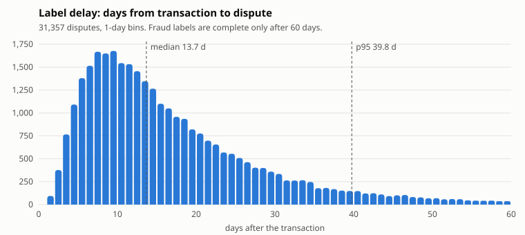

# Data characteristics

What the source data looks like at the default volume (~1 GB), and which problems it carries on purpose.
Every number below is printed by `generator/check_data.py` (65 checks, all pass) on the data from
`generator/generate.py` with `seed: 42`, period 2024-01-01 to 2026-10-15. These are the "before" numbers
the later phases are measured against.

## Datasets

| Dataset | Where it lands | Files | Rows | Size |
|---|---|---:|---:|---:|
| customers (SCD2 source, 100,000 customers) | Postgres `core_banking` | 1 | 193,207 | |
| accounts | Postgres | 1 | 100,000 | |
| cards | Postgres | 1 | 130,120 | |
| merchants | Postgres | 1 | 5,000 | |
| disputes (fraud labels) | Postgres | 1 | 31,357 | |
| ref_province_mapping (63 → 34) | Postgres | 1 | 63 | |
| *core banking tables total* | | 6 | 459,747 | 11.7 MB |
| transactions (nightly export) | S3 `core-banking-export/transactions/export_date=*/` | 1,019 | 8,159,516 | 329.0 MB |
| card_authorizations | Kafka topic, key `card_id` | 1,019 | 8,119,499 | 401.5 MB |
| app_events | Kafka topic, key `customer_id` | 1,019 | 4,822,745 | 224.0 MB |
| *total* | | | | *~966 MB* |

Sizes are Parquet on disk under `data/source/`. `_truth/ato_sessions.parquet` (21,789 ATO sessions) is
ground truth for evaluation only and is never loaded into the platform.

Generate: ~6.5 min, 0.31 GB RAM. Check: ~1 min, 4.24 GB RAM peak.

## Problems in the batch sources

| Problem | How it shows up | Measured | Fixed in |
|---|---|---|---|
| Duplicate rows | Nightly export re-run after a timeout: same `transaction_id`, later `created_ts` | 159,990 extra rows = 2.00% of 7,999,526 unique; 100% of duplicates have a later `created_ts` | P4 dedup (keep latest) |
| Merchant skew | 10 super merchants (e-wallet top-up, ride-hailing, marketplace, convenience chains) | top-10 share 0.6998; biggest / median merchant = 9,071× | P4 salting / AQE skew join |
| City skew | Shares on the 34 new units | Ho Chi Minh 0.5989, Ha Noi 0.1802, Da Nang 0.0502 | P4 / P5 partitioning, P6 hot key |
| Province reorganization (63 → 34, from 2025-07-01) | Old names before the cutoff; 5% of legacy terminals keep sending old names after it | old-only names 19.66% before, 0.98% after; raw "Ho Chi Minh" share 0.4792 before the cutoff (a fake jump to 0.60 if not normalized) | P4 normalize via `ref_province_mapping` |
| Schema evolution | `auth_method`, `three_ds_version` exist only in files from 2024-07-01 | 100% of earlier files lack the columns, 100% of later files have them; `3ds_app` 29.98% of ecom, 3DS 2.2.0 84.99% | P3 / P4 `mergeSchema` |
| High cardinality | `terminal_id` on POS / ATM, null for ecom | 26,863 distinct | P5 bucketing, approx distinct |
| SCD2 | Customers move (5%/yr), get rescored (10%/yr); on 2025-07-01 the core system relabels old province names | 56.45% of customers have >1 version; 16,635 spurious relabel versions (95.09% of old-name customers) | P4 SCD2 / snapshot logic |
| As-of joins | A moved customer pays in the home unit valid at `txn_ts` | 96.68% of 1,107,359 post-move transactions | P4 point-in-time join |
| Label delay | Disputes arrive 1 to 60 days after the transaction (truncated log-normal, median 14) | median 13.67 days; last-30-day fraud rate is 0.44× the mature rate (expected 0.48) | P4 / Layer 2 maturity window of 60 days |
| Trend: ATM decline | ATM share of card payments falls 17%/yr | 2025 / 2024 = 0.8287 | Layer 2 drift monitoring |

Labels: fraud rate on mature transactions 0.0030; ecom fraud rate is 3.85× non-ecom (a learnable signal).

Disputes peak 7 to 10 days after the transaction (median 13.7) and 5% arrive after day 40 (p95 39.8 days; the configured 45 applies before the 60-day truncation). Transactions from the last 60 days are still missing part of their fraud labels, so training data must be older than 60 days. Redraw with `python docs/diagrams/label_delay.py`.

## Problems in the streams

Both streams carry two timestamps: event time (`auth_ts`, `event_ts`) and arrival time (`received_ts`).
`producer.py` sends in `received_ts` order, so Kafka sees the disorder.

### card_authorizations

| Problem | How it shows up | Measured | Fixed in |
|---|---|---|---|
| Late events | 10% of POS payments come from offline terminals and arrive 5 to 30 min late | 214,892 late = 2.69% of all auths (9.99% of POS); on-time delay ≤ 2 s | P6 watermark 5 s + `allowed_lateness` 30 min + side output |
| Duplicates | Network retry without an ack: same `auth_id`, `received_ts` 1 to 10 s later | 1.50% extra rows; duplicates differ only in `received_ts` | P6 keyed dedup on `auth_id` with state TTL, before any count |
| Join key to batch | `auth_id` shares the counter with `transaction_id` | 7,999,526 unique auths = unique transactions, 100% match | Layer 2 auth → transaction → dispute label |
| Device signal | `device_id` on ecom only; fraud always uses a device new to the card | 169,820 distinct devices; new device: fraud 100%, legit 3.55% | Layer 2 realtime feature |

### app_events

2,199,812 sessions: 2,178,023 legit, 14,602 `new_device` ATO, 7,187 `remote_access` ATO.

| Problem | How it shows up | Measured | Fixed in |
|---|---|---|---|
| Out-of-order events | App uploads in parallel: an event reaches Kafka after the next event of its session | exactly 15.00%; max disorder 20 s; in-order delay ≤ 1 s | P6 event-time watermark 30 s, buffer per `session_id`, sort by `event_ts` (CEP / `KeyedProcessFunction`) |
| Sequence rule broken by disorder | `new_device` ATO: password_reset → add_payee → transfer within 10 min | 1,205 of 4,034 ATO sequences look broken in arrival order | same as above |
| Decision 2345/QĐ-NHNN (from 2024-07-01) | Biometric check on a new device, a transfer ≥ 10M VND, or a day total > 20M VND; a failed check ends the session | all rule checks 100%; pass rate legit 0.9895, ATO 0.1052 | P6 rule / Layer 2 feature |
| Split transfers | `remote_access` ATO (malware on the victim's phone) keeps each transfer in [9M, 10M) | 16,673 remote ATO vs 4,836 legit transfers in that band | Layer 2 `transfer_9m_10m_count_1d` |
| Trend: QR at shops | `qr_merchant` share of transfers grows 15%/yr | 2025 / 2024 = 1.1497 | Layer 2 drift monitoring |

## Scaling

Volume lives in `generator/config.yaml` (`volume`). `generate.py --scale 0.05` gives a quick smoke test.
Pandas-based checks stop at about this size (4.24 GB RAM); the 100 GB run (P9) checks with Spark.
