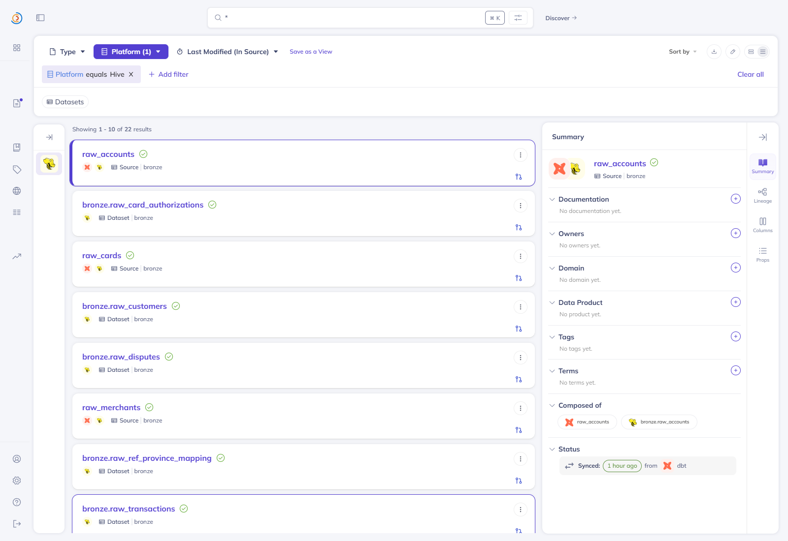
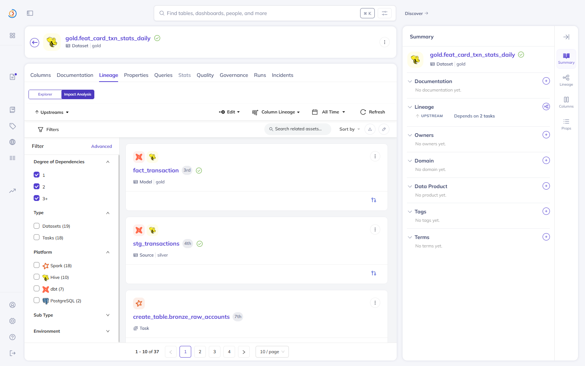
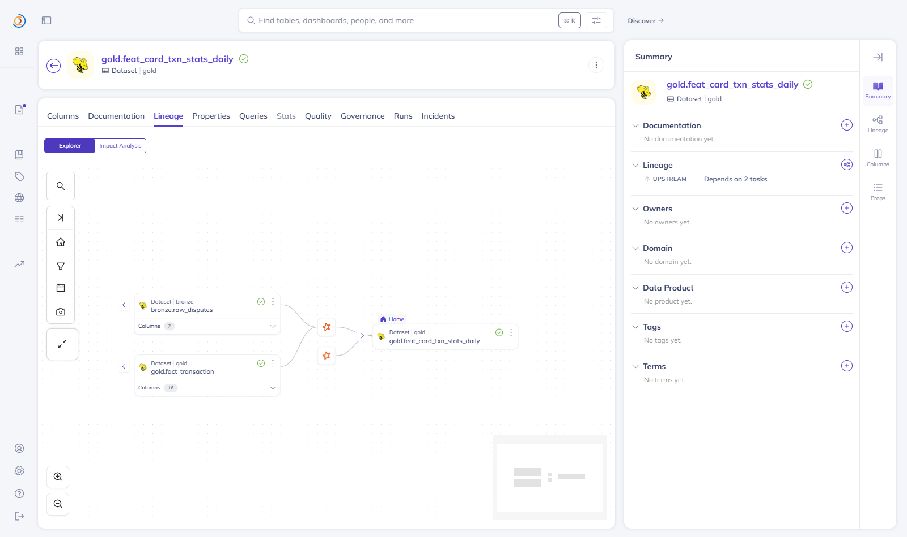
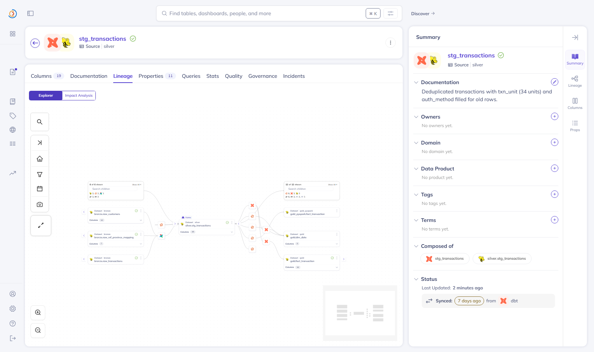
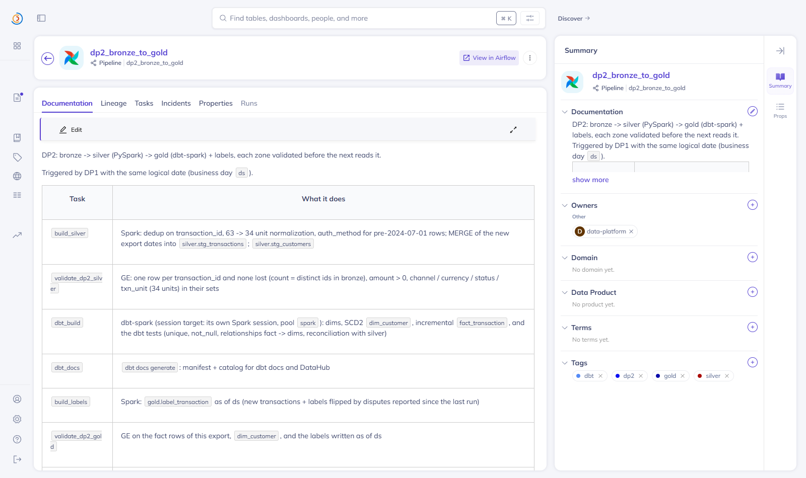
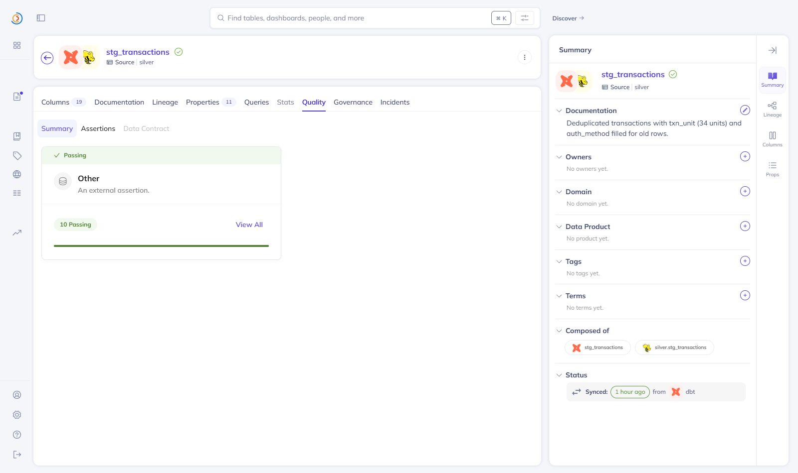
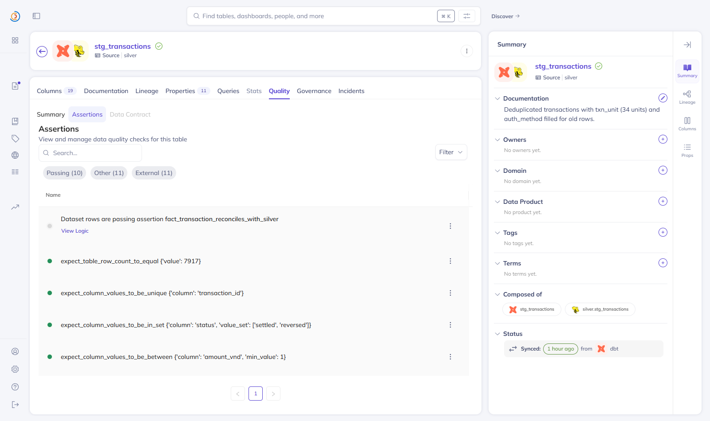
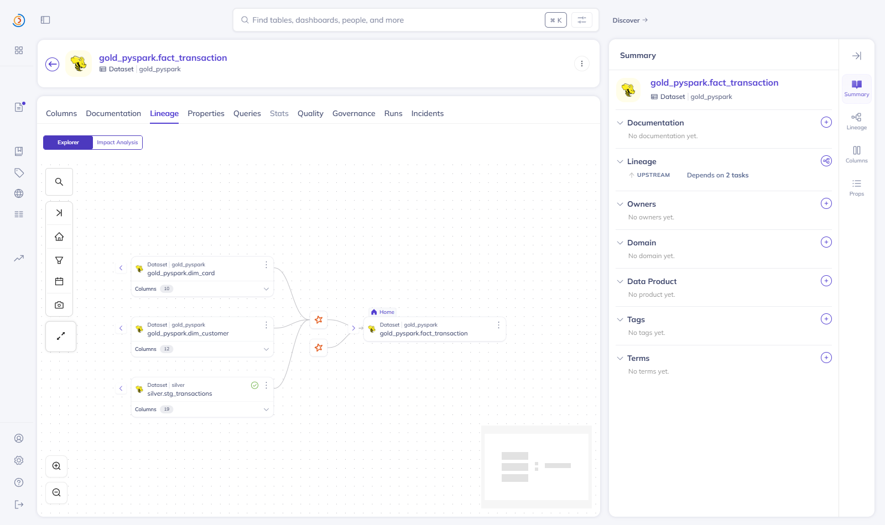

# DataHub: tables, lineage, validation

DataHub v1.5.0.6 (the course version) is the platform's metadata catalog: the lakehouse tables of every zone, their
lineage from the core banking sources to the features, the Airflow pipelines that produce them and the result of every
validation run, in one place. It has its own Postgres and OpenSearch and uses the core Kafka as its event bus. The UI
user is `datahub`; its password is `DATAHUB_ADMIN_PASSWORD` in `infra/.env`, written to the frontend's `user.props`
by `make_env.py` instead of the default `datahub:datahub`.

| | |
|---|---|
| Code | [`infra/docker-compose.yaml` L455-L564](https://github.com/cvinhnguyen/card-fraud-platform/blob/1416656ca28dbf52a0663508c5f0a81fb869faed/infra/docker-compose.yaml#L455-L564), [`pipelines/airflow/dags/datahub_metadata.py`](https://github.com/cvinhnguyen/card-fraud-platform/blob/1416656ca28dbf52a0663508c5f0a81fb869faed/pipelines/airflow/dags/datahub_metadata.py), [`pipelines/airflow/dags/datahub_recipes/`](https://github.com/cvinhnguyen/card-fraud-platform/tree/1416656ca28dbf52a0663508c5f0a81fb869faed/pipelines/airflow/dags/datahub_recipes) |
| Runs on | compose profile `gov`: GMS on 127.0.0.1:8083, UI on http://127.0.0.1:9002 |
| Reads | OpenLineage events of every Spark job, the Airflow listener, GE results, `datahub ingest` of Postgres `core_banking`, the Kafka topics and the dbt artifacts |
| Writes | its own Postgres and OpenSearch |
| Related | [openlineage.md](openlineage.md), [airflow.md](airflow.md), [dbt_gold.md](dbt_gold.md) |

## Run it

DataHub needs the `gov` profile next to the batch stack and Airflow, and its admin password in `infra/.env`:

```bash
python infra/make_env.py      # DATAHUB_ADMIN_PASSWORD in infra/.env, written to the frontend's user.props
docker compose -f infra/docker-compose.yaml --profile core --profile batch --profile orch --profile gov up -d --build
docker exec airflow-scheduler airflow dags trigger datahub_metadata    # core banking tables, Kafka topics, dbt
```

Then open http://127.0.0.1:9002 and log in as `datahub`.

## What reaches DataHub

| What | Sent by | How |
|---|---|---|
| Lakehouse tables (bronze / silver / gold / feat), their schema and lineage, column-level lineage | every Spark job, dbt included | OpenLineage listener in [`infra/conf/spark/spark-defaults.conf` L34-L41](https://github.com/cvinhnguyen/card-fraud-platform/blob/1416656ca28dbf52a0663508c5f0a81fb869faed/infra/conf/spark/spark-defaults.conf#L34-L41), posting to GMS `/openapi/openlineage/api/v1/lineage` ([openlineage.md](openlineage.md)) |
| DAGs, tasks, task runs | Airflow | DataHub's Airflow listener (`acryl-datahub-airflow-plugin`) |
| Validation results (GE) | `publish_results` task of every validate stage ([`pipelines/airflow/dags/common.py` L62-L117](https://github.com/cvinhnguyen/card-fraud-platform/blob/1416656ca28dbf52a0663508c5f0a81fb869faed/pipelines/airflow/dags/common.py#L62-L117)) | `AssertionInfo` + `AssertionRunEvent` per expectation, on the hive URN of the table |
| Core banking tables, Kafka topics, dbt models / docs / tests | `datahub_metadata` DAG | `datahub ingest` recipes in [`pipelines/airflow/dags/datahub_recipes/`](https://github.com/cvinhnguyen/card-fraud-platform/tree/1416656ca28dbf52a0663508c5f0a81fb869faed/pipelines/airflow/dags/datahub_recipes) |

The `datahub_metadata` DAG runs one `datahub ingest` per recipe
([`pipelines/airflow/dags/datahub_metadata.py` L33-L37](https://github.com/cvinhnguyen/card-fraud-platform/blob/1416656ca28dbf52a0663508c5f0a81fb869faed/pipelines/airflow/dags/datahub_metadata.py#L33-L37)):

```python
with DAG("datahub_metadata", schedule="@daily", start_date=datetime(2026, 10, 1), catchup=False, max_active_runs=1,
         default_args={**DEFAULT_ARGS, "depends_on_past": False}, doc_md=__doc__, tags=["governance"]) as dag:
    for name in ["core_banking", "kafka_topics", "dbt"]:
        recipe = {"kafka_topics": "kafka"}.get(name, name)
        BashOperator(task_id=name, bash_command=f"{DATAHUB} ingest -c {RECIPES}/{recipe}.yml", env=ENV, append_env=True)
```

## What DataHub holds

After the DP1, DP2 and DP3 runs of 2026-10-12..15 and one run of `datahub_metadata`, DataHub holds (GraphQL counts):

| Entity | Count |
|---|---:|
| Lakehouse tables (hive): 8 bronze, 2 silver, 7 gold (dims, fact, labels, features) + the 5 tables of `gold_pyspark` | 22 |
| Core banking tables (Postgres) | 6 (12 with the `core_banking.public` schema entities) |
| Kafka topics | 4 |
| dbt models / sources (shown as siblings of the hive tables they build) | 10 |
| Pipelines: Airflow DAGs (listener) and the Spark jobs of each DAG (OpenLineage) | 4 + 4 |
| Spark jobs (one per Spark action): 42 in the three DP pipelines + 11 of `gold_pyspark` / Airflow tasks | 53 / 22 |
| Job-dataset lineage edges | 74 |
| Assertions: 88 from GE (4 suites) + 27 dbt tests | 115 |

### Tables of every zone

Every `bronze.*`, `silver.*` and `gold.*` table is there with its zone as the container. The tables dbt builds are
merged with their dbt model (two icons: dbt and Hive), so one entity carries the model's SQL, docs and tests and the
table's lineage. The datasets filtered on the Hive platform, 22 results:



### Lineage from the source to the features

The impact analysis upstream of the feature table, *all degrees*, finds 37 entities: 19 datasets and 18 tasks over
Spark, Hive, dbt and PostgreSQL. The chain reaches the core banking Postgres tables through `bronze.raw_cards` /
`raw_accounts` (7 hops):



The lineage graph of the feature table shows its direct inputs, `gold.fact_transaction` and `bronze.raw_disputes`:



`silver.stg_transactions` sits in the middle. Its lineage graph after the DP2 run of 2026-11-07: upstream, the three
bronze tables `build_silver` reads (`raw_customers`, `raw_ref_province_mapping`, `raw_transactions`) through the
task, which declares them since OpenLineage reports DP2's MERGE without its source
([openlineage.md](openlineage.md#how-it-is-wired)); downstream, dbt (the fact and `dim_date`), the labels and the PySpark
comparison job:



### Which pipeline produced a table

Each table's upstream job carries the DAG's name. The OpenLineage job name is `spark.openlineage.appName`, which is
the DAG id, set for every Spark task in
[`pipelines/airflow/dags/common.py` L41-L49](https://github.com/cvinhnguyen/card-fraud-platform/blob/1416656ca28dbf52a0663508c5f0a81fb869faed/pipelines/airflow/dags/common.py#L41-L49).

`bronze.raw_transactions` takes one more step. DP1 writes the export into the lakeFS repository on a branch and
publishes it with a merge, an API call OpenLineage cannot see, so the DAG declares that hop
([novel_lakefs_wap.md](novel_lakefs_wap.md#how-it-is-wired)). After the DP1 run of 2026-11-07, the repository's
`bronze/raw_transactions` (S3) sits between the export and the table: `ingest_exports` and its Spark job write it from
`core-banking-export/transactions`, and `merge_to_main` reads it and produces `bronze.raw_transactions`. The table
also keeps its first producer, `create_table.bronze_raw_transactions`, the load that created it before lakeFS:


The Airflow DAG itself is an entity next to it, with its documentation, tasks and runs from the Airflow listener. The
pipeline `dp2_bronze_to_gold`, with its DAG doc:



These runs predate the move of `bronze.raw_transactions` into lakeFS on 2026-10-24. DP1 now appends each export on
the run's branch (`s3a://bronze/dp1_<ds>/raw_transactions`) and merges it into `main` after the checks
([novel_lakefs_wap.md](novel_lakefs_wap.md)).

### Validation results

Every GE expectation of the validate stages is an assertion on its table with one run event per DAG run; dbt tests
(from `run_results.json`) sit next to them.

Each GE result becomes an `AssertionInfo` (what is checked) and an `AssertionRunEvent` (this run's result). The
assertion id is a hash of table, expectation and column, so every run lands on the same assertion
([`pipelines/airflow/dags/common.py` L77-L94](https://github.com/cvinhnguyen/card-fraud-platform/blob/1416656ca28dbf52a0663508c5f0a81fb869faed/pipelines/airflow/dags/common.py#L77-L94)):

```python
    for r in report["results"]:
        dataset = make_dataset_urn(r.get("platform", "hive"), r["table"], "PROD")   # Layer 3 results name feast
        col = r["kwargs"].get("column")
        urn = make_assertion_urn(datahub_guid({"table": r["table"], "expectation": r["expectation"], "column": col}))
        info = AssertionInfoClass(type=AssertionTypeClass.DATASET, description=f"{r['expectation']} {r['kwargs']}",
                                  datasetAssertion=DatasetAssertionInfoClass(
                                      dataset=dataset, operator=AssertionStdOperatorClass._NATIVE_,
                                      nativeType=r["expectation"],
                                      nativeParameters={k: str(v)[:200] for k, v in r["kwargs"].items()},
                                      scope=DatasetAssertionScopeClass.DATASET_COLUMN if col else DatasetAssertionScopeClass.DATASET_ROWS,
                                      fields=[f"urn:li:schemaField:({dataset},{col})"] if col else []))
        result = AssertionResultClass(type=AssertionResultTypeClass.SUCCESS if r["success"] else AssertionResultTypeClass.FAILURE,
                                      unexpectedCount=r["unexpected_count"], rowCount=r["element_count"],
                                      nativeResults={"observed_value": str(r["observed_value"]), "filter": str(r["filter"])})
        emitter.emit(MetadataChangeProposalWrapper(entityUrn=urn, aspect=info))
        emitter.emit(MetadataChangeProposalWrapper(entityUrn=urn, aspect=AssertionRunEventClass(
            timestampMillis=now, runId=run_id, asserteeUrn=dataset, assertionUrn=urn,
            status=AssertionRunStatusClass.COMPLETE, result=result)))
```

On `silver.stg_transactions` there are the 10 GE checks of that table, all passing after the drill in
[airflow.md](airflow.md) (its failing run is in each assertion's history), and the dbt reconciliation test. The
Quality tab sums up the 10 passing GE checks:



The Assertions tab lists them, Passing (10) and External (11), with the dbt test
`fact_transaction_reconciles_with_silver` first:



### A job nobody declared

[`pipelines/spark/build_gold_pyspark.py`](https://github.com/cvinhnguyen/card-fraud-platform/blob/1416656ca28dbf52a0663508c5f0a81fb869faed/pipelines/spark/build_gold_pyspark.py)
(the hand-written comparison for the dbt gold layer, never run by Airflow) appears with its inputs and outputs after
its first run:



Column-level lineage is stored on each job (16 column mappings for that fact, see [openlineage.md](openlineage.md))
and readable through the API. The lineage canvas draws column edges only when the target table has a schema in
DataHub, which the tables written by path do not get from the listener.

## Gotchas

- GMS consumers stopped, so nothing was stored or searchable. The course compose sets
  `SPRING_KAFKA_PROPERTIES_USE_LATEST_VERSION` / `AUTO_REGISTER_SCHEMAS` for both the system-update job and GMS. With
  the internal schema registry, GMS's Kafka consumers then ask for the "latest version" of a schema, get
  `lookUpSchemaUnderSubject method not implemented` / `Error retrieving Avro value schema version for id 16`, and stop.
  OpenLineage events were accepted (HTTP 200) but entities had no properties and search returned 0. DataHub's own
  quickstart sets those variables (and `SCHEMA_REGISTRY_SYSTEM_UPDATE`) on system-update only; doing the same fixed it
  ([`infra/docker-compose.yaml` L502-L507](https://github.com/cvinhnguyen/card-fraud-platform/blob/1416656ca28dbf52a0663508c5f0a81fb869faed/infra/docker-compose.yaml#L502-L507)).
- Our broker has auto-create off, and GMS still consumes the legacy topic `MetadataChangeEvent_v4` (and its failed /
  audit topics), which system-update does not create. `infra/init_infra.py` creates them
  ([`infra/init_infra.py` L16-L18](https://github.com/cvinhnguyen/card-fraud-platform/blob/1416656ca28dbf52a0663508c5f0a81fb869faed/infra/init_infra.py#L16-L18)).
- DataHub (GMS 1 GB heap, OpenSearch 512 MB) fits next to batch + orch only without the Spark Thrift Server (see
  [airflow.md](airflow.md)); in the 8 GB Docker VM, swapping made Docker's DNS fail.
- `acryl-datahub-airflow-plugin` 1.6.x needs Airflow 3; 1.5.0.6 pins a `sqlglotc` build no longer on PyPI; 1.5.0.17
  works with Airflow 2.10 and the v1.5.0.6 server
  ([`infra/airflow/Dockerfile` L54-L57](https://github.com/cvinhnguyen/card-fraud-platform/blob/1416656ca28dbf52a0663508c5f0a81fb869faed/infra/airflow/Dockerfile#L54-L57)).
