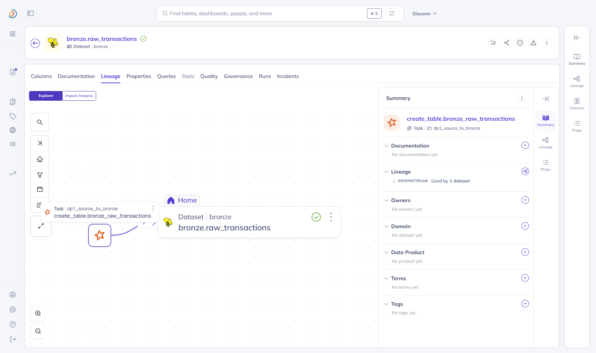

# DataHub: tables, lineage, validation

DataHub v1.5.0.6 (the course version), compose profile `gov`: GMS on 127.0.0.1:8083, UI on http://127.0.0.1:9002
(user `datahub`, password `DATAHUB_ADMIN_PASSWORD` in `infra/.env`, written to the frontend's `user.props` by
`make_env.py` instead of the default `datahub:datahub`). It has its own Postgres and OpenSearch and uses the core
Kafka as its event bus.

What reaches DataHub, and from where:

| What | Sent by | How |
|---|---|---|
| Lakehouse tables (bronze / silver / gold / feat), their schema and lineage, column-level lineage | every Spark job, dbt included | OpenLineage listener in `spark-defaults.conf` -> GMS `/openapi/openlineage/api/v1/lineage` (novel idea 2) |
| DAGs, tasks, task runs | Airflow | DataHub's Airflow listener (`acryl-datahub-airflow-plugin`) |
| Validation results (GE) | `publish_results` task of every validate stage | `AssertionInfo` + `AssertionRunEvent` per expectation, on the hive URN of the table |
| Core banking tables, Kafka topics, dbt models / docs / tests | `datahub_metadata` DAG | `datahub ingest` recipes in `pipelines/airflow/dags/datahub_recipes/` |

After the DP1 -> DP2 -> DP3 runs of 2026-10-12..15 and one run of `datahub_metadata`, DataHub holds (GraphQL
counts):

| Entity | Count |
|---|---:|
| Lakehouse tables (hive): 8 bronze, 2 silver, 7 gold (dims, fact, labels, features) + the 5 tables of `gold_pyspark` | 22 |
| Core banking tables (Postgres) | 6 (12 with the `core_banking.public` schema entities) |
| Kafka topics | 4 |
| dbt models / sources (shown as siblings of the hive tables they build) | 10 |
| Pipelines: Airflow DAGs (listener) and the Spark jobs of each DAG (OpenLineage) | 4 + 4 |
| Spark jobs (one per Spark action): 42 in the three DP pipelines + 11 of `gold_pyspark` / Airflow tasks | 53 / 22 |
| Job-dataset lineage edges | 74 |
| Assertions: 88 from GE (4 suites) + 27 dbt tests | 115 |

### Tables of every zone

Every `bronze.*`, `silver.*` and `gold.*` table is there with its zone as the container; the tables dbt builds are
merged with their dbt model (two icons: dbt and Hive), so one entity carries the model's SQL, docs and tests and the
table's lineage.

### Lineage from the source to the features

Upstream of the feature table, *all degrees*: 37 entities, 19 datasets and 18 tasks over Spark, Hive, dbt and
PostgreSQL. The chain reaches the core banking Postgres tables through `bronze.raw_cards` / `raw_accounts` (7 hops).

`silver.stg_transactions` sits in the middle: produced by DP2's MERGE job, read by dbt (the fact and `dim_date`),
the labels, and the PySpark comparison job.

### Which pipeline produced a table

Each table's upstream job carries the DAG's name: `bronze.raw_transactions` is produced by
`create_table.bronze_raw_transactions` in the pipeline `dp1_source_to_bronze` (OpenLineage job name =
`spark.openlineage.appName` = the DAG id). The Airflow DAG itself is an entity next to it, with its documentation,
tasks and runs from the Airflow listener.

### Validation results

Every GE expectation of the validate stages is an assertion on its table with one run event per DAG run; dbt tests
(from `run_results.json`) sit next to them. On `silver.stg_transactions`: the 10 GE checks of that table, all
passing after the drill in docs/airflow.md (its failing run is in each assertion's history), and the dbt
reconciliation test.

### A job nobody declared

`pipelines/spark/build_gold_pyspark.py` (the comparison job of novel idea 1, never run by Airflow) appears with its inputs and
outputs after its first run:

Column-level lineage is stored on each job (16 column mappings for that fact, see docs/novel_openlineage.md) and
readable through the API; the lineage canvas draws column edges only when the target table has a schema in DataHub,
which the tables written by path do not get from the listener.

## Problems met

- GMS consumers stopped, so nothing was stored or searchable. The course compose sets
  `SPRING_KAFKA_PROPERTIES_USE_LATEST_VERSION` / `AUTO_REGISTER_SCHEMAS` for both the system-update job and GMS. With
  the internal schema registry, GMS's Kafka consumers then ask for the "latest version" of a schema, get
  `lookUpSchemaUnderSubject method not implemented` / `Error retrieving Avro value schema version for id 16`, and stop.
  OpenLineage events were accepted (HTTP 200) but entities had no properties and search returned 0. DataHub's own
  quickstart sets those variables (and `SCHEMA_REGISTRY_SYSTEM_UPDATE`) on system-update only; doing the same fixed it.
- Our broker has auto-create off, and GMS still consumes the legacy topic `MetadataChangeEvent_v4` (and its failed /
  audit topics), which system-update does not create. `infra/init_infra.py` creates them.
- DataHub (GMS 1 GB heap, OpenSearch 512 MB) fits next to batch + orch only without the Spark Thrift Server (see
  docs/airflow.md); in the 8 GB Docker VM, swapping made Docker's DNS fail.
- `acryl-datahub-airflow-plugin` 1.6.x needs Airflow 3; 1.5.0.6 pins a `sqlglotc` build no longer on PyPI; 1.5.0.17
  works with Airflow 2.10 and the v1.5.0.6 server.
