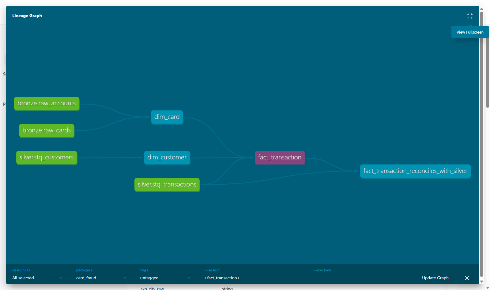

# dbt-spark for the gold layer

In Layer 1, dbt builds the gold star schema (`dim_customer` SCD2, `dim_card`, `dim_merchant`, `dim_date`,
incremental `fact_transaction`) as SQL `SELECT` models on Spark: dbt renders the SQL, works out the build order from
`ref()` / `source()`, runs it on Spark (Spark still does all the work), runs the tests, and writes docs and lineage
artifacts. Silver stays PySpark (the dedup window and the MERGE on `created_ts` need DataFrame code; `mergeSchema` is
in DP1 and the skew benchmark is its own job); everything after silver that is "join and reshape" is dbt.

| | |
|---|---|
| Code | [`pipelines/dbt/`](https://github.com/cvinhnguyen/card-fraud-platform/tree/a593ac7ac74f781dc50824b14e97f2620198be46/pipelines/dbt), [`pipelines/spark/build_gold_pyspark.py`](https://github.com/cvinhnguyen/card-fraud-platform/blob/a593ac7ac74f781dc50824b14e97f2620198be46/pipelines/spark/build_gold_pyspark.py) (the PySpark baseline) |
| Runs on | by hand: Spark Thrift Server, compose profile `dbt` (target `local`); in Airflow DP2: dbt's own Spark session (target `session`) |
| Reads | `silver.stg_transactions`, `silver.stg_customers`, `bronze.raw_cards`, `bronze.raw_accounts`, `bronze.raw_merchants` |
| Writes | `gold.dim_customer`, `gold.dim_card`, `gold.dim_merchant`, `gold.dim_date`, `gold.fact_transaction` (Delta under `s3a://lakehouse/gold`) |
| Related | [schema_design.md](schema_design.md), [airflow.md](airflow.md), [datahub.md](datahub.md), [spark_jobs.md](spark_jobs.md) |

## Run it

From the repo root, with the `batch` profile up and silver built ([spark_jobs.md](spark_jobs.md)):

```bash
docker compose -f infra/docker-compose.yaml --profile dbt up -d spark-thrift
.venv/Scripts/dbt build --project-dir pipelines/dbt --profiles-dir pipelines/dbt           # models + tests; --full-refresh rebuilds the fact
.venv/Scripts/dbt docs generate --project-dir pipelines/dbt --profiles-dir pipelines/dbt   # docs site + manifest for DataHub
# the PySpark baseline and the row-by-row comparison with dbt's tables
docker compose -f infra/docker-compose.yaml exec spark-master /opt/spark/bin/spark-submit \
    --conf spark.cores.max=2 --conf spark.executor.memory=1g /opt/jobs/build_gold_pyspark.py
```

In Airflow, DP2 runs `dbt_build` and `dbt_docs` after silver is validated.

## The dbt project

| Where | What |
|---|---|
| [`pipelines/dbt/models/gold/`](https://github.com/cvinhnguyen/card-fraud-platform/tree/a593ac7ac74f781dc50824b14e97f2620198be46/pipelines/dbt/models/gold) | 5 models; `fact_transaction` is `incremental` with `merge` on `transaction_id` and `partition_by txn_month` |
| [`pipelines/dbt/models/gold/schema.yml`](https://github.com/cvinhnguyen/card-fraud-platform/blob/a593ac7ac74f781dc50824b14e97f2620198be46/pipelines/dbt/models/gold/schema.yml) | 19 generic tests (unique, not_null, relationships from the fact to each dim) + descriptions |
| [`pipelines/dbt/tests/`](https://github.com/cvinhnguyen/card-fraud-platform/tree/a593ac7ac74f781dc50824b14e97f2620198be46/pipelines/dbt/tests) | 3 singular tests: one current version per customer, no gaps/overlaps between versions, fact reconciles with silver |
| [`pipelines/dbt/profiles.yml`](https://github.com/cvinhnguyen/card-fraud-platform/blob/a593ac7ac74f781dc50824b14e97f2620198be46/pipelines/dbt/profiles.yml) | `local`: Spark Thrift Server (by hand, :10000); `session`: dbt's own Spark session (Airflow DP2) |
| [`pipelines/airflow/dags/dp2_bronze_to_gold.py`](https://github.com/cvinhnguyen/card-fraud-platform/blob/a593ac7ac74f781dc50824b14e97f2620198be46/pipelines/airflow/dags/dp2_bronze_to_gold.py) | `dbt_build` + `dbt_docs` tasks after silver is validated |

The fact reads only the export dates it does not hold yet and MERGEs them on `transaction_id`
([`pipelines/dbt/models/gold/fact_transaction.sql` L4-L17](https://github.com/cvinhnguyen/card-fraud-platform/blob/a593ac7ac74f781dc50824b14e97f2620198be46/pipelines/dbt/models/gold/fact_transaction.sql#L4-L17)):

```sql
{{ config(
    materialized='incremental',
    incremental_strategy='merge',
    unique_key='transaction_id',
    partition_by=['txn_month'],
) }}

with txn as (
    select * from {{ source('silver', 'stg_transactions') }}
    where status = 'settled'
    
      and export_date > (select max(export_date) from {{ this }})
    
)
```

## Same tables as hand-written PySpark

To have something to compare with,
[`pipelines/spark/build_gold_pyspark.py`](https://github.com/cvinhnguyen/card-fraud-platform/blob/a593ac7ac74f781dc50824b14e97f2620198be46/pipelines/spark/build_gold_pyspark.py)
builds the same five tables by hand in PySpark (the way the course writes Spark jobs) into the database
`gold_pyspark`, and runs the same 22 checks as assertions
([`pipelines/spark/build_gold_pyspark.py` L82-L110](https://github.com/cvinhnguyen/card-fraud-platform/blob/a593ac7ac74f781dc50824b14e97f2620198be46/pipelines/spark/build_gold_pyspark.py#L82-L110)).
Then it compares both results row by row, with `EXCEPT ALL` in both directions
([`pipelines/spark/build_gold_pyspark.py` L113-L120](https://github.com/cvinhnguyen/card-fraud-platform/blob/a593ac7ac74f781dc50824b14e97f2620198be46/pipelines/spark/build_gold_pyspark.py#L113-L120)):

```python
def compare_with_dbt(spark: SparkSession) -> None:
    """Row-for-row comparison with the tables dbt built in `gold` (both directions of EXCEPT ALL)."""
    for name in ["dim_customer", "dim_card", "dim_merchant", "dim_date", "fact_transaction"]:
        mine, dbt = spark.table(f"{DB}.{name}"), spark.table(f"gold.{name}")
        cols = [c for c in dbt.columns if c in mine.columns]
        only_mine, only_dbt = mine.select(cols).exceptAll(dbt.select(cols)).count(), dbt.select(cols).exceptAll(mine.select(cols)).count()
        print(f"{name}: {mine.count():,} rows here, {dbt.count():,} in dbt gold, {len(cols)} columns compared, "
              f"only here {only_mine}, only in dbt {only_dbt}")
```

| Table | Rows (PySpark) | Rows (dbt) | Columns compared | Only in PySpark | Only in dbt |
|---|---:|---:|---:|---:|---:|
| `dim_customer` | 144,167 | 144,167 | 12 | 0 | 0 |
| `dim_card` | 130,120 | 130,120 | 10 | 0 | 0 |
| `dim_merchant` | 5,200 | 5,200 | 6 | 0 | 0 |
| `dim_date` | 1,019 | 1,019 | 8 | 0 | 0 |
| `fact_transaction` | 7,879,773 | 7,879,773 | 16 | 0 | 0 |

dbt-spark produces exactly the rows hand-written Spark produces. The two differ in how the work is written down and
what it costs to run.

## What it costs to write and run

Same Spark resources for both (2 cores, 1 GB executor), same data (after the Airflow backfill), same disk (Docker on
the USB HDD), full build of all five tables:

| | PySpark by hand | dbt-spark |
|---|---|---|
| Transformation code | 61 lines of Python | 95 lines of SQL (5 files) |
| Tests | 28 lines of assertion code for 22 checks | 22 tests: 19 declared in `schema.yml` (`[unique, not_null]`, `relationships`) + 14 lines of SQL for the 3 singular ones |
| Build order | written by hand (fact after its dims) | derived from `ref()` |
| Incremental fact | not done (full rebuild); a MERGE would add a max(export_date) lookup + `DeltaTable.merge` | `materialized='incremental'`, `unique_key`, one `is_incremental()` filter |
| Docs + lineage graph | none | `dbt docs generate`: column docs, model DAG (below), artifacts DataHub ingests |
| A failing test | stops at the first failed assert | runs every test, reports each one, skips only the models downstream of a failure |
| Full build + tests | 171 s build + 87 s checks = 258 s (inside the job) | `dbt build --full-refresh`: 477 s (wall, incl. starting the session) |
| Daily run | full rebuild every day (as above) | `dbt build`, nothing new: 405 s; in Airflow 158 s for one new export date (SSD, before the disk move) |

dbt is slower to run here. It runs one model and one test query at a time (threads 1 in the session target,
[`pipelines/dbt/profiles.yml` L17-L22](https://github.com/cvinhnguyen/card-fraud-platform/blob/a593ac7ac74f781dc50824b14e97f2620198be46/pipelines/dbt/profiles.yml#L17-L22)),
rebuilds the four dimension tables on every run (materialized `table`), and pays for starting a session. The PySpark
job computes everything in one session and counts its 22 checks in a few shared scans. With a long-lived Thrift
Server and `threads: 2` (target `local`) the session cost goes away; making the dimensions incremental would cut the
daily run further.

The line counts are close too. What dbt saves is plumbing: the PySpark version needs a `save()` helper, table
registration, an explicit build order and an assertion per test; in dbt those are a materialization config, `ref()`,
and one word per test.

### Adding one more dimension

Adding a `dim_terminal` (one row per POS/ATM terminal from the fact's `terminal_id`, with merchant and unit):

| Step | PySpark | dbt |
|---|---|---|
| Transformation | new function + entry in the build list, placed before the fact | `dim_terminal.sql` (a `SELECT`) |
| Write + register | reuse `save()` | nothing (materialization config of the folder) |
| Key tests | 2 assertions (unique, not_null) + 1 for the fact relationship | 3 lines in `schema.yml` |
| Docs / lineage | none | appears in `dbt docs` and, through the manifest, in DataHub |

## Tests that stop bad data

`dbt build` runs each model's tests (the 19 generic tests of `schema.yml` and the 3 singular ones) right after the
model and skips everything downstream of a failure. DP2 runs it
after the silver validation
([`pipelines/airflow/dags/dp2_bronze_to_gold.py` L58-L60](https://github.com/cvinhnguyen/card-fraud-platform/blob/a593ac7ac74f781dc50824b14e97f2620198be46/pipelines/airflow/dags/dp2_bronze_to_gold.py#L58-L60)),
so a dbt test failure fails the Airflow task and stops the pipeline before features are built. Every DP2 run of the
backfill passed 27/27 (5 models, 22 tests). The silver validation drill in [airflow.md](airflow.md) shows a failing
test one step earlier, and dbt's own report lists each failing test with the query that failed.

## Lineage graph

`dbt docs generate` (task `dbt_docs` in DP2) writes the docs site, and the graph is built from `ref()` / `source()`
alone. The docs site's lineage of `fact_transaction`, with the sources in green:



The same manifest feeds DataHub (`datahub_metadata` DAG, recipe
[`pipelines/airflow/dags/datahub_recipes/dbt.yml` L3-L10](https://github.com/cvinhnguyen/card-fraud-platform/blob/a593ac7ac74f781dc50824b14e97f2620198be46/pipelines/airflow/dags/datahub_recipes/dbt.yml#L3-L10)):
every dbt model is merged with the hive table it builds, so its SQL, column docs and the 27 test results sit on the
table's page next to the GE assertions.

## Gotchas

- The plan for SCD2 was a dbt `snapshot`, but the source already holds every version since 2024 and a snapshot only
  records changes from its first run, so `dim_customer` is a model (lag over a hash of the tracked attributes, city
  compared after normalization,
  [`pipelines/dbt/models/gold/dim_customer.sql` L4-L22](https://github.com/cvinhnguyen/card-fraud-platform/blob/a593ac7ac74f781dc50824b14e97f2620198be46/pipelines/dbt/models/gold/dim_customer.sql#L4-L22)).
  Decision recorded 2026-10-17.
- With Delta on the Thrift Server, `min/max(date)` failed with `ClassCastException LocalDate -> java.sql.Date`
  (Delta's metadata-only query vs the Thrift Server's java8 time API). Fix:
  `spark.databricks.delta.optimizeMetadataQuery.enabled=false`
  ([`infra/docker-compose.yaml` L259-L262](https://github.com/cvinhnguyen/card-fraud-platform/blob/a593ac7ac74f781dc50824b14e97f2620198be46/infra/docker-compose.yaml#L259-L262)).
- The Thrift Server holds a 1 GB driver and a 1 GB executor all the time. Next to DataHub in the 8 GB
  Docker VM that pushed the VM into swap, and Docker's DNS started failing (`Unable to execute HTTP request:
  seaweedfs`). In Airflow, dbt therefore uses the `session` target: it starts its own Spark session for the length
  of the task, queued in the `spark` pool like the other jobs; the Thrift Server stays for interactive use.
