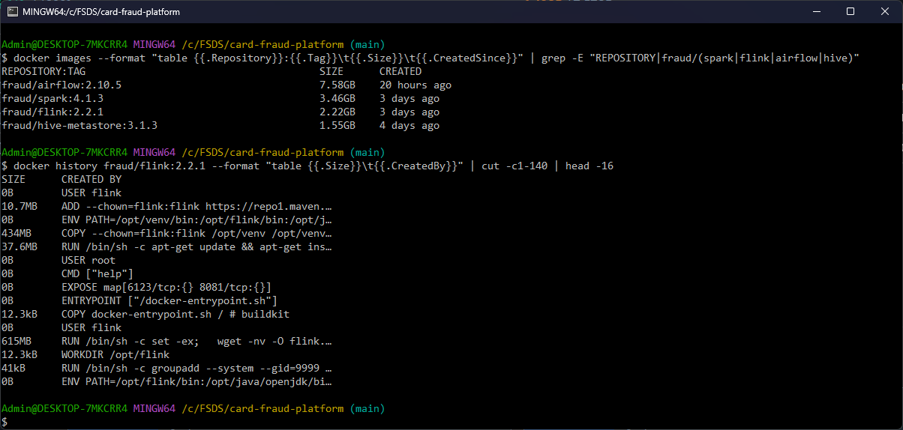

# Docker image optimization

Layer 1 builds four images from `infra/*/Dockerfile`; every other Layer 1 container runs an official image as is.
Multi-stage builds made the Flink and Airflow images smaller, and a new Spark image bakes in the jars that every
`spark-submit` used to download. This doc has the sizes before and after, what made the images big, and the checks
that the slim images still run the pipelines.

| | |
|---|---|
| Code | [`infra/flink/Dockerfile`](https://github.com/cvinhnguyen/card-fraud-platform/blob/a593ac7ac74f781dc50824b14e97f2620198be46/infra/flink/Dockerfile), [`infra/airflow/Dockerfile`](https://github.com/cvinhnguyen/card-fraud-platform/blob/a593ac7ac74f781dc50824b14e97f2620198be46/infra/airflow/Dockerfile), [`infra/spark/Dockerfile`](https://github.com/cvinhnguyen/card-fraud-platform/blob/a593ac7ac74f781dc50824b14e97f2620198be46/infra/spark/Dockerfile), [`infra/hive/Dockerfile`](https://github.com/cvinhnguyen/card-fraud-platform/blob/a593ac7ac74f781dc50824b14e97f2620198be46/infra/hive/Dockerfile) |
| Runs on | built by compose: `fraud/spark` and `fraud/hive-metastore` in profile `batch`, `fraud/flink` in `stream`, `fraud/airflow` in `orch` |
| Related | [flink_jobs.md](flink_jobs.md), [airflow.md](airflow.md), [spark_jobs.md](spark_jobs.md) |

## Run it

Build the images, then read their sizes the way the screenshot below does:

```bash
docker compose -f infra/docker-compose.yaml --profile batch build                   # fraud/spark, fraud/hive-metastore (fraud/airflow builds FROM fraud/spark)
docker compose -f infra/docker-compose.yaml --profile stream --profile orch build   # fraud/flink, fraud/airflow
docker images --format "table {{.Repository}}:{{.Tag}}\t{{.Size}}\t{{.CreatedSince}}" | grep -E "REPOSITORY|fraud/(spark|flink|airflow|hive)"
docker history fraud/flink:2.2.1 --format "table {{.Size}}\t{{.CreatedBy}}" | cut -c1-140 | head -16
```

## The four images

| Image | Built from | Why it exists |
|---|---|---|
| `fraud/spark:4.1.3` | `apache/spark:4.1.3-scala2.13-java17-python3-ubuntu` | Spark with the lakehouse jars baked in (Delta, S3A, Postgres JDBC, OpenLineage); new in P9 |
| `fraud/flink:2.2.1` | `flink:2.2.1-scala_2.12-java17` | PyFlink 2.2.1 + Kafka connector for the `stream` profile |
| `fraud/airflow:2.10.5` | `apache/airflow:2.10.5-python3.10` | Spark client (JRE + Spark 4.1.3), GE, dbt, DataHub plugin and CLI |
| `fraud/hive-metastore:3.1.3` | `apache/hive:3.1.3` | newer Postgres driver (SCRAM) + S3A jars ([`infra/hive/Dockerfile` L5-L9](https://github.com/cvinhnguyen/card-fraud-platform/blob/a593ac7ac74f781dc50824b14e97f2620198be46/infra/hive/Dockerfile#L5-L9)); 3 small layers, nothing to trim |

## Sizes

"Before" is the image the P6 / P7 Dockerfiles built; "after" is the multi-stage Dockerfile now in the repo. Docker
Desktop's containerd image store reports a `docker images` size that is neither the content size nor the download
size, so the table has two measures: the sum of the layer sizes in `docker history` (what the image adds on disk,
comparable between images) and the `docker images` figure (uncompressed, as stored by Docker Desktop).

| Image | Layers before | Layers after | Change | `docker images` before -> after |
|---|---:|---:|---:|---|
| `fraud/flink:2.2.1` | 1.80 GB | **1.38 GB** | **-23%** | 2.95 -> 2.22 GB |
| `fraud/airflow:2.10.5` | 5.39 GB | **4.50 GB** | **-17%** (-29% before the jars below were added) | 7.66 -> 6.50 GB (5.19 GB without them) |
| `fraud/spark:4.1.3` (new; was `apache/spark` + jars downloaded per run) | 1.35 GB | 2.06 GB | +0.71 GB of jars, once | 2.15 -> 3.46 GB |

The Airflow image after the change also carries the lakehouse jars (it copies Spark from `fraud/spark`), about
0.65 GB that the old image downloaded at run time instead. Without them the same Dockerfile is about 3.85 GB of
layers (4.50 minus the jars), hence the -29%.

On 2026-10-21 Docker reports the sizes below, and Flink and Spark match the table. The Airflow image is bigger by then
(7.58 GB) because layers were added to it after this measurement: Layer 2 put a Feast venv in it (Feast, MLflow,
XGBoost, scikit-learn, kfp, deltalake,
[`infra/airflow/Dockerfile` L23-L27](https://github.com/cvinhnguyen/card-fraud-platform/blob/a593ac7ac74f781dc50824b14e97f2620198be46/infra/airflow/Dockerfile#L23-L27))
and Layer 3 the Docker provider for the RAG DAG
([`infra/airflow/Dockerfile` L56-L58](https://github.com/cvinhnguyen/card-fraud-platform/blob/a593ac7ac74f781dc50824b14e97f2620198be46/infra/airflow/Dockerfile#L56-L58)).
`docker history` of the Flink image shows what the multi-stage build adds on top of the base image: the venv copied
from the build stage (434 MB), the apt layer and the Kafka connector jar:



## What made the images big

Flink (`fraud/flink`, before 2.95 GB): one `RUN` installed `python3 python3-pip python3-venv` with apt and
`apache-flink==2.2.1` with pip into the system Python: an 893 MB layer. Inside it:

| Part | Size | Needed at run time? |
|---|---:|---|
| `pyflink/lib`: the Flink 2.2.1 jars | 267 MB | no: the same jars are already in `/opt/flink/lib` of the base image |
| `pyflink/opt`, `fn_execution`, Python modules | ~70 MB | yes |
| pyarrow, pandas, numpy, apache-beam, grpc, ... | ~420 MB | yes (PyFlink's Python runtime) |
| `__pycache__` / `tests` directories | 87 MB / 60 MB | no |
| pip, setuptools, `python3-pip` / `python3-venv` packages | ~40 MB | no: only to install |

The old instruction is not in the git history (the first commit of `infra/flink/Dockerfile` is already the
multi-stage build), so it is shown here as text:

```text
# before: one layer with apt pip + venv, pip into the system Python, every jar twice
RUN apt-get update && apt-get install -y --no-install-recommends python3 python3-pip python3-venv \
    && rm -rf /var/lib/apt/lists/* && ln -sf /usr/bin/python3 /usr/bin/python \
    && pip3 install --no-cache-dir --break-system-packages apache-flink==2.2.1
```

Airflow (`fraud/airflow`, before 7.66 GB): on top of the 2.14 GB Airflow image:

| Layer | Size | Problem |
|---|---:|---|
| JRE + `/opt/spark` copied from the Spark image | 282 + 518 MB | Spark's `examples/`, `R/`, `data/`, `tests/` not needed by a client |
| `apache-airflow-providers-apache-spark` | 367 MB | it declares `pyspark` (342 MB) as a dependency; `SparkSubmitOperator` only calls the `spark-submit` binary |
| DataHub CLI venv | 1.71 GB | the `delta-lake` extra pulled `deltalake` (135 MB) and a second `pyspark` (343 MB); delta-lake ingestion is not used (lakehouse tables come from OpenLineage) |
| GE venv | 622 MB | pip, caches and test suites included |
| DataHub plugin | 57 MB | separate `pip install` layer |

Spark (stock `apache/spark`): every Spark container ran the stock image and `spark-defaults.conf` listed
`spark.jars.packages`, so each `spark-submit` resolved Delta, hadoop-aws (with the 600 MB AWS SDK bundle), the
Postgres driver and OpenLineage through Ivy, and the standalone worker copied them into every application's work
directory. After a day of Airflow runs the worker's container layer held 94 GB of these copies and filled the disk
([airflow.md](airflow.md#gotchas)).

## What changed

### Flink: multi-stage build, duplicate jars linked

[`infra/flink/Dockerfile`](https://github.com/cvinhnguyen/card-fraud-platform/blob/a593ac7ac74f781dc50824b14e97f2620198be46/infra/flink/Dockerfile)
has a `build` stage with `python3-venv` that installs PyFlink into `/opt/venv`, replaces `pyflink/lib` (the same
Flink 2.2.1 jars as `/opt/flink/lib`) with a symlink, and deletes `__pycache__` / `tests` and pip. The final stage
only installs the `python3` runtime (37.6 MB layer) and copies the venv (434 MB layer, was 893 MB). `PATH` points
`python` (the default `python.executable` of the Python workers) at the venv
([`infra/flink/Dockerfile` L4-L20](https://github.com/cvinhnguyen/card-fraud-platform/blob/a593ac7ac74f781dc50824b14e97f2620198be46/infra/flink/Dockerfile#L4-L20)):

```dockerfile
FROM flink:2.2.1-scala_2.12-java17 AS build
USER root
RUN apt-get update && apt-get install -y --no-install-recommends python3-venv
RUN python3 -m venv /opt/venv && /opt/venv/bin/pip install --no-cache-dir apache-flink==2.2.1
# pyflink/lib is a copy of the Flink 2.2.1 jars already in /opt/flink/lib (267 MB): link instead of copy.
# Bytecode caches and test suites are not needed at run time.
RUN cd /opt/venv/lib/python3.12/site-packages \
    && rm -rf pyflink/lib && ln -s /opt/flink/lib pyflink/lib \
    && find /opt/venv -depth \( -name __pycache__ -o -name tests \) -type d -exec rm -rf {} + \
    && /opt/venv/bin/pip uninstall -y -q pip

FROM flink:2.2.1-scala_2.12-java17
USER root
RUN apt-get update && apt-get install -y --no-install-recommends python3 && rm -rf /var/lib/apt/lists/*
COPY --from=build --chown=flink:flink /opt/venv /opt/venv
# `python` (the default python.executable of the Python workers) resolves to the venv
ENV PATH=/opt/venv/bin:$PATH
```

### Airflow: venvs built in a stage, only what a Spark client needs

[`infra/airflow/Dockerfile`](https://github.com/cvinhnguyen/card-fraud-platform/blob/a593ac7ac74f781dc50824b14e97f2620198be46/infra/airflow/Dockerfile)
builds the venvs in a `venvs` stage and copies into the final stage only the parts of Spark a client needs:

| Layer | Before | After | How |
|---|---:|---:|---|
| JRE + Spark | 282 + 518 MB | 282 + 484 MB | copy `bin/`, `jars/`, `python/lib` only (no `examples/`, `R/`, `data/`, `tests/`) |
| Spark provider | 367 MB | (in 34 MB) | `--no-deps`: its `pyspark` dependency (342 MB) is never imported by `SparkSubmitOperator` ([`infra/airflow/Dockerfile` L53-L60](https://github.com/cvinhnguyen/card-fraud-platform/blob/a593ac7ac74f781dc50824b14e97f2620198be46/infra/airflow/Dockerfile#L53-L60)) |
| DataHub CLI venv | 1.71 GB | | no `delta-lake` extra (it brought `deltalake` 135 MB and a second `pyspark` 343 MB) ([`infra/airflow/Dockerfile` L19-L22](https://github.com/cvinhnguyen/card-fraud-platform/blob/a593ac7ac74f781dc50824b14e97f2620198be46/infra/airflow/Dockerfile#L19-L22)) |
| GE + dbt + DataHub venvs | 2.46 GB together | 1.29 GB | built in the `venvs` stage, copied without `__pycache__`, `tests` and pip |

The final stage copies the JRE, the parts of Spark a client needs and the venvs
([`infra/airflow/Dockerfile` L36-L50](https://github.com/cvinhnguyen/card-fraud-platform/blob/a593ac7ac74f781dc50824b14e97f2620198be46/infra/airflow/Dockerfile#L36-L50)):

```dockerfile
FROM apache/airflow:2.10.5-python3.10
USER root
COPY --from=spark /opt/java/openjdk /opt/java/openjdk
# A Spark client needs bin/, jars/ and the Python libs; examples, R, data, tests and sbin stay in the Spark image.
COPY --from=spark /opt/spark/bin /opt/spark/bin
COPY --from=spark /opt/spark/jars /opt/spark/jars
COPY --from=spark /opt/spark/python/lib /opt/spark/python/lib
COPY --from=spark /opt/spark/RELEASE /opt/spark/RELEASE
ENV JAVA_HOME=/opt/java/openjdk \
    SPARK_HOME=/opt/spark \
    PATH=/opt/spark/bin:/opt/java/openjdk/bin:$PATH
# dbt-artifacts is a named volume: created here so it is owned by group 0 and writable by uid 185 (spark)
RUN mkdir -p /opt/spark/conf /opt/airflow/dbt-artifacts && chown airflow:0 /opt/airflow/dbt-artifacts \
    && chmod g+rwx /opt/airflow/dbt-artifacts
COPY --from=venvs --chown=airflow:0 /opt/venvs /opt/venvs
```

### Spark: jars baked into a new image

[`infra/spark/Dockerfile` L6-L21](https://github.com/cvinhnguyen/card-fraud-platform/blob/a593ac7ac74f781dc50824b14e97f2620198be46/infra/spark/Dockerfile#L6-L21)
resolves the packages once in a build stage and copies only the 13 jars Spark does not ship into `/opt/spark/jars`,
plus the `delta-spark` Python module. The whole Ivy directory is not copied because Ivy also pulls an older jackson
that breaks Spark on the classpath. The image is 1.3 GB bigger than `apache/spark`, once, instead of 600 MB per
application. Nothing is downloaded at run time any more, `spark.jars.packages` / `spark.jars.ivy` are gone from
`spark-defaults.conf`, and the Thrift Server no longer needs its 13-jar `extraClassPath` workaround (which also
carried a Git Bash path-conversion artifact since P4). The worker also cleans up finished applications' directories
(`SPARK_WORKER_OPTS`,
[`infra/docker-compose.yaml` L224-L227](https://github.com/cvinhnguyen/card-fraud-platform/blob/a593ac7ac74f781dc50824b14e97f2620198be46/infra/docker-compose.yaml#L224-L227)).

## Checks after the rebuild

A PyFlink job in the new Flink image (Python UDF through the venv and the linked `pyflink/lib`) returned `[2, 4, 6]`.
The Airflow image imports GE 0.18.19, dbt-core 1.11.16 + dbt-spark 1.11.0, the DataHub CLI 1.5.0.17, the Spark
provider and the DataHub listener, and `spark-submit --version` reports 4.1.3.

Import checks were not enough: the first slim Airflow image passed all of them and still broke dbt (see
[Gotchas](#gotchas)). Functional checks on the images in the repo:

| Check | Image | Result |
|---|---|---|
| `pipelines/flink/check_windows.py --replay-from "2026-06-01 00:00" --limit 20000` | `fraud/flink:2.2.1` | baseline 96.08%, lateness 98.47%, dedup **100.00%** card windows exact: same as before the change ([flink_jobs.md](flink_jobs.md); baseline sent 484 late events to the side output instead of 483, watermark timing) |
| `dp2_bronze_to_gold` + `dp3_gold_to_features` for 2026-10-15 (Spark jobs, GE, dbt build with its 14 tests) | `fraud/airflow:2.10.5` | both runs `success` |

## Layer order and cache

Each Dockerfile puts what changes least first: base image and system packages, then the large dependency installs,
then small files. In the Airflow image the venv stage is cached separately from the final stage, so changing the
plugin version or the Spark image rebuilds only the last layers (the rebuild after switching to `fraud/spark`
reused the cached venvs).

## glibc vs musl

All images stay on glibc bases (Debian for Airflow, Ubuntu for Spark and Flink). The Airflow image copies the JRE and
Spark out of the Ubuntu-based Spark image; both are built against glibc, so they run unchanged. An Alpine (musl) base
would have needed a musl JRE and would break the manylinux wheels of pyarrow, numpy and grpc.

## Gotchas

- The first slim Airflow image passed every import check, then DP2 failed in the functional run of 2026-10-18. The
  `find ... -name tests` cleanup had also deleted `dbt/include/global_project/macros/materializations/tests`, which is
  code (the `test` materialization and `get_where_subquery`), so all 14 dbt tests failed to compile
  (`'get_where_subquery' is undefined`, `No materialization 'test'`). numpy 2 has the same trap: it imports
  `numpy._core.tests._natype` at run time. The cleanup now skips the `dbt` and `numpy` packages (a few hundred KB
  kept,
  [`infra/airflow/Dockerfile` L28-L34](https://github.com/cvinhnguyen/card-fraud-platform/blob/a593ac7ac74f781dc50824b14e97f2620198be46/infra/airflow/Dockerfile#L28-L34)).

## Limits

- The Layer 2 images (`infra/ml`, `infra/mlflow`, `ml/Dockerfile`, `services/*/Dockerfile`) came later and are not
  part of this comparison.
