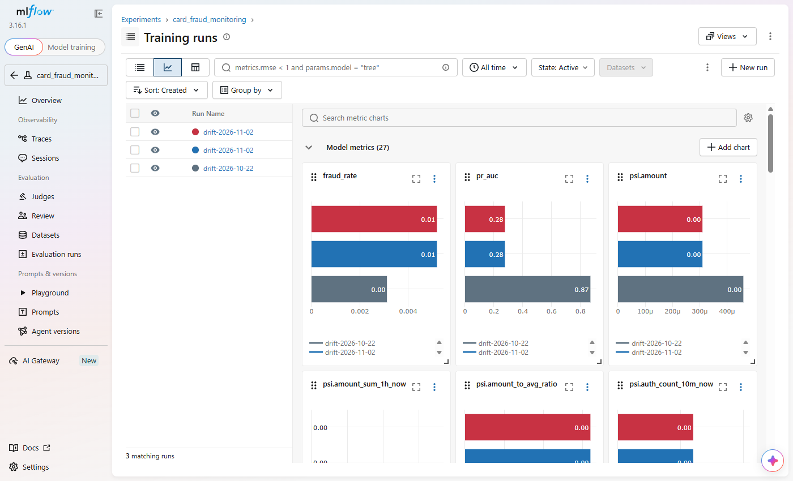
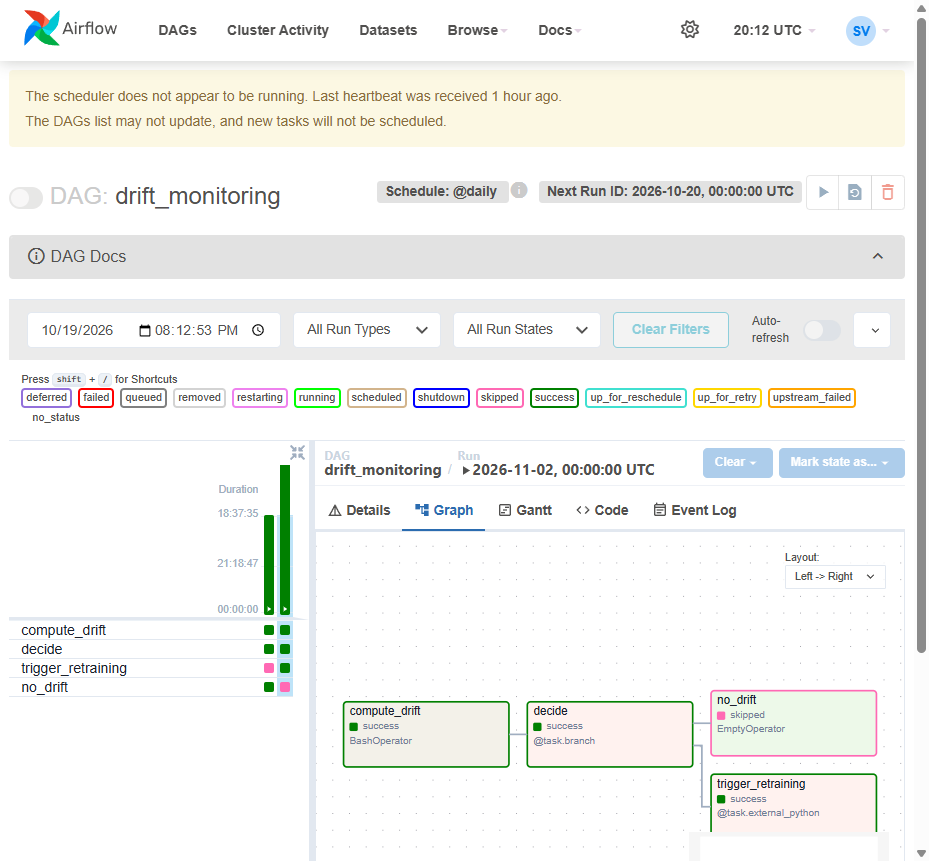

# Drift: simulation, detection, retraining

## The live period (`generator/generate_drift.py`)

The 2-year history ends on 2026-10-15. The drift generator continues the same world (same customers, cards,
merchants, devices: `world()` replays the setup with the same seeds,
[`generator/generate_drift.py` L33-L44](https://github.com/cvinhnguyen/card-fraud-platform/blob/35d4295a1e5a409fa242bc6aa9eff9b06038c111/generator/generate_drift.py#L33-L44))
for 2026-10-16 .. 2026-11-15, driven by the
`drift:` block of `generator/config.yaml`:

| Phase | Days | Kind | What changes |
|---|---|---|---|
| normal | 10-16 .. 10-25 | none | same as history |
| `fraud_shift` | from 10-26 | **concept drift** | fraud rings pay from the victim's own phone (malware): 60% of ecom frauds on a device the card already knows, so `is_new_device`, the model's strongest signal, fades; frauds lean to large night payments; fraud rate 0.3% -> 0.5% |
| `sale_season` | 11-09 .. 11-12 (11/11) | **data drift** | volume x2, online merchants' weight x2, amounts x1.6: the inputs move, fraud behaviour does not |

Outputs in `data/drift/`: the authorization stream (with retries and late events, as the history), the request
fields per payment, the core-banking export, and the **ground truth** `labels/` = the 2-column table
`(transaction_id, is_fraud)`. `--upload` puts the export and the labels on S3
(`s3://lakehouse/ml/ground_truth/labels.parquet`); DP1-DP3 then process the new days as any other.

The drift is defined entirely in the generator's configuration,
[`generator/config.yaml` L97-L112](https://github.com/cvinhnguyen/card-fraud-platform/blob/35d4295a1e5a409fa242bc6aa9eff9b06038c111/generator/config.yaml#L97-L112):

```yaml
drift:                           # Layer 2: live period after the training data (generator/generate_drift.py)
  start: 2026-10-16
  end: 2026-11-15
  daily_transactions: 8000       # the 2026 daily volume of the training period
  phases:                        # a day takes every phase whose [from, to] covers it (no `to` = until end)
    - name: sale_season          # 11/11 shopping festival (data drift: volume, channel mix, amounts)
      from: 2026-11-09
      to: 2026-11-12
      volume_scale: 2.0
      online_weight: 2.0         # online merchants' share of payments x2 (renormalized)
      amount_scale: 1.6
    - name: fraud_shift          # fraud rings switch to large night payments from the victim's own phone (malware):
      from: 2026-10-26           # concept drift, the "new device" signal fades
      fraud_rate: 0.005
      risk_weights: {ecom: 2.0, night: 5.0, high_amount: 4.0, foreign: 1.0}
      fraud_known_device_share: 0.6
```

The label table has exactly two columns, `transaction_id` and `is_fraud` (279,915 rows), and joins to any table by the
id. Joined to the export of 2026-11-03 (payments of 11-02):

```
  transaction_id  is_fraud       card_id              txn_ts  amount_vnd channel
txn_00010002127a         1 card_dbd353d5 2026-11-02 12:28:39      211000    ecom
txn_0001000212ca         1 card_50bf2cd5 2026-11-02 17:07:43      596000    ecom
txn_0001000211d5         0 card_a594c46e 2026-11-02 19:12:38      335000     pos
txn_0001000211d6         0 card_6aa9546c 2026-11-02 20:29:42       87000     pos
```

Generated 2026-10-19 (13 s, 279,915 payments):

| Phase | Days | Payments / day | Ecom share | Avg amount (VND) | Fraud rate | Frauds | of which on a known device |
|---|---:|---:|---:|---:|---:|---:|---:|
| normal | 10 | 7,989 | 71.7% | 429,369 | 0.30% | 236 | 0 |
| `fraud_shift` | 17 | 7,982 | 72.2% | 430,354 | 0.52% | 705 | 383 |
| `sale_season` + `fraud_shift` | 4 | 16,083 | 83.6% | 651,068 | 0.53% | 343 | 201 |

The inputs of `fraud_shift` days match the normal ones (ecom share, amounts) while the fraud rate almost doubles and
over half of the ecom frauds come from a device the card already knew: concept drift with no visible data drift.
The sale days move every input.

## Real-time detection (Drift API, `services/drift_api`)

The Scoring API logs every decision to Kafka; `ml/jobs/drift_forwarder.py` posts them to the Drift API in batches of up
to 1,000 (offsets committed after the API accepted the batch,
[`ml/jobs/drift_forwarder.py` L24-L41](https://github.com/cvinhnguyen/card-fraud-platform/blob/35d4295a1e5a409fa242bc6aa9eff9b06038c111/ml/jobs/drift_forwarder.py#L24-L41)).
Scoring never waits on drift detection.

- Reference = `reference_profile.json` of the production model: decile edges of each input and of the score on
  the validation period, the share of rows per bin, plus a `missing` bin (a feature that suddenly goes NULL, a
  broken join or a dead stream, drifts too). `services/predictor/fetch_model.py` downloads it next to the model;
  run it before starting `drift-api` (compose bind-mounts the file, and a missing file becomes an empty directory).
- Live histograms in Redis, one hash per minute and input (`drift:<minute>:<input>`, `HINCRBY bin 1`, TTL 6 h,
  [`services/drift_api/app/store.py` L24-L38](https://github.com/cvinhnguyen/card-fraud-platform/blob/35d4295a1e5a409fa242bc6aa9eff9b06038c111/services/drift_api/app/store.py#L24-L38)).
  The replicas keep no state: any number of them can count into the same buckets.
- `GET /v1/drift` sums the last 15 minutes and computes the **PSI** per input,
  `sum (live% - ref%) * ln(live% / ref%)`: < 0.1 stable, 0.1-0.25 moderate, > 0.25 major. Below `MIN_EVENTS` (100,
  ~10 per decile bin) an input is `too_few_events` and cannot raise `drift`: the first live run reported PSI 12 and
  `drift: true` from 9 events
  ([`services/drift_api/app/main.py` L75-L86](https://github.com/cvinhnguyen/card-fraud-platform/blob/35d4295a1e5a409fa242bc6aa9eff9b06038c111/services/drift_api/app/main.py#L75-L86)).
  Fallback decisions are
  not counted (no model output). The gauges `drift_psi{input}` follow every report.

The PSI of one input, with a floor `EPS = 1e-4` for empty bins,
[`services/drift_api/app/psi.py` L24-L34](https://github.com/cvinhnguyen/card-fraud-platform/blob/35d4295a1e5a409fa242bc6aa9eff9b06038c111/services/drift_api/app/psi.py#L24-L34):

```python
def psi(reference: dict[str, float], live: dict[str, int]) -> float | None:
    """PSI of live counts against reference shares (same bin labels); None without live data."""
    total = sum(live.values())
    if total == 0:
        return None
    out = 0.0
    for b in set(reference) | set(live):
        e = max(reference.get(b, 0.0), EPS)
        a = max(live.get(b, 0) / total, EPS)
        out += (a - e) * math.log(a / e)
    return out
```

Replay caveat: `ml/tools/replay_scoring.py` plays a day of events in ~80 s (~1,000x). Kafka -> Flink -> Redis takes a
few seconds, i.e. hours of replayed time, so a card's last authorizations are often not online yet when its next
payment is scored: the realtime `*_now` features read low and show some PSI that production would not. Request
features (amount, channel, ...) and daily stats are not affected, and the daily DAG reads the offline store.

PSI on inputs sees **data drift** within minutes, without labels. It cannot see concept drift: in `fraud_shift`
the inputs barely move, the meaning of `is_new_device` does.

### Replay run (2026-10-19)

```bash
python ml/tools/replay_scoring.py --from-day 2026-10-18 --rate 30 --concurrency 8 --max-lag 300 \
    --score-days 2026-10-18,2026-10-19,2026-10-27,2026-11-03     # the other days go to Kafka only
python ml/tools/drift_by_day.py --days 2026-10-19,2026-10-27,2026-11-03
```

Days 10-16 .. 11-03 went through Kafka -> Flink -> Feast (online and offline) and raw landing; four days were also
scored through the API at 30 requests/s (one worker scores ~45/s, see [serving.md](serving.md)), 32,017 decisions
with 34 fallbacks. The Drift API received every decision through `fraud_predictions` and the forwarder. Its
15-minute window is wall-clock time, so `ml/tools/drift_by_day.py` regroups the same logged decisions by the payment's
own day, with the Drift API's binning and PSI code, and joins the ground truth:

| Day | Phase | Payments | Frauds | Live PR-AUC | Largest input PSI |
|---|---|---:|---:|---:|---|
| 10-19 | normal | 8,021 | 22 | **0.902** | `days_since_last_active` 0.81; every other input < 0.03 |
| 11-03 | `fraud_shift` | 7,935 | 48 | **0.293** | `days_since_last_active` 4.88; every other input < 0.03 |

- Concept drift, as designed: the inputs of 11-03 look like 10-19's (PSI < 0.03 on amount, channel, device,
  realtime counts...), the fraud rate doubles and PR-AUC falls from 0.90 to 0.29. The Drift API cannot see this;
  the daily check with labels (below) can.
- `days_since_last_active` drifts more every day (0.81 on day 3, 4.88 on day 19). It is `request_ts - stats_ts`,
  and the online daily stats stay at their last materialization (10-16) because DP3 did not run during the replay.
  Here PSI catches a stale batch pipeline, not the model: in production, an alert on this input means "the nightly
  DP3 / materialize did not run".
- The sale days (11-09 .. 11-12) were not replayed (see below), so this run has no data-drift example on the
  request inputs; the generator table above shows how strongly they move.

Three things went wrong on the way, all now handled:

| Problem | Effect | Fix |
|---|---|---|
| Live `rt_features` checkpointed into JobManager memory (5 MB cap) | every checkpoint failed past 5 MB of state, the job looped through restarts, 24k events behind | checkpoint storage on S3 ([feature_store.md](feature_store.md)) |
| Scoring a day while Flink is behind | 10-27 was scored with features ~3 days stale (`is_new_device` = 1 for every device of the last 3 days): PR-AUC 0.34 mixes concept drift and staleness, so 11-03 is the clean shift day | `--max-lag`: a day starts only when the Flink groups are within 300 events of the topic end |
| A first attempt at 100/s kept producing after scoring fell behind, and a benchmark re-scored 10-16 later | the first 10 hours of 10-18 were scored with their own authorization already online (`auth_count_10m_now` = 1 for 22% of 10-18, against 0.05% in reality) | 10-18 is left out; the Drift API's wall-clock window also counted the benchmark, so test traffic must be tagged and excluded from drift statistics |

Running the live days through Airflow: the live period is dated after the machine clock (the runs here were on
2026-10-19), and Airflow does not run a task whose logical date is in the future (`RunnableExecDateDep`), so a
backfill of DP1 for 2026-11-03 deadlocked with every task waiting. Two settings make it work without changing any
DAG's schedule: `AIRFLOW__SCHEDULER__ALLOW_TRIGGER_IN_FUTURE` (compose) lets the scheduler run the *triggered* DAGs
(DP2, DP3, `feast_materialize`, all `schedule=None`), and the two daily DAGs run as `airflow dags test <dag> <ds>`,
which executes the same tasks in-process and records the run like any other. One run for ds = 11-03 loads every
live export up to it, because every load is incremental:

```bash
docker exec airflow-scheduler airflow dags test dp1_source_to_bronze 2026-11-03   # -> DP2 -> DP3 -> materialize
docker exec airflow-scheduler airflow dags test drift_monitoring 2026-10-22
docker exec airflow-scheduler airflow dags test drift_monitoring 2026-11-02
```

The first try of DP1 failed its own validation: a manual run's data interval ends on ds itself, so the export bound
`data_interval_end` loaded the folders up to ds while the validation (correctly) looked for `ds + 1`. DP1 now uses
`macros.ds_add(ds, 1)` for the sensor and the load, the same day as the validation in every kind of run.

Why the replay stopped at 11-03: the rubric asks for a drift-detection API and an Airflow drift pipeline on
the offline store that triggers retraining; a real-time replay of the whole live period is not required. The
replay covers the normal and `fraud_shift` phases, which the daily check below uses.

## Daily check with labels (DAG `drift_monitoring`)

Concept drift needs labels. Every day the DAG
([`drift_monitoring.py` L23-L51](https://github.com/cvinhnguyen/card-fraud-platform/blob/35d4295a1e5a409fa242bc6aa9eff9b06038c111/pipelines/airflow/dags/drift_monitoring.py#L23-L51))
runs `ml/jobs/drift_job.py` on the last 7 days:

1. entity rows of the window = ground truth + request fields + device, `event_timestamp = txn_ts - 1 ms` (as
   training), point-in-time features from the Feast offline store with the production model's feature service;
2. scores them with the production booster (MLflow alias `production`);
3. PR-AUC, recall at 1% FPR and fraud rate on the window; PSI of every input and the score vs the model's reference;
4. one MLflow run per check in experiment `card_fraud_monitoring` (the history of drift and live performance);
5. branch: **retrain** when any PSI > 0.25 (`drift_psi_threshold`) or the PR-AUC fell more than 0.05
   (`drift_pr_auc_drop`) below the model's own test PR-AUC
   ([`ml/jobs/drift_job.py` L72-L76](https://github.com/cvinhnguyen/card-fraud-platform/blob/35d4295a1e5a409fa242bc6aa9eff9b06038c111/ml/jobs/drift_job.py#L72-L76));
   `trigger_retraining` starts the KFP pipeline
   `train_fraud_model` through the KFP API with `label_as_of` = the run's day.

The new model still has to pass evaluation (better than production on the same test period) and a reviewer before
it serves. Ground-truth labels here are known at once because the data is simulated; in production they would
mature over 60 days, so the daily check would lag that much (the PSI path does not).

### Runs (2026-10-19)

After one DP1 -> DP2 -> DP3 -> `feast_materialize` chain for ds = 11-03 (16 minutes; `check_online`: 200 cards
active on 11-03, 0 missing online, 0 stale), the DAG ran for two windows of the live period:

| `ds` | Window | Rows | Fraud rate | PR-AUC (test 0.828) | recall @ 1% FPR | Worst input PSI | Branch |
|---|---|---:|---:|---:|---:|---|---|
| 2026-10-22 | 10-16 .. 10-22, normal | 56,025 | 0.31% | **0.869** | 0.966 | 0.019 `days_since_card_issue` | `no_drift` |
| 2026-11-02 | 10-27 .. 11-02, `fraud_shift` | 55,850 | 0.52% | **0.277** | 0.369 | 0.022 `days_since_card_issue` | `trigger_retraining` |

The two windows have the same inputs (no PSI above 0.03) and opposite verdicts: the decision came from the
PR-AUC drop alone, which is what concept drift looks like and why this check needs ground truth. Each run is an
MLflow run in the experiment `card_fraud_monitoring` (11-02 twice, identical: the first try failed at the trigger).



The 11-02 run in Airflow: `decide` branched to `trigger_retraining` (success) and skipped `no_drift`; the grid's
other column is the 10-22 run, which took the other branch. (The scheduler banner: it was stopped to free memory
for the KFP run once the DAG had triggered it.)



The 11-02 run submitted the KFP run `drift-retrain-2026-11-02` (`a7cfc35f`) through the KFP API.

Two bugs found on the way: `trigger_retraining(host, ds)` failed with `The key 'ds' in args is a part of kwargs and
therefore reserved` (Airflow passes its context by name; the parameter is now `label_as_of`), and the job's Spark
session needs the Hive metastore up (the Feast offline store reads through the session catalog).

The retrain: the run the DAG submitted (`a7cfc35f`, `label_as_of` 2026-11-02) failed in step 2 with
`OutOfMemoryError: Java heap space` (a heap tuned to the previous run's peak, see
[ml_training.md](ml_training.md)); resubmitted with the same argument (`ce0b680c`), its evaluate step failed once on
MLflow's presigned URLs (same page) and passed after a KFP retry of the failed step:

| Test period of 11-02 (same rows for both) | Retrained challenger | Production v1 |
|---|---:|---:|
| PR-AUC | **0.883** | 0.844 |
| recall @ 1% FPR | 0.9275 | 0.9283 |

`passed = False`, nothing registered: PR-AUC gained 0.039 (the gate asks for 0.005), but recall at 1% FPR fell by
0.0008 and the rule allows no loss there. The gate is strict by design; a reviewer could relax it per release.

The bigger limit is the label delay: `label_as_of` 2026-11-02 trains on payments up to 60 days before it (maturity
window), so not a single `fraud_shift` payment (from 10-26) is in the training set yet. Retraining cannot fix this
concept drift until its labels mature (or until confirmed frauds are labelled faster than the 60-day worst case); what
the platform does today is detect it the week it starts and report it.
