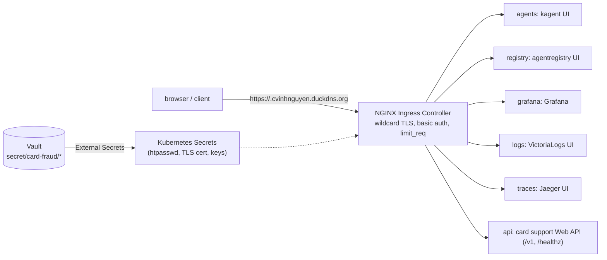
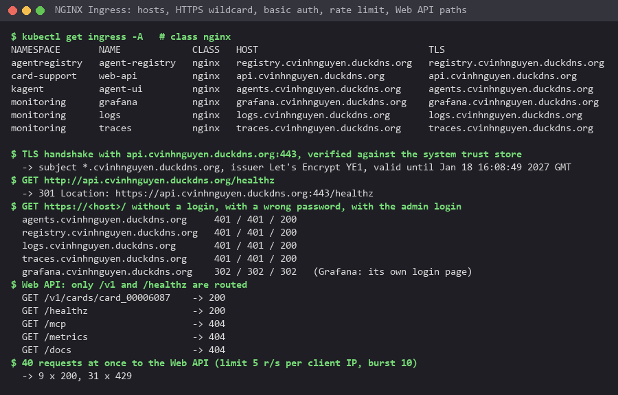

# Edge routing, HTTPS and secrets

Nothing in the cluster is reached through a port-forward or a NodePort by people: every UI and the public Web API sit
behind one NGINX Ingress Controller, on their own host name under a real domain, with HTTPS, a login and a rate limit.
Every secret the platform uses lives in HashiCorp Vault and reaches the cluster through External Secrets. This page
covers rubric A37 to A43 and A54.

## NGINX Ingress Controller

F5 NGINX Ingress Controller 5.6.3 (chart 2.7.3) runs on the kind node's ports 80 and 443, which
[`infra/k8s/kind.yaml`](../infra/k8s/kind.yaml) maps to `127.0.0.1`. [`infra/k8s/edge.sh`](../infra/k8s/edge.sh)
installs it and then the small chart [`infra/k8s/edge`](../infra/k8s/edge): one Ingress per route, all generated from
[`values.yaml`](../infra/k8s/edge/values.yaml) by [`templates/ingresses.yaml`](../infra/k8s/edge/templates/ingresses.yaml).

| Host | Service | Rubric | Login | Rate limit per client IP |
|---|---|---|---|---|
| `grafana.<domain>` | Grafana (metrics) | C37 | Grafana's own login | 20 r/s, burst 60 |
| `logs.<domain>` | VictoriaLogs UI | C38 | basic auth | 20 r/s, burst 60 |
| `traces.<domain>` | Jaeger UI | C39 | basic auth | 20 r/s, burst 60 |
| `agents.<domain>` | kagent UI, to test the agents | C40, C42 | basic auth | 20 r/s, burst 60; no buffering and 300 s reads, so streamed answers arrive as they are written |
| `registry.<domain>` | agentregistry UI | C41 | basic auth | 20 r/s, burst 60 |
| `api.<domain>` | card support Web API, only `/v1` and `/healthz` | C43 | basic auth | 5 r/s, burst 10 |

The annotations in the template do the work: `nginx.org/basic-auth-secret` points at `edge-basic-auth` (an htpasswd
file for the user `admin`, from Vault), `nginx.org/limit-req-rate` and `limit-req-burst` set the per-IP limit and
`limit-req-reject-code: 429` the answer above it, `redirect-to-https` sends plain HTTP to HTTPS. The Web API route
lists its two paths instead of `/`: the MCP endpoint is only reachable through agentgateway (with an agent's key) and
`/metrics` only by Prometheus inside the cluster.

## Domain and HTTPS

The domain is `cvinhnguyen.duckdns.org` (DuckDNS, free), with its A record set to `127.0.0.1` because the platform runs
on this machine. One Let's Encrypt wildcard certificate, `*.cvinhnguyen.duckdns.org`, covers every host. The machine is
not reachable from the internet, so the HTTP-01 challenge cannot work; [`infra/k8s/tls.sh`](../infra/k8s/tls.sh) runs
lego v5.5.2 in a container with the DNS-01 challenge through the DuckDNS API, writes the certificate and key into Vault,
and External Secrets syncs them to `nginx-ingress/wildcard-tls`, NGINX's default wildcard TLS secret. Certificates last
90 days: re-run `tls.sh` within the last 30 (this one expires on 2027-01-18).

The certificate verifies against the system's trust store (issuer Let's Encrypt YE1), plain HTTP gets a 301 to HTTPS,
every host but Grafana answers 401 without a login and with a wrong password and 200 with the right one (Grafana
redirects to its own login page), the Web API answers `/v1/...` and `/healthz` but 404 for `/mcp`, `/metrics` and
`/docs`, and of 40 requests sent at once 9 passed and 31 got 429. The agents' chat UI over HTTPS is in
[agents.md](agents.md#chat-with-the-agents-kagent-ui).

## Secrets: HashiCorp Vault + External Secrets

[`infra/k8s/vault.sh`](../infra/k8s/vault.sh) installs Vault 2.0.4 (chart 0.34.1) and External Secrets Operator 2.11.0
and connects them:

- Vault runs the KV v2 engine at `secret/`. Every secret of the cluster is at `secret/card-fraud/<namespace>/<name>`.
- External Secrets logs in to Vault with Kubernetes auth: the role `external-secrets` is bound to that operator's
  ServiceAccount and has the read-only policy `card-fraud-read` on `secret/card-fraud/*`. No Vault token is stored in
  the cluster.
- [`infra/k8s/secrets.sh`](../infra/k8s/secrets.sh) writes the values from the gitignored `infra/.env` into Vault
  (JSON on stdin to the HTTP API, never on a command line or in a log) and one ExternalSecret per secret
  (ClusterSecretStore `vault`, refreshed hourly). Changing a value in Vault changes it in the cluster within the hour.
- Values never enter git: `infra/.env` and `infra/.secrets/` are gitignored and `infra/make_env.py` generates random
  local values. The gateway keeps only SHA-256 hashes of its API keys.

16 secrets in 7 namespaces, from the agents' gateway keys to the TLS certificate, all `SecretSynced`. Jenkins is
outside the cluster and keeps its own credentials, filled from Docker secrets by configuration as code
([cicd.md](cicd.md#jenkins-setup)); the cosign signing key is one of them.

## Limits on this machine

- Vault runs in dev mode: in memory and unsealed at start. After a restart it is empty until `vault.sh` runs again
  (the synced Kubernetes Secrets stay in place meanwhile). A real deployment would run it with Raft storage, several
  replicas and auto-unseal through a KMS.
- The domain points at `127.0.0.1`, so the HTTPS hosts work only on this machine; the certificate is a real public one.
