# Edge routing, HTTPS and secrets

Nothing in the cluster is reached through a port-forward or a NodePort by people: every UI and the public Web API sit
behind one NGINX Ingress Controller, on their own host name under a real domain, with HTTPS, a login and a rate limit.
Every secret the platform uses lives in HashiCorp Vault and reaches the cluster through External Secrets. This page
covers rubric A37 to A43 and A54.

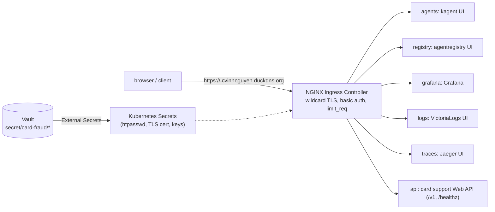

## NGINX Ingress Controller

F5 NGINX Ingress Controller 5.6.3 (chart 2.7.3) runs on the kind node's ports 80 and 443, which
[`infra/k8s/kind.yaml`](../infra/k8s/kind.yaml) maps to `127.0.0.1`. [`infra/k8s/edge.sh`](../infra/k8s/edge.sh)
installs it and then the small chart [`infra/k8s/edge`](../infra/k8s/edge): one Ingress per route, all generated from
[`values.yaml`](../infra/k8s/edge/values.yaml) by [`templates/ingresses.yaml`](../infra/k8s/edge/templates/ingresses.yaml).

| Host | Service | Rubric | Login | Rate limit per client IP |
|---|---|---|---|---|
| `grafana.<domain>` | Grafana (metrics) | C37 | Grafana's own login | 20 r/s, burst 60 |
| `logs.<domain>` | VictoriaLogs UI | C38 | basic auth | 20 r/s, burst 60 |
| `traces.<domain>` | Jaeger UI | C39 | basic auth | 20 r/s, burst 60 |
| `agents.<domain>` | kagent UI, to test the agents | C40, C42 | basic auth | 20 r/s, burst 60; no buffering and 300 s reads, so streamed answers arrive as they are written |
| `registry.<domain>` | agentregistry UI | C41 | basic auth | 20 r/s, burst 60 |
| `api.<domain>` | card support Web API, only `/v1` and `/healthz` | C43 | basic auth | 5 r/s, burst 10 |

The annotations in the template do the work: `nginx.org/basic-auth-secret` points at `edge-basic-auth` (an htpasswd
file for the user `admin`, from Vault), `nginx.org/limit-req-rate` and `limit-req-burst` set the per-IP limit and
`limit-req-reject-code: 429` the answer above it, `redirect-to-https` sends plain HTTP to HTTPS. The Web API route
lists its two paths instead of `/`: the MCP endpoint is only reachable through agentgateway (with an agent's key) and
`/metrics` only by Prometheus inside the cluster.

[`infra/k8s/edge/templates/ingresses.yaml` L9-L29](https://github.com/cvinhnguyen/card-fraud-platform/blob/35d4295a1e5a409fa242bc6aa9eff9b06038c111/infra/k8s/edge/templates/ingresses.yaml#L9-L29):

```yaml
  annotations:
    {{- if $r.auth }}
    nginx.org/basic-auth-secret: {{ $.Values.basicAuthSecret }}
    nginx.org/basic-auth-realm: "Card fraud platform"
    {{- end }}
    nginx.org/limit-req-rate: {{ $r.rate }}
    nginx.org/limit-req-burst: {{ $r.burst | quote }}
    nginx.org/limit-req-no-delay: "true"
    nginx.org/limit-req-reject-code: "429"
    {{- if $r.streaming }}
    nginx.org/proxy-buffering: "false"
    nginx.org/proxy-read-timeout: "300s"
    {{- end }}
    {{- if $.Values.tls }}
    nginx.org/redirect-to-https: "true"
    {{- end }}
spec:
  ingressClassName: nginx
  {{- if $.Values.tls }}
  tls:
    - hosts: [{{ printf "%s.%s" $r.host $.Values.domain }}]   # no secretName: the controller's wildcard TLS secret
```

[`infra/k8s/edge/values.yaml` L46-L55](https://github.com/cvinhnguyen/card-fraud-platform/blob/35d4295a1e5a409fa242bc6aa9eff9b06038c111/infra/k8s/edge/values.yaml#L46-L55), the Web API route:

```yaml
  - name: web-api             # card support Web API: card data and chunks by id, policy search, fraud score
    namespace: card-support
    host: api
    service: {name: card-support-mcp, port: 8000}
    auth: true
    rate: 5r/s
    burst: 10
    paths:                     # REST only: /mcp is reachable only through agentgateway, /metrics only by Prometheus
      - {path: /v1, type: Prefix}
      - {path: /healthz, type: Exact}
```

The controller and the Ingresses in the cluster (the last line is KServe's own Istio ingress from
[serving.md](serving.md), not part of the edge):

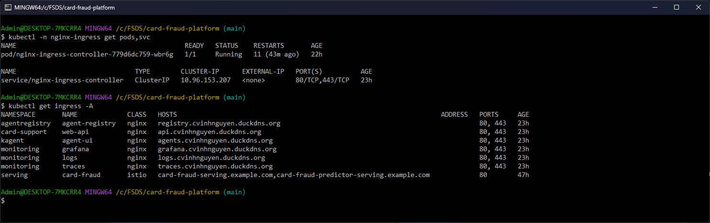

Every host opened in Chrome, logged in as `admin`:

| `https://agents.cvinhnguyen.duckdns.org` (C40, C42) | `https://registry.cvinhnguyen.duckdns.org` (C41) |
|---|---|
| 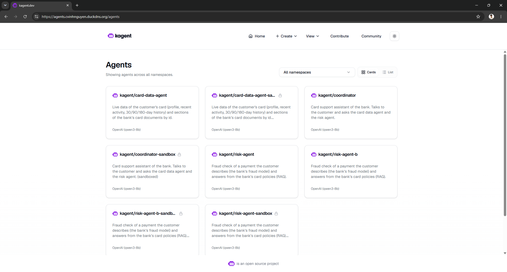 | 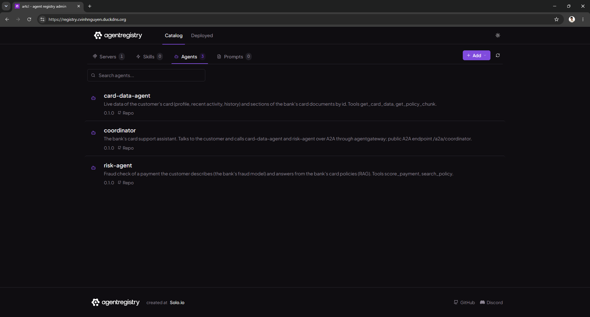 |
| **`https://logs.cvinhnguyen.duckdns.org` (C38)** | **`https://traces.cvinhnguyen.duckdns.org` (C39)** |
| 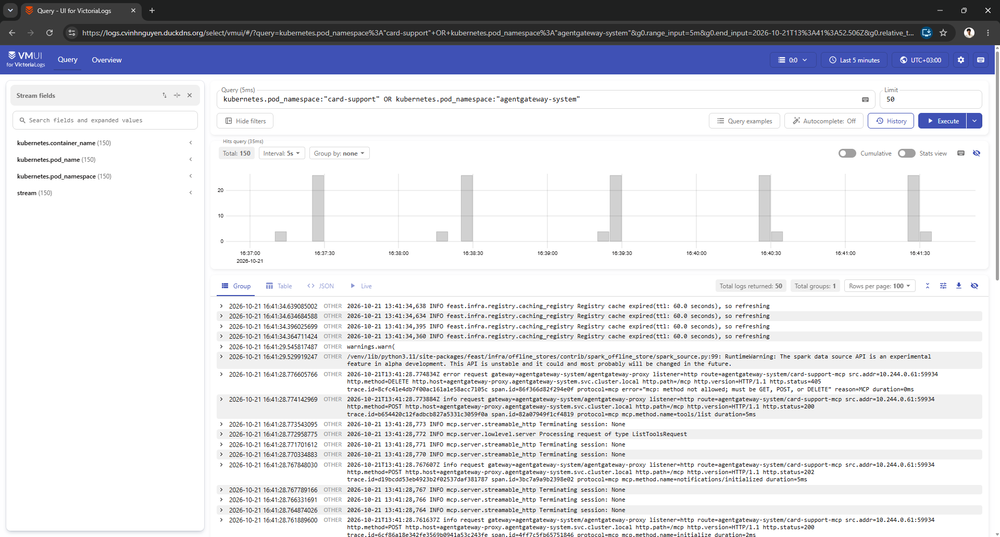 | 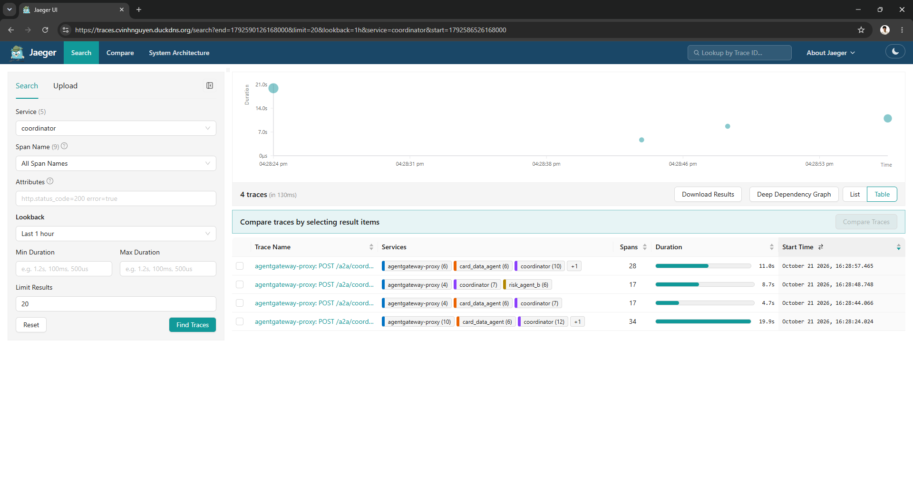 |
| **`https://grafana.cvinhnguyen.duckdns.org` (C37)** | **`https://api.cvinhnguyen.duckdns.org` (C43)** |
| 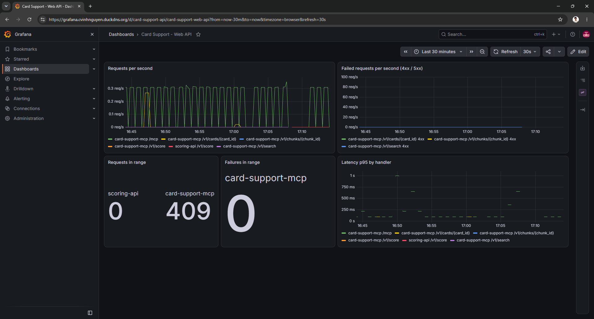 | 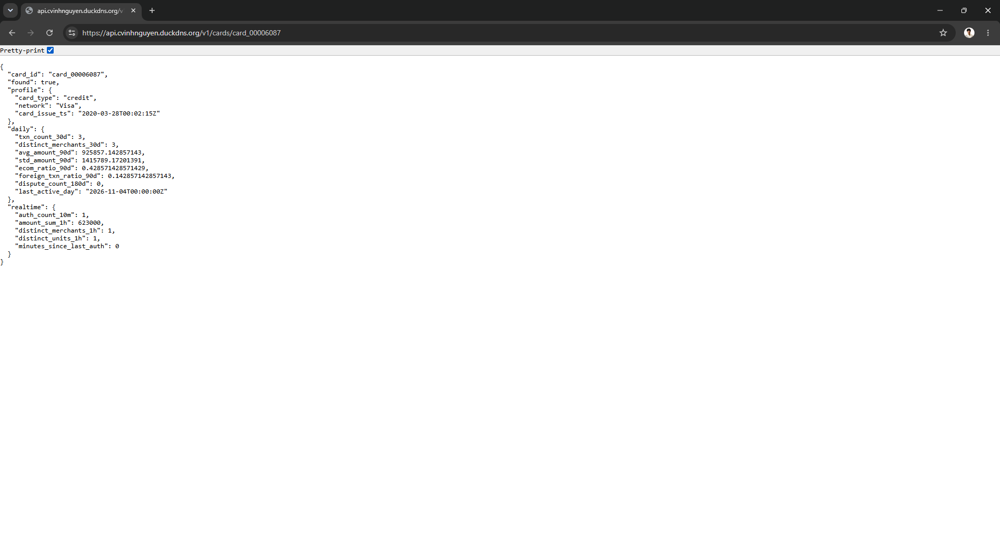 |

## Domain and HTTPS

The domain is `cvinhnguyen.duckdns.org` (DuckDNS, free), with its A record set to `127.0.0.1` because the platform runs
on this machine. One Let's Encrypt wildcard certificate, `*.cvinhnguyen.duckdns.org`, covers every host. The machine is
not reachable from the internet, so the HTTP-01 challenge cannot work; [`infra/k8s/tls.sh`](../infra/k8s/tls.sh) runs
lego v5.5.2 in a container with the DNS-01 challenge through the DuckDNS API, writes the certificate and key into Vault,
and External Secrets syncs them to `nginx-ingress/wildcard-tls`, NGINX's default wildcard TLS secret. Certificates last
90 days: re-run `tls.sh` within the last 30 (this one expires on 2027-01-18).

[`infra/k8s/tls.sh` L22-L26](https://github.com/cvinhnguyen/card-fraud-platform/blob/35d4295a1e5a409fa242bc6aa9eff9b06038c111/infra/k8s/tls.sh#L22-L26):

```sh
# the token reaches the container through the environment (-e NAME without a value), not the command line
DUCKDNS_TOKEN=$(val DUCKDNS_TOKEN) MSYS_NO_PATHCONV=1 docker run --rm -e DUCKDNS_TOKEN -v "$dir:/data" \
  "goacme/lego:$LEGO" run --accept-tos --dns duckdns -d "*.$DOMAIN" --key-type ec256 --path /data ${email:+--email "$email"}
sh infra/k8s/secrets.sh   # cert + key -> Vault -> nginx-ingress/wildcard-tls
sh infra/k8s/edge.sh      # wildcard TLS on, HTTPS hosts
```

What a client sees, from Git Bash: openssl reads the certificate the Web API presents and verifies it against the
CA bundle, and plain HTTP is redirected to HTTPS:

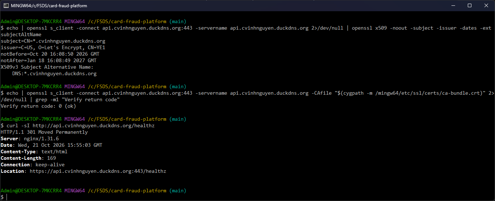

### Login and rate limit

Without a login, Chrome shows its own sign-in dialog for the realm NGINX sends:

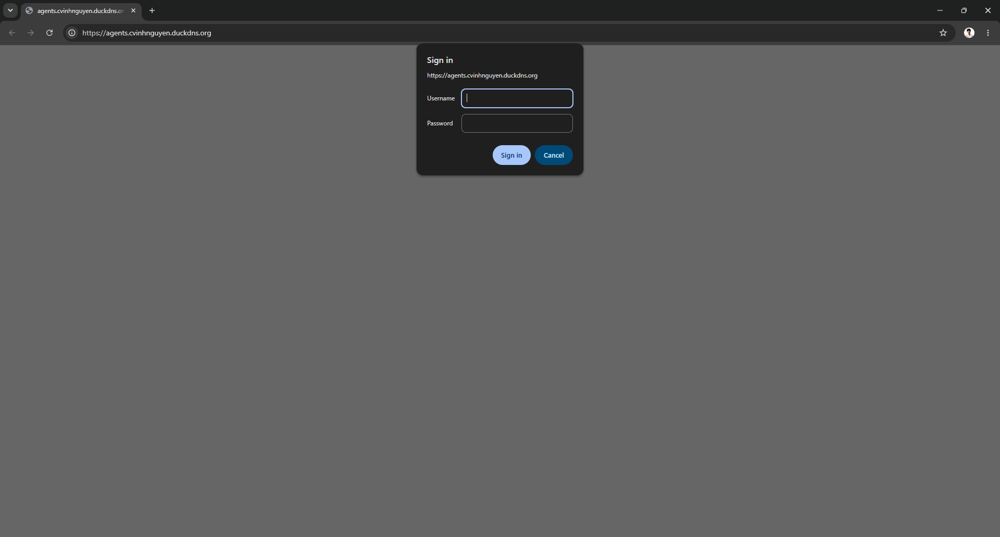

Status codes per host without a login, with a wrong password and with the `admin` login (Grafana is not behind basic
auth and redirects to its own login page), then the Web API paths, then the rate limit: the Web API allows 5 requests
per second per client IP with a burst of 10, and 40 requests sent at once get 13 answers and 27 `429`. The password
comes from the environment; only its variable name appears:

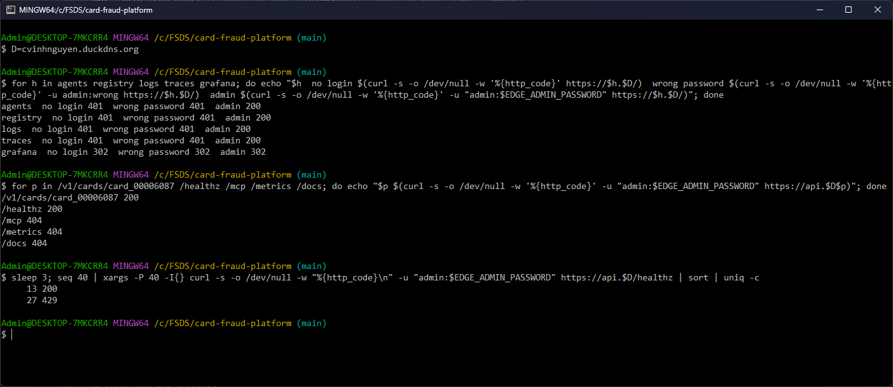

The same limit in the browser, right after such a burst:

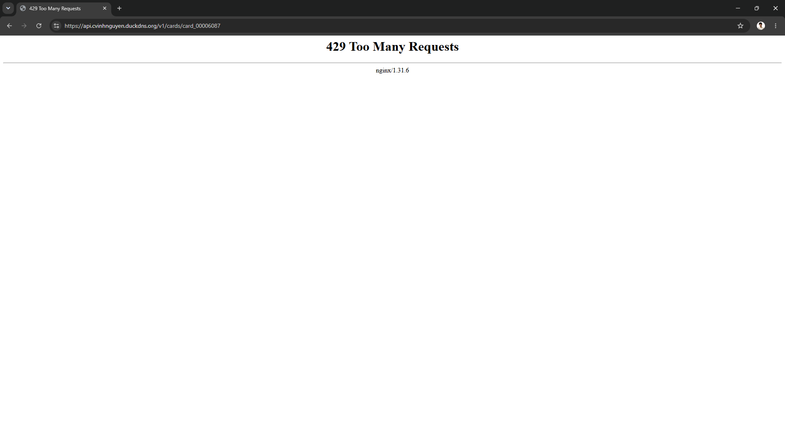

The agents' chat UI over HTTPS is in [agents.md](agents.md#chat-with-the-agents-kagent-ui).

## Secrets: HashiCorp Vault + External Secrets

[`infra/k8s/vault.sh`](../infra/k8s/vault.sh) installs Vault 2.0.4 (chart 0.34.1) and External Secrets Operator 2.11.0
and connects them:

- Vault runs the KV v2 engine at `secret/`. Every secret of the cluster is at `secret/card-fraud/<namespace>/<name>`.
- External Secrets logs in to Vault with Kubernetes auth: the role `external-secrets` is bound to that operator's
  ServiceAccount and has the read-only policy `card-fraud-read` on `secret/card-fraud/*`. No Vault token is stored in
  the cluster.
- [`infra/k8s/secrets.sh`](../infra/k8s/secrets.sh) writes the values from the gitignored `infra/.env` into Vault
  (JSON on stdin to the HTTP API, never on a command line or in a log) and one ExternalSecret per secret
  (ClusterSecretStore `vault`, refreshed hourly). Changing a value in Vault changes it in the cluster within the hour.
- Values never enter git: `infra/.env` and `infra/.secrets/` are gitignored and `infra/make_env.py` generates random
  local values. The gateway keeps only SHA-256 hashes of its API keys.

[`infra/k8s/secrets.sh` L34-L54](https://github.com/cvinhnguyen/card-fraud-platform/blob/35d4295a1e5a409fa242bc6aa9eff9b06038c111/infra/k8s/secrets.sh#L34-L54),
one call per secret: the value goes to Vault, the ExternalSecret tells ESO where to read it:

```sh
secret() {
  ns=$1 name=$2 type=$3; shift 3
  kubectl get ns "$ns" >/dev/null 2>&1 || return 0
  json=$(for kv in "$@"; do printf '"%s":"%s",' "${kv%%=*}" "${kv#*=}"; done)
  printf '{"data":{%s}}' "${json%,}" | curl -fsS -o /dev/null -K "$hdr" --data @- \
    "http://127.0.0.1:18200/v1/secret/data/card-fraud/$ns/$name" || { echo "vault write failed: $ns/$name" >&2; return 1; }
  kubectl apply -f - >/dev/null <<EOF
apiVersion: external-secrets.io/v1
kind: ExternalSecret
metadata:
  name: $name
  namespace: $ns
  annotations: {force-sync: "$sync"}   # sync now, not at the next refresh
spec:
  refreshInterval: 1h
  secretStoreRef: {kind: ClusterSecretStore, name: vault}
  target: {name: $name, creationPolicy: Owner, template: {type: $type}}
  dataFrom: [{extract: {key: card-fraud/$ns/$name, decodingStrategy: ${DECODE:-None}}}]
EOF
  echo "  vault -> $ns/$name"
}
```

The NGINX login is one of them
([L68-L69](https://github.com/cvinhnguyen/card-fraud-platform/blob/35d4295a1e5a409fa242bc6aa9eff9b06038c111/infra/k8s/secrets.sh#L68-L69)):
only the apr1 hash of `EDGE_ADMIN_PASSWORD` is stored.

```sh
htpasswd="admin:$(printf '%s' "$(val EDGE_ADMIN_PASSWORD)" | openssl passwd -apr1 -stdin)"
for ns in kagent agentregistry monitoring card-support; do secret "$ns" edge-basic-auth nginx.org/htpasswd htpasswd="$htpasswd"; done
```

Below are Vault's status and the role External Secrets logs in with. The root token of dev mode stays inside the Vault
pod (`$VAULT_DEV_ROOT_TOKEN_ID` is expanded there, never typed or shown):

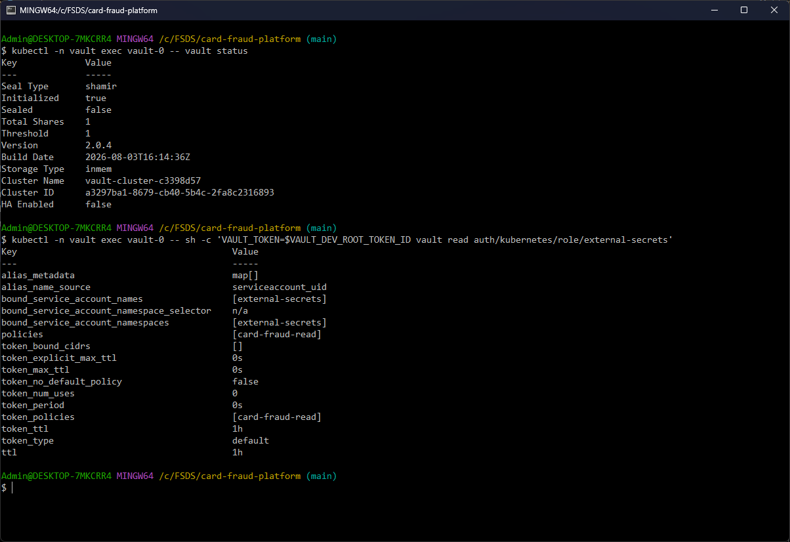

The secrets in Vault (names only, `vault kv list` never prints values) and every ExternalSecret synced from them:

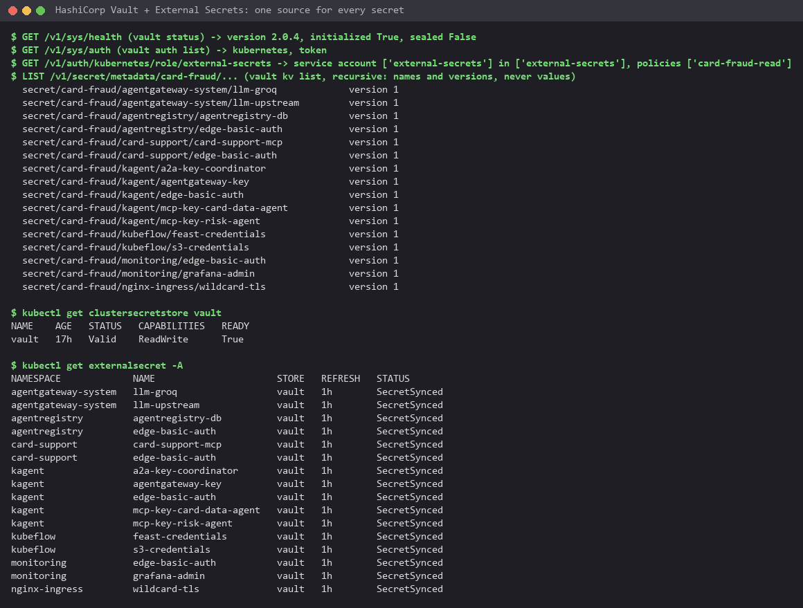

16 secrets in 7 namespaces, from the agents' gateway keys to the TLS certificate, all `SecretSynced`. Jenkins is
outside the cluster and keeps its own credentials, filled from Docker secrets by configuration as code
([cicd.md](cicd.md#jenkins-setup)); the cosign signing key is one of them.

## Limits on this machine

- Vault runs in dev mode: in memory and unsealed at start. After a restart it is empty until `vault.sh` runs again
  (the synced Kubernetes Secrets stay in place meanwhile). A real deployment would run it with Raft storage, several
  replicas and auto-unseal through a KMS.
- The domain points at `127.0.0.1`, so the HTTPS hosts work only on this machine; the certificate is a real public one.
