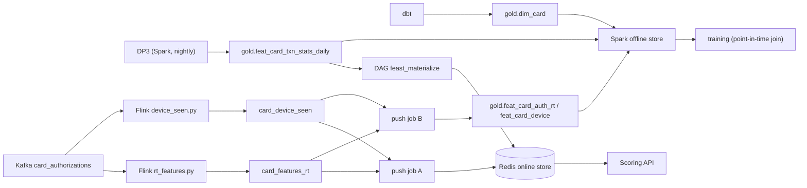
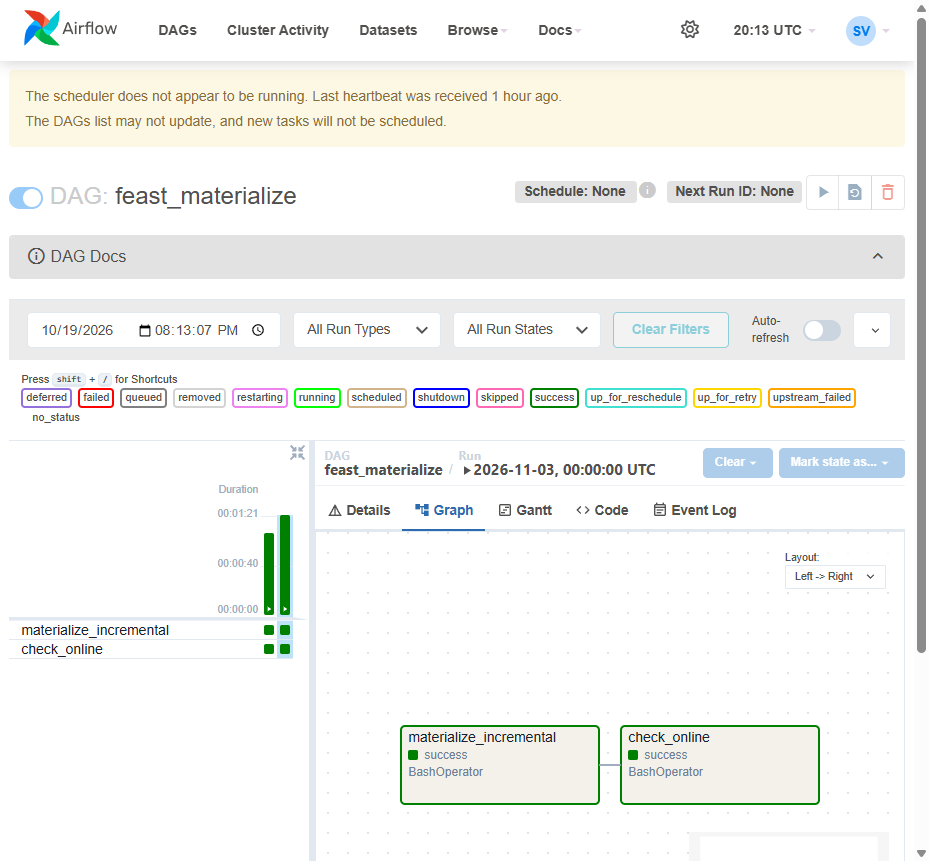

# Feature store (Feast)

The model reads the same features in training and in serving through one Feast repository
(`ml/feature_repo/`): the Spark offline store over the Delta tables of the lakehouse for training, Redis for the
Scoring API. Feast 0.66, SQL registry in Postgres (`ml-db`, database `feast`).



## Feature views

| View | Source | Key | TTL | Written by |
|---|---|---|---|---|
| `card_txn_stats_daily` | `gold.feat_card_txn_stats_daily` | card | none | DP3, one row the night after each day the card was active |
| `card_profile` | `gold.dim_card` (SQL query) | card | none | dbt |
| `card_auth_realtime` | push source `card_auth_rt_push` -> `gold.feat_card_auth_rt` | card | 1 h | Flink `rt_features.py`, push jobs A / B |
| `card_device` | push source `card_device_push` -> `gold.feat_card_device` | card, device | none | Flink `device_seen.py`, push jobs A / B |
| `fraud_request_features` | on demand: the request + the four views | | | computed per request (pandas) |

Feature service `fraud_model_v1` = 7 daily stats + the 13 on-demand features. The model is trained on exactly this
list and the API asks for exactly this list, so the two cannot drift apart: a model with other inputs gets
`fraud_model_v2`.

## TTL

TTL is how old a stored value may be and still describe the card. One Feast behaviour drives every choice: **the
Redis lookup returns the stored value however old it is**. TTL bounds the point-in-time join (training) and the
materialization window, not online reads. Anything the model must see "aged" is therefore computed in the on-demand
view from the value's own timestamp, so training and serving age it the same way.

| View | TTL | Why |
|---|---|---|
| daily stats | none (`timedelta(0)`) | the newest row is the card's history however old it is; a card idle for 5 months still has a 180-day dispute count. Its age is a feature (`days_since_last_active`, from `stats_ts`) instead of a cut-off |
| card profile | none | issue date, type, network never change |
| realtime | 1 h, the longest window | the join drops older rows (NULL). Online the stored row stays, so the on-demand view turns a value older than its own window (10 min or 1 h, from `rt_ts`) into 0 and NULL into 0: "no authorization in the window". Both paths give the model the same number |
| card device | none | "this card has used this device before" never expires |

## Train / serve consistency

Three decisions keep the training rows identical to what the API sees:

1. **Entity timestamp = payment time - 1 ms.** When the API scores a payment, Flink has not processed it yet: the
   online store holds features of the *previous* authorizations. Training joins at `txn_ts - 1 ms`, so the
   point-in-time join also excludes the payment itself.
2. **DP3 rows land the night after the activity.** A row for day L has `event_timestamp = L + 1` and windows that
   end at L. A payment on day L+1 sees the stats up to L, which is what Redis holds that day (materialized after DP3
   of L). Layer 1 wrote one row on each day D the card *paid*, windows ending at D-1: that row existed only
   because of the payment being scored. For a card that last paid 20 days ago, training saw windows ending
   yesterday; serving has the row of 20 days ago, whose 30-day window covers other days.
3. **Streaming features for history come from replaying history (Kappa).** The full authorization history is
   replayed through the same Flink jobs and push job B, so the offline rows were produced by the code that produces
   the online ones, and there is no second implementation in Spark to keep equal.

## Pipelines

| What | How | When |
|---|---|---|
| Daily stats -> Redis | DAG `feast_materialize` ([run of 2026-11-03](#materialize-run)): `feast materialize-incremental <ds+1>` then `ml/tools/check_online.py` (sample of cards active on ds read back from Redis, values compared with Delta) | triggered by DP3 |
| Streaming -> Redis | push job A (`ml/jobs/push_job.py --to online`), consumer group per job, offsets committed after the write | continuous |
| Streaming -> Delta | push job B (`--to offline`), `deltalake` append (Feast's Spark offline push appends plain Parquet next to the Delta log, which Delta readers ignore) | continuous; `--until-idle` for the backfill |
| Definitions | `feast apply` from `ml/feature_repo/` | after a change |
| Bootstrap | `feast materialize 2000-01-01T00:00:00 <ds+1>T00:00:00` once: the first `materialize-incremental` of a view without TTL only looks back a limited window, which would skip `card_profile` rows (stamped at the card's issue date) and cards idle for a long time | once, before the first daily run |

<a id="materialize-run"></a>The run for ds 2026-11-03 (triggered by DP3): `materialize-incremental` to 2026-11-04, then `check_online` over
200 cards active that day: 0 missing online, 0 stale.



## Kappa backfill (history of the streaming features)

```bash
# empty topics card_authorizations / card_features_rt / card_device_seen, landing, bronze.raw_card_authorizations
python generator/producer.py --topic card_authorizations --speed 0            # 8,119,499 events, in 4 chunks (RAM)
docker exec flink-jobmanager flink run -d -py /opt/flink/jobs/rt_features.py --topic card_authorizations --parallelism 4
docker exec flink-jobmanager flink run -d -py /opt/flink/jobs/device_seen.py --topic card_authorizations
docker exec flink-jobmanager flink run -d -py /opt/flink/jobs/raw_landing.py
docker compose -f infra/docker-compose.yaml --profile ml up -d push-online push-offline   # after Flink: catch up
```

Result: 8,119,499 authorizations -> 7,999,526 feature rows (the 119,973 = 1.48% network retries are dropped by the
dedup) and 214,808 first (card, device) pairs. The producer needs 111 s. Flink is the slow part, and it took three
runs to reach a steady rate:

| Run | Setting | Rate of `rt_features` |
|---|---|---|
| 1 | 4 slots, parallelism 1, Python state cache 1,000 keys (default) | 188 events/s (12 h) |
| 2 | 8 slots (4 GB TaskManager), parallelism 5, state cache 200k keys | 1,020 events/s for 2 minutes, then the 8 GB Docker VM swapped (91 MB free, 2.2 GB swap) and it nearly stopped |
| 3 | 6 slots (3.5 GB), parallelism 4, state cache 30k keys, push jobs started only after Flink | **~870 events/s, steady** (~2.5 h) |

Each element of a PyFlink function crosses to a Python worker, and one worker uses one core, so the job scales with
parallelism (state is keyed by card) until memory runs out: every slot adds a Python process (~0.3 GB). The state
cache only needs to hold the keys of one worker (130k cards / 4). Bounded runs do not commit Kafka offsets: before
any `--live` run, move the `rt_features` and `device_seen` groups to the end of the topic, or live mode replays the
history again.

## Gotchas met

- Live Flink jobs need checkpoint storage. Bounded backfill runs never checkpoint; the live `rt_features`
  checkpoints every 10 s (offsets are committed on checkpoints), and by default into JobManager memory, capped at
  5 MB. Its state (card histories + dedup ids) passed that during the replay: `Size of the state is larger than the
  maximum permitted memory-backed state. Size=5380688, maxSize=5242880`, 25 failed checkpoints, then a restart loop
  that looked like a slow job (lag 24k events). `execution.checkpointing.storage: filesystem` with
  `execution.checkpointing.dir: s3://lakehouse/flink/checkpoints` in the cluster config fixed it: checkpoints of
  ~2 MB on S3, ~270 events/s.
- `raw_landing.py` always started at the earliest offset, so landing the live period would have landed the 8.1M
  history events again; `--from-ms` starts at a Kafka timestamp instead (the producers stamp event time).
- `SparkSource(file_format=...)` accepts only csv / json / parquet / avro: a Delta table is
  `file_format="parquet", table_format=DeltaFormat()`.
- The on-demand view runs from the source text stored in the registry: module-level helpers and imports are not
  there at run time (`NameError`). The function is self-contained.
- `feast apply` infers schemas by reading the sources: the push-source Delta tables must exist first (push job B
  creates them empty on its first run).
- `${VAR:-default}` is not expanded in `feature_store.yaml`, only `${VAR}`.
- Feast 0.66's local materialization engine pulls **every** row of the window and keeps the latest per key in
  pandas unless `materialization: pull_latest_features: true`: the 7.6M daily-stats rows took the Python process to
  5.7 GB and the kernel killed it. With the flag Spark returns one row per card; the bootstrap took 52 s.
