# Flink jobs

The Flink jobs are the streaming half of Layer 1. They read card authorizations and app events from Kafka: they count
authorizations per card window despite late POS events and network-retry duplicates, compute the realtime card
features that Feast serves, find account takeover sequences whose events arrive out of order, and count authorizations
per unit despite a hot key. A Flink SQL job lands the raw authorizations in S3 for bronze. Each replay check compares a
job's output with a pandas recomputation from the Parquet files.

| | |
|---|---|
| Code | [`pipelines/flink/`](https://github.com/cvinhnguyen/card-fraud-platform/tree/612ffdc2aa8a38f9098d6190f54bd46c2ea70315/pipelines/flink), [`infra/flink/Dockerfile`](https://github.com/cvinhnguyen/card-fraud-platform/blob/612ffdc2aa8a38f9098d6190f54bd46c2ea70315/infra/flink/Dockerfile), [`infra/docker-compose.yaml` L293-L332](https://github.com/cvinhnguyen/card-fraud-platform/blob/612ffdc2aa8a38f9098d6190f54bd46c2ea70315/infra/docker-compose.yaml#L293-L332) |
| Runs on | compose profile `stream`: Flink 2.2.1 session cluster, 1 JobManager and 1 TaskManager with 6 slots; UI http://127.0.0.1:8088 |
| Reads | Kafka `card_authorizations`; the replay topics `card_auth_replay` and `app_events_replay` |
| Writes | Kafka `auth_counts_<mode>`, `auth_late_<mode>`, `card_features_rt`, `card_device_seen`, `ato_alerts_<order>`, `ato_alerts_cep`, `unit_counts_<mode>`; JSON lines under `s3://lakehouse/landing/card_authorizations/` |
| Related | [novel_flink_cep.md](novel_flink_cep.md), [feature_store.md](feature_store.md) |

## Run it

From the repo root, with the source data generated (the checks read its Parquet files): start the Flink cluster, then
run each check:

```bash
docker compose -f infra/docker-compose.yaml --profile core --profile stream up -d --build
python pipelines/flink/check_windows.py --replay-from "2026-06-01 00:00" --limit 20000     # late events + duplicates
python pipelines/flink/check_features.py --replay-from "2025-03-01 00:00" --limit 100000   # realtime features
python pipelines/flink/check_ato.py --replay-from "2024-03-01 00:00" --limit 150000        # out-of-order sessions
python pipelines/flink/check_ato_cep.py --replay-from "2026-03-01 00:00" --limit 300000    # takeover patterns, Flink CEP
python pipelines/flink/check_hot_key.py --replay-from "2025-01-01 00:00" --limit 1000000   # hot key, parallelism 4
docker exec flink-jobmanager flink run -py /opt/flink/jobs/raw_landing.py         # raw events -> S3 landing
```

Each `check_*.py` loads a fixed slice of the generated stream into a replay topic, runs the job over it as a bounded
job (from the earliest to the latest offset, then it stops), reads the output topic and recomputes the expected
result from the Parquet files with pandas. The numbers below are those comparisons.

## Jobs

The image adds PyFlink 2.2.1 and the Kafka connector 5.0.0-2.2 to Flink 2.2.1
([`infra/flink/Dockerfile` L4-L21](https://github.com/cvinhnguyen/card-fraud-platform/blob/612ffdc2aa8a38f9098d6190f54bd46c2ea70315/infra/flink/Dockerfile#L4-L21)).
Most jobs use the PyFlink DataStream API; `ato_cep.py` and `raw_landing.py` use Flink SQL. The jobs live in
[`pipelines/flink/`](https://github.com/cvinhnguyen/card-fraud-platform/tree/612ffdc2aa8a38f9098d6190f54bd46c2ea70315/pipelines/flink),
mounted at `/opt/flink/jobs`
([`infra/docker-compose.yaml` L321-L323](https://github.com/cvinhnguyen/card-fraud-platform/blob/612ffdc2aa8a38f9098d6190f54bd46c2ea70315/infra/docker-compose.yaml#L321-L323)).

A bounded job ends as FINISHED in the Flink UI (the dedup screenshot below): it stops at the offset that was the
latest when it started, so its output is complete and can be compared with pandas row by row. The jobs that feed the
platform are unbounded and stay RUNNING until they are cancelled: `rt_features.py --live` and `device_seen.py --live`
read `card_authorizations` from their committed offsets and feed the Feast push jobs ([feature_store.md](feature_store.md);
[`rt_features` running](#live-the-job-stays-running)). `hot_key.py --live` runs the hot-key test the same way, fed at a
fixed rate ([screenshots](#at-a-fixed-input-rate-live-mode)).

| Job | Input | Output |
|---|---|---|
| `auth_windows.py --mode baseline\|lateness\|dedup` | `card_auth_replay` | `auth_counts_<mode>`, late events `auth_late_<mode>` |
| `rt_features.py` | `card_auth_replay` | `card_features_rt` (feature view `card_auth_realtime`) |
| `ato_sequence.py --order arrival\|event` | `app_events_replay` | `ato_alerts_<order>` |
| `ato_cep.py` (Flink SQL, MATCH_RECOGNIZE; [novel idea](novel_flink_cep.md)) | `app_events_replay` | `ato_alerts_cep` |
| `hot_key.py --mode hot\|two_phase [--live]` (parallelism 4) | `card_auth_replay` | `unit_counts_<mode>` |
| `raw_landing.py` (Flink SQL) | `card_authorizations` | `s3://lakehouse/landing/card_authorizations/auth_date=*/` |

## What each optimization changed

| Problem | Job | Metric | Before (baseline) | After (fix) |
|---|---|---|---|---|
| Late events: offline POS terminals send 5 to 30 min late | `auth_windows.py` | late events dropped from their window; card windows exact | 483 dropped; 96.08% | `allowed_lateness(30 min)` + side output: 0 dropped; 98.47%; replay 305 s → 348 s |
| Duplicates: network retries resend the same `auth_id` | `auth_windows.py` | card windows overcounted; exact | 301 overcounted; 98.47% (`lateness` mode) | dedup on `auth_id` before the window: 0; **100.00%** |
| Out-of-order app events within a session | `ato_sequence.py` | account takeovers caught | 461 / 658 (70.1%) in arrival order | 658 / 658 (**100%**) in event-time order, +30 s per alert |
| Hot key: Ho Chi Minh is 60% of the authorizations | `hot_key.py`, parallelism 4 | replay: job time; records on the busiest counting subtask; Flink UI data skew and backpressure. Live at 16,000 events/s: records/s processed, Kafka lag, BackPressure status | 71.4 s; 84%; skew 100%, upstream backpressured 88%. Live: about 13,300/s, lag grows, HIGH | two-phase salting: **50.7 s** (about 14,000 → 19,700 records/s); 33%; skew 28%, upstream 48%. Live: **16,000/s, lag 0, OK** |

Backpressure and busy time measure throughput, so they are the before / after of the hot key, a load problem
([Flink UI before and after](#flink-ui-before-and-after), [at a fixed input rate](#at-a-fixed-input-rate-live-mode)).
Late events, duplicates and out-of-order events are correctness problems: their before / after is the comparison
with the pandas recomputation. In the Flink UI it shows as the `late events` sink metric (443 late events before and
0 after, at the same point of the replay, [screenshots](#in-the-flink-ui-late-events-before-and-after)) and as
records per operator (20,000 in, 19,699 after dedup, 19,696 card windows).

## Event time

The producer sets each Kafka message timestamp to the event time (`auth_ts`, `event_ts`), as a card network or app
would
([`generator/producer.py` L43-L55](https://github.com/cvinhnguyen/card-fraud-platform/blob/612ffdc2aa8a38f9098d6190f54bd46c2ea70315/generator/producer.py#L43-L55)).
The jobs use it directly: `WatermarkStrategy.for_bounded_out_of_orderness(...)` without a timestamp assigner,
so watermarks are generated inside the Kafka source
([`pipelines/flink/auth_windows.py` L108-L110](https://github.com/cvinhnguyen/card-fraud-platform/blob/612ffdc2aa8a38f9098d6190f54bd46c2ea70315/pipelines/flink/auth_windows.py#L108-L110)).

## Late events and duplicates

[`pipelines/flink/auth_windows.py`](https://github.com/cvinhnguyen/card-fraud-platform/blob/612ffdc2aa8a38f9098d6190f54bd46c2ea70315/pipelines/flink/auth_windows.py)
counts authorizations per card per 5-minute tumbling window, with a watermark of 5 s (normal network delay is at most
2 s). The three modes add one fix each:

- In `baseline` the late events miss their window and vanish (here they go to a side output, so they can be
  counted), and retries are counted twice.
- Allowed lateness keeps each window's state 30 minutes past the watermark. The window fires on time and fires again
  when a late event arrives, so results are early and still complete. Raising the watermark delay to 30 minutes
  instead would hold every result back by 30 minutes.
- Dedup keeps a flag per `auth_id` for 1 hour (retries come 1 to 10 s later) and passes only the first copy.
  It runs before any count
  ([`pipelines/flink/auth_windows.py` L42-L55](https://github.com/cvinhnguyen/card-fraud-platform/blob/612ffdc2aa8a38f9098d6190f54bd46c2ea70315/pipelines/flink/auth_windows.py#L42-L55)).

In the job, the three modes are a few lines around the window
([`pipelines/flink/auth_windows.py` L117-L130](https://github.com/cvinhnguyen/card-fraud-platform/blob/612ffdc2aa8a38f9098d6190f54bd46c2ea70315/pipelines/flink/auth_windows.py#L117-L130)):

```python
    events = env.from_source(source, wm, f"kafka {TOPIC}").map(parse, output_type=EVENT)
    if mode == "dedup":
        events = events.key_by(lambda e: e[0], key_type=Types.STRING()).process(FirstSeen(), output_type=EVENT)

    # ponytail: untyped (pickled) tag; a TUPLE-typed tag fails to pickle in PyFlink 2.2 (nested Java type info)
    late = OutputTag("late")
    windows = events.key_by(lambda e: e[1], key_type=Types.STRING()).window(TumblingEventTimeWindows.of(WINDOW))
    if mode != "baseline":
        windows = windows.allowed_lateness(LATENESS.to_milliseconds())
    counts = windows.side_output_late_data(late).aggregate(Count(), ToJson(), accumulator_type=Types.LONG(),
                                                           output_type=Types.STRING())
    counts.sink_to(sink(f"auth_counts_{mode}")).name("counts")
    (counts.get_side_output(late).map(lambda e: json.dumps({"auth_id": e[0], "card_id": e[1], "auth_ts": e[3]}), output_type=Types.STRING())
     .sink_to(sink(f"auth_late_{mode}")).name("late events"))
```

Replay: 20,000 authorizations from 2026-06-01, of which 301 are network-retry duplicates and 485 arrive 5 to 30
minutes late (offline POS terminals); 19,696 card windows.

| Mode | What it adds | Late events dropped | Card windows exact | Overcounted | Undercounted |
|---|---|---:|---:|---:|---:|
| `baseline` | watermark 5 s | 483 (to side output) | 96.08% | 295 | 477 |
| `lateness` | `allowed_lateness(30 min)` + side output | 0 | 98.47% | 301 | 0 |
| `dedup` | keyed state on `auth_id` (TTL 1 h) before the window | 0 | **100.00%** | 0 | 0 |

The `dedup` job in the Flink UI shows the records per operator: 20,000 events in, 19,699 after dedup, 19,696
windows:

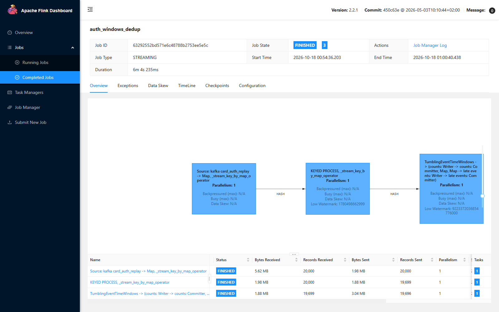

### In the Flink UI: late events before and after

The window vertex chains two Kafka sinks: `counts` for the window results and `late events` for the side output. Its
Metrics tab shows `late_events__Writer.numRecordsIn`, the number of events that reached their window after the
watermark had already closed it. Flink shows these metrics only while a job runs, so both screenshots were taken
with about 18,700 and 19,300 of the 20,000 events through the window vertex (Records Received in the bottom table);
at the end the check script counts 483 and 0.

Before, `baseline` (watermark 5 s only): 443 late events after 18,726 events.


After, `lateness` (`allowed_lateness(30 min)`): 0 late events after 19,334 events; the same events now update their
windows instead.

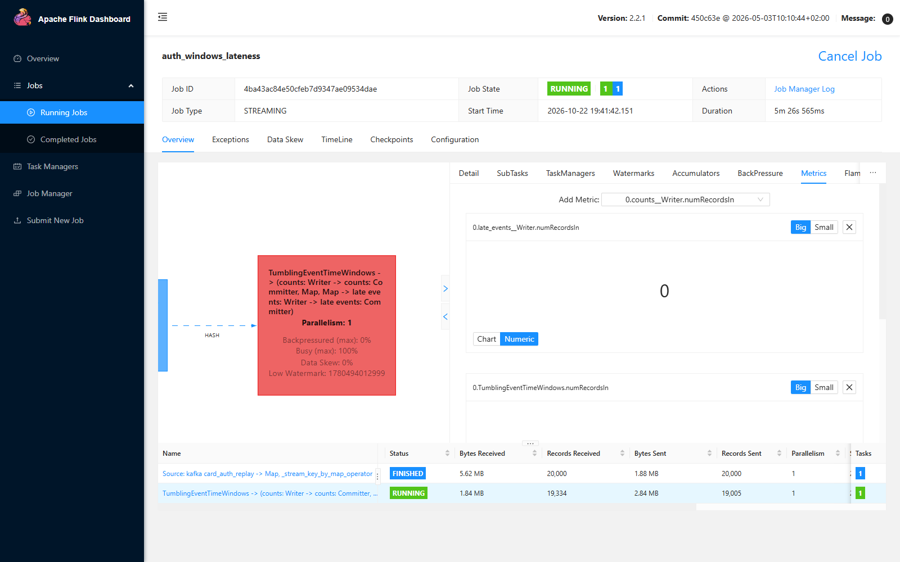

Allowed lateness has a cost: the whole replay took 348 s against 305 s for the baseline (re-run on 2026-10-22,
same results as the table above), because each window keeps its state 30 minutes longer and fires again for each
late event. In both runs the window vertex is busy 100% and backpressured 0%: the replay runs with a Python bundle
size of 1 (see below), so these runs measure correctness, not throughput.

### What it took to see the late events in a replay

The first runs reported 0 late events. Three replay effects hid them, each fixed in the job or the setup:

1. PyFlink 2.2 ignores a Python `TimestampAssigner` passed to `from_source`: windows fell on the Kafka timestamp,
   which was then the send time, so every event landed in the current 5 minutes. Fix: the producer writes event time
   as the Kafka timestamp.
2. The watermark moves in steps. It is emitted every 200 ms by default, and a replay covers days of event time in
   seconds, so one step jumped hours and a 30-minute-late event still arrived "before" it. The Python map also takes
   1,000 events per bundle, which lets the source run ahead. Fix: watermark every 10 ms and a Python bundle size of
   1, so a step covers a few events, as with live traffic
   ([`pipelines/flink/auth_windows.py` L97-L102](https://github.com/cvinhnguyen/card-fraud-platform/blob/612ffdc2aa8a38f9098d6190f54bd46c2ea70315/pipelines/flink/auth_windows.py#L97-L102)).
3. The watermark is the minimum over Kafka partitions. With the 6-partition topic, the partitions were read at
   very different speeds: a debug job measured the watermark at `Long.MIN_VALUE` for the first 30,000 events and
   then days behind the newest event, so almost nothing looked late (206 of 1,218 in a 50,000-event replay).
   Watermark alignment (`with_watermark_alignment`, which pauses partitions that run ahead) is the production fix for
   replays and backfills, but with a bounded source it failed in this setup with
   `IllegalStateException: No current assignment for partition card_authorizations-5` once a partition was finished.
   Fix for the demo: the replay topic has 1 partition and the job runs with parallelism 1.

With live traffic none of this applies: partitions advance with the wall clock and a 200 ms step covers a few events.

## Realtime features

[`pipelines/flink/rt_features.py`](https://github.com/cvinhnguyen/card-fraud-platform/blob/612ffdc2aa8a38f9098d6190f54bd46c2ea70315/pipelines/flink/rt_features.py)
emits one feature row per authorization, computed when it arrives over the same card's earlier authorizations:
`auth_count_10m`, `amount_sum_1h`, `distinct_merchants_1h`, `distinct_units_1h`. The job is a `KeyedProcessFunction`
per card that holds the last 90 minutes of authorizations in state
([`pipelines/flink/rt_features.py` L64-L91](https://github.com/cvinhnguyen/card-fraud-platform/blob/612ffdc2aa8a38f9098d6190f54bd46c2ea70315/pipelines/flink/rt_features.py#L64-L91)).
A window would only report when it closes, and the scoring model needs the features of the payment being authorized
now. Duplicates are dropped first, and locations are mapped to the 34 units (the 63-row mapping is loaded once; a
broadcast stream would be needed only if it changed at runtime).

Replay: 100,000 authorizations from 2025-03-01 (before the reorganization, when 20% of location strings are old
province names); 98,529 unique, one feature row each.

| Feature | Rows equal to the pandas recomputation |
|---|---:|
| `auth_count_10m`, `amount_sum_1h`, `distinct_merchants_1h`, `distinct_units_1h` | 100.00% each |

| Authorizations whose card was in 2 or more places within the hour | Count |
|---|---:|
| by raw location name | 122 |
| by unit (what the job emits as `distinct_units_1h`) | 14 |

108 of the 122 would be "impossible travel" alerts caused only by old and new names of the same place (for example
"Binh Duong" and "Ho Chi Minh").

### Live: the job stays RUNNING

In the platform the job is unbounded: `rt_features.py --topic card_authorizations --live` resumes from the committed
offsets of group `rt_features`, checkpoints every 10 s to `s3://lakehouse/flink/checkpoints` (the Kafka offsets are
committed with each checkpoint) and runs until it is cancelled
([`pipelines/flink/rt_features.py` L107-L112](https://github.com/cvinhnguyen/card-fraud-platform/blob/612ffdc2aa8a38f9098d6190f54bd46c2ea70315/pipelines/flink/rt_features.py#L107-L112);
checkpoint storage in
[`infra/docker-compose.yaml` L315-L316](https://github.com/cvinhnguyen/card-fraud-platform/blob/612ffdc2aa8a38f9098d6190f54bd46c2ea70315/infra/docker-compose.yaml#L315-L316)).
Its output feeds the Feast push jobs ([feature_store.md](feature_store.md)).

For the screenshots (2026-10-25) the live job read the replay topic instead, fed at 200 events/s by
`producer.py --speed 200 --target card_auth_replay`, so that the real topic and the Feast stores kept their data. The
push jobs stayed stopped, and after the run their consumer groups (`feast_push_online`, `feast_push_offline`, both at
lag 0 before it) were moved to the end of `card_features_rt`, past the 29,247 feature rows of the test.

After 1 min 45 s the job overview shows it RUNNING and STREAMING: 18,668 records read, 17,805 of them reach the
feature step, and no vertex is backpressured:

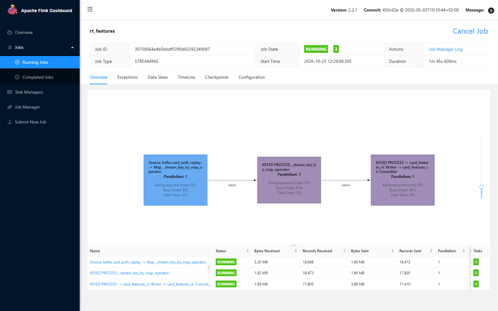

The Checkpoints tab of the running job lists 9 completed checkpoints, the latest 2.01 MB at
`s3://lakehouse/flink/checkpoints`:

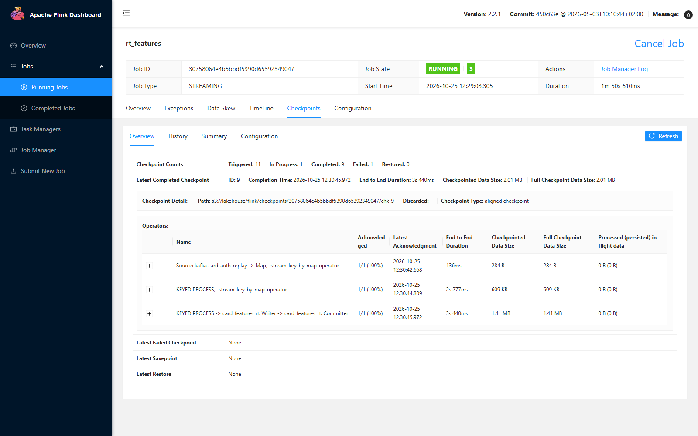

When the job was cancelled, 15 of its 16 checkpoints had completed. While it ran, the output topic received new
feature rows, and the group's lag on the replay topic stayed around one checkpoint interval of events (2,405 at 200
events/s), with lag 0 on `card_authorizations`, which the run did not touch:

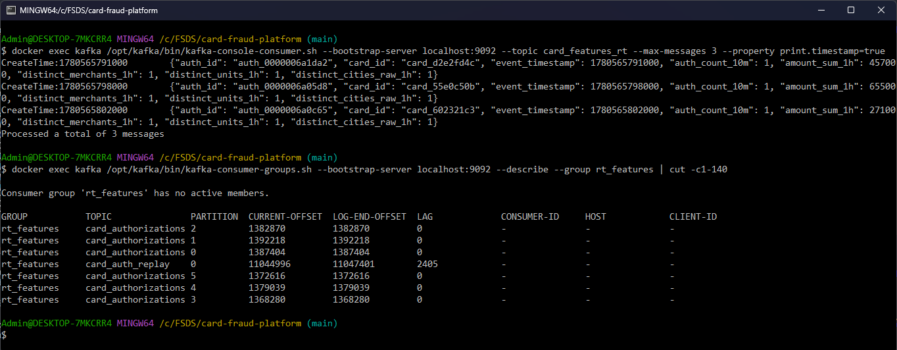

## Out-of-order app events

[`pipelines/flink/ato_sequence.py`](https://github.com/cvinhnguyen/card-fraud-platform/blob/612ffdc2aa8a38f9098d6190f54bd46c2ea70315/pipelines/flink/ato_sequence.py)
looks for the `new_device` account takeover pattern: `password_reset`, then `add_payee`, then `transfer`, within 10
minutes in one session. 15% of app events reach Kafka after the next event of their session (1 to 20 s, parallel
uploads). The job has two orders:

- `arrival`: a state machine per session
  ([`pipelines/flink/ato_sequence.py` L53-L65](https://github.com/cvinhnguyen/card-fraud-platform/blob/612ffdc2aa8a38f9098d6190f54bd46c2ea70315/pipelines/flink/ato_sequence.py#L53-L65))
  fed in arrival order.
- `event`: each session's events wait in keyed state; an event-time timer at each `event_ts` releases them in
  `event_ts` order once the watermark (30 s behind the newest event) passes, then the same state machine runs
  ([`pipelines/flink/ato_sequence.py` L67-L80](https://github.com/cvinhnguyen/card-fraud-platform/blob/612ffdc2aa8a38f9098d6190f54bd46c2ea70315/pipelines/flink/ato_sequence.py#L67-L80)).

Replay: 150,000 app events from 2024-03-01 (before the biometric rule, which later stops most takeovers before the
transfer); 67,443 sessions, 771 with the full pattern in event time, 658 of them generator-labelled `new_device` ATO.

| Order | Alerts | Pattern sessions caught | ATO caught |
|---|---:|---:|---:|
| arrival | 578 | 557 / 771 (72.2%) | 461 / 658 (70.1%) |
| event time | 795 | **771 / 771 (100%)** | **658 / 658 (100%)** |

Reordering costs 30 s of latency per alert and finds every takeover; arrival order misses 3 in 10. Both modes raise
about 20 alerts on sessions outside the truth query (21 and 24): the pandas query compares the first `add_payee`
and `transfer` of the session, while the state machine takes the first ones after the `password_reset`.

## Hot key

[`pipelines/flink/hot_key.py`](https://github.com/cvinhnguyen/card-fraud-platform/blob/612ffdc2aa8a38f9098d6190f54bd46c2ea70315/pipelines/flink/hot_key.py)
counts authorizations per unit per day (an operations metric: payment volume by province), with parallelism 4. Ho Chi
Minh is 60% of all authorizations, so `key_by(unit)` sends 60% of the stream, plus whatever other units hash to the
same place, to one subtask.

The replay check runs both modes, then `two_phase` again with every unit salted:

```bash
python pipelines/flink/check_hot_key.py --replay-from "2025-01-01 00:00" --limit 1000000                  # hot + two_phase
python pipelines/flink/check_hot_key.py --replay-from "2025-01-01 00:00" --limit 1000000 --no-replay --modes two_phase --salt-all
```

Replay: 1,000,000 authorizations from 2025-01-01 (Ho Chi Minh 59.9%, Ha Noi 18.0%, Da Nang 5.0%), 4,283 unit-days.
Every mode returns exactly the pandas counts (4,283 of 4,283 unit-days, 0 late events: the watermark waits 31
minutes, longer than the latest POS event). Per-subtask records and accumulated busy time come from the REST API
after the job ends.

| Mode | Job time | Records into the counting subtasks | Busiest subtask |
|---|---:|---|---|
| `hot`: `key_by(unit)` | 71.4 s | 97,976 / **842,368** / 32,823 / 26,833 | 84% of records, busy 100%; the other three 69-84% idle |
| `two_phase`, 8 salts on Ho Chi Minh only | **50.7 s** | 247,514 / 318,138 / 107,782 / 326,566 | 33% of records; three subtasks busy 94-100% |
| `two_phase`, 8 salts on every unit (`--salt-all`) | 112.5 s | 192,699 / 176,333 / 149,634 / 481,334 | 48%, and slower than no fix |

### Flink UI before and after

The job graph values while each job runs (screenshots below), per vertex:

| Vertex (parallelism) | Flink UI metric | `hot` (before) | `two_phase` (after) |
|---|---|---:|---:|
| Kafka source (1) | backpressured (max) | 100% | 100% |
| `to unit`, map before `key_by` (4) | backpressured (max) | **88%** | **48%** |
| | busy (max) | 24% | 51% |
| `count per key` (4) | busy (max) | 99% | 99% |
| | data skew | **100%** | **28%** |
| `add partial counts` (4, two-phase only) | busy (max) / data skew | none | 34% / 33% |

In `hot`, one counting subtask gets 84% of the records and is busy 100% while the other three are
69-84% idle; the UI colours the vertex red and the operator in front of it is backpressured 88%: it could go faster,
but the one hot subtask cannot take more. With two phases the records spread over the four subtasks, three of them
busy 94-100%: the skew drops to 28%, the operator in front waits less (backpressure 48%) and does more (busy from 24%
to 51%), and the job finishes in 50.7 s instead of 71.4 s.

Before, `hot`: the counting vertex busy 99% with data skew 100%, upstream backpressured 88-100%:

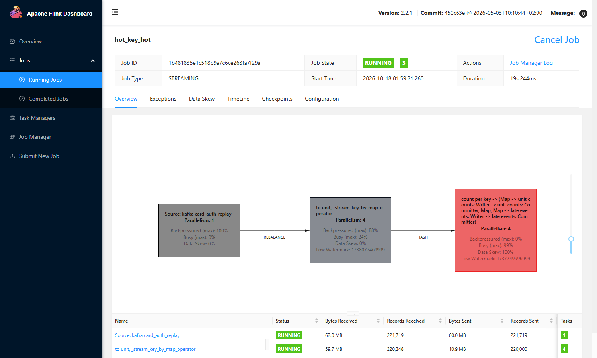

The Data Skew tab of the counting vertex in `hot` shows 100%:

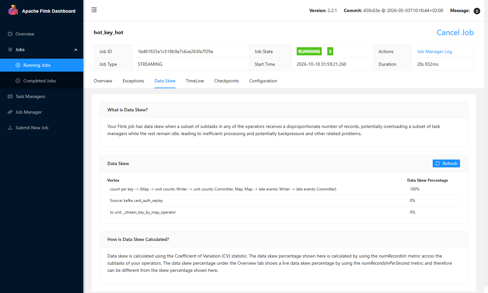

After, `two_phase`: data skew 28% on the counting vertex, upstream backpressure 48%:

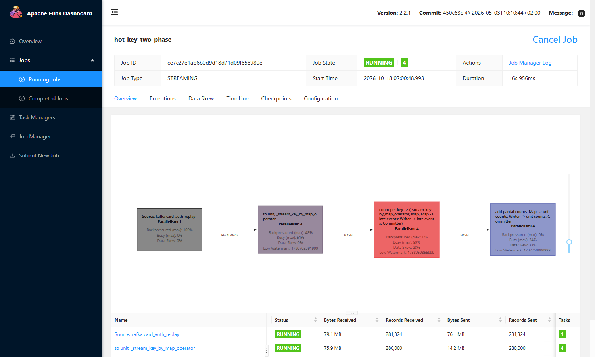

### How two-phase aggregation works

The two modes differ in the key and in a second window that adds the partial counts
([`pipelines/flink/hot_key.py` L117-L128](https://github.com/cvinhnguyen/card-fraud-platform/blob/612ffdc2aa8a38f9098d6190f54bd46c2ea70315/pipelines/flink/hot_key.py#L117-L128)):

```python
    if mode == "hot":
        windows = auths.key_by(lambda a: a[1], key_type=Types.STRING())
    else:
        # The salt comes from auth_id, so a retry lands in the same partial count as its original.
        windows = auths.key_by(lambda a: f"{a[1]}#{int(a[0][5:], 16) % salts}" if hot is None or a[1] in hot else a[1],
                               key_type=Types.STRING())
    partials = (windows.window(TumblingEventTimeWindows.of(WINDOW)).side_output_late_data(late)
                .aggregate(Count(), Partial(), accumulator_type=Types.LONG(), output_type=PARTIAL).name("count per key"))
    counts = partials
    if mode == "two_phase":
        counts = (partials.key_by(lambda p: p[0], key_type=Types.STRING()).window(TumblingEventTimeWindows.of(WINDOW))
                  .reduce(lambda a, b: (a[0], a[1], a[2] + b[2]), output_type=PARTIAL).name("add partial counts"))
```

In two-phase aggregation, Ho Chi Minh's key gets a salt from `auth_id` (`Ho Chi Minh#0` .. `#7`), so its records
spread over all subtasks; each counts its share per day, then `key_by(unit)` adds the at most 8 partial counts of a
unit-day. Phase 2 receives 5,165 records instead of 1,000,000. The salt comes from `auth_id`, so a network retry
lands in the same partial count as its original.

Only hot keys should get a salt. Salting all 34 units made the job slower (112.5 s) even though its records were
spread better. In PyFlink each new (key, window) pair costs a state entry and a timer registration through the Python
runtime; a small unit has a few records per day, so with 8 salts it pays that cost 8 times for almost no records.
The measurements show it: subtasks holding many small units process about 4,500 records/s, the Ho Chi Minh subtask
12,000 records/s, and two-phase on every unit got slower with each salt added (4 salts 102 s, 8 salts 111 s, 16 salts
135 s). Ho Chi Minh has about 4,700 records per day, so its 8 partial keys are still full. A salt chosen from the
event minute (fewer key switches) changed nothing (99.8 s vs 102.0 s for 4 salts), which rules out key switching as
the cost.

### At a fixed input rate (live mode)

In a replay the source is backpressured in both modes. It reads a backlog that Kafka serves faster than the operators
after it can take, so it waits for the slowest one, here the Python operators. Two-phase removes the hot spot, and the
Python operators stay as slow as they were. `key_by(card_id)` would also spread the load, but it answers a different
question (per card, not per unit).

A live job has to keep up with the rate at which authorizations arrive. `--live` makes the job unbounded (RUNNING,
from the latest offset;
[`pipelines/flink/hot_key.py` L106-L109](https://github.com/cvinhnguyen/card-fraud-platform/blob/612ffdc2aa8a38f9098d6190f54bd46c2ea70315/pipelines/flink/hot_key.py#L106-L109)),
and the producer sends a fixed 16,000 events/s, more than `hot` can process:

```bash
docker exec flink-jobmanager flink run -d -py /opt/flink/jobs/hot_key.py --mode hot --live      # then --mode two_phase
python generator/producer.py --replay-from "2025-01-01 00:00" --limit 2000000 --speed 16000 --target card_auth_replay
```

Same input for both modes, screenshots 75 to 95 s after the producer started:

| At 16,000 events/s | `hot` (before) | `two_phase` (after) |
|---|---:|---:|
| Records/s through the job (REST API, 60 s average) | about 13,300 | 16,000 |
| Records read by the source, job running about 82 s | 681,325 | 944,783 |
| Kafka lag of the source (`pendingRecords`) | rises in steps to about 100,000 | 0 |
| Source backpressured (max) | 98% | 1% |
| `to unit` BackPressure tab | **HIGH** (30-68% per subtask) | **OK** (0% on all four) |
| `count per key` busy (max) / data skew | 100% / 100% | 71% / 29% |

With `hot` the job falls behind: it counts about 13,300 of the 16,000 authorizations per second, so the lag grows for
as long as the rate lasts and the per-unit counts arrive later and later. With two-phase the job keeps up: the source
no longer waits and the lag stays at 0. Two-phase replayed at about 19,700 records/s, so above that rate it would fall
behind too; the next step there is more parallelism, or moving the count out of Python (a Flink SQL aggregation runs
in the JVM).

Before, `hot`: the lag of the Kafka source rises, `to unit` is backpressured (HIGH), the counting vertex is busy 100%
with data skew 100%. The source's `pendingRecords` rises to about 100,000:

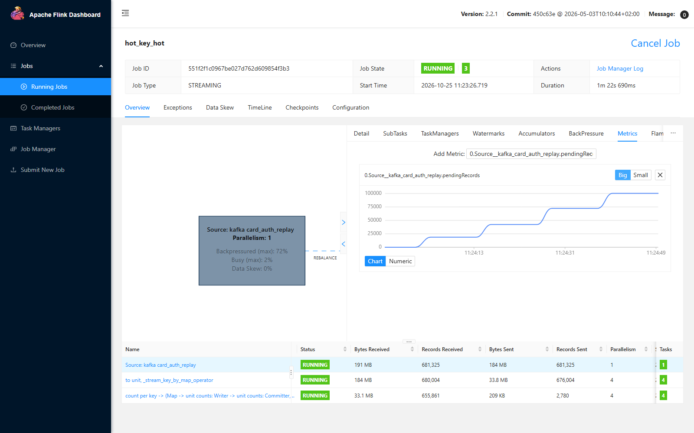

The BackPressure tab of `to unit` shows status HIGH, with its subtasks backpressured 30-68%:

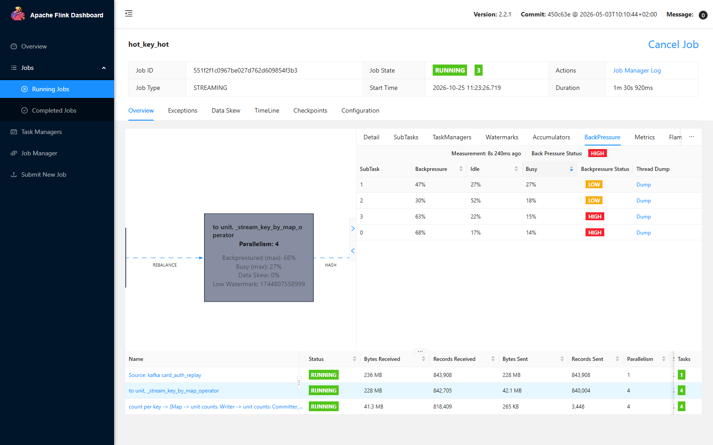

The job overview: RUNNING, the source backpressured 98%, the counting vertex busy 100% with data skew 100%:

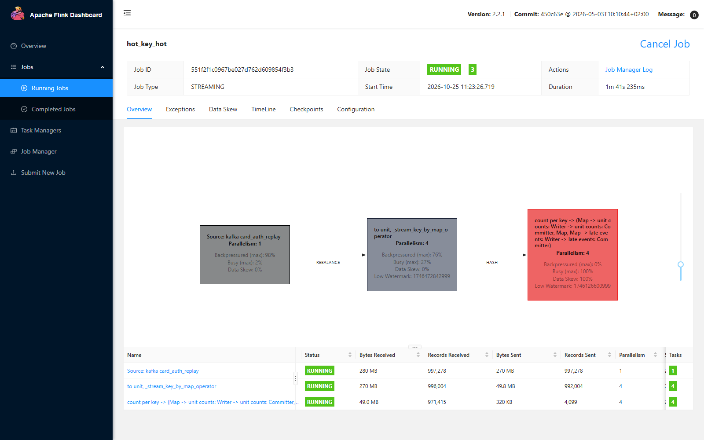

After, `two_phase`: lag 0, `to unit` OK, source backpressured 1%. The source's `pendingRecords` stays flat at 0:

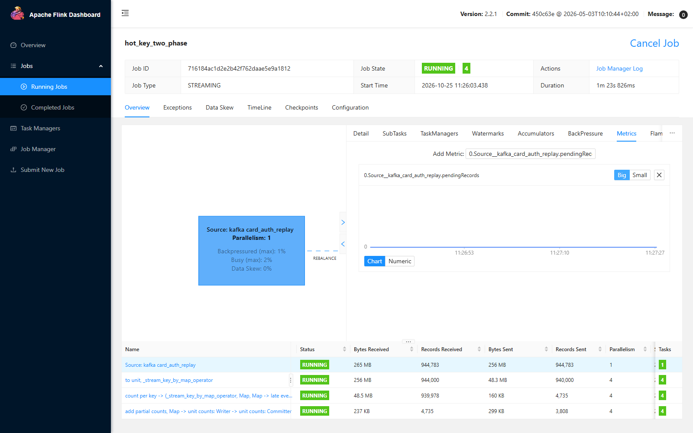

The BackPressure tab of `to unit` shows status OK, 0% on all four subtasks:

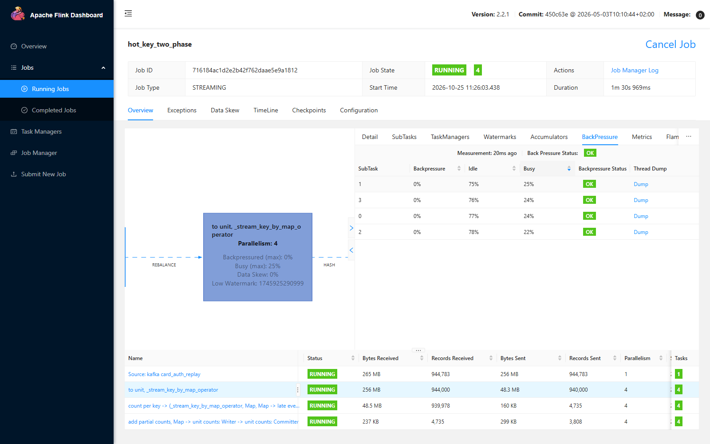

The job overview: RUNNING, the source backpressured 1%, the counting vertex busy 71% with data skew 29%:

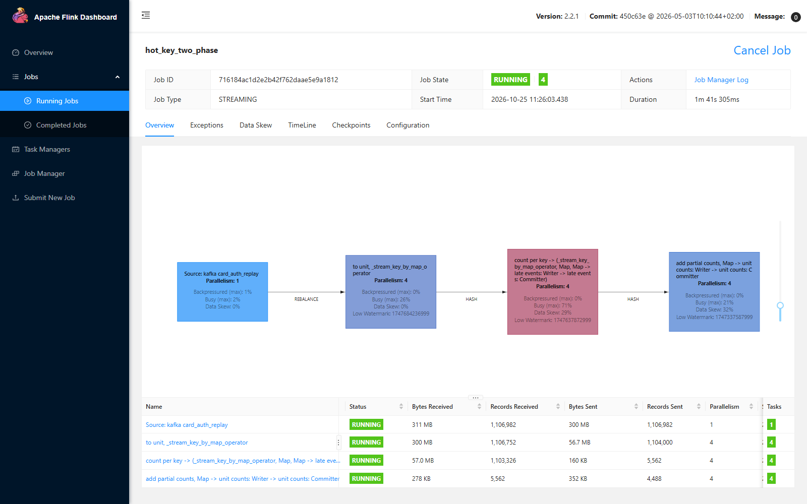

## Raw events to bronze

Flink SQL in
[`pipelines/flink/raw_landing.py` L25-L53](https://github.com/cvinhnguyen/card-fraud-platform/blob/612ffdc2aa8a38f9098d6190f54bd46c2ea70315/pipelines/flink/raw_landing.py#L25-L53)
copies `card_authorizations` unchanged (duplicates and late events included, plus Kafka partition and offset for
tracing) to `s3://lakehouse/landing/card_authorizations/auth_date=YYYY-MM-DD/` as JSON lines; the file sink commits
files on checkpoints (every 10 s). `ingest_bronze.py --part landing` then appends them to the Delta table
`bronze.raw_card_authorizations` with a Spark file stream (`trigger(availableNow=True)`,
[`pipelines/spark/ingest_bronze.py` L110-L114](https://github.com/cvinhnguyen/card-fraud-platform/blob/612ffdc2aa8a38f9098d6190f54bd46c2ea70315/pipelines/spark/ingest_bronze.py#L110-L114)):
its checkpoint remembers which files were loaded, so a late event that adds a file to an older `auth_date` is still
picked up, and a re-run loads nothing twice.

| Step | Result |
|---|---|
| `raw_landing.py` on the 50,000-event topic | 8 `auth_date` partitions, 14.8 MB, 5 s |
| `ingest_bronze.py --part landing` | `bronze.raw_card_authorizations`: 50,000 rows (52 s) |
| same command again | still 50,000 rows |

The landing files are JSON because Flink's Parquet writer needs the Hadoop client jars on the classpath. JSON needs
none, and Spark writes Delta in the next step.

## Gotchas

- Topics written with event-time timestamps need `retention.ms=-1`: with the default 7 days Kafka deletes 2024-2026
  messages as soon as a segment rolls.
  [`infra/init_infra.py` L35-L38](https://github.com/cvinhnguyen/card-fraud-platform/blob/612ffdc2aa8a38f9098d6190f54bd46c2ea70315/infra/init_infra.py#L35-L38)
  and the check scripts (for example
  [`pipelines/flink/check_windows.py` L35-L36](https://github.com/cvinhnguyen/card-fraud-platform/blob/612ffdc2aa8a38f9098d6190f54bd46c2ea70315/pipelines/flink/check_windows.py#L35-L36))
  create them that way.
- PyFlink 2.2: windows and state TTL take `Time`, watermarks take `Duration`
  ([`pipelines/flink/auth_windows.py` L36-L38](https://github.com/cvinhnguyen/card-fraud-platform/blob/612ffdc2aa8a38f9098d6190f54bd46c2ea70315/pipelines/flink/auth_windows.py#L36-L38));
  a side-output tag typed as a tuple fails to pickle, so the late-event tag is untyped
  ([`pipelines/flink/auth_windows.py` L121-L122](https://github.com/cvinhnguyen/card-fraud-platform/blob/612ffdc2aa8a38f9098d6190f54bd46c2ea70315/pipelines/flink/auth_windows.py#L121-L122)).
