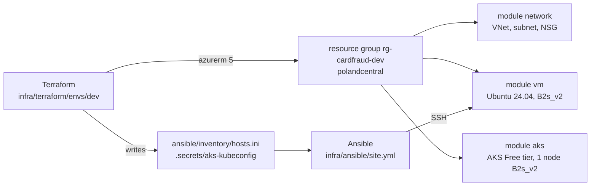

# Infrastructure as code (Azure)



Terraform creates the cloud resources; Ansible configures the VM and deploys the services on it. The cloud is an Azure
for Students subscription ($100 credit, no card): it caps a region at 6 vCPU, refuses quota increases and only allows
5 EU regions. Of those, only `polandcentral` lets AKS use the B-series the quota covers (in `germanywestcentral` AKS
only offers v6/v7 sizes, whose quota is 0), so everything runs there: 2 vCPU for the VM + 2 for the AKS node.

## Terraform (`infra/terraform`)

One reusable module per service, one folder per environment (the layout the rubric links to):

```
infra/terraform/
  modules/network/   VNet, subnet, NSG: only the admin's IP reaches SSH (22), the model server (8080), node_exporter (9100)
  modules/vm/        static public IP, NIC, Ubuntu 24.04 VM, SSH key login only
  modules/aks/       AKS Free tier (no control plane fee), 1 system node, Azure CNI overlay, managed identity
  envs/dev/          the resource group + the 3 modules; writes Ansible's inventory and the AKS kubeconfig
```

```bash
az login && export ARM_SUBSCRIPTION_ID=$(az account show --query id -o tsv)
cd infra/terraform/envs/dev
terraform init
terraform apply -var admin_cidr=$(curl -s https://api.ipify.org)/32
kubectl --kubeconfig ../../../.secrets/aks-kubeconfig get nodes
terraform destroy -var admin_cidr=0.0.0.0/32     # the VM and the node are billed by the hour
```

- azurerm 5 registers no resource providers by itself: `resource_providers_to_register` lists the three it needs
  ([`versions.tf` L16-L20](https://github.com/cvinhnguyen/card-fraud-platform/blob/35d4295a1e5a409fa242bc6aa9eff9b06038c111/infra/terraform/envs/dev/versions.tf#L16-L20)),
  and `node_provisioning_profile` is required on the AKS cluster
  ([`modules/aks/main.tf` L31-L33](https://github.com/cvinhnguyen/card-fraud-platform/blob/35d4295a1e5a409fa242bc6aa9eff9b06038c111/infra/terraform/modules/aks/main.tf#L31-L33)).
- The subscription id comes from `ARM_SUBSCRIPTION_ID`, never from a committed file. The state, the plan, the
  inventory (VM IP) and the kubeconfig are gitignored. The state is local: one person runs this.
- `admin_cidr` is required and validated (`0.0.0.0/0` is refused), so the VM is never open to the whole internet.

The environment wires the three modules
([`envs/dev/main.tf` L17-L53](https://github.com/cvinhnguyen/card-fraud-platform/blob/35d4295a1e5a409fa242bc6aa9eff9b06038c111/infra/terraform/envs/dev/main.tf#L17-L53)).
The check on `admin_cidr`
([`envs/dev/variables.tf` L13-L21](https://github.com/cvinhnguyen/card-fraud-platform/blob/35d4295a1e5a409fa242bc6aa9eff9b06038c111/infra/terraform/envs/dev/variables.tf#L13-L21))
and the NSG rule that uses it
([`modules/network/main.tf` L36-L46](https://github.com/cvinhnguyen/card-fraud-platform/blob/35d4295a1e5a409fa242bc6aa9eff9b06038c111/infra/terraform/modules/network/main.tf#L36-L46),
SSH has the same rule on port 22 just above):

```hcl
variable "admin_cidr" {
  description = "The admin's public IP as /32: the only source allowed to reach the VM"
  type        = string

  validation {
    condition     = can(cidrhost(var.admin_cidr, 0)) && var.admin_cidr != "0.0.0.0/0"
    error_message = "admin_cidr must be a CIDR and not the whole internet."
  }
}
```

```hcl
  security_rule {
    name                       = "services-from-admin"
    priority                   = 110
    direction                  = "Inbound"
    access                     = "Allow"
    protocol                   = "Tcp"
    source_port_range          = "*"
    destination_port_ranges    = [for p in var.service_ports : tostring(p)]
    source_address_prefix      = var.admin_cidr
    destination_address_prefix = "*"
  }
```

### Run on 2026-10-21

`terraform apply` from an empty state. The plan body and the `[id=/subscriptions/...]` suffixes are cut from the log:

```text
$ terraform apply -var admin_cidr=<my-ip>/32
...
Plan: 11 to add, 0 to change, 0 to destroy.
azurerm_resource_group.this: Creation complete after 26s
module.vm.azurerm_public_ip.this: Creation complete after 3s
module.network.azurerm_network_security_group.vm: Creation complete after 4s
module.network.azurerm_virtual_network.this: Creation complete after 5s
module.network.azurerm_subnet.vm: Creation complete after 5s
module.network.azurerm_subnet_network_security_group_association.vm: Creation complete after 5s
module.vm.azurerm_network_interface.this: Creation complete after 2s
module.vm.azurerm_linux_virtual_machine.this: Creation complete after 49s
local_file.inventory: Creation complete after 0s
module.aks.azurerm_kubernetes_cluster.this: Creation complete after 3m54s
local_sensitive_file.kubeconfig: Creation complete after 0s

Apply complete! Resources: 11 added, 0 changed, 0 destroyed.

Outputs:

aks_name = "aks-cardfraud-dev"
resource_group = "rg-cardfraud-dev"
ssh = "ssh azureuser@74.248.36.47"
vm_public_ip = "74.248.36.47"
```

Earlier attempts failed on the subscription's limits, not on the code: `Standard_B2s_v2` not allowed for AKS and out
of capacity for VMs in `germanywestcentral`, then two transient `404` right after the VNet and the subnet were created
in `polandcentral`.

The state holds the 11 resources and a new plan finds no difference with Azure (the `grep` hides the refresh lines,
which print the subscription id):


The resource group, the VM and the AKS cluster in the Azure Portal (tenant, subscription id and account blanked out):


The AKS node and its system pods, with the kubeconfig Terraform wrote:


## Ansible (`infra/ansible`)

`site.yml` applies four roles to the `serving` group (the VM Terraform created):

| Role | What it does |
|---|---|
| `common` | base packages, `ufw`: deny inbound except 22 / 8080 / 9100 (a second firewall behind the NSG) |
| `docker` | Docker engine + compose plugin from the Ubuntu archive, started at boot |
| `predictor` | copies `services/predictor` (code + production model) and builds the image on the VM (no registry credential), runs it with compose, waits until the model is ready, then a smoke prediction |
| `node_exporter` | host metrics for Prometheus on :9100 |

```bash
# macOS / Linux
pip install ansible==14.5.0 && cd infra/ansible && ansible-playbook site.yml
# Windows: Ansible has no Windows control node, so it runs in a container (infra/ansible/Dockerfile)
docker build -t fraud/ansible:14.5.0 infra/ansible
docker run --rm -v "$PWD:/work:ro" -v "$HOME/.ssh/id_ed25519:/key:ro" fraud/ansible:14.5.0 ansible-playbook site.yml
```

A code or model change rebuilds the image (handler on the copy); otherwise the role only checks the container runs.
`services/predictor/model/` is gitignored: `python services/predictor/fetch_model.py --alias production` fills it.

The checks at the end of the predictor role
([`roles/predictor/tasks/main.yml` L25-L44](https://github.com/cvinhnguyen/card-fraud-platform/blob/35d4295a1e5a409fa242bc6aa9eff9b06038c111/infra/ansible/roles/predictor/tasks/main.yml#L25-L44)):
the play fails unless the model answers.

```yaml
- name: Model is loaded and ready
  ansible.builtin.uri:
    url: "http://localhost:{{ predictor_port }}/v1/models/{{ predictor_model_name }}"
  register: ready
  until: ready.status == 200 and ready.json.ready | default(false)
  retries: 30
  delay: 5

- name: Smoke prediction (an empty instance, every feature missing)
  ansible.builtin.uri:
    url: "http://localhost:{{ predictor_port }}/v1/models/{{ predictor_model_name }}:predict"
    method: POST
    body_format: json
    body: {instances: [{}]}
  register: prediction
  failed_when: prediction.json.predictions | length != 1
```

First run on the new VM: 9 changes.

<details>
<summary>Full log of the first run</summary>

```text
$ ansible-playbook site.yml

PLAY [Model-serving VM] ********************************************************

TASK [Gathering Facts] *********************************************************
ok: [vm-cardfraud-dev-serving]

TASK [common : Base packages] **************************************************
ok: [vm-cardfraud-dev-serving]

TASK [common : Allow SSH before the firewall goes up] **************************
changed: [vm-cardfraud-dev-serving]

TASK [common : Allow the service ports] ****************************************
changed: [vm-cardfraud-dev-serving] => (item=8080)
changed: [vm-cardfraud-dev-serving] => (item=9100)

TASK [common : Firewall on, deny other inbound] ********************************
changed: [vm-cardfraud-dev-serving]

TASK [docker : Docker engine and compose plugin] *******************************
changed: [vm-cardfraud-dev-serving]

TASK [docker : Docker running and started at boot] *****************************
ok: [vm-cardfraud-dev-serving]

TASK [predictor : Model server source and model] *******************************
changed: [vm-cardfraud-dev-serving]

TASK [predictor : Compose file] ************************************************
changed: [vm-cardfraud-dev-serving]

TASK [predictor : Model server running] ****************************************
[WARNING]: Docker compose: unknown predictor: pull access denied for fraud/predictor, repository does not exist or may require 'docker login'
[WARNING]: Docker compose: unknown None: Docker Compose is configured to build using Bake, but buildx isn't installed
changed: [vm-cardfraud-dev-serving]

TASK [predictor : Flush the rebuild before the checks] *************************

RUNNING HANDLER [predictor : Rebuild model server] *****************************
changed: [vm-cardfraud-dev-serving]

TASK [predictor : Model is loaded and ready] ***********************************
ok: [vm-cardfraud-dev-serving]

TASK [predictor : Smoke prediction (an empty instance, every feature missing)] ***
ok: [vm-cardfraud-dev-serving]

TASK [predictor : Served model version] ****************************************
ok: [vm-cardfraud-dev-serving] => {
    "msg": "model 1, score 0.01143606100231409"
}

TASK [node_exporter : node_exporter] *******************************************
changed: [vm-cardfraud-dev-serving]

TASK [node_exporter : node_exporter running and started at boot] ***************
ok: [vm-cardfraud-dev-serving]

TASK [node_exporter : Metrics answer] ******************************************
ok: [vm-cardfraud-dev-serving]

PLAY RECAP *********************************************************************
vm-cardfraud-dev-serving   : ok=17   changed=9    unreachable=0    failed=0    skipped=0    rescued=0    ignored=0
```

</details>

Run again from Git Bash on Windows (the same container, with Windows paths for the mounts): 0 changes, the play is
idempotent. The `pull access denied` warning of the first run is expected: the image is built on the VM, never pulled.


From the local machine, through the NSG:


Then everything goes away again (only the summary lines are kept: the plan of a destroy prints the ids and the admin
IP):


## Gotchas

- Docker publishes ports through its own iptables chains, before `ufw`: the NSG is the firewall that holds for 8080.
- Bind-mounted files from Windows are world-readable and `ssh` refuses such a key: the container copies `/key` to
  `~/.ssh` with mode 600 first.
- Run on a loaded Docker Desktop VM, the Ansible container once failed reading `model.json` with
  `[Errno 12] Cannot allocate memory` (the host, not the VM); the rerun passed.
