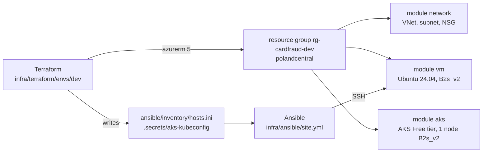
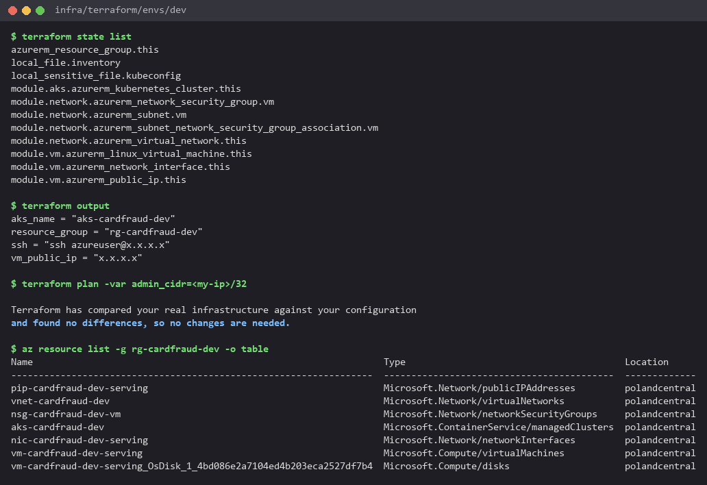
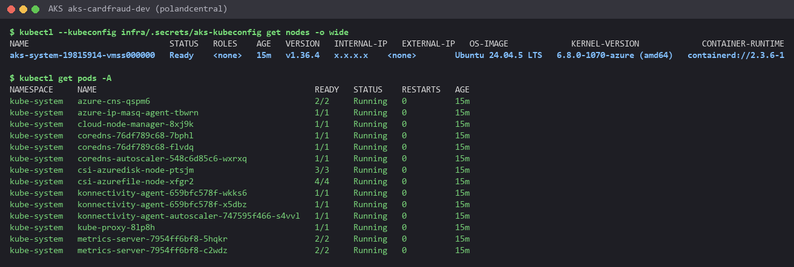

# Infrastructure as code (Azure)



Terraform creates the cloud resources; Ansible configures the VM and deploys the services on it. The cloud is an Azure
for Students subscription ($100 credit, no card): it caps a region at 6 vCPU, refuses quota increases and only allows
5 EU regions. Of those, only `polandcentral` lets AKS use the B-series the quota covers (in `germanywestcentral` AKS
only offers v6/v7 sizes, whose quota is 0), so everything runs there: 2 vCPU for the VM + 2 for the AKS node.

## Terraform (`infra/terraform`)

One reusable module per service, one folder per environment (the layout the rubric links to):

```
infra/terraform/
  modules/network/   VNet, subnet, NSG: only the admin's IP reaches SSH (22), the model server (8080), node_exporter (9100)
  modules/vm/        static public IP, NIC, Ubuntu 24.04 VM, SSH key login only
  modules/aks/       AKS Free tier (no control plane fee), 1 system node, Azure CNI overlay, managed identity
  envs/dev/          the resource group + the 3 modules; writes Ansible's inventory and the AKS kubeconfig
```

```bash
az login && export ARM_SUBSCRIPTION_ID=$(az account show --query id -o tsv)
cd infra/terraform/envs/dev
terraform init
terraform apply -var admin_cidr=$(curl -s https://api.ipify.org)/32
kubectl --kubeconfig ../../../.secrets/aks-kubeconfig get nodes
terraform destroy -var admin_cidr=0.0.0.0/32     # the VM and the node are billed by the hour
```

- azurerm 5 registers no resource providers by itself: `resource_providers_to_register` lists the three it needs, and
  `node_provisioning_profile` is required on the AKS cluster.
- The subscription id comes from `ARM_SUBSCRIPTION_ID`, never from a committed file. The state, the plan, the
  inventory (VM IP) and the kubeconfig are gitignored. The state is local: one person runs this.
- `admin_cidr` is required and validated (`0.0.0.0/0` is refused), so the VM is never open to the whole internet.


The first applies failed on the subscription's limits, not on the code: `Standard_B2s_v2` not allowed for AKS and
out of capacity for VMs in `germanywestcentral`, then two transient `404` right after the VNet and the subnet were
created in `polandcentral`. The run above is the last apply; the state below holds all 11 resources, and a new plan
finds no difference with Azure:





## Ansible (`infra/ansible`)

`site.yml` applies four roles to the `serving` group (the VM Terraform created):

| Role | What it does |
|---|---|
| `common` | base packages, `ufw`: deny inbound except 22 / 8080 / 9100 (a second firewall behind the NSG) |
| `docker` | Docker engine + compose plugin from the Ubuntu archive, started at boot |
| `predictor` | copies `services/predictor` (code + production model) and builds the image on the VM (no registry credential), runs it with compose, waits until the model is ready, then a smoke prediction |
| `node_exporter` | host metrics for Prometheus on :9100 |

```bash
# macOS / Linux
pip install ansible==14.5.0 && cd infra/ansible && ansible-playbook site.yml
# Windows: Ansible has no Windows control node, so it runs in a container (infra/ansible/Dockerfile)
docker build -t fraud/ansible:14.5.0 infra/ansible
docker run --rm -v "$PWD:/work:ro" -v "$HOME/.ssh/id_ed25519:/key:ro" fraud/ansible:14.5.0 ansible-playbook site.yml
```

A code or model change rebuilds the image (handler on the copy); otherwise the role only checks the container runs.
`services/predictor/model/` is gitignored: `python services/predictor/fetch_model.py --alias production` fills it.

First run: 9 changes. Second run: 0 changes (idempotent).


From the local machine, through the NSG:


## Gotchas

- Docker publishes ports through its own iptables chains, before `ufw`: the NSG is the firewall that holds for 8080.
- Bind-mounted files from Windows are world-readable and `ssh` refuses such a key: the container copies `/key` to
  `~/.ssh` with mode 600 first.
- Run on a loaded Docker Desktop VM, the Ansible container once failed reading `model.json` with
  `[Errno 12] Cannot allocate memory` (the host, not the VM); the rerun passed.
