# Infrastructure as code (Azure)

Terraform creates the cloud resources; Ansible configures the VM and deploys the services on it; kubectl deploys the
same model image to AKS, which pulls it from the registry. The cloud is an Azure for Students subscription ($100
credit, no card): it caps a region at 6 vCPU, refuses quota increases and only allows 5 EU regions. Of those, only
`polandcentral` lets AKS use the B-series the quota covers (in `germanywestcentral` AKS only offers v6/v7 sizes, whose
quota is 0), so everything runs there: 2 vCPU for the VM + 2 for the AKS node.

| | |
|---|---|
| Code | [`infra/terraform/`](https://github.com/cvinhnguyen/card-fraud-platform/tree/612ffdc2aa8a38f9098d6190f54bd46c2ea70315/infra/terraform), [`infra/ansible/`](https://github.com/cvinhnguyen/card-fraud-platform/tree/612ffdc2aa8a38f9098d6190f54bd46c2ea70315/infra/ansible), [`infra/k8s/aks/predictor.yaml`](https://github.com/cvinhnguyen/card-fraud-platform/blob/612ffdc2aa8a38f9098d6190f54bd46c2ea70315/infra/k8s/aks/predictor.yaml) |
| Runs on | Azure, resource group `rg-cardfraud-dev` in `polandcentral` (one IaC run: created, checked, destroyed); Terraform, Ansible and kubectl run from the PC |
| Reads | `services/predictor/` (code + production model) for the VM, the image `fraud/predictor:1` of the local registry for AKS |
| Writes | the Azure resources, `infra/ansible/inventory/hosts.ini`, `infra/.secrets/aks-kubeconfig`, the local Terraform state (all three gitignored) |
| Related | [serving.md](serving.md), [architecture.md](architecture.md) |

What one IaC run creates and deploys:

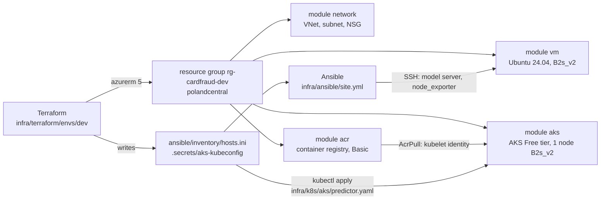

## Run it

Create the resources with Terraform:

```bash
az login && export ARM_SUBSCRIPTION_ID=$(az account show --query id -o tsv)
cd infra/terraform/envs/dev
terraform init
terraform apply -var admin_cidr=$(curl -s https://api.ipify.org)/32
kubectl --kubeconfig ../../../.secrets/aks-kubeconfig get nodes
```

Configure the VM with Ansible, from the repo root. `services/predictor/model/` is gitignored:
`python services/predictor/fetch_model.py --alias production` fills it.

```bash
# macOS / Linux
pip install ansible==14.5.0 && cd infra/ansible && ansible-playbook site.yml
# Windows: Ansible has no Windows control node, so it runs in a container (infra/ansible/Dockerfile)
docker build -t fraud/ansible:14.5.0 infra/ansible
docker run --rm -v "$PWD:/work:ro" -v "$HOME/.ssh/id_ed25519:/key:ro" fraud/ansible:14.5.0 ansible-playbook site.yml
```

Push the model image to ACR and deploy it on AKS:

```bash
az acr login -n crcardfrauddev
docker tag localhost:5001/fraud/predictor:1 crcardfrauddev.azurecr.io/fraud/predictor:1
docker push crcardfrauddev.azurecr.io/fraud/predictor:1
sed -e "s#ACR#crcardfrauddev.azurecr.io#; s#MODEL_VERSION#1#" infra/k8s/aks/predictor.yaml |
  kubectl --kubeconfig infra/.secrets/aks-kubeconfig apply -f -
```

Destroy everything when done:

```bash
cd infra/terraform/envs/dev
terraform destroy -var admin_cidr=0.0.0.0/32     # the VM and the node are billed by the hour
```

## What runs where

| Where | What | Lifetime |
|---|---|---|
| The Windows PC (Ryzen 5 3600, 16 GB RAM, GTX 1070) | all of Layers 1-3: the compose profiles in the Docker Desktop VM (8 GB + 4 GB swap), the kind cluster, the two llama.cpp model servers on the GPU | always |
| Azure, `rg-cardfraud-dev` in `polandcentral` | VNet, NSG, a VM running the fraud model server and node_exporter (Ansible), AKS running the same model server from ACR (kubectl) | one IaC run: created, checked, destroyed |
| SaaS | GitHub (Jenkins polls it), Langfuse Cloud EU (agent prompts, eval experiments), Groq (side B of the LLM A/B test), Let's Encrypt + DuckDNS (the HTTPS certificate) | always |

## Why not all of it on Azure

Every part is a container image, a compose service or a Helm chart, so most of it could move:

| On the PC | On Azure it would be |
|---|---|
| kind cluster: KFP, KServe, kagent, agentgateway, monitoring, Vault | AKS with the same charts and manifests; the NodePorts become a load balancer or the NGINX ingress |
| local registry `localhost:5001` | ACR, as in the run below |
| compose services: Kafka, Spark, Airflow, DataHub, Postgres, Redis, SeaweedFS | VMs configured by Ansible, as the model server here, or managed services: Event Hubs (Kafka API), Blob Storage, Azure Database for PostgreSQL, Azure Cache for Redis |
| llama.cpp on the GTX 1070 | a GPU VM, or an LLM API such as Groq, already wired as side B of the A/B test |

The subscription keeps it on the PC. Quotas were read with `az vm list-usage` and `az network list-usages` during the
run on 2026-10-22 ([screenshot below](#run-on-2026-10-22)); prices are Linux pay-as-you-go in `polandcentral`, from the
Azure Retail Prices API.

- 6 vCPU per region and no increase. The run below takes 4 (2 for the VM, 2 for the AKS node) and another VM in the
  subscription the last 2, so the quota is full.
- 3 public IPs per region. The VM's, the AKS outbound load balancer's and the other VM's take them, so not even the
  model server on AKS can get a load balancer (below).
- The GPU sizes on sale (T4, A10, A100, H100 families) have a quota of 0, so the chat and embedding models cannot run
  there. A T4 VM (NC4as T4 v3) would cost $0.656 an hour.
- The PC has 16 GB (8 GB + 4 GB swap for the Docker Desktop VM), and not every compose profile fits in it at once. A
  VM with 16 GB (D4s v3, 4 vCPU) costs $0.23 an hour, about $168 a month left on, so the $100 credit lasts about 18
  days. One with 32 GB (D8s v3, $0.46 an hour) does not fit the 6 vCPU quota.

So the cloud part is the deployment path of one service, in two forms (a VM configured by Ansible and AKS pulling from
a registry), built from the same image the local platform serves. A run of an hour or two costs under a dollar of
credit: two B2s v2 at $0.096 an hour each, plus the registry, the disks and the load balancer while they exist.

## Terraform

[`infra/terraform/`](https://github.com/cvinhnguyen/card-fraud-platform/tree/612ffdc2aa8a38f9098d6190f54bd46c2ea70315/infra/terraform)
has one reusable module per service and one folder per environment (the layout the rubric links to):

```text
infra/terraform/
  modules/network/   VNet, subnet, NSG: only the admin's IP reaches SSH (22), the model server (8080), node_exporter (9100)
  modules/vm/        static public IP, NIC, Ubuntu 24.04 VM, SSH key login only
  modules/aks/       AKS Free tier (no control plane fee), 1 system node, Azure CNI overlay, managed identity
  modules/acr/       container registry (Basic, no admin user): AKS pulls with its kubelet identity
  envs/dev/          the resource group + the 4 modules + AcrPull for AKS; writes Ansible's inventory and the AKS kubeconfig
```

- azurerm 5 registers no resource providers by itself: `resource_providers_to_register` lists the four it needs
  ([`infra/terraform/envs/dev/versions.tf` L16-L22](https://github.com/cvinhnguyen/card-fraud-platform/blob/612ffdc2aa8a38f9098d6190f54bd46c2ea70315/infra/terraform/envs/dev/versions.tf#L16-L22)),
  and `node_provisioning_profile` is required on the AKS cluster
  ([`infra/terraform/modules/aks/main.tf` L31-L33](https://github.com/cvinhnguyen/card-fraud-platform/blob/612ffdc2aa8a38f9098d6190f54bd46c2ea70315/infra/terraform/modules/aks/main.tf#L31-L33)).
- The subscription id comes from `ARM_SUBSCRIPTION_ID`, never from a committed file. The state, the plan, the
  inventory (VM IP) and the kubeconfig are gitignored. The state is local: one person runs this.
- `admin_cidr` is required and validated (`0.0.0.0/0` is refused), so the VM is never open to the whole internet.

The environment wires the resource group and the four modules
([`infra/terraform/envs/dev/main.tf` L17-L61](https://github.com/cvinhnguyen/card-fraud-platform/blob/612ffdc2aa8a38f9098d6190f54bd46c2ea70315/infra/terraform/envs/dev/main.tf#L17-L61)).
The check on `admin_cidr`
([`infra/terraform/envs/dev/variables.tf` L13-L21](https://github.com/cvinhnguyen/card-fraud-platform/blob/612ffdc2aa8a38f9098d6190f54bd46c2ea70315/infra/terraform/envs/dev/variables.tf#L13-L21)):

```hcl
variable "admin_cidr" {
  description = "The admin's public IP as /32: the only source allowed to reach the VM"
  type        = string

  validation {
    condition     = can(cidrhost(var.admin_cidr, 0)) && var.admin_cidr != "0.0.0.0/0"
    error_message = "admin_cidr must be a CIDR and not the whole internet."
  }
}
```

The NSG rules use it: SSH on port 22
([`infra/terraform/modules/network/main.tf` L24-L34](https://github.com/cvinhnguyen/card-fraud-platform/blob/612ffdc2aa8a38f9098d6190f54bd46c2ea70315/infra/terraform/modules/network/main.tf#L24-L34))
and, just below it, the service ports,
[`infra/terraform/modules/network/main.tf` L36-L46](https://github.com/cvinhnguyen/card-fraud-platform/blob/612ffdc2aa8a38f9098d6190f54bd46c2ea70315/infra/terraform/modules/network/main.tf#L36-L46):

```hcl
  security_rule {
    name                       = "services-from-admin"
    priority                   = 110
    direction                  = "Inbound"
    access                     = "Allow"
    protocol                   = "Tcp"
    source_port_range          = "*"
    destination_port_ranges    = [for p in var.service_ports : tostring(p)]
    source_address_prefix      = var.admin_cidr
    destination_address_prefix = "*"
  }
```

### Run on 2026-10-22

`terraform apply` from an empty state, in Git Bash. The `grep` keeps the "Creation complete" lines and the `sed` cuts
their `[id=/subscriptions/...]` suffix; the plan body is left out because it prints the admin IP. 13 resources were
created, the AKS cluster in 3m23s:

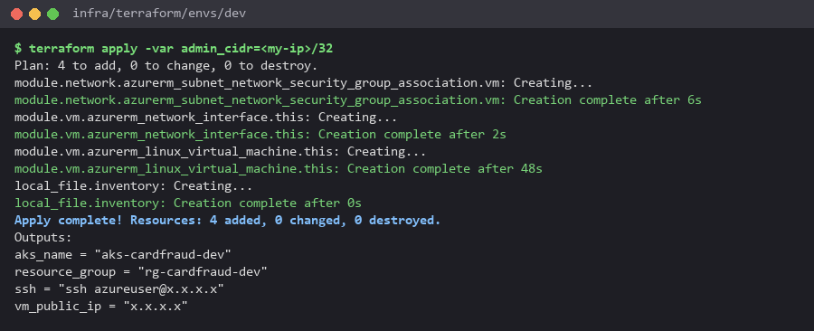

The first attempts (2026-10-21) hit the subscription's limits: `Standard_B2s_v2` not allowed for AKS and out of
capacity for VMs in `germanywestcentral`, then two transient `404` right after the VNet and the subnet were created in
`polandcentral`.

In the Azure Portal (tenant, subscription id and account are blanked out), the resource group with its 8 resources:

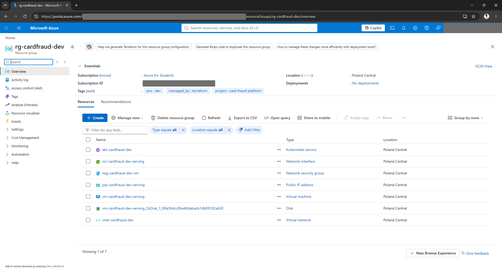

The Portal's own drawing of the resource group (Resource visualizer):

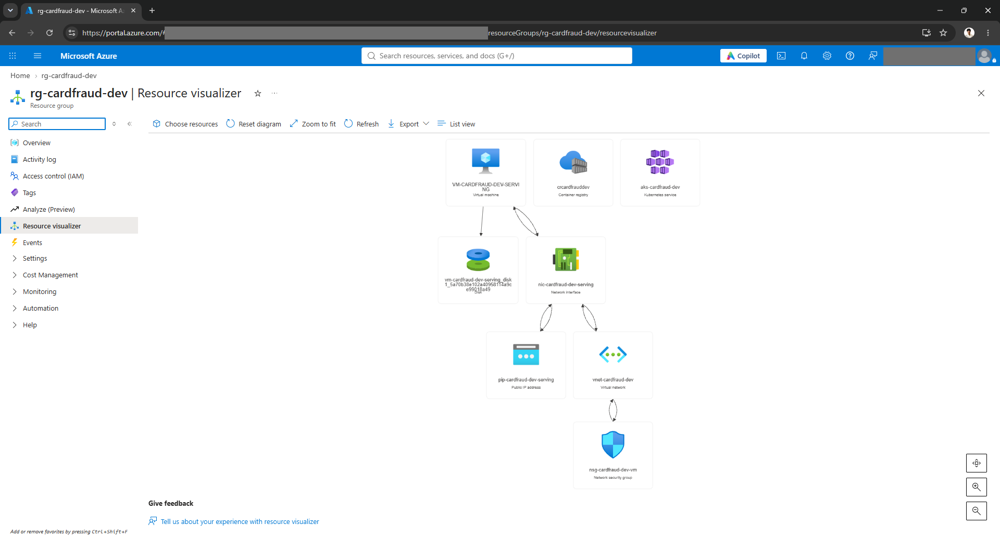

The VM, running as Standard B2s v2 with Ubuntu 24.04 in Poland Central:

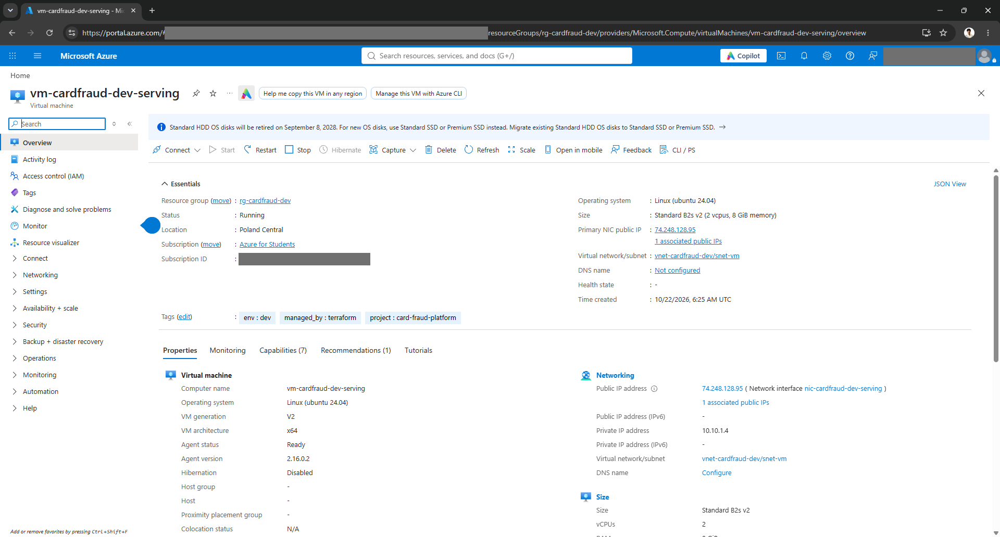

The AKS cluster: Kubernetes 1.36.4, Free tier, Azure CNI Overlay, 1 node pool, with the container registry
`crcardfrauddev`:

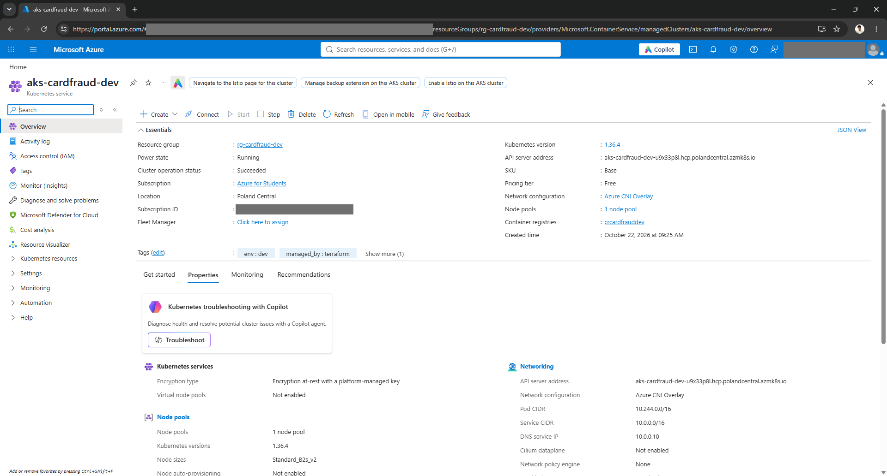

The state and the subscription's quotas while the run is up: the run's 4 vCPU (Bsv2 family) and the other VM's 2
(Basv2) fill the 6 of the region, the GPU families have a limit of 0, and the 3 public IPs are taken:

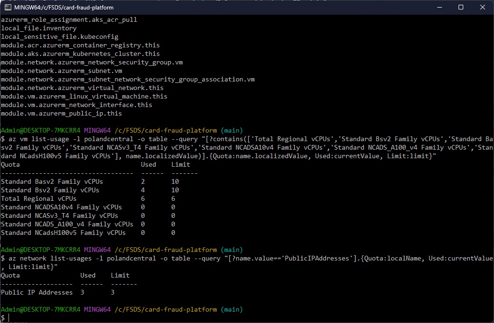

## Ansible

[`infra/ansible/site.yml`](https://github.com/cvinhnguyen/card-fraud-platform/blob/612ffdc2aa8a38f9098d6190f54bd46c2ea70315/infra/ansible/site.yml)
applies four roles to the `serving` group (the VM Terraform created;
[`infra/ansible/site.yml` L10-L17](https://github.com/cvinhnguyen/card-fraud-platform/blob/612ffdc2aa8a38f9098d6190f54bd46c2ea70315/infra/ansible/site.yml#L10-L17)):

| Role | What it does |
|---|---|
| `common` | base packages, `ufw`: deny inbound except 22 / 8080 / 9100 (a second firewall behind the NSG) |
| `docker` | Docker engine + compose plugin from the Ubuntu archive, started at boot |
| `predictor` | copies `services/predictor` (code + production model) and builds the image on the VM (no registry credential), runs it with compose, waits until the model is ready, then a smoke prediction |
| `node_exporter` | host metrics for Prometheus on :9100 |

A code or model change rebuilds the image (handler on the copy); otherwise the role only checks the container runs.

The checks at the end of the predictor role; the play fails unless the model answers
([`infra/ansible/roles/predictor/tasks/main.yml` L25-L44](https://github.com/cvinhnguyen/card-fraud-platform/blob/612ffdc2aa8a38f9098d6190f54bd46c2ea70315/infra/ansible/roles/predictor/tasks/main.yml#L25-L44)):

```yaml
- name: Model is loaded and ready
  ansible.builtin.uri:
    url: "http://localhost:{{ predictor_port }}/v1/models/{{ predictor_model_name }}"
  register: ready
  until: ready.status == 200 and ready.json.ready | default(false)
  retries: 30
  delay: 5

- name: Smoke prediction (an empty instance, every feature missing)
  ansible.builtin.uri:
    url: "http://localhost:{{ predictor_port }}/v1/models/{{ predictor_model_name }}:predict"
    method: POST
    body_format: json
    body: {instances: [{}]}
  register: prediction
  failed_when: prediction.json.predictions | length != 1

- name: Served model version
  ansible.builtin.debug:
    msg: "model {{ prediction.json.model_version }}, score {{ prediction.json.predictions[0] }}"
```

First run on the new VM, from Git Bash: 9 changes, the model answers with version 1 of the registry:

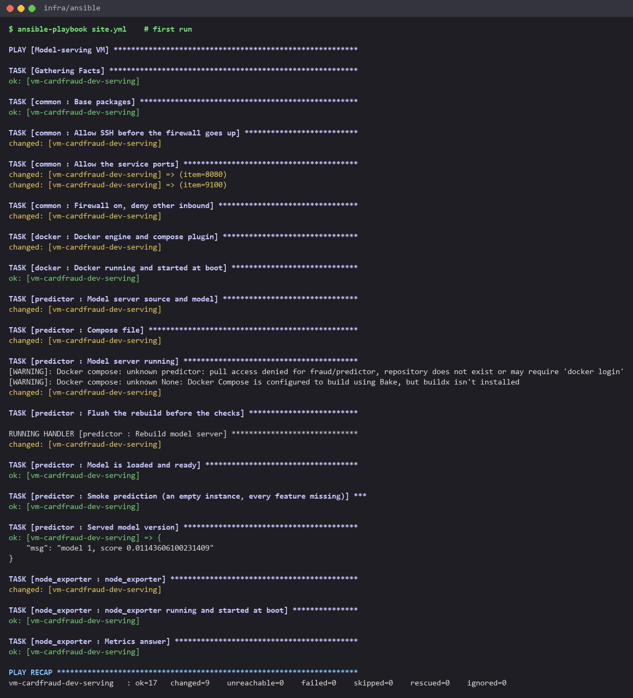

<details>
<summary>Full log of a first run (2026-10-21, the same tasks)</summary>

```text
$ ansible-playbook site.yml

PLAY [Model-serving VM] ********************************************************

TASK [Gathering Facts] *********************************************************
ok: [vm-cardfraud-dev-serving]

TASK [common : Base packages] **************************************************
ok: [vm-cardfraud-dev-serving]

TASK [common : Allow SSH before the firewall goes up] **************************
changed: [vm-cardfraud-dev-serving]

TASK [common : Allow the service ports] ****************************************
changed: [vm-cardfraud-dev-serving] => (item=8080)
changed: [vm-cardfraud-dev-serving] => (item=9100)

TASK [common : Firewall on, deny other inbound] ********************************
changed: [vm-cardfraud-dev-serving]

TASK [docker : Docker engine and compose plugin] *******************************
changed: [vm-cardfraud-dev-serving]

TASK [docker : Docker running and started at boot] *****************************
ok: [vm-cardfraud-dev-serving]

TASK [predictor : Model server source and model] *******************************
changed: [vm-cardfraud-dev-serving]

TASK [predictor : Compose file] ************************************************
changed: [vm-cardfraud-dev-serving]

TASK [predictor : Model server running] ****************************************
[WARNING]: Docker compose: unknown predictor: pull access denied for fraud/predictor, repository does not exist or may require 'docker login'
[WARNING]: Docker compose: unknown None: Docker Compose is configured to build using Bake, but buildx isn't installed
changed: [vm-cardfraud-dev-serving]

TASK [predictor : Flush the rebuild before the checks] *************************

RUNNING HANDLER [predictor : Rebuild model server] *****************************
changed: [vm-cardfraud-dev-serving]

TASK [predictor : Model is loaded and ready] ***********************************
ok: [vm-cardfraud-dev-serving]

TASK [predictor : Smoke prediction (an empty instance, every feature missing)] ***
ok: [vm-cardfraud-dev-serving]

TASK [predictor : Served model version] ****************************************
ok: [vm-cardfraud-dev-serving] => {
    "msg": "model 1, score 0.01143606100231409"
}

TASK [node_exporter : node_exporter] *******************************************
changed: [vm-cardfraud-dev-serving]

TASK [node_exporter : node_exporter running and started at boot] ***************
ok: [vm-cardfraud-dev-serving]

TASK [node_exporter : Metrics answer] ******************************************
ok: [vm-cardfraud-dev-serving]

PLAY RECAP *********************************************************************
vm-cardfraud-dev-serving   : ok=17   changed=9    unreachable=0    failed=0    skipped=0    rescued=0    ignored=0
```

</details>

The `pull access denied` warning of the first run is expected: the image is built on the VM, never pulled. Run again
right after, the play makes 0 changes, so it is idempotent:

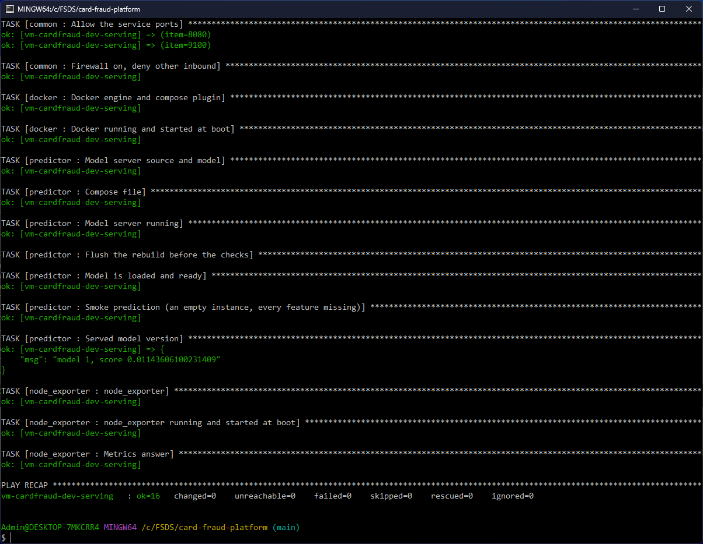

From the local machine, through the NSG (2026-10-21 run), curl reaches the model server on 8080 and node_exporter on
9100:

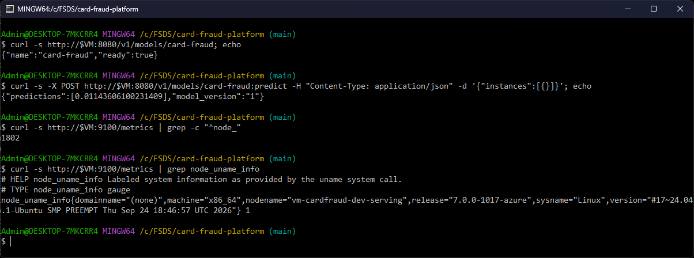

## AKS: the same model server, from ACR

The VM builds its image from source. AKS runs the image the local platform serves, `fraud/predictor:1` (the model
inside the image, as on kind), pulled from the registry Terraform creates. Terraform also grants the cluster's kubelet
identity `AcrPull` on that registry, so the cluster holds no image pull secret
([`infra/terraform/envs/dev/main.tf` L64-L69](https://github.com/cvinhnguyen/card-fraud-platform/blob/612ffdc2aa8a38f9098d6190f54bd46c2ea70315/infra/terraform/envs/dev/main.tf#L64-L69)):

```hcl
resource "azurerm_role_assignment" "aks_acr_pull" {
  scope                            = module.acr.id
  role_definition_name             = "AcrPull"
  principal_id                     = module.aks.kubelet_object_id
  skip_service_principal_aad_check = true
}
```

[`infra/k8s/aks/predictor.yaml`](https://github.com/cvinhnguyen/card-fraud-platform/blob/612ffdc2aa8a38f9098d6190f54bd46c2ea70315/infra/k8s/aks/predictor.yaml)
is a plain Deployment (one B2s v2 node has no room for KServe and cert-manager): 2 replicas, `maxUnavailable: 0`, a
readiness probe on the model, non-root. The image is pushed to ACR and the manifest applied as in [Run it](#run-it).

A `LoadBalancer` Service gets no public IP here: Azure answers `PublicIPCountLimitReached`, "Cannot create more than
3 public IP addresses for this subscription in this region". The Service is a `ClusterIP`, and the check goes through
`kubectl port-forward`:

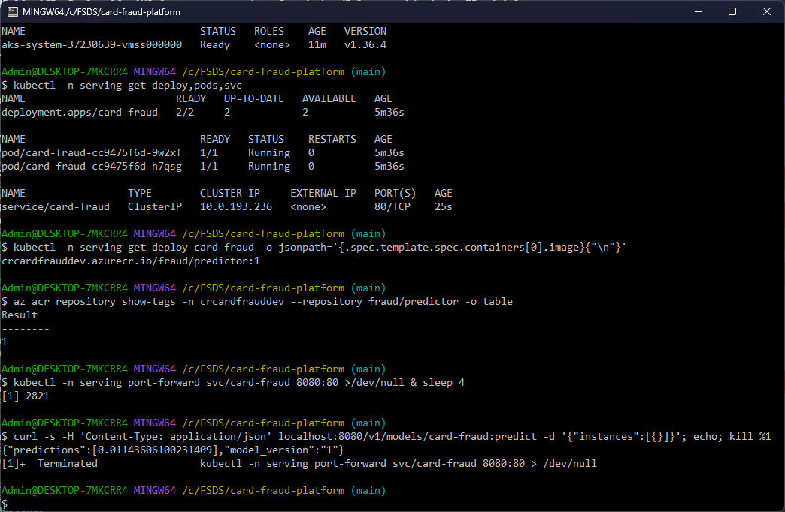

In the Portal, the deployment `card-fraud` next to the system pods:

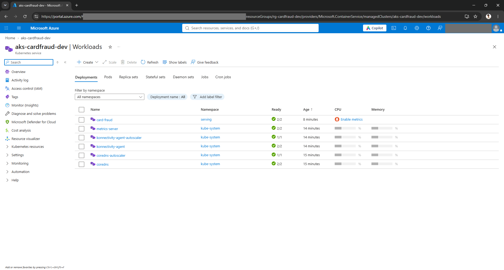

And the repository `fraud/predictor` in the registry:

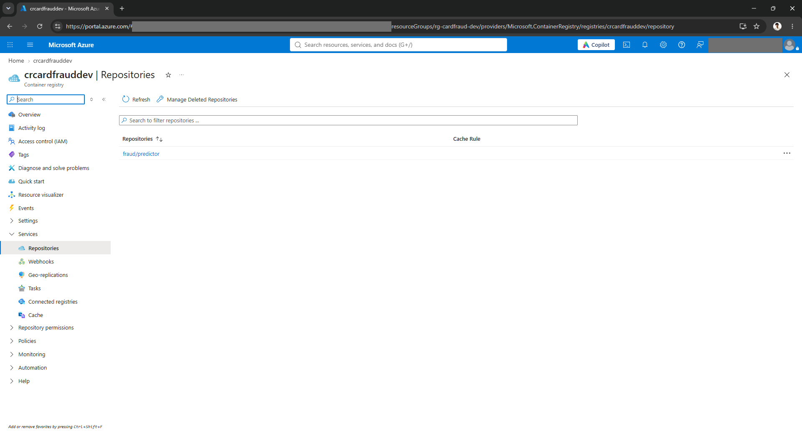

## Destroy

Then everything goes away again (`terraform destroy`, see [Run it](#run-it)). Only the summary lines are kept, since
the plan of a destroy prints the ids and the admin IP. 13 resources were destroyed and the resource group no longer
exists:

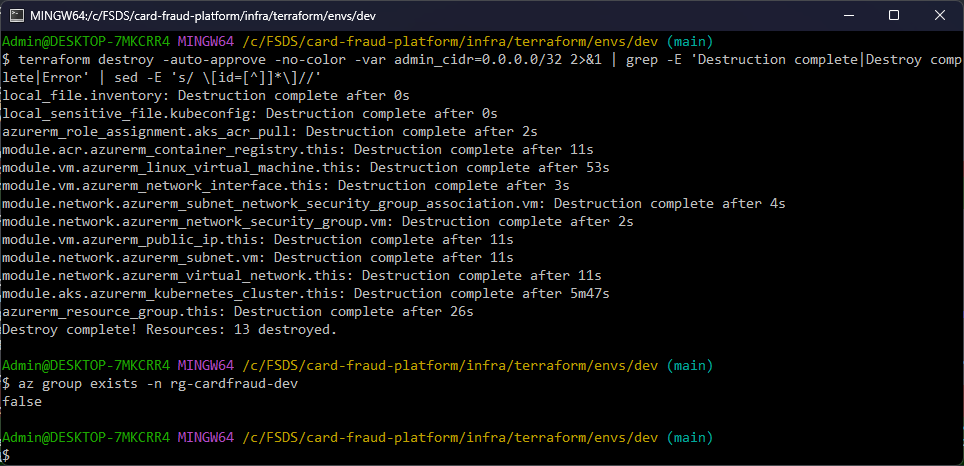

## Gotchas

- Docker publishes ports through its own iptables chains, before `ufw`: the NSG is the firewall that holds for 8080.
- Bind-mounted files from Windows are world-readable and `ssh` refuses such a key: the container copies `/key` to
  `~/.ssh` with mode 600 first
  ([`infra/ansible/Dockerfile` L8](https://github.com/cvinhnguyen/card-fraud-platform/blob/612ffdc2aa8a38f9098d6190f54bd46c2ea70315/infra/ansible/Dockerfile#L8)).
- Run on a loaded Docker Desktop VM, the Ansible container once failed reading `model.json` with
  `[Errno 12] Cannot allocate memory` (the host, not the VM); the rerun passed.
