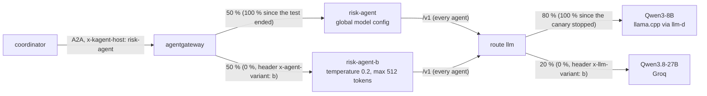
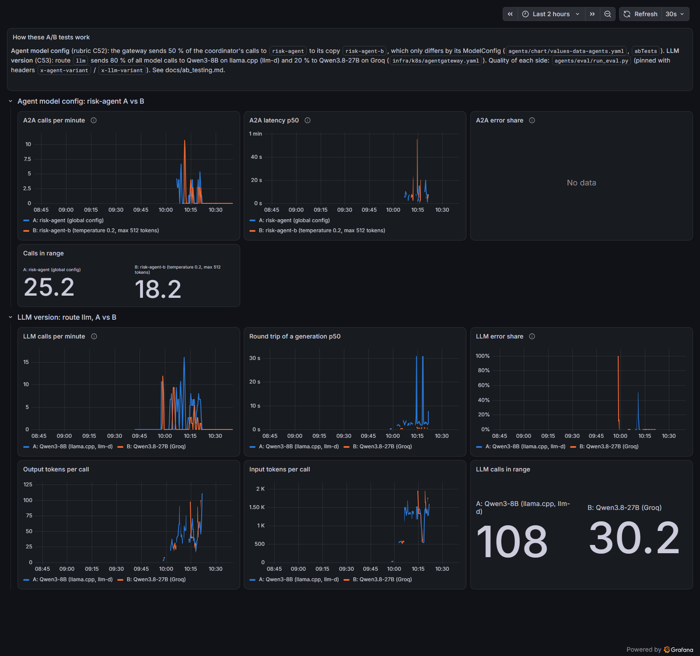

# A/B testing (agents and LLM versions)

An A/B test gives a new model config or LLM version a share of live traffic next to the current one, so a worse model
cannot spoil every conversation. Two tests ran at agentgateway, on the risk agent's model config and on the LLM behind
route `llm` (B: Qwen3.8-27B on Groq); a Grafana dashboard and an evaluation run compared the sides, and both kept A.
The fraud model's A/B test, a challenger model in the Scoring API, is a separate test
([serving.md](../ml-platform/serving.md#ab-test-of-the-fraud-model)).

| | |
|---|---|
| Code | [`agents/chart/`](https://github.com/cvinhnguyen/card-fraud-platform/tree/6457d47445ec1a910ebd2c01bc1edbff50f76d37/agents/chart), [`infra/k8s/agentgateway.yaml`](https://github.com/cvinhnguyen/card-fraud-platform/blob/6457d47445ec1a910ebd2c01bc1edbff50f76d37/infra/k8s/agentgateway.yaml), [`infra/k8s/dashboards/ab-tests.json`](https://github.com/cvinhnguyen/card-fraud-platform/blob/6457d47445ec1a910ebd2c01bc1edbff50f76d37/infra/k8s/dashboards/ab-tests.json), [`agents/eval/`](https://github.com/cvinhnguyen/card-fraud-platform/tree/6457d47445ec1a910ebd2c01bc1edbff50f76d37/agents/eval) |
| Runs on | kind: agentgateway in namespace `agentgateway-system`, the agents in namespace `kagent`; the evaluation in a `python:3.13-slim` container on the `kind` network |
| Reads | `agents/eval/dataset.jsonl` and the bank documents in `generator/knowledge` (evaluation); the gateway's metrics (dashboard) |
| Writes | `agents/eval/results/*.json` (per-question answers) |
| Related | [agents.md](agents.md), [llm_platform.md](llm_platform.md), [observability.md](../operations/observability.md), [novel_eval_gate.md](novel_eval_gate.md) |

## Where it fits

- Layer 3 (LLM and agent platform), at agentgateway ([architecture.md](../architecture.md#system-diagram-layer-3): arrow A7, dashboard O3).
- Fed by the coordinator's A2A (agent-to-agent) calls to the risk agent and every agent's LLM calls ([agents.md](agents.md), [llm_platform.md](llm_platform.md)).
- Read by the Grafana dashboard ([observability.md](../operations/observability.md)) and the per-question results.
- The eval gate of the CD (continuous delivery) pipeline uses the same questions and scoring ([novel_eval_gate.md](novel_eval_gate.md)).

## How it works



1. A variant is a second backend behind the same route: `risk-agent-b`, or the 27B model on Groq. Callers change
   nothing: the coordinator still calls `risk-agent`, the agents still send model `qwen3-8b`.
2. The gateway splits by weight (50/50 for the agent test, 80/20 for the LLM test); a header (`x-agent-variant`,
   `x-llm-variant`) pins a call to one side.
3. The dashboard compares the sides on live traffic: calls per minute, latency p50 (the median), error share, tokens
   per call ([Monitoring](#monitoring-dashboard-card-support---ab-tests)).
4. `run_eval.py` sends the eval questions pinned to A, then to B, and counts an answer correct when it states every
   expected fact ([Evaluation](#evaluation)).
5. The weights then move to the winner or the variant is removed; B stays reachable by header ([Decisions](#decisions)).

## Run it

`A2A_KEY` is the coordinator's key for the sub-agents (`A2A_KEY_COORDINATOR` in `infra/.env`, also used by the Jenkins
eval stage); `AGW_KEY` is the agents' gateway key (`AGW_API_KEY`). `--mode agent` asks the risk agent over A2A,
`--mode llm` asks route `/v1`, `--variant a|b` pins a side:

```bash
export A2A_KEY=$(grep '^A2A_KEY_COORDINATOR=' infra/.env | cut -d= -f2-) AGW_KEY=$(grep '^AGW_API_KEY=' infra/.env | cut -d= -f2-)
kubectl -n agentgateway-system get svc agentgateway-proxy -o jsonpath='{.spec.ports[0].nodePort}'   # the gateway nodePort
docker run --rm --network kind -e A2A_KEY -e AGW_KEY -e GATEWAY=http://fraud-control-plane:<gateway nodePort> \
  -v "$PWD:/repo" -w /repo python:3.13-slim python agents/eval/run_eval.py --mode agent --variant b
```

Add `--out agents/eval/results/<name>.json` to keep the per-question answers.

## Agent model config (risk-agent A vs B)

`abTests` in [`agents/chart/values-data-agents.yaml`
L30-L37](https://github.com/cvinhnguyen/card-fraud-platform/blob/6457d47445ec1a910ebd2c01bc1edbff50f76d37/agents/chart/values-data-agents.yaml#L30-L37):

```yaml
# A/B test of the risk agent's model config: B samples near-greedily and caps its answers (the global config leaves
# llama.cpp's defaults: temperature 0.8, no cap). The test ran at weight 50 (half of the coordinator's calls to
# risk-agent-b); B lost (docs/llm-platform/ab_testing.md), so it gets no live calls and stays reachable with header
# x-agent-variant: b for later evaluations. Delete the entry to remove risk-agent-b.
abTests:
  risk-agent: {variant: risk-agent-b, modelConfig: qwen3-8b-precise, weight: 0}
modelConfigs:
  qwen3-8b-precise: {temperature: "0.2", maxTokens: 512}
```

The chart makes `risk-agent-b` ([`agents/chart/templates/_helpers.tpl`
L1-L9](https://github.com/cvinhnguyen/card-fraud-platform/blob/6457d47445ec1a910ebd2c01bc1edbff50f76d37/agents/chart/templates/_helpers.tpl#L1-L9)),
a copy of `risk-agent` with the same Langfuse prompt and MCP (Model Context Protocol) tools, its own KEDA ScaledObject
(autoscaling) and SandboxAgent, under the release's NetworkPolicy. It differs only in the ModelConfig
`qwen3-8b-precise` ([`agents/chart/templates/modelconfigs.yaml`
L1-L19](https://github.com/cvinhnguyen/card-fraud-platform/blob/6457d47445ec1a910ebd2c01bc1edbff50f76d37/agents/chart/templates/modelconfigs.yaml#L1-L19)):
temperature 0.2 and at most 512 output tokens, against llama.cpp's defaults (temperature 0.8, no cap).

The release's A2A route
([`agents/chart/templates/a2a-gateway.yaml`](https://github.com/cvinhnguyen/card-fraud-platform/blob/6457d47445ec1a910ebd2c01bc1edbff50f76d37/agents/chart/templates/a2a-gateway.yaml))
sent 50 % of the coordinator's `risk-agent` calls to each side during the test, and B gets 0 % since. Header
`x-agent-variant: a|b` pins a side; the gateway's metrics (label `backend`) give calls, latency p50 and error share. For
an agent in `abTests` the template writes three rules, pinned to A, pinned to B and the weighted split
([a2a-gateway.yaml L30-L49](https://github.com/cvinhnguyen/card-fraud-platform/blob/6457d47445ec1a910ebd2c01bc1edbff50f76d37/agents/chart/templates/a2a-gateway.yaml#L30-L49)):

```yaml
    {{- range $name, $a := .Values.agents }}
    {{- $host := dict "name" "x-kagent-host" "value" (printf "%s.%s" $name $.Release.Namespace) }}
    {{- with index (default dict $.Values.abTests) $name }}
    - matches: [{path: {type: PathPrefix, value: /}, headers: [{{ toJson $host }}, {name: x-agent-variant, value: a}]}]
      backendRefs: [{group: agentgateway.dev, kind: AgentgatewayBackend, name: agent-{{ $name }}}]
      timeouts: {request: 300s}
    - matches: [{path: {type: PathPrefix, value: /}, headers: [{{ toJson $host }}, {name: x-agent-variant, value: b}]}]
      backendRefs: [{group: agentgateway.dev, kind: AgentgatewayBackend, name: agent-{{ .variant }}}]
      timeouts: {request: 300s}
    - matches: [{path: {type: PathPrefix, value: /}, headers: [{{ toJson $host }}]}]
      backendRefs:
        - {group: agentgateway.dev, kind: AgentgatewayBackend, name: agent-{{ $name }}, weight: {{ sub 100 .weight }}}
        - {group: agentgateway.dev, kind: AgentgatewayBackend, name: agent-{{ .variant }}, weight: {{ .weight }}}
      timeouts: {request: 300s}
    {{- else }}
    - matches: [{path: {type: PathPrefix, value: /}, headers: [{{ toJson $host }}]}]
      backendRefs: [{group: agentgateway.dev, kind: AgentgatewayBackend, name: agent-{{ $name }}}]
      timeouts: {request: 300s}
    {{- end }}
    {{- end }}
```

## LLM version (route `llm`: Qwen3-8B vs Qwen3.8-27B)

Configured in
[`infra/k8s/agentgateway.yaml`](https://github.com/cvinhnguyen/card-fraud-platform/blob/6457d47445ec1a910ebd2c01bc1edbff50f76d37/infra/k8s/agentgateway.yaml):

| Version | Model | Backend |
|---|---|---|
| A | the platform's model, Qwen3-8B Q4_K_M on llama.cpp | the llm-d InferencePool ([agentgateway.yaml L18-L31](https://github.com/cvinhnguyen/card-fraud-platform/blob/6457d47445ec1a910ebd2c01bc1edbff50f76d37/infra/k8s/agentgateway.yaml#L18-L31)) |
| B | Qwen3.8-27B on Groq | an OpenAI-compatible `AgentgatewayBackend` with the key `llm-groq` from Vault ([agentgateway.yaml L36-L57](https://github.com/cvinhnguyen/card-fraud-platform/blob/6457d47445ec1a910ebd2c01bc1edbff50f76d37/infra/k8s/agentgateway.yaml#L36-L57)) |

The route sent 80 % of model calls to A and 20 % to B until the canary stopped ([Decisions](#decisions)). The B backend
rewrites model `qwen3-8b` and sets its own User-Agent ([Gotchas](#gotchas)); header `x-llm-variant: a|b` pins a side.
The rules now
([agentgateway.yaml L70-L84](https://github.com/cvinhnguyen/card-fraud-platform/blob/6457d47445ec1a910ebd2c01bc1edbff50f76d37/infra/k8s/agentgateway.yaml#L70-L84)):

```yaml
  rules:
    - matches: [{path: {type: PathPrefix, value: /v1}, headers: [{name: x-llm-variant, value: a}]}]
      backendRefs: [{group: agentgateway.dev, kind: AgentgatewayBackend, name: qwen3-8b}]
      timeouts: {request: 300s}
    - matches: [{path: {type: PathPrefix, value: /v1}, headers: [{name: x-llm-variant, value: b}]}]
      backendRefs: [{group: agentgateway.dev, kind: AgentgatewayBackend, name: qwen3-8-27b-groq, filters: [{type: RequestHeaderModifier, requestHeaderModifier: {set: [{name: User-Agent, value: agentgateway}]}}]}]
      timeouts: {request: 300s}
    # Canary stopped on 2026-10-21 (docs/llm-platform/ab_testing.md): at 20 % the dashboard showed B refusing agent calls (429, the
    # free tier's output tokens a minute). B stays reachable with the header; raise its weight again on a paid tier.
    - matches: [{path: {type: PathPrefix, value: /v1}}]
      backendRefs:
        - {group: agentgateway.dev, kind: AgentgatewayBackend, name: qwen3-8b, weight: 100}
        - {group: agentgateway.dev, kind: AgentgatewayBackend, name: qwen3-8-27b-groq, weight: 0,
           filters: [{type: RequestHeaderModifier, requestHeaderModifier: {set: [{name: User-Agent, value: agentgateway}]}}]}
      timeouts: {request: 300s}
```

The route's policy (API key, rate limits, masking of personal data (PII),
[agentgateway.yaml L86-L123](https://github.com/cvinhnguyen/card-fraud-platform/blob/6457d47445ec1a910ebd2c01bc1edbff50f76d37/infra/k8s/agentgateway.yaml#L86-L123))
covers both versions: a phone number reaches Groq as `<masked>` ("Repeat exactly: my phone is 0912345678" came back as
"my phone is <masked>"). The
metrics (labels `backend` and `gen_ai_response_model`) give calls, round trip p50, error share, and input and output
tokens per call.

## Monitoring: dashboard "Card Support - A/B tests"

[`infra/k8s/dashboards/ab-tests.json`](https://github.com/cvinhnguyen/card-fraud-platform/blob/6457d47445ec1a910ebd2c01bc1edbff50f76d37/infra/k8s/dashboards/ab-tests.json),
loaded by
[`infra/k8s/observability.sh`](https://github.com/cvinhnguyen/card-fraud-platform/blob/6457d47445ec1a910ebd2c01bc1edbff50f76d37/infra/k8s/observability.sh).
A is blue and B orange. The top row compares risk-agent A and B (A2A calls per minute, latency p50, error share), the
lower rows the LLM versions (also output and input tokens per call). Over the 2 hours of the runs, calls in range were
25.2 (A) and 18.2 (B) for the agent, 108 and 30.2 for the LLM:



## Evaluation

[`agents/eval/dataset.jsonl`](https://github.com/cvinhnguyen/card-fraud-platform/blob/6457d47445ec1a910ebd2c01bc1edbff50f76d37/agents/eval/dataset.jsonl)
(in [`agents/eval/`](https://github.com/cvinhnguyen/card-fraud-platform/tree/6457d47445ec1a910ebd2c01bc1edbff50f76d37/agents/eval))
held 12 card-policy questions for these runs (fees, disputes, authentication; 20 now, for the eval gate), each with the
facts a correct answer must state, from the bank documents
([`generator/knowledge/`](https://github.com/cvinhnguyen/card-fraud-platform/tree/6457d47445ec1a910ebd2c01bc1edbff50f76d37/generator/knowledge)).
`run_eval.py` sends each to the risk agent over A2A (`agent` mode, as the coordinator does) or straight to `/v1` with
the policy document as context (`llm` mode)
([`agents/eval/run_eval.py`
L65-L90](https://github.com/cvinhnguyen/card-fraud-platform/blob/6457d47445ec1a910ebd2c01bc1edbff50f76d37/agents/eval/run_eval.py#L65-L90)).
An answer is correct when it states every expected fact as a whole term and not negated: "3%" does not match "1.3%",
"not free" does not match "free"
([run_eval.py L51-L54](https://github.com/cvinhnguyen/card-fraud-platform/blob/6457d47445ec1a910ebd2c01bc1edbff50f76d37/agents/eval/run_eval.py#L51-L54)).
Re-scoring every stored answer and every eval-gate answer in Langfuse with this rule on 2026-11-12 gave the same
results. Command: [Run it](#run-it).

One experiment ran at a time; the agent runs had the LLM route at 100/0, so A and B differed only in model config.

| experiment | side | correct | latency p50 | latency max |
|---|---|---:|---:|---:|
| agent model config | A: global config | 8 / 12 | 7.6 s | 71.7 s |
| agent model config | B: temperature 0.2, max 512 tokens | 7 / 12 | 7.5 s | 69.1 s |
| LLM version | A: Qwen3-8B (llama.cpp) | 12 / 12 | 1.93 s | 3.7 s |
| LLM version | B: Qwen3.8-27B (Groq) | 12 / 12 | 0.47 s | 1.5 s |

Per-question answers:
[`agents/eval/results/`](https://github.com/cvinhnguyen/card-fraud-platform/tree/6457d47445ec1a910ebd2c01bc1edbff50f76d37/agents/eval/results)
(`*.json`). Unpinned, with the split on, two agent passes got 8 / 12 each and the LLM pass 12 / 12, with about 78 / 22
of the LLM calls per side on the dashboard.

## Decisions

| Test | Decision | Reason |
|---|---|---|
| Agent model config | keep A; B at weight 0 | near-greedy sampling with a cap improved neither accuracy (7 vs 8 of 12) nor latency (both ~7.5 s, set by the GPU) |
| LLM version | stop the canary; A at 100 % | B was as accurate on the document questions and about 4x faster, but failed on live agent traffic |

Both B variants stay reachable by header for evaluations; deleting the `abTests` entry removes `risk-agent-b` at the
next deploy. The evaluation also showed where both agent sides fail: they answer "the policy could not be checked" in
2 s without calling `search_policy`, or after hits without the fee table row. The prompt causes that, and the eval gate
now measures it ([novel idea: eval gate](novel_eval_gate.md)).

The LLM canary failed the coordinator pipeline's smoke test (Jenkins `card-support-coordinator` #18, `failed`): its
last model call landed on B, and Groq answered `429 ... output tokens per minute (OTPM): Limit 1000, Requested 1619`.
Agents send no `max_tokens`, and the free tier's 1,000 output tokens a minute per account is less than two agent
answers; the dashboard's "LLM error share" shows B failing and A not. The default rule is now 100 / 0, and
`x-llm-variant: b` gets a gateway default of `max_tokens: 512`
([agentgateway.yaml L54-L57](https://github.com/cvinhnguyen/card-fraud-platform/blob/6457d47445ec1a910ebd2c01bc1edbff50f76d37/infra/k8s/agentgateway.yaml#L54-L57)).
Since B only had a share of traffic, stopping it was a weight change. Resuming needs a paid Groq tier and a decision on
sending (masked) customer text outside the bank.

## Gotchas

- Groq's edge (Cloudflare) refuses calls with error 1010, because it rejects Python's default User-Agent. The gateway
  sets `User-Agent: agentgateway` (the `RequestHeaderModifier` filter on the `qwen3-8-27b-groq` backend refs in route
  `llm`).
