# Card support agents, MCP servers and agent gateway

Layer 3, the large language model (LLM) and agent platform, gives support workers three AI agents that answer a
customer's card question (why was my payment declined, what does a withdrawal abroad cost?) from the card's recent
activity, the fraud model's verdict and the bank's card policies. The coordinator asks two specialists, the card data
agent and the risk agent, which call three tool servers over MCP (the Model Context Protocol). Every call goes through
agentgateway, which checks the caller's key and allows only what it needs. The model is in
[llm_platform.md](llm_platform.md).

| | |
|---|---|
| Code | [`agents/chart/`](https://github.com/cvinhnguyen/card-fraud-platform/tree/54d21eddbf6e602ae13fed46a1a9e0ef265d23cd/agents/chart), [`services/card_support_mcp/`](https://github.com/cvinhnguyen/card-fraud-platform/tree/54d21eddbf6e602ae13fed46a1a9e0ef265d23cd/services/card_support_mcp), [`agents/registry/`](https://github.com/cvinhnguyen/card-fraud-platform/tree/54d21eddbf6e602ae13fed46a1a9e0ef265d23cd/agents/registry), [`infra/k8s/llm-platform.sh`](https://github.com/cvinhnguyen/card-fraud-platform/blob/54d21eddbf6e602ae13fed46a1a9e0ef265d23cd/infra/k8s/llm-platform.sh) |
| Runs on | kind: the agents in namespace `kagent` (kagent 0.10.3), the MCP servers in `card-support`, agentgateway in `agentgateway-system`, Agent Substrate in `ate-system`, agentregistry in `agentregistry` |
| Reads | Feast `card_fraud` online store (Redis), Feast `card_support_kb` online store (pgvector), the Layer 2 Fraud Scoring API, llama.cpp embeddings; the system prompts from Langfuse at deploy time |
| Related | [llm_platform.md](llm_platform.md), [ab_testing.md](ab_testing.md), [rag_pipeline.md](rag_pipeline.md), [observability.md](../operations/observability.md), [cicd.md](../operations/cicd.md), [novel_eval_gate.md](novel_eval_gate.md) |

## Where it fits

- The A flow of the Layer 3 picture ([architecture.md](../architecture.md#layer-3-the-llm-and-agent-platform-left-panel), [numbered arrows](../architecture.md#numbered-arrows-layer-3)).
- Fed by the Feast online store the Scoring API uses ([feature_store.md](../ml-platform/feature_store.md)), the Scoring API ([serving.md](../ml-platform/serving.md)) and the RAG (retrieval-augmented generation) pipeline's chunks ([rag_pipeline.md](rag_pipeline.md)).
- Used by support staff on the support chat page, over HTTPS through NGINX and then agentgateway ([edge_security.md](../operations/edge_security.md)).
- Deployed by Jenkins with prompts from Langfuse, each release checked by the eval gate ([cicd.md](../operations/cicd.md), [novel_eval_gate.md](novel_eval_gate.md)).

## How it works

1. A support worker asks on `https://support.<domain>`. NGINX checks the login, and the page's proxy sends the
   question with the `support-app` key to the gateway route `/a2a/coordinator`
   ([Support chat](#support-chat-gateway-first)).
2. The coordinator decides which specialists to ask and sends each a sub-task over A2A (agent-to-agent protocol),
   through the gateway's internal agent route ([A2A gateway](#a2a-gateway)).
3. Each specialist calls the tool it needs over MCP, on the gateway route of that tool server (`/mcp/card-data`,
   `/mcp/fraud-score` or `/mcp/policy-rag`) ([MCP gateway](#mcp-gateway)).
4. card-data reads Redis and pgvector through Feast, fraud-score asks the Scoring API, and policy-rag turns the
   question into a vector with the embedding model and finds the nearest policy chunks
   ([The three MCP servers](#the-three-mcp-servers)).
5. Each agent writes its answer with the LLM on gateway route `/v1` ([llm_platform.md](llm_platform.md)); the
   coordinator combines them into the reply.

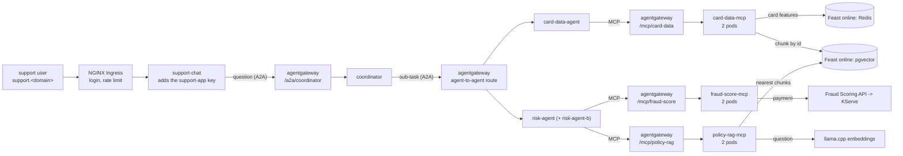

At every hop the gateway checks the caller's key (kept in Vault, handed to the pods as a Kubernetes Secret), applies
that caller's rules and limits the rate:

| Key of | May call only |
|---|---|
| `support-app` (the support chat's proxy, the coordinator pipeline's smoke test) | `/a2a/coordinator`: the coordinator |
| `coordinator` (the coordinator, CI's smoke test and eval gate) | the internal agent route: the card-data and risk agents |
| `card-data-agent` | `/mcp/card-data`: `get_card_data`, `get_policy_chunk` |
| `risk-agent` | `/mcp/fraud-score` and `/mcp/policy-rag`: `score_payment`, `search_policy` |
| the agents' LLM key | `/v1`: the model, with personal data masked |

## Run it

The pipelines deploy all of this ([cicd.md](../operations/cicd.md#agents)). By hand, run these from the repo root after
[`infra/k8s/up.sh`](https://github.com/cvinhnguyen/card-fraud-platform/blob/54d21eddbf6e602ae13fed46a1a9e0ef265d23cd/infra/k8s/up.sh).
The agents then take the prompts in
[`agents/chart/prompts/`](https://github.com/cvinhnguyen/card-fraud-platform/tree/54d21eddbf6e602ae13fed46a1a9e0ef265d23cd/agents/chart/prompts)
(`<agent>.md`), which the pipeline replaces with the Langfuse prompts labelled `production`.

```bash
sh infra/k8s/llm-platform.sh     # agentgateway, llm-d, kagent 0.10.3, Agent Substrate 0.0.9, KEDA, agentregistry 0.4.0
# the three MCP servers, one release each; <tag> = an image tag the Jenkins pipeline built, pushed and signed
# (the git commit, e.g. `helm -n card-support get values card-data-mcp`), since Kyverno admits only signed images
helm upgrade --install card-data-mcp   services/card_support_mcp/chart -f services/card_support_mcp/chart/values-card-data.yaml   -n card-support --atomic --timeout 4m --set image.tag=<tag>
helm upgrade --install fraud-score-mcp services/card_support_mcp/chart -f services/card_support_mcp/chart/values-fraud-score.yaml -n card-support --atomic --timeout 4m --set image.tag=<tag>
helm upgrade --install policy-rag-mcp  services/card_support_mcp/chart -f services/card_support_mcp/chart/values-policy-rag.yaml  -n card-support --atomic --timeout 4m --set image.tag=<tag>
# the agents, two releases
helm upgrade --install card-support-data-agents agents/chart -n kagent -f agents/chart/values-data-agents.yaml
helm upgrade --install card-support-coordinator agents/chart -n kagent -f agents/chart/values-coordinator.yaml
arctl apply -f agents/registry/catalog.yaml      # the agent registry's catalog
```

The agent pipelines also validate with `helm upgrade --dry-run=server` before the upgrade and wait with
`agents/wait_ready.sh` after it, until kagent reports each Agent's new generation Ready.

## Agents and tools

One MCP server per rubric item that asks for a tool:

| MCP server | Tools | Rubric |
|---|---|---|
| `card-data-mcp` | `get_card_data`, `get_policy_chunk` | A16: the Web API that pulls a user's data from the online feature store and a chunk written by the RAG pipeline, by id |
| `fraud-score-mcp` | `score_payment` | A22, tool 1: the call to the ML inference service |
| `policy-rag-mcp` | `search_policy` | A22, tool 2: RAG over the chunks the RAG data pipeline ingested |

| Agent | Tools (MCP server) | Release, pipeline |
|---|---|---|
| card-data-agent | `get_card_data`, `get_policy_chunk` (`card-data-mcp`) | `card-support-data-agents`, [`agents/Jenkinsfile.data-agents`](https://github.com/cvinhnguyen/card-fraud-platform/blob/54d21eddbf6e602ae13fed46a1a9e0ef265d23cd/agents/Jenkinsfile.data-agents) |
| risk-agent (and its A/B variant risk-agent-b) | `score_payment` (`fraud-score-mcp`), `search_policy` (`policy-rag-mcp`) | same release |
| coordinator | the two agents above, over A2A | `card-support-coordinator`, [`agents/Jenkinsfile.coordinator`](https://github.com/cvinhnguyen/card-fraud-platform/blob/54d21eddbf6e602ae13fed46a1a9e0ef265d23cd/agents/Jenkinsfile.coordinator) |

One Helm chart
([`agents/chart/`](https://github.com/cvinhnguyen/card-fraud-platform/tree/54d21eddbf6e602ae13fed46a1a9e0ef265d23cd/agents/chart))
renders declarative kagent 0.10.3 Agents on the Go ADK runtime from a values file per release
([`agents/chart/values-data-agents.yaml`](https://github.com/cvinhnguyen/card-fraud-platform/blob/54d21eddbf6e602ae13fed46a1a9e0ef265d23cd/agents/chart/values-data-agents.yaml),
[`agents/chart/values-coordinator.yaml`](https://github.com/cvinhnguyen/card-fraud-platform/blob/54d21eddbf6e602ae13fed46a1a9e0ef265d23cd/agents/chart/values-coordinator.yaml)),
each listing its MCP servers and tools ([values-data-agents.yaml L5-L19](https://github.com/cvinhnguyen/card-fraud-platform/blob/54d21eddbf6e602ae13fed46a1a9e0ef265d23cd/agents/chart/values-data-agents.yaml#L5-L19)).
Each Agent carries its Langfuse system prompt inline (`systemMessage`, in `agents/chart/templates/_helpers.tpl`) next
to the annotation `card-support/prompt` with its version, so one write changes both
([cicd.md](../operations/cicd.md#agents)).

## MCP gateway

Each MCP server is reachable only on its own gateway route, `/mcp/<server>`
([`services/card_support_mcp/chart/templates/gateway.yaml`](https://github.com/cvinhnguyen/card-fraud-platform/blob/54d21eddbf6e602ae13fed46a1a9e0ef265d23cd/services/card_support_mcp/chart/templates/gateway.yaml)).
kagent sees it as a RemoteMCPServer
([`services/card_support_mcp/chart/templates/mcp-servers.yaml`](https://github.com/cvinhnguyen/card-fraud-platform/blob/54d21eddbf6e602ae13fed46a1a9e0ef265d23cd/services/card_support_mcp/chart/templates/mcp-servers.yaml))
that calls that route with the key of the server's agent, from a Secret synced from Vault.

| Policy | Setting | Why |
|---|---|---|
| Authentication | `apiKeyAuthentication: Strict`, keys stored as SHA-256 hashes with a user id | no known key, no access |
| Tool authorization | per route: `apiKey.user_id == "card-data-agent"` on `/mcp/card-data`, `apiKey.user_id == "risk-agent"` on `/mcp/fraud-score` and `/mcp/policy-rag` | least privilege; the rule filters `tools/list` too, so an agent does not even see the other servers' tools |
| Rate limit | 300 requests a minute, burst 50, per server | a looping agent cannot flood the stores |
| Session routing | `Stateless` | any replica answers any call (rolling updates, scaling) |

Route, backend and policy come from the release's values (`server`, `agent`; the rate limit in
[`services/card_support_mcp/chart/values.yaml`
L38-L41](https://github.com/cvinhnguyen/card-fraud-platform/blob/54d21eddbf6e602ae13fed46a1a9e0ef265d23cd/services/card_support_mcp/chart/values.yaml#L38-L41)).
The policy ([gateway.yaml L30-L53](https://github.com/cvinhnguyen/card-fraud-platform/blob/54d21eddbf6e602ae13fed46a1a9e0ef265d23cd/services/card_support_mcp/chart/templates/gateway.yaml#L30-L53)):

```yaml
# Who: an API key from agentgateway-api-keys. How much: a request rate limit. What: only the key of this server's
# agent sees its tools (the rule runs once per tool, in tools/list and in tools/call); any other key, even a valid
# one, sees no tool here.
apiVersion: agentgateway.dev/v1alpha1
kind: AgentgatewayPolicy
metadata:
  name: {{ .Release.Name }}
  namespace: {{ $ns }}
spec:
  targetRefs: [{group: gateway.networking.k8s.io, kind: HTTPRoute, name: {{ .Release.Name }}}]
  traffic:
    apiKeyAuthentication:
      mode: Strict
      configMapSelector: {matchLabels: {agentgateway.dev/apikey: "true"}}
    rateLimit:
      local:
        - {requests: {{ .Values.gateway.rateLimit.requests }}, unit: Minutes, burst: {{ .Values.gateway.rateLimit.burst }}}
  backend:
    mcp:
      authorization:
        action: Allow
        policy:
          matchExpressions:
            - {{ printf "apiKey.user_id == %q" (required "agent: the gateway key user allowed to use these tools" .Values.agent) | quote }}
```

Tested from Git Bash through a port-forward with shell functions `mcp` and `tools` (one curl `POST /mcp/<server>`, key
as Bearer token, JSON-RPC body; stateless servers need no `initialize` before `tools/list`):

- With no key, a route answers 401.
- The card data agent's key sees `get_card_data` and `get_policy_chunk` on `/mcp/card-data`, and the risk agent's key
  `score_payment` on `/mcp/fraud-score` and `search_policy` on `/mcp/policy-rag`; neither sees a tool on the other
  routes. The agents' LLM key passes authentication but sees no tool.
- The risk agent's key calling `get_card_data` gets `Unknown tool: get_card_data`.

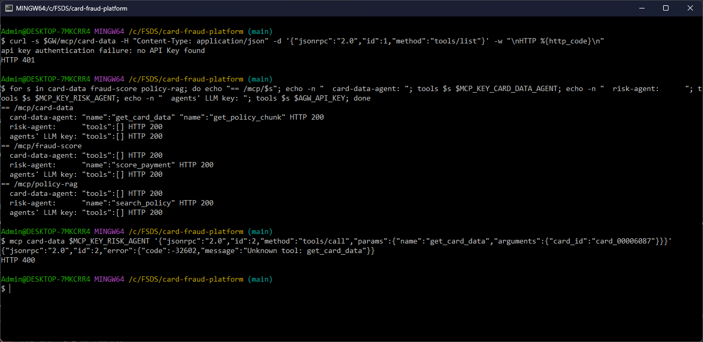

## A2A gateway

kagent's `proxy.url`
([`infra/k8s/llm-platform.sh`
L49](https://github.com/cvinhnguyen/card-fraud-platform/blob/54d21eddbf6e602ae13fed46a1a9e0ef265d23cd/infra/k8s/llm-platform.sh#L49))
sends every agent-as-tool call to the gateway, with the header `x-kagent-host: <agent>.<namespace>`, instead of to the
other agent's Service. The chart adds the routes and policies
([`agents/chart/templates/a2a-gateway.yaml`](https://github.com/cvinhnguyen/card-fraud-platform/blob/54d21eddbf6e602ae13fed46a1a9e0ef265d23cd/agents/chart/templates/a2a-gateway.yaml):
internal route [a2a-gateway.yaml L50-L68](https://github.com/cvinhnguyen/card-fraud-platform/blob/54d21eddbf6e602ae13fed46a1a9e0ef265d23cd/agents/chart/templates/a2a-gateway.yaml#L50-L68),
public route [a2a-gateway.yaml L69-L104](https://github.com/cvinhnguyen/card-fraud-platform/blob/54d21eddbf6e602ae13fed46a1a9e0ef265d23cd/agents/chart/templates/a2a-gateway.yaml#L69-L104)):

| Route | Who may call | Policy |
|---|---|---|
| `card-support-data-agents-internal` (header `x-kagent-host`) | key user `coordinator` only (the coordinator, and CI's smoke test and eval gate) | API key, `apiKey.user_id in ["coordinator"]`, 120 requests a minute (burst 20), 300 s timeout |
| `a2a-coordinator` (`/a2a/coordinator`) | key user `support-app` only (the support chat, the coordinator pipeline's smoke test) | API key, `apiKey.user_id == "support-app"`, same rate limit |

The gateway rewrites each agent card's URL to its own, so A2A clients stay on it. The risk agent's A/B split also
happens here (weights and the `x-agent-variant` header, [ab_testing.md](ab_testing.md)). Checked live: a pod that
calls the risk agent or an MCP server directly times out; `/a2a/coordinator` refuses a missing key (401) and the
coordinator's key (403) and accepts the support app's; the internal route refuses the support app (403) and accepts the coordinator; the card URL is the gateway's:

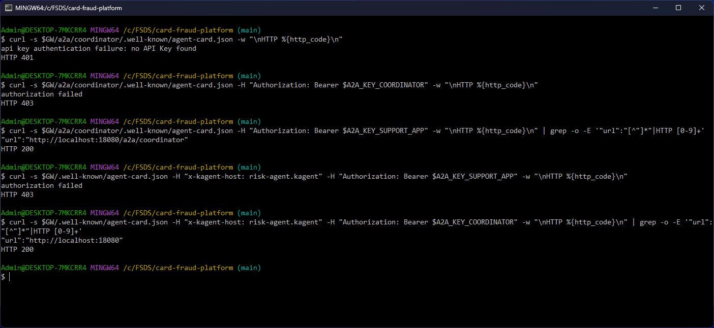

## The three MCP servers

[`services/card_support_mcp/`](https://github.com/cvinhnguyen/card-fraud-platform/tree/54d21eddbf6e602ae13fed46a1a9e0ef265d23cd/services/card_support_mcp)
is one FastAPI code base run as three servers. `MCP_SERVER` picks the server, and the app registers only its tools,
both as MCP tools on `/mcp` (streamable HTTP, stateless, for the agents) and as REST routes under `/v1` (for people,
the tests and the load test). Each server is its own Helm release (Deployment, probes, Secret, network policy, gateway
route,
key, kagent tool server, registry entry).

| Server | REST | Reads | `/readyz` checks | Secret |
|---|---|---|---|---|
| card-data | `GET /v1/cards/{card_id}`, `GET /v1/chunks/{chunk_id}` | Feast `card_fraud` online store (Redis): profile, 30/90/180-day stats, real-time activity from the stream jobs; Feast `card_support_kb` online store (pgvector): one chunk of the [RAG pipeline](rag_pipeline.md) | Redis and pgvector answer | `card-data-mcp`: Feast registry, Redis and pgvector passwords |
| fraud-score | `POST /v1/score` | the Layer 2 Fraud Scoring API (features from Feast, XGBoost on KServe, rule fallback) | the Scoring API answers its `/healthz` | none |
| policy-rag | `POST /v1/search` | llama.cpp embeddings (the question's vector), pgvector (nearest chunks, re-ranked by cosine) | pgvector and the embedding server answer | `policy-rag-mcp`: Feast registry and pgvector passwords, embedder key |

The split is one table
([`services/card_support_mcp/app/main.py`
L39-L44](https://github.com/cvinhnguyen/card-fraud-platform/blob/54d21eddbf6e602ae13fed46a1a9e0ef265d23cd/services/card_support_mcp/app/main.py#L39-L44)):

```python
# server -> (its tools, the adapters those tools use: built at start-up and checked by /readyz)
SERVERS = {
    "card-data": ({"get_card_data", "get_policy_chunk"}, ("features", "knowledge")),
    "fraud-score": ({"score_payment"}, ("scoring",)),
    "policy-rag": ({"search_policy"}, ("knowledge", "embedder")),
}
```

`build_service`
([main.py L55-L62](https://github.com/cvinhnguyen/card-fraud-platform/blob/54d21eddbf6e602ae13fed46a1a9e0ef265d23cd/services/card_support_mcp/app/main.py#L55-L62))
builds only the adapters a server's tools use, so fraud-score never imports Feast and holds no store password.

One image serves all three because they share schemas, metrics wrapper and FastAPI/MCP scaffolding and are released
together; it is built, tested, mutation-tested and signed once ([cicd.md](../operations/cicd.md#mcp-servers)).
Different owners or release cadences would make it three images.

### FastAPI and pydantic validation

Every input and output is a pydantic model or a constrained parameter (id patterns in
[`services/card_support_mcp/app/schemas.py`
L8-L9](https://github.com/cvinhnguyen/card-fraud-platform/blob/54d21eddbf6e602ae13fed46a1a9e0ef265d23cd/services/card_support_mcp/app/schemas.py#L8-L9),
request models in [schemas.py L64-L87](https://github.com/cvinhnguyen/card-fraud-platform/blob/54d21eddbf6e602ae13fed46a1a9e0ef265d23cd/services/card_support_mcp/app/schemas.py#L64-L87)):

| Input | Rule |
|---|---|
| card and chunk ids | must match their patterns |
| amount | a whole number of VND above 0 and at most 10 billion |
| channel | an enum |
| search | 1 to 10 chunks |

The MCP tools carry the same rules in their input schema
([main.py L99-L125](https://github.com/cvinhnguyen/card-fraud-platform/blob/54d21eddbf6e602ae13fed46a1a9e0ef265d23cd/services/card_support_mcp/app/main.py#L99-L125)),
so a bad argument from an agent is a tool error before any store is read; over REST it is a 422.

FastAPI publishes each server's REST API as an OpenAPI page; card-data's, through NGINX
(`https://api.<domain>/docs`, basic auth, [edge_security.md](../operations/edge_security.md)):

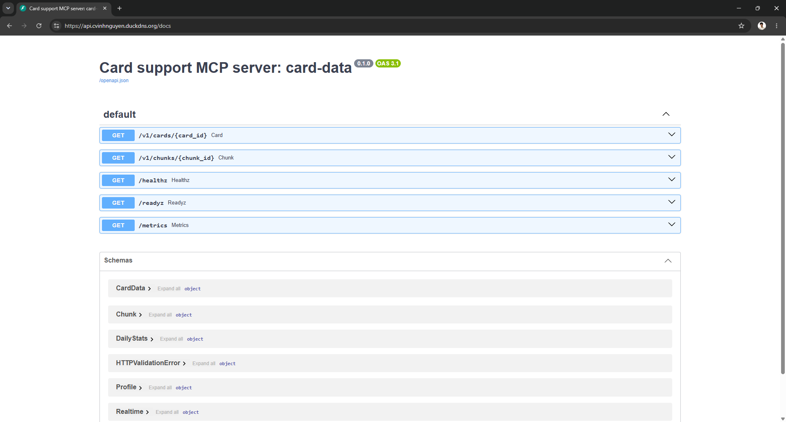

On `GET /v1/cards/{card_id}` the page shows the path rule (`pattern: ^[A-Za-z0-9_-]{1,64}$`) and the response model:

![FastAPI OpenAPI page: card_id is required and must match ^[A-Za-z0-9_-]{1,64}$; the 200 response is the CardData model](../images/mcp3_docs_card.png)

From Git Bash through a port-forward: a known card answers 200; a malformed card id, an amount of 0 with an unknown
channel, and a search for 11 chunks each answer 422 with pydantic's reason; another server's route answers 404:

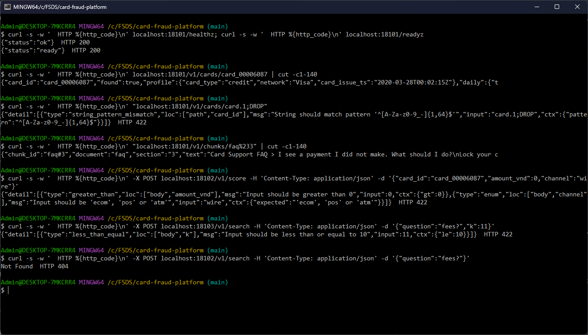

### Health checks for Kubernetes

| Endpoint | Checks | Probe |
|---|---|---|
| `/healthz` | answers as long as the process serves requests, never checks a dependency | startup and liveness |
| `/readyz` | the dependencies of this server's tools ([`services/card_support_mcp/app/main.py` L183-L194](https://github.com/cvinhnguyen/card-fraud-platform/blob/54d21eddbf6e602ae13fed46a1a9e0ef265d23cd/services/card_support_mcp/app/main.py#L183-L194)) | readiness |

A down store or upstream takes the pods out of traffic without a restart, since the fault is outside the pod. The
probes
([`services/card_support_mcp/chart/templates/deployment.yaml`
L40-L50](https://github.com/cvinhnguyen/card-fraud-platform/blob/54d21eddbf6e602ae13fed46a1a9e0ef265d23cd/services/card_support_mcp/chart/templates/deployment.yaml#L40-L50)):

```yaml
          startupProbe:
            httpGet: {path: /healthz, port: http}
            periodSeconds: 2
            failureThreshold: 30
          livenessProbe:
            httpGet: {path: /healthz, port: http}
            periodSeconds: 10
          readinessProbe:
            httpGet: {path: /readyz, port: http}
            periodSeconds: 5
            timeoutSeconds: 5
```

Test: with the Scoring API (compose container `scoring-api`) stopped, both fraud-score pods went 0/1 Ready within the
readiness period, with 0 restarts; `/healthz` still answered 200 and `/readyz` 503
(`not ready: scoring ConnectError`). With the container back, the pods were Ready and `/readyz` answered 200:

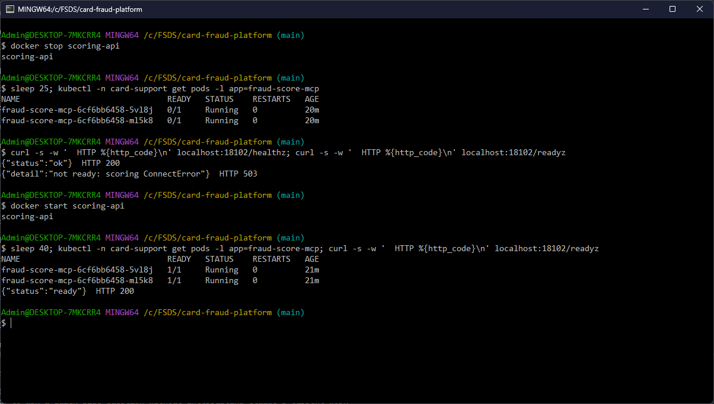

With no fraud-score pod Ready, the risk agent fails every question, even those that need no score
([Gotchas](#gotchas)).

### Async

Every handler is `async`. The HTTP clients (embeddings, Scoring API) are one pooled `httpx.AsyncClient` each, and the
Feast reads with no async API (the pgvector store) run in `asyncio.to_thread`, so one slow search does not hold up
other requests (Feast reads in
[`services/card_support_mcp/app/clients.py`
L64-L77](https://github.com/cvinhnguyen/card-fraud-platform/blob/54d21eddbf6e602ae13fed46a1a9e0ef265d23cd/services/card_support_mcp/app/clients.py#L64-L77),
HTTP clients in [clients.py L88-L122](https://github.com/cvinhnguyen/card-fraud-platform/blob/54d21eddbf6e602ae13fed46a1a9e0ef265d23cd/services/card_support_mcp/app/clients.py#L88-L122)).
The card-data load test is in [testing.md](../operations/testing.md#load-test-locust-1).

### Deployed with Helm: one release per server, rolling update, automatic rollback

One chart,
[`services/card_support_mcp/chart/`](https://github.com/cvinhnguyen/card-fraud-platform/tree/54d21eddbf6e602ae13fed46a1a9e0ef265d23cd/services/card_support_mcp/chart),
with a values file per server
([`services/card_support_mcp/chart/values-card-data.yaml`](https://github.com/cvinhnguyen/card-fraud-platform/blob/54d21eddbf6e602ae13fed46a1a9e0ef265d23cd/services/card_support_mcp/chart/values-card-data.yaml),
[`services/card_support_mcp/chart/values-fraud-score.yaml`](https://github.com/cvinhnguyen/card-fraud-platform/blob/54d21eddbf6e602ae13fed46a1a9e0ef265d23cd/services/card_support_mcp/chart/values-fraud-score.yaml),
[`services/card_support_mcp/chart/values-policy-rag.yaml`](https://github.com/cvinhnguyen/card-fraud-platform/blob/54d21eddbf6e602ae13fed46a1a9e0ef265d23cd/services/card_support_mcp/chart/values-policy-rag.yaml)),
gives three releases in namespace `card-support`. Each runs 2 replicas (card-data 2 to 4,
[autoscaled](#autoscaling-the-card-data-server-keda)) with `RollingUpdate` (`maxSurge: 1`, `maxUnavailable: 0`,
`minReadySeconds: 5`, [deployment.yaml L13-L16](https://github.com/cvinhnguyen/card-fraud-platform/blob/54d21eddbf6e602ae13fed46a1a9e0ef265d23cd/services/card_support_mcp/chart/templates/deployment.yaml#L13-L16)):
a new pod must pass `/readyz` before an old one stops, so a server never drops below two serving pods.

The pipeline installs the releases one after the other with `helm upgrade --install --atomic`. Helm rolls back a
release whose new pods do not get Ready in time, and the pipeline stops before the next server
([`services/card_support_mcp/Jenkinsfile`
L69-L90](https://github.com/cvinhnguyen/card-fraud-platform/blob/54d21eddbf6e602ae13fed46a1a9e0ef265d23cd/services/card_support_mcp/Jenkinsfile#L69-L90)):

```groovy
stage('Deploy (helm --atomic)') {
  // one release per server, one after the other; rolling update with maxUnavailable 0; a release whose pods
  // never get Ready is rolled back by --atomic and stops the pipeline before the next server. deployed.txt lists
  // the releases already upgraded, which post rolls back when a later step fails or the build is aborted.
  steps {
    withCredentials([file(credentialsId: 'kubeconfig', variable: 'KUBECONFIG')]) {
      sh '''
        rm -f deployed.txt
        for s in $SERVERS; do
          # a release an aborted build left pending-* blocks every upgrade; helm rollback clears it
          case "$(helm status $s-mcp -n card-support -o json 2>/dev/null | jq -r .info.status)" in
            pending-*) helm rollback $s-mcp -n card-support --wait --timeout 4m;;
          esac
          helm upgrade --install $s-mcp $SVC/chart -f $SVC/chart/values-$s.yaml -n card-support \
            --atomic --timeout 4m --set image.tag=$TAG
          echo $s >> deployed.txt
          kubectl -n card-support rollout status deploy/$s-mcp --timeout=60s
        done
      '''
    }
  }
}
```

MCP sessions are stateless (`sessionRouting: Stateless`,
[gateway.yaml L10](https://github.com/cvinhnguyen/card-fraud-platform/blob/54d21eddbf6e602ae13fed46a1a9e0ef265d23cd/services/card_support_mcp/chart/templates/gateway.yaml#L10)),
so a rolling update does not break a conversation. The releases in the cluster (`helm list`, Deployments and Services
with 2 pods each, one pod's `MCP_SERVER`, the probes):

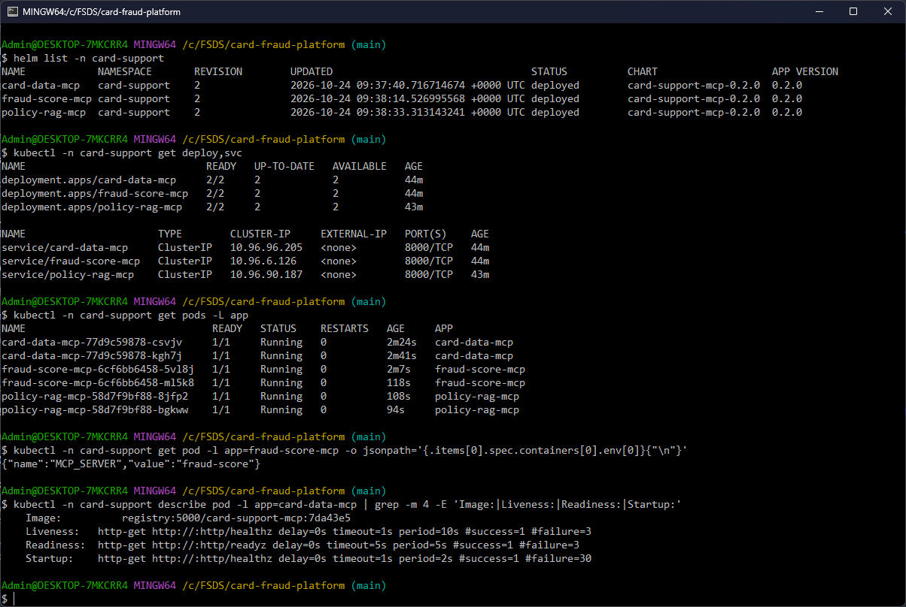

Two release tests, with a client calling through the gateway meanwhile:

| Test | What was done | Result |
|---|---|---|
| Automatic rollback, fraud-score | a release pointing at a Scoring API that does not exist (`--set env.SCORING_URL=http://no-such-api:8000/v1/score`, `--atomic --timeout 90s`), `score_payment` called every 0.2 s | the new pod never passes `/readyz`; after 90 s Helm answers `UPGRADE FAILED ... has been rolled back due to atomic being set`, writes revision 4 "Rollback to 2" and removes the new pod; the two old pods served all 337 calls with 200 |
| Rolling update, policy-rag | one setting changed (`TIMEOUT_S` 5 to 4), policy searches running | the upgrade took 29 s, the pods were replaced one at a time, all 72 calls answered 200 |

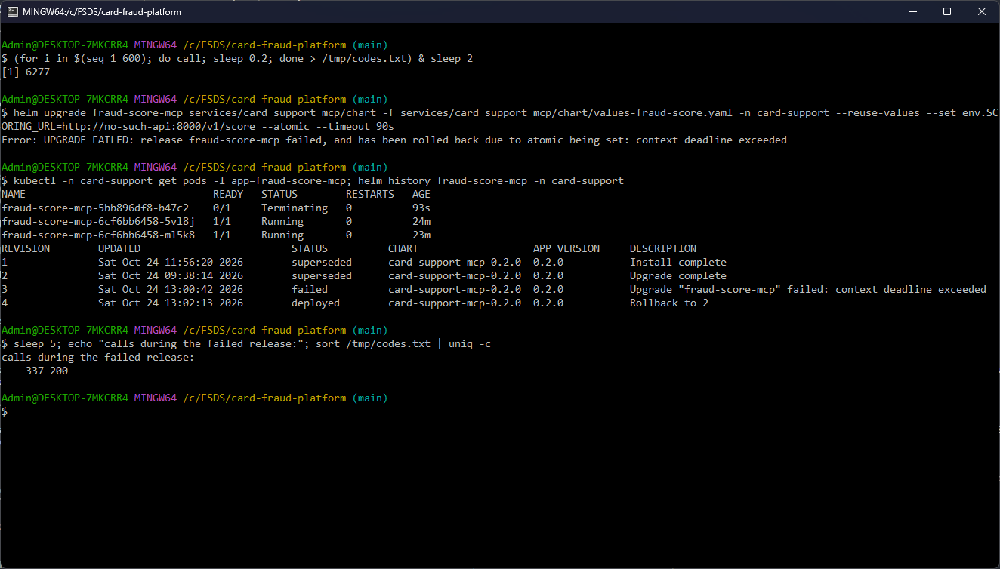

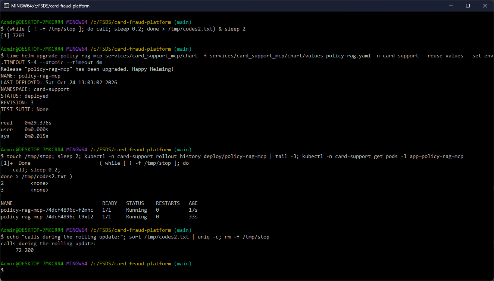

### Autoscaling the card-data server (KEDA)

card-data can outgrow two replicas because it is also the public Web API: the gateway caps all agents at 300 calls a
minute per server (5 per second), but NGINX limits only each client IP, to 5 requests per second. Its release turns on
a KEDA (Kubernetes Event-driven Autoscaling) ScaledObject
([`services/card_support_mcp/chart/templates/scaledobject.yaml`](https://github.com/cvinhnguyen/card-fraud-platform/blob/54d21eddbf6e602ae13fed46a1a9e0ef265d23cd/services/card_support_mcp/chart/templates/scaledobject.yaml),
[values-card-data.yaml](https://github.com/cvinhnguyen/card-fraud-platform/blob/54d21eddbf6e602ae13fed46a1a9e0ef265d23cd/services/card_support_mcp/chart/values-card-data.yaml)).
fraud-score and policy-rag, reached only through the gateway, keep a fixed 2 replicas (`autoscaling.enabled: false` in
[`services/card_support_mcp/chart/values.yaml`](https://github.com/cvinhnguyen/card-fraud-platform/blob/54d21eddbf6e602ae13fed46a1a9e0ef265d23cd/services/card_support_mcp/chart/values.yaml)).

| Setting | Value | Why |
|---|---|---|
| What KEDA counts | `http_requests_total` of the server's pods as Prometheus scrapes them, without `/healthz`, `/readyz` and `/metrics` | covers both paths, MCP through the gateway and REST through NGINX; the gateway's metric would see only the first |
| Threshold | 15 requests per second per replica, 2 to 4 replicas | in the test below, a pod at about 13 requests per second used about 100m CPU, its CPU request; two pods at 25 to 27 each used 140m to 210m; new pods were Ready about 20 s after KEDA asked |
| `replicas` | unset on the Deployment when autoscaling is on | a Helm upgrade does not reset what KEDA set |

The trigger
([scaledobject.yaml L16-L22](https://github.com/cvinhnguyen/card-fraud-platform/blob/54d21eddbf6e602ae13fed46a1a9e0ef265d23cd/services/card_support_mcp/chart/templates/scaledobject.yaml#L16-L22)):

```yaml
  triggers:
    - type: prometheus
      metadata:
        serverAddress: {{ $as.prometheus }}
        query: sum(rate(http_requests_total{namespace="{{ .Release.Namespace }}", service="{{ .Release.Name }}"}[1m]))
        threshold: {{ $as.requestsPerSecond | quote }}
        ignoreNullValues: "true"
```

Test on 2026-10-25: the load test's locust pod ([testing.md](../operations/testing.md#load-test-locust-1)) in
`card-support`, 10 users for 4 minutes against the Service, `NEW_CONNECTION=1`
([`services/card_support_mcp/locustfile.py`
L29-L32](https://github.com/cvinhnguyen/card-fraud-platform/blob/54d21eddbf6e602ae13fed46a1a9e0ef265d23cd/services/card_support_mcp/locustfile.py#L29-L32)):
12,830 requests, 53.6 per second, 0 failures, p95 27 ms (MCP `get_card_data` p95 36 ms). Report:
[`locust_card_data_scaling.html`](https://github.com/cvinhnguyen/card-fraud-platform/blob/54d21eddbf6e602ae13fed46a1a9e0ef265d23cd/docs/images/locust_card_data_scaling.html).

| Moment | Requests/s (all pods) | Replicas | Per pod |
|---|---:|---:|---|
| before the load | 0 | 2 | idle |
| 45 s into the load | about 50 | 2, then 4 (`above target`) | 25 to 27 requests/s, 140m to 210m CPU |
| 3.5 minutes into the load | 54 | 4 | 13.0 to 13.8 requests/s, 76m to 107m CPU |
| 5 minutes after the load | 0 | 4, then 3, then 2 (`All metrics below target`) | idle |

During the load, the HPA (Horizontal Pod Autoscaler) KEDA created reads 13,545m (13.5 requests per second per
replica) against a target of 15:

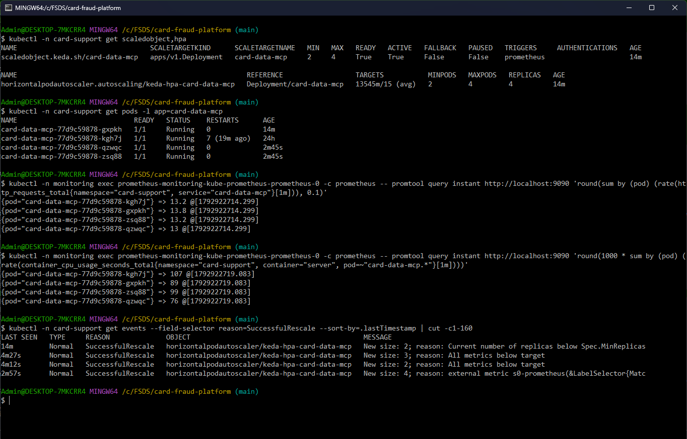

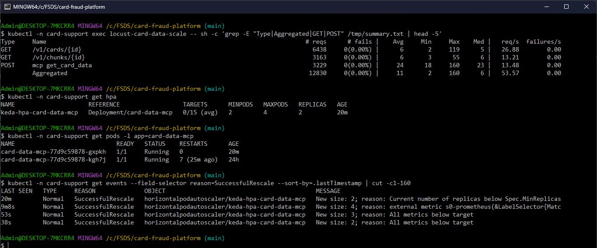

A first run with locust's default keep-alive connections also scaled to 4, but the two new pods stayed idle (3m CPU):
kube-proxy picks a pod when a connection opens, and each user kept its first one. `NEW_CONNECTION=1` (one connection
per request) spread the load. In production NGINX picks a pod per request, so new pods get traffic at once; the
gateway's pooled connections to the Service reach a new pod only when it opens new ones.

## The agents: replicas, autoscaling, sandbox

Each Agent becomes a Deployment managed by kagent. The chart leaves `replicas` unset, so kagent does not fight the
autoscaler, and adds a KEDA ScaledObject per agent
([`agents/chart/templates/scaledobjects.yaml`](https://github.com/cvinhnguyen/card-fraud-platform/blob/54d21eddbf6e602ae13fed46a1a9e0ef265d23cd/agents/chart/templates/scaledobjects.yaml)):
2 to 4 replicas, scaled on the agent's A2A request rate through the gateway (Prometheus `agentgateway_requests_total`),
0.04 requests per second per replica ([`agents/chart/values.yaml`
L19-L27](https://github.com/cvinhnguyen/card-fraud-platform/blob/54d21eddbf6e602ae13fed46a1a9e0ef265d23cd/agents/chart/values.yaml#L19-L27)).
With conversations of about 40 s, that is about 1.6 in flight per replica. Replicas add no LLM capacity (one GPU behind
llm-d); they keep a slow conversation from blocking the next.

The template
([scaledobjects.yaml L1-L22](https://github.com/cvinhnguyen/card-fraud-platform/blob/54d21eddbf6e602ae13fed46a1a9e0ef265d23cd/agents/chart/templates/scaledobjects.yaml#L1-L22)):

```yaml
{{- $as := .Values.autoscaling }}
{{- range $name, $a := include "card-support.agents" . | fromYaml }}
---
# KEDA owns the replicas of the Deployment kagent creates for the agent (the Agent leaves replicas unset)
apiVersion: keda.sh/v1alpha1
kind: ScaledObject
metadata:
  name: {{ $name }}
  namespace: {{ $.Release.Namespace }}
spec:
  scaleTargetRef: {name: {{ $name }}}
  minReplicaCount: {{ $as.minReplicas }}
  maxReplicaCount: {{ $as.maxReplicas }}
  pollingInterval: 15   # scale-down: the HPA's 5 min stabilization (cooldownPeriod applies only to scale-to-zero)
  triggers:
    - type: prometheus
      metadata:
        serverAddress: {{ $as.prometheus }}
        query: sum(rate(agentgateway_requests_total{backend="{{ $.Values.gateway.namespace }}/agent-{{ $name }}"}[1m]))
        threshold: {{ $as.requestsPerSecond | quote }}
        ignoreNullValues: "true"
{{- end }}
```

In the cluster (four Agents with risk-agent-b, the three MCP tool servers kagent sees on the gateway):

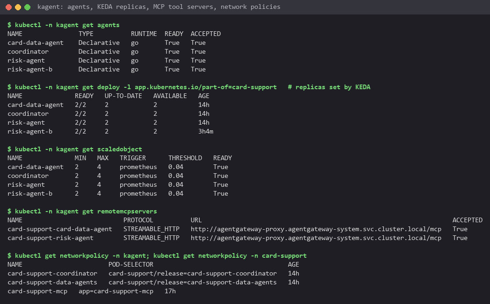

Scaling tests, locust sending conversations to the gateway's `/a2a/coordinator`:

| Run | Load | Conversations | Result |
|---|---|---|---|
| [`locust_agents_scaling.html`](https://github.com/cvinhnguyen/card-fraud-platform/blob/54d21eddbf6e602ae13fed46a1a9e0ef265d23cd/docs/images/locust_agents_scaling.html) | 6 users for 3 min 41 s | 31, 0 failures | coordinator 2 to 4 replicas, risk agent 2 to 4, card data agent 2 to 3, back down after the load |
| [`locust_agents_a2a.html`](https://github.com/cvinhnguyen/card-fraud-platform/blob/54d21eddbf6e602ae13fed46a1a9e0ef265d23cd/docs/images/locust_agents_a2a.html) | 6 users, 5 minutes | 37, 0 failures | p95 85 s |
| 2026-10-21, locust in a container on the kind network | 6 users for 3 minutes | 18, 0 failures | coordinator at 4 replicas and risk-agent-b at 3 right after |

In the 2026-10-21 run the HPA events give the reason, the request rate through the gateway (`s0-prometheus`) above
target; the older events at the top are the HPAs' creation and an earlier coordinator rise and fall:

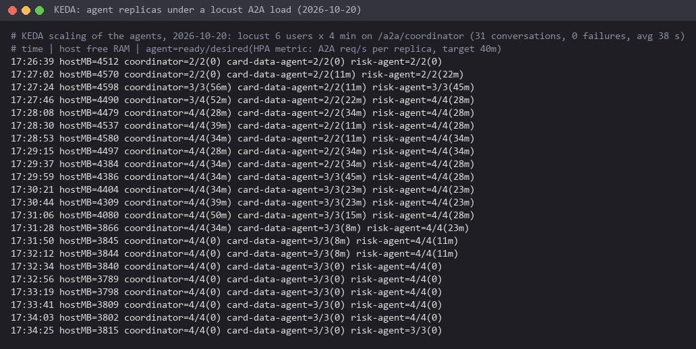

### Sandboxed agents on Agent Substrate (warm-up)

The chart also renders every agent as a SandboxAgent
([`agents/chart/templates/sandboxagents.yaml`
L1-L22](https://github.com/cvinhnguyen/card-fraud-platform/blob/54d21eddbf6e602ae13fed46a1a9e0ef265d23cd/agents/chart/templates/sandboxagents.yaml#L1-L22))
from the same spec helper, so it has the same prompt, tools and model config. A SandboxAgent runs each conversation in
its own gVisor sandbox on Agent Substrate 0.0.9 ([`infra/k8s/llm-platform.sh`
L34](https://github.com/cvinhnguyen/card-fraud-platform/blob/54d21eddbf6e602ae13fed46a1a9e0ef265d23cd/infra/k8s/llm-platform.sh#L34),
kagent's worker pool at [llm-platform.sh L51-L55](https://github.com/cvinhnguyen/card-fraud-platform/blob/54d21eddbf6e602ae13fed46a1a9e0ef265d23cd/infra/k8s/llm-platform.sh#L51-L55)),
restored from a snapshot taken once the agent was warm, so there is no cold start. Its egress is limited to the gateway
and the kagent controller ([`agents/chart/values.yaml`
L44-L51](https://github.com/cvinhnguyen/card-fraud-platform/blob/54d21eddbf6e602ae13fed46a1a9e0ef265d23cd/agents/chart/values.yaml#L44-L51)).

All sandboxed agents share the worker pool `kagent-default`, here a single worker. A worker runs one conversation,
snapshots it and takes the next, so a fleet needs one worker per concurrent conversation, whatever the number of
agents.

The test used `ask`, a Git Bash function: an A2A `message/send` to `/api/a2a-sandboxes/kagent/<agent>-sandbox/` on the
kagent controller (port-forward), retried every 3 s on "no free workers", printing the time and the retries. One after
the other, the three agents answered in 8 to 28 s (the retries are the worker snapshotting the previous conversation);
sent at once, all three answered within 61 s:

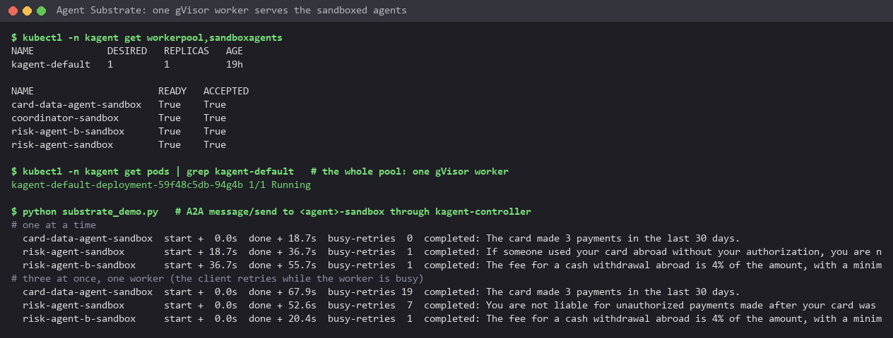

## Support chat (gateway first)

Support users ask on the support chat page at `https://support.<domain>` (user `admin`, basic auth). Behind NGINX,
agentgateway is the first service a question reaches:

| Hop | From | To | Checks |
|---|---|---|---|
| 1 | browser | NGINX Ingress Controller (namespace `nginx-ingress`), Ingress `support-chat` (namespace `kagent`), host `support.<domain>` | HTTPS, basic auth, 5 requests a second per IP (burst 20) |
| 2 | NGINX | Service `support-chat`, port 8080 (namespace `kagent`) | serves the page, forwards only `POST /a2a/coordinator`, swaps the browser's login header for the `support-app` key |
| 3 | support-chat | Service `agentgateway-proxy`, port 80 (namespace `agentgateway-system`), HTTPRoute `a2a-coordinator` | API key, key user `support-app` only, 120 requests a minute (burst 20), 300 s timeout |
| 4 | agentgateway | Service `coordinator`, port 8080 (namespace `kagent`) | the agents' NetworkPolicy lets in only the gateway and the kagent controller |
| 5 | coordinator | agentgateway again: route `card-support-data-agents-internal` to the other agents, then the MCP routes and route `llm` | as in [How it works](#how-it-works) |

The chat is one template,
[`agents/chart/templates/support-chat.yaml`](https://github.com/cvinhnguyen/card-fraud-platform/blob/54d21eddbf6e602ae13fed46a1a9e0ef265d23cd/agents/chart/templates/support-chat.yaml),
on in the coordinator's release (`supportChat.enabled` in `values-coordinator.yaml`): the stock
`nginxinc/nginx-unprivileged` image plus a ConfigMap with the page and proxy config, so no image to build. The HTML
and JavaScript page sends A2A 0.3 JSON-RPC `message/send` to `/a2a/coordinator` and keeps the `contextId` for
follow-ups. `infra/k8s/secrets.sh` writes the key from Vault into the Secret `a2a-key-support-app` in `kagent`;
nginx puts it into its config at start, so the browser never gets it. The Ingress is the `support-chat` route in
`infra/k8s/edge/values.yaml`.

The kagent UI cannot take this path, so it stays the admin and test console at `agents.<domain>`: kagent 0.10.3
applies `proxy.url` only to the agents' own calls, and the controller sends a UI chat straight to the agent's Service
(`http://<agent>.<namespace>:8080` from the agent card). Its only override, a debug setting, redirects every agent's
connections and cannot add a path or a key.

Checked on 2026-11-12 with the local LLM off, so the checks stop at the model call:

- `https://support.<domain>/` answers 401 without the login and the page with it. A GET on `/a2a/coordinator` gets
  403, another gateway path such as `/v1/chat/completions` 404 from the page's nginx.
- A `message/send` through `https://support.<domain>/a2a/coordinator` reached the coordinator: the gateway logged
  `route=agentgateway-system/a2a-coordinator` from the support-chat pod with `a2a.method=message/send`, the task
  started 1 ms later, and its model calls on route `llm` got 503 (model server off), so it came back `failed`.
- On `/a2a/coordinator`, no key and a wrong key get 401, the coordinator's key 403. A pod that calls
  `coordinator:8080` directly times out, the support-chat pod included.
- A message through the kagent controller (the kagent UI's path) left no `a2a-coordinator` line in the gateway log.

## When a specialist fails

When a specialist fails, the coordinator reports everything that specialist covers as not checked, with no number or
rule of its own. Two runs on 2026-11-12 led to that rule.

### The runs that failed

That evening, with the chat model on and the embedding server off (to keep memory free), one question went through
`https://support.<domain>/a2a/coordinator`: "A customer with card card_d10f799f says a card payment of
2,500,000 VND at an online electronics shop was declined. What does the card's recent activity look like, and how risky
would that payment score?" The answer came back in 13.4 s, HTTP 200, task state `completed`:

> The card d10f799f has not been used in the last hour, with 0 payments in the last 10 minutes. It was issued on
> April 5, 2016, and is a credit card through Napas. In the last 30 days, there have been 3 payments, averaging about
> 383,800 VND. The risk agent is currently unable to provide the risk score for the payment. Please try again later
> or contact our support team for further assistance.

The card part came through `/mcp/card-data` (Redis). The risk agent failed because it loads both its tool servers and
`/mcp/policy-rag` answered 500 without the embedding server; the coordinator said the score was missing.

A second try came before the policy-rag pods were Ready, so `/mcp/policy-rag` still answered 500. This time the
coordinator wrote that the risk "may be high" and a declined payment can be disputed "within 7 days", although no
score was computed and the dispute policy gives 60 days.

### The fix in the coordinator's prompt

The prompt ([`agents/chart/prompts/coordinator.md`](../../agents/chart/prompts/coordinator.md)) says every fact must
come from a specialist (for the risk agent: the payment's risk and every fee, deadline and rule) and the coordinator
knows no bank policy itself.

`run_eval.py --mode down` sends the model, over `/v1`, the coordinator's prompt with an answer from the card data
agent and a failure from the risk agent. An answer is correct only when it says the part failed and has no risk level,
percentage or deadline of its own (the card's own "last 30 days" is allowed).

```sh
GATEWAY=http://<gateway> AGW_KEY=... python agents/eval/run_eval.py --mode down
```

Results on the chat model, evening of 2026-11-12:

| Prompt | Declined payment, "how long to dispute?" | "What is the foreign transaction fee?" |
|---|---|---|
| before the fix | fail | fail |
| first rule only ("say the part could not be checked") | fail: said the risk could not be checked, then wrote "14 days ... as per document#section 12.3" | ok |
| final rule (also: no policy knowledge of its own) | ok: "could not check the payment risk or dispute period" | ok: "the foreign transaction fee could not be checked right now" |

With a working risk agent ("low risk", "60 days (dispute_policy#2)") the final prompt still passes both facts and the
citation through.

### The fix in the real chat

The coordinator was deployed with prompt v2 from Langfuse (the pipeline's
`helm upgrade ... --set promptVersions.coordinator=2`), policy-rag left down, and the same question sent through
`https://support.<domain>/a2a/coordinator`. The local chat model could not run next to the cluster that night (the PC
crashed when it did), so route `llm` sent every model call to version B of the [LLM A/B test](ab_testing.md),
Qwen3.8-27B on Groq (weights 0/100 for the test, then back to 100/0 from `infra/k8s/agentgateway.yaml`). The task
completed in 32 s, keeping the card data and reporting the rest:

> **Risk score and the dispute policy — not available right now**
> I wasn't able to complete the fraud/risk check on that payment, so I can't tell you how that 2,500,000 VND
> transaction would score or the specific reason it was declined. For the same reason I can't give you the policy
> details on disputing a declined payment (eligibility, deadline, or process) — I don't want to quote a number or
> rule I haven't verified. Please check back with us in a little while so we can run that check for you.

Two earlier Groq tries did not count: one was cut off by a lower output cap set for the free tier's rate limit, and in
the other the model misspelled the risk agent's tool name on a retry, so Groq rejected the call. Still untested: the
real chat with the local Qwen3-8B and the risk agent down, and a full answer with a real score and policy chunk, which
needs all three MCP servers ready before the question goes in.

## Chat with the agents (kagent UI)

The admin and test console, at `https://agents.<domain>` behind NGINX basic auth
([edge_security.md](../operations/edge_security.md)); its chat's first hop skips the gateway
([Support chat](#support-chat-gateway-first)). It lists the agents and their sandboxed copies (lock icon):

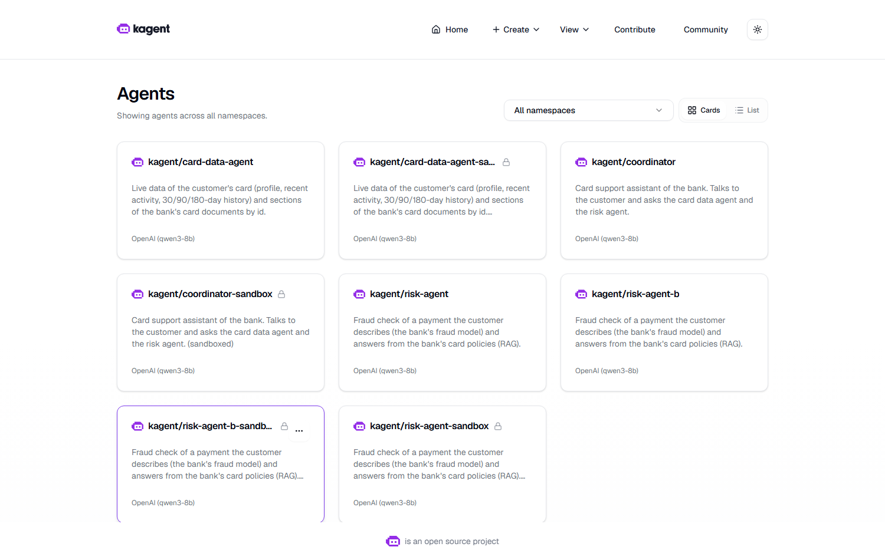

and the three MCP servers with the tools kagent found, 3 servers and 4 tools:

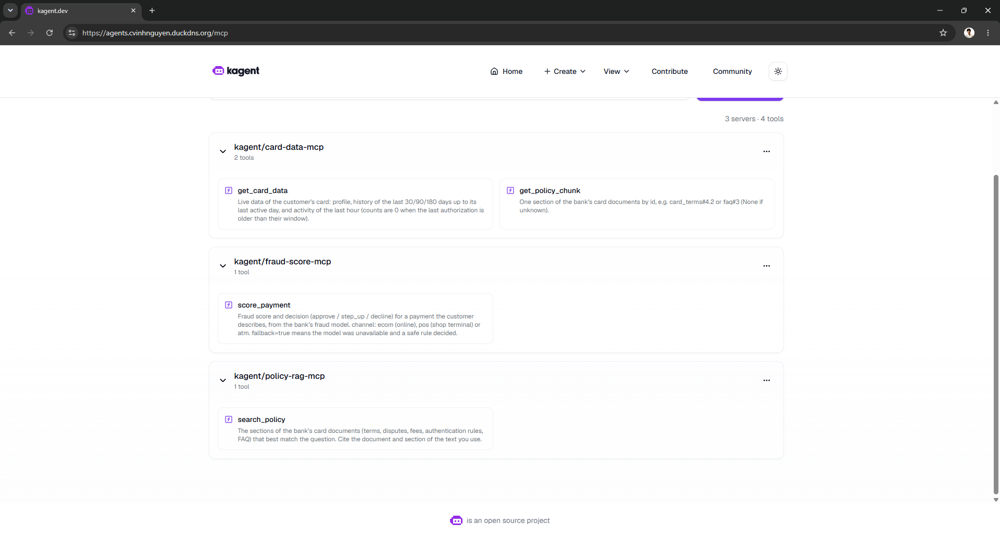

A chat with the coordinator on 2026-10-24:

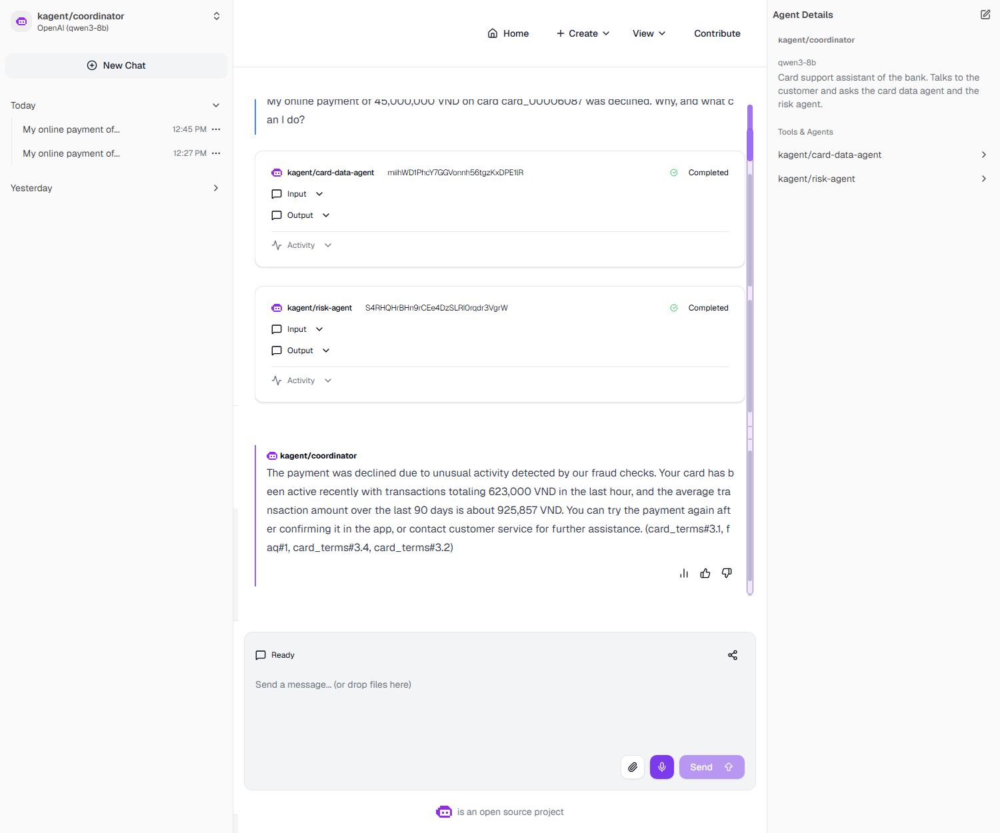

The risk agent's side: one `score_payment` call (served by `fraud-score-mcp`); the A/B split sent it to
`risk-agent-b`:

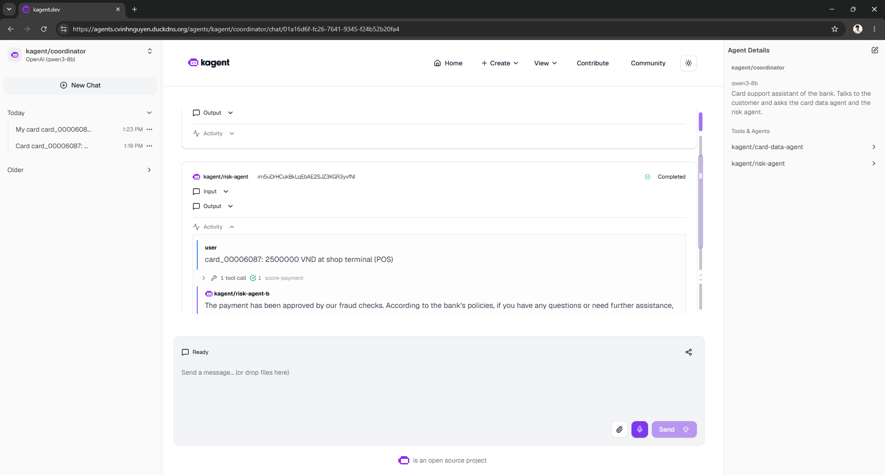

## Agent registry

agentregistry 0.4.0 keeps the catalog: which agents exist, their version and runtime image, where their definition
lives and which MCP servers they use. It runs in namespace `agentregistry` with its own database on ml-db and RBAC
limited to the `kagent` namespace ([`infra/k8s/llm-platform.sh`
L60-L62](https://github.com/cvinhnguyen/card-fraud-platform/blob/54d21eddbf6e602ae13fed46a1a9e0ef265d23cd/infra/k8s/llm-platform.sh#L60-L62)).
The catalog is code,
[`agents/registry/catalog.yaml`](https://github.com/cvinhnguyen/card-fraud-platform/blob/54d21eddbf6e602ae13fed46a1a9e0ef265d23cd/agents/registry/catalog.yaml),
published with `arctl apply -f agents/registry/catalog.yaml`; install values in
[`agents/registry/values.yaml`](https://github.com/cvinhnguyen/card-fraud-platform/blob/54d21eddbf6e602ae13fed46a1a9e0ef265d23cd/agents/registry/values.yaml).
The UI at `https://registry.<domain>` (basic auth) lists the three agents:

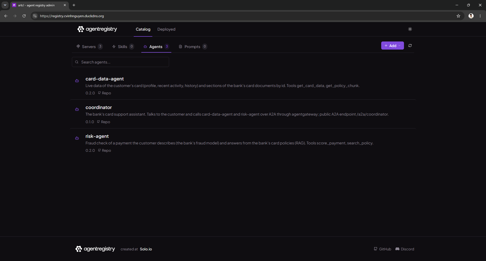

the three MCP servers, each at version 0.2.0:

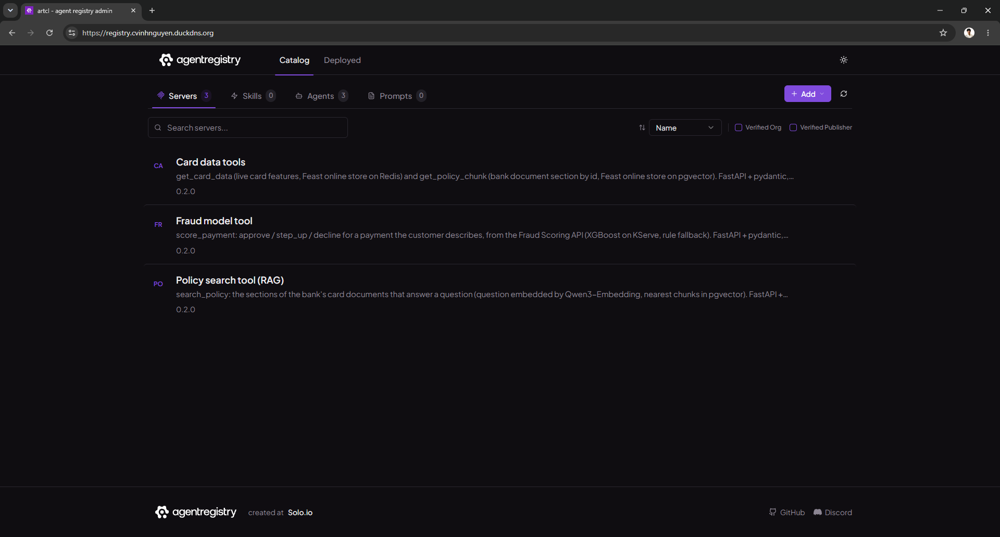

and, in each agent record, the servers it uses; the risk agent's lists `fraud-score-mcp` and `policy-rag-mcp`, both
at 0.2.0:

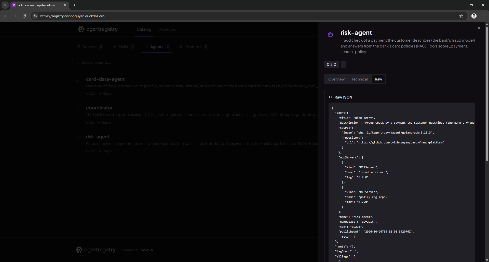

## Network policies

An agent can reach an MCP server, the model server or another agent only through the gateway:

| Pods | Accept connections from | May open connections to | Policy |
|---|---|---|---|
| agents | the gateway proxy and the kagent controller (A2A calls) | DNS, the gateway, the kagent controller and Jaeger | [`agents/chart/templates/networkpolicy.yaml`](https://github.com/cvinhnguyen/card-fraud-platform/blob/54d21eddbf6e602ae13fed46a1a9e0ef265d23cd/agents/chart/templates/networkpolicy.yaml) |
| support chat | only the NGINX Ingress Controller | only DNS and the gateway | [support-chat.yaml](https://github.com/cvinhnguyen/card-fraud-platform/blob/54d21eddbf6e602ae13fed46a1a9e0ef265d23cd/agents/chart/templates/support-chat.yaml) |
| each MCP server | only the gateway, Prometheus and its own namespace; the public Web API (card-data) also from NGINX | not limited (the policy covers ingress only) | [`services/card_support_mcp/chart/templates/networkpolicy.yaml`](https://github.com/cvinhnguyen/card-fraud-platform/blob/54d21eddbf6e602ae13fed46a1a9e0ef265d23cd/services/card_support_mcp/chart/templates/networkpolicy.yaml) |

## Gotchas

- The first upgrade with autoscaling on drops the card-data Deployment to 1 replica for a few seconds: removing
  `replicas` makes Kubernetes use its default of 1, until the HPA sets 2 (event `Current number of replicas below
  Spec.MinReplicas`). Later upgrades leave the field alone.
- After a reboot, a sandboxed conversation hangs and holds the only worker: the Substrate Valkey cluster keeps its old
  pod IPs and the sandbox network components keep stale state. Re-introduce the Valkey nodes (`CLUSTER MEET`), then
  restart `atenet-router`, `dns`, `ate-controller`, `atelet`, the Agent Substrate (ATE) API server, the worker pool and
  the kagent controller.
- KEDA does not scale although the total request rate is above the threshold: it compares per replica
  (`AverageValue`), so a total of 0.13 requests per second over two replicas did not cross 0.1. Hence a low,
  per-replica threshold.
- `score_payment` fails with `String should match pattern`: the gateway's PII (personal data) guardrail on the LLM
  route can replace a number with a placeholder such as `<PHONE_NUMBER>`, which the model may pass as `device_id`. The
  agent gets the reason as a tool error instead of a wrong score.
- A chat asking for a fee and a payment check together can end with a system error (seen once, 2026-10-24). The A/B
  split is per call: when two calls of one sub-agent session go to `risk-agent` and `risk-agent-b`, both try to create
  the session in the kagent controller (`Session not found`, then `created ... agentRef kagent__NS__risk_agent_b`) and
  one fails. A per-session split needs a session key the gateway can hash on; the A/B tests of
  [ab_testing.md](ab_testing.md) use a new context per question.
- One slow upstream fails every risk agent question, policy questions included: a readiness check on an upstream all
  replicas share takes them all out, and the risk agent connects to each of its MCP servers for every question. On
  2026-10-24 the Docker VM was overloaded (5-minute load average 19, 15-minute 27), both fraud-score pods failed
  `/readyz` (timeouts and 503), and from 10:49:13 to 10:49:41 UTC the gateway got
  `upstream call failed: Connect: Connection refused` on `/mcp/fraud-score`. The 22 questions in those 28 s failed,
  the 18 before and after did not; build #37 of `card-support-data-agents` scored 0.20 and 0.70 and rolled back
  ([novel_eval_gate.md](novel_eval_gate.md#proof)). The check stays because it makes `helm --atomic` roll back a
  release that cannot reach its upstream; checking the upstream only in the startup probe would keep that without
  failing questions.

Coursework rubric: A8, A16 to A27.
