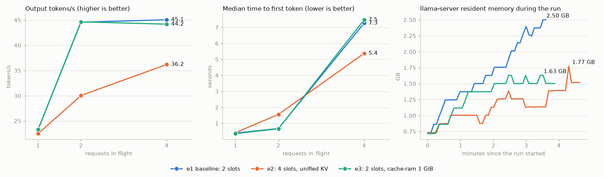

# LLM model server benchmark

Every agent answer waits for the model, so its speed sets how long a support worker waits and how many conversations
run at once. The benchmark loads llama.cpp (build b11755) serving Qwen3-8B Q4_K_M on the host's GTX 1070 (8 GB, a
Pascal GPU, so no vLLM) the way the agents do, keeps the configuration that holds the speed without memory growth, and
adds speculative decoding with n-grams from the prompt (+46 % decode speed). The agents reach the server through
agentgateway, the llm-d router and the InferencePool `qwen3-8b`, installed by
[`infra/k8s/llm-platform.sh`](https://github.com/cvinhnguyen/card-fraud-platform/blob/6457d47445ec1a910ebd2c01bc1edbff50f76d37/infra/k8s/llm-platform.sh)
([llm_platform.md](llm_platform.md)).

| | |
|---|---|
| Code | [`infra/benchmark/`](https://github.com/cvinhnguyen/card-fraud-platform/tree/6457d47445ec1a910ebd2c01bc1edbff50f76d37/infra/benchmark) |
| Runs on | load generator: Docker container `fraud/inference-perf:0.7.0` on the `kind` network; llama.cpp as a host process (`:8085`) |
| Reads | speculative decoding run: the eval questions (`agents/eval/dataset.jsonl`) and their bank documents (`generator/knowledge/`) |
| Writes | `infra/benchmark/results/<run>/` (inference-perf reports, `memory.csv`), `infra/benchmark/results/spec-<name>.json`, `docs/images/llm_benchmark.png` |
| Related | [llm_platform.md](llm_platform.md), [novel_eval_gate.md](novel_eval_gate.md) |

## Where it fits

- The model server is the last hop of every agent call in Layer 3, after route `/v1` and the llm-d router ([architecture.md](../architecture.md#system-diagram-layer-3), arrow A16; [llm_platform.md](llm_platform.md)).
- Its input is the agents' prompts: a long system prompt per agent, then a question.
- The kept flags go into the platform's llama.cpp start command; the capacity found bounds agent autoscaling ([What it means for agent autoscaling](#what-it-means-for-agent-autoscaling)).

## How it works

1. inference-perf replays agent-shaped traffic: three groups with a 1,500-token shared system prompt each, a 100-token
   question and 150 output tokens, at 1, 2 and 4 requests in flight ([Setup](#setup)).
2. Each run starts on a fresh llama-server and records output tokens per second, time to first token (TTFT), time per
   output token (TPOT), latency, the prefix-cache share of prompt tokens, and memory every 5 s.
3. Three configurations are compared: the baseline (2 slots), 4 slots on one unified KV (key-value) cache buffer, and
   the baseline with the host prompt cache capped at 1 GiB ([Results](#results),
   [What the numbers say](#what-the-numbers-say)).
4. Speculative decoding with n-grams from the prompt, where the model checks several drafted tokens in one pass, is
   measured on the 20 eval questions
   ([Second optimization](#second-optimization-speculative-decoding-with-n-grams-from-the-prompt)).

## Run it

You need llama.cpp on the host (`:8085`) and, for the `gateway` target, the kind cluster with the Layer 3 platform:

```bash
docker build -t fraud/inference-perf:0.7.0 infra/benchmark
sh infra/benchmark/run.sh e3-cram1g direct        # or: gateway (through agentgateway + llm-d, needs the cluster)
python infra/benchmark/summarize.py               # the table below
python infra/benchmark/plot.py                    # docs/images/llm_benchmark.png
LLM_URL=http://127.0.0.1:8085 LLM_API_KEY=... python infra/benchmark/spec_decoding.py <name>   # -> infra/benchmark/results/spec-<name>.json
```

`<name>` names the run; `...` is `LLM_API_KEY` from `infra/.env`. `run.sh` pipes the config into the container, so the
key never lands on disk, and deletes the config copy inference-perf keeps with its reports
([`infra/benchmark/run.sh`
L22-L27](https://github.com/cvinhnguyen/card-fraud-platform/blob/6457d47445ec1a910ebd2c01bc1edbff50f76d37/infra/benchmark/run.sh#L22-L27)).

## Setup

The harness is in
[`infra/benchmark/`](https://github.com/cvinhnguyen/card-fraud-platform/tree/6457d47445ec1a910ebd2c01bc1edbff50f76d37/infra/benchmark).

| Part | Setting |
|---|---|
| Load generator | [`inference-perf`](https://github.com/kubernetes-sigs/inference-perf) 0.7.0, which llm-d's own benchmark CLI drives; `Dockerfile` installs the PyPI release, since the published image is tagged only by commit and its `uvloop` dependency does not install on Windows ([`infra/benchmark/Dockerfile` L3-L6](https://github.com/cvinhnguyen/card-fraud-platform/blob/6457d47445ec1a910ebd2c01bc1edbff50f76d37/infra/benchmark/Dockerfile#L3-L6)) |
| Workload | [`infra/benchmark/agentic.yaml`](https://github.com/cvinhnguyen/card-fraud-platform/blob/6457d47445ec1a910ebd2c01bc1edbff50f76d37/infra/benchmark/agentic.yaml): 3 groups, one per agent, each with its own shared 1,500-token system prompt, then a 100-token question and exactly 150 output tokens (`ignore_eos`) |
| Where the sizes come from | llama.cpp's counters on real agent traffic: 79 % of prompt tokens were prefix-cache hits, the longest prompt 1.8k tokens |
| Load | closed loop, 1, 2 and 4 requests in flight (12, 16 and 24 requests), as each agent replica waits for its answer |
| Memory | every 5 s into `results/<run>/memory.csv` |
| Prefix-cache share | llama.cpp's per-request `cached_tokens` ("cached" in inference-perf), which `summarize.py` divides by the prompt tokens ([`infra/benchmark/summarize.py` L13-L14](https://github.com/cvinhnguyen/card-fraud-platform/blob/6457d47445ec1a910ebd2c01bc1edbff50f76d37/infra/benchmark/summarize.py#L13-L14)) |
| Server state | a freshly started llama-server per run (empty caches) |
| Target | straight to llama.cpp, so the numbers are the model server's |

The llm-d router has no choice with a single endpoint: its prefix-aware and load-aware routing pay off only with two
or more model servers (llm-d's own report compares 8 vLLM servers), so here it adds one hop and no speed.

The workload part of the config
([`infra/benchmark/agentic.yaml`
L17-L31](https://github.com/cvinhnguyen/card-fraud-platform/blob/6457d47445ec1a910ebd2c01bc1edbff50f76d37/infra/benchmark/agentic.yaml#L17-L31)):

```yaml
data:
  type: shared_prefix
  shared_prefix:
    num_groups: 3
    num_prompts_per_group: 16
    system_prompt_len: 1500
    question_len: 100
    output_len: 150
load:
  type: concurrent
  stages:
    - {concurrency_level: 1, num_requests: 12}
    - {concurrency_level: 2, num_requests: 16}
    - {concurrency_level: 4, num_requests: 24}
  request_timeout: 300
```

## Results

Common flags: `-ngl 99 --reasoning off --load-mode none -fa on -c 16384 -ctk q8_0 -ctv q8_0`. The runs differ in:

| run | flags | what it tests |
|---|---|---|
| e1-baseline | `-np 2` | the configuration the platform ran with |
| e2-slots4 | `-np 4 -kvu` | more slots on one unified KV buffer: more requests decoded together |
| e3-cram1g | `-np 2 -cram 1024` | the host-RAM prompt cache capped at 1 GiB (default 8 GiB) |

p50 is the median, p90 the value that 90 % of the requests stay under.

| run | in flight | req/s | output tok/s | TTFT p50 (s) | TTFT p90 (s) | TPOT p50 (ms) | latency p50 (s) | latency p90 (s) | prompt cached | failures |
|---|---:|---:|---:|---:|---:|---:|---:|---:|---:|---:|
| e1-baseline | 1 | 0.16 | 23.3 | 0.39 | 3.35 | 36 | 5.7 | 8.7 | 70 % | 0 |
| e1-baseline | 2 | 0.30 | 44.6 | 0.68 | 0.74 | 41 | 6.7 | 6.8 | 94 % | 0 |
| e1-baseline | 4 | 0.30 | 45.1 | 7.27 | 7.39 | 41 | 13.3 | 13.4 | 95 % | 0 |
| e2-slots4 | 1 | 0.15 | 22.5 | 0.42 | 3.36 | 38 | 6.0 | 8.7 | 70 % | 0 |
| e2-slots4 | 2 | 0.20 | 30.0 | 1.56 | 5.89 | 49 | 9.0 | 13.3 | 76 % | 0 |
| e2-slots4 | 4 | 0.24 | 36.2 | 5.38 | 8.55 | 68 | 15.4 | 23.3 | 78 % | 0 |
| e3-cram1g | 1 | 0.16 | 23.3 | 0.36 | 3.36 | 36 | 5.7 | 8.7 | 70 % | 0 |
| e3-cram1g | 2 | 0.30 | 44.6 | 0.66 | 0.75 | 41 | 6.7 | 6.8 | 95 % | 0 |
| e3-cram1g | 4 | 0.29 | 44.2 | 7.48 | 7.57 | 41 | 13.6 | 13.6 | 94 % | 0 |

The three runs: output tokens/s and median TTFT per requests in flight, and llama-server's resident memory:



## What the numbers say

- Capacity: one request at a time gets 23 tokens/s (TPOT 36 ms). Two in flight double that to 45 tokens/s at almost
  no cost (TTFT 0.7 s, latency 5.7 to 6.7 s), as the GPU decodes both in one batch. At four, two requests wait for a
  slot and only TTFT grows (7.3 s). The peak is about 0.3 requests/s (18 agent LLM calls a minute) for this call shape.
- Prefix caching keeps TTFT low: each agent's first call pays for its 1,600-token prompt (TTFT p90 3.4 s, prefill
  about 480 tokens/s), then 94-95 % of prompt tokens come from the cache and TTFT is 0.4-0.7 s.
- 4 slots is slower (e2): at four in flight, 45 to 36 tokens/s and cache share 95 % to 78 %. In the server log,
  llama.cpp picked a slot already holding the request's prefix 12 times out of 52 (24 out of 52 with two slots), so the
  others re-read their 1,500-token prompt; and a batch of 4 on this Pascal GPU raises TPOT from 41 to 68 ms. Kept at 2
  slots.
- The host prompt cache grows until it hits 8 GiB (e1). On slot reuse, llama.cpp saves the old prompt's KV state to RAM
  (`--cache-ram`, default 8,192 MiB), which lets two slots serve three agents from cache, but resident memory grew about
  0.5 GB a minute (0.75 to 2.5 GB in four minutes) toward 8 GiB, on a 16 GB machine that also runs the 8 GB Docker VM.
  The three prefixes need only about 3 x 1,600 tokens x 78 KB (q8_0 KV of Qwen3-8B) = 0.4 GB.
- Kept: `-cram 1024` (e3): same throughput (44.6 / 44.2 tokens/s), TTFT and 94-95 % cache share as e1, with memory
  level at about 1.5 GB, now in the platform's start command
  ([llm_platform.md](llm_platform.md#start-the-model-servers)).

## Second optimization: speculative decoding with n-grams from the prompt

Agent answers quote the bank documents `search_policy` put in their context. llama.cpp's n-gram drafter finds the last
tokens in the prompt and proposes what followed them; the model checks the draft in one forward pass, so each accepted
token saves a decode step, with no draft model and no extra VRAM.

[`infra/benchmark/spec_decoding.py`](https://github.com/cvinhnguyen/card-fraud-platform/blob/6457d47445ec1a910ebd2c01bc1edbff50f76d37/infra/benchmark/spec_decoding.py)
sends the 20 eval questions with their document straight to llama.cpp, in 2 seeded passes at temperature 0.8 like the
agents, reads llama.cpp's `timings` (tokens drafted / accepted, decode tokens/s), and scores with the eval gate's
`correct`, imported from [`agents/eval/run_eval.py`
L51](https://github.com/cvinhnguyen/card-fraud-platform/blob/6457d47445ec1a910ebd2c01bc1edbff50f76d37/agents/eval/run_eval.py#L51)
in [`infra/benchmark/spec_decoding.py`
L18](https://github.com/cvinhnguyen/card-fraud-platform/blob/6457d47445ec1a910ebd2c01bc1edbff50f76d37/infra/benchmark/spec_decoding.py#L18).
The measuring loop ([`infra/benchmark/spec_decoding.py`
L41-L48](https://github.com/cvinhnguyen/card-fraud-platform/blob/6457d47445ec1a910ebd2c01bc1edbff50f76d37/infra/benchmark/spec_decoding.py#L41-L48)):

```python
    for rep in range(REPEATS):
        for n, it in enumerate(items):
            out = ask(url, key, docs[it["doc"]], it["question"], seed=1000 * rep + n)
            t = out.get("timings", {})
            answer = out["choices"][0]["message"]["content"] or ""
            rows.append({"id": it["id"], "pass": rep, "tokens": t.get("predicted_n"), "tok_s": t.get("predicted_per_second"),
                         "drafted": t.get("draft_n", 0), "accepted": t.get("draft_n_accepted", 0),
                         "correct": correct(answer, it["expect"])})
```

| llama-server flags (on top of e3) | decode tok/s | drafted | accepted | correct |
|---|---:|---:|---:|---:|
| none (e3) | 28.8 | 0 | 0 | 40 / 40 |
| `--spec-type ngram-mod` (defaults, tuned for code: 24-token lookup, 48-64-token drafts) | 29.7 | 448 | 19 % | 40 / 40 |
| `--spec-type ngram-simple`, lookup 4, draft 16 | 39.9 | 1,894 | 33 % | 40 / 40 |
| `--spec-type ngram-simple --spec-ngram-simple-size-n 3 --spec-ngram-simple-size-m 8` (kept) | 42.1 (+46 %) | 1,526 | 44 % | 40 / 40 |

Through the gateway, the risk agent on the same 20 questions (`run_eval.py --mode agent`) had p50 5.25 s without and
4.88 s with (accuracy 0.85 both): an agent turn is mostly prefill (tool definitions, search hits) and tool-call JSON,
which the drafter does not predict. The last row is in the platform's start command. Results:
`infra/benchmark/results/spec-*.json`.

## What it means for agent autoscaling

KEDA adds agent replicas (2 to 4 per agent) when the gateway sees more A2A (agent-to-agent) calls, so more
conversations run at once. All replicas share this one model server, though: past two LLM calls in flight the rest
wait for a slot (TTFT 0.7 to 7.3 s at four), and the ceiling stays about 18 calls a minute. Faster answers need a
second model server in the InferencePool, where the llm-d router also starts to choose.

## Gotchas

- Windows crashed (bugcheck 0x154, the machine's recurring memory-manager fault under load) one minute into the first
  e1 attempt. The runs above had the RAM's D.O.C.P profile off (2133 MHz) and the kind cluster and compose services
  stopped (Docker VM from 8 to 2 GB), so only llama.cpp and the load generator used memory.
- To point inference-perf at llama.cpp, use its `vllm` server type, which is its OpenAI-compatible client: it sends
  `api_key` as a bearer token, and `ignore_eos` works on llama.cpp, so every answer is exactly 150 tokens
  ([`infra/benchmark/agentic.yaml`
  L9-L14](https://github.com/cvinhnguyen/card-fraud-platform/blob/6457d47445ec1a910ebd2c01bc1edbff50f76d37/infra/benchmark/agentic.yaml#L9-L14)).
