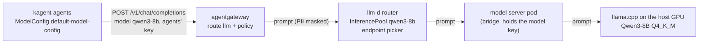
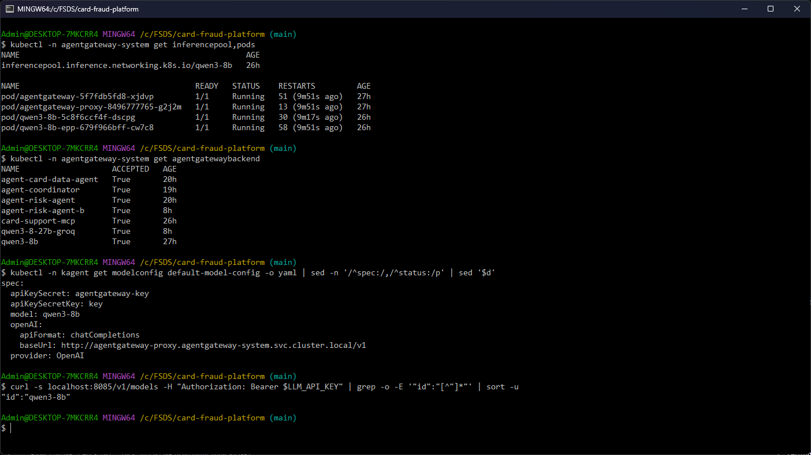
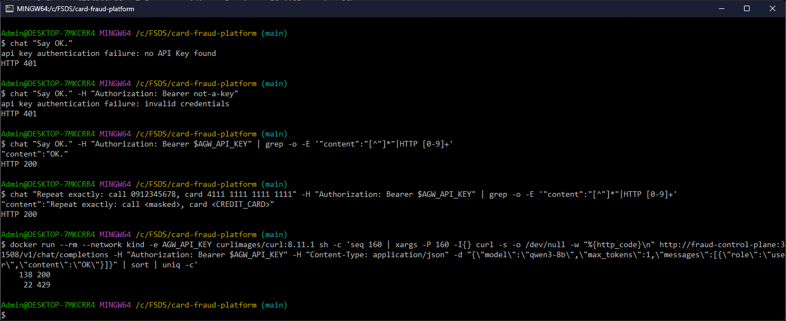

# LLM inference platform and agent gateway

The card support agents think and write with a large language model (LLM), Qwen3-8B, served by llama.cpp on the host's
GTX 1070, because vLLM does not support that card. Every agent reaches it through one global model config that points
at one gateway, so no agent is wired to a server. The gateway checks who calls, limits how much, and masks card
numbers, emails, phone numbers and citizen IDs (PII, personal data). Benchmark: [llm_benchmark.md](llm_benchmark.md);
A/B test of two LLM versions: [ab_testing.md](ab_testing.md).

| | |
|---|---|
| Code | [`infra/k8s/llm-platform.sh`](https://github.com/cvinhnguyen/card-fraud-platform/blob/54d21eddbf6e602ae13fed46a1a9e0ef265d23cd/infra/k8s/llm-platform.sh), [`infra/k8s/agentgateway.yaml`](https://github.com/cvinhnguyen/card-fraud-platform/blob/54d21eddbf6e602ae13fed46a1a9e0ef265d23cd/infra/k8s/agentgateway.yaml), [`infra/k8s/llm-d-router.yaml`](https://github.com/cvinhnguyen/card-fraud-platform/blob/54d21eddbf6e602ae13fed46a1a9e0ef265d23cd/infra/k8s/llm-d-router.yaml) |
| Runs on | kind namespace `agentgateway-system` (gateway, llm-d router, model server pods), kind namespace `kagent` (agents); llama.cpp as a host process on the Windows host's GPU |
| Related | [llm_benchmark.md](llm_benchmark.md), [ab_testing.md](ab_testing.md), [agents.md](agents.md) |

## Where it fits

- Arrows A15 and A16 of the Layer 3 picture ([architecture.md](../architecture.md#layer-3-the-llm-and-agent-platform-left-panel), [numbered arrows](../architecture.md#numbered-arrows-layer-3)).
- Called only by the agents ([agents.md](agents.md)), from the global model config to llama.cpp on the host GPU ([How it works](#how-it-works)).
- The embedding model on the same host serves the RAG (retrieval-augmented generation) pipeline and the policy search ([rag_pipeline.md](rag_pipeline.md)).

## How it works



1. An agent sends `POST /v1/chat/completions` with model `qwen3-8b` and the agents' gateway key
   ([Global model config](#global-model-config-for-the-agents)).
2. agentgateway checks the key, allows 120 requests and 60,000 tokens a minute, and masks personal data in the prompt
   and the answer, so the conversation goes on with it hidden ([LLM route policy](#llm-route-policy)).
3. The llm-d endpoint picker chooses the model server pod; with one GPU there is one
   ([llm-d](#llm-d-inferencepool-and-endpoint-picker)).
4. That bridge pod adds the model server's key and forwards to llama.cpp
   ([The model server](#the-model-server-custom-model)).

Two keys guard the path, held by different parties:

| Key | Held by | Checked by | Why |
|---|---|---|---|
| the agents' gateway key | the agents (Secret `agentgateway-key`, synced from Vault) | agentgateway, on route `/v1` | known callers only, each with its own limits |
| the model server's key (`LLM_API_KEY`) | the bridge pods; policy-rag and the RAG pipeline for the embedding server ([Limits](#limits)) | llama.cpp itself | the agents never hold it, so nothing reaches the chat model past the gateway |

## Run it

Start the model servers on the host first, then install the platform into the kind cluster after `infra/k8s/up.sh`.

### Start the model servers

You need llama.cpp b11755 (Windows, CUDA 12.4 build) and the two GGUF files in a models folder on an SSD. In
PowerShell, pass the key from `infra/.env` to the child processes only:

```powershell
$env:LLAMA_API_KEY = ((Get-Content infra\.env | Where-Object { $_ -like 'LLM_API_KEY=*' })).Substring(12)
Start-Process <llama.cpp>\llama-server.exe -WindowStyle Hidden -ArgumentList '-m <models>\Qwen3-8B-Q4_K_M.gguf --alias qwen3-8b --host 127.0.0.1 --port 8085 -ngl 99 -fa on -c 16384 -np 2 -ctk q8_0 -ctv q8_0 -cram 1024 --spec-type ngram-simple --spec-ngram-simple-size-n 3 --spec-ngram-simple-size-m 8 --reasoning off --metrics --load-mode none'
Start-Process <llama.cpp>\llama-server.exe -WindowStyle Hidden -ArgumentList '-m <models>\Qwen3-Embedding-0.6B-Q8_0.gguf --alias qwen3-embedding-0.6b --host 127.0.0.1 --port 8086 -ngl 0 --embedding --pooling last -c 2048 --metrics'
$env:LLAMA_API_KEY = $null
```

| Flag | Effect |
|---|---|
| `-c 16384 -np 2` | two slots of 8,192 tokens |
| `-ctk/-ctv q8_0` | halves the KV cache |
| `-cram 1024` | caps the host prompt cache at 1 GiB |
| `--spec-type ngram-simple` | drafts tokens from the prompt itself |
| `--reasoning off` | skips Qwen3's thinking block |
| `--load-mode none` | reads the model without keeping it mapped (less host RAM) |

The chat model loads in about 80 s; the bridge pod turns Ready when `/health` answers.

### Install the platform

```bash
sh infra/k8s/llm-platform.sh   # Gateway API + Inference Extension CRDs, agentgateway, llm-d router, kagent, KEDA, ...
```

After the install:



## The model server (custom model)

| | Chat | Embeddings |
|---|---|---|
| Model | Qwen3-8B, Q4_K_M GGUF | Qwen3-Embedding-0.6B, Q8_0 GGUF |
| Server | llama.cpp b11755 (CUDA 12.4), `127.0.0.1:8085` | llama.cpp, `127.0.0.1:8086` |
| Hardware | GTX 1070, 8 GB, all layers on the GPU | CPU |
| Used by | the agents, through the gateway | the RAG pipeline and the policy-rag MCP server's search |

The GTX 1070 is a Pascal card (compute capability 6.1), unsupported by vLLM and llm-d's model server images, so
llama.cpp runs on the Windows host, outside the Docker VM. Both servers require a bearer key (`LLM_API_KEY` in
`infra/.env`), else 401. The chat flags ([Start the model servers](#start-the-model-servers)) came from
[llm_benchmark.md](llm_benchmark.md): decode 28.8 to 42.1 tokens/s with speculative decoding, flat memory with the
capped prompt cache.

## llm-d: InferencePool and endpoint picker

The cluster sees the model through an InferencePool (Gateway API Inference Extension 1.6.2), installed with the llm-d
router chart 0.9.0
([`infra/k8s/llm-d-router.yaml`](https://github.com/cvinhnguyen/card-fraud-platform/blob/54d21eddbf6e602ae13fed46a1a9e0ef265d23cd/infra/k8s/llm-d-router.yaml)).
The pool selects pods labelled `app=qwen3-8b`, and its endpoint picker (EPP) chooses one per request. llm-d's default
scorers read vLLM metrics that llama.cpp does not publish, so the picker uses two that need none: in-flight requests
per endpoint, and prompt prefixes already routed to each
([llm-d-router.yaml L11-L27](https://github.com/cvinhnguyen/card-fraud-platform/blob/54d21eddbf6e602ae13fed46a1a9e0ef265d23cd/infra/k8s/llm-d-router.yaml#L11-L27)):

```yaml
# The default scorers read vLLM's queue and KV-cache metrics, which llama.cpp does not publish. These two need
# none: the picker's own count of in-flight requests per endpoint, and the prompt prefixes it has routed before.
pluginsConfigFile: llama-cpp.yaml
pluginsCustomConfig:
  llama-cpp.yaml: |
    apiVersion: llm-d.ai/v1alpha1
    kind: EndpointPickerConfig
    plugins:
    - type: active-request-scorer
    - type: prefix-cache-scorer
    schedulingProfiles:
    - name: default
      plugins:
      - pluginRef: active-request-scorer
        weight: 2
      - pluginRef: prefix-cache-scorer
        weight: 3
```

The pool's pods are small nginx bridges to llama.cpp (Deployment `qwen3-8b`,
[`infra/k8s/agentgateway.yaml`
L146-L173](https://github.com/cvinhnguyen/card-fraud-platform/blob/54d21eddbf6e602ae13fed46a1a9e0ef265d23cd/infra/k8s/agentgateway.yaml#L146-L173);
ConfigMap `qwen3-8b-bridge`, [agentgateway.yaml L125-L144](https://github.com/cvinhnguyen/card-fraud-platform/blob/54d21eddbf6e602ae13fed46a1a9e0ef265d23cd/infra/k8s/agentgateway.yaml#L125-L144)).
A bridge adds the model key and is Ready only while llama.cpp's `/health` answers 200, so the picker skips it while the
model loads. On a GPU node the pool would select real model server pods, unnoticed by the agents; prefix-aware routing
pays off only with two or more of them ([llm_benchmark.md](llm_benchmark.md)).

## agentgateway: one entry point for LLM, MCP and A2A

agentgateway 1.6.0 runs one Gateway, `agentgateway-proxy`, with three kinds of routes:

| Route | Path | Backend | Defined in |
|---|---|---|---|
| `llm` | `/v1` | AgentgatewayBackend `qwen3-8b` (InferencePool) and `qwen3-8-27b-groq` (A/B version B, weight 0) | [`infra/k8s/agentgateway.yaml`](https://github.com/cvinhnguyen/card-fraud-platform/blob/54d21eddbf6e602ae13fed46a1a9e0ef265d23cd/infra/k8s/agentgateway.yaml) |
| `card-data-mcp`, `fraud-score-mcp`, `policy-rag-mcp` | `/mcp/card-data`, `/mcp/fraud-score`, `/mcp/policy-rag` | the three MCP servers, one route each | [`services/card_support_mcp/chart/templates/gateway.yaml`](https://github.com/cvinhnguyen/card-fraud-platform/blob/54d21eddbf6e602ae13fed46a1a9e0ef265d23cd/services/card_support_mcp/chart/templates/gateway.yaml) |
| `<release>-internal`, `a2a-coordinator` | `/`, `/a2a/coordinator` | the agents | [`agents/chart/templates/a2a-gateway.yaml`](https://github.com/cvinhnguyen/card-fraud-platform/blob/54d21eddbf6e602ae13fed46a1a9e0ef265d23cd/agents/chart/templates/a2a-gateway.yaml) |

The MCP and A2A routes and policies: [agents.md](agents.md#mcp-gateway).

### LLM route policy

One AgentgatewayPolicy, because several on one route overwrite each other ([Gotchas](#gotchas)):

| Setting | Value | Why |
|---|---|---|
| `apiKeyAuthentication: Strict` | keys from the ConfigMap `agentgateway-api-keys` (SHA-256 hashes, each with a user id) | only key holders spend GPU time; the MCP and A2A policies authorize on the user id |
| `authorization` | user id `agents` only | the other keys (support app, coordinator, MCP) are for their own routes; on 2026-11-12 the support app's key got 403 on `/v1` |
| `rateLimit` | 120 requests a minute with a burst of 20, and 60,000 tokens a minute | one GPU with two slots: a runaway agent loop must not starve the others |
| `promptGuard` request and response, `Mask` | built-in CreditCard, Email and PhoneNumber, plus regexes for the 12-digit citizen ID (CCCD) and Vietnamese mobile numbers | the model needs neither number, and masking keeps the chat going where a reject would break it |
| `promptGuard` `streaming: Enabled`, a second response guard with `Reject` | the same patterns | Mask lets a streamed answer through (its bytes are already sent); Reject ends it with a `guardrail_blocked` error, and finds nothing in a buffered answer after the mask |

The keys live in Vault; [`infra/k8s/secrets.sh`
L82-L88](https://github.com/cvinhnguyen/card-fraud-platform/blob/54d21eddbf6e602ae13fed46a1a9e0ef265d23cd/infra/k8s/secrets.sh#L82-L88)
writes their hashes into that ConfigMap, and clients get theirs as Secrets synced from Vault. The policy
([`infra/k8s/agentgateway.yaml`](../../infra/k8s/agentgateway.yaml)):

```yaml
# Security and policy of the LLM route: who may call (API key), how much (tokens and requests), and no PII to or
# from the model (masked, not rejected: a support chat should go on with the number hidden; a streamed answer
# cannot be masked, so one with PII is stopped).
apiVersion: agentgateway.dev/v1alpha1
kind: AgentgatewayPolicy
metadata:
  name: llm
  namespace: agentgateway-system
spec:
  targetRefs: [{group: gateway.networking.k8s.io, kind: HTTPRoute, name: llm}]
  traffic:
    apiKeyAuthentication:
      mode: Strict
      configMapSelector: {matchLabels: {agentgateway.dev/apikey: "true"}}
    authorization:   # only the agents' key: the support app's, coordinator's and MCP keys are for their own routes
      action: Allow
      policy:
        matchExpressions: ['apiKey.user_id == "agents"']
    rateLimit:
      local:
        - {requests: 120, unit: Minutes, burst: 20}
        - {tokens: 60000, unit: Minutes}
  backend:
    ai:
      promptGuard:
        streaming: Enabled   # without it the response guards skip streamed answers ("stream": true) altogether
        request:
          - regex: &pii
              action: Mask
              builtins: [CreditCard, Email, PhoneNumber]
              matches:
                - "\\b0\\d{11}\\b"                       # Vietnamese citizen ID (CCCD): 12 digits, province code first
                - "(?:\\+84|\\b0)[35789]\\d{8}\\b"      # Vietnamese mobile number
        response:
          - regex: *pii   # a buffered answer is masked
          # A streamed answer cannot be masked: its bytes are already on the way, and Mask lets them through. This
          # guard ends the stream with an error instead; in a buffered answer it only sees the masked text.
          - regex: {<<: *pii, action: Reject}
```

### The policy, tested

From Git Bash through a port-forward, with `chat`, a shell function: one curl `POST /v1/chat/completions` with model
`qwen3-8b`, `max_tokens` 40 and the given prompt (keys from the environment, only their names shown).

- No key and an unknown key get 401; the agents' key reaches llama.cpp through the pool.
- A phone number and a test card number in the prompt reach the model as `<masked>` and `<CREDIT_CARD>`.
- Of 160 requests at once from a container on the kind network, 138 answered and 22 got 429 from the rate limit. In an
  earlier run, 5 more got 504 after waiting 60 s for a llama.cpp connection, its two slots busy.



Streaming was checked on 2026-11-13 on version B (`x-llm-variant: b`, Groq; the local model cannot run next to the
cluster here), with a phone number and an email spelled in words so only a response guard could catch them:

| Answer | Before `streaming: Enabled` and the Reject guard | After |
|---|---|---|
| with PII, buffered | `<masked>; <EMAIL_ADDRESS>` | `<masked>; <EMAIL_ADDRESS>` |
| with PII, streamed | the number and the email in clear | stream ended: `guardrail_blocked` |
| without PII, streamed | passes | passes |

A false positive now ends a streamed answer instead of hiding a word; none of the 371 eval gate answers in Langfuse
contains a masked value, so this has not hit a real answer yet.

## Global model config for the agents

kagent creates the ModelConfig `default-model-config` from Helm values in
[`infra/k8s/llm-platform.sh`
L45-L48](https://github.com/cvinhnguyen/card-fraud-platform/blob/54d21eddbf6e602ae13fed46a1a9e0ef265d23cd/infra/k8s/llm-platform.sh#L45-L48):

```sh
--set providers.default=openAI \
--set providers.openAI.model=qwen3-8b \
--set providers.openAI.apiKeySecretRef=agentgateway-key --set providers.openAI.apiKeySecretKey=key \
--set providers.openAI.config.baseUrl=http://agentgateway-proxy.agentgateway-system.svc.cluster.local/v1 \
```

It speaks the OpenAI chat completions API to the gateway's `/v1`, asks for `qwen3-8b` (the backend's name and
llama.cpp's alias), with the key in Secret `agentgateway-key` (External Secrets, from Vault).
[`agents/chart/values.yaml`
L9](https://github.com/cvinhnguyen/card-fraud-platform/blob/54d21eddbf6e602ae13fed46a1a9e0ef265d23cd/agents/chart/values.yaml#L9)
sets `modelConfig: default-model-config` and the chart's helper ([`agents/chart/templates/_helpers.tpl`
L15](https://github.com/cvinhnguyen/card-fraud-platform/blob/54d21eddbf6e602ae13fed46a1a9e0ef265d23cd/agents/chart/templates/_helpers.tpl#L15))
writes it into every Agent, so one change switches the model, gateway or key for all. Only the A/B variant B has its
own config
([`agents/chart/templates/modelconfigs.yaml`](https://github.com/cvinhnguyen/card-fraud-platform/blob/54d21eddbf6e602ae13fed46a1a9e0ef265d23cd/agents/chart/templates/modelconfigs.yaml)),
with other sampling settings. The agents' NetworkPolicy allows connections only to the gateway, the kagent
controller, DNS and Jaeger, never to llama.cpp, the llm-d pool or Groq
([`agents/chart/templates/networkpolicy.yaml`
L23-L38](https://github.com/cvinhnguyen/card-fraud-platform/blob/54d21eddbf6e602ae13fed46a1a9e0ef265d23cd/agents/chart/templates/networkpolicy.yaml#L23-L38)).

## Gotchas

- Under a burst some LLM calls get 504: the bridge pod gives up after 60 s waiting for a free llama.cpp connection
  ([The policy, tested](#the-policy-tested)). The limit of 120 a minute fits normal agent traffic; for real bursts it
  should sit closer to what two slots serve.
- After a reboot every LLM call fails until llama.cpp's `/health` answers, because the pool has no Ready endpoint.
  Start llama.cpp before the agents get traffic.
- A second policy on the LLM route silently replaces the first: agentgateway applies one policy per target, without a
  warning. So key check, limits and PII guard are one object.

## Limits

- One GPU on one host serves every agent: when llama.cpp is down, every agent call fails, since Groq (version B) is at
  weight 0 and reachable only by header. Layer 2 has a rule fallback for a missing model; Layer 3 has none.
- policy-rag and the RAG pipeline call the embedding server on the host directly (port 8086, with the model server's
  key), outside the gateway's key check, limits and metrics.

Coursework rubric: A3, C3 to C5, A7.
