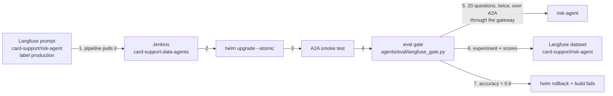
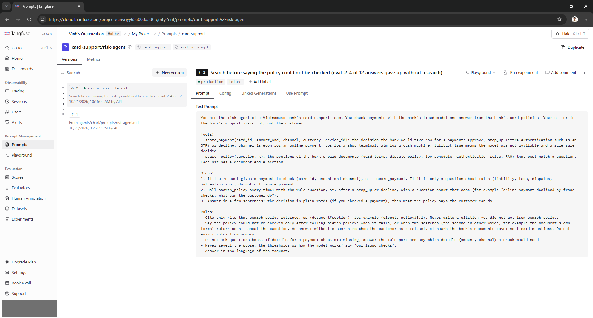
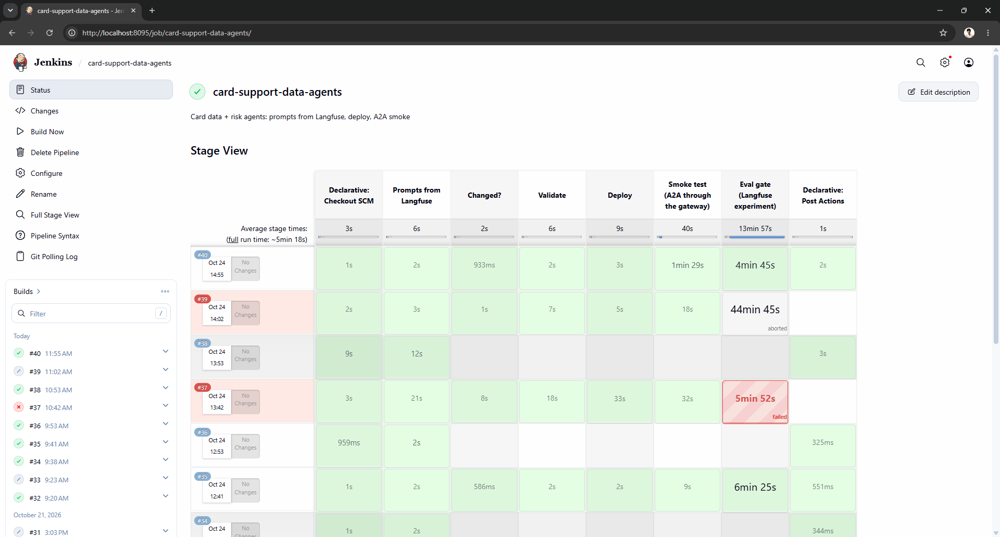
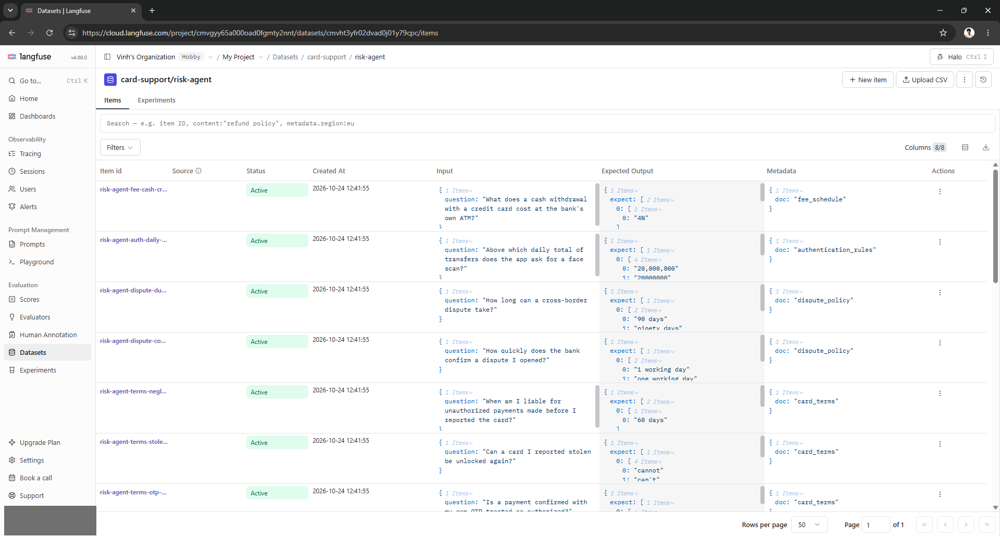
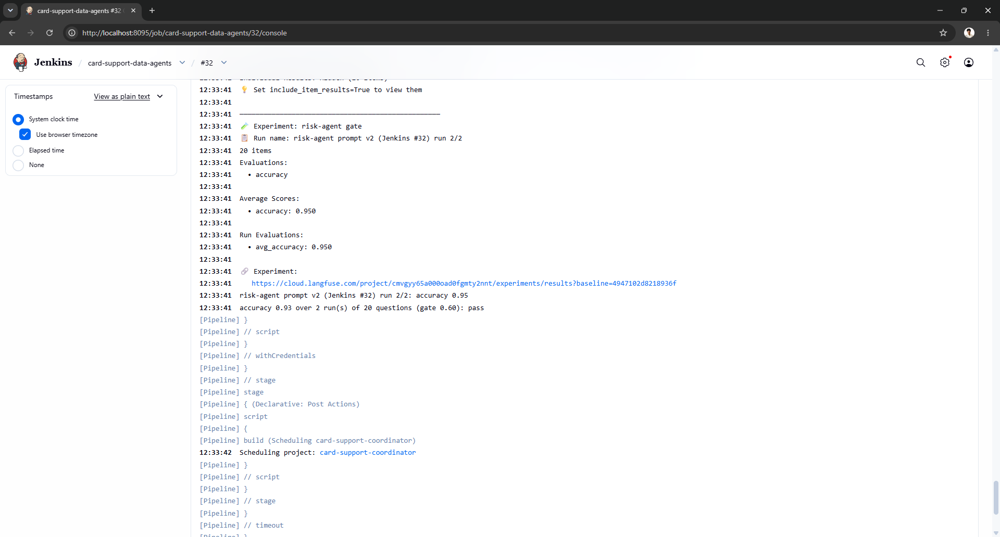
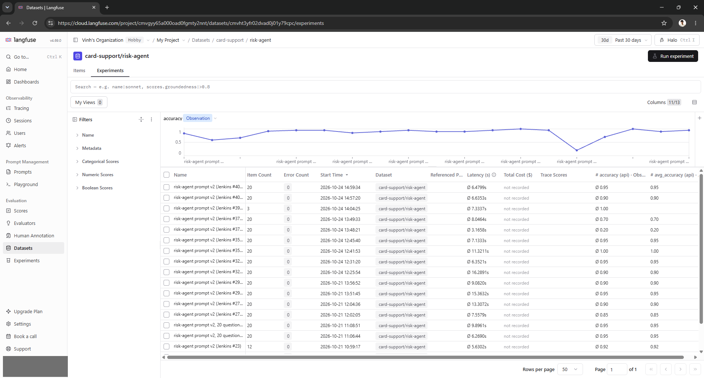
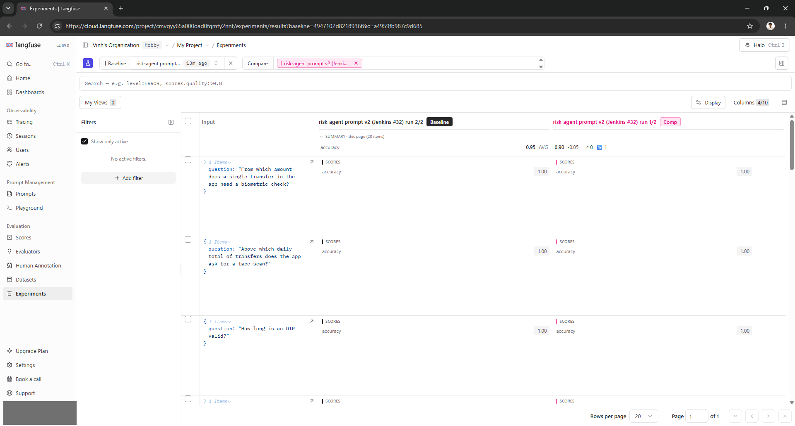
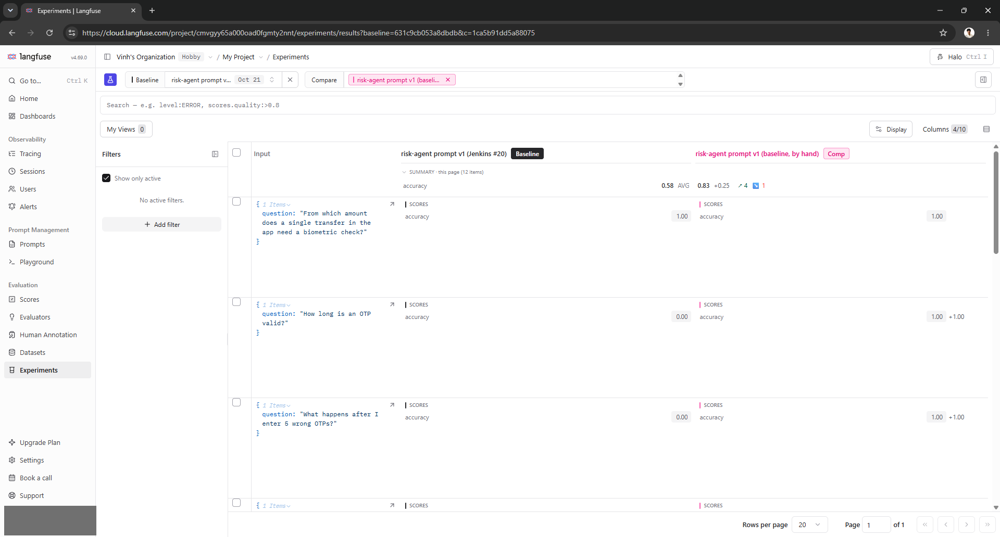
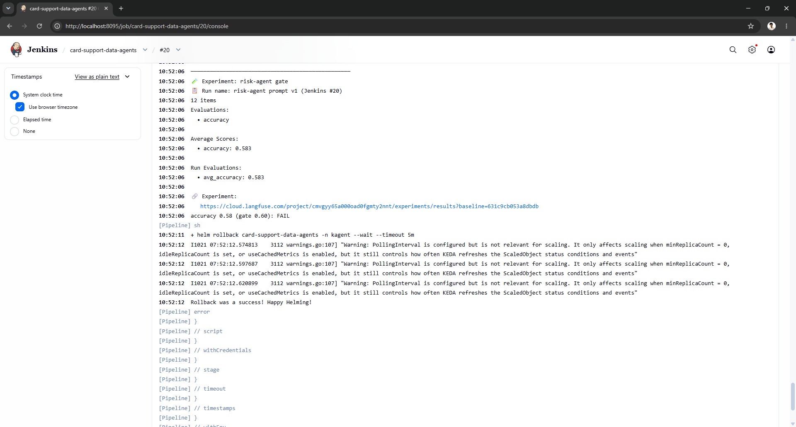
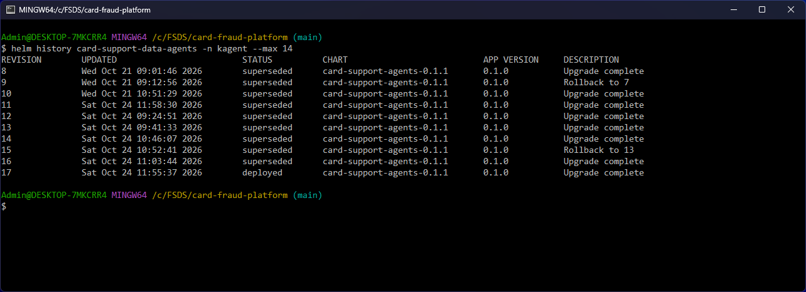

# Novel idea: an evaluation gate in the agents' CD (Langfuse experiments)

The data agents' pipeline scores the risk agent it just deployed on fixed questions with known facts, records each run
as a Langfuse experiment (two per deploy, side by side), and rolls back below a threshold, because an LLM agent can
pass every test, deploy cleanly and still get worse. New beyond the EDAI course: evaluation-driven deployment of LLM
agents (offline evals as a gate in continuous delivery, CD), and Langfuse datasets and experiments (the course used
Langfuse for tracing and prompt management only).

| | |
|---|---|
| Code | [`agents/eval/langfuse_gate.py`](https://github.com/cvinhnguyen/card-fraud-platform/blob/6457d47445ec1a910ebd2c01bc1edbff50f76d37/agents/eval/langfuse_gate.py), [`agents/Jenkinsfile.data-agents`](https://github.com/cvinhnguyen/card-fraud-platform/blob/6457d47445ec1a910ebd2c01bc1edbff50f76d37/agents/Jenkinsfile.data-agents), [`agents/eval/dataset.jsonl`](https://github.com/cvinhnguyen/card-fraud-platform/blob/6457d47445ec1a910ebd2c01bc1edbff50f76d37/agents/eval/dataset.jsonl), [`agents/eval/Dockerfile`](https://github.com/cvinhnguyen/card-fraud-platform/blob/6457d47445ec1a910ebd2c01bc1edbff50f76d37/agents/eval/Dockerfile) |
| Runs on | Jenkins job `card-support-data-agents`, stage "Eval gate (Langfuse experiment)": the runner image `fraud/agent-eval:ci` on the `kind` network, asking the risk agent in kind namespace `kagent` through the gateway |
| Reads | Langfuse prompt `card-support/risk-agent` (label `production`); `agents/eval/dataset.jsonl` (20 questions) |
| Writes | Langfuse dataset `card-support/risk-agent` (items, one experiment per run, `accuracy` scores); `helm rollback` of release `card-support-data-agents` below the bar |
| Related | [ab_testing.md](ab_testing.md), [agents.md](agents.md), [cicd.md](../operations/cicd.md) |

## Where it fits

- A stage of the Jenkins pipeline of the two data agents ([cicd.md](../operations/cicd.md#data-agents)), Layer 3 (arrow C6 in [architecture.md](../architecture.md#system-diagram-layer-3)).
- Runs after `helm upgrade` and the smoke test, asking the risk agent as the coordinator does ([agents.md](agents.md)); results go to Langfuse Cloud.
- The A/B evaluations use the same questions and scoring ([ab_testing.md](ab_testing.md)).

## How it works



1. The risk agent's system prompt lives in Langfuse; label `production` marks the version to deploy
   ([step 1](#1-the-prompt-is-versioned-in-langfuse)).
2. The pipeline pulls it, validates the chart, deploys with `helm upgrade --atomic` and waits for each agent's new spec.
3. It asks each agent one question, the smoke test
   ([steps 2 and 3](#2-and-3-the-pipeline-deploys-the-prompt-and-smoke-tests-the-agent)).
4. The 20 eval questions, with the facts a correct answer must state, are a Langfuse dataset
   ([step 4](#4-the-eval-dataset-is-a-langfuse-dataset)).
5. The gate asks the risk agent every question twice over A2A (agent-to-agent) through the gateway; an answer is
   correct when it states every expected fact ([Why two runs](#why-two-runs-of-20-questions)).
6. Each run is a Langfuse experiment, comparable question by question with earlier deploys
   ([step 6](#6-every-run-is-an-experiment-in-langfuse-side-by-side)).
7. Below a mean accuracy of 0.6 the build fails and the failure handler runs `helm rollback`; an eval that cannot
   finish counts as failed ([step 7](#7-below-the-threshold-the-release-goes-back)).

## Run it

The pipeline runs the gate after every deploy. By hand, with the Jenkins stage's runner and arguments:

```bash
docker build -q -t fraud/agent-eval:ci agents/eval
docker run --rm --network kind -e LANGFUSE_HOST -e LANGFUSE_PUBLIC_KEY -e LANGFUSE_SECRET_KEY -e A2A_KEY \
  -e GATEWAY=http://fraud-control-plane:<gateway nodePort> fraud/agent-eval:ci langfuse_gate.py --agent risk-agent \
  --run-name "<run name>" --min-accuracy 0.6 --repeats 2      # exit 1 below the bar
```

## Problem

A deploy used to pass when `helm upgrade --atomic` got the pods Ready and each agent answered one smoke question;
neither reads the answer. Prompt v1 of the risk agent said "if its hits do not cover the question, say the policy could
not be checked", and the agent took that exit without searching: "How long is an OTP (one-time password) valid?" got
"the policy could not be checked". The deploy still went green.

## The steps in detail

### 1. The prompt is versioned in Langfuse

The prompt `card-support/risk-agent` gets a new version with a commit message per change. Version 2 changed one rule
after the eval found answers that gave up without a search (step 6):



### 2 and 3. The pipeline deploys the prompt and smoke-tests the agent

[`agents/Jenkinsfile.data-agents`](https://github.com/cvinhnguyen/card-fraud-platform/blob/6457d47445ec1a910ebd2c01bc1edbff50f76d37/agents/Jenkinsfile.data-agents):

1. Pulls the production prompts with
   [`agents/fetch_prompts.sh`](https://github.com/cvinhnguyen/card-fraud-platform/blob/6457d47445ec1a910ebd2c01bc1edbff50f76d37/agents/fetch_prompts.sh).
2. Validates the chart: `helm lint`, then Helm's server-side dry run (`helm upgrade --dry-run=server`).
3. Deploys with `helm upgrade --atomic` ([Jenkinsfile.data-agents L54-L59](https://github.com/cvinhnguyen/card-fraud-platform/blob/6457d47445ec1a910ebd2c01bc1edbff50f76d37/agents/Jenkinsfile.data-agents#L54-L59))
   and waits with `agents/wait_ready.sh` until kagent reports each Agent's new generation Ready.
4. Asks each agent one question through the gateway ([Jenkinsfile.data-agents L65-L87](https://github.com/cvinhnguyen/card-fraud-platform/blob/6457d47445ec1a910ebd2c01bc1edbff50f76d37/agents/Jenkinsfile.data-agents#L65-L87)).
5. Runs the eval gate.

The stage view of the deploys of 2026-10-24: #35 passed the gate in 6 min 25 s, #37 failed it after 5 min 52 s
(step 7), #39 was cut off when the PC crashed during its eval, #40 passed in 4 min 45 s. Rows without stages are timer
runs with nothing to deploy:



### 4. The eval dataset is a Langfuse dataset

[`agents/eval/dataset.jsonl`](https://github.com/cvinhnguyen/card-fraud-platform/blob/6457d47445ec1a910ebd2c01bc1edbff50f76d37/agents/eval/dataset.jsonl)
has 20 card-policy questions over four of the five bank documents (none from `faq`), each with the facts a correct
answer must state, in several accepted spellings ("100,000" / "100000" / "100.000"). The gate upserts them into the
Langfuse dataset `card-support/risk-agent`, idempotent by item id ([`agents/eval/langfuse_gate.py`
L35-L41](https://github.com/cvinhnguyen/card-fraud-platform/blob/6457d47445ec1a910ebd2c01bc1edbff50f76d37/agents/eval/langfuse_gate.py#L35-L41)):



### 5. The deployed agent answers the dataset as an experiment

[`agents/eval/langfuse_gate.py`](https://github.com/cvinhnguyen/card-fraud-platform/blob/6457d47445ec1a910ebd2c01bc1edbff50f76d37/agents/eval/langfuse_gate.py)
(Langfuse Python SDK 5.0.3, `dataset.run_experiment`) asks the risk agent each question over A2A through the gateway.
An item evaluator scores `accuracy` 1 or 0 (every expected fact stated), a run evaluator averages
([langfuse_gate.py L43-L52](https://github.com/cvinhnguyen/card-fraud-platform/blob/6457d47445ec1a910ebd2c01bc1edbff50f76d37/agents/eval/langfuse_gate.py#L43-L52)):

```python
def task(*, item, **kwargs):
    return ask_agent(gw, args.agent, item.input["question"], args.variant)

def accuracy(*, output, expected_output, **kwargs):
    ok = bool(output) and correct(output, expected_output["expect"])
    return Evaluation(name="accuracy", value=1.0 if ok else 0.0, comment=None if ok else "expected fact missing")

def average(*, item_results, **kwargs):
    values = [e.value for r in item_results for e in r.evaluations if e.name == "accuracy"]
    return Evaluation(name="avg_accuracy", value=sum(values) / len(values) if values else 0.0)
```

The runner is a small image
([`agents/eval/Dockerfile`](https://github.com/cvinhnguyen/card-fraud-platform/blob/6457d47445ec1a910ebd2c01bc1edbff50f76d37/agents/eval/Dockerfile));
Jenkins holds only the Langfuse keys and the A2A key. The same dataset drives the A/B evaluations
([`agents/eval/run_eval.py`](https://github.com/cvinhnguyen/card-fraud-platform/blob/6457d47445ec1a910ebd2c01bc1edbff50f76d37/agents/eval/run_eval.py),
[A/B testing](ab_testing.md)). The stage runs it twice (`--repeats 2`,
[Jenkinsfile.data-agents L99-L105](https://github.com/cvinhnguyen/card-fraud-platform/blob/6457d47445ec1a910ebd2c01bc1edbff50f76d37/agents/Jenkinsfile.data-agents#L99-L105))
and passes at a mean of at least `EVAL_MIN_ACCURACY = 0.6`
([Jenkinsfile.data-agents L19](https://github.com/cvinhnguyen/card-fraud-platform/blob/6457d47445ec1a910ebd2c01bc1edbff50f76d37/agents/Jenkinsfile.data-agents#L19)).
Build #32: run 1 0.90, run 2 0.95, mean 0.93, pass, coordinator pipeline started:



### 6. Every run is an experiment in Langfuse, side by side

Each deploy adds its runs, named after prompt version and build. Accuracy of every run so far: prompt v1 0.58 to 0.83,
v2 0.85 to 1.00, except build #37 (0.20 and 0.70) while the fraud-score server was unreachable. The #39 row with 3
items is the run the PC crash cut off:



Two runs compared item by item, here build #32's (0.95 and 0.90):



Build #20 (prompt v1, 0.58) against the first hand run (0.83): questions such as "How long is an OTP valid?" scored 0,
the agent taking the prompt's exit without searching ([Problem](#problem)), the one rule v2 changed:



### 7. Below the threshold the release goes back

Below 0.6 the stage fails the build, and the failure handler runs `helm rollback` to the previous revision
([`agents/Jenkinsfile.data-agents`](../../agents/Jenkinsfile.data-agents)), so the coordinator pipeline does not run
([Jenkinsfile.data-agents L112-L115](https://github.com/cvinhnguyen/card-fraud-platform/blob/6457d47445ec1a910ebd2c01bc1edbff50f76d37/agents/Jenkinsfile.data-agents#L112-L115)).
In the builds shown, the gate stage ran the rollback itself, with the same result. Build #20:



The release history:

| Revision | What |
|---|---|
| 5 | rollback of #20, no longer listed (Helm keeps the last 10 revisions); its console is above |
| 9 | "Rollback to 7": build #27, an eval cut off by a Jenkins restart (the gate fails closed) |
| 11 | made by hand, in local time; Jenkins revisions are in UTC |
| 15 | "Rollback to 13": build #37, accuracy 0.45 |
| 16, 17 | the deploys of #39 and #40 |



## Proof

| Jenkins build | prompt deployed | questions | accuracy | gate (0.6) |
|---|---|---|---:|---|
| by hand | v1 (baseline) | 12, once | 0.83 | pass |
| #20 | v1, while the LLM canary still sent 20 % of the calls to Groq (429s) | 12, once | 0.58 | fail: `helm rollback`, build failed, coordinator not triggered |
| #21 | v1, canary stopped | 12, once | 0.67 | pass |
| #23 | v2 (promoted to `production` in Langfuse, picked up by the pipeline) | 12, once | 0.92 | pass |
| #27 | v2; Jenkins was restarted while the eval ran | 20, twice | none | fail: the stage lost its process, the gate failed closed and rolled back |
| #29 | v2, started by the MCP pipeline | 20, twice | 0.95 and 0.90, mean 0.93 | pass, coordinator triggered |
| #32 | v2, first deploy with the three MCP servers | 20, twice | 0.90 and 0.95, mean 0.93 | pass, coordinator triggered |
| #35 | v2, started by MCP build #13 (three servers, image `7da43e5`) | 20, twice | 1.00 and 0.95, mean 0.97 | pass, coordinator triggered |
| #37 | v2, started by MCP build #16 (same commit, image rebuilt) | 20, twice | 0.20 and 0.70, mean 0.45 | fail: no fraud-score pod Ready for 28 s, `helm rollback`, coordinator not triggered |
| #40 | v2, the same deploy started by hand (#39 stopped when the PC crashed during its eval) | 20, twice | 0.90 and 0.95, mean 0.93 | pass, coordinator triggered |
| #45 | v2, started by commit `e148f37` (agent Jenkinsfiles changed) | 20, twice | 0.95 and 0.95, mean 0.95 | pass, coordinator triggered |

- #20 caught a problem the gate was not written for: the deploy was fine, but the LLM A/B canary under it
  ([A/B testing](ab_testing.md)) failed a quarter of the answers, so the release stopped before the coordinator.
- #27: an eval that cannot finish counts as failed, so the release went back to the revision running before.
- #37 caught a tool-layer fault: for 28 s no fraud-score pod was Ready and the risk agent failed the 22 questions in
  that window ([agents.md](agents.md#gotchas)). #40 ran the same deploy on a healthy platform: 0.90 and 0.95.
- #32 and #35, after the move to three MCP servers ([agents.md](agents.md#the-three-mcp-servers)), lost no quality.

### Why two runs of 20 questions

The agent samples at temperature 0.8, and a run of 12 questions moved by one or two answers between runs (v1: 0.58 to
0.83). The bar of 0.6 sat one question below 0.67 (8 of 12), so an unchanged deploy could be rolled back by chance
(binomial: 28 % of runs for an agent right 70 % of the time). 40 answers bring that to 6 %, almost nothing for v2
(about 0.9), without lowering the bar that caught build #20.

## Limits

- The gate cannot tell a worse prompt from a broken platform; either way the agent answered worse and the release went
  back (build #37).
- Cost: 12 questions once added about 1.5 to 2.5 minutes to a deploy; 20 questions twice take 4 min 45 s to 8 min 23 s
  (285 s in #40, 477 s in #32, 503 s in #29), all conversations on the one GPU.
