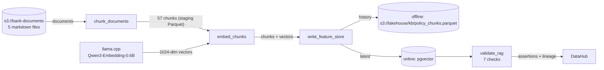
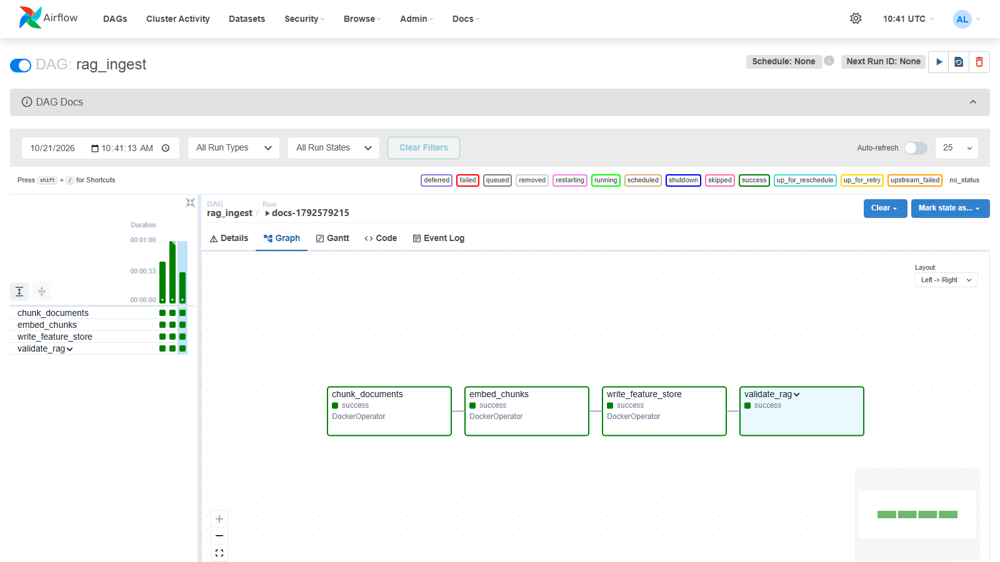
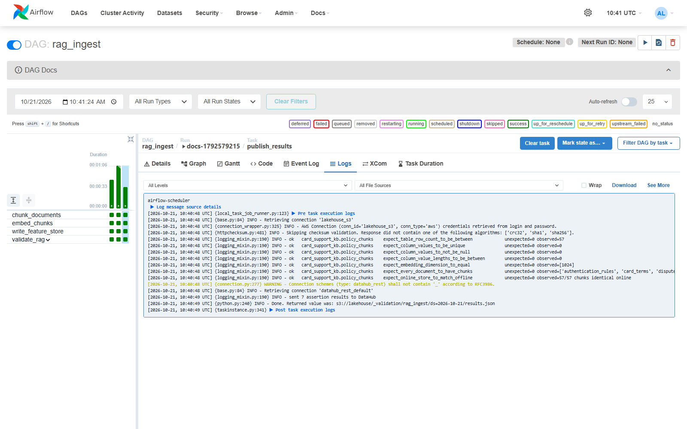
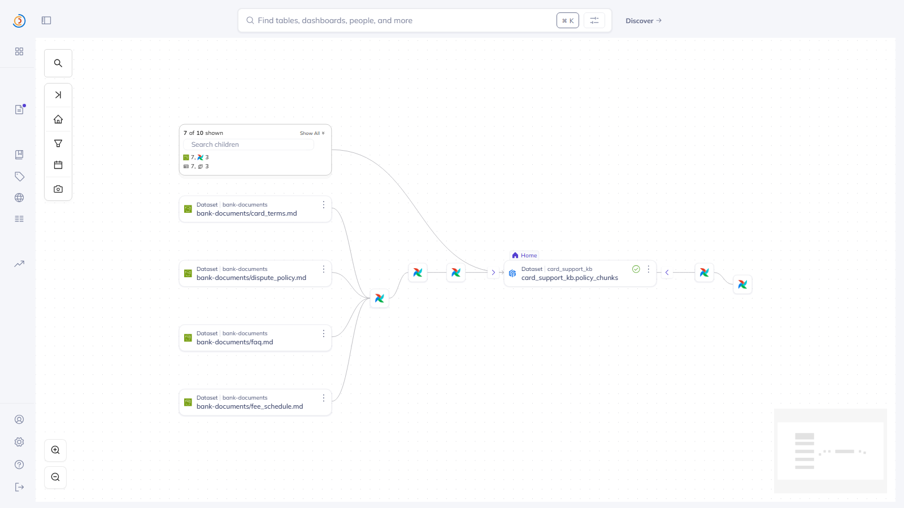
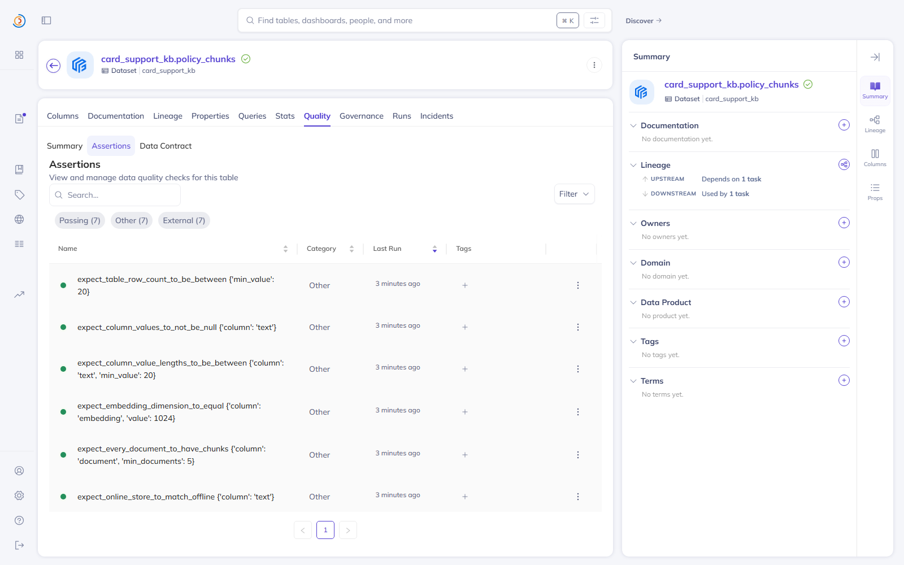

# RAG data pipeline

The RAG (retrieval-augmented generation) data pipeline, the Layer 3 Airflow DAG `rag_ingest`, prepares the bank's
card documents (terms and conditions, fee schedule, dispute policy, authentication rules, FAQ) so the risk agent
answers policy questions from them, quoting the clause, instead of making up fees and rules. It cuts the documents
into chunks, turns each into a 1024-number vector of its meaning, and stores both in a Feast feature view, where
policy-rag's `search_policy` finds the chunks closest to a question and card-data's `get_policy_chunk` reads one by id.
CI/CD: [cicd.md](../operations/cicd.md#rag-data-pipeline).

| | |
|---|---|
| Code | [`pipelines/airflow/dags/rag_ingest.py`](https://github.com/cvinhnguyen/card-fraud-platform/blob/6457d47445ec1a910ebd2c01bc1edbff50f76d37/pipelines/airflow/dags/rag_ingest.py), [`ml/jobs/rag_ingest.py`](https://github.com/cvinhnguyen/card-fraud-platform/blob/6457d47445ec1a910ebd2c01bc1edbff50f76d37/ml/jobs/rag_ingest.py), [`ml/feature_repo_kb/`](https://github.com/cvinhnguyen/card-fraud-platform/tree/6457d47445ec1a910ebd2c01bc1edbff50f76d37/ml/feature_repo_kb) |
| Runs on | compose profile `orch` (Airflow); each task is a container of the ml image `ghcr.io/cvinhnguyen/fraud-ml-train:<commit>`, started through `docker-proxy`; the embedding server (Qwen3-Embedding-0.6B on llama.cpp) on the host |
| Reads | `s3://bank-documents/*.md` (5 markdown files) |
| Writes | Feast project `card_support_kb`: offline history `s3://lakehouse/kb/policy_chunks.parquet`, online store pgvector (`vector-db`); validation reports `s3://lakehouse/_validation/rag_ingest/ds=<date>/results.json`; assertions and lineage in DataHub |
| Related | [cicd.md](../operations/cicd.md#rag-data-pipeline), [agents.md](agents.md), [airflow.md](../data-platform/airflow.md), [datahub.md](../data-platform/datahub.md) |

## Where it fits

- The K flow of the Layer 3 picture ([architecture.md](../architecture.md#system-diagram-layer-3)).
- Fed by the five documents in bucket `bank-documents` and the host's embedding server ([llm_platform.md](llm_platform.md)); started by the Jenkins pipeline `rag-pipeline` ([cicd.md](../operations/cicd.md#rag-data-pipeline)).
- Writes Feast project `card_support_kb` (history to the lakehouse, latest to pgvector), read by the policy-rag and card-data tool servers ([agents.md](agents.md)).
- Sends its checks and lineage to DataHub ([datahub.md](../data-platform/datahub.md)).

## How it works



1. A document or code change makes CI build a new image, set the Airflow Variable `rag_image` and start the DAG,
   which has no schedule of its own.
2. `chunk_documents` makes one chunk per numbered clause, per section without clauses (the fee tables) and per FAQ
   question, keeping the document title and section heading in the text so a chunk stands alone ([Chunking](#chunking)).
3. `embed_chunks` gets a 1024-number vector per chunk from the embedding server; similar meanings get similar vectors,
   which is how a question finds its chunks.
4. `write_feature_store` appends the chunks to the offline history and writes them to pgvector, both through Feast.
5. `validate_rag` runs 7 checks on what was written and sends them to DataHub; one failure fails the run, though the
   chunks are already readable ([Gotchas](#gotchas)).
6. Each task is a container of the ml image, and tasks hand each other S3 paths, never data ([Steps](#steps)).

## Run it

Start the embedding server on the host first ([llm_platform.md](llm_platform.md#start-the-model-servers)). On this
machine the kind cluster stays stopped while Airflow and DataHub run, because the Docker VM has 8 GB:

```bash
# Airflow (orch) + DataHub (gov) + the stores; Kafka for DataHub
docker compose -f infra/docker-compose.yaml --profile core --profile ml --profile orch --profile gov up -d
.venv/Scripts/python generator/load_source.py --part documents      # the 5 documents -> s3://bank-documents
docker exec airflow-scheduler airflow dags trigger rag_ingest       # or the CI pipeline, which also sets rag_image
```

Without DataHub (`DATAHUB_ENABLED=false`, as in CI) the checks still gate the run; only their publication is skipped.

## Steps

Each task of the DAG
([`pipelines/airflow/dags/rag_ingest.py`](https://github.com/cvinhnguyen/card-fraud-platform/blob/6457d47445ec1a910ebd2c01bc1edbff50f76d37/pipelines/airflow/dags/rag_ingest.py))
runs one step of
[`ml/jobs/rag_ingest.py`](https://github.com/cvinhnguyen/card-fraud-platform/blob/6457d47445ec1a910ebd2c01bc1edbff50f76d37/ml/jobs/rag_ingest.py)
in a container of the ml image ([rag_ingest.py L56-L74](https://github.com/cvinhnguyen/card-fraud-platform/blob/6457d47445ec1a910ebd2c01bc1edbff50f76d37/pipelines/airflow/dags/rag_ingest.py#L56-L74)).

| Task | What it does |
|---|---|
| `chunk_documents` | reads `s3://bank-documents/*.md` (uploaded by `generator/load_source.py --part documents` from [`generator/knowledge/`](https://github.com/cvinhnguyen/card-fraud-platform/tree/6457d47445ec1a910ebd2c01bc1edbff50f76d37/generator/knowledge)) and chunks it as in [How it works](#how-it-works), with ids such as `card_terms#4.2` |
| `embed_chunks` | OpenAI-compatible `/v1/embeddings` on the host (Qwen3-Embedding-0.6B, connection `llm_embeddings`), 1024-number vectors ([`ml/jobs/rag_ingest.py` L79-L89](https://github.com/cvinhnguyen/card-fraud-platform/blob/6457d47445ec1a910ebd2c01bc1edbff50f76d37/ml/jobs/rag_ingest.py#L79-L89)) |
| `write_feature_store` | Feast project `card_support_kb` ([`ml/feature_repo_kb/`](https://github.com/cvinhnguyen/card-fraud-platform/tree/6457d47445ec1a910ebd2c01bc1edbff50f76d37/ml/feature_repo_kb)): offline history (the Parquet FileSource) and online store, Postgres with pgvector (`vector-db`) ([rag_ingest.py L108-L123](https://github.com/cvinhnguyen/card-fraud-platform/blob/6457d47445ec1a910ebd2c01bc1edbff50f76d37/ml/jobs/rag_ingest.py#L108-L123)) |
| `validate_rag.run_checks` | 7 checks, in the report format of the Layer 1 validate stages |
| `validate_rag.publish_results` | logs the checks, sends them to DataHub as assertions on the feature view, fails the run if one failed ([`pipelines/airflow/dags/common.py` L150-L170](https://github.com/cvinhnguyen/card-fraud-platform/blob/6457d47445ec1a910ebd2c01bc1edbff50f76d37/pipelines/airflow/dags/common.py#L150-L170)) |

### Chunking

`chunk_documents` on one document
([rag_ingest.py L46-L63](https://github.com/cvinhnguyen/card-fraud-platform/blob/6457d47445ec1a910ebd2c01bc1edbff50f76d37/ml/jobs/rag_ingest.py#L46-L63)):

```python
def split_document(doc: str, text: str) -> list[dict]:
    """Chunks of one Markdown document: numbered clauses, else whole `##` sections (FAQ: one per question)."""
    title = text.splitlines()[0].lstrip("# ").strip()
    version = re.search(r"Version (\d{4}-\d{2}-\d{2})", text).group(1)
    chunks = []
    for i, block in enumerate(re.split(r"^## ", text, flags=re.M)[1:], start=1):
        heading, *body = block.strip().splitlines()
        lines = [line.strip() for line in body if line.strip()]
        clauses = [m for m in map(CLAUSE.match, lines) if m]
        numbered = SECTION.match(heading)
        if clauses:
            parts = [(m.group(1), m.group(2)) for m in clauses]
        else:   # a fee table or an FAQ answer: the whole section is one chunk
            parts = [(numbered.group(1) if numbered else str(i), "\n".join(lines))]
        for number, content in parts:
            chunks.append({"chunk_id": f"{doc}#{number}", "document": doc, "section": number,
                           "text": f"{title} > {heading}\n{content}", "version": version})
    return chunks
```

### Run on 2026-10-21

Run `docs-1792579215` on 2026-10-21, started through the Airflow REST API: `chunk_documents` 3.1 s, `embed_chunks`
4.9 s, `write_feature_store` 7.1 s, `validate_rag.run_checks` 6.1 s, `validate_rag.publish_results` 1.1 s. Its CI
release (rag-pipeline #2) is in [cicd.md](../operations/cicd.md#rag-data-pipeline):



## Feature view and retrieval

The feature view `policy_chunks` (entity `chunk_id`) holds `document`, `section`, `text` and `embedding` (1024
numbers, cosine distance, vector index on;
[`ml/feature_repo_kb/kb_features.py`
L26-L41](https://github.com/cvinhnguyen/card-fraud-platform/blob/6457d47445ec1a910ebd2c01bc1edbff50f76d37/ml/feature_repo_kb/kb_features.py#L26-L41)).
policy-rag embeds a question with Qwen3-Embedding's query instruction, asks the online store for the nearest
candidates, reads them by id and ranks them by its own cosine similarity
([`services/card_support_mcp/app/service.py`
L68-L75](https://github.com/cvinhnguyen/card-fraud-platform/blob/6457d47445ec1a910ebd2c01bc1edbff50f76d37/services/card_support_mcp/app/service.py#L68-L75)).

## Data governance

Same rules as the Layer 1 pipelines ([airflow.md](../data-platform/airflow.md),
[datahub.md](../data-platform/datahub.md)):

| Rule | How |
|---|---|
| Quality gate | 7 checks after every write: at least 20 chunks (57), unique `chunk_id`, no empty text, text length at least 20, embedding dimension 1024, every document has chunks, online store identical to the offline history (57/57); one failure fails the run ([Gotchas](#gotchas)) |
| Validation history | each report at `s3://lakehouse/_validation/rag_ingest/ds=<date>/results.json`, and as assertion results on `card_support_kb.policy_chunks` in DataHub |
| Lineage | the tasks' inlets and outlets, turned into lineage by the DataHub Airflow plugin: the 5 documents, `chunk_documents`, the staging chunks, `embed_chunks`, `write_feature_store`, the offline history and the feature view, then the validate task |
| Secrets | none in the DAG: store passwords and the embedding key come from Airflow connections (`feast_registry`, `feast_kb_online`, `llm_embeddings`, `lakehouse_s3`), masked in logs and rendered templates ([`pipelines/airflow/dags/rag_ingest.py` L31-L37](https://github.com/cvinhnguyen/card-fraud-platform/blob/6457d47445ec1a910ebd2c01bc1edbff50f76d37/pipelines/airflow/dags/rag_ingest.py#L31-L37)) |
| Code provenance | tasks run the image in Airflow Variable `rag_image`, set only by the CI release; the DAG refuses anything but the ml code image (the GHCR release, or the local build `fraud/ml-train`) ([rag_ingest.py L41-L46](https://github.com/cvinhnguyen/card-fraud-platform/blob/6457d47445ec1a910ebd2c01bc1edbff50f76d37/pipelines/airflow/dags/rag_ingest.py#L41-L46)); Airflow starts containers through `docker-proxy`, which allows the container API and denies exec, build and volumes (Airflow has no Docker socket) |

The 7 checks of `validate_rag.run_checks`, the last reading every chunk back from the online store
([rag_ingest.py L141-L158](https://github.com/cvinhnguyen/card-fraud-platform/blob/6457d47445ec1a910ebd2c01bc1edbff50f76d37/ml/jobs/rag_ingest.py#L141-L158)):

```python
    online = FeatureStore(repo_path=os.environ["FEAST_KB_REPO"]).get_online_features(
        features=["policy_chunks:text"], entity_rows=[{"chunk_id": c} for c in df.chunk_id]).to_dict()
    mismatched = sum(o != t for o, t in zip(online["text"], df.text))
    results = [
        check("expect_table_row_count_to_be_between", n >= 20, n, n, min_value=20),
        check("expect_column_values_to_be_unique", df.chunk_id.is_unique, int(df.chunk_id.duplicated().sum()), n,
              int(df.chunk_id.duplicated().sum()), column="chunk_id"),
        check("expect_column_values_to_not_be_null", df.text.notna().all(), int(df.text.isna().sum()), n,
              int(df.text.isna().sum()), column="text"),
        check("expect_column_value_lengths_to_be_between", short == 0, int(short), n, int(short), column="text",
              min_value=20),
        check("expect_embedding_dimension_to_equal", (dims == EMBEDDING_DIM).all(), sorted(dims.unique().tolist()), n,
              int((dims != EMBEDDING_DIM).sum()), column="embedding", value=EMBEDDING_DIM),
        check("expect_every_document_to_have_chunks", len(docs) >= 5, docs, n, max(0, 5 - len(docs)), column="document",
              min_documents=5),
        check("expect_online_store_to_match_offline", mismatched == 0, f"{n - mismatched}/{n} chunks identical online",
              n, mismatched, column="text"),
    ]
```

In run `docs-1792579215` all 7 checks were `ok` (57 rows, 57/57 chunks identical online), and 7 assertion results
went to DataHub:



The feature view's lineage in DataHub:



Its assertions, all 7 passing in the last run:



## Gotchas

- The agents can read chunks from a run that failed its checks: the checks run after the write, so the chunks are
  already in the online store, until a good run replaces them. Writing to a staging view and switching after the
  checks would close that gap.
- Feast 0.66's `retrieve_online_documents_v2(...).to_df()` can pair the wrong text and vector with a `chunk_id` (the
  id column keeps the database's rank order, the feature columns another). policy-rag uses it only for candidate ids
  ([`services/card_support_mcp/app/clients.py`
  L68-L77](https://github.com/cvinhnguyen/card-fraud-platform/blob/6457d47445ec1a910ebd2c01bc1edbff50f76d37/services/card_support_mcp/app/clients.py#L68-L77)),
  then reads the features by id and ranks them itself ([`services/card_support_mcp/app/logic.py`
  L45-L50](https://github.com/cvinhnguyen/card-fraud-platform/blob/6457d47445ec1a910ebd2c01bc1edbff50f76d37/services/card_support_mcp/app/logic.py#L45-L50)).
- After a change of the embedding model, question vectors and stored vectors stop matching: the pipeline and
  policy-rag must use the same model, so re-run the pipeline.

Coursework rubric: A9 (C9, C10).
