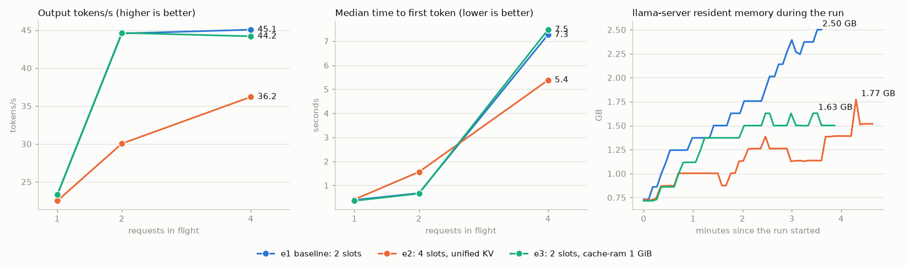

# LLM model server benchmark

The model server behind the agents is llama.cpp (build b11755) serving Qwen3-8B Q4_K_M on the host's GTX 1070 (8 GB,
Pascal: no vLLM), reached through agentgateway -> llm-d router -> InferencePool `qwen3-8b` (see
[Layer 3 platform](../infra/k8s/llm-platform.sh)). This page measures that server under the agents' kind of load,
tries three configurations, and keeps the one that holds the speed without the memory growth.

## Setup (`infra/benchmark`)

- **Load generator**: [`inference-perf`](https://github.com/kubernetes-sigs/inference-perf) 0.7.0, the harness llm-d's
  own benchmark CLI drives. `Dockerfile` installs the PyPI release (the published image is only tagged by commit, and
  its `uvloop` dependency does not install on Windows).
- **Workload** (`agentic.yaml`): shared prefix, 3 groups = the 3 agents. Each group has its own 1,500-token system
  prompt shared by all its calls, then a 100-token question and exactly 150 output tokens (`ignore_eos`). The sizes
  come from llama.cpp's counters on real agent traffic: 79 % of prompt tokens were prefix-cache hits, the longest
  prompt was 1.8k tokens. Closed loop with 1, 2 and 4 requests in flight (12, 16 and 24 requests): each agent replica
  waits for its answer before the next call.
- **Measured**: output tokens/s, time to first token (TTFT), time per output token (TPOT), end-to-end latency, the
  share of prompt tokens served from the prefix cache (llama.cpp reports it per request), and llama-server's memory
  (sampled every 5 s, `results/<run>/memory.csv`).
- Each run starts on a freshly started llama-server (empty caches). The calls go straight to llama.cpp, so the numbers
  are the model server's. With a single endpoint the llm-d router has no choice to make: its prefix-aware and
  load-aware routing pay off only with two or more model servers (llm-d's own report compares 8 vLLM servers). On this
  machine it adds one hop and no speed.

```bash
docker build -t fraud/inference-perf:0.7.0 infra/benchmark
sh infra/benchmark/run.sh e3-cram1g direct        # or: gateway (through agentgateway + llm-d, needs the cluster)
python infra/benchmark/summarize.py               # the table below
python infra/benchmark/plot.py                    # docs/images/llm_benchmark.png
```

`run.sh` pipes the config into the container, so the API key never lands on disk, and deletes the copy of the config
that inference-perf keeps with its reports.

## Results

| run | in flight | req/s | output tok/s | TTFT p50 (s) | TTFT p90 (s) | TPOT p50 (ms) | latency p50 (s) | latency p90 (s) | prompt cached | failures |
|---|---:|---:|---:|---:|---:|---:|---:|---:|---:|---:|
| e1-baseline | 1 | 0.16 | 23.3 | 0.39 | 3.35 | 36 | 5.7 | 8.7 | 70% | 0 |
| e1-baseline | 2 | 0.30 | 44.6 | 0.68 | 0.74 | 41 | 6.7 | 6.8 | 94% | 0 |
| e1-baseline | 4 | 0.30 | 45.1 | 7.27 | 7.39 | 41 | 13.3 | 13.4 | 95% | 0 |
| e2-slots4 | 1 | 0.15 | 22.5 | 0.42 | 3.36 | 38 | 6.0 | 8.7 | 70% | 0 |
| e2-slots4 | 2 | 0.20 | 30.0 | 1.56 | 5.89 | 49 | 9.0 | 13.3 | 76% | 0 |
| e2-slots4 | 4 | 0.24 | 36.2 | 5.38 | 8.55 | 68 | 15.4 | 23.3 | 78% | 0 |
| e3-cram1g | 1 | 0.16 | 23.3 | 0.36 | 3.36 | 36 | 5.7 | 8.7 | 70% | 0 |
| e3-cram1g | 2 | 0.30 | 44.6 | 0.66 | 0.75 | 41 | 6.7 | 6.8 | 95% | 0 |
| e3-cram1g | 4 | 0.29 | 44.2 | 7.48 | 7.57 | 41 | 13.6 | 13.6 | 94% | 0 |

Common flags: `-ngl 99 --reasoning off --load-mode none -fa on -c 16384 -ctk q8_0 -ctv q8_0`. The runs differ in:

| run | flags | what it tests |
|---|---|---|
| e1-baseline | `-np 2` | the configuration the platform ran with |
| e2-slots4 | `-np 4 -kvu` | more slots on one unified KV buffer: more requests decoded together |
| e3-cram1g | `-np 2 -cram 1024` | the host-RAM prompt cache capped at 1 GiB (default 8 GiB) |



## What the numbers say

- **Capacity.** One request at a time gets 23 tokens/s (TPOT 36 ms). Two in flight double that to 45 tokens/s at
  almost no cost (TTFT 0.7 s, latency 5.7 -> 6.7 s): the GPU decodes both in one batch. At four in flight the two slots
  are full, two requests wait for a slot, and only TTFT grows (7.3 s). The server peaks at about 0.3 requests/s (18
  agent LLM calls a minute) for this shape of call.
- **Prefix caching is what makes it work.** The first call of each agent pays for its 1,600-token prompt (TTFT p90
  3.4 s, prefill about 480 tokens/s); after that 94-95 % of prompt tokens come from the cache and TTFT is 0.4-0.7 s.
- **4 slots is slower (e2).** More slots should batch more requests. Instead, throughput at four in flight fell from
  45 to 36 tokens/s and the cache share from 95 % to 78 %. Two causes, both in the server log: llama.cpp picked a slot
  that already held the request's prefix 12 times out of 52 (24 with two slots), so the other requests re-read their
  1,500-token prompt; and a batch of 4 on this Pascal GPU raises TPOT from 41 to 68 ms, so the extra slots buy no
  decode speed. Kept at 2 slots.
- **The host prompt cache grows until it hits 8 GiB (e1).** When a slot is reused, llama.cpp saves the old prompt's KV
  state to RAM (`--cache-ram`, default 8,192 MiB) to restore it later. That is why two slots still serve three agents
  from cache, but llama-server's resident memory grew by about 0.5 GB a minute during e1 (0.75 -> 2.5 GB in four
  minutes) and keeps growing toward 8 GiB, on a 16 GB machine that also runs the 8 GB Docker VM. The three agents'
  prefixes need about 3 x 1,600 tokens x 78 KB (q8_0 KV of Qwen3-8B) = 0.4 GB.
- **Optimization kept: `-cram 1024` (e3).** Same throughput (44.6 / 44.2 tokens/s), same TTFT, same 94-95 % cache share
  as e1, and memory levels off at about 1.5 GB instead of climbing. Applied to the platform's llama.cpp start command.

## Second optimization: speculative decoding with n-grams from the prompt

Agent answers quote the bank documents that `search_policy` put in their context. llama.cpp's n-gram drafter looks
the last tokens up in the prompt, proposes the tokens that followed them there, and the model checks the whole
draft in one forward pass: every accepted token is a decode step saved, with no draft model and no extra VRAM.
[`infra/benchmark/spec_decoding.py`](../infra/benchmark/spec_decoding.py) sends the 20 eval questions with their
document as context straight to llama.cpp (temperature 0.8 as the agents, seeded, 2 passes) and reads llama.cpp's
own `timings` (tokens drafted / accepted, decode tokens/s); answers are scored with the eval gate's check.

| llama-server flags (on top of e3) | decode tok/s | drafted | accepted | correct |
|---|---:|---:|---:|---:|
| none (e3) | 28.8 | 0 | 0 | 40 / 40 |
| `--spec-type ngram-mod` (defaults, tuned for code: 24-token lookup, 48-64-token drafts) | 29.7 | 448 | 19 % | 40 / 40 |
| `--spec-type ngram-simple`, lookup 4, draft 16 | 39.9 | 1,894 | 33 % | 40 / 40 |
| **`--spec-type ngram-simple --spec-ngram-simple-size-n 3 --spec-ngram-simple-size-m 8`** | **42.1 (+46 %)** | 1,526 | 44 % | 40 / 40 |

End to end through the gateway, the risk agent on the same 20 questions (`run_eval.py --mode agent`): p50 5.25 s
without, **4.88 s** with (accuracy 0.85 both). The gain is smaller there because an agent turn is mostly prefill
(tool definitions, search hits) and tool-call JSON, which the drafter does not predict. Kept: the last row is now in
the platform's llama.cpp start command. Results: `infra/benchmark/results/spec-*.json`.

## What it means for agent autoscaling

KEDA adds agent replicas (2 to 4 per agent) when the gateway sees more A2A calls, so the platform accepts more
conversations at once. All replicas of the three agents share this one model server, though: past two LLM calls in
flight the extra calls wait for a slot (TTFT 0.7 -> 7.3 s at four), and the ceiling stays about 18 calls a minute.
Scaling agents therefore adds concurrency, not answer speed; faster answers need a second model server in the
InferencePool, which is also where the llm-d router starts to choose between endpoints.

## Gotchas

- The first attempt at e1 crashed Windows (bugcheck 0x154, the machine's recurring memory-manager fault under load)
  one minute in. The runs above were made with the RAM's D.O.C.P profile off (2133 MHz) and the kind cluster and
  compose services stopped (Docker VM 8 -> 2 GB), so only llama.cpp and the load generator used memory.
- An inference-perf `vllm` server type is its OpenAI-compatible client; `api_key` is sent as a bearer token, and
  `ignore_eos` works on llama.cpp, so every answer is exactly 150 tokens.
- llama.cpp's per-request `cached_tokens` is what inference-perf reports as "cached": the share above is measured, not
  estimated.
