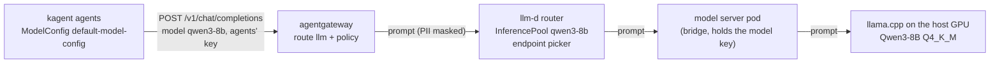
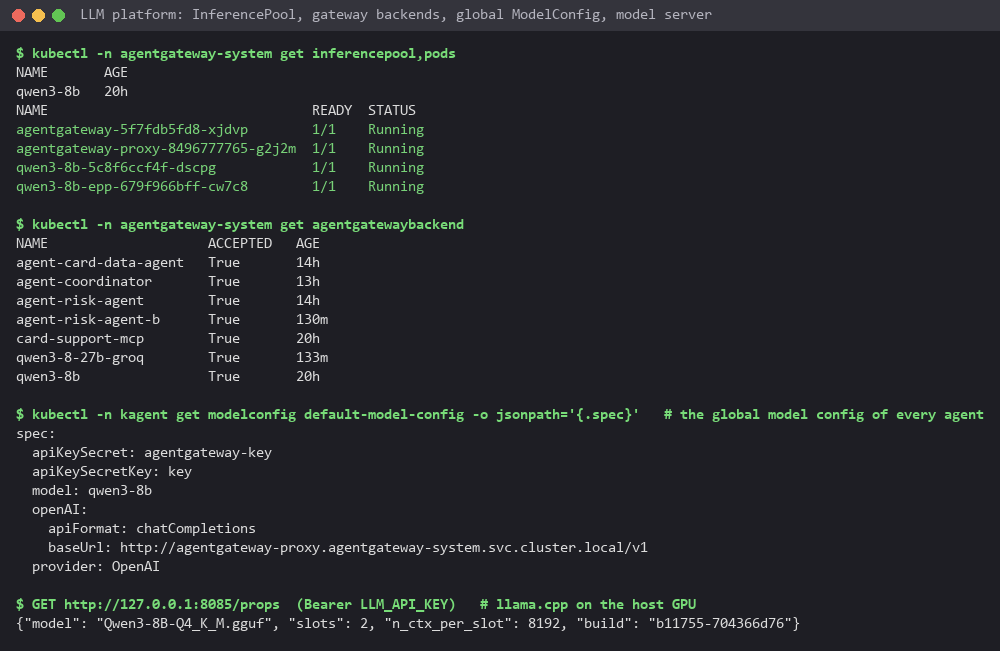
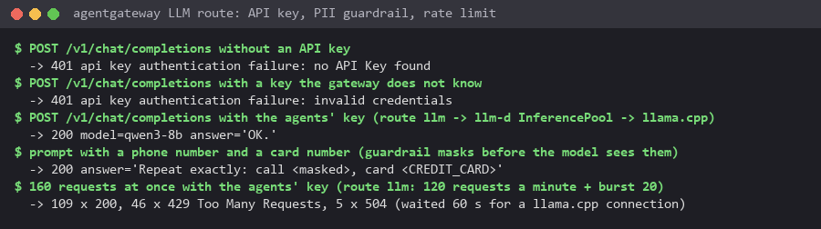

# LLM inference platform and agent gateway

Every LLM call of the card support agents takes the same path: the agent's global model config points at
agentgateway, the gateway checks the caller's key, limits the rate and masks personal data, and hands the request to
the llm-d router, whose InferencePool picks a model server endpoint. The model itself is Qwen3-8B on llama.cpp on the
machine's GPU. This page covers the setup (rubric A3, C3 to C5, A7); the benchmark and the optimizations it led to
are in [llm_benchmark.md](llm_benchmark.md), the A/B test of two LLM versions in [ab_testing.md](ab_testing.md).



Install, after the kind cluster (`infra/k8s/up.sh`) and with the model servers running on the host:

```bash
sh infra/k8s/llm-platform.sh   # Gateway API + Inference Extension CRDs, agentgateway, llm-d router, kagent, KEDA, ...
```



## The model server (custom model)

| | Chat | Embeddings |
|---|---|---|
| Model | Qwen3-8B, Q4_K_M GGUF | Qwen3-Embedding-0.6B, Q8_0 GGUF |
| Server | llama.cpp b11755 (CUDA 12.4), `127.0.0.1:8085` | llama.cpp, `127.0.0.1:8086` |
| Hardware | GTX 1070, 8 GB, all layers on the GPU | CPU |
| Used by | the agents, through the gateway | the RAG pipeline and the MCP server's policy search |

The GTX 1070 is a Pascal card (compute capability 6.1), which vLLM and llm-d's model server images do not support,
so the model runs in llama.cpp on the Windows host, outside the Docker VM. Both servers require a bearer key
(`LLM_API_KEY` in `infra/.env`); a call without it gets 401. The chat server runs two slots of 8,192 tokens each,
q8 KV cache, a 1 GiB prompt cache and n-gram speculative decoding; how those settings were chosen is in
[llm_benchmark.md](llm_benchmark.md) (decode 28.8 to 42.1 tokens/s with speculative decoding, flat memory with the
capped prompt cache).

### Start the model servers

llama.cpp b11755 (Windows, CUDA 12.4 build) and the two GGUF files in a models folder on an SSD; PowerShell, with the
key taken from `infra/.env` into the child processes' environment only:

```powershell
$env:LLAMA_API_KEY = ((Get-Content infra\.env | Where-Object { $_ -like 'LLM_API_KEY=*' })).Substring(12)
Start-Process <llama.cpp>\llama-server.exe -WindowStyle Hidden -ArgumentList '-m <models>\Qwen3-8B-Q4_K_M.gguf --alias qwen3-8b --host 127.0.0.1 --port 8085 -ngl 99 -fa on -c 16384 -np 2 -ctk q8_0 -ctv q8_0 -cram 1024 --spec-type ngram-simple --spec-ngram-simple-size-n 3 --spec-ngram-simple-size-m 8 --reasoning off --metrics --load-mode none'
Start-Process <llama.cpp>\llama-server.exe -WindowStyle Hidden -ArgumentList '-m <models>\Qwen3-Embedding-0.6B-Q8_0.gguf --alias qwen3-embedding-0.6b --host 127.0.0.1 --port 8086 -ngl 0 --embedding --pooling last -c 2048 --metrics'
$env:LLAMA_API_KEY = $null
```

`-c 16384 -np 2` gives two slots of 8,192 tokens, `-ctk/-ctv q8_0` halves the KV cache, `-cram 1024` caps the host
prompt cache at 1 GiB, `--spec-type ngram-simple` drafts tokens from the prompt itself, `--reasoning off` skips Qwen3's
thinking block, `--load-mode none` reads the model without keeping it mapped (less host RAM). The chat model takes
about 80 s to load; the pool's bridge pod turns Ready when `/health` answers.

## llm-d: InferencePool and endpoint picker

The cluster sees the model through an InferencePool (Gateway API Inference Extension 1.6.2), installed with the llm-d
router chart 0.9.0 ([`infra/k8s/llm-d-router.yaml`](../infra/k8s/llm-d-router.yaml)). The pool selects the pods
labelled `app=qwen3-8b`, and its endpoint picker (EPP) chooses one pod per request. llm-d's default scorers read
vLLM's queue and KV-cache metrics, which llama.cpp does not publish, so the picker is configured with the two scorers
that need none: in-flight requests per endpoint and the prompt prefixes it has already routed to each endpoint.

The pool's pods ([`infra/k8s/agentgateway.yaml`](../infra/k8s/agentgateway.yaml), Deployment `qwen3-8b`) are small
nginx bridges to llama.cpp on the host. A bridge adds the model server's key to each request, so the agents never
hold it, and is Ready only while llama.cpp's `/health` answers 200, so the picker skips it while the model loads. On a
GPU node the same pool would select real model server pods and the agents would not notice. With one GPU there is one
endpoint: the picker has nothing to choose between, and its prefix-aware routing only pays off with two or more model
servers (see the benchmark page).

## agentgateway: one entry point for LLM, MCP and A2A

agentgateway 1.6.0 runs one Gateway, `agentgateway-proxy`, with three kinds of routes:

| Route | Path | Backend | Defined in |
|---|---|---|---|
| `llm` | `/v1` | AgentgatewayBackend `qwen3-8b` (InferencePool) and `qwen3-8-27b-groq` (A/B version B, weight 0) | [`infra/k8s/agentgateway.yaml`](../infra/k8s/agentgateway.yaml) |
| `card-support-mcp` | `/mcp` | the MCP server | [`services/card_support_mcp/chart/templates/gateway.yaml`](../services/card_support_mcp/chart/templates/gateway.yaml) |
| `<release>-internal`, `a2a-coordinator` | `/`, `/a2a/coordinator` | the agents | [`agents/chart/templates/a2a-gateway.yaml`](../agents/chart/templates/a2a-gateway.yaml) |

The MCP and A2A routes and their policies are described in [agents.md](agents.md#mcp-gateway). The LLM route has one
AgentgatewayPolicy (several policies on the same route overwrite each other without a warning):

| Setting | Value | Why |
|---|---|---|
| `apiKeyAuthentication: Strict` | keys from the ConfigMap `agentgateway-api-keys`, which holds only their SHA-256 hashes, each with a user id | only callers with a gateway key may spend GPU time; the user id is what the MCP and A2A policies authorize on |
| `rateLimit` | 120 requests a minute with a burst of 20, and 60,000 tokens a minute | one GPU with two slots: a runaway agent loop must not starve the others |
| `promptGuard` request and response, `Mask` | built-in CreditCard, Email and PhoneNumber, plus regexes for the 12-digit citizen ID (CCCD) and Vietnamese mobile numbers | customers type card and phone numbers into a support chat; the model needs neither, and masking lets the conversation go on where a reject would break it |

The keys themselves live in Vault (`infra/k8s/secrets.sh`): the gateway only stores their hashes, and each client
gets its key as a Kubernetes Secret synced from Vault.



Without a key and with an unknown key the gateway answers 401; with the agents' key the request reaches llama.cpp
through the pool. A phone number and a test card number in the prompt reach the model as `<masked>` and
`<CREDIT_CARD>`. 160 requests sent at once: 109 answered, 46 got 429 from the rate limit, and 5 got 504 after waiting
60 s for a connection to llama.cpp, whose two slots were busy with the requests already admitted. The script runs in a
container on the kind network and reads the keys from `infra/.env` without printing them.

## Global model config for the agents

kagent creates the ModelConfig `default-model-config` from the Helm values in
[`infra/k8s/llm-platform.sh`](../infra/k8s/llm-platform.sh):

```
--set providers.default=openAI
--set providers.openAI.model=qwen3-8b
--set providers.openAI.apiKeySecretRef=agentgateway-key --set providers.openAI.apiKeySecretKey=key
--set providers.openAI.config.baseUrl=http://agentgateway-proxy.agentgateway-system.svc.cluster.local/v1
```

It speaks the OpenAI chat completions API to the gateway's `/v1` route, asks for the model name `qwen3-8b` (the name
the gateway's backend and llama.cpp's alias use), and authenticates with the agents' gateway key from the Secret
`agentgateway-key`, which External Secrets syncs from Vault. Every agent uses it:
[`agents/chart/values.yaml`](../agents/chart/values.yaml) sets `modelConfig: default-model-config`, and the chart's
helper writes it into each Agent's spec. Changing the model, the gateway or the key for all agents is one change to
this config. The A/B test adds a second config only for the B variant
([`agents/chart/templates/modelconfigs.yaml`](../agents/chart/templates/modelconfigs.yaml)), the same gateway and key
with other sampling settings.

The agents never call llama.cpp, the llm-d pool or Groq themselves: their NetworkPolicy lets them open connections only
to the gateway, the kagent controller, DNS and Jaeger ([`agents/chart/templates/networkpolicy.yaml`](../agents/chart/templates/networkpolicy.yaml)).

## Gotchas

- The bridge pod gives up after 60 s waiting for a free llama.cpp connection (the 504s above). Under a real burst the
  rate limit should sit closer to what two slots can serve; 120 a minute is sized for the agents' normal traffic.
- After a reboot llama.cpp must be started before the agents get traffic; until its `/health` answers, the pool has
  no Ready endpoint and every LLM call fails.
- agentgateway applies only one policy per target: the LLM route's key check, limits and PII guard are one object on
  purpose.
