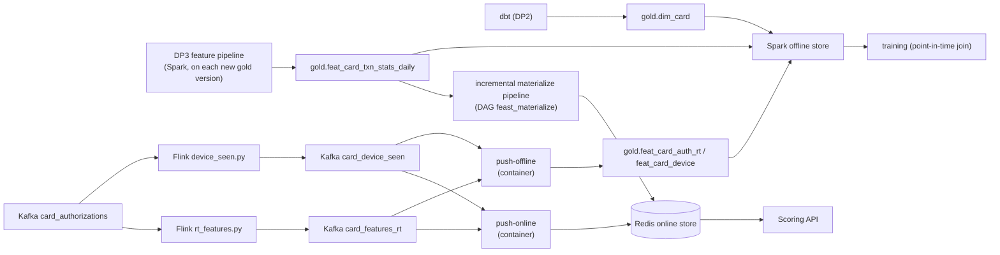
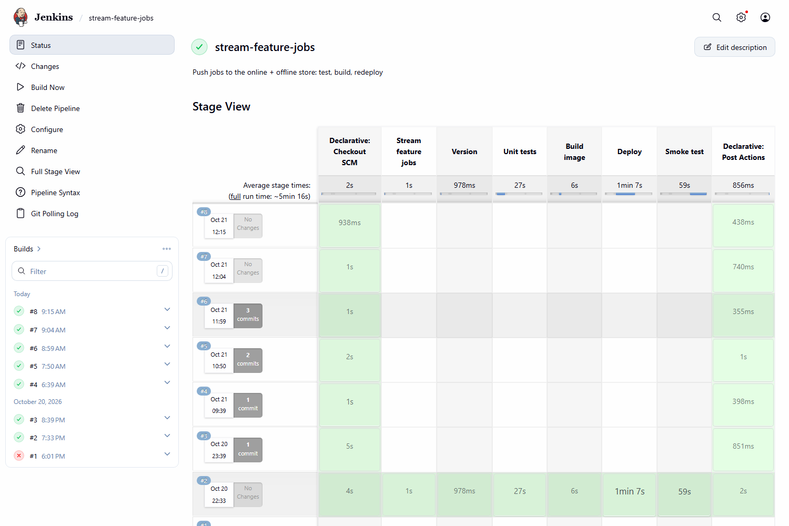
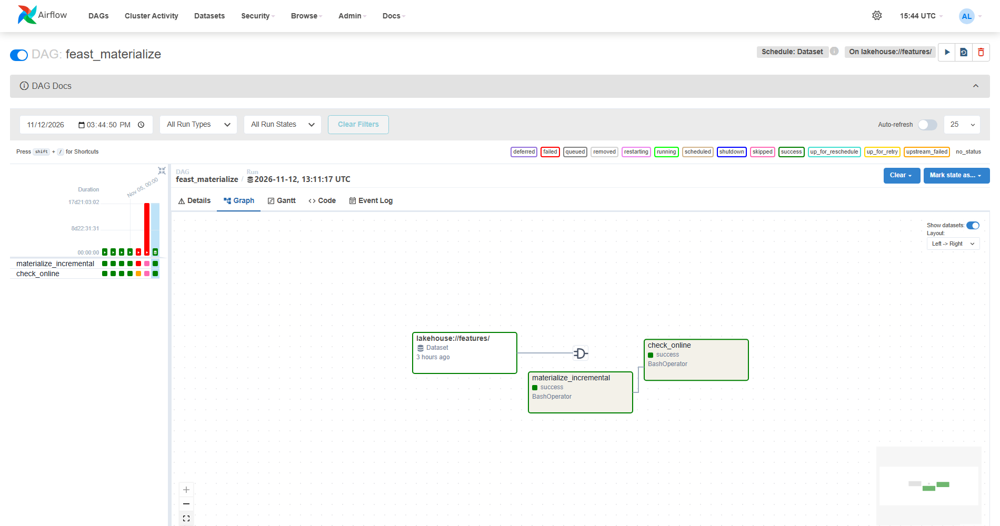

# Feature store (Feast)

The feature store defines the model's 20 features once, in one Feast repository, and serves them two ways: the
offline store (the lakehouse's Delta tables, read with Spark) builds training sets, and the online store (Redis)
answers the Scoring API in milliseconds. One definition means production never computes "spend over the last 30
days" differently from training. It runs Feast 0.66 with a SQL registry in Postgres (`ml-db`, database `feast`).

| | |
|---|---|
| Code | [`ml/feature_repo/`](https://github.com/cvinhnguyen/card-fraud-platform/tree/6457d47445ec1a910ebd2c01bc1edbff50f76d37/ml/feature_repo), [`ml/jobs/push_job.py`](https://github.com/cvinhnguyen/card-fraud-platform/blob/6457d47445ec1a910ebd2c01bc1edbff50f76d37/ml/jobs/push_job.py), [`pipelines/airflow/dags/feast_materialize.py`](https://github.com/cvinhnguyen/card-fraud-platform/blob/6457d47445ec1a910ebd2c01bc1edbff50f76d37/pipelines/airflow/dags/feast_materialize.py) |
| Runs on | a library inside the Scoring API, the push jobs, Airflow, Jupyter and the training pipeline's pods; push jobs `push-online` / `push-offline`: always-on containers in compose profile `ml`, deployed by Jenkins; materialization: Airflow DAG `feast_materialize` |
| Reads | `gold.feat_card_txn_stats_daily`, `gold.dim_card`, Kafka `card_features_rt` and `card_device_seen` |
| Writes | Redis online store; `gold.feat_card_auth_rt` and `gold.feat_card_device` (`push-offline`) |
| Related | [ml_training.md](ml_training.md), [serving.md](serving.md), [flink_jobs.md](../data-platform/flink_jobs.md), [schema_design.md](../data-platform/schema_design.md) |

## Where it fits

Feast is the hand-over between Layers 1 and 2 in the [overview](../architecture.md#the-hand-over-feast): Layer 1
(data platform) writes the features, Layer 2 (ML platform) reads them.

- In, daily: per-card statistics over 30, 90 and 180 days (`gold.feat_card_txn_stats_daily`) from DP3
  ([spark_jobs.md](../data-platform/spark_jobs.md#dp3-features)).
- In, realtime: counts and sums over the last 10 minutes and hour, and a device's first use, from Flink
  ([flink_jobs.md](../data-platform/flink_jobs.md)) via Kafka and two push jobs.
- In, static: the card's profile (`gold.dim_card`: issue date, type, network) from dbt, in DP2.
- Out: point-in-time correct training rows ([ml_training.md](ml_training.md)), and one card's 20 features now for the
  Scoring API ([serving.md](serving.md)) and Layer 3's card-data MCP server ([agents.md](../llm-platform/agents.md)).

How the features flow:



## How it works

1. Definitions: `ml/feature_repo/` declares the entities (card, device), the sources (Delta tables and push
   sources), the feature views and the feature service `fraud_model_v1` (the model's 20 features); `feast apply`
   stores them in the registry ([Feature views](#feature-views)).
2. Daily: each night DP3 writes one row per card active that day and, once its checks pass, emits the Airflow dataset
   event `lakehouse://features`; the incremental materialize pipeline then loads the newer rows into Redis and checks
   a sample ([Pipelines](#pipelines)).
3. Realtime: Flink computes them per payment within seconds into Kafka; `push-online` writes each batch into Redis
   through Feast push, and `push-offline` appends the same rows to Delta for training ([Pipelines](#pipelines)).
4. Training reads the offline store with a point-in-time join: each labelled payment gets the feature values as they
   were just before it ([Train / serve consistency](#train--serve-consistency)).
5. Serving reads the online store, and Feast computes the on-demand features (ages, ratios) from the stored values
   and the request with the training code ([TTL](#ttl)).

## Run it

Prerequisites: DP2 (silver and gold) and DP3 (features) have run, and `push-offline` has created its Delta tables
([Gotchas](#gotchas)). With the `ml` profile:

```bash
docker compose -f infra/docker-compose.yaml --profile core --profile ml up -d
docker compose -f infra/docker-compose.yaml exec notebook feast -c /opt/ml/feature_repo apply   # definitions, after a change
# bootstrap, once before the first daily run (see Pipelines)
docker compose -f infra/docker-compose.yaml exec notebook feast -c /opt/ml/feature_repo materialize 2000-01-01T00:00:00 <ds+1>T00:00:00
docker compose -f infra/docker-compose.yaml --profile ml up -d push-online push-offline         # the two push jobs
```

Replace `<ds+1>` with the day after the last feature date (`YYYY-MM-DD`). After the bootstrap, DAG
`feast_materialize` runs daily on DP3's dataset event ([airflow.md](../data-platform/airflow.md)).

## Feature views

The views are in
[`ml/feature_repo/fraud_features.py`
L46-L72](https://github.com/cvinhnguyen/card-fraud-platform/blob/6457d47445ec1a910ebd2c01bc1edbff50f76d37/ml/feature_repo/fraud_features.py#L46-L72),
the on-demand view in [`fraud_features.py`
L80-L120](https://github.com/cvinhnguyen/card-fraud-platform/blob/6457d47445ec1a910ebd2c01bc1edbff50f76d37/ml/feature_repo/fraud_features.py#L80-L120):

| View | Source | Key | TTL (time to live) | Written by |
|---|---|---|---|---|
| `card_txn_stats_daily` | `gold.feat_card_txn_stats_daily` | card | none | DP3, one row the night after each day the card was active |
| `card_profile` | `gold.dim_card` (SQL query) | card | none | dbt |
| `card_auth_realtime` | push source `card_auth_rt_push`, batch source `gold.feat_card_auth_rt` | card | 1 h | Flink `rt_features.py`, `push-online` / `push-offline` |
| `card_device` | push source `card_device_push`, batch source `gold.feat_card_device` | card, device | none | Flink `device_seen.py`, `push-online` / `push-offline` |
| `fraud_request_features` | on demand: the request + the four views | | | computed per request (pandas) |

Feature service `fraud_model_v1` = 7 daily stats + the 13 on-demand features
([`fraud_features.py`
L123-L128](https://github.com/cvinhnguyen/card-fraud-platform/blob/6457d47445ec1a910ebd2c01bc1edbff50f76d37/ml/feature_repo/fraud_features.py#L123-L128)).
The model trains on and the API asks for exactly this list, so they cannot drift apart; a model with other inputs
gets `fraud_model_v2`.

## TTL

TTL is how old a stored value may be and still describe the card. It bounds the point-in-time join and the
materialization window, but online reads ignore it, so anything the model must see "aged" is computed in the
on-demand view from the value's own timestamp, the same way in training and serving.

| View | TTL | Why |
|---|---|---|
| daily stats | none (`timedelta(0)`) | the newest row is the card's history however old (a card idle for 5 months still has a 180-day dispute count); its age is a feature (`days_since_last_active`, from `stats_ts`) |
| card profile | none | issue date, type, network never change |
| realtime | 1 h, the longest window | the join drops older rows (NULL); online the row stays, so the on-demand view turns NULL and a value older than its window (10 min or 1 h, from `rt_ts`) into 0, "no authorization in the window", in both paths |
| card device | none | "this card has used this device before" never expires |

The ageing in the on-demand view
([`fraud_features.py`
L103-L111](https://github.com/cvinhnguyen/card-fraud-platform/blob/6457d47445ec1a910ebd2c01bc1edbff50f76d37/ml/feature_repo/fraud_features.py#L103-L111)):

```python
    # Realtime values were computed at the card's previous authorization: "now" they still hold only within their
    # window; past it there was no authorization in that window, i.e. 0. (Inside it, an upper bound: the oldest
    # authorizations may have slid out since.)
    age_s = (now - utc(df["rt_ts"])).dt.total_seconds()
    for name, window_s in (("auth_count_10m", 600), ("amount_sum_1h", 3600), ("distinct_merchants_1h", 3600),
                           ("distinct_units_1h", 3600)):
        fresh = age_s.notna() & (age_s <= window_s)
        out[f"{name}_now"] = df[name].where(fresh, 0).fillna(0).astype("int64")
    out["days_since_last_active"] = ((now - utc(df["stats_ts"])).dt.total_seconds() / 86400).astype("float64")
```

## Train / serve consistency

Three decisions keep the training rows identical to what the API sees:

1. Entity timestamp = payment time - 1 ms. When the API scores a payment Flink has not processed it, so the online
   store holds the *previous* authorizations' features; training joins at `txn_ts - 1 ms`
   ([`ml/fraud_ml/data.py`
   L107-L110](https://github.com/cvinhnguyen/card-fraud-platform/blob/6457d47445ec1a910ebd2c01bc1edbff50f76d37/ml/fraud_ml/data.py#L107-L110)),
   which also keeps the payment itself out of the join.
2. DP3 rows land the night after the activity: a row for day L has `event_timestamp = L + 1` and windows that end at
   L ([`pipelines/spark/build_features.py`
   L69-L70](https://github.com/cvinhnguyen/card-fraud-platform/blob/6457d47445ec1a910ebd2c01bc1edbff50f76d37/pipelines/spark/build_features.py#L69-L70)).
   A payment on day L+1 sees the stats up to L, as Redis does that day (materialized after DP3 of L). An earlier
   Layer 1 layout wrote a row only on each day D the card *paid* (windows ending at D-1), so for a card that last paid
   20 days ago training saw windows ending yesterday, while serving had the 20-day-old row, whose 30-day window
   covers other days.
3. History's streaming features come from replaying history (Kappa) through the same Flink jobs and `push-offline`:
   one code path for offline and online rows, no second Spark implementation to keep equal.

## Pipelines

| What | How | When |
|---|---|---|
| Daily stats to Redis | DAG `feast_materialize` ([`feast_materialize.py`](https://github.com/cvinhnguyen/card-fraud-platform/blob/6457d47445ec1a910ebd2c01bc1edbff50f76d37/pipelines/airflow/dags/feast_materialize.py), [run of 2026-11-12](#materialize-run-on-2026-11-12)): `feast materialize-incremental <day+1>` (day from the dataset event), then `ml/tools/check_online.py` compares a sample of the day's active cards in Redis with Delta | dataset event `lakehouse://features` from DP3 |
| Streaming to Redis | `push-online` (`ml/jobs/push_job.py --to online`), one consumer group per job, offsets committed after the write | continuous |
| Streaming to Delta | `push-offline` (`--to offline`), `deltalake` append (Feast's Spark offline push writes plain Parquet next to the Delta log, which Delta readers ignore) | continuous; `--until-idle` for the backfill |
| Definitions | `feast apply` from `ml/feature_repo/` | after a change |
| Bootstrap | `feast materialize 2000-01-01T00:00:00 <ds+1>T00:00:00`: a first `materialize-incremental` of a view without TTL looks back a limited window and would skip `card_profile` rows (stamped at the issue date) and long-idle cards | once, before the first daily run |

The push jobs' write-then-commit loop makes delivery at-least-once: a crash repeats the last batch instead of losing
it ([`push_job.py`
L113-L122](https://github.com/cvinhnguyen/card-fraud-platform/blob/6457d47445ec1a910ebd2c01bc1edbff50f76d37/ml/jobs/push_job.py#L113-L122)):

```python
        if full or (now - last_flush >= max_wait_s and any(pending.values())):
            for topic, values in pending.items():
                if values:
                    source, schema = TOPICS[topic]
                    sink.write(source, to_frame(values, schema), schema)
                    written += len(values)
            consumer.commit(asynchronous=False)
            print(f"{group}: {written:,} rows written", flush=True)
            pending = {t: [] for t in TOPICS}
            last_flush = now
```

Both push jobs run
[`ml/jobs/push_job.py`](https://github.com/cvinhnguyen/card-fraud-platform/blob/6457d47445ec1a910ebd2c01bc1edbff50f76d37/ml/jobs/push_job.py)
from the ml code image (`ghcr.io/cvinhnguyen/fraud-ml-train:<commit>` after a release). Jenkins pipeline
`stream-feature-jobs`
([`ml/jobs/Jenkinsfile.stream`](https://github.com/cvinhnguyen/card-fraud-platform/blob/6457d47445ec1a910ebd2c01bc1edbff50f76d37/ml/jobs/Jenkinsfile.stream),
[cicd.md](../operations/cicd.md#stream-feature-jobs)) tests, builds and pushes the image, recreates both jobs on it,
and sends one marked message to Kafka that must reach both stores. Build #2 printed
`ci_smoke_fabe0b34: online 12.4 s, offline 8.4 s (s3://lakehouse/gold/feat_card_auth_rt)`:



### Materialize run on 2026-11-12

DP3's dataset event `lakehouse://features` (Airflow shows `lakehouse://features/`) started this run for business
day 2026-11-08: `materialize-incremental` to 2026-11-09, then `check_online` over 200 cards active that day, 0
missing online, 0 stale. The long red bar is an October run, stopped by hand:



## Kappa backfill (history of the streaming features)

History's streaming features are rebuilt from the start of the topic, Flink first, the push jobs after:

```bash
# empty topics card_authorizations / card_features_rt / card_device_seen, landing, bronze.raw_card_authorizations,
# and delete the consumer group raw_landing
python generator/producer.py --topic card_authorizations --speed 0            # 8,119,499 events, in 4 chunks (RAM)
docker exec flink-jobmanager flink run -d -py /opt/flink/jobs/rt_features.py --topic card_authorizations --parallelism 4
docker exec flink-jobmanager flink run -d -py /opt/flink/jobs/device_seen.py --topic card_authorizations
docker exec flink-jobmanager flink run -d -py /opt/flink/jobs/raw_landing.py --topic card_authorizations --live   # stays on
docker compose -f infra/docker-compose.yaml --profile ml up -d push-online push-offline   # after Flink: catch up
```

The 8,119,499 authorizations gave 7,999,526 feature rows and 214,808 first (card, device) pairs; the dedup dropped
the other 119,973 (1.48%), network retries. The producer needs 111 s; Flink took three runs to reach a steady rate:

| Run | Setting | Rate of `rt_features` |
|---|---|---|
| 1 | 4 slots, parallelism 1, Python state cache 1,000 keys (default) | 188 events/s (12 h) |
| 2 | 8 slots (4 GB TaskManager), parallelism 5, state cache 200k keys | 1,020 events/s for 2 minutes, then the 8 GB Docker VM swapped (91 MB free, 2.2 GB swap) and it nearly stopped |
| 3 | 6 slots (3.5 GB), parallelism 4, state cache 30k keys, push jobs started only after Flink | ~870 events/s, steady (~2.5 h) |

Each PyFlink element crosses to a one-core Python worker, so the job scales with parallelism (state is keyed by
card) until memory runs out, each slot adding a Python process (~0.3 GB). The state cache needs only one worker's
keys (130k cards / 4).

## Gotchas

- `Size of the state is larger than the maximum permitted memory-backed state. Size=5380688, maxSize=5242880`, 25
  failed checkpoints and a restart loop that looked like a slow job (lag 24k events), on the live `rt_features`
  during the live-period replay ([drift.md](drift.md#gotchas)). Bounded backfills never checkpoint; the live job
  checkpoints every 10 s (offsets commit on checkpoints), by default into JobManager memory capped at 5 MB, which its
  state (card histories + dedup ids) passed. The fix is checkpoint storage:
  `execution.checkpointing.storage: filesystem` with `execution.checkpointing.dir: s3://lakehouse/flink/checkpoints`
  in the cluster config
  ([`infra/docker-compose.yaml`
  L341-L344](https://github.com/cvinhnguyen/card-fraud-platform/blob/6457d47445ec1a910ebd2c01bc1edbff50f76d37/infra/docker-compose.yaml#L341-L344)):
  checkpoints of ~2 MB on S3, ~270 events/s.
- Landing the live period would have relanded the 8.1M history events: `raw_landing.py` always started at the
  earliest offset. `--from-ms` starts at a Kafka timestamp (producers stamp event time), and the always-on `--live`
  mode resumes from group `raw_landing`'s committed offsets, so a restart does not reland history.
- `SparkSource(file_format=...)` accepts only csv / json / parquet / avro; a Delta table is
  `file_format="parquet", table_format=DeltaFormat()`
  ([`fraud_features.py`
  L39-L43](https://github.com/cvinhnguyen/card-fraud-platform/blob/6457d47445ec1a910ebd2c01bc1edbff50f76d37/ml/feature_repo/fraud_features.py#L39-L43)).
- `NameError` in the on-demand view: it runs from the source text in the registry, without module-level helpers and
  imports, so the function is self-contained.
- `feast apply` fails without the push-source Delta tables, since it infers schemas by reading the sources. Start
  `push-offline` first: it creates them empty.
- `${VAR:-default}` is not expanded in `feature_store.yaml`, only `${VAR}`.
- The kernel killed the bootstrap materialization at 5.7 GB: Feast 0.66's local engine pulls every row of the window
  (7.6M daily-stats rows) and keeps the latest per key in pandas, unless `materialization: pull_latest_features: true`.
  With the flag Spark returns one row per card; the bootstrap took 52 s.
- Live mode replays the history after a backfill, since bounded runs do not commit Kafka offsets: before any `--live`
  run, move the `rt_features` and `device_seen` groups to the end of the topic.
