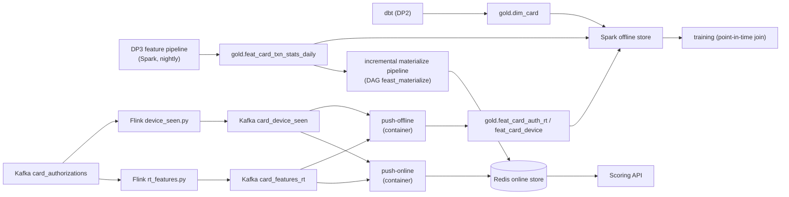

# Feature store (Feast)

A fraud model is only as good in production as the features it gets there. If training computes "spend over the
last 30 days" one way and the Scoring API another, the model sees numbers it never learned from. The feature store
removes that risk: the 20 features are defined once in one Feast repository, and that one definition is read two
ways, from the offline store (the Delta tables of the lakehouse, read with Spark) to build training sets, and from
the online store (Redis) when the Scoring API scores a payment in milliseconds. Feast is the hand-over between the
layers: Layer 1 (data platform) writes the features into it and Layer 2 (ML platform) reads them. Feast 0.66, SQL
registry in Postgres (`ml-db`, database `feast`).

| | |
|---|---|
| Code | [`ml/feature_repo/`](https://github.com/cvinhnguyen/card-fraud-platform/tree/822721cab1ac597d118f100f1c49949f137f8a7d/ml/feature_repo), [`ml/jobs/push_job.py`](https://github.com/cvinhnguyen/card-fraud-platform/blob/822721cab1ac597d118f100f1c49949f137f8a7d/ml/jobs/push_job.py), [`pipelines/airflow/dags/feast_materialize.py`](https://github.com/cvinhnguyen/card-fraud-platform/blob/822721cab1ac597d118f100f1c49949f137f8a7d/pipelines/airflow/dags/feast_materialize.py) |
| Runs on | a library inside the Scoring API, the push jobs, Airflow, Jupyter and the training pipeline's pods; push jobs `push-online` / `push-offline`: always-on containers in compose profile `ml`, deployed by Jenkins; materialization: Airflow DAG `feast_materialize` |
| Reads | `gold.feat_card_txn_stats_daily`, `gold.dim_card`, Kafka `card_features_rt` and `card_device_seen` |
| Writes | Redis online store; `gold.feat_card_auth_rt` and `gold.feat_card_device` (`push-offline`) |
| Related | [ml_training.md](ml_training.md), [serving.md](serving.md), [flink_jobs.md](../data-platform/flink_jobs.md), [schema_design.md](../data-platform/schema_design.md) |

## Where it fits

Features come in from three places and go out to two:

| In or out | What | Through |
|---|---|---|
| in, daily | per-card statistics over 30, 90 and 180 days (`gold.feat_card_txn_stats_daily`) | DP3, the feature pipeline ([spark_jobs.md](../data-platform/spark_jobs.md#dp3-features)), then the incremental materialize pipeline copies the newest row per card into Redis |
| in, realtime | counts and sums over the last 10 minutes and hour, and the first use of a device | Flink ([flink_jobs.md](../data-platform/flink_jobs.md)) writes them to Kafka; two push jobs write them on into Redis and Delta |
| in, static | the card's profile (`gold.dim_card`: issue date, type, network) | dbt, in DP2 |
| out, training | point-in-time correct training rows | the training pipeline and the notebook ([ml_training.md](ml_training.md)) |
| out, serving | the 20 features of one card, now | the Scoring API ([serving.md](serving.md)) and Layer 3's card-data MCP server ([agents.md](../llm-platform/agents.md)) |

The two push jobs are deployed units of their own: always-on containers `push-online` and `push-offline` in compose
profile `ml`, both running
[`ml/jobs/push_job.py`](https://github.com/cvinhnguyen/card-fraud-platform/blob/822721cab1ac597d118f100f1c49949f137f8a7d/ml/jobs/push_job.py)
from the `fraud/ml-train` image. The Jenkins pipeline `stream-feature-jobs` tests them, builds the image and
recreates both containers ([Pipelines](#pipelines), [cicd.md](../operations/cicd.md#stream-feature-jobs)).

How the features flow into Feast and out to training and serving:



## How it works

1. Definitions. `ml/feature_repo/` declares the entities (card, device), the sources (Delta tables and push
   sources), the feature views and the feature service `fraud_model_v1`, the exact list of 20 features the model
   uses. `feast apply` stores them in the registry.
2. Daily features. Each night DP3 writes one row per card for the day it was active. When DP3's checks pass, it
   emits the Airflow dataset event `lakehouse://features`. The incremental materialize pipeline is scheduled on that
   event: it loads the rows newer than its last run into Redis and reads a sample back to check them.
3. Realtime features. Flink computes them for every payment within seconds and writes them to Kafka. `push-online`
   reads the two topics and writes each batch into Redis through Feast push; `push-offline` appends the same rows
   to Delta tables, the offline copy that training reads. Both commit their Kafka offsets only after the write, so a
   crash repeats the last batch instead of losing it.
4. Training reads the offline store with a point-in-time join: every labelled
   payment gets the feature values as they were just before it.
5. Serving reads the online store: the Scoring API asks Feast for the card's 20 features, and Feast computes the
   on-demand features (ages, ratios) from the stored values and the request, the same code as in training.

## Run it

With DP2 (silver and gold) and DP3 (features) run, so the gold and feature tables exist, and the `ml` profile:

```bash
docker compose -f infra/docker-compose.yaml --profile core --profile ml up -d
docker compose -f infra/docker-compose.yaml exec notebook feast -c /opt/ml/feature_repo apply   # definitions, after a change
# bootstrap, once before the first daily run (see Pipelines)
docker compose -f infra/docker-compose.yaml exec notebook feast -c /opt/ml/feature_repo materialize 2000-01-01T00:00:00 <ds+1>T00:00:00
docker compose -f infra/docker-compose.yaml --profile ml up -d push-online push-offline         # the two push jobs
```

Replace `<ds+1>` with the day after the last feature date (`YYYY-MM-DD`).

`feast apply` needs the push-source Delta tables to exist (see [Gotchas](#gotchas)). The daily materialization runs in
the incremental materialize pipeline (DAG `feast_materialize`), scheduled on the dataset event `lakehouse://features`
that DP3 emits after its checks ([airflow.md](../data-platform/airflow.md)).

## Feature views

The views are defined in
[`ml/feature_repo/fraud_features.py` L46-L72](https://github.com/cvinhnguyen/card-fraud-platform/blob/822721cab1ac597d118f100f1c49949f137f8a7d/ml/feature_repo/fraud_features.py#L46-L72),
the on-demand view in
[`ml/feature_repo/fraud_features.py` L80-L120](https://github.com/cvinhnguyen/card-fraud-platform/blob/822721cab1ac597d118f100f1c49949f137f8a7d/ml/feature_repo/fraud_features.py#L80-L120):

| View | Source | Key | TTL | Written by |
|---|---|---|---|---|
| `card_txn_stats_daily` | `gold.feat_card_txn_stats_daily` | card | none | DP3, one row the night after each day the card was active |
| `card_profile` | `gold.dim_card` (SQL query) | card | none | dbt |
| `card_auth_realtime` | push source `card_auth_rt_push`, batch source `gold.feat_card_auth_rt` | card | 1 h | Flink `rt_features.py`, `push-online` / `push-offline` |
| `card_device` | push source `card_device_push`, batch source `gold.feat_card_device` | card, device | none | Flink `device_seen.py`, `push-online` / `push-offline` |
| `fraud_request_features` | on demand: the request + the four views | | | computed per request (pandas) |

Feature service `fraud_model_v1` = 7 daily stats + the 13 on-demand features
([`ml/feature_repo/fraud_features.py` L123-L128](https://github.com/cvinhnguyen/card-fraud-platform/blob/822721cab1ac597d118f100f1c49949f137f8a7d/ml/feature_repo/fraud_features.py#L123-L128)).
The model is trained on exactly this list and the API asks for exactly this list, so the two cannot drift apart: a
model with other inputs gets `fraud_model_v2`.

## TTL

TTL is how old a stored value may be and still describe the card. One Feast behaviour drives every choice: the
Redis lookup returns the stored value however old it is. TTL bounds the point-in-time join (training) and the
materialization window, and online reads ignore it. Anything the model must see "aged" is therefore computed in the
on-demand view from the value's own timestamp, so training and serving age it the same way.

| View | TTL | Why |
|---|---|---|
| daily stats | none (`timedelta(0)`) | the newest row is the card's history however old it is; a card idle for 5 months still has a 180-day dispute count. Its age is a feature (`days_since_last_active`, from `stats_ts`) instead of a cut-off |
| card profile | none | issue date, type, network never change |
| realtime | 1 h, the longest window | the join drops older rows (NULL). Online the stored row stays, so the on-demand view turns a value older than its own window (10 min or 1 h, from `rt_ts`) into 0 and NULL into 0: "no authorization in the window". Both paths give the model the same number |
| card device | none | "this card has used this device before" never expires |

The ageing in the on-demand view, from each value's own timestamp
([`ml/feature_repo/fraud_features.py` L103-L111](https://github.com/cvinhnguyen/card-fraud-platform/blob/822721cab1ac597d118f100f1c49949f137f8a7d/ml/feature_repo/fraud_features.py#L103-L111)):

```python
    # Realtime values were computed at the card's previous authorization: "now" they still hold only within their
    # window; past it there was no authorization in that window, i.e. 0. (Inside it, an upper bound: the oldest
    # authorizations may have slid out since.)
    age_s = (now - utc(df["rt_ts"])).dt.total_seconds()
    for name, window_s in (("auth_count_10m", 600), ("amount_sum_1h", 3600), ("distinct_merchants_1h", 3600),
                           ("distinct_units_1h", 3600)):
        fresh = age_s.notna() & (age_s <= window_s)
        out[f"{name}_now"] = df[name].where(fresh, 0).fillna(0).astype("int64")
    out["days_since_last_active"] = ((now - utc(df["stats_ts"])).dt.total_seconds() / 86400).astype("float64")
```

## Train / serve consistency

Three decisions keep the training rows identical to what the API sees:

1. Entity timestamp = payment time - 1 ms. When the API scores a payment, Flink has not processed it yet: the
   online store holds features of the *previous* authorizations. Training joins at `txn_ts - 1 ms`
   ([`ml/fraud_ml/data.py` L88-L91](https://github.com/cvinhnguyen/card-fraud-platform/blob/822721cab1ac597d118f100f1c49949f137f8a7d/ml/fraud_ml/data.py#L105-L108)),
   so the point-in-time join also excludes the payment itself.
2. DP3 rows land the night after the activity. A row for day L has `event_timestamp = L + 1` and windows that
   end at L
   ([`pipelines/spark/build_features.py` L69-L70](https://github.com/cvinhnguyen/card-fraud-platform/blob/822721cab1ac597d118f100f1c49949f137f8a7d/pipelines/spark/build_features.py#L69-L70)).
   A payment on day L+1 sees the stats up to L, which is what Redis holds that day (materialized after DP3 of L).
   Layer 1 wrote one row on each day D the card *paid*, windows ending at D-1: that row existed only because of the
   payment being scored. For a card that last paid 20 days ago, training saw windows ending yesterday; serving has
   the row of 20 days ago, whose 30-day window covers other days.
3. Streaming features for history come from replaying history (Kappa). The full authorization history is
   replayed through the same Flink jobs and `push-offline`, so the offline rows were produced by the code that produces
   the online ones, and there is no second implementation in Spark to keep equal.

## Pipelines

| What | How | When |
|---|---|---|
| Daily stats to Redis | incremental materialize pipeline, DAG `feast_materialize` ([`pipelines/airflow/dags/feast_materialize.py`](https://github.com/cvinhnguyen/card-fraud-platform/blob/822721cab1ac597d118f100f1c49949f137f8a7d/pipelines/airflow/dags/feast_materialize.py), [run of 2026-11-03](#materialize-run-on-2026-11-03)): `feast materialize-incremental <day+1>` then `ml/tools/check_online.py` (sample of cards active on the business day read back from Redis, values compared with Delta); the day comes from the dataset event | dataset event `lakehouse://features`, emitted by DP3 |
| Streaming to Redis | `push-online` (`ml/jobs/push_job.py --to online`), consumer group per job, offsets committed after the write | continuous |
| Streaming to Delta | `push-offline` (`--to offline`), `deltalake` append (Feast's Spark offline push appends plain Parquet next to the Delta log, which Delta readers ignore) | continuous; `--until-idle` for the backfill |
| Definitions | `feast apply` from `ml/feature_repo/` | after a change |
| Bootstrap | `feast materialize 2000-01-01T00:00:00 <ds+1>T00:00:00` once: the first `materialize-incremental` of a view without TTL only looks back a limited window, which would skip `card_profile` rows (stamped at the card's issue date) and cards idle for a long time | once, before the first daily run |

Both push jobs write a batch first and commit the Kafka offsets after it (at-least-once: after a crash the last
batch is written again)
([`ml/jobs/push_job.py` L113-L122](https://github.com/cvinhnguyen/card-fraud-platform/blob/822721cab1ac597d118f100f1c49949f137f8a7d/ml/jobs/push_job.py#L113-L122)):

```python
        if full or (now - last_flush >= max_wait_s and any(pending.values())):
            for topic, values in pending.items():
                if values:
                    source, schema = TOPICS[topic]
                    sink.write(source, to_frame(values, schema), schema)
                    written += len(values)
            consumer.commit(asynchronous=False)
            print(f"{group}: {written:,} rows written", flush=True)
            pending = {t: [] for t in TOPICS}
            last_flush = now
```

The two push jobs
([`ml/jobs/push_job.py`](https://github.com/cvinhnguyen/card-fraud-platform/blob/822721cab1ac597d118f100f1c49949f137f8a7d/ml/jobs/push_job.py))
are deployed by their own CI pipeline
([`ml/jobs/Jenkinsfile.stream`](https://github.com/cvinhnguyen/card-fraud-platform/blob/822721cab1ac597d118f100f1c49949f137f8a7d/ml/jobs/Jenkinsfile.stream), [cicd.md](../operations/cicd.md#stream-feature-jobs)):
unit tests, the ml image, `push-online` and `push-offline` recreated on it, then a smoke test that sends one marked
message to Kafka and waits for it in both stores. Build #2: `ci_smoke_fabe0b34: online 12.4 s, offline 8.4 s
(s3://lakehouse/gold/feat_card_auth_rt)`. The Jenkins stage view of that build:


### Materialize run on 2026-11-03

The run of 2026-11-12, started by DP3's `lakehouse://features/` event for business day 2026-11-08:
`materialize-incremental` to 2026-11-09, then `check_online` over 200 cards active that day: 0 missing online,
0 stale. The long red bar in the grid is a run left over from October, stopped by hand:


## Kappa backfill (history of the streaming features)

The streaming features of the whole history are rebuilt from the start of the topic, Flink first and the push jobs
after it:

```bash
# empty topics card_authorizations / card_features_rt / card_device_seen, landing, bronze.raw_card_authorizations
python generator/producer.py --topic card_authorizations --speed 0            # 8,119,499 events, in 4 chunks (RAM)
docker exec flink-jobmanager flink run -d -py /opt/flink/jobs/rt_features.py --topic card_authorizations --parallelism 4
docker exec flink-jobmanager flink run -d -py /opt/flink/jobs/device_seen.py --topic card_authorizations
docker exec flink-jobmanager flink run -d -py /opt/flink/jobs/raw_landing.py
docker compose -f infra/docker-compose.yaml --profile ml up -d push-online push-offline   # after Flink: catch up
```

Result: 8,119,499 authorizations gave 7,999,526 feature rows (the 119,973 = 1.48% network retries are dropped by the
dedup) and 214,808 first (card, device) pairs. The producer needs 111 s. Flink is the slow part, and it took three
runs to reach a steady rate:

| Run | Setting | Rate of `rt_features` |
|---|---|---|
| 1 | 4 slots, parallelism 1, Python state cache 1,000 keys (default) | 188 events/s (12 h) |
| 2 | 8 slots (4 GB TaskManager), parallelism 5, state cache 200k keys | 1,020 events/s for 2 minutes, then the 8 GB Docker VM swapped (91 MB free, 2.2 GB swap) and it nearly stopped |
| 3 | 6 slots (3.5 GB), parallelism 4, state cache 30k keys, push jobs started only after Flink | **~870 events/s, steady** (~2.5 h) |

Each element of a PyFlink function crosses to a Python worker, and one worker uses one core, so the job scales with
parallelism (state is keyed by card) until memory runs out: every slot adds a Python process (~0.3 GB). The state
cache only needs to hold the keys of one worker (130k cards / 4). Bounded runs do not commit Kafka offsets: before
any `--live` run, move the `rt_features` and `device_seen` groups to the end of the topic, or live mode replays the
history again.

## Gotchas

- Live Flink jobs need checkpoint storage. Bounded backfill runs never checkpoint; the live `rt_features`
  checkpoints every 10 s (offsets are committed on checkpoints), and by default into JobManager memory, capped at
  5 MB. Its state (card histories + dedup ids) passed that during the replay: `Size of the state is larger than the
  maximum permitted memory-backed state. Size=5380688, maxSize=5242880`, 25 failed checkpoints, then a restart loop
  that looked like a slow job (lag 24k events). `execution.checkpointing.storage: filesystem` with
  `execution.checkpointing.dir: s3://lakehouse/flink/checkpoints` in the cluster config
  ([`infra/docker-compose.yaml` L313-L316](https://github.com/cvinhnguyen/card-fraud-platform/blob/822721cab1ac597d118f100f1c49949f137f8a7d/infra/docker-compose.yaml#L313-L316))
  fixed it: checkpoints of ~2 MB on S3, ~270 events/s.
- `raw_landing.py` always started at the earliest offset, so landing the live period would have landed the 8.1M
  history events again; `--from-ms` starts at a Kafka timestamp instead (the producers stamp event time).
- `SparkSource(file_format=...)` accepts only csv / json / parquet / avro: a Delta table is
  `file_format="parquet", table_format=DeltaFormat()`
  ([`ml/feature_repo/fraud_features.py` L39-L43](https://github.com/cvinhnguyen/card-fraud-platform/blob/822721cab1ac597d118f100f1c49949f137f8a7d/ml/feature_repo/fraud_features.py#L39-L43)).
- The on-demand view runs from the source text stored in the registry: module-level helpers and imports are not
  there at run time (`NameError`). The function is self-contained.
- `feast apply` infers schemas by reading the sources: the push-source Delta tables must exist first (`push-offline`
  creates them empty on its first run).
- `${VAR:-default}` is not expanded in `feature_store.yaml`, only `${VAR}`.
- Feast 0.66's local materialization engine pulls every row of the window and keeps the latest per key in
  pandas unless `materialization: pull_latest_features: true`: the 7.6M daily-stats rows took the Python process to
  5.7 GB and the kernel killed it. With the flag Spark returns one row per card; the bootstrap took 52 s.
