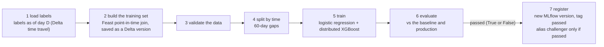
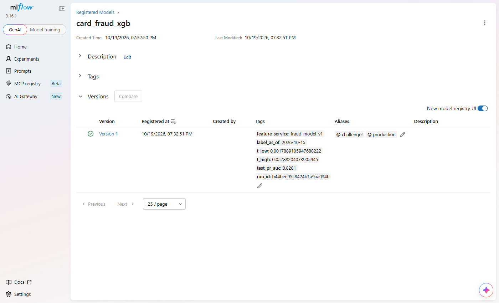
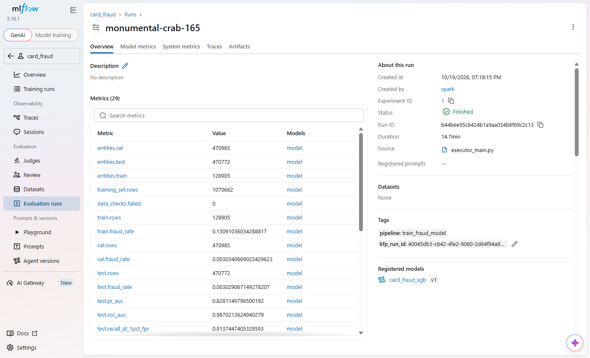
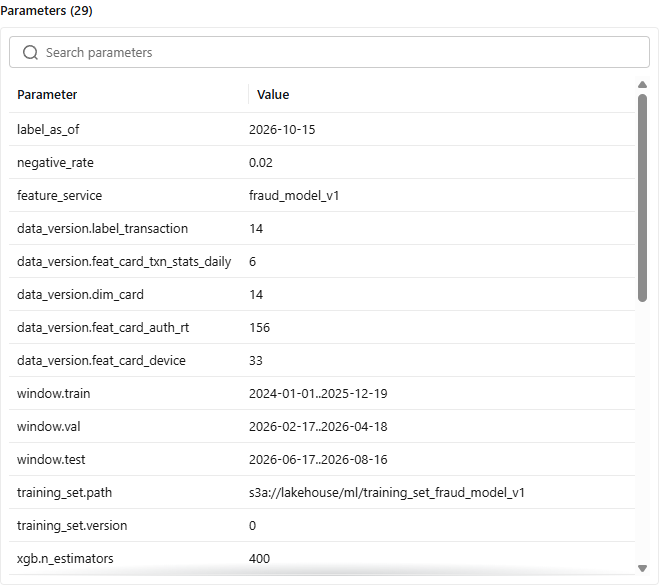
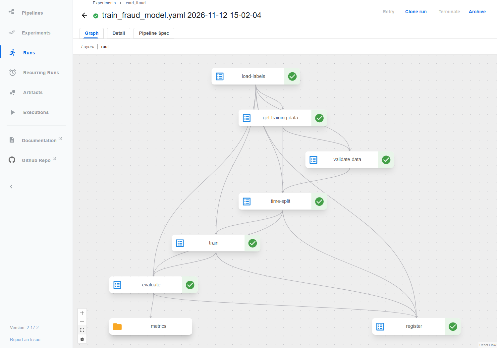
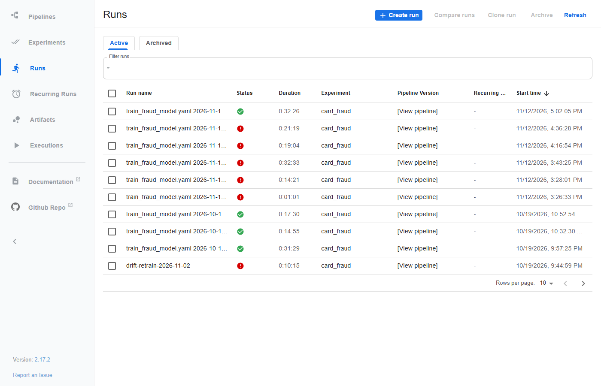

# Model training

Layer 2 (ML platform) trains the fraud model, retrains it as fraud changes, and keeps every model traceable to its
data. The seven functions of
[`ml/fraud_ml/steps.py`](https://github.com/cvinhnguyen/card-fraud-platform/blob/54d21eddbf6e602ae13fed46a1a9e0ef265d23cd/ml/fraud_ml/steps.py)
run two ways: step by step in the notebook
[`ml/notebooks/fraud_model.ipynb`](https://github.com/cvinhnguyen/card-fraud-platform/blob/54d21eddbf6e602ae13fed46a1a9e0ef265d23cd/ml/notebooks/fraud_model.ipynb),
where a person explores the data and trains the first model, and unattended in the training pipeline
`train_fraud_model` on Kubeflow Pipelines (KFP), started by hand or by the daily drift pipeline when the model gets
worse ([drift.md](drift.md)).

| | |
|---|---|
| Code | [`ml/fraud_ml/`](https://github.com/cvinhnguyen/card-fraud-platform/tree/54d21eddbf6e602ae13fed46a1a9e0ef265d23cd/ml/fraud_ml), [`ml/pipelines/train_fraud_model.py`](https://github.com/cvinhnguyen/card-fraud-platform/blob/54d21eddbf6e602ae13fed46a1a9e0ef265d23cd/ml/pipelines/train_fraud_model.py), [`ml/notebooks/fraud_model.ipynb`](https://github.com/cvinhnguyen/card-fraud-platform/blob/54d21eddbf6e602ae13fed46a1a9e0ef265d23cd/ml/notebooks/fraud_model.ipynb) |
| Runs on | notebook: compose service `notebook` (profile `ml`, port 8899); pipeline: Kubeflow Pipelines in kind namespace `kubeflow`, the `train` step with 2 Spark executor pods |
| Reads | `gold.label_transaction` at the Delta version written on `label_as_of` (time travel); Feast feature service `fraud_model_v1` through the Spark offline store |
| Writes | Delta table `s3://lakehouse/ml/training_set_fraud_model_v1` (one version per run); run files in `s3://lakehouse/ml/runs/<run id>/`; MLflow experiment `card_fraud`; registered model `card_fraud_xgb`: one new version per run, tagged `passed`, alias `challenger` only when it passed, with its `reference_profile.json` |
| Related | [feature_store.md](feature_store.md), [serving.md](serving.md), [drift.md](drift.md) |

## Where it fits

Training is the right side of Layer 2 in the
[overview](../architecture.md#layer-2-the-ml-platform-right-panel):

- Inputs: labels from `gold.label_transaction`, written by DP2, the batch pipeline that builds silver and gold
  ([spark_jobs.md](../data-platform/spark_jobs.md)); features from the Feast offline store
  ([feature_store.md](feature_store.md)).
- Output: a new MLflow version per run; the version behind `production` runs in the Scoring API's KServe image
  ([Evaluation and promotion](#evaluation-and-promotion)).
- Trigger: the data drift pipeline, when live data moves away from the training data or the model gets worse
  ([drift.md](drift.md)).

## How it works

The seven steps, each a pod in the pipeline and a function call in the notebook:

| # | Step (function) | What it does | Why |
|---|---|---|---|
| 1 | load labels (`load_labels`) | the labels as known on day D (`label_as_of`), only payments whose label is final | fraud is known only once disputed, up to 60 days later (label delay) |
| 2 | build the training set (`get_training_data`) | each labelled payment with its 20 features as of that moment (point-in-time join), saved as a new Delta table version | keeps the future out of training; anyone can rebuild a model's exact rows |
| 3 | validate the data (`validate_data`) | unique keys, every feature present and numeric, null shares under limits, rows and frauds per split, a plausible fraud rate | a broken input stops the run before training |
| 4 | split by time (`time_split`) | train, validation and test windows in time order, 60-day gaps | a random split leaks next month's fraud pattern into training |
| 5 | train (`train`) | a logistic-regression baseline and XGBoost on 2 Spark executor pods | the baseline is the bar; XGBoost gets served |
| 6 | evaluate (`evaluate`) | thresholds on validation; test scores against the baseline and the current `production` model on the same period | only a better model goes further |
| 7 | register (`register`) | always: a new MLflow version with thresholds, data versions and tag `passed` (True or False); alias `challenger` only if step 6 passed | no model is lost; a person decides what moves to `production` |

What each step passes on:



[`train_fraud_model.py`
L114-L136](https://github.com/cvinhnguyen/card-fraud-platform/blob/54d21eddbf6e602ae13fed46a1a9e0ef265d23cd/ml/pipelines/train_fraud_model.py#L114-L136)
wires the steps. They pass S3 paths and the MLflow run id, never data; each run's files live in
`s3://lakehouse/ml/runs/<run id>/`.

## Run it

Prerequisites: the `ml` profile for the notebook; for the pipeline, kind with Kubeflow Pipelines and the code image
on GitHub Container Registry ([Releases](#releases-cicd)). A run by hand uses the newest image (`:latest`):

```bash
# notebook (compose profile ml; token = JUPYTER_TOKEN in infra/.env)
docker compose -f infra/docker-compose.yaml --profile ml up -d notebook      # http://127.0.0.1:8899
# pipeline (kind cluster with Kubeflow Pipelines: infra/k8s/up.sh + infra/k8s/platform.sh)
kubectl -n kubeflow port-forward svc/ml-pipeline 8888:8888 &
KFP_HOST=http://127.0.0.1:8888 python ml/pipelines/train_fraud_model.py --run --label-as-of 2026-11-08
# label_as_of = day D: load_labels reads the gold.label_transaction version that the DP2 gold run wrote on D (or the
# last one before D). Both tables keep 365 days of versions; before that fix a day older than 7 days failed with
# DELTA_UNSUPPORTED_TIME_TRAVEL_BEYOND_DELETED_FILE_RETENTION_DURATION (see Gotchas).
python ml/pipelines/train_fraud_model.py --compile    # only writes ml/pipelines/train_fraud_model.yaml (drift DAG fallback before any release)
```

## Releases (CI/CD)

The Jenkins job `training-pipeline` ([`ml/pipelines/Jenkinsfile`](../../ml/pipelines/Jenkinsfile)) builds the code
image and releases the pipeline when the pipeline, the ML library, the Feast repo or the image change. The git short
sha names everything in a release:

| Stage | What it does |
|---|---|
| Unit tests | registry, training and `test_train_pipeline.py` (the compiled pipeline runs only its own image), in the ml image's test stage |
| Build + push image | `ghcr.io/cvinhnguyen/fraud-ml-train:<sha>`, and `:latest` for runs by hand; public, so kind pulls it without a secret |
| Pipeline version | in that image: compile with `ML_IMAGE` = the `<sha>` image, assert every step runs it, upload as version `<sha>` of KFP pipeline `train_fraud_model` |
| Check version | reads it back from the KFP API: every container must be the `<sha>` image |
| Release to Airflow | the Variable `train_release` = `{"pipeline_id", "version_id", "version", "image"}` |

The drift DAG's `trigger_retraining` runs the version in `train_release` (before the first release, the package
compiled in the repo, `ml/pipelines/train_fraud_model.yaml`). The Variable moves last, after the check, so a failed
build leaves the drift DAG's version alone. To go back, set `train_release` to an older version's JSON (from its
build's Jenkins log).

Tracing: step 1 tags the MLflow run with `ml_image` (image and sha) next to `kfp_run_id`, each model version tags its
`run_id`, and a released version's run shows `<sha>` on its KFP page.

```bash
docker exec airflow-scheduler airflow variables get train_release   # the version the drift DAG starts
```

## Labels and the split

A label is final 60 days after the payment (disputes arrive up to 60 days late). Training "as of" day D reads
`gold.label_transaction` at the Delta version `build_labels` wrote on D (each commit carries
`userMetadata label_as_of=D`), read back in
[`ml/fraud_ml/data.py`
L65-L73](https://github.com/cvinhnguyen/card-fraud-platform/blob/54d21eddbf6e602ae13fed46a1a9e0ef265d23cd/ml/fraud_ml/data.py#L65-L73).
So a retrain next month can rebuild exactly the labels this run saw. The last 60 days before D are immature and left
out.

```text
... train ... | 60 d gap | val (60 d) | 60 d gap | test (60 d) | 60 d immature | D
```

The split is by time (step 4). Each gap is 60 days because a model trained up to day T is usable only from T + 60 d,
when T's labels are known (`TimeSplitter`,
[`ml/fraud_ml/split.py`
L32-L40](https://github.com/cvinhnguyen/card-fraud-platform/blob/54d21eddbf6e602ae13fed46a1a9e0ef265d23cd/ml/fraud_ml/split.py#L32-L40)).

Fraud is ~0.3% of payments. Train-period negatives are downsampled to 2% by a hash of `transaction_id`, so every run
keeps the same rows and the training set changes only where the data did; their sample weight is 50
([`data.py`
L103-L110](https://github.com/cvinhnguyen/card-fraud-platform/blob/54d21eddbf6e602ae13fed46a1a9e0ef265d23cd/ml/fraud_ml/data.py#L103-L110),
which also sets the `event_timestamp` below). Validation and test keep every row, so their metrics reflect the real
fraud rate.

## Features and data versioning

Entity rows = (card_id, device_id, `event_timestamp = txn_ts - 1 ms`, request fields; the 1 ms is explained in
[feature_store.md](feature_store.md)). Feast's Spark offline store joins each with the feature values valid at that
instant, on-demand features included
([`data.py`
L112-L115](https://github.com/cvinhnguyen/card-fraud-platform/blob/54d21eddbf6e602ae13fed46a1a9e0ef265d23cd/ml/fraud_ml/data.py#L112-L115)).

The result is MERGEd into one Delta table per feature service, `s3://lakehouse/ml/training_set_fraud_model_v1`, with
deletion vectors, matching rows on `transaction_id` *and* `row_hash` (a hash of every other column). A run on almost
the same data then stores just its new rows, and `VERSION AS OF n` returns any run's exact training set. The validate
and split steps read it with Spark
([`ml/fraud_ml/steps.py`
L45-L52](https://github.com/cvinhnguyen/card-fraud-platform/blob/54d21eddbf6e602ae13fed46a1a9e0ef265d23cd/ml/fraud_ml/steps.py#L45-L52))
because the `deltalake` reader (0.25 and 1.1.4 tested) refuses deletion vectors.

The MERGE, in `TrainingDataService.save_versioned`
([`data.py`
L117-L135](https://github.com/cvinhnguyen/card-fraud-platform/blob/54d21eddbf6e602ae13fed46a1a9e0ef265d23cd/ml/fraud_ml/data.py#L117-L135)):

```python
    def save_versioned(self, df: pd.DataFrame, path: str) -> int:
        """MERGE the run's rows into the training-set table; returns the Delta version holding exactly them.

        Rows match on the key AND a hash of every other column: an unchanged row matches and stays where it is; a
        new or changed row is inserted, a row gone (or the old copy of a changed one) is deleted. With deletion
        vectors a delete only marks the row, so a version stores the inserted rows plus small DV files. Without
        them Delta rewrote every file of the table on each MERGE (all 108 files when the windows moved by 18 days;
        all 3 for a 1-day shift with 15k rows changed)."""
        cols = [c for c in df.columns if c != KEY]
        # ponytail: 64-bit hash; a collision between a row's old and new values would miss that one update
        sdf = self.spark.createDataFrame(df).withColumn(ROW_HASH, F.xxhash64(*cols))
        if not DeltaTable.isDeltaTable(self.spark, path):
            sdf.write.format("delta").option("delta.enableDeletionVectors", "true").save(path)
        else:
            (DeltaTable.forPath(self.spark, path).alias("t")
             .merge(sdf.alias("s"), f"t.{KEY} = s.{KEY} AND t.{ROW_HASH} = s.{ROW_HASH}")
             .whenNotMatchedInsertAll().whenNotMatchedBySourceDelete().execute())
        return delta_version(self.spark, path)
```

History of the table on 2026-10-19 (`DESCRIBE HISTORY` + the Delta log), one version per pipeline run:

| Version | Run (`label_as_of`) | Operation | New data written | Files rewritten | Rows inserted / deleted |
|---:|---|---|---:|---:|---:|
| 0 | 2026-10-15 | WRITE | 69.1 MB (108 files) | - | 1,070,662 / - |
| 1 | 2026-11-02 (drift retrain) | MERGE, no deletion vectors | 64.0 MB | 108 of 108 | 285,660 / 281,903 |
| 2 | one-off | add `row_hash` | 72.4 MB | 4 of 4 | - |
| 3 | 2026-11-03 | MERGE on id + hash, no deletion vectors | 72.9 MB | 3 of 3 | 15,822 / 15,592 |
| 4 | one-off | enable deletion vectors | - | - | - |
| 5 | 2026-11-04 | MERGE on id + hash, deletion vectors | 1.2 MB + 0.2 KB of DVs | 0 | 15,786 / 15,809 |

Version 5 is the wanted behaviour: a day later 1.5% of the rows changed, and it stores just those (60x less than
version 3 for the same kind of change). Versions 1-3 are two wrong turns: version 1 merged without `row_hash`
(added in version 2), and deletion vectors, switched off to fix the validate and split reader, made the versions full
copies. MLflow records the training-set version with the version of every input table (`data_version.label_transaction`, `data_version.feat_card_txn_stats_daily`, ..., logged in
[`steps.py`
L81-L85](https://github.com/cvinhnguyen/card-fraud-platform/blob/54d21eddbf6e602ae13fed46a1a9e0ef265d23cd/ml/fraud_ml/steps.py#L81-L85)),
so one run id points to its exact data.

## Models

`FraudModelTrainer` in
[`ml/fraud_ml/train.py`](https://github.com/cvinhnguyen/card-fraud-platform/blob/54d21eddbf6e602ae13fed46a1a9e0ef265d23cd/ml/fraud_ml/train.py)
fits both models:

| Model | Why |
|---|---|
| Logistic regression (median impute, scaler, `class_weight=balanced`) | simple, explainable baseline: the bar XGBoost must clear |
| XGBoost (`xgboost.spark.SparkXGBClassifier`, `num_workers=2`) | non-linear, handles NaN natively; the model that gets served |

In the KFP component `train`, the pod is the Spark driver (`k8s://https://kubernetes.default.svc:443`) with 2
executor pods: `SparkXGBClassifier(num_workers=2)` trains one model as two Spark tasks on shards of the rows,
all-reducing gradient histograms every boosting round. Executors get their S3 keys from the Kubernetes
secret `s3-credentials` (`spark.kubernetes.executor.secretKeyRef`, session in
[`ml/fraud_ml/spark.py`
L36-L48](https://github.com/cvinhnguyen/card-fraud-platform/blob/54d21eddbf6e602ae13fed46a1a9e0ef265d23cd/ml/fraud_ml/spark.py#L36-L48)).
The notebook runs the same code on `local[2]`. Row order decides which worker gets which row, so rows are sorted by
`transaction_id` first and the same training set gives the same booster
([notebook run](#notebook-run-on-2026-10-20-label_as_of-2026-10-15)).

The validation split is the early-stopping set (`validation_indicator_col`; stop after 30 rounds without a gain in
PR-AUC, the area under the precision-recall curve,
[`train.py`
L21-L23](https://github.com/cvinhnguyen/card-fraud-platform/blob/54d21eddbf6e602ae13fed46a1a9e0ef265d23cd/ml/fraud_ml/train.py#L21-L23)).
The fitted booster holds up to 30 rounds past the best, and `inplace_predict` (evaluation, predictor, drift job) runs
every tree, so `best_trees` cuts it at the best round before saving (since 2026-11-12, checked by
`ml/jobs/tests/test_train.py`; the runs below kept the extra rounds). The weight of 50 on the downsampled negatives
(1 / the 2% rate) keeps probabilities on the real fraud rate, which a `scale_pos_weight` would distort.

`FraudModelTrainer.fit_xgboost`
([`train.py`
L41-L60](https://github.com/cvinhnguyen/card-fraud-platform/blob/54d21eddbf6e602ae13fed46a1a9e0ef265d23cd/ml/fraud_ml/train.py#L41-L60)):

```python
    def fit_xgboost(self, spark, train: pd.DataFrame, val: pd.DataFrame) -> xgb.Booster:
        """Distributed XGBoost on Spark over train + val (val only as the early-stopping set)."""
        from xgboost.spark import SparkXGBClassifier
        cols = [*self.features, LABEL, WEIGHT, "is_val"]
        # Sorted, then shuffled with a fixed seed. Sorted: the point-in-time join returns rows in any order, the row
        # order decides which worker gets which row, and subsample draws by position within a worker, so the same
        # rows in another order gave another booster (best iteration 93 vs 28 on one test set). Shuffled:
        # xgboost.spark builds the DMatrix per Arrow batch, and a batch without any training row fails (KeyError
        # 'values' with a feature-column list); train-then-val order made the later batches val only.
        data = (pd.concat([train.assign(is_val=False), val.assign(is_val=True)], ignore_index=True)
                .sort_values(KEY, ignore_index=True)
                .sample(frac=1, random_state=self.seed, ignore_index=True)[cols])
        data[self.features] = data[self.features].astype("float64")   # NaN = missing for XGBoost
        sdf = spark.createDataFrame(data).repartition(self.num_workers)
        clf = SparkXGBClassifier(features_col=self.features, label_col=LABEL, weight_col=WEIGHT,
                                 validation_indicator_col="is_val", num_workers=self.num_workers,
                                 random_state=self.seed, **self.xgb_params)
        booster = self.best_trees(clf.fit(sdf).get_booster())
        booster.feature_names = list(self.features)
        return booster
```

## Evaluation and promotion

`ModelEvaluator`
([`ml/fraud_ml/evaluate.py`
L29-L56](https://github.com/cvinhnguyen/card-fraud-platform/blob/54d21eddbf6e602ae13fed46a1a9e0ef265d23cd/ml/fraud_ml/evaluate.py#L29-L56))
sets the thresholds, computes the test metrics and decides whether the new model passed:

| Output | Rule |
|---|---|
| `t_high` (decline) | score above which 0.1% of legitimate validation payments fall |
| `t_low` (step-up: ask for a one-time password, OTP) | score above which 1% of legitimate validation payments fall |
| metrics on test | PR-AUC, ROC-AUC (the area under the ROC curve; it flatters weak models on rare classes, so PR-AUC leads), recall at 1% FPR (false positive rate: the share of legitimate payments flagged), decline precision / recall, decline and step-up rates |
| `passed` | no production model yet, or PR-AUC gain >= 0.005 and recall at 1% FPR not worse than production's on the same test period |

Production is scored on the new test period too, since an old test score came from easier or harder months
([`steps.py`
L212-L223](https://github.com/cvinhnguyen/card-fraud-platform/blob/54d21eddbf6e602ae13fed46a1a9e0ef265d23cd/ml/fraud_ml/steps.py#L212-L223),
which then applies `ModelEvaluator.passed`). The minimum PR-AUC gain is the pipeline parameter `min_pr_auc_gain`
(default 0.005).

`register` runs for every model
([`ml/fraud_ml/registry.py`](https://github.com/cvinhnguyen/card-fraud-platform/blob/54d21eddbf6e602ae13fed46a1a9e0ef265d23cd/ml/fraud_ml/registry.py),
[`train_fraud_model.py`](https://github.com/cvinhnguyen/card-fraud-platform/blob/54d21eddbf6e602ae13fed46a1a9e0ef265d23cd/ml/pipelines/train_fraud_model.py):
it gets the `passed` output of `evaluate`). It logs the booster (JSON format, signature, input example) as a new
version tagged with its thresholds, test PR-AUC, feature service and `passed` = True or False, and only a passed model
gets the alias `challenger`. A rejected one stays a version without an alias, to inspect, compare or promote by hand.

The very first model that passes takes both aliases. After that a person promotes a model by moving `production`, and
a rollback moves it back. Jenkins follows the aliases: a new `challenger` runs with no traffic until a person approves
an A/B test on 10% of the cards ([serving.md](serving.md#model-release-pipeline)).

The unit test
[`ml/jobs/tests/test_registry.py`](https://github.com/cvinhnguyen/card-fraud-platform/blob/54d21eddbf6e602ae13fed46a1a9e0ef265d23cd/ml/jobs/tests/test_registry.py)
checks this on a throwaway MLflow file store (a rejected model becomes a version tagged `passed=False` with no alias;
the next passing one becomes `challenger` and, as the first, `production`), in the ml image's test stage.

`evaluate` also writes the drift reference `reference_profile.json`
([`steps.py`
L232-L239](https://github.com/cvinhnguyen/card-fraud-platform/blob/54d21eddbf6e602ae13fed46a1a9e0ef265d23cd/ml/fraud_ml/steps.py#L232-L239),
built by [`ml/fraud_ml/profile.py`
L23-L31](https://github.com/cvinhnguyen/card-fraud-platform/blob/54d21eddbf6e602ae13fed46a1a9e0ef265d23cd/ml/fraud_ml/profile.py#L23-L31)):
the validation period's decile edges and bin shares of every input and the score ([drift.md](drift.md)).

## Step sizing on kind

The pipeline runs on the single 7.75 GiB kind node, where KFP itself uses ~2.9 GB. Every step requests 1 GiB and runs
alone; the request is in
[`train_fraud_model.py`
L108-L110](https://github.com/cvinhnguyen/card-fraud-platform/blob/54d21eddbf6e602ae13fed46a1a9e0ef265d23cd/ml/pipelines/train_fraud_model.py#L108-L110),
each limit where the step is wired
([`train_fraud_model.py`
L123-L136](https://github.com/cvinhnguyen/card-fraud-platform/blob/54d21eddbf6e602ae13fed46a1a9e0ef265d23cd/ml/pipelines/train_fraud_model.py#L123-L136));
[Gotchas](#gotchas) explains how the limits were found:

| Step | Limit | Holds |
|---|---|---|
| 1 load_labels | 3 GiB, 2 CPU | `local[2]` Spark, 2g driver |
| 2 get_training_data | 6 GiB, 2 CPU | `local[2]` Spark (2g heap) + the 1.07M-row result in pandas |
| 3 validate / 4 time_split | 4 GiB | the training set read with Spark (2g heap, deletion vectors) into pandas |
| 5 train | 3 GiB + 2 executor pods of 1408 MiB | Spark driver (1g) + train/val in pandas; the executors are the XGBoost workers |
| 6 evaluate | 3 GiB | val + test in pandas, 3 models scored |
| 7 register | 2 GiB | test sample, MLflow upload |

## Notebook run on 2026-10-20 (`label_as_of` 2026-10-15)

The final run (MLflow run `9ae007ce`) came after the live days were loaded, so the feature tables are at later Delta
versions, with the same training-period rows: `label_transaction` v14, `feat_card_txn_stats_daily` v7,
`dim_card` v15, `feat_card_auth_rt` v235, `feat_card_device` v103. 20 features; 7.5M mature labelled payments,
22,552 frauds.

| Split | Window | Rows | Frauds | Fraud rate |
|---|---|---:|---:|---:|
| train (negatives downsampled to 2%, weight 50) | 2024-01-01 .. 2025-12-18 | 128,905 | 16,875 | 13.1% |
| val | 2026-02-17 .. 2026-04-17 | 470,985 | 1,429 | 0.30% |
| test | 2026-06-17 .. 2026-08-15 | 470,772 | 1,426 | 0.30% |

The point-in-time join of the 1,070,662 entity rows took 294 s (`local[2]`); every data check passed. XGBoost (2
workers) trained in 56 s, stopping early at its best iteration 248. Step 5 saves both models (`ml/notebooks/models/`,
gitignored), as the pipeline's `train` step does on S3:

```text
models/baseline_logreg.joblib  3 KB
models/xgboost.joblib  941 KB
models/xgboost.json  1413 KB
reloaded booster gives the same scores: True
```

| Test period | XGBoost | Logistic regression |
|---|---:|---:|
| PR-AUC | 0.858 | 0.584 |
| ROC-AUC | 0.9875 | 0.9861 |
| recall at 1% FPR | 0.914 | 0.914 |
| decline (`t_high` = 0.057): precision / recall | 0.72 / 0.90 | 0.66 / 0.64 |
| share of payments declined / stepped up | 0.38% / 0.95% | 0.29% / 0.99% |

ROC-AUC (0.9875 and 0.9861) and recall at 1% FPR are almost equal; PR-AUC and the decline row show what matters to
the bank: at its decline threshold XGBoost stops 90% of the frauds, 7 of 10 declines being fraud, the baseline 64%.
XGBoost's decisions on the test period:

| decision | legitimate | fraud |
|---|---:|---:|
| approve | 464,380 | 123 |
| step_up (OTP) | 4,459 | 26 |
| decline | 507 | 1,277 |

The notebook logs an MLflow run (experiment `card_fraud`) and registers nothing; registering is the pipeline's step 7.

### Reproducible booster

Earlier runs on the same rows and parameters disagreed: PR-AUC 0.807, 0.827 and 0.853, best iteration 14 in one run
and 96 in another. The join returns rows in no fixed order, `fit_xgboost` cut the 2 workers' shards in that order,
and `subsample = 0.8` draws by position inside a worker, so another order meant other trees and another early stop
on the noisy validation curve. On a synthetic set, 20,000 rows in two orders gave best iteration 93 vs 28. `fit_xgboost` now sorts by `transaction_id` before its seeded shuffle: the run above, executed
twice, wrote the same `xgboost.json` byte for byte (sha1 `ad71740e`), with the same thresholds, metrics and decision
table.

## Pipeline run on 2026-10-19 (KFP run `40045db3`, MLflow run `b44bee95`)

Same `label_as_of` as the notebook, so the same training-period rows (input versions in the MLflow params
`data_version.*`). 16 min end to end:

| Step | Pod time | Result |
|---|---:|---|
| 1 load_labels | 2 min 23 s | 128,905 / 470,985 / 470,772 entity rows (train / val / test) |
| 2 get_training_data | 7 min 37 s | training set `training_set_fraud_model_v1` version 0, 1,070,662 rows |
| 3 validate_data | 22 s | 0 failed checks |
| 4 time_split | 15 s | 3 parquet files, windows and gaps checked |
| 5 train | 1 min 23 s | driver pod + executor pods `train-xgboost-exec-1/2` (the 2 XGBoost workers); best iteration 14 |
| 6 evaluate | 30 s | `passed = True` (no production model yet) |
| 7 register | 19 s | `card_fraud_xgb` version 1, aliases `challenger` and `production` (first run) |

| Test period | XGBoost v1 | Logistic regression |
|---|---:|---:|
| PR-AUC | 0.828 | 0.584 |
| ROC-AUC | 0.987 | 0.986 |
| recall at 1% FPR | 0.914 | 0.914 |
| decline (`t_high` = 0.0579): precision / recall | 0.72 / 0.88 | 0.66 / 0.64 |
| share of payments declined / stepped up | 0.37% / 0.94% | 0.29% / 0.99% |

| decision | legitimate | fraud |
|---|---:|---:|
| approve | 464,470 | 122 |
| step_up (OTP) | 4,391 | 49 |
| decline | 485 | 1,255 |

Top features by gain: `is_otp`, `is_new_device`, `ecom_ratio_90d`, `days_since_card_issue`, `distinct_merchants_30d`.

Distributed training, from the `train` pod's log and the cluster:

```text
[KFP Executor 2026-10-19 20:07:38,495 INFO]: Running xgboost-3.2.0 on 2 workers with ...
[KFP Executor 2026-10-19 20:08:30,585 INFO]: Finished xgboost training!

$ kubectl get pods -n kubeflow -l spark-role=executor
train-xgboost-exec-1   1/1   Running   0     6s
train-xgboost-exec-2   1/1   Running   0     4s
```

This run and the evening runs of 2026-10-19 each wrote one training-set version. A model that did not pass was then
not registered; the current code registers a run like `ce0b680c` as a version tagged `passed=False` without an alias:

| Run | `label_as_of` | Gate | Registered |
|---|---|---|---|
| `40045db3` | 2026-10-15 | passed (no production yet) | v1, `production` + `challenger` |
| `ce0b680c` | 2026-11-02 (drift retrain) | PR-AUC 0.883 vs 0.844, but recall @ 1% FPR 0.9275 < 0.9283: not passed | - |
| `d290160e` | 2026-11-03 | 0.879 vs 0.846, recall 0.9316 >= 0.9301: passed | v2 `challenger` |
| `dc392583` | 2026-11-04 | 0.873 vs 0.846: passed | v3 `challenger` |

`production` stays on v1 until a person moves it ([Evaluation and promotion](#evaluation-and-promotion)):



The pipeline's MLflow run carries the KFP run id as a tag, so each run traces to the other:



Its parameters record the Delta version of every input table and of the training set it wrote
(`training_set.version`), so `VERSION AS OF` rebuilds it exactly, plus the split windows, the training set path and
the XGBoost parameters:



The booster is reproducible for a given number of workers only since 2026-10-20
([reproducible booster](#reproducible-booster)); these 2026-10-19 boosters depended on the join's row order.

## Pipeline run on 2026-11-12 (KFP run `c9e6a2bd`)

This was the first end-to-end run with the always-register step and the 6 GiB limit, on 2 Spark workers
(`label_as_of` 2026-11-08); its KFP graph shows all 7 steps green and the metrics artifact. `register` has no
condition: it takes `passed` from `evaluate`. The new model gained 0.029 PR-AUC over
production (0.8712 against 0.8424) but lost recall at 1% FPR (0.9265 against 0.9287), so version 4 got
`passed=False` and no alias, and `challenger` and `production` stayed put:



That day's five failed attempts came before the 32-minute success, above the October runs with the failed
`drift-retrain-2026-11-02`. They failed on an old label day, a DNS error at start-up, a second Spark worker that did
not fit, and two OOMKills of step 2 at 5 GiB; [Gotchas](#gotchas) covers all but the DNS error:



## Gotchas

The first pipeline runs on kind:

| Symptom | Cause | Fix |
|---|---|---|
| step 1: S3 `403 Forbidden` | in a pod the short name `seaweedfs` resolves to KFP standalone's own `seaweedfs` Service in `kubeflow` | compose network alias `lakehouse-s3` on the lakehouse SeaweedFS ([`infra/docker-compose.yaml` L110-L114](https://github.com/cvinhnguyen/card-fraud-platform/blob/54d21eddbf6e602ae13fed46a1a9e0ef265d23cd/infra/docker-compose.yaml#L110-L114)), used by every S3 endpoint |
| step 1 crawled for 50+ min | `local[2]` Spark joining ~8M-row tables with 1 CPU / 2 GiB | step limits 2 CPU / 3 GiB, driver 2g |
| step 2 `Pending: Insufficient memory` | without a request Kubernetes reserves the whole limit, and KFP's pods already request 3.5 of the node's 7.75 GiB | request 1 GiB, keep the limit (one run at a time fits) |
| step 2 `OOMKilled` at 4.5 GiB | `spark.createDataFrame(pandas)` without Arrow pickles the 1.07M rows one by one | `spark.sql.execution.arrow.pyspark.enabled=true` in `fraud_ml.spark.session` ([`spark.py` L27-L28](https://github.com/cvinhnguyen/card-fraud-platform/blob/54d21eddbf6e602ae13fed46a1a9e0ef265d23cd/ml/fraud_ml/spark.py#L27-L28)) |
| step 2 thrashing at the limit (load 15, node swapping) | a 2g-heap JVM (2.9 GB RSS) + the pandas result (1.8 GB) under a 4.5 GiB limit | a 1500m heap passed once, then hit `OutOfMemoryError: Java heap space` in `toPandas` on the drift retrain (+0.35% rows); now 2g heap and 5 GiB (6 GiB since, see below) ([`steps.py` L96-L98](https://github.com/cvinhnguyen/card-fraud-platform/blob/54d21eddbf6e602ae13fed46a1a9e0ef265d23cd/ml/fraud_ml/steps.py#L96-L98)): tuning to one run's peak was too tight |
| step 3 `DeltaProtocolError: ... reader features: {'deletionVectors'}` | `deltalake` 0.25 (and 1.1.4) cannot read the table's deletion vectors | first deletion vectors off (the next row shows why that was wrong); final: the validate and split steps read with Spark |
| without deletion vectors, MERGEs rewrote all 108 files when the windows moved 18 days, all 3 for a 1-day shift (15k of 1.07M rows changed) | copy-on-write rewrites every file with a matched or deleted row, which with a delete-by-source clause was every file in our tests, whatever the layout | deletion vectors back on + MERGE on id + `row_hash`, insert / delete-by-source only ([details](#features-and-data-versioning)); on a 20k-row test, 0 files removed instead of 10 |
| evaluate: `Failed to download 1 chunk(s) for MLmodel` (only once a `production` model existed) | MLflow 3 presigns S3 URLs for its own endpoint `seaweedfs:8333`, in a kind pod KFP's SeaweedFS | `MLFLOW_S3_ENDPOINT_URL=http://lakehouse-s3:8333` on the MLflow server ([`infra/docker-compose.yaml` L674-L676](https://github.com/cvinhnguyen/card-fraud-platform/blob/54d21eddbf6e602ae13fed46a1a9e0ef265d23cd/infra/docker-compose.yaml#L674-L676)) |
| step 2 `OOMKilled` at 5 GiB (2026-11-12, `label_as_of` 2026-11-08: passed in one run that then failed at step 5, killed in two) | the peak sits right at 5 GiB | limit 6 GiB; the request stays 1 GiB, so scheduling is unchanged |
| step 1 `DELTA_UNSUPPORTED_TIME_TRAVEL_BEYOND_DELETED_FILE_RETENTION_DURATION` for `label_as_of` 2026-10-15 | Delta refuses time travel past `deletedFileRetentionDuration` (7 days by default), though nothing vacuums the table: a model lost the trace to its labels after a week | `build_labels.py` and `fraud_ml.data.keep_history` set `deletedFileRetentionDuration` and `logRetentionDuration` to 365 days before their own commit; the 2026-10-15 labels (version 14, 7,999,526 rows) read again |
| step 5 `BarrierJobSlotsNumberCheckFailed`, executor 2 `Insufficient memory` | the train step (1 GiB request), 2 executors (1408 MiB each) and KFP's requests overflow the 7.75 GiB node when other namespaces are up | scale Layer 3 down and drop KFP's visualization server; the default 2 workers then fit |

The notebook never hit the memory ones (its container has no memory limit). Its first run failed with
`KeyError: 'values'`: `xgboost.spark` builds its DMatrix per Arrow batch, which fails for a batch without training
rows when the features are a list of columns, and `fit_xgboost` put train before validation. The rows are now
shuffled (seeded) first.
