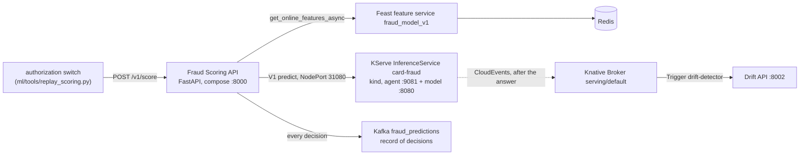

# Serving

The serving path decides each card authorization in real time. The card network waits for the bank's answer before
the shop can finish the sale, so the decision must come back in milliseconds and never fail: an outage of any
dependency gives a safe fallback decision. The Fraud Scoring API (FastAPI) reads the card's features from the Feast
online store, gets a score from KServe (a Kubernetes model server, with the booster inside the image) and returns
approve, step_up (a one-time password, OTP, or a biometric check) or decline.

| | |
|---|---|
| Code | [`services/scoring_api/`](https://github.com/cvinhnguyen/card-fraud-platform/tree/6457d47445ec1a910ebd2c01bc1edbff50f76d37/services/scoring_api), [`services/predictor/`](https://github.com/cvinhnguyen/card-fraud-platform/tree/6457d47445ec1a910ebd2c01bc1edbff50f76d37/services/predictor), [`infra/k8s/kserve-card-fraud.yaml`](https://github.com/cvinhnguyen/card-fraud-platform/blob/6457d47445ec1a910ebd2c01bc1edbff50f76d37/infra/k8s/kserve-card-fraud.yaml), `infra/k8s/kserve-card-fraud-challenger.yaml`, `services/predictor/Jenkinsfile` (model release), `ml/tools/ab_report.py` |
| Runs on | KServe: kind namespace `serving` (`card-fraud`, and `card-fraud-challenger` during an A/B test); Scoring API: compose service `scoring-api` (profile `ml`, port 8000) |
| Reads | Feast feature service `fraud_model_v1` (Redis online store); the model images built from the MLflow aliases `production` and `challenger` |
| Writes | Scoring API: Kafka `fraud_predictions` (every request, response, feature vector, A/B arm and latency); KServe payload logger: every model request and response of `card-fraud` as CloudEvents to the Knative Broker `serving/default` |
| Related | [ml_training.md](ml_training.md), [drift.md](drift.md), [testing.md](../operations/testing.md), [cicd.md](../operations/cicd.md) |

## Where it fits

Serving is the left side of Layer 2 in the
[overview](../architecture.md#layer-2-the-ml-platform-right-panel):

- Inputs: features from the Feast online store ([feature_store.md](feature_store.md)) and the model behind the MLflow
  alias `production` ([ml_training.md](ml_training.md)).
- Outputs: every decision to Kafka `fraud_predictions`, every model call to the Drift API ([drift.md](drift.md)).
- Callers: the card network's switch and Layer 3's fraud-score MCP server ([agents.md](../llm-platform/agents.md)).

## How it works

1. The card network's switch (the system that routes each payment to the bank) sends the payment (card, amount,
   channel, device) to `POST /v1/score` ([Fraud Scoring API](#fraud-scoring-api)).
2. The API asks Feast for the card's 20 features; Feast reads Redis and computes the on-demand ones.
3. KServe returns the fraud probability ([Model server](#model-server-kserve)).
4. The version's thresholds decide: below `t_low` approve, between step_up, above `t_high` decline; if Redis or KServe
   is late or down, a rule decides by amount ([Decision and fallback](#decision-and-fallback)).
5. The API answers, then logs the request, features and decision to Kafka ([Prediction log](#prediction-log)).
6. After answering, the KServe agent sends the request and response as CloudEvents through a Knative Broker to the
   Drift API ([drift.md](drift.md)).

One payment through the serving path:



## Run it

Prerequisites: the production model in MLflow and the kind cluster with KServe (`infra/k8s/platform.sh`).

The Jenkins job `fraud-predictor` releases on its own when an MLflow alias moves
([Model release pipeline](#model-release-pipeline)). By hand, logged in to GHCR (`docker login ghcr.io`):

```bash
MLFLOW_TRACKING_URI=http://127.0.0.1:5000 python services/predictor/fetch_model.py --alias production   # MLflow alias -> services/predictor/model/
img=ghcr.io/cvinhnguyen/fraud-predictor:v<version>-$(git rev-parse --short=7 HEAD)
docker build -t $img services/predictor && docker push $img
# the pull secret, from infra/.env: the token goes through files and stdin, never onto a command line
( umask 077; tok=$(grep '^GHCR_PULL_TOKEN=' infra/.env | cut -d= -f2-); usr=$(grep '^GHCR_USER=' infra/.env | cut -d= -f2-)
  printf '{"auths": {"ghcr.io": {"auth": "%s"}}}' "$(printf '%s:%s' "$usr" "$tok" | base64 | tr -d '\n')" > ghcr-pull.json )
kubectl -n serving create secret generic ghcr-pull --type=kubernetes.io/dockerconfigjson \
  --from-file=.dockerconfigjson=ghcr-pull.json --dry-run=client -o yaml | kubectl apply --server-side -f - && rm ghcr-pull.json
sed -e "s|MODEL_IMAGE|$img|" -e "s|MODEL_VERSION|<version>|" infra/k8s/kserve-card-fraud.yaml | kubectl apply -f -   # also the Broker and Trigger
```

Replace `<version>` with the MLflow registry version. The manifest's placeholders are `MODEL_IMAGE` (the image) and
`MODEL_VERSION` (the annotation `fraud.platform/model-version`, the running version); the lines between
`docker build` and `sed` create the pull secret ([Private image](#private-image)). To see what is live:

```bash
kubectl -n serving get isvc -o custom-columns='NAME:.metadata.name,MODEL:.metadata.annotations.fraud\.platform/model-version,IMAGE:.spec.predictor.containers[0].image'
```

## Model server (KServe)

[`infra/k8s/kserve-card-fraud.yaml`](https://github.com/cvinhnguyen/card-fraud-platform/blob/6457d47445ec1a910ebd2c01bc1edbff50f76d37/infra/k8s/kserve-card-fraud.yaml)
defines the InferenceService `card-fraud` in namespace `serving`, on KServe 0.21 in Standard mode (formerly
RawDeployment): a plain Deployment + Service without Knative Serving, so it fits the 8 GB machine. The same file holds
the drift feed's Knative Eventing Broker `default` and Trigger `drift-detector` ([drift.md](drift.md));
`infra/k8s/platform.sh` installs Knative Eventing. The predictor is a custom KServe `Model`
([`services/predictor/predictor.py`](https://github.com/cvinhnguyen/card-fraud-platform/blob/6457d47445ec1a910ebd2c01bc1edbff50f76d37/services/predictor/predictor.py)).

One image is one model version: the tag is the running version, a rollback is the previous tag, and a pod never
starts without its model (no start-up download that can fail). Instances are dicts reordered by the booster's
feature names, so callers never depend on column order; a missing feature is NaN, as in training. The response
carries `model_version` and that version's `t_low` and `t_high`
([`predictor.py`
L42-L48](https://github.com/cvinhnguyen/card-fraud-platform/blob/6457d47445ec1a910ebd2c01bc1edbff50f76d37/services/predictor/predictor.py#L42-L48)):

```python
def predict(self, payload: dict, headers: dict | None = None) -> dict:
    """Score every instance; unknown keys are ignored, missing ones are NaN."""
    names = self.booster.feature_names
    x = np.array([[np.nan if r.get(n) is None else float(r[n]) for n in names] for r in payload["instances"]],
                 dtype="float64")
    return {"predictions": self.booster.inplace_predict(x, missing=np.nan).tolist(), "model_version": self.version,
            **self.thresholds}
```

`logger` (`mode: all`) adds KServe's agent sidecar on port 9081 in front of the model on 8080, sending every request
and response to the Broker; NodePort 31080 points at 9081, so the Scoring API's calls pass it
([`kserve-card-fraud.yaml`](https://github.com/cvinhnguyen/card-fraud-platform/blob/6457d47445ec1a910ebd2c01bc1edbff50f76d37/infra/k8s/kserve-card-fraud.yaml),
[`infra/k8s/nodeports.yaml`](https://github.com/cvinhnguyen/card-fraud-platform/blob/6457d47445ec1a910ebd2c01bc1edbff50f76d37/infra/k8s/nodeports.yaml)):

```yaml
apiVersion: serving.kserve.io/v1beta1
kind: InferenceService
metadata:
  name: card-fraud
  namespace: serving
  annotations:
    serving.kserve.io/deploymentMode: Standard
    fraud.platform/model-version: "MODEL_VERSION"   # MLflow card_fraud_xgb version (alias production)
spec:
  predictor:
    imagePullSecrets: [{name: ghcr-pull}]   # fraud-predictor is a private GHCR package (it holds the model)
    minReplicas: 1
    maxReplicas: 3
    logger:
      mode: all
      url: http://broker-ingress.knative-eventing.svc.cluster.local/serving/default   # the Broker above
    containers:
      - name: kserve-container
        image: MODEL_IMAGE
        args: ["--model_name", "card-fraud", "--http_port", "8080"]
        ports: [{containerPort: 8080, protocol: TCP}]
        resources:
          requests: {cpu: 100m, memory: 256Mi}
          limits: {cpu: "1", memory: 512Mi}
```

### Private image

The package `fraud-predictor` is Private on GHCR because each image holds the model and its `reference_profile.json`
(the distribution of every feature). Both InferenceServices pull it with the Secret `ghcr-pull` (`imagePullSecrets`),
which the pipeline updates before every deploy from the Jenkins credential `ghcr-pull`, a read-only token
(`read:packages`); the push token never reaches the cluster. By hand, `printf` (a shell builtin) keeps the
token out of the process list, and server-side apply keeps it out of a last-applied annotation.

## Fraud Scoring API

The API
([`services/scoring_api/`](https://github.com/cvinhnguyen/card-fraud-platform/tree/6457d47445ec1a910ebd2c01bc1edbff50f76d37/services/scoring_api))
has four endpoints ([`main.py`
L52-L81](https://github.com/cvinhnguyen/card-fraud-platform/blob/6457d47445ec1a910ebd2c01bc1edbff50f76d37/services/scoring_api/app/main.py#L52-L81)):

| Endpoint | Purpose |
|---|---|
| `POST /v1/score` | one authorization in (pydantic `ScoreRequest`: ids, amount, channel, currency, auth method, device, time), `{score, decision, model_version, fallback}` out |
| `GET /healthz` | liveness: the process answers; never checks dependencies (a Redis outage must not restart the API) |
| `GET /readyz` | readiness: Feast online read and the model endpoint both answer |
| `GET /metrics` | Prometheus: request rate / latency / status, decisions, fallbacks by cause, score histogram, stage latency |

It is async end to end (Feast `get_online_features_async`, one pooled `httpx.AsyncClient` to KServe, `aiokafka` for
the prediction log), so one worker serves many requests while each waits on Redis or the model.

### Decision and fallback

`ThresholdPolicy` decides: `score >= t_high` decline, `>= t_low` step_up (OTP), else approve. A retrained model has a
different score distribution, so each version has its own thresholds, set on its validation (`t_low` at 1% FPR,
`t_high` at 0.1% FPR; FPR = false positive rate, the share of legitimate payments flagged), stored as MLflow tags
and copied into `metadata.json` by `fetch_model.py`. The configured `T_LOW` and `T_HIGH` decide only for a model that
sends none, such as an older image
([`services/scoring_api/app/policy.py`
L20-L37](https://github.com/cvinhnguyen/card-fraud-platform/blob/6457d47445ec1a910ebd2c01bc1edbff50f76d37/services/scoring_api/app/policy.py#L20-L37)):

```python
    def decide(self, score: float) -> Decision:
        """Map a fraud probability to a decision."""
        if score >= self.t_high:
            return Decision.decline
        if score >= self.t_low:
            return Decision.step_up
        return Decision.approve


@dataclass(frozen=True)
class FallbackPolicy:
    """Conservative rule without a model: small payments pass, larger ones get extra authentication."""

    step_up_from_vnd: int

    def decide(self, amount_vnd: int) -> Decision:
        """Approve below the amount, step up from it; never decline without evidence."""
        return Decision.step_up if amount_vnd >= self.step_up_from_vnd else Decision.approve
```

Each stage has a time budget (`asyncio.wait_for`, 50 ms by default, 200 ms in compose, where KServe is behind the
kind NodePort). On a timeout or failure of the feature store or the model, `FallbackPolicy` decides: approve below
2,000,000 VND (Vietnamese dong), else step_up, never decline without evidence. The response says `fallback: true`;
`fraud_fallbacks_total{cause}` records why (`features_timeout`, `model_error`, ...)
([`services/scoring_api/app/scorer.py`
L58-L88](https://github.com/cvinhnguyen/card-fraud-platform/blob/6457d47445ec1a910ebd2c01bc1edbff50f76d37/services/scoring_api/app/scorer.py#L58-L88)):

```python
async def score(self, req: ScoreRequest) -> ScoreResponse:
    """Score one authorization; falls back instead of failing."""
    feats, cause, arm, start = None, None, ab_arm(req.card_id, self.ab_percent), time.perf_counter()
    policy = None
    try:
        t0 = time.perf_counter()
        feats = await asyncio.wait_for(self.features.features(req), self.feature_timeout_s)
        STAGE.labels("features").observe(time.perf_counter() - t0)
        t0 = time.perf_counter()
        score, version, thresholds = await self.predict(feats, arm, req.auth_id)
        STAGE.labels("model").observe(time.perf_counter() - t0)
        # each model with its own cut-offs (set on its validation); the configured ones for a model without them
        policy = ThresholdPolicy(*thresholds) if thresholds else self.policy
        resp = ScoreResponse(auth_id=req.auth_id, score=score, decision=policy.decide(score),
                             model_version=version)
        SCORES.observe(score)
    except Exception as e:   # noqa: BLE001 - any failure of a dependency means: fall back
        cause = "features" if feats is None else "model"
        cause += "_timeout" if isinstance(e, TimeoutError) else "_error"
        log.warning("fallback (%s) for %s: %r", cause, req.auth_id, e)
        FALLBACKS.labels(cause).inc()
        resp = ScoreResponse(auth_id=req.auth_id, decision=self.fallback.decide(req.amount_vnd),
                             model_version="fallback", fallback=True)
    DECISIONS.labels(resp.decision.value, str(resp.fallback).lower()).inc()
    if self.prediction_log:
        record = {**req.model_dump(mode="json"), "features": feats, "fallback_cause": cause, "ab_arm": arm,
                  "latency_ms": round((time.perf_counter() - start) * 1000, 1),   # features + model, for A/B
                  "t_low": policy and policy.t_low, "t_high": policy and policy.t_high}   # None: the amount rule
        record |= resp.model_dump(mode="json")   # pragma: no mutate (every response field is JSON-native anyway)
        await self.prediction_log.send(record)
    return resp
```

### Prediction log

Every request, response and feature vector goes to Kafka `fraud_predictions`, keyed by card, without waiting for the
broker ack; if Kafka is down, the API keeps scoring and only stops logging
([`services/scoring_api/app/clients.py`
L89-L112](https://github.com/cvinhnguyen/card-fraud-platform/blob/6457d47445ec1a910ebd2c01bc1edbff50f76d37/services/scoring_api/app/clients.py#L89-L112)).
The topic is the record of decisions; monitoring does not read it (the Drift API reads KServe's payload logger,
[drift.md](drift.md)).

### Design

The scorer depends on three small interfaces (`FeatureSource`, `ModelSource`, `PredictionLog`) wired in
`build_scorer` (fakes in tests, real clients in the app); the two policies are interchangeable strategies behind one
`decide` call. The app factory `create_app` lets tests build an app with fakes and their own metrics registry
([`services/scoring_api/app/main.py`
L28-L37](https://github.com/cvinhnguyen/card-fraud-platform/blob/6457d47445ec1a910ebd2c01bc1edbff50f76d37/services/scoring_api/app/main.py#L28-L37)).

## Model release pipeline

The Jenkins job `fraud-predictor` (`services/predictor/Jenkinsfile`) makes the MLflow aliases the source of truth:
`production` runs as `card-fraud`, `challenger` as `card-fraud-challenger` for an A/B test. Every 15 minutes it
compares each alias's version (MLflow REST API `http://mlflow:5000`, on the compose network) with its
InferenceService's annotation `fraud.platform/model-version`.

| Stage | What it does |
|---|---|
| Changed? | a change under `services/predictor/` or `infra/k8s/kserve-card-fraud*.yaml`, or a manual run, rebuilds both models even if no alias moved |
| Aliases vs what runs | `production` goes to `card-fraud`; `challenger` to `card-fraud-challenger` only when it exists and differs from `production`. A missing alias (HTTP 404 on older MLflow, HTTP 400 `alias ... not found` on MLflow 3.16) counts as none |
| Fetch models | `fetch_model.py --alias <alias>` in the Dockerfile's `fetch` stage, one folder `model-<alias>` each |
| Release check (pytest) | `test_predictor.py` in the image: the model loads, scores a row and is the planned version (a moved alias fails), with its own `t_low` / `t_high` tags and a matching `reference_profile.json` (feature order, version) |
| Build + push image | `ghcr.io/cvinhnguyen/fraud-predictor:v<model version>-<commit>` (model version, predictor code commit), pushed with the Jenkins credential `ghcr` |
| Sign image (cosign) | `infra/k8s/supply-chain.sh sign fraud-predictor <tag>` ([novel_supply_chain.md](../operations/novel_supply_chain.md)) |
| Deploy | updates the pull secret `ghcr-pull` ([Private image](#private-image)), saves the image and version each InferenceService runs, applies the manifest, waits for rollout and Ready |
| Smoke test | a V1 predict through the Scoring API's NodePort must answer with the released `model_version` |
| A/B split | every build: `AB_PERCENT` 10 while an approved challenger runs, else 0 ([A/B test](#ab-test-of-the-fraud-model)); skipped when `scoring-api` is not running |
| Remove challenger | deletes `card-fraud-challenger` once the split is off |
| Drift reference | writes the new production model's `reference_profile.json` into the Drift API's mounted file, restarts it, checks the version `/v1/drift` reports; a failure marks the build unstable and keeps the new model |
| post: failure | re-applies what each InferenceService ran before (deleting one that did not exist) and restores the split |
| Approve the A/B test | after a new challenger deploy: the input "Start the A/B test: send 10% of the cards to model v<N>?" waits up to 7 days for the user `admin` |
| Start the A/B test | records the approval on the challenger (`fraud.platform/ab-approved-version`, `fraud.platform/ab-approved-by`), then sets `AB_PERCENT` |

### Human steps

Two human steps keep real payments away from a model nobody looked at:

| Step | Where | What happens |
|---|---|---|
| Approve the A/B test | Jenkins input | Training sets `challenger` on its own when a model beats production offline, so a new challenger gets only a smoke test and no traffic until a person approves. The build and the InferenceService annotation record who approved |
| Promote or roll back | MLflow | Moving `production` to the challenger's version is the approval; Jenkins asks for none. The next check releases it as `card-fraud`, finds `challenger` equal to `production`, turns the split off and removes the challenger. A rollback moves the alias back |

Without an answer in 7 days, or on Abort, the build ends aborted with the split off and the challenger idle; a manual
run asks again. The wait holds no executor, so a production release can go out meanwhile. To stop a test without
promoting, delete the alias `challenger`: the next check turns the split off and removes the challenger.

## A/B test of the fraud model

The Scoring API sends a fixed share of the cards to the challenger, its own InferenceService `card-fraud-challenger`
on NodePort 31081. KServe's `canaryTrafficPercent` needs Knative Serving, which this cluster does not run (Standard
mode), and a per-request canary would send one card to both models.

- `ab_arm(card_id)` is `crc32(card_id) % 100 < AB_PERCENT`, stable across processes and restarts, so a card meets the
  same model for the whole test.
- `AB_PERCENT` unset or 0: no split, and no challenger client.
- A challenger that fails or times out hands the request to production (counted in
  `fraud_challenger_failures_total{cause}`), so no payment loses its model decision.
- Each arm decides with its own model's thresholds. Each decision log record carries `ab_arm` (the card's arm),
  `model_version` (the model that scored), `t_low` and `t_high` (empty for the amount rule) and `latency_ms`
  (features + model), which `ab_report.py` prints.
- The challenger has no `logger`, so the drift feed stays on production.

`AB_PERCENT` is read once at start, so the predictor pipeline turns the split on (after the approval) and off by
recreating the compose service `scoring-api`, same image, at a few seconds of scoring downtime like any API release.
By hand:

```bash
AB_PERCENT=10 docker compose -f infra/docker-compose.yaml --profile ml up -d --no-deps scoring-api   # 0 turns it off
python ml/tools/ab_report.py --since 2026-11-21   # per arm and model version: decisions, decline / step-up rate, p95 latency, PR-AUC, recall
```

`ab_report.py` reads `fraud_predictions` like `drift_by_day.py` and joins the labels in
`data/drift/labels/labels.parquet` where they exist (labels arrive late, [drift.md](drift.md)).

## Runs on 2026-10-19 and 2026-10-21 (model v1)

Model version 1 was released from the local compose registry (`localhost:5001`), since replaced by GHCR:

```bash
MLFLOW_TRACKING_URI=http://mlflow:5000 python services/predictor/fetch_model.py --alias production   # v1 -> model/
docker build -t localhost:5001/fraud/predictor:1 services/predictor && docker push localhost:5001/fraud/predictor:1
sed 's/MODEL_VERSION/1/' infra/k8s/kserve-card-fraud.yaml | kubectl apply -f -
kubectl wait --for=condition=Ready isvc/card-fraud -n serving        # Ready after 25 s, 1 predictor pod
```

`GET /v1/models/card-fraud` returned `{"name":"card-fraud","ready":true}`. The image is 968 MB (the `kserve` package
and its dependencies); the model inside is 243 KB.

The compose thresholds are model v1's (`T_LOW=0.0018`, `T_HIGH=0.058`, its MLflow tags): scores are calibrated to
the real 0.3% fraud rate, so a 0.5 cut-off would decline almost nothing.

Three payments of the first live day (2026-10-16), through `POST /v1/score`:

| label | channel | amount (VND) | score | decision | latency |
|---|---|---:|---:|---|---:|
| fraud | ecom | 129,000 | 0.9989 | decline | 101 ms (first call) |
| legitimate | ecom | 514,000 | 0.0003 | approve | 22 ms |
| legitimate | pos | 42,000 | 0.0021 | step_up | 21 ms |

Fallback demo: after `docker pause redis` the same three requests gave `approve`, `score: null`, `fallback: true` in
~220 ms (the 200 ms feature budget), log `fallback (features_timeout)`; `docker unpause redis` resumed scoring.
`/readyz` reports both dependencies; `/metrics` counts `fraud_decisions_total{decision, fallback}`.

On 2026-10-21 (Git Bash) the InferenceService was Ready with one predictor pod, and a direct V1 `predict` through the
NodePort answered `model_version` 1. Of two payments on one card, the first fell back (on a loaded machine the feature
lookup ran past its budget, so `FallbackPolicy` approved 450,000 VND by rule, `model_version: fallback`); KServe
scored the second, 45,000,000 VND online, and declined it (0.2221, `fallback: false`):


## Capacity, and a bug the first load found

One worker scores about 45 requests a second. The first replay, at 100 requests/s, fell back on 96% of the payments
for two reasons:

| Concurrency | Throughput | p50 / p95 | Fallback |
|---:|---:|---:|---:|
| 1 | 36 req/s | 25 / 41 ms | 0% |
| 2 | 45 req/s | 42 / 58 ms | 0% |
| 4 | 46 req/s | 82 / 121 ms | 0% |
| 8 | 47 req/s | 165 / 206 ms | 0% |
| 32 | 41 req/s | 757 / 950 ms | 94% |

1. CPU: about 22 ms per request, mostly Feast computing on-demand features in pandas in the event loop. Above that
   rate requests queue past their 200 ms budget and the fallback answers, as designed. More throughput needs more
   replicas, not a bigger budget; the replay scores at 30/s.
2. After a burst the API never recovered: every request fell back (`model_timeout` / `PoolTimeout`) until a restart,
   while a fresh client in the same container reached KServe in 4 ms. `asyncio.wait_for` cancelled httpx calls
   mid-request and left the shared pool exhausted. `ModelClient.predict` now runs the call under `asyncio.shield`:
   the budget still answers on time, and the abandoned call ends under httpx's own timeouts and frees its
   connection. After 1,000 requests at concurrency 32, serial requests are back at 25 ms with no fallback (before:
   100% fallback). `test_model_budget_does_not_cancel_the_http_call`
   ([`services/scoring_api/tests/test_clients.py`
   L50](https://github.com/cvinhnguyen/card-fraud-platform/blob/6457d47445ec1a910ebd2c01bc1edbff50f76d37/services/scoring_api/tests/test_clients.py#L50))
   fails on the old code.

The fix
([`clients.py`
L68-L81](https://github.com/cvinhnguyen/card-fraud-platform/blob/6457d47445ec1a910ebd2c01bc1edbff50f76d37/services/scoring_api/app/clients.py#L68-L81)):

```python
async def predict(self, features: dict[str, float | None]) -> tuple[float, str, Thresholds]:
    """Score of one feature vector, the model version that produced it and that version's thresholds (None when
    the predictor does not send a valid pair, e.g. an image built before they were added).
    The scorer's time budget cancels only the shield: the HTTP call itself ends under httpx's own timeouts and
    returns its connection. Cancelled mid-request, httpx calls left the pool exhausted after a load burst, and
    every later request fell back (model_timeout / PoolTimeout) until the API was restarted."""
    call = asyncio.ensure_future(self.client.post(self.url, json={"instances": [features]}))
    call.add_done_callback(lambda c: c.cancelled() or c.exception())   # an abandoned call's error is not news
    r = await asyncio.shield(call)
    r.raise_for_status()
    body = r.json()
    lo, hi = body.get("t_low"), body.get("t_high")
    th = (float(lo), float(hi)) if lo is not None and hi is not None and 0 <= float(lo) <= float(hi) <= 1 else None
    return float(body["predictions"][0]), str(body.get("model_version", "unknown")), th
```

## Gotchas

- The Helm chart `kserve` does not resolve in KServe 0.21 (renamed): install
  `oci://ghcr.io/kserve/charts/kserve-resources`.

## Limits

- One Scoring API container with one worker, about 45 requests a second
  ([Capacity](#capacity-and-a-bug-the-first-load-found)); more traffic needs more replicas behind a load balancer.
- The thresholds come with the model: the risk team needs new tags on the version and a new image release to move
  them. `T_LOW` and `T_HIGH` in compose are only the fallback for a model without tags.
- A failing challenger waits out its own budget before production answers, so such a request can take up to twice
  `MODEL_TIMEOUT_S`.
- `auth_ts` is the bank's local time without an offset, as in training. An offset from the switch (for example
  `+07:00`) is untested and could shift the hour behind `is_night`.
- A Kafka outage after start costs only the prediction log: a record not queued within 50 ms is dropped and logged,
  and the decision goes out as usual.
