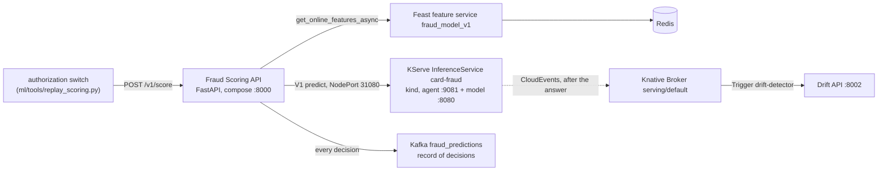
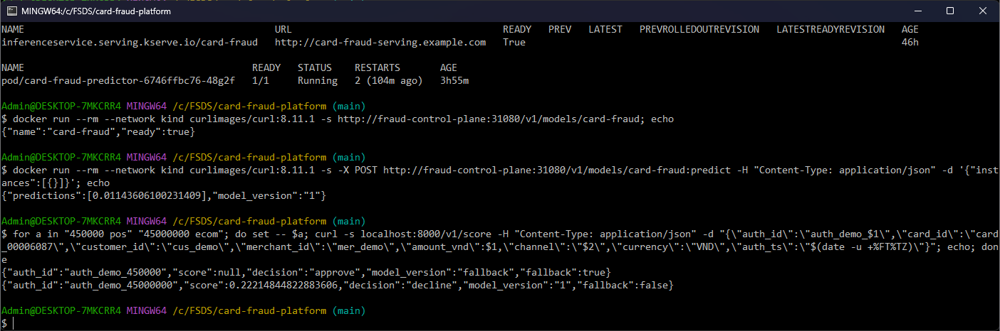

# Serving

When a card is used, the card network waits for the bank's answer before the shop can finish the sale, so the
fraud decision has to come back in milliseconds and must never fail outright. The Layer 2 serving path decides each
card authorization in real time. KServe, a Kubernetes model server, serves the fraud model with the booster inside
the image. The Fraud Scoring API (FastAPI) reads the card's features from the Feast online store and asks KServe for
a score. It turns the score into approve, step_up or decline, and logs every decision to Kafka as the record of
decisions. A step_up asks the cardholder for a one-time password (OTP) or a biometric check.
KServe's payload logger copies every request and response of the model to the Drift API.
An outage of any dependency gives a safe fallback decision instead of an error.

| | |
|---|---|
| Code | [`services/scoring_api/`](https://github.com/cvinhnguyen/card-fraud-platform/tree/822721cab1ac597d118f100f1c49949f137f8a7d/services/scoring_api), [`services/predictor/`](https://github.com/cvinhnguyen/card-fraud-platform/tree/822721cab1ac597d118f100f1c49949f137f8a7d/services/predictor), [`infra/k8s/kserve-card-fraud.yaml`](https://github.com/cvinhnguyen/card-fraud-platform/blob/822721cab1ac597d118f100f1c49949f137f8a7d/infra/k8s/kserve-card-fraud.yaml), `infra/k8s/kserve-card-fraud-challenger.yaml`, `services/predictor/Jenkinsfile` (model release), `ml/tools/ab_report.py` |
| Runs on | KServe: kind namespace `serving` (`card-fraud`, and `card-fraud-challenger` during an A/B test); Scoring API: compose service `scoring-api` (profile `ml`, port 8000) |
| Reads | Feast feature service `fraud_model_v1` (Redis online store); the model images built from the MLflow aliases `production` and `challenger` |
| Writes | Scoring API: Kafka `fraud_predictions` (every request, response, feature vector, A/B arm and latency); KServe payload logger: every model request and response of `card-fraud` as CloudEvents to the Knative Broker `serving/default` |
| Related | [ml_training.md](ml_training.md), [drift.md](drift.md), [testing.md](../operations/testing.md), [cicd.md](../operations/cicd.md) |

## Where it fits

Serving is the left side of Layer 2 in the
[overview](../architecture.md#layer-2-the-ml-platform-right-panel). The features come from the Feast online store that
Layer 1's pipelines and the push jobs keep fresh ([feature_store.md](feature_store.md)); the model is the one a reviewer
promoted to `production` in MLflow ([ml_training.md](ml_training.md)); every decision goes to the Kafka topic
`fraud_predictions`, the record of decisions. KServe's payload logger sends every request and response of the model
through Knative Eventing to the Drift API ([drift.md](drift.md)). Layer 3's fraud-score MCP server calls the same API
for the agents ([agents.md](../llm-platform/agents.md)).

## How it works

1. The card network's switch, the system that routes each payment to the bank, sends the payment (card, amount,
   channel, device) to `POST /v1/score`.
2. The API asks Feast for the card's 20 features; Feast reads Redis and computes the on-demand ones.
3. The API sends the features to KServe and gets the fraud probability back.
4. Two thresholds set on validation turn the probability into a decision: below `t_low` approve, between the two
   step_up, above `t_high` decline. If Redis or KServe is late or down, a rule decides instead, by amount.
5. The API returns the decision and, without waiting, logs the request, the features and the decision to Kafka.
6. On the model side, the KServe agent in front of the model posts the request and the response as two CloudEvents
   to a Knative Broker after it has answered. A Trigger delivers them to the Drift API.

One payment through the serving path:



## Run it

With the production model in MLflow and the kind cluster with KServe (`infra/k8s/platform.sh`), the Jenkins job
`fraud-predictor` releases the model ([Model release pipeline](#model-release-pipeline)). It checks the MLflow aliases
every 15 minutes, so moving the alias `production` is enough. The same steps by hand, logged in to GHCR
(`docker login ghcr.io`):

```bash
MLFLOW_TRACKING_URI=http://127.0.0.1:5000 python services/predictor/fetch_model.py --alias production   # MLflow alias -> services/predictor/model/
img=ghcr.io/cvinhnguyen/fraud-predictor:v<version>-$(git rev-parse --short=7 HEAD)
docker build -t $img services/predictor && docker push $img
# the pull secret, from infra/.env: the token goes through files and stdin, never onto a command line
( umask 077; tok=$(grep '^GHCR_PULL_TOKEN=' infra/.env | cut -d= -f2-); usr=$(grep '^GHCR_USER=' infra/.env | cut -d= -f2-)
  printf '{"auths": {"ghcr.io": {"auth": "%s"}}}' "$(printf '%s:%s' "$usr" "$tok" | base64 | tr -d '\n')" > ghcr-pull.json )
kubectl -n serving create secret generic ghcr-pull --type=kubernetes.io/dockerconfigjson \
  --from-file=.dockerconfigjson=ghcr-pull.json --dry-run=client -o yaml | kubectl apply --server-side -f - && rm ghcr-pull.json
sed -e "s|MODEL_IMAGE|$img|" -e "s|MODEL_VERSION|<version>|" infra/k8s/kserve-card-fraud.yaml | kubectl apply -f -   # also the Broker and Trigger
```

Replace `<version>` with the model version in the MLflow registry. The manifest holds two placeholders, `MODEL_IMAGE`
for the image and `MODEL_VERSION` for the annotation `fraud.platform/model-version`, which records the version that
runs.

The package `fraud-predictor` is Private on GHCR, because each image holds the model and its
`reference_profile.json` (the distribution of every feature). Both InferenceServices pull it with the Secret
`ghcr-pull` (`imagePullSecrets` in the manifests). The pipeline creates or updates that Secret from the Jenkins
credential `ghcr-pull`, a read-only token (`read:packages`), before every deploy, so the push token never
reaches the cluster; by hand it is the two commands above. `printf` is a shell builtin, so the token
never shows up in the process list, and server-side apply keeps it out of a last-applied annotation. To see what is
live:

```bash
kubectl -n serving get isvc -o custom-columns='NAME:.metadata.name,MODEL:.metadata.annotations.fraud\.platform/model-version,IMAGE:.spec.predictor.containers[0].image'
```

## Model server (KServe)

[`infra/k8s/kserve-card-fraud.yaml`](https://github.com/cvinhnguyen/card-fraud-platform/blob/822721cab1ac597d118f100f1c49949f137f8a7d/infra/k8s/kserve-card-fraud.yaml)
defines one InferenceService in namespace `serving`, KServe 0.21 in Standard mode (formerly called RawDeployment): a
plain Deployment + Service, no Knative Serving, so it fits the 8 GB machine. The same file holds the Knative Eventing
Broker `default` and Trigger `drift-detector` of the drift feed ([drift.md](drift.md)); Knative Eventing itself is
installed by `infra/k8s/platform.sh`. The predictor is a custom KServe `Model`
([`services/predictor/predictor.py`](https://github.com/cvinhnguyen/card-fraud-platform/blob/822721cab1ac597d118f100f1c49949f137f8a7d/services/predictor/predictor.py))
with the booster inside the image.

One image = one model version: the running version is the image tag, a rollback is the previous tag, and a pod
never starts without its model (no download at start-up that can fail). Instances are sent as dicts and reordered by
the booster's own feature names, so a caller never depends on column order; a missing feature is NaN, as in
training. The response carries `model_version`
([`services/predictor/predictor.py`
L38-L43](https://github.com/cvinhnguyen/card-fraud-platform/blob/822721cab1ac597d118f100f1c49949f137f8a7d/services/predictor/predictor.py#L38-L43)):

```python
def predict(self, payload: dict, headers: dict | None = None) -> dict:
    """Score every instance; unknown keys are ignored, missing ones are NaN."""
    names = self.booster.feature_names
    x = np.array([[np.nan if r.get(n) is None else float(r[n]) for n in names] for r in payload["instances"]],
                 dtype="float64")
    return {"predictions": self.booster.inplace_predict(x, missing=np.nan).tolist(), "model_version": self.version}
```

In the InferenceService below, `logger` (`mode: all`) makes KServe add its agent sidecar on port 9081 in front of
the model on 8080; the agent sends every request and response to the Broker. NodePort 31080 points at 9081, so the
Scoring API's calls pass the agent
([`infra/k8s/kserve-card-fraud.yaml`](https://github.com/cvinhnguyen/card-fraud-platform/blob/822721cab1ac597d118f100f1c49949f137f8a7d/infra/k8s/kserve-card-fraud.yaml),
[`infra/k8s/nodeports.yaml`](https://github.com/cvinhnguyen/card-fraud-platform/blob/822721cab1ac597d118f100f1c49949f137f8a7d/infra/k8s/nodeports.yaml)):

```yaml
apiVersion: serving.kserve.io/v1beta1
kind: InferenceService
metadata:
  name: card-fraud
  namespace: serving
  annotations:
    serving.kserve.io/deploymentMode: Standard
    fraud.platform/model-version: "MODEL_VERSION"   # MLflow card_fraud_xgb version (alias production)
spec:
  predictor:
    imagePullSecrets: [{name: ghcr-pull}]   # fraud-predictor is a private GHCR package (it holds the model)
    minReplicas: 1
    maxReplicas: 3
    logger:
      mode: all
      url: http://broker-ingress.knative-eventing.svc.cluster.local/serving/default   # the Broker above
    containers:
      - name: kserve-container
        image: MODEL_IMAGE
        args: ["--model_name", "card-fraud", "--http_port", "8080"]
        ports: [{containerPort: 8080, protocol: TCP}]
        resources:
          requests: {cpu: 100m, memory: 256Mi}
          limits: {cpu: "1", memory: 512Mi}
```

## Fraud Scoring API

The API in
[`services/scoring_api/`](https://github.com/cvinhnguyen/card-fraud-platform/tree/822721cab1ac597d118f100f1c49949f137f8a7d/services/scoring_api)
has four endpoints ([`services/scoring_api/app/main.py`
L50-L79](https://github.com/cvinhnguyen/card-fraud-platform/blob/822721cab1ac597d118f100f1c49949f137f8a7d/services/scoring_api/app/main.py#L50-L79)):

| Endpoint | Purpose |
|---|---|
| `POST /v1/score` | one authorization in (pydantic `ScoreRequest`: ids, amount, channel, currency, auth method, device, time), `{score, decision, model_version, fallback}` out |
| `GET /healthz` | liveness: the process answers; never checks dependencies (a Redis outage must not restart the API) |
| `GET /readyz` | readiness: Feast online read and the model endpoint both answer |
| `GET /metrics` | Prometheus format: request rate / latency / status, decisions, fallbacks by cause, score histogram, latency per stage |

The API is async end to end (Feast `get_online_features_async`, `httpx.AsyncClient` with one pooled client to
KServe, `aiokafka` for the prediction log), so one worker serves many requests while each waits on Redis or the
model.

### Decision and fallback

The decision is `ThresholdPolicy`: `score >= t_high` decline, `>= t_low` step_up (OTP), else approve. Each model
version brings its own thresholds, set on its validation (`t_low` at 1% FPR, `t_high` at 0.1% FPR, FPR = false
positive rate, the share of legitimate payments flagged). They are MLflow tags of the version; `fetch_model.py`
copies them into `metadata.json`, and the predictor returns them next to `model_version`. A retrained model has a
different score distribution, so it needs its own cut-offs. The configured `T_LOW` and `T_HIGH` decide only when the
model sends none, for example an image built before this change
([`services/scoring_api/app/policy.py`
L20-L37](https://github.com/cvinhnguyen/card-fraud-platform/blob/822721cab1ac597d118f100f1c49949f137f8a7d/services/scoring_api/app/policy.py#L20-L37)):

```python
    def decide(self, score: float) -> Decision:
        """Map a fraud probability to a decision."""
        if score >= self.t_high:
            return Decision.decline
        if score >= self.t_low:
            return Decision.step_up
        return Decision.approve


@dataclass(frozen=True)
class FallbackPolicy:
    """Conservative rule without a model: small payments pass, larger ones get extra authentication."""

    step_up_from_vnd: int

    def decide(self, amount_vnd: int) -> Decision:
        """Approve below the amount, step up from it; never decline without evidence."""
        return Decision.step_up if amount_vnd >= self.step_up_from_vnd else Decision.approve
```

Each stage has a time budget (`asyncio.wait_for`, 50 ms by default, 200 ms in compose where KServe is reached
through the kind NodePort). A timeout or failure of the feature store or the model gives `FallbackPolicy` instead of
an error: approve below 2,000,000 VND (Vietnamese dong), step_up from it, never decline without evidence. The
response says `fallback: true` and the counter `fraud_fallbacks_total{cause}` records why (`features_timeout`,
`model_error`, ...)
([`services/scoring_api/app/scorer.py`
L35-L60](https://github.com/cvinhnguyen/card-fraud-platform/blob/822721cab1ac597d118f100f1c49949f137f8a7d/services/scoring_api/app/scorer.py#L35-L60)):

```python
    async def score(self, req: ScoreRequest) -> ScoreResponse:
        """Score one authorization; falls back instead of failing."""
        feats, cause = None, None
        try:
            t0 = time.perf_counter()
            feats = await asyncio.wait_for(self.features.features(req), self.feature_timeout_s)
            STAGE.labels("features").observe(time.perf_counter() - t0)
            t0 = time.perf_counter()
            score, version = await asyncio.wait_for(self.model.predict(feats), self.model_timeout_s)
            STAGE.labels("model").observe(time.perf_counter() - t0)
            resp = ScoreResponse(auth_id=req.auth_id, score=score, decision=self.policy.decide(score),
                                 model_version=version)
            SCORES.observe(score)
        except Exception as e:   # noqa: BLE001 - any failure of a dependency means: fall back
            cause = "features" if feats is None else "model"
            cause += "_timeout" if isinstance(e, TimeoutError) else "_error"
            log.warning("fallback (%s) for %s: %r", cause, req.auth_id, e)
            FALLBACKS.labels(cause).inc()
            resp = ScoreResponse(auth_id=req.auth_id, decision=self.fallback.decide(req.amount_vnd),
                                 model_version="fallback", fallback=True)
        DECISIONS.labels(resp.decision.value, str(resp.fallback).lower()).inc()
        if self.prediction_log:
            record = {**req.model_dump(mode="json"), "features": feats, "fallback_cause": cause}
            record |= resp.model_dump(mode="json")   # pragma: no mutate (every response field is JSON-native anyway)
            await self.prediction_log.send(record)
        return resp
```

### Prediction log

Every request + response + the feature vector goes to Kafka `fraud_predictions`, keyed by card, without waiting for
the broker ack. If Kafka is down the API keeps scoring and only stops logging
([`services/scoring_api/app/clients.py`
L83-L109](https://github.com/cvinhnguyen/card-fraud-platform/blob/822721cab1ac597d118f100f1c49949f137f8a7d/services/scoring_api/app/clients.py#L83-L109)).
The topic is the record of decisions. Nothing in the monitoring path reads it: the Drift API gets its input from
KServe's payload logger ([drift.md](drift.md)).

### Design

The scorer depends on three small interfaces (`FeatureSource`, `ModelSource`, `PredictionLog`) wired in
`build_scorer`; tests pass fakes, the app passes the real clients. The two policies are interchangeable strategies
behind one `decide` call. `create_app` is an app factory so tests build an app with fake collaborators and their own
metrics registry
([`services/scoring_api/app/main.py`
L25-L35](https://github.com/cvinhnguyen/card-fraud-platform/blob/822721cab1ac597d118f100f1c49949f137f8a7d/services/scoring_api/app/main.py#L25-L35)).

## Model release pipeline

`services/predictor/Jenkinsfile` (Jenkins job `fraud-predictor`) makes the MLflow aliases the source of truth for
what runs. Every 15 minutes it reads the version behind `production` and `challenger` from the MLflow REST API
(`http://mlflow:5000`, Jenkins is on the compose network) and compares each with the annotation
`fraud.platform/model-version` of its InferenceService. It also runs when `services/predictor/` or the manifests
change, or by hand; then it rebuilds both models even if no alias moved.

| Stage | What it does |
|---|---|
| Changed? | a change under `services/predictor/` or `infra/k8s/kserve-card-fraud*.yaml`, or a manual run, forces a rebuild |
| Aliases vs what runs | `production` goes to `card-fraud`; `challenger` goes to `card-fraud-challenger` only when it exists and differs from `production` |
| Fetch models | `fetch_model.py --alias <alias>` in the Dockerfile's `fetch` stage, one folder `model-<alias>` per model |
| Release check (pytest) | `test_predictor.py` in the image: the model loads and scores a row, its version is the one planned (a moved alias fails here), and it has its own `t_low` / `t_high` tags (a version without them fails here) |
| Build + push image | `ghcr.io/cvinhnguyen/fraud-predictor:v<model version>-<commit>`: the model version and the predictor code's commit |
| Sign image (cosign) | `infra/k8s/supply-chain.sh sign fraud-predictor <tag>` ([novel_supply_chain.md](../operations/novel_supply_chain.md)) |
| Deploy | creates or updates the pull secret `ghcr-pull` from the `ghcr` credential, saves the image and version each InferenceService runs, applies the manifest with the new ones, waits for the rollout and Ready |
| Smoke test | a V1 predict through the NodePort the Scoring API uses must answer with the released `model_version` |
| A/B split | sets the Scoring API's `AB_PERCENT` to 10 while an approved challenger runs, and to 0 otherwise ([A/B test](#ab-test-of-the-fraud-model)) |
| Remove challenger | deletes `card-fraud-challenger` once the split is off |
| Drift reference | writes the new production model's `reference_profile.json` into the file the Drift API mounts, restarts it and checks the version `/v1/drift` reports; a failure here marks the build unstable and keeps the new model |
| post: failure | re-applies the image and version each InferenceService ran before (or deletes one that did not exist) and puts the split back |
| Approve the A/B test | only after a new challenger was deployed: the input "Start the A/B test: send 10% of the cards to model v<N>?" waits up to 7 days for the user `admin`, without holding an executor |
| Start the A/B test | writes the approval on the challenger (`fraud.platform/ab-approved-version`, `fraud.platform/ab-approved-by`), then sets `AB_PERCENT` on the Scoring API |

Two human steps keep real payments away from a model nobody looked at. The training pipeline sets the alias
`challenger` on its own when a model beats production offline, so a new challenger is deployed with no traffic and
only smoke-tested. Real cards reach it only after a person approves in Jenkins. Jenkins records who approved in the
build, and the annotation on the InferenceService records it in the cluster. Without an answer for 7 days, or on
Abort, the build ends as aborted, the split stays off and the challenger keeps running with no traffic. A manual run
of the job deploys it again and asks again. The job does not block builds while it waits, so a production release
can go out in the meantime.

Promotion is the other human step, in MLflow, and needs no approval in Jenkins. Move the alias `production` to the
challenger's version: the next check releases it as `card-fraud`, finds `challenger` equal to `production`, turns
the split off and removes the challenger. A rollback of the model is the same move back to the previous version.

## A/B test of the fraud model

The challenger runs next to production as its own InferenceService, `card-fraud-challenger`, reached on NodePort
31081. KServe's `canaryTrafficPercent` needs Knative Serving, which this cluster does not run (Standard mode), and
a canary split by request would send one card to both models. The split happens in the Scoring API instead:

- `ab_arm(card_id)` is `crc32(card_id) % 100 < AB_PERCENT`. crc32 gives the same answer in every process and after a
  restart, so a card always meets the same model while the test runs.
- `AB_PERCENT` unset or 0 turns the split off; the challenger client is then not even created.
- A challenger that fails or runs out of its time budget hands the request to production, so the experiment never
  costs a payment its model decision. `fraud_challenger_failures_total{cause}` counts these.
- Each arm decides with its own model's thresholds: the challenger's scores are cut where its own validation put
  them, so each model is judged with the cut-offs set for its own scores.
- Every decision log record carries `ab_arm` (the card's arm), `model_version` (the model that scored), `t_low` and
  `t_high` (the thresholds that decided; empty for the amount rule) and `latency_ms` (features + model).
  `ab_report.py` prints the thresholds of each row.
- The payload logger and the drift feed stay on production only: the challenger has no `logger`.

The predictor pipeline turns the split on (after the approval) and off by recreating the compose service
`scoring-api` with `AB_PERCENT` set, keeping the image it runs. The switch is one environment variable, read once at
start, and the pipeline that knows whether an approved challenger is live sets it. A recreate costs a few seconds of scoring downtime, like any release of the API. By hand:

```bash
AB_PERCENT=10 docker compose -f infra/docker-compose.yaml --profile ml up -d --no-deps scoring-api   # 0 turns it off
python ml/tools/ab_report.py --since 2026-11-21   # per arm and model version: decisions, decline / step-up rate, p95 latency, PR-AUC, recall
```

`ab_report.py` reads `fraud_predictions` the way `drift_by_day.py` does and joins the labels in
`data/drift/labels/labels.parquet` where they exist (labels arrive late, see [drift.md](drift.md)).

## Runs on 2026-10-19 and 2026-10-21 (model v1)

These runs used the local compose registry (`localhost:5001`), replaced by GHCR since. The commands of that run, for
model version 1:

```bash
MLFLOW_TRACKING_URI=http://mlflow:5000 python services/predictor/fetch_model.py --alias production   # v1 -> model/
docker build -t localhost:5001/fraud/predictor:1 services/predictor && docker push localhost:5001/fraud/predictor:1
sed 's/MODEL_VERSION/1/' infra/k8s/kserve-card-fraud.yaml | kubectl apply -f -
kubectl wait --for=condition=Ready isvc/card-fraud -n serving        # Ready after 25 s, 1 predictor pod
```

`GET /v1/models/card-fraud` returned `{"name":"card-fraud","ready":true}`. The image is 968 MB (the `kserve` package and
its dependencies); the model inside is 243 KB.

Thresholds in compose are model v1's validated ones (`T_LOW=0.0018`, `T_HIGH=0.058`, MLflow tags of the version):
the scores are calibrated to the real 0.3% fraud rate, so a 0.5 cut-off would decline almost nothing.

Three payments of the first live day (2026-10-16), through `POST /v1/score`:

| label | channel | amount (VND) | score | decision | latency |
|---|---|---:|---:|---|---:|
| fraud | ecom | 129,000 | 0.9989 | decline | 101 ms (first call) |
| legitimate | ecom | 514,000 | 0.0003 | approve | 22 ms |
| legitimate | pos | 42,000 | 0.0021 | step_up | 21 ms |

Fallback demo: `docker pause redis`, same three requests: all `approve`, `score: null`, `fallback: true`,
~220 ms each (the 200 ms feature budget), log `fallback (features_timeout)`; `docker unpause redis` and scoring
resumes. `/readyz` reports both dependencies; `/metrics` counts `fraud_decisions_total{decision, fallback}`.

Checked again on 2026-10-21 from Git Bash: the InferenceService is Ready with one predictor pod, and a direct V1
`predict` call through the NodePort answers with `model_version` 1. Then two payments on the same card went through the
Scoring API. The first one fell back: the machine was loaded, the feature lookup ran past its time budget, and
`FallbackPolicy` approved the 450,000 VND payment by rule (`model_version: fallback`). The second one was scored by
KServe: 45,000,000 VND online was declined (0.2221, `fallback: false`):



## Capacity, and a bug the first load found

The first replay at 100 requests/s fell back on 96% of the payments. Two separate problems:

| Concurrency | Throughput | p50 / p95 | Fallback |
|---:|---:|---:|---:|
| 1 | 36 req/s | 25 / 41 ms | 0% |
| 2 | 45 req/s | 42 / 58 ms | 0% |
| 4 | 46 req/s | 82 / 121 ms | 0% |
| 8 | 47 req/s | 165 / 206 ms | 0% |
| 32 | 41 req/s | 757 / 950 ms | 94% |

1. One worker scores ~45 requests/s, at about 22 ms of CPU per request, most of it Feast computing the on-demand
   features in pandas inside the event loop. Above that rate requests queue past their 200 ms budget and the
   fallback answers (as designed: the payment still gets a decision). More throughput means more replicas, not a
   bigger budget; the replay scores at 30/s.
2. After a burst the API never recovered. Once the load was gone, every request still fell back
   (`model_timeout` / `PoolTimeout`) until a restart, while a fresh client in the same container reached KServe in
   4 ms. `asyncio.wait_for` cancelled the httpx calls mid-request and the shared connection pool stayed exhausted.
   `ModelClient.predict` now runs the call under `asyncio.shield`: the budget still answers the switch on time, and
   the abandoned call ends under httpx's own timeouts and returns its connection. Measured: 1,000 requests at
   concurrency 32, then serial requests are back at 25 ms with no fallback (before the fix: 100% fallback).
   `test_model_budget_does_not_cancel_the_http_call`
   ([`services/scoring_api/tests/test_clients.py`
   L36](https://github.com/cvinhnguyen/card-fraud-platform/blob/822721cab1ac597d118f100f1c49949f137f8a7d/services/scoring_api/tests/test_clients.py#L36))
   fails on the old code.

The fix
([`services/scoring_api/app/clients.py`
L65-L75](https://github.com/cvinhnguyen/card-fraud-platform/blob/822721cab1ac597d118f100f1c49949f137f8a7d/services/scoring_api/app/clients.py#L65-L75)):

```python
    async def predict(self, features: dict[str, float | None]) -> tuple[float, str]:
        """Score of one feature vector and the model version that produced it.
        The scorer's time budget cancels only the shield: the HTTP call itself ends under httpx's own timeouts and
        returns its connection. Cancelled mid-request, httpx calls left the pool exhausted after a load burst, and
        every later request fell back (model_timeout / PoolTimeout) until the API was restarted."""
        call = asyncio.ensure_future(self.client.post(self.url, json={"instances": [features]}))
        call.add_done_callback(lambda c: c.cancelled() or c.exception())   # an abandoned call's error is not news
        r = await asyncio.shield(call)
        r.raise_for_status()
        body = r.json()
        return float(body["predictions"][0]), str(body.get("model_version", "unknown"))
```

## Gotchas

- In KServe 0.21 the Helm chart is `oci://ghcr.io/kserve/charts/kserve-resources`; the old `kserve` chart name no
  longer resolves.

## Limits

- One Scoring API container with one worker, about 45 requests a second
  ([Capacity](#capacity-and-a-bug-the-first-load-found)). Nothing scales it: more traffic needs more replicas behind a
  load balancer.
- The thresholds come with the model. The risk team can no longer move them with a configuration change alone: a
  new pair means new tags on the version and a new release of the image. `T_LOW` and `T_HIGH` in compose are only
  the fallback for a model without tags.
- A challenger that fails waits for its own time budget before production answers, so such a request can take up to
  twice `MODEL_TIMEOUT_S`.
- `auth_ts` is the bank's local time without an offset, as in the training data. A switch that sends an offset (for
  example `+07:00`) has not been tested, and the hour behind `is_night` could then be off.
- A Kafka outage after start costs only the prediction log: a record that cannot be queued within 50 ms is dropped
  and logged, and the decision goes out as usual.
