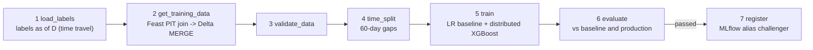
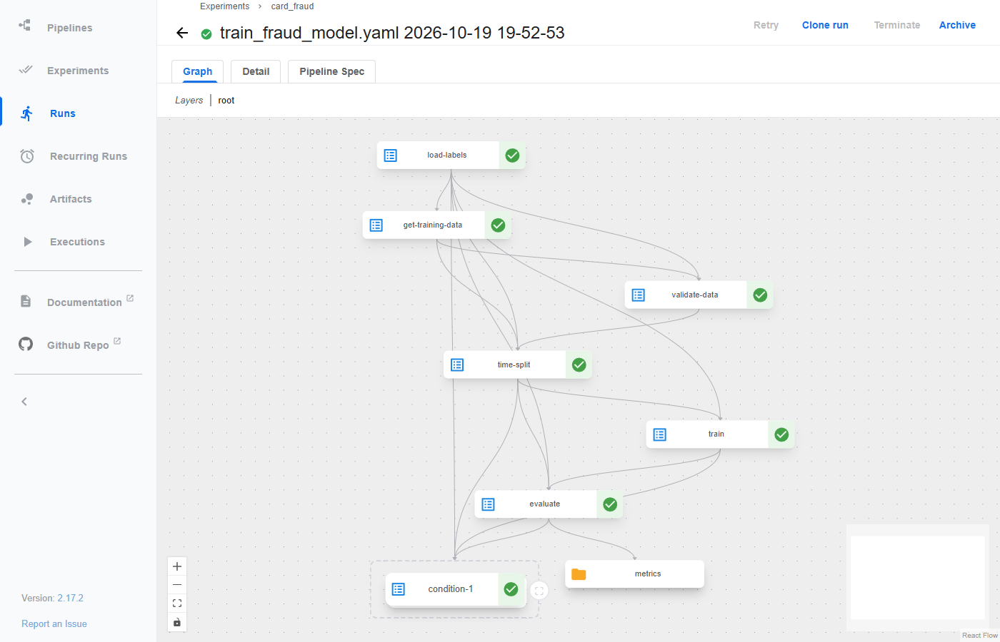
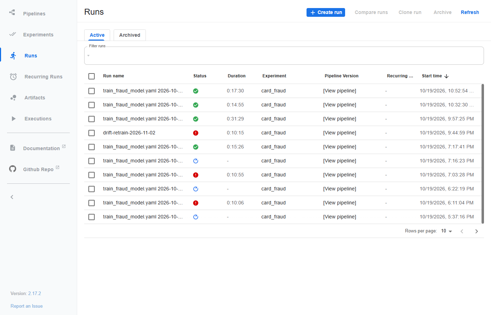
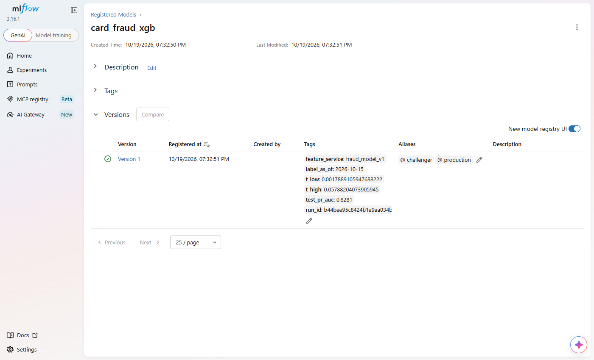
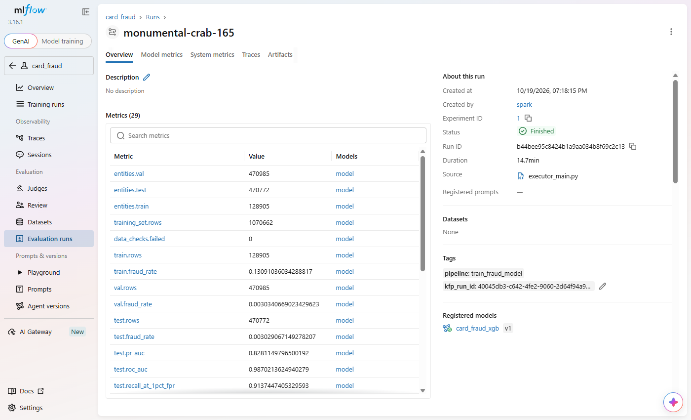
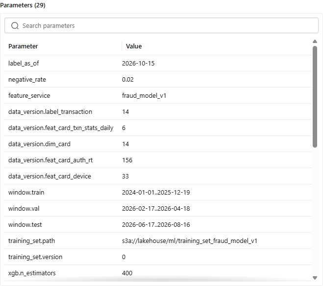

# Model training

One training procedure, two ways to run it: the notebook (`ml/notebooks/fraud_model.ipynb`, exploration and the
first model) and the Kubeflow pipeline `train_fraud_model` (`ml/pipelines/train_fraud_model.py`, every later model, triggered by the
drift DAG). Both call the same seven functions of `ml/fraud_ml/steps.py`, so the notebook and the pipeline run the
same code.



Steps pass S3 paths and the MLflow run id, never data. Each run's files live in `s3://lakehouse/ml/runs/<run id>/`.

## Labels and the split

A payment's label is final only 60 days after it (disputes arrive up to 60 days late). Training "as of" day D
reads `gold.label_transaction` at the Delta version that `build_labels` wrote on D (each commit carries
`userMetadata label_as_of=D`). That is time travel, so a retrain next month can rebuild exactly the labels this run
saw. Rows from the last 60 days before D are immature and left out.

```
... train ... | 60 d gap | val (60 d) | 60 d gap | test (60 d) | 60 d immature | D
```

The split is by time, never random: a random split puts next month's fraud pattern into training. Each gap is 60
days because a model trained up to day T is only usable from T + 60 d, when T's labels are known (`TimeSplitter`).

Fraud is ~0.3% of payments. Negatives of the train period are downsampled to 2% by a hash of `transaction_id`
(the same rows in every run, so the versioned training set only changes where the data did), with sample weight
50. Validation and test keep every row: their metrics must reflect the real fraud rate.

## Features and data versioning

Entity rows = (card_id, device_id, `event_timestamp = txn_ts - 1 ms`, request fields). Feast's Spark offline store
joins each row with the feature values valid at that instant (point-in-time join), the on-demand features
included. See [feature_store.md](feature_store.md) for why the timestamp is shifted by 1 ms.

The result is MERGEd into one Delta table per feature service, `s3://lakehouse/ml/training_set_fraud_model_v1`,
with deletion vectors. Rows match on `transaction_id` *and* `row_hash` (a hash of every other column), and the
MERGE has only two clauses: insert the source rows with no match (new or changed rows), delete the target rows with
no match (rows gone, or the old copy of a changed row). An unchanged row matches and is left alone; a deleted row is
only marked in a small deletion-vector file. So a run on almost the same data stores just its new rows, and
`VERSION AS OF n` returns any run's exact training set. Steps 3-4 read the table with Spark: the `deltalake` reader
(0.25 and 1.1.4 tested) refuses deletion vectors.

History of the table on 2026-10-19 (`DESCRIBE HISTORY` + the Delta log), each pipeline run one version:

| Version | Run (`label_as_of`) | Operation | New data written | Files rewritten | Rows inserted / deleted |
|---:|---|---|---:|---:|---:|
| 0 | 2026-10-15 | WRITE | 69.1 MB (108 files) | - | 1,070,662 / - |
| 1 | 2026-11-02 (drift retrain) | MERGE, no deletion vectors | 64.0 MB | **108 of 108** | 285,660 / 281,903 |
| 2 | one-off | add `row_hash` | 72.4 MB | 4 of 4 | - |
| 3 | 2026-11-03 | MERGE on id + hash, no deletion vectors | 72.9 MB | **3 of 3** | 15,822 / 15,592 |
| 4 | one-off | enable deletion vectors | - | - | - |
| 5 | 2026-11-04 | MERGE on id + hash, **deletion vectors** | **1.2 MB** + 0.2 KB of DVs | **0** | 15,786 / 15,809 |

Version 5 is the incremental behaviour the platform needs: one day later, 1.5% of the rows changed, and the
version stores just those rows (60x less than version 3 for the same kind of change). Versions 1-3 show the two
wrong turns on the way (the second one mine: deletion vectors were first switched off to fix the reader of steps
3-4, which is exactly what made the versions full copies). MLflow records that version together with the version of
every input table (`data_version.label_transaction`, `data_version.feat_card_txn_stats_daily`, ...), so one run
id points to its exact data.

## Models

| Model | Why |
|---|---|
| Logistic regression (median impute, scaler, `class_weight=balanced`) | simple, explainable baseline: the bar XGBoost must clear |
| XGBoost (`xgboost.spark.SparkXGBClassifier`, `num_workers=2`) | non-linear, handles NaN natively; the model that gets served |

Distributed training: in the KFP component `train`, the pod is the Spark driver
(`k8s://https://kubernetes.default.svc`) and starts 2 executor pods. `SparkXGBClassifier(num_workers=2)` runs two
Spark tasks that train one model together: each holds a shard of the rows, and the gradient histograms are
all-reduced every boosting round. The executors get their S3 keys from the Kubernetes secret `s3-credentials`
(`spark.kubernetes.executor.secretKeyRef`). In the notebook the same code runs on `local[2]`. Which row goes to
which worker follows the row order, so the rows are sorted by `transaction_id` first: the same training set then
gives the same booster ([notebook run](#notebook-run-2026-10-20-label_as_of-2026-10-15)).

The validation split is the early-stopping set (`validation_indicator_col`, stop after 30 rounds without PR-AUC
gain). The 1/rate sample weight keeps the predicted probabilities on the real fraud rate, so no
`scale_pos_weight`, which would distort them.

## Evaluation and promotion

| Output | Rule |
|---|---|
| `t_high` (decline) | score above which 0.1% of legitimate validation payments fall |
| `t_low` (step-up, OTP) | the 1% point |
| metrics on test | PR-AUC (ROC-AUC flatters weak models on rare classes), ROC-AUC, recall at 1% FPR, decline precision / recall, decline and step-up rates |
| `passed` | no production model yet, or PR-AUC gain >= 0.005 and recall at 1% FPR not worse than production's **on the same test period** |

The production model is scored on the new test period too, so the comparison is fair: an old test score would
come from easier or harder months. `register` logs the booster (JSON format, signature, input example), tags the
version with its thresholds, test PR-AUC and feature service, and sets alias `challenger`. A reviewer moves
`production`; the very first model takes both. Rollback = move the alias back.

`evaluate` also writes `reference_profile.json`: decile edges and bin shares of every input and of the score on the
validation period, the reference the drift API compares live traffic with ([drift.md](drift.md)).

## Running it

```bash
# notebook (compose profile ml; token = JUPYTER_TOKEN in infra/.env)
docker compose -f infra/docker-compose.yaml --profile ml up -d notebook      # http://127.0.0.1:8899
# pipeline (kind cluster with KFP: infra/k8s/up.sh + infra/k8s/platform.sh)
docker build -f ml/Dockerfile -t localhost:5001/fraud/ml-train:latest . && docker push localhost:5001/fraud/ml-train:latest
kubectl -n kubeflow port-forward svc/ml-pipeline 8888:8888 &
KFP_HOST=http://127.0.0.1:8888 python ml/pipelines/train_fraud_model.py --run --label-as-of 2026-10-15
```

## Notebook run (2026-10-20, `label_as_of` 2026-10-15)

Final run on 2026-10-20 (MLflow run `9ae007ce`), after the live days were loaded, so the feature tables are at later Delta
versions with the same rows for the training period: `label_transaction` v14, `feat_card_txn_stats_daily` v7,
`dim_card` v15, `feat_card_auth_rt` v235, `feat_card_device` v103. 20 features. 7.5M mature labelled payments,
22,552 frauds.

| Split | Window | Rows | Frauds | Fraud rate |
|---|---|---:|---:|---:|
| train (negatives downsampled to 2%, weight 50) | 2024-01-01 .. 2025-12-18 | 128,905 | 16,875 | 13.1% |
| val | 2026-02-17 .. 2026-04-17 | 470,985 | 1,429 | 0.30% |
| test | 2026-06-17 .. 2026-08-15 | 470,772 | 1,426 | 0.30% |

The Feast point-in-time join of the 1,070,662 entity rows took 294 s (`local[2]`); every data check passed.
XGBoost (2 workers) trained in 56 s and stopped early at its best iteration 248. Step 5 then saves both models
(`ml/notebooks/models/`, gitignored), as the pipeline's `train` step does on S3:

```
models/baseline_logreg.joblib  3 KB
models/xgboost.joblib  941 KB
models/xgboost.json  1413 KB
reloaded booster gives the same scores: True
```

| Test period | XGBoost | Logistic regression |
|---|---:|---:|
| **PR-AUC** | **0.858** | 0.584 |
| ROC-AUC | 0.9875 | 0.9861 |
| recall at 1% FPR | 0.914 | 0.914 |
| decline (`t_high` = 0.057): precision / recall | 0.72 / 0.90 | 0.66 / 0.64 |
| share of payments declined / stepped up | 0.38% / 0.95% | 0.29% / 0.99% |

The two models have the same ROC-AUC and recall at 1% FPR; PR-AUC and the decline row show the difference that
matters to the bank: at its decline threshold XGBoost stops 90% of the frauds with 7 of 10 declines being fraud,
the baseline 64%. Decision table of XGBoost on the test period:

| decision | legitimate | fraud |
|---|---:|---:|
| approve | 464,380 | 123 |
| step_up (OTP) | 4,459 | 26 |
| decline | 507 | 1,277 |

Reproducible booster: earlier runs on the same rows and parameters disagreed: PR-AUC 0.807, 0.827 and 0.853,
best iteration 14 in one run and 96 in another. Cause: the point-in-time join returns its rows in no fixed order,
`fit_xgboost` cut them into the 2 workers' shards in that order, and `subsample = 0.8` draws rows by position inside
a worker, so another order meant other trees, and the noisy validation curve then stopped early somewhere else. On
a synthetic set, the same 20,000 rows in two orders gave best iteration 93 vs 28. `fit_xgboost` now sorts by
`transaction_id` before its seeded shuffle: the run above was executed twice and wrote the same `xgboost.json` byte
for byte (sha1 `ad71740e`), with the same thresholds, metrics and decision table.

The notebook logs an MLflow run (experiment `card_fraud`); it registers nothing: registration and the `challenger`
alias belong to the pipeline, after its evaluation gate.

> [!note] Bug found on the first run
> `xgboost.spark` builds its DMatrix per Arrow batch, and a batch with no training row fails with
> `KeyError: 'values'` when the features are a list of columns. `fit_xgboost` concatenated train and then
> validation, so the later batches held validation rows only. The rows are now shuffled (seeded) first.

## Pipeline gotchas (first runs on kind)

| Symptom | Cause | Fix |
|---|---|---|
| step 1: S3 `403 Forbidden` | KFP standalone runs its own `seaweedfs` Service in `kubeflow`; in a pod the short name `seaweedfs` resolves to it, not to the lakehouse | compose network alias `lakehouse-s3` on the lakehouse SeaweedFS; every S3 endpoint uses it |
| step 1 crawled for 50+ min | `local[2]` Spark joining ~8M-row tables with 1 CPU / 2 GiB | step limits 2 CPU / 3 GiB, driver 2g |
| step 2 `Pending: Insufficient memory` | no request set, so Kubernetes reserves the whole limit; KFP's own pods already request 3.5 of the node's 7.75 GiB | request 1 GiB, keep the per-step limit (one run at a time fits) |
| step 2 `OOMKilled` at 4.5 GiB | `spark.createDataFrame(pandas)` without Arrow pickles the 1.07M training rows row by row in Python | `spark.sql.execution.arrow.pyspark.enabled=true` in `fraud_ml.spark.session` |
| step 2 thrashing at the limit (load 15, node swapping) | JVM with a 2g heap (2.9 GB RSS) + the pandas result in Python (1.8 GB) at a 4.5 GiB limit | first a 1500m heap: passed once, then `OutOfMemoryError: Java heap space` in `toPandas` on the drift retrain (+0.35% rows). Now 2g heap and a 5 GiB limit: tuning to one run's peak was too tight |
| step 3 `DeltaProtocolError: ... reader features: {'deletionVectors'}` | the training-set table has deletion vectors; steps 3-4 read it with `deltalake` 0.25, which cannot (nor can 1.1.4) | first: table without deletion vectors (next row shows why that was wrong); final: steps 3-4 read with Spark |
| without deletion vectors, MERGEs were not incremental: all 108 files rewritten when the windows moved 18 days, all 3 for a 1-day shift (15k of 1.07M rows changed) | copy-on-write: Delta rewrites every file holding a matched or deleted row, and with a delete-by-source clause that was every file in our tests, whatever the layout | deletion vectors back on + MERGE on id + `row_hash` with only insert / delete-by-source clauses ([details](#features-and-data-versioning)); on a 20k-row test the same MERGE removed 0 files instead of 10 |
| evaluate: `Failed to download 1 chunk(s) for MLmodel` (only once a `production` model existed) | MLflow 3 gives clients presigned S3 URLs for its own endpoint `seaweedfs:8333`, which in a kind pod is KFP's SeaweedFS | `MLFLOW_S3_ENDPOINT_URL=http://lakehouse-s3:8333` on the MLflow server |

The notebook never hit the memory ones: its container has no memory limit.

Step sizing on the single 7.75 GiB kind node (KFP itself uses ~2.9 GB). Every step requests 1 GiB and runs alone:

| Step | Limit | Holds |
|---|---|---|
| 1 load_labels | 3 GiB, 2 CPU | `local[2]` Spark, 2g driver |
| 2 get_training_data | 5 GiB, 2 CPU | `local[2]` Spark (2g heap) + the 1.07M-row result in pandas |
| 3 validate / 4 time_split | 4 GiB | the training set read with Spark (2g heap, deletion vectors) into pandas |
| 5 train | 3 GiB + 2 executor pods of 1408 MiB | Spark driver (1g) + train/val in pandas; the executors are the XGBoost workers |
| 6 evaluate | 3 GiB | val + test in pandas, 3 models scored |
| 7 register | 2 GiB | test sample, MLflow upload |

## Pipeline run (2026-10-19, KFP run `40045db3`, MLflow run `b44bee95`)

Same `label_as_of` and the same input versions as the notebook (MLflow params `data_version.*`). 16 min end to end:

| Step | Pod time | Result |
|---|---:|---|
| 1 load_labels | 2 min 23 s | 128,905 / 470,985 / 470,772 entity rows (train / val / test) |
| 2 get_training_data | 7 min 37 s | training set `training_set_fraud_model_v1` version 0, 1,070,662 rows |
| 3 validate_data | 22 s | 0 failed checks |
| 4 time_split | 15 s | 3 parquet files, windows and gaps checked |
| 5 train | 1 min 23 s | driver pod + executor pods `train-xgboost-exec-1/2` (the 2 XGBoost workers); best iteration 14 |
| 6 evaluate | 30 s | `passed = True` (no production model yet: the gate is the baseline) |
| 7 register | 19 s | `card_fraud_xgb` **version 1**, aliases `challenger` and `production` (first run) |

| Test period | XGBoost v1 | Logistic regression |
|---|---:|---:|
| **PR-AUC** | **0.828** | 0.584 |
| ROC-AUC | 0.987 | 0.986 |
| recall at 1% FPR | 0.914 | 0.914 |
| decline (`t_high` = 0.0579): precision / recall | 0.72 / 0.88 | 0.66 / 0.64 |
| share of payments declined / stepped up | 0.37% / 0.94% | 0.29% / 0.99% |

| decision | legitimate | fraud |
|---|---:|---:|
| approve | 464,470 | 122 |
| step_up (OTP) | 4,391 | 49 |
| decline | 485 | 1,255 |

Top features by gain: `is_otp`, `is_new_device`, `ecom_ratio_90d`, `days_since_card_issue`, `distinct_merchants_30d`.



Distributed training, from the `train` step's pod log and the cluster while it ran:

```
[KFP Executor 2026-10-19 20:07:38,495 INFO]: Running xgboost-3.2.0 on 2 workers with ...
[KFP Executor 2026-10-19 20:08:30,585 INFO]: Finished xgboost training!

$ kubectl get pods -n kubeflow -l spark-role=executor
train-xgboost-exec-1   1/1   Running   0     6s
train-xgboost-exec-2   1/1   Running   0     4s
```

Every run of the day in the KFP UI, including the one the drift DAG submitted (`drift-retrain-2026-11-02`, failed in
step 2) and the earlier failures listed in the gotchas above; the blue ones are runs whose workflow was deleted to
restart them:



Later runs (2026-10-19 evening), each one Delta version of the training set:

| Run | `label_as_of` | Gate | Registered |
|---|---|---|---|
| `40045db3` | 2026-10-15 | passed (no production yet) | v1, `production` + `challenger` |
| `ce0b680c` | 2026-11-02 (drift retrain) | PR-AUC 0.883 vs 0.844, but recall @ 1% FPR 0.9275 < 0.9283: **not passed** | - |
| `d290160e` | 2026-11-03 | 0.879 vs 0.846, recall 0.9316 >= 0.9301: passed | v2 `challenger` |
| `dc392583` | 2026-11-04 | 0.873 vs 0.846: passed | v3 `challenger` |

`production` stays on v1: the pipeline only sets `challenger`, and a reviewer decides what moves to production.



The pipeline's MLflow run: test metrics next to the baseline's, the KFP run id as a tag (each run traces to the
other), the registered model v1:



Data versioning: the run records the Delta version of every input table and of the training set it wrote
(`training_set.version`), so `VERSION AS OF` rebuilds it exactly:



The training set is reproducible (`VERSION AS OF`), and since 2026-10-20 so is the booster for a given number of
workers: `fit_xgboost` orders the rows by `transaction_id` before cutting them into worker shards (see the notebook
run above). The pipeline runs in this document predate that fix: their boosters depended on the row order the join
happened to return.
